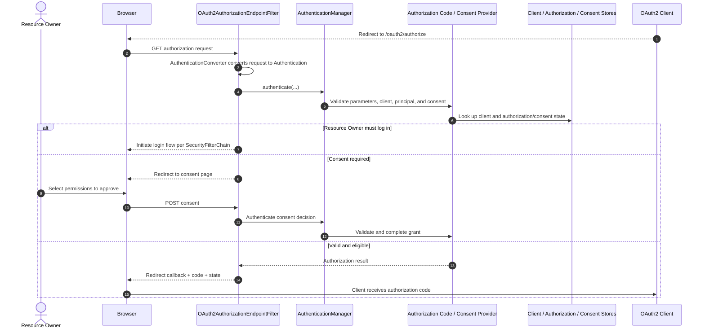
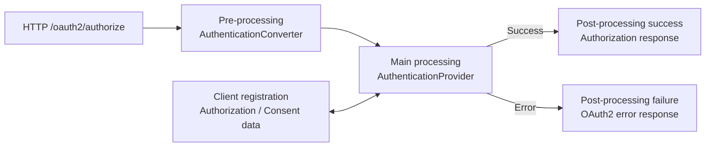
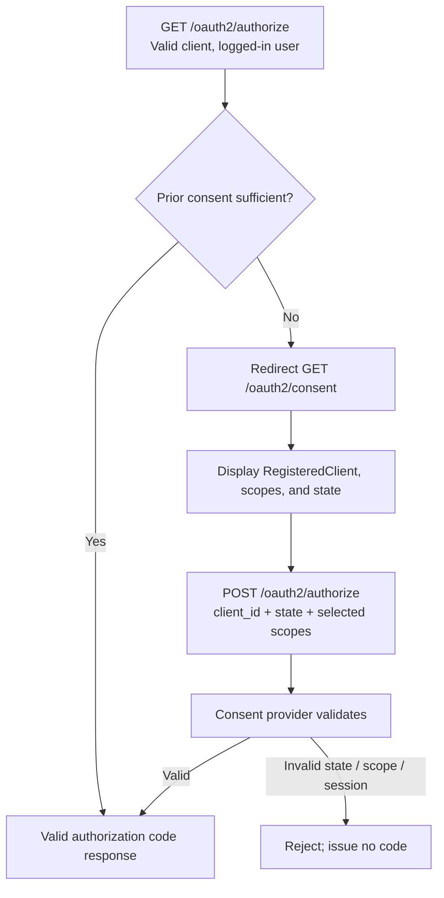

# Customizing OAuth2AuthorizationEndpointConfigurer

> **Chapter:** Authorization Endpoint  
> **Module:** `SPRING_SECURITY_OAUTH2_OIDC_AUTHORIZATION_SERVER`  
> **Scope:** Designing, configuring, securing, testing, and operating an OAuth 2.0/OpenID Connect Authorization Server with Spring Security and Spring Authorization Server in Spring Boot.  
> **Example version:** Servlet stack, Spring Security 6.x and Spring Authorization Server 1.x, using `OAuth2AuthorizationServerConfigurer.authorizationServer()` and `HttpSecurity.with(...)`. For Spring Security 7.x with integrated Authorization Server, check packages, dependencies, and DSL against the documentation for your exact version.

## 1. Learning Objectives

Upon completing this lesson, you will be able to:

1. Explain the role of `OAuth2AuthorizationEndpointConfigurer` and its relationship with `OAuth2AuthorizationServerConfigurer`, `OAuth2AuthorizationEndpointFilter`, and `SecurityFilterChain`.
2. Identify the exact **seven extension points** for request converters, authentication providers, response handlers, and consent pages.
3. Customize authorization request validation via `authenticationProviders(...)` while **preserving default checks** for `redirect_uri` and `scope`.
4. Distinguish components suited for customization from those whose OAuth 2.0/OIDC semantics must remain intact.
5. Build a custom consent page and understand POST consent requirements for `client_id`, `scope`, `state`, and CSRF.
6. Test success paths, protocol errors, redirects, PKCE, consent, and security edge cases that can easily be overlooked when customizing the endpoint.

This lesson focuses on **browser-based authorization**, particularly Authorization Code + PKCE. Issuing access tokens at `/oauth2/token`, client authentication at the token endpoint, and ID token processing belong to other extension points; do not cram everything into the authorization endpoint configurer.

## 2. Where Does the Authorization Endpoint Sit in the Architecture?

The Authorization Endpoint is where the **Resource Owner** interacts through a browser to authorize an OAuth 2.0 Client to receive an authorization code. When OIDC is enabled, the client may additionally request the `openid` scope to obtain an ID token upon exchanging the code at the token endpoint.

Example default path:

```http
GET /oauth2/authorize?response_type=code&client_id=booking-web&redirect_uri=https%3A%2F%2Fclient.example.test%2Fcallback&scope=openid%20booking.read&state=EXAMPLE_STATE&code_challenge=EXAMPLE_CHALLENGE&code_challenge_method=S256 HTTP/1.1
Host: auth.example.test
Accept: text/html
```

`EXAMPLE_STATE` and `EXAMPLE_CHALLENGE` are placeholders for reading the example, **not valid PKCE values for real testing**. In real deployments, the client must generate an unpredictable `state`, a high-entropy `code_verifier`, and compute `code_challenge` via S256; the AS must validate client registration, redirect URI, and protocol parameters.



The diagram depicts **logical stages**; where a login redirect is triggered also depends on filter chains and exception handling. Not every response flows directly through one provider in a single fixed call sequence.

### 2.1. Who Is Responsible for What?

| Component | Responsibility |
| --- | --- |
| `OAuth2AuthorizationServerConfigurer` | Configures the overall Authorization Server endpoints and shared components |
| `OAuth2AuthorizationEndpointConfigurer` | Customizes authorization request and consent handling specifically at the authorization endpoint |
| `OAuth2AuthorizationEndpointFilter` | Receives and processes HTTP requests targeting the authorization endpoint |
| `AuthenticationConverter` | Converts an HTTP request into an `Authentication` appropriate for authorize/consent |
| `AuthenticationManager` | Coordinates the relevant `AuthenticationProvider` instances |
| `OAuth2AuthorizationCodeRequestAuthenticationProvider` | Validates and processes Authorization Code requests |
| `OAuth2AuthorizationConsentAuthenticationProvider` | Validates user consent submission steps |
| `AuthenticationSuccessHandler` | Builds a successful authorization response |
| `AuthenticationFailureHandler` | Builds an OAuth2 error response when processing fails |
| `RegisteredClientRepository` | Source of `client_id`, redirect URIs, grant types, and scopes |
| `OAuth2AuthorizationService` | Persists authorization state, codes, and issued tokens |
| `OAuth2AuthorizationConsentService` | Persists permission approval decisions |

**Note:** `OAuth2AuthorizationEndpointConfigurer` is not the place to configure token endpoint or Resource Server behavior. If a customizer drops a safety check from the default filter or protocol handler, the system could issue authorization codes for ineligible requests.

## 3. Seven Extension Points Provided by the Configurer

Under the Spring Authorization Server 1.x API, these are the primary configuration methods:

| Extension point | Input type | Effect | When genuinely needed |
| --- | --- | --- | --- |
| `authorizationRequestConverter(...)` | `AuthenticationConverter` | Adds a converter transforming requests before authentication | Custom request formats need valid mapping |
| `authorizationRequestConverters(...)` | `Consumer<List<AuthenticationConverter>>` | Inspects/adjusts the list of default and custom converters | Explicit control over converter order/registration |
| `authenticationProvider(...)` | `AuthenticationProvider` | Adds a provider into the main processing stage | A well-defined extended authentication request type exists |
| `authenticationProviders(...)` | `Consumer<List<AuthenticationProvider>>` | Accesses providers, including default ones, for further configuration | Attaching a custom validator/policy onto a default provider |
| `authorizationResponseHandler(...)` | `AuthenticationSuccessHandler` | Replaces the handler building successful authorization responses | Very rare; must preserve standard response formatting |
| `errorResponseHandler(...)` | `AuthenticationFailureHandler` | Replaces the handler building OAuth2 error responses | Custom protocol error behavior backed by strict tests |
| `consentPage(...)` | `String` URL | Specifies an application-built consent page | Custom permission UI, localization, or approval workflow |

By default, the authorization endpoint uses a `DelegatingAuthenticationConverter` composed of `OAuth2AuthorizationCodeRequestAuthenticationConverter` and `OAuth2AuthorizationConsentAuthenticationConverter`, along with corresponding providers for authorization requests and consent. Default success/error handlers emit protocol-compliant responses. These components should be **kept intact unless there is a specific requirement**.

### 3.1. Three Processing Stages



- **Converter** parses and normalizes the request into an authentication object per protocol contract; it must never decide to issue codes itself.
- **Provider** applies validation, state, client registration, resource owner checks, and consent.
- **Handler** writes the final response to the user agent and client; it must never violate redirect URI, state, or error code rules.

Never implement a custom grant controller just to tweak one small validation rule: use the appropriate extension point so the rest of Spring Authorization Server's machinery stays intact.

## 4. Minimal Configuration on Spring Authorization Server 1.x

The example below focuses purely on **authorization endpoint customization** with a custom consent page and an additional validation policy; client registration beans, authorization service, signing keys, issuer settings, user authentication, and consent storage must exist in a complete application.

```java
@Configuration
public class AuthorizationEndpointSecurityConfig {

    @Bean
    @Order(1)
    SecurityFilterChain authorizationServerSecurityFilterChain(
            HttpSecurity http) throws Exception {

        OAuth2AuthorizationServerConfigurer authorizationServer =
            OAuth2AuthorizationServerConfigurer.authorizationServer();

        http
            .securityMatcher(authorizationServer.getEndpointsMatcher())
            .with(authorizationServer, as -> as
                .authorizationEndpoint(endpoint -> endpoint
                    .consentPage("/oauth2/consent")
                    .authenticationProviders(providers ->
                        providers.forEach(provider -> {
                            if (provider instanceof
                                    OAuth2AuthorizationCodeRequestAuthenticationProvider
                                        codeRequestProvider) {
                                codeRequestProvider.setAuthenticationValidator(
                                    defaultValidationWithExtraPolicy()
                                );
                            }
                        })
                    )
                )
                .oidc(Customizer.withDefaults())
            )
            .authorizeHttpRequests(auth -> auth
                .anyRequest().authenticated()
            )
            .exceptionHandling(exceptions -> exceptions
                .defaultAuthenticationEntryPointFor(
                    new LoginUrlAuthenticationEntryPoint("/login"),
                    new MediaTypeRequestMatcher(MediaType.TEXT_HTML)
                )
            );

        return http.build();
    }

    @Bean
    @Order(2)
    SecurityFilterChain applicationSecurityFilterChain(
            HttpSecurity http) throws Exception {

        return http
            .authorizeHttpRequests(auth -> auth
                .requestMatchers("/assets/**").permitAll()
                .anyRequest().authenticated()
            )
            .formLogin(Customizer.withDefaults())
            .build();
    }

    private static Consumer<OAuth2AuthorizationCodeRequestAuthenticationContext>
            defaultValidationWithExtraPolicy() {

        return OAuth2AuthorizationCodeRequestAuthenticationValidator
                .DEFAULT_REDIRECT_URI_VALIDATOR
            .andThen(OAuth2AuthorizationCodeRequestAuthenticationValidator
                .DEFAULT_SCOPE_VALIDATOR)
            .andThen(context -> {
                RegisteredClient client = context.getRegisteredClient();
                Set<String> scopes = context.getAuthentication().getScopes();

                // Example policy: reporting client must not request write scope.
                if ("reporting-web".equals(client.getClientId())
                        && scopes.contains("booking.write")) {
                    throw new OAuth2AuthorizationCodeRequestAuthenticationException(
                        new OAuth2Error(OAuth2ErrorCodes.INVALID_SCOPE),
                        null
                    );
                }
            });
    }
}
```

Key imports (an IDE can auto-import them):

```java
import java.util.Set;
import java.util.function.Consumer;

import org.springframework.context.annotation.Bean;
import org.springframework.context.annotation.Configuration;
import org.springframework.core.annotation.Order;
import org.springframework.http.MediaType;
import org.springframework.security.config.Customizer;
import org.springframework.security.config.annotation.web.builders.HttpSecurity;
import org.springframework.security.oauth2.core.OAuth2Error;
import org.springframework.security.oauth2.core.OAuth2ErrorCodes;
import org.springframework.security.oauth2.server.authorization.authentication.OAuth2AuthorizationCodeRequestAuthenticationContext;
import org.springframework.security.oauth2.server.authorization.authentication.OAuth2AuthorizationCodeRequestAuthenticationException;
import org.springframework.security.oauth2.server.authorization.authentication.OAuth2AuthorizationCodeRequestAuthenticationProvider;
import org.springframework.security.oauth2.server.authorization.authentication.OAuth2AuthorizationCodeRequestAuthenticationValidator;
import org.springframework.security.oauth2.server.authorization.client.RegisteredClient;
import org.springframework.security.oauth2.server.authorization.config.annotation.web.configurers.OAuth2AuthorizationServerConfigurer;
import org.springframework.security.web.SecurityFilterChain;
import org.springframework.security.web.authentication.LoginUrlAuthenticationEntryPoint;
import org.springframework.security.web.util.matcher.MediaTypeRequestMatcher;
```

### 4.1. What This Example Guarantees

- The AS chain has `@Order(1)` and uses `authorizationServer.getEndpointsMatcher()` to handle only protocol endpoints.
- `authorizationEndpoint(...)` customizes **the authorization endpoint**, without modifying the token endpoint.
- `.authenticationProviders(...)` accesses the default providers and locates `OAuth2AuthorizationCodeRequestAuthenticationProvider` to attach the validator.
- The composed validator still executes **default redirect URI and scope validation** before enforcing the rule restricting `booking.write` for `reporting-web`.
- `.consentPage(...)` only sets the consent page URL; **it does not create the HTML page automatically**.
- Browsers requiring login are directed to `/login` when needed via the HTML-matching entry point.
- The application chain serves default form login and non-AS endpoints.

**Limitations:** this illustrates configuration inside an application that already defines all required beans. The consent page route needs the controller/view added in section 7. This snippet alone does not prove end-to-end correctness of Authorization Code + PKCE/OIDC; run integration tests against real client registrations, consent, and the token endpoint.

### 4.2. `SecurityFilterChain` Ordering Matters More Than You Think

With multiple `SecurityFilterChain` beans, Spring Security picks **the first chain whose matcher matches**. If an application chain matching `anyRequest()` comes before the AS chain, it can intercept `/oauth2/authorize` and protocol endpoints. Do not treat symptoms by disabling authentication/authorization on a chain; fix the ordering and matchers.

If you change the authorization endpoint path via `AuthorizationServerSettings`, using the configurer's `getEndpointsMatcher()` automatically adapts mappings to AS settings instead of hardcoding `/oauth2/authorize` matchers everywhere.

## 5. Customizing Authorization Request Validation

### 5.1. Default Rules That Must Be Preserved

`OAuth2AuthorizationCodeRequestAuthenticationValidator` validates essential parameters by default, particularly `redirect_uri` and `scope` for the Authorization Code Grant. In addition, the provider/AS enforces protocol checks such as client registration, grants, PKCE, and principal step by step.

When calling `setAuthenticationValidator(custom)`, you **replace the provider's validator**, so you must explicitly retain required default validations. Passing a lambda that checks only one business claim can silently drop critical security safeguards.

Example in the **right direction**:

```java
Consumer<OAuth2AuthorizationCodeRequestAuthenticationContext> validator =
    OAuth2AuthorizationCodeRequestAuthenticationValidator
        .DEFAULT_REDIRECT_URI_VALIDATOR
    .andThen(OAuth2AuthorizationCodeRequestAuthenticationValidator
        .DEFAULT_SCOPE_VALIDATOR)
    .andThen(context -> {
        // Only ADD specific policy; never broaden redirect URIs.
        enforceOrganizationPolicy(context);
    });

codeRequestProvider.setAuthenticationValidator(validator);
```

Here `enforceOrganizationPolicy(context)` is an application-implemented helper that throws `OAuth2AuthorizationCodeRequestAuthenticationException` with an appropriate `OAuth2Error` upon rejection. If no custom validation is needed, **do not call `setAuthenticationValidator(...)`**.

### 5.2. When Does Additional Policy Add Value?

Typical cases include:

- Blocking sensitive scopes for a subset of clients even if a shared registration profile includes them.
- Requiring clients belonging to a registered organization/tenant to meet operational conditions before receiving an authorization code.
- Denying requests when a user or organization is restricted under a specific policy, even after authentication succeeds.
- Enforcing elevated assurance levels for sensitive operations, coordinated with login/step-up authentication.
- Requiring standardized extension parameters within an internal ecosystem once their semantics are thoroughly understood and tested.

For most requirements, constrain policy first through `RegisteredClient`, scopes, PKCE, consent, and authentication rules. **Provider customization** helps when you have requirements that cannot be expressed through standard configuration.

### 5.3. Example of Rejecting Unregistered Redirect URIs

A key principle in Spring Authorization Server documentation is matching redirect URIs strictly per policy—never accepting arbitrary patterns:

```java
String requestedRedirectUri =
    context.getAuthentication().getRedirectUri();

RegisteredClient client = context.getRegisteredClient();

if (!client.getRedirectUris().contains(requestedRedirectUri)) {
    throw new OAuth2AuthorizationCodeRequestAuthenticationException(
        new OAuth2Error(OAuth2ErrorCodes.INVALID_REQUEST),
        null
    );
}
```

This snippet illustrates **the check when a redirect URI is supplied**; it does not replace the full default validator. Edge cases such as an omitted redirect URI, single-URI client registrations, localhost loopbacks, public clients, or specialized profiles must be handled according to standards and official APIs. In standard deployments, **retaining `DEFAULT_REDIRECT_URI_VALIDATOR` is the safer choice**.

Strictly avoid rules like:

```java
// UNSAFE: prefix matching easily permits unintended domains.
if (redirectUri.startsWith("https://client.example.test")) {
    // "https://client.example.test.attacker.example" also matches the prefix!
}
```

And never use `response.sendRedirect(request.getParameter("redirect_uri"))` to construct redirects manually from values not verified by the AS.

### 5.4. PKCE, `state`, and OIDC `nonce` Are Not the Same Thing

| Parameter | Primary creator/consumer | Purpose |
| --- | --- | --- |
| `state` | OAuth2 Client creates and checks at callback | Binds the response to the authorization request, mitigating CSRF/mix-up per client design |
| `code_challenge` + `code_challenge_method` | Client sends at authorize; AS stores/binds to code | Public commitment half of PKCE |
| `code_verifier` | Client sends when exchanging code at token endpoint | Proves the party exchanging the code holds the PKCE secret |
| `nonce` (OIDC, when used) | OIDC Client creates and verifies inside ID token per requirements | Binds the ID token to the authentication session |
| `redirect_uri` | Registered by client; supplied in request per rules | Constrains valid callbacks, preventing code/token leakage via unauthorized redirects |
| `scope` | Requested by client; checked by AS / consented by user | Access scope, including `openid` when using OIDC |

Customizing authorization converters or validators **must never drop or arbitrarily alter these bindings**. PKCE must also be verified again when exchanging the code; you cannot "finish PKCE validation" solely from a single request at the authorization endpoint.

## 6. Customizing Converters and Providers in the Right Place

### 6.1. What Does `authorizationRequestConverter(...)` Do?

An `AuthenticationConverter` inspects `HttpServletRequest` and returns a matching `Authentication`, or `null` when the request is not its responsibility. Default converters handle both:

- `OAuth2AuthorizationCodeRequestAuthenticationConverter` for authorization requests.
- `OAuth2AuthorizationConsentAuthenticationConverter` for consent POSTs.

When an application uses extension parameters, a custom converter is occasionally needed. For example, if an internal protocol adds a `tenant_hint` parameter, a converter may validate its format and map metadata via the designed API. However, **never choose a principal or grant access based solely on `tenant_hint` from a URL**; the tenant must be verified against the session, client registration, and system account store.

Pattern for registering a custom converter:

```java
AuthenticationConverter customConverter = new TenantAwareAuthorizationConverter();

authorizationEndpoint.authorizationRequestConverter(customConverter);
```

This is an **illustrative snippet**; `TenantAwareAuthorizationConverter` is an application-defined class, not a built-in Spring API. Your implementation must return `null` for requests outside its supported scope and avoid breaking default consent or Authorization Code handling.

### 6.2. `authorizationRequestConverters(...)` and Processing Order

When you need control over the converter list, use:

```java
authorizationEndpoint.authorizationRequestConverters(converters -> {
    // Custom converter handles only specific extended requests.
    converters.add(0, customConverter);
});
```

This list holds both default and additional converters. `DelegatingAuthenticationConverter` typically invokes converters in order; an overly broad custom converter can "swallow" requests before standard converters run.

Checklist for a custom converter:

1. Clearly distinguish GET authorization requests from POST consent submissions.
2. Never treat URL parameters as authentication proof.
3. Never accept scopes or redirect URIs outside configuration.
4. Never alter the names or protocol semantics of `code`, `state`, or `client_id` if standard clients must interoperate.
5. Never read/write raw authorization codes, state, session cookies, or sensitive content into logs.
6. Write unit tests proving the converter returns `null` for requests outside its responsibility.

### 6.3. `authenticationProvider(...)` and `authenticationProviders(...)`

These two APIs serve different purposes:

- `authenticationProvider(newProvider)`: **adds a provider** supporting an appropriate `Authentication` type; must implement `supports(...)` accurately.
- `authenticationProviders(providersConsumer)`: lets you **locate/configure existing providers**, such as `OAuth2AuthorizationCodeRequestAuthenticationProvider`, to apply an extra validator; this is the pattern used in section 4.

If you only want to add a `redirect_uri`/scope policy, registering a brand-new provider can conflict with the default provider. That is why the main example uses `authenticationProviders(...)` to customize the responsible provider directly.

### 6.4. Configuring Consent Conditions Directly on the Provider

In Spring Authorization Server 1.x, `OAuth2AuthorizationCodeRequestAuthenticationProvider` can also customize when consent is required, e.g., via `setAuthorizationConsentRequired(...)` on supported releases. Context can include the registered client, authorization request, and prior consent.

A change like "skip consent if the user is logged in" is **insecure by design**. When replacing the default predicate, evaluate registered consent policy, unapproved scopes, client type, sensitivity, and governance requirements. Customize only with tests proving new scopes or new clients are never silently auto-approved.

## 7. Building a Custom Consent Page

### 7.1. `consentPage(...)` Sets the URL Only; It Does Not Build the UI

By default, Spring Authorization Server renders a framework-provided consent page. When you call:

```java
authorizationEndpoint.consentPage("/oauth2/consent");
```

the framework redirects the Resource Owner to this URL whenever consent is needed, but **the application must serve the GET request and render the HTML page**.

Under Spring Authorization Server 1.x, the consent page query includes parameters such as `client_id`, `scope` (space-delimited list), and `state` managed by the consent flow. The page must submit the required fields back to the authorization endpoint via a form POST.

### 7.2. Example Controller Rendering Consent

Assume the application uses Spring MVC + Thymeleaf, has `RegisteredClientRepository`, an authenticated user session, and a login chain protecting the consent route.

```java
@Controller
public class ConsentPageController {

    private final RegisteredClientRepository clients;

    public ConsentPageController(RegisteredClientRepository clients) {
        this.clients = clients;
    }

    @GetMapping("/oauth2/consent")
    String consent(
            @RequestParam("client_id") String clientId,
            @RequestParam("scope") String scope,
            @RequestParam("state") String state,
            Model model,
            Authentication user) {

        RegisteredClient client = clients.findByClientId(clientId);
        if (client == null || user == null) {
            throw new ResponseStatusException(HttpStatus.BAD_REQUEST);
        }

        Set<String> scopes = Arrays.stream(scope.split(" "))
            .filter(s -> !s.isBlank())
            .collect(Collectors.toCollection(LinkedHashSet::new));

        // Never render scopes that do not belong to registration.
        if (!client.getScopes().containsAll(scopes)) {
            throw new ResponseStatusException(HttpStatus.BAD_REQUEST);
        }

        model.addAttribute("clientId", client.getClientId());
        model.addAttribute("clientDisplayName", client.getClientName());
        model.addAttribute("state", state);
        model.addAttribute("scopes", scopes);
        return "oauth2-consent";
    }
}
```

Required imports include `Arrays`, `Set`, `LinkedHashSet`, `Collectors`, `Model`, `Authentication`, `RegisteredClient`, `RegisteredClientRepository`, `ResponseStatusException`, `HttpStatus`, `@Controller`, `@GetMapping`, and `@RequestParam` from Spring/Java.

This is a minimal UI and validation example. In production, verify that **the active consent request is valid and bound to the authenticated session**. Never treat arbitrary GET query strings as the source of truth to grant extra permissions. The consent POST must still be re-validated by the AS provider against the pending authorization request and server state.

### 7.3. Example Thymeleaf Form

```html
<h1>Consent to Permissions</h1>
<p>
  Application:
  <strong th:text="${clientDisplayName}">Application Name</strong>
</p>

<form method="post" th:action="@{/oauth2/authorize}">
  <input type="hidden" name="client_id"
         th:value="${clientId}">
  <input type="hidden" name="state"
         th:value="${state}">

  <div th:each="requestedScope : ${scopes}">
    <label>
      <input type="checkbox" name="scope"
             th:value="${requestedScope}">
      <span th:text="${requestedScope}">scope</span>
    </label>
  </div>

  <!-- Spring Security CSRF token, when required by configuration. -->
  <input type="hidden" th:name="${_csrf.parameterName}"
         th:value="${_csrf.token}">

  <button type="submit">Approve</button>
</form>
```

Spring Authorization Server's consent filter expects a **POST to the authorization endpoint** containing `client_id`, `state`, and the user-approved scopes. Rendering checkboxes does not grant scopes on its own; the AS must still validate the request/consent on the server.

**Two values commonly confused:**

- `state` in the consent URL/form is a token **binding the consent context** used by the AS; never regenerate it from user-supplied input.
- `_csrf` (when Spring Security CSRF protection is active) is the anti-CSRF token for HTTP form submissions per application security policy; it does not replace consent provider validation and is not the OAuth2 Client's callback `state`.

Never build a "Deny" action by manually redirecting the browser to an unverified `redirect_uri`. Handle consent denial via a valid `access_denied` response or let the built-in endpoint handle it per your version's API.

### 7.4. Protecting the Consent Page Route

A dual-chain application typically structures routes as:

- AS chain: handles `/oauth2/authorize`, covered by `getEndpointsMatcher()`.
- Application/login chain: handles `GET /oauth2/consent`, `GET /login`, and other web routes.

The consent page requires an **authenticated** user. Never set `permitAll()` on the consent page just to avoid redirect issues; when sensitive data is present, verify the principal/session and forbid caching consent HTML at public proxies. Ensure the route and view actually exist so requests do not hit 404 or a login loop.

The page must never present out-of-policy scopes, display client names from arbitrary query parameters, or echo raw authorization codes or tokens. For human-readable scope descriptions, source descriptions on the server and HTML-escape output.

## 8. Customizing Success Handlers and Error Handlers

### 8.1. `authorizationResponseHandler(...)`

The Authorization Endpoint's `AuthenticationSuccessHandler` builds the authorization response after the AS validates and completes processing. For Authorization Code, standard responses redirect to the **verified redirect URI** with matching `code` and `state`.

When replacing the success handler, you must preserve:

- Callback URL built from **validated metadata**, never unchecked query parameters.
- `code` placed properly without leaking into logs, `Referer` headers, or untrusted pages.
- Original request `state` preserved when required by specification.
- Response parameters properly URL-encoded with no response splitting.
- OIDC/hybrid/alternative `response_mode` contracts when enabled.

Because the default success handler is an internal framework implementation, replacing it solely to "add logging" carries maintenance risk: without clean delegation, you must maintain response construction across upgrades. For auditing, prefer **events, business hooks, observability, or a well-designed filter** instead of rewriting authorization responses.

### 8.2. `errorResponseHandler(...)`

The error handler produces OAuth2 error responses, potentially carrying `error`, `error_description`, and `state` depending on context. Some errors may redirect to a verified redirect URI; others **must be handled directly at the AS** because the redirect URI/client cannot be trusted.

Examples:

| Error | Cause | Handling note |
| --- | --- | --- |
| `invalid_request` | Missing/invalid parameter or malformed request | Never redirect to an unverified URI |
| `unauthorized_client` | Client not allowed to use requested flow | Check registered client and grant types |
| `invalid_scope` | Requested scope invalid or disallowed | Never "temporarily grant" unregistered scopes |
| `unsupported_response_type` | Response type not supported | Return matching protocol error |
| `access_denied` | Resource Owner denied or AS refused access | Preserve authorization response semantics |

If you want to customize how errors are presented to users, first identify whether the error originates in the **authorization endpoint**, **login flow**, or **token endpoint**. `errorResponseHandler(...)` on this configurer affects only the authorization endpoint scope, not every application error.

### 8.3. Logging in the Right Places

Never log raw:

- Authorization codes, client secrets, Bearer tokens, or session cookies.
- Full URLs when query strings contain `code`, `state`, or sensitive data.
- Unnecessary personal data from client requests or consent forms.

Instead, log request IDs, timestamps, validated client IDs, grant/response types, error codes, and policy outcomes. Enforce retention limits, audit log access controls, and data normalization before writing.

## 9. Separating OAuth2 Policy, User Login, and Client Authentication

One of the most frequent architectural mistakes is choosing the wrong extension point:

| Requirement | Right place to handle it |
| --- | --- |
| Redirecting to login when user is unauthenticated | Application login chain + `AuthenticationEntryPoint` |
| Validating user password | `UserDetailsService`/`AuthenticationProvider` for user login |
| Validating redirect URI, scope, and consent at authorize | Authorization Endpoint configurer/provider |
| Validating `client_secret` or `private_key_jwt` on code exchange | AS client authentication configurer/provider |
| Handling `POST /oauth2/token`, grant types, and access tokens | Token Endpoint configurer and token generator |
| Adding claims to JWT access tokens or ID tokens | Token customizer/generator for that specific token type |
| Deciding whose bookings an API may return | Resource Server and business authorization rules |
| Protecting `/api/**` requests with Bearer tokens | Resource Server security filter chain |

Moving token generation into an authorization endpoint converter breaks protocol separation. An authorization code is an intermediate artifact; the client exchanges it for access/ID tokens only at a valid token endpoint.

### 9.1. Multiple Authorization Flows Can Share One AS

- Authorization Code + PKCE uses both the authorization endpoint and token endpoint.
- Client Credentials goes straight to the token endpoint without using the browser authorization endpoint.
- Device Authorization has dedicated device-flow endpoints; not every device request goes through `OAuth2AuthorizationEndpointConfigurer`.
- Pushed Authorization Requests (PAR) has its own endpoint/configurer; custom request policies may need to apply **consistently across both PAR and the authorization endpoint**.
- OIDC adds rules like `openid`/`nonce`/ID tokens; do not assume custom OAuth2 Java code automatically covers every OIDC response mode.

Architectures supporting multiple flows should maintain tests along **each specific grant's path**.

## 10. End-to-End Testing of Customizations

### 10.1. Critical Cases

| Test case | Input/condition | Expected outcome |
| --- | --- | --- |
| Valid authorization request, user logged in | Valid client/redirect URI/scope/PKCE | AS proceeds to consent or issues code per policy |
| User unauthenticated, valid HTML request | `Accept: text/html` | Redirects to login, saves/resumes request per configuration |
| Redirect URI differs from registration | Invalid `redirect_uri` | AS rejects; never redirects to untrusted URI |
| Client lacks code grant | Disallowed in RegisteredClient | AS rejects with proper error |
| Unregistered scope | `scope=unknown` | `invalid_scope` or matching error |
| Custom policy | `reporting-web` requests `booking.write` | Validator rejects; no code issued |
| Other valid scope | `reporting-web` requests `booking.read` | Not unintentionally blocked by custom validator |
| Missing/invalid PKCE per client type | Client requires PKCE | AS enforces appropriate validation |
| Custom consent page | Logged-in user; consent required | Renders UI with accurate client, scopes, and state |
| Consent POST with tampered scope | User submits disallowed scope | AS rejects/restricts per policy; never over-grants |
| Consent POST with wrong `state` | State mismatches authorization context | Rejected; no code issued |
| Browser omits CSRF token when required | Consent/login POST | Rejected per CSRF policy |
| User denies consent | Valid deny submission | No code issued; compliant `access_denied` error |
| Auth code issued, exchanged with wrong verifier | Token endpoint | `invalid_grant`; no access token issued |
| Spring version upgrade | Chains/extension points still compile | Protocol, redirect, and consent tests pass |

### 10.2. Testing Policy on the Provider

You can write integration tests or unit tests around policy validators. When testing a validator directly, construct a valid `OAuth2AuthorizationCodeRequestAuthenticationContext` with client registration and request token, then verify:

1. The default redirect URI validator rejects unregistered URIs.
2. The default scope validator rejects unregistered scopes.
3. The custom validator rejects the client-specific condition.
4. Valid requests for other clients remain unaffected.
5. Thrown exceptions carry the right OAuth2 error type without leaking internal details.

Do not test only the business lambda in isolation and conclude the system is safe: an integration test through the filter proves the validator is actually wired into the provider and enforced at the endpoint.

### 10.3. MockMvc: Testing a Valid Authorization Request

The example below assumes tests initialized a `RegisteredClient` with `client_id=booking-web`, valid callback, permitted scopes, Authorization Code + PKCE, and corresponding user login/consent setup:

```java
@Test
void unauthenticatedBrowserIsRedirectedToLogin() throws Exception {
    mockMvc.perform(get("/oauth2/authorize")
            .param("response_type", "code")
            .param("client_id", "booking-web")
            .param("redirect_uri", "https://client.example.test/callback")
            .param("scope", "openid", "booking.read")
            .param("state", "test-state-unique-per-request")
            .param("code_challenge",
                "E9Melhoa2OwvFrEMTJguCHaoeK1t8URWbuGJSstw-cM")
            .param("code_challenge_method", "S256")
            .accept(MediaType.TEXT_HTML))
        .andExpect(status().is3xxRedirection())
        .andExpect(header().string(
            "Location", containsString("/login")));
}
```

Include static imports for `MockMvcRequestBuilders.get`, `MockMvcResultMatchers.*`, and `Matchers.containsString`. `test-state-unique-per-request` is an illustrative fixture, not a production random value. In real tests, ensure `state` matches client expectations and `code_challenge` matches the chosen algorithm.

### 10.4. When Testing Custom Validators, Avoid Attribution Errors

A request with an invalid redirect URI may be rejected **before** your custom policy runs. To test the `booking.write` policy, send a valid redirect URI and include that scope in registration so the default validator lets it pass, proving **your custom rule** rejects it. Otherwise, a test might pass because the default validator rejected the request, misleading you into thinking your custom policy worked.

Conversely, tests proving the default validator remains active must use a client that the custom policy **does not reject**. Keep the two failure causes independent.

### 10.5. Adding Consent Tests

Merely opening the consent URL is insufficient. Test the full cycle:



For custom forms, also test HTML escaping, displaying the exact client's scopes, CSRF protection, cookies/sessions, reverse proxies, and tampering with hidden fields.

## 11. Common Issues and Diagnostics

| Symptom | Common cause | How to investigate |
| --- | --- | --- |
| `/oauth2/authorize` returns 404 | AS endpoint matcher/configurer not applied | Check dependencies, `@Order`, `getEndpointsMatcher()`, and AS settings |
| Always redirects to `/login` | User lacks session, context not persisted, or wrong chain | Check login chain, session cookie, and `SecurityContextRepository` |
| Custom consent page returns 404 | Called `consentPage(...)` without GET controller/view | Add route/view and test authenticated access |
| Consent shows unknown scope/client | Controller trusts unvalidated query params | Load client from repository; verify scopes against server state |
| Consent POST returns 403 | Wrong CSRF, session/state, or denied authorization | Check CSRF token and authorization consent state |
| Custom validator seems skipped | Attached to wrong provider or request failed earlier | Use `authenticationProviders(...)` to find right provider; test valid prior inputs |
| Unknown redirect URI accepted | Custom validator overwrote default redirect check | Chain `DEFAULT_REDIRECT_URI_VALIDATOR` and scope validator back in |
| Unregistered scope granted | Dropped or weakened scope validation | Restore default validator; test code and token issuance |
| Client receives malformed callback | Custom success handler misbuilds URL/encoding | Keep default handler or test full OAuth2 responses |
| Error response renders non-standard HTML | Custom error handler breaks OAuth2 semantics | Restore default handler; test authorization errors |
| PKCE fails on code exchange | Wrong `code_challenge`/`code_verifier`, different redirect URI, or altered request | Test both authorize and token requests |
| PAR works yet authorize policy bypassed | Customization applied only to authorization endpoint | Configure `pushedAuthorizationRequestEndpoint(...)` consistently |

When debugging, trace in order: which filter chain matched the request, whether a user principal exists, which converter parsed the request, which provider ran, whether default validators ran, what authorization/consent services returned, and which response handler wrote the output.

## 12. Security and Operations Checklist

- [ ] AS chain matches protocol endpoints accurately and orders ahead of the web chain.
- [ ] Default validations for `redirect_uri`, scope, client registration, and PKCE are never disabled.
- [ ] Additional validation only **tightens** policy permissions; unregistered callbacks are never allowed.
- [ ] Any custom converter returns `null` for out-of-scope requests.
- [ ] Success/error handlers are not replaced without comprehensive OAuth2 response tests.
- [ ] The consent page requires authentication and displays the real client from `RegisteredClientRepository` and valid scopes.
- [ ] The consent form POSTs to the exact authorization endpoint with `client_id`, `state`, approved scopes, and CSRF token when required.
- [ ] Tests cover consent denial, tampered scopes/state, incomplete login, and invalidated sessions.
- [ ] OAuth2 client authentication at the token endpoint is kept distinct from resource owner login.
- [ ] Codes, tokens, client secrets, cookies, and URLs carrying sensitive parameters are never logged.
- [ ] Integration tests cover Authorization Code + PKCE; when using OIDC, corresponding behaviors are also tested.
- [ ] Security advisories, release notes, and API migrations are tracked for your Spring Security/Spring Authorization Server branch.

## 13. Self-Check Questions

**Q1.** How do `OAuth2AuthorizationEndpointConfigurer` and `OAuth2AuthorizationServerConfigurer` differ?

**Answer:** The server configurer manages overall Authorization Server configuration and endpoints; the authorization endpoint configurer specifically governs authorization request and consent handling at that endpoint.

**Q2.** Why should you not call `setAuthenticationValidator(ctx -> enforceMyRule(ctx))` while omitting default validators?

**Answer:** Replacing the provider's validator can skip default redirect URI and scope validations, causing dangerous requests to be accepted or out-of-policy permissions to be granted.

**Q3.** To modify a validation condition on the default provider, is `authenticationProvider(...)` or `authenticationProviders(...)` better suited?

**Answer:** `authenticationProviders(...)` lets you locate the default provider and configure how it validates requests. `authenticationProvider(...)` is for deliberately adding another provider with a proper `supports(...)` contract.

**Q4.** Is calling `consentPage("/oauth2/consent")` alone enough for the consent page to work?

**Answer:** No. The application must implement the GET controller/view and a form that POSTs back to the authorization endpoint with the required parameters; the AS still validates consent.

**Q5.** Can the server redirect to any client-supplied `redirect_uri` when an error occurs?

**Answer:** No. The URI must be verified against registration and protocol rules. When the URI is untrusted, never redirect the browser there.

**Q6.** Can a custom success handler drop `state` and return only `code`?

**Answer:** No. `state` must be preserved per OAuth2 response rules so the client can correlate the request; custom handlers must preserve standard semantics, encoding, and redirect checks.

**Q7.** If the Authorization Server supports PAR, is customizing validation only on the authorization endpoint sufficient?

**Answer:** Not necessarily. PAR has its own endpoint/provider; ensure policies apply consistently across all supported request paths.

## 14. Conclusion and References

`OAuth2AuthorizationEndpointConfigurer` is a **controlled intervention point** into the authorization endpoint's three processing stages: converting an HTTP request into authentication, validating and enforcing policy, and writing success/failure responses. Its converter, provider, handler, and `consentPage` APIs support product customization without reimplementing the protocol.

The non-negotiable invariant is **never weakening standard checks**—especially `redirect_uri`, scope, PKCE, consent, principal/session validation, and safe OAuth2 error responses. When you only need a custom validator, locate the default provider via `authenticationProviders(...)`, keep default validators intact, and chain tested policy rules. When you need custom consent, build a flow-compliant UI and let the AS re-verify state on the server.

Reference documentation for Spring Authorization Server 1.x:

- [Spring Authorization Server 1.5 — Protocol Endpoints](https://docs.spring.io/spring-authorization-server/reference/protocol-endpoints.html)
- [Spring Authorization Server — OAuth2AuthorizationEndpointConfigurer API](https://docs.spring.io/spring-authorization-server/reference/api/java/org/springframework/security/oauth2/server/authorization/config/annotation/web/configurers/OAuth2AuthorizationEndpointConfigurer.html)
- [Spring Authorization Server — Configuration Model](https://docs.spring.io/spring-authorization-server/reference/configuration-model.html)
- [Spring Security — Servlet Authentication Architecture](https://docs.spring.io/spring-security/reference/servlet/authentication/architecture.html)
- [RFC 6749 — OAuth 2.0 Authorization Framework](https://www.rfc-editor.org/rfc/rfc6749)
- [RFC 7636 — Proof Key for Code Exchange (PKCE)](https://www.rfc-editor.org/rfc/rfc7636)
- [RFC 9207 — Authorization Server Issuer Identification](https://www.rfc-editor.org/rfc/rfc9207)

These examples are technical integration guides, not substitutes for a complete AS application with user stores, client registrations, authorization/consent persistence, signing keys, HTTPS issuer, logging, and governed test/deployment pipelines. Across Spring Security major-version upgrades, consult release notes and re-run protocol tests.
