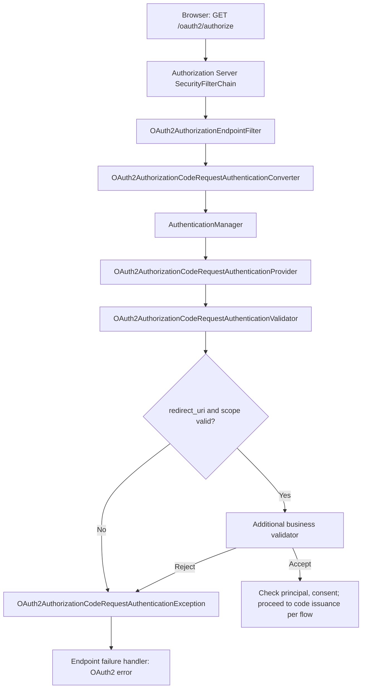

# Customizing Validation with OAuth2AuthorizationCodeRequestAuthenticationValidator

## 1. Why Customize Validation at the Authorization Endpoint?

In the **Authorization Endpoint** chapter of the `SPRING_SECURITY_OAUTH2_OIDC_AUTHORIZATION_SERVER` module, we examine how to validate an OAuth 2.0 Authorization Code request before the server allows authorization to proceed. This knowledge supports **designing, configuring, securing, testing, and operating an OAuth 2.0/OpenID Connect Authorization Server with Spring Security and Spring Authorization Server in Spring Boot**.

For example, an application registered with the Authorization Server sends:

```http
GET /oauth2/authorize?response_type=code
    &client_id=portal-web
    &redirect_uri=https%3A%2F%2Fportal.example.com%2Fcallback
    &scope=openid%20payments.read%20payments.write
    &state=<random-state>
    &code_challenge=<s256-challenge>
    &code_challenge_method=S256
Host: auth.example.com
```

The Authorization Server must verify whether this request belongs to a registered client, uses an allowed redirect URI, and requests valid scopes. An organization may also want to enforce custom rules—for example, **the `portal-web` application may request `payments.write` only if it simultaneously requests `payments.read`**. This is an illustrative business policy, not an OAuth 2.0 specification requirement.

Spring Authorization Server exposes an extension point via `OAuth2AuthorizationCodeRequestAuthenticationProvider.setAuthenticationValidator(...)`. **The safe approach when you only want to add constraints** is to run the default validators first, then run your custom validator. Accidentally replacing the default validator entirely can cause the application to stop validating `redirect_uri` or `scope` properly.

After this lesson, learners will be able to:

1. Explain the position of `OAuth2AuthorizationCodeRequestAuthenticationValidator` in the Authorization Endpoint pipeline.
2. Distinguish `redirect_uri`/`scope` validation from user authentication, PKCE validation, consent, and code-for-token exchange.
3. Plug in a custom `Consumer<OAuth2AuthorizationCodeRequestAuthenticationContext>` via `OAuth2AuthorizationEndpointConfigurer`'s hook.
4. Preserve standard checks using `DEFAULT_REDIRECT_URI_VALIDATOR` and `DEFAULT_SCOPE_VALIDATOR`.
5. Test both happy paths and rejected requests, especially cases carrying open-redirect risks.

**API scope:** examples use Spring Authorization Server 1.5.x and Spring Security Servlet 6.x APIs (typically paired with Spring Boot 3.x). In newer release lines, Authorization Server code may live in the Spring Security distribution; verify artifacts and API docs for your running version before copying configuration.

## 2. Where Does the Validator Sit in the Pipeline?

In a standard Servlet setup, `OAuth2AuthorizationEndpointFilter` receives `/oauth2/authorize` requests, uses an `AuthenticationConverter` to build an `OAuth2AuthorizationCodeRequestAuthenticationToken`, and then invokes `AuthenticationManager` and `OAuth2AuthorizationCodeRequestAuthenticationProvider`.



The diagram depicts primary responsibilities, **not the exact invocation order of every internal framework method**. Checks for client, response type, PKCE, user, and consent also happen at appropriate pipeline stages; do not assume this validator alone enforces the entire protocol.

| Component | Primary responsibility |
| --- | --- |
| `OAuth2AuthorizationEndpointFilter` | Receives HTTP requests and coordinates endpoint success/failure handling |
| `OAuth2AuthorizationCodeRequestAuthenticationConverter` | Parses authorization request parameters and constructs input `Authentication` |
| `OAuth2AuthorizationCodeRequestAuthenticationProvider` | Validates request and code-issuance eligibility; invokes validator; coordinates authorization/consent state |
| `OAuth2AuthorizationCodeRequestAuthenticationValidator` | Default validation of `redirect_uri`, followed by `scope` |
| `OAuth2AuthorizationCodeRequestAuthenticationContext` | Supplies the request token, `RegisteredClient`, and related context |
| `OAuth2AuthorizationCodeRequestAuthenticationException` | Carries validation errors for the Authorization Endpoint to handle per protocol |

This is **authorization request validation**. `POST /oauth2/token` requests with `grant_type=authorization_code` are handled by **Token Endpoint** converters/providers, which perform separate checks on the code, client authentication, and `code_verifier`.

## 3. What Does the Default Validator Check?

`OAuth2AuthorizationCodeRequestAuthenticationValidator` is a `Consumer<OAuth2AuthorizationCodeRequestAuthenticationContext>`. In Spring Authorization Server 1.5.x, it exposes two public members:

```java
OAuth2AuthorizationCodeRequestAuthenticationValidator.DEFAULT_REDIRECT_URI_VALIDATOR
OAuth2AuthorizationCodeRequestAuthenticationValidator.DEFAULT_SCOPE_VALIDATOR
```

| Component | Purpose | Common mistake |
| --- | --- | --- |
| `DEFAULT_REDIRECT_URI_VALIDATOR` | Checks the request's `redirect_uri` against registered redirects per supported rules | Client points callback to a different domain, different path, or mismatched URI |
| `DEFAULT_SCOPE_VALIDATOR` | Checks requested scopes against the permissions allowed on `RegisteredClient` | Client requests `payments.admin` though only `payments.read` is registered |
| Combined default validator | Executes redirect URI validation then scope validation | Safe behavior may be lost if replaced wholesale with a custom validator |

Example registered client:

```text
client_id: portal-web
redirect_uris:
  - https://portal.example.com/callback
scopes:
  - openid
  - payments.read
  - payments.write
```

If the browser sends `redirect_uri=https://attacker.example/callback`, the request does not match registration. If the browser requests scope `payments.admin`, the request likewise fails. Parsing the query string into syntactically valid fields is the job of earlier request-reading components; the default validator focuses on verifying values against client configuration.

**Never infer that these two validators verify all of OAuth 2.0.** Beyond them lie requirements for `response_type`, grant type, PKCE, user authentication, consent, transaction state, and OIDC rules when `openid` is in scope.

### 3.1. Distinguishing Requested `redirect_uri` from Registered Redirect URIs

`redirect_uri` in the browser request is **client-supplied input**. The values stored in `RegisteredClient.getRedirectUris()` are configuration governed by the Authorization Server. Simply sending the request over HTTPS does not make the callback URI valid.

Never write checks like:

```java
// UNSAFE EXAMPLE - DO NOT APPLY
if (requestedRedirectUri.contains("example.com")) {
    // accept
}
```

The string `https://example.com.attacker.invalid/cb` still contains `example.com` yet belongs to an unintended domain. Similarly, prefix comparisons, arbitrary wildcards, or ignoring ports/paths can introduce open redirect vulnerabilities and leak authorization codes.

**Prefer registering exact URIs and preserving the standard validator.** Exceptions such as loopback redirects for native apps must be designed per the appropriate profile, restricted to eligible client types, governed by dedicated policy, and thoroughly negative-tested.

### 3.2. `scope` Has Two Validation Layers

Default validation confirms that client-requested scopes **are registered**; application policy may additionally govern **which scopes may be requested together and in what context**. For example:

- The client registers `payments.read` and `payments.write`.
- Internal policy mandates that `payments.write` may appear only when `payments.read` is also requested.
- After token issuance, the Resource Server must still validate scope/audience and business permissions for each API.

A valid scope in `RegisteredClient` does not automatically grant access to every resource, nor does it replace user consent when required.

## 4. Extension Mechanism via `setAuthenticationValidator`

The extension hook sits on **`OAuth2AuthorizationCodeRequestAuthenticationProvider`**, with conceptual signature:

```java
void setAuthenticationValidator(
        Consumer<OAuth2AuthorizationCodeRequestAuthenticationContext> validator);
```

We do not need to replace `OAuth2AuthorizationEndpointFilter` or rewrite `AuthenticationProvider`. In configuration:

```text
OAuth2AuthorizationServerConfigurer
  -> authorizationEndpoint(...)
  -> authenticationProviders(Consumer<List<AuthenticationProvider>>)
  -> locate OAuth2AuthorizationCodeRequestAuthenticationProvider
  -> setAuthenticationValidator(composed validator)
```

`authenticationProviders(...)` grants access to the list of default and custom providers so you can configure the right instance. **Do not pick `OAuth2AuthorizationCodeAuthenticationProvider` by mistake**: that class handles *exchanging the authorization code at the Token Endpoint*, whereas `OAuth2AuthorizationCodeRequestAuthenticationProvider` handles *the code request at the Authorization Endpoint*.

### 4.1. Two Validator Composition Patterns

**Pattern A — keep the entire default validator, then append custom policy:**

```java
Consumer<OAuth2AuthorizationCodeRequestAuthenticationContext> validator =
        new OAuth2AuthorizationCodeRequestAuthenticationValidator()
                .andThen(new PaymentScopePairValidator());
```

**Pattern B — compose each step explicitly to make order visible:**

```java
Consumer<OAuth2AuthorizationCodeRequestAuthenticationContext> validator =
        OAuth2AuthorizationCodeRequestAuthenticationValidator.DEFAULT_REDIRECT_URI_VALIDATOR
                .andThen(
                    OAuth2AuthorizationCodeRequestAuthenticationValidator.DEFAULT_SCOPE_VALIDATOR)
                .andThen(new PaymentScopePairValidator());
```

Both patterns achieve **the same goal** with the API version covered here: running default checks before applying extra rules. With `Consumer.andThen(...)`, if an earlier step throws an exception, subsequent steps **do not run**. This is important when analyzing error precedence and logs.

By contrast, the following **completely replaces** the default validator:

```java
// Use only when deliberately taking full responsibility for all required validation.
provider.setAuthenticationValidator(new PaymentScopePairValidator());
```

If the custom validator checks only paired scopes, this setup drops standard checks for `redirect_uri` and registered scopes. **Do not apply this approach in the example we are building.**

## 5. Business Requirement Example: `payments.write` Paired with `payments.read`

Suppose `portal-web` has screens for reading and writing payments. The API team decides that whenever requesting payment-write access, the client must also request read access to complete transactions. This policy applies solely to **one specific client**, while other clients follow their own rules.

### 5.1. Writing `PaymentScopePairValidator`

```java
package com.example.authserver.security;

import java.util.Set;
import java.util.function.Consumer;

import org.springframework.security.oauth2.core.OAuth2Error;
import org.springframework.security.oauth2.core.OAuth2ErrorCodes;
import org.springframework.security.oauth2.server.authorization.authentication
        .OAuth2AuthorizationCodeRequestAuthenticationContext;
import org.springframework.security.oauth2.server.authorization.authentication
        .OAuth2AuthorizationCodeRequestAuthenticationException;
import org.springframework.security.oauth2.server.authorization.client.RegisteredClient;

public final class PaymentScopePairValidator
        implements Consumer<OAuth2AuthorizationCodeRequestAuthenticationContext> {

    @Override
    public void accept(OAuth2AuthorizationCodeRequestAuthenticationContext context) {
        RegisteredClient registeredClient = context.getRegisteredClient();
        Set<String> requestedScopes = context.getAuthentication().getScopes();

        // Restrict this policy strictly to the designated client.
        if (!"portal-web".equals(registeredClient.getClientId())) {
            return;
        }

        boolean writesPayments = requestedScopes.contains("payments.write");
        boolean readsPayments = requestedScopes.contains("payments.read");

        if (writesPayments && !readsPayments) {
            OAuth2Error error = new OAuth2Error(
                    OAuth2ErrorCodes.INVALID_SCOPE,
                    "payments.write requires payments.read",
                    null);
            throw new OAuth2AuthorizationCodeRequestAuthenticationException(
                    error, null);
        }
    }
}
```

**Role of each key line:**

- `context.getRegisteredClient()` fetches the **trusted** client configuration looked up by the Authorization Server.
- `context.getAuthentication().getScopes()` returns the scopes from the authorization request converted into an `Authentication`.
- The `clientId` condition limits the scope of this **example policy**; it does not replace valid client identification.
- `OAuth2ErrorCodes.INVALID_SCOPE` is the appropriate error when a scope policy rejects the request.
- `OAuth2AuthorizationCodeRequestAuthenticationException` is the exception type required by this extension point upon validation failure.

Never issue authorization codes, store tokens, or trigger manual redirects inside a validator. If a policy needs external data (such as tenant or entitlement lists), define a trusted data source, latency budget, and fallback behavior when the policy store is unavailable; never trust a browser-supplied header as proof of entitlement.

**Important boundary:** requiring scopes to come in pairs is a **custom application rule**, not an OAuth 2.0 or OIDC requirement. Real applications must align such constraints with API owners and clients. If you do not need such a rule, stick with the default validator.

## 6. Registering the Validator with the Authorization Endpoint

The configuration below demonstrates applying the custom validator inside the Authorization Server's `SecurityFilterChain`. The example uses `OAuth2AuthorizationServerConfigurer.authorizationServer()` from Spring Authorization Server 1.5.x.

```java
package com.example.authserver.security;

import java.util.function.Consumer;

import org.springframework.context.annotation.Bean;
import org.springframework.context.annotation.Configuration;
import org.springframework.core.annotation.Order;
import org.springframework.http.MediaType;
import org.springframework.security.config.Customizer;
import org.springframework.security.config.annotation.web.builders.HttpSecurity;
import org.springframework.security.oauth2.server.authorization.authentication
        .OAuth2AuthorizationCodeRequestAuthenticationContext;
import org.springframework.security.oauth2.server.authorization.authentication
        .OAuth2AuthorizationCodeRequestAuthenticationProvider;
import org.springframework.security.oauth2.server.authorization.authentication
        .OAuth2AuthorizationCodeRequestAuthenticationValidator;
import org.springframework.security.oauth2.server.authorization.config.annotation.web.configurers
        .OAuth2AuthorizationServerConfigurer;
import org.springframework.security.web.SecurityFilterChain;
import org.springframework.security.web.authentication.LoginUrlAuthenticationEntryPoint;
import org.springframework.security.web.util.matcher.MediaTypeRequestMatcher;

@Configuration(proxyBeanMethods = false)
public class AuthorizationServerSecurityConfig {

    @Bean
    @Order(1)
    SecurityFilterChain authorizationServerSecurityFilterChain(HttpSecurity http)
            throws Exception {
        OAuth2AuthorizationServerConfigurer authorizationServer =
                OAuth2AuthorizationServerConfigurer.authorizationServer();

        http
            .securityMatcher(authorizationServer.getEndpointsMatcher())
            .with(authorizationServer, server -> server
                .authorizationEndpoint(endpoint -> endpoint
                    .authenticationProviders(providers -> {
                        providers.forEach(authenticationProvider -> {
                            if (authenticationProvider instanceof
                                    OAuth2AuthorizationCodeRequestAuthenticationProvider codeRequestProvider) {
                                Consumer<OAuth2AuthorizationCodeRequestAuthenticationContext> validator =
                                        OAuth2AuthorizationCodeRequestAuthenticationValidator
                                            .DEFAULT_REDIRECT_URI_VALIDATOR
                                            .andThen(OAuth2AuthorizationCodeRequestAuthenticationValidator
                                                .DEFAULT_SCOPE_VALIDATOR)
                                            .andThen(new PaymentScopePairValidator());

                                codeRequestProvider.setAuthenticationValidator(validator);
                            }
                        });
                    })
                )
                .oidc(Customizer.withDefaults())
            )
            .authorizeHttpRequests(authorize -> authorize
                .anyRequest().authenticated()
            )
            .exceptionHandling(exceptions -> exceptions
                .defaultAuthenticationEntryPointFor(
                    new LoginUrlAuthenticationEntryPoint("/login"),
                    new MediaTypeRequestMatcher(MediaType.TEXT_HTML))
            );

        return http.build();
    }

    @Bean
    @Order(2)
    SecurityFilterChain applicationSecurityFilterChain(HttpSecurity http)
            throws Exception {
        http.authorizeHttpRequests(authorize -> authorize
                .anyRequest().authenticated())
            .formLogin(Customizer.withDefaults());

        return http.build();
    }
}
```

**Key points to observe:**

1. `securityMatcher(authorizationServer.getEndpointsMatcher())` matches only Authorization Server endpoints; `@Order(1)` takes precedence over the application chain.
2. `.authorizationEndpoint(...)` opens the customization hook for the **Authorization Endpoint**.
3. `.authenticationProviders(...)` locates the `OAuth2AuthorizationCodeRequestAuthenticationProvider` configured by the framework.
4. `setAuthenticationValidator(...)` installs the chain **default redirect URI -> default scope -> paired scope policy**.
5. `.oidc(Customizer.withDefaults())` enables OIDC features when needed; the example uses `openid`.
6. The `@Order(2)` chain serves `/login` so users can log in and resume the authorization flow.

This is a **filter chain skeleton for learning the extension point**, not a ready-to-run production Authorization Server. The application still requires `RegisteredClientRepository`, user authentication, `AuthorizationServerSettings`, keys/JWK, token generators, and authorization/consent services per your architecture. When enabling OIDC UserInfo/JWT resource server support, additional JWT decoder and security configuration may be needed per version.

Never register a second `OAuth2AuthorizationCodeRequestAuthenticationProvider` manually if your goal is only to change the default provider's validator: adding another provider handling the same `Authentication` type can create unpredictable ordering or authentication paths.

## 7. RegisteredClient and the Meaning of Test Configuration

To demonstrate the validator in action, we register a client holding both scopes. This example assumes local execution and a **confidential web client** keeping its secret on the backend:

```java
// Imports for RegisteredClient, OidcScopes, ClientSettings, TokenSettings...
// omitted to focus on the client registration part.
RegisteredClient portal = RegisteredClient.withId("portal-client-test-id")
        .clientId("portal-web")
        .clientSecret(encodedClientSecret) // hash from PasswordEncoder, not plain text
        .clientAuthenticationMethod(ClientAuthenticationMethod.CLIENT_SECRET_BASIC)
        .authorizationGrantType(AuthorizationGrantType.AUTHORIZATION_CODE)
        .authorizationGrantType(AuthorizationGrantType.REFRESH_TOKEN)
        .redirectUri("https://portal.example.com/callback")
        .scope(OidcScopes.OPENID)
        .scope("payments.read")
        .scope("payments.write")
        .clientSettings(ClientSettings.builder()
                .requireProofKey(true)
                .requireAuthorizationConsent(true)
                .build())
        .build();
```

This is a **client construction snippet**, not a complete bean/repository. `encodedClientSecret` holds a one-way hashed secret such as one produced by `PasswordEncoder`. With `DelegatingPasswordEncoder`, ensure the hash includes the proper algorithm prefix (e.g., `{bcrypt}`). Never commit raw secrets, private keys, or tokens into a repository.

With this registration:

| Scope request | Default validation | PaymentScopePairValidator | Conclusion |
| --- | --- | --- | --- |
| `openid payments.read` | Valid if URI matches | Valid | Can proceed through flow |
| `openid payments.read payments.write` | Valid if URI matches | Valid | Can proceed through flow |
| `openid payments.write` | Valid since registered | Rejects `invalid_scope` | No code issued |
| `openid payments.admin` | Rejects unregistered scope | Does not run | No code issued |
| `openid payments.read`, unregistered callback | Rejects redirect URI | Does not run | No code issued |

"Can proceed through flow" means the validators passed, **not that a code is guaranteed**: the user must still log in, consent must be handled, and remaining protocol checks must pass.

## 8. If You Truly Need to Replace the `redirect_uri` Validator

Spring Authorization Server documentation illustrates customizing redirect URI validation (e.g., during development or when integrating loopback redirects). In such cases, developers may **replace** the redirect validator portion while keeping the standard scope validator:

```java
Consumer<OAuth2AuthorizationCodeRequestAuthenticationContext> validator =
        new CarefullyReviewedRedirectUriValidator()
                .andThen(OAuth2AuthorizationCodeRequestAuthenticationValidator
                        .DEFAULT_SCOPE_VALIDATOR);

codeRequestProvider.setAuthenticationValidator(validator);
```

`CarefullyReviewedRedirectUriValidator` in the snippet above is an **illustrative placeholder name**, not a built-in framework class. A real replacement bears full responsibility for redirect URI invariants; in production it requires risk analysis, RFC cross-checking, and thorough testing.

### 8.1. Security Requirements That Must Not Be Bypassed

- Compare the requested URI against registered URIs; **prefer exact matching** per protocol and applicable profile.
- Allow only valid schemes/hosts/ports/paths; reject `javascript:`, `data:`, fragments, and arbitrary callbacks.
- Never use `contains`, `startsWith`, or arbitrary wildcards to validate allowed domains.
- Never bypass `RegisteredClient.getRedirectUris()` by trusting client names, scopes, or untrusted headers.
- When `redirect_uri` may be omitted under a protocol/version rule, handle it per specification; **never call `URI.create(null)`** or substitute an arbitrary callback.
- When supporting loopback URIs for native apps, restrict client type, host, path, and dynamic port rules per profile; never extend the same exception to confidential web clients.
- When the redirect URI is invalid, **never send errors or authorization codes back to the unverified URI itself**.

Risk examples:

```text
Registered redirect:
  https://portal.example.com/callback

Requests that must never be relaxed to accept:
  https://portal.example.com.attacker.invalid/callback
  https://attacker.invalid/callback
  https://portal.example.com/other-callback
  javascript:alert(1)
```

In real configurations, relax matching only with a specific compatibility justification, security review, and verified negative tests. If you simply need to add a callback for a new environment, **registering the exact redirect URI on `RegisteredClient`** is usually simpler and safer than writing a custom validator.

### 8.2. Why Not `catch` the Default Error and Let It Pass?

A common mistake:

```java
// WRONG EXAMPLE - DO NOT APPLY
try {
    OAuth2AuthorizationCodeRequestAuthenticationValidator.DEFAULT_REDIRECT_URI_VALIDATOR
            .accept(context);
} catch (OAuth2AuthorizationCodeRequestAuthenticationException ignored) {
    // Allow mismatched redirect_uri so the client does not fail
}
```

This lets dangerous requests proceed, risking authorization code leakage and open redirects. If an existing client behaves incompatibly, investigate why the URI mismatches, decide the exact policy, and test both valid and invalid requests before making changes.

## 9. Checking and Throwing the Right Exception Type

A custom validator should have two clear outcomes:

- **Valid:** return normally from `accept(context)` (returning neither a token nor an `Authentication` object).
- **Invalid:** throw `OAuth2AuthorizationCodeRequestAuthenticationException` with an appropriate `OAuth2Error`.

| Case | Usually appropriate error code | Notes |
| --- | --- | --- |
| Disallowed scope or scope policy violation | `invalid_scope` | Used in the paired `payments.write` example |
| Invalid redirect URI or malformed request parameter | `invalid_request` | Never redirect to an unverified URI |
| Client not permitted to use authorization flow | `unauthorized_client` | Usually verified by provider from registration |
| Unsupported response type | `unsupported_response_type` | Outside this validator's primary focus |
| Request lacks user authentication in OIDC non-interactive mode | `login_required` (OIDC) | Handled by OIDC flow policy |

Exact error codes and HTTP responses depend on the endpoint and failure type. Once a redirect URI is verified valid, the Authorization Server may return OAuth2 errors to the callback with `state`; when the redirect URI is untrusted, the server must never send the browser to that callback. **Do not claim every validation failure must return HTTP 400 JSON**, because the Authorization Endpoint is a browser-facing interactive endpoint, unlike the Token Endpoint.

Keep `error_description` concise and free of `client_secret`, tokens, authorization codes, `code_verifier`, private keys, or sensitive internal details. Error responses are part of the public interface and must be designed safely.

## 10. Unit Testing the Validator Without Running the Full Authorization Server

For the paired-scope rule, you can test `PaymentScopePairValidator` directly. To guarantee default protections were not dropped, tests should also exercise **the composed `Consumer` chain** with valid and invalid redirect URIs and scopes.

The JUnit 5 example below shows how to build an `OAuth2AuthorizationCodeRequestAuthenticationContext` from a token and registered client. Imports are complete for a test independent of the server runtime:

```java
package com.example.authserver.security;

import java.util.Map;
import java.util.Set;
import java.util.function.Consumer;

import org.junit.jupiter.api.Test;
import org.springframework.security.authentication.UsernamePasswordAuthenticationToken;
import org.springframework.security.oauth2.core.AuthorizationGrantType;
import org.springframework.security.oauth2.core.ClientAuthenticationMethod;
import org.springframework.security.oauth2.core.OAuth2ErrorCodes;
import org.springframework.security.oauth2.server.authorization.authentication
        .OAuth2AuthorizationCodeRequestAuthenticationContext;
import org.springframework.security.oauth2.server.authorization.authentication
        .OAuth2AuthorizationCodeRequestAuthenticationException;
import org.springframework.security.oauth2.server.authorization.authentication
        .OAuth2AuthorizationCodeRequestAuthenticationToken;
import org.springframework.security.oauth2.server.authorization.authentication
        .OAuth2AuthorizationCodeRequestAuthenticationValidator;
import org.springframework.security.oauth2.server.authorization.client.RegisteredClient;

import static org.junit.jupiter.api.Assertions.assertDoesNotThrow;
import static org.junit.jupiter.api.Assertions.assertEquals;
import static org.junit.jupiter.api.Assertions.assertThrows;

class AuthorizationRequestValidationTest {

    private final RegisteredClient client = RegisteredClient.withId("test-1")
            .clientId("portal-web")
            .clientAuthenticationMethod(ClientAuthenticationMethod.NONE)
            .authorizationGrantType(AuthorizationGrantType.AUTHORIZATION_CODE)
            .redirectUri("https://portal.example.com/callback")
            .scope("payments.read")
            .scope("payments.write")
            .build();

    private final Consumer<OAuth2AuthorizationCodeRequestAuthenticationContext> validator =
            new OAuth2AuthorizationCodeRequestAuthenticationValidator()
                    .andThen(new PaymentScopePairValidator());

    private OAuth2AuthorizationCodeRequestAuthenticationContext context(
            String redirectUri, Set<String> scopes) {
        var principal = new UsernamePasswordAuthenticationToken("test-user", "N/A");
        var request = new OAuth2AuthorizationCodeRequestAuthenticationToken(
                "https://auth.example.com/oauth2/authorize",
                "portal-web",
                principal,
                redirectUri,
                "test-state",
                scopes,
                Map.of());

        return OAuth2AuthorizationCodeRequestAuthenticationContext.with(request)
                .registeredClient(client)
                .build();
    }

    @Test
    void acceptsPairedScopes() {
        assertDoesNotThrow(() -> validator.accept(context(
                "https://portal.example.com/callback",
                Set.of("payments.read", "payments.write"))));
    }

    @Test
    void rejectsWriteWithoutRead() {
        var exception = assertThrows(
                OAuth2AuthorizationCodeRequestAuthenticationException.class,
                () -> validator.accept(context(
                        "https://portal.example.com/callback",
                        Set.of("payments.write"))));
        assertEquals(OAuth2ErrorCodes.INVALID_SCOPE,
                exception.getError().getErrorCode());
    }

    @Test
    void rejectsUnregisteredScopeBeforeCustomPolicy() {
        assertThrows(OAuth2AuthorizationCodeRequestAuthenticationException.class,
                () -> validator.accept(context(
                        "https://portal.example.com/callback",
                        Set.of("payments.admin"))));
    }

    @Test
    void rejectsUnregisteredRedirectUri() {
        assertThrows(OAuth2AuthorizationCodeRequestAuthenticationException.class,
                () -> validator.accept(context(
                        "https://attacker.invalid/callback",
                        Set.of("payments.read"))));
    }
}
```

This test **verifies only the `Consumer`**; it does not verify user authentication, consent, PKCE, or authorization code issuance. In a real project, test dependencies must include JUnit 5 and the matching Spring Authorization Server version; keep this test out of production code.

## 11. HTTP Integration Testing of the Authorization Endpoint

The unit test in section 10 is not enough to prove the `authenticationProviders(...)` hook is wired and executed on real HTTP requests. You need an integration test via `MockMvc`, an embedded server, or a test environment.

### 11.1. Preparing Fixtures

- A `RegisteredClient` with `client_id=portal-web`, redirect URI `https://portal.example.com/callback`, scopes `payments.read` and `payments.write`, and grant `authorization_code`.
- If OIDC is needed, add `openid` and enable the OIDC configurer.
- A test user with an active login session; with `MockMvc`, establish an appropriate `SecurityContext` or perform form login first.
- If `requireProofKey(true)` is enabled, provide a high-entropy `code_verifier` and valid `S256` `code_challenge`.
- If `requireAuthorizationConsent(true)` is enabled, expect a consent step before redirecting to the success callback.

### 11.2. Test Matrix

| Case | Protocol-level expectation |
| --- | --- |
| Scopes `payments.read payments.write`, valid redirect | Passes validator; proceeds to authentication/consent/code issuance per conditions |
| Scope `payments.write` alone | Rejected with `invalid_scope` by custom validator |
| Unregistered scope `payments.admin` | Rejected by standard scope validator |
| Redirect URI differs from registration | Rejected by standard redirect URI validator; no redirect to spoofed URI |
| Non-existent client ID | Rejected before or during client verification |
| Grant disallowed for client | Rejected per registration and grant policy |
| Reused code at Token Endpoint | Rejected by grant/token validation (not this lesson's validator) |
| Missing `state`, `nonce`, or PKCE | Handled per OAuth2/OIDC rules, client type, and version; never assume from custom validator alone |

### 11.3. Sending a Test Request with curl

Assuming the server runs locally at `http://localhost:9000` with the test client registered and login configured:

```bash
# Run only in a test environment with a client holding matching URI/scopes.
curl -i --get 'http://localhost:9000/oauth2/authorize' \
  --data-urlencode 'response_type=code' \
  --data-urlencode 'client_id=portal-web' \
  --data-urlencode 'redirect_uri=https://portal.example.com/callback' \
  --data-urlencode 'scope=payments.write' \
  --data-urlencode 'state=example-state' \
  --data-urlencode 'code_challenge=E9Melhoa2OwvFrEMTJguCHaoeK1t8URWbuGJSstw-cM' \
  --data-urlencode 'code_challenge_method=S256'
```

The `code_challenge` value comes from the standard S256 example; `state` here is a fixed value **for testing only**—production clients must generate a random, unpredictable state per transaction. Because `curl` has no login session, the request may be **redirected to `/login` before surfacing validation errors**. In integration tests, preserve cookies/session and complete login or use an appropriate test client harness.

**Never judge results solely by HTTP 302/400 status.** An HTTP 302 might be a login redirect, consent redirect, success callback, or error callback. Inspect the target `Location`, error code, state, client details, and whether the endpoint actually ran.

## 12. Common Pitfalls

### 12.1. Customizing the Token Endpoint Instead of the Authorization Endpoint

`OAuth2AuthorizationCodeAuthenticationProvider` handles **code-for-token exchange**. `OAuth2AuthorizationCodeRequestAuthenticationProvider` handles **the authorization code request** at the Authorization Endpoint. Changing the validator on the former does not enforce `redirect_uri`/`scope` checks when a browser hits `/oauth2/authorize`.

### 12.2. Replacing the Validator and Forgetting Default Checks

Symptom: your custom scope policy runs, yet an unregistered redirect URI gets farther than expected. Check the code calling `setAuthenticationValidator`: did you chain `DEFAULT_REDIRECT_URI_VALIDATOR` and `DEFAULT_SCOPE_VALIDATOR` before your custom policy?

### 12.3. Registering a Custom Provider in the Wrong Place

If you register a new provider handling the same `Authentication` type as the standard provider with unintended ordering, one provider may finish before your custom validation executes. When you only want to add validation, using **`authorizationEndpoint(...).authenticationProviders(...)`** to configure the standard provider is usually much safer.

### 12.4. Using Wildcard Callbacks/Hostnames to Fix Configuration Errors

If a client reports a redirect URI mismatch, first compare the exact URI against registration. Relaxing checks with `startsWith("https://")` or `contains("localhost")` creates vulnerabilities. If multiple environments exist, give each environment its own client and redirect URI.

### 12.5. Thinking a Registered Scope Means Unconditional Resource Access

The server issuing codes/tokens with scopes is only one control layer. The Resource Server must verify the Access Token's signature/issuer/audience/expiry and check both scopes and resource-level permissions. Custom authorization validation **does not replace** API authorization policies.

### 12.6. Trying to Assume User Details Inside the Request Validator

`OAuth2AuthorizationCodeRequestAuthenticationContext` provides request data and `RegisteredClient`. Never assume every invocation at this hook already has an authenticated user or granted consent. If a policy depends on user/tenant context, ensure a trusted context and appropriate validation stage, especially around login/consent flows.

### 12.7. Leaking Data While Debugging

Avoid logging the full `/oauth2/authorize` query string since it can contain `state`, `nonce`, `login_hint`, and transaction data. Never log client secrets, authorization codes, refresh/access tokens, or verifiers. Use correlation IDs and standard error codes, protect logs, and restrict access.

## 13. Advanced Cases: PAR, OIDC, and Other Rules

**Pushed Authorization Requests (PAR)** allow clients to push authorization request parameters to a dedicated PAR endpoint and pass a `request_uri` to the Authorization Endpoint. In versions supporting PAR, `OAuth2PushedAuthorizationRequestAuthenticationProvider` also exposes an authorization request validator hook. **Configuring only the Authorization Endpoint's provider does not automatically prove the policy applies to the PAR endpoint.** If your system supports both paths, review and test policies at both points consistently with the protocol profile.

**OIDC** extends the Authorization Code Flow with the `openid` scope, parameters like `nonce`, `prompt`, and `max_age`, and ID Tokens. This lesson's validator focuses on `redirect_uri`/`scope`; do not reimplement all nonce, ID Token, login-freshness, or prompt handling inside one `Consumer` merely because everything enters at the Authorization Endpoint.

**Authorization Code + PKCE** must remain compliant: `code_challenge` on the authorization request and `code_verifier` at the Token Endpoint. Settings like `ClientSettings.requireProofKey(true)` and default provider/grant validations must continue running. Never disable PKCE checks to "accommodate" a misconfigured client.

## 14. Safe Rollout Process and Operational Observability

When genuinely changing validation logic for an organization:

1. **Document the rule:** specify which clients/issuers/environments it applies to, required scopes, and business justification.
2. **Preserve defaults:** prefer appending a custom `Consumer` after standard validators; if forced to replace part of them, document every standard invariant you must reimplement.
3. **Test first:** cover allowed, forbidden, ambiguous, and missing scopes/redirects across multiple clients and environments.
4. **HTTP testing:** verify the filter chain and provider actually invoke the custom validator; test Authorization Endpoint errors both before and after login/consent.
5. **Controlled rollout:** version the policy, deploy to staging first, and maintain rollback capability if legitimate clients are unexpectedly rejected.
6. **Monitor:** track `invalid_scope` and `invalid_request` by client/endpoint type (never attach raw queries, tokens, or secrets as metric labels).
7. **Maintain:** when upgrading Spring Security/Spring Authorization Server, inspect the new version's default validator before deciding to keep overrides.

A minimal test strategy includes both **Consumer unit tests** and **endpoint integration tests**. Unit tests prove the rule inside the method; integration tests prove `setAuthenticationValidator` takes effect on real OAuth2 requests.

## 15. Exercises and Review Questions

**Exercise 1 — Add a scope policy.** Adapt `PaymentScopePairValidator` to enforce: "scope `reports.export` may be requested only if the client also requests `reports.read`." Preserve both default validators and add matching unit tests.

**Exercise 2 — Callback validation.** Register callback `https://portal.example.com/callback`, then test `https://portal.example.com.attacker.invalid/callback`. Explain why substring matching must never accept it.

**Exercise 3 — Post-login testing.** Using MockMvc, send an authorization request without a session, complete login, resume authorization, and verify the custom validator rejects `payments.write` without `payments.read`.

**Exercise 4 — Reviewing a custom validator.** A teammate writes `provider.setAuthenticationValidator(ctx -> { /* validate one header */ });`. Point out which validations were replaced and how to fix it to keep standard safeguards.

**Self-assessment questions:**

1. Which parameters does `OAuth2AuthorizationCodeRequestAuthenticationValidator` validate by default?
2. Why is `OAuth2AuthorizationCodeRequestAuthenticationProvider` the right place for this hook rather than `OAuth2AuthorizationCodeAuthenticationProvider`?
3. Does `Consumer.andThen` execute the second validator if the first throws an exception?
4. When custom validation fails, which exception type must be thrown?
5. When should you use `DEFAULT_SCOPE_VALIDATOR` instead of rewriting all scope validation yourself?
6. May an invalid redirect URI receive an error redirect back to that same URI?
7. Which two sets of values do `RegisteredClient.getScopes()` and `context.getAuthentication().getScopes()` represent?
8. Why is a unit test of the Consumer alone insufficient to prove the Authorization Endpoint uses the right validator?
9. If using PAR, why must you check additional validation points?
10. Why does a validator at the Authorization Endpoint not replace Resource Server authorization rules?

## 16. References

- [Spring Authorization Server 1.5.x — Protocol Endpoints, Customizing Authorization Request Validation](https://docs.spring.io/spring-authorization-server/reference/protocol-endpoints.html)
- [Spring Authorization Server — API: OAuth2AuthorizationCodeRequestAuthenticationValidator](https://docs.spring.io/spring-authorization-server/reference/api/java/org/springframework/security/oauth2/server/authorization/authentication/OAuth2AuthorizationCodeRequestAuthenticationValidator.html)
- [Spring Authorization Server — API: OAuth2AuthorizationCodeRequestAuthenticationProvider](https://docs.spring.io/spring-authorization-server/reference/api/java/org/springframework/security/oauth2/server/authorization/authentication/OAuth2AuthorizationCodeRequestAuthenticationProvider.html)
- [Spring Authorization Server — API: OAuth2AuthorizationCodeRequestAuthenticationContext](https://docs.spring.io/spring-authorization-server/reference/api/java/org/springframework/security/oauth2/server/authorization/authentication/OAuth2AuthorizationCodeRequestAuthenticationContext.html)
- [Spring Security — Servlet Architecture](https://docs.spring.io/spring-security/reference/servlet/architecture.html)
- [RFC 6749 — OAuth 2.0 Authorization Framework](https://www.rfc-editor.org/rfc/rfc6749)
- [RFC 7636 — Proof Key for Code Exchange (PKCE)](https://www.rfc-editor.org/rfc/rfc7636)
- [RFC 8252 — OAuth 2.0 for Native Apps](https://www.rfc-editor.org/rfc/rfc8252)
- [RFC 9700 — OAuth 2.0 Security Best Current Practice](https://www.rfc-editor.org/rfc/rfc9700)

**Key takeaway:** `OAuth2AuthorizationCodeRequestAuthenticationValidator` validates `redirect_uri` and `scope` on authorization requests. Configure it via `OAuth2AuthorizationCodeRequestAuthenticationProvider.setAuthenticationValidator(...)`, **preserving default checks when adding custom rules**, and prove with both unit and integration tests that dangerous requests are still rejected before the Authorization Server issues a code.
