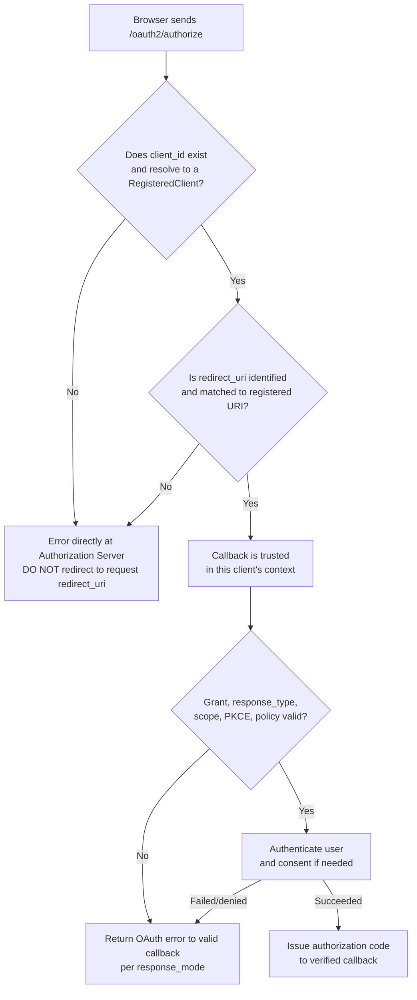

# Returning Context-Appropriate Errors and Avoiding Redirects to Invalid URIs

## 1. The Problem: One Error Can Turn an Authorization Server into an Open Redirector

In the **SPRING_SECURITY_OAUTH2_OIDC_AUTHORIZATION_SERVER** module, we learn how to design, configure, secure, test, and operate an OAuth 2.0/OpenID Connect Authorization Server using **Spring Security and Spring Authorization Server in Spring Boot**. In the **Authorization Endpoint** chapter, error handling is part of **protocol security**, not merely picking an HTTP status code or rendering a message.

Suppose the `portal-web` application is registered with callback:

```text
https://portal.example.com/login/oauth2/code/portal-web
```

An attacker sends a browser to:

```http
GET /oauth2/authorize?response_type=code
  &client_id=portal-web
  &redirect_uri=https%3A%2F%2Fattacker.example%2Fcollect
  &scope=openid%20profile
  &state=demo-state
```

If the Authorization Server detects that `redirect_uri` is wrong yet still issues an HTTP 302 to **the request-supplied URI** with `error=invalid_request`, the server lends its trusted domain to the attacker to steer victims onto a malicious site. Even worse, if the same validation flaw occurs on the **authorization code issuance** path, codes or tokens may leak externally.

The core rule from **RFC 6749 §3.1.2.4 and §4.1.2.1**: **when the redirect URI is missing, invalid, or mismatched, or the client ID is missing/invalid, the Authorization Server must not automatically redirect the browser to the invalid URI**. **RFC 9700 §2.1** further mandates exact matching against registered redirect URIs when using redirect flows (with a narrow exception for native app loopback/localhost).

Accordingly, error handling at the Authorization Endpoint has **two distinct contexts**:

- **No trustworthy callback yet:** return the error directly on **the Authorization Server's origin**, with no `Location` pointing to the request-supplied `redirect_uri`.
- **Client and callback verified:** you may return an **OAuth/OIDC error response** to the **verified** callback per the valid response mode, including `state` if supplied in the request.

After this lesson, you will be able to design the request validation order, choose the right place to return errors, understand OAuth/OIDC error codes, control extension points in Spring Authorization Server, and build a test suite preventing open redirects.

## 2. Understanding the Involved Roles and Requests

The Authorization Endpoint is where the **user-agent/browser** arrives to request permissions or authenticate via OIDC. In Spring Authorization Server, the default path is `/oauth2/authorize`, configurable via `AuthorizationServerSettings`.

| Component | Role at the Authorization Endpoint |
| --- | --- |
| **Resource Owner / End User** | Logs in and approves/denies permissions when prompted. |
| **OAuth2/OIDC Client** | Initiates the authorization request, registers `client_id` and redirect URIs, and holds `state`/PKCE verifier. |
| **Authorization Server** | Validates client, callback, grant/response type, scope, PKCE, and user session; issues a code or returns an error. |
| **RegisteredClientRepository** | Looks up client metadata: redirect URIs, grant types, scopes, `ClientSettings`. |
| **Resource Server** | Does not receive authorization errors directly; protects APIs using access tokens in a separate step. |

Basic Authorization Code request:

```http
GET /oauth2/authorize?
    response_type=code
    &client_id=portal-web
    &redirect_uri=https%3A%2F%2Fportal.example.com%2Flogin%2Foauth2%2Fcode%2Fportal-web
    &scope=openid%20profile
    &state=RANDOM_BOUND_TO_BROWSER_TRANSACTION
    &code_challenge=BASE64URL_SHA256_VERIFIER
    &code_challenge_method=S256
```

In OIDC, `openid` signals an identity authentication request, and `nonce` may be required/used depending on flow and policy. For **public clients**, PKCE is mandatory per OAuth Security BCP; for confidential clients using Authorization Code, PKCE is also recommended.

**Never confuse the Authorization Endpoint with the Token Endpoint:** errors during **browser authorization** may redirect to a valid callback; errors during **exchanging an authorization code for tokens** are typically HTTP/JSON responses from `/oauth2/token`, not arbitrary browser redirects.

## 3. Validation Order: Verify the Destination Before Handling Error Content

To prevent unsafe redirects, do not start by asking "what kind of error is this?" Determine **where results are permitted to be sent** first.



This diagram is a **security decision model**, not a guarantee of internal method call order across all Spring versions. What never changes is: **no redirect leaves the Authorization Server without a trustworthy destination**.

### 3.1. Verifying `client_id`

1. Check that the request contains a `client_id` with valid structure/length per policy.
2. Query `RegisteredClientRepository.findByClientId(clientId)`.
3. If missing, not found, or conflicting, **never** accept any URI from the request as a callback.
4. If your application tracks client lifecycle state (ACTIVE/SUSPENDED), enforce that policy in the appropriate protocol handler; `RegisteredClient` itself has no built-in `enabled` flag.

Client ID is an **identifier**, not a secret and not proof that the sender owns the application. Knowing a valid client ID **does not** let an attacker designate a new redirect URI.

### 3.2. Verifying `redirect_uri`

For a submitted URI, the Authorization Server must validate it against **the set of URIs registered for that exact client**. Avoid weak checks:

- Using `startsWith("https://portal.example.com")`: can accept `https://portal.example.com.attacker.example/...`.
- Using `endsWith("example.com")` loosely: easily overlooks origins, subdomains, and delimiters.
- Comparing only hostnames: ignores scheme, port, path, or query.
- Allowing wildcards `https://*.example.com/*` or overly broad regexes without ownership control.
- Trusting `redirect_uri` from `Referer`, `Origin`, `Host`, or `next`/`return_to` query parameters instead of registration.
- **Decoding/normalizing URIs multiple times** before matching in ways that alter the request's original value.

RFC 9700 requires **exact string matching** against registered URIs, except for the narrow native-app loopback/localhost port case. In Spring, prefer the standard validator and test against your exact version. **Never disable redirect URI verification just to "get localhost working"**; if native loopback is needed, implement the exact standard exception and test it separately.

### 3.3. What If `redirect_uri` Is Missing?

Do not equate **a missing parameter** with **a present yet invalid parameter**. OAuth 2.0 has rules regarding one versus multiple registered callbacks; some configurations may infer a single callback when allowed by protocol. However, **OIDC Authentication Requests require `redirect_uri`**. Either way, proceed only once **a trusted URI from registration** has been determined—never pick an unverified request URI or build a fallback containing user-supplied parameters.

## 4. Where Should Errors Be Returned? Decision Matrix

| Scenario | Trusted callback? | Proper handling |
| --- | --- | --- |
| Missing `client_id` | No | Return HTTP error page directly at the AS; no automatic redirect. |
| Non-existent `client_id` | No | Return error directly; never use request-supplied `redirect_uri`. |
| Unregistered `redirect_uri` | No | Return error directly; **never** set `Location` to that URI. |
| `redirect_uri` has wrong scheme/host/path/port | No | Return error directly. |
| Valid `redirect_uri` but `scope` outside client permissions | Yes | OAuth error response `invalid_scope` to the verified callback. |
| Valid `redirect_uri` but `response_type` denied/unsupported | Yes | OAuth error response `unsupported_response_type` or `unauthorized_client` by cause. |
| Valid `redirect_uri` but request lacks valid PKCE | Yes | Appropriate OAuth error (typically `invalid_request`) to the verified callback. |
| User denies consent | Yes | `access_denied` to the verified callback. |
| OIDC `prompt=none` yet login required | Yes | `login_required` (per OIDC context) to the verified callback. |
| Temporary Authorization Server outage | Yes, if verified | May return `server_error`/`temporarily_unavailable` via callback; expose no internal details. |
| Failure before callback can be verified | Undetermined | Error at AS; do not attempt to redirect to report the error. |

**The "Trusted callback?" column is a prerequisite**, not merely informational. A custom handler must never conclude "since `redirect_uri` is present, we can redirect."

### 4.1. Returning Errors Directly at the Authorization Server

When no valid callback exists, the AS should present an appropriate message to the user with an appropriate HTTP status (usually 4xx for invalid requests). Illustrative example:

```http
HTTP/1.1 400 Bad Request
Content-Type: text/html; charset=UTF-8
Cache-Control: no-store
Referrer-Policy: no-referrer

<!doctype html>
<html lang="en">
<head><meta charset="utf-8"><title>Unable to Process Login Request</title></head>
<body>
  <h1>Unable to Continue Login</h1>
  <p>The application sent an invalid request. Please contact the application administrator.</p>
  <p>Support code: REQ-12345</p>
</body>
</html>
```

The response above illustrates **a safe application-built error page**. It contains no HTTP `Location` pointing to the request's redirect URI, prints no raw authorization codes/tokens/secrets, echoes no unescaped HTML from `redirect_uri` or `state`, and exposes no stack traces. The support code exists purely to correlate with sanitized internal logs.

Not every error needs the same HTTP status: return 400 for invalid requests and 500/503 for server failures. **The primary security criterion is never sending the browser to an untrusted destination.**

### 4.2. Returning OAuth Errors to a Verified Callback

Once the client and redirect URI **are valid**, Authorization Code errors are typically placed in **query parameters** per RFC 6749:

```http
HTTP/1.1 302 Found
Location: https://portal.example.com/login/oauth2/code/portal-web?error=access_denied&state=RANDOM_BOUND_TO_BROWSER_TRANSACTION
Cache-Control: no-store
```

This example shows the default Authorization Code response mode. `error=access_denied` indicates the user or AS rejected the request; **no `code` is present**, and no tokens or sensitive data may be attached.

If the client sent `state`, the Authorization Server returns the exact corresponding value when performing the authorization error redirect per RFC. The client must compare `state` against the initiated login session before processing the callback to prevent login CSRF/response injection. `state` is untrusted data when displayed: never inject it unescaped into HTML, never use it as `Location`, and never log it excessively; on the client, generate it randomly bound to the browser session.

## 5. OAuth 2.0 and OpenID Connect Error Codes to Distinguish

### 5.1. Common Error Codes at the OAuth Authorization Endpoint

| `error` | Meaning | Example | Response location |
| --- | --- | --- | --- |
| `invalid_request` | Missing required parameter, invalid duplicate parameter, or malformed syntax | Public client missing PKCE, malformed parameter | Callback **only if verified**; if identification/redirect error, return at AS |
| `unauthorized_client` | Client is not permitted to use this method/flow | Client has only `client_credentials` yet requests `authorization_code` | Verified callback |
| `access_denied` | User or AS denied authorization | User clicks "Deny" on consent screen | Verified callback |
| `unsupported_response_type` | AS does not support the requested response type | Unsupported `response_type` | Verified callback |
| `invalid_scope` | Invalid, unknown, or out-of-policy scope | Client requests unregistered `admin.write` | Verified callback |
| `server_error` | AS backend error prevented completing the request | Backend failure handling authorize | Verified callback if safe |
| `temporarily_unavailable` | AS temporarily unable to serve requests | Planned maintenance/overload | Verified callback if safe |

These codes belong to OAuth Authorization Endpoint responses per RFC 6749. **Do not use `invalid_client` (typically returned for client authentication failures at the Token Endpoint) as a catch-all error for `/oauth2/authorize`.** In particular, if `client_id` is invalid, the RFC mandates **never automatically redirecting to an invalid URI**, even if an application wishes to send a specific OAuth code.

### 5.2. Additional Error Codes for OIDC

OIDC Authentication Requests may return additional error codes (when the callback is verified):

| `error` | When appropriate |
| --- | --- |
| `login_required` | `prompt=none` yet user login or reauthentication is required. |
| `interaction_required` | `prompt=none` yet another form of user interaction is required. |
| `consent_required` | `prompt=none` yet user consent is required. |
| `account_selection_required` | User must select an account/session. |
| `invalid_request_uri` | `request_uri` parameter contains invalid or unusable content in supported profiles. |
| `invalid_request_object` | Invalid Request Object in supported profiles. |

Example:

```http
HTTP/1.1 302 Found
Location: https://portal.example.com/callback?error=login_required&state=xyz-session
```

With `prompt=none`, the Authorization Server **must not display login/consent UI to complete that request**. If non-interactive processing is impossible, return the appropriate error code to a safe callback. Never turn every OIDC error into HTTP 500 or a login redirect loop.

### 5.3. Fields in an Error Response

In an OAuth authorization error response:

- `error`: **required**, standard ASCII error code.
- `error_description`: **optional**, brief explanation using allowed characters; never include stack traces, secrets, or PII.
- `error_uri`: **optional**, link to error documentation; must be a trusted system-controlled URI, never the request's `redirect_uri`.
- `state`: **required if the authorization request contained `state`**, echoing the exact value in the error redirect.

The client must handle callback errors properly: match `state`, terminate the associated login transaction, display an understandable message to the user, and log an event code without leaking sensitive data.

## 6. Response Delivery Modes: query, fragment, form_post

Not every response type uses the same query-string format. Understand the enabled **response type**, **response mode**, and **authorization request profile**:

| Context | Typical mechanism | Security note |
| --- | --- | --- |
| **Authorization Code** (`response_type=code`) | Query parameters on a valid callback | Codes and errors must never go to unverified redirect URIs; `state` must be checked by the client. |
| **Implicit flow** (legacy) | Fragment per RFC 6749 | Not recommended for new designs; RFC 9700 prefers Authorization Code + PKCE. |
| **OIDC Hybrid** | Per agreed response type/response mode | Client and AS must align with the active profile; never assume all responses sit in query params. |
| **`response_mode=form_post`** (if supported) | Auto-submitting HTML form POSTing to verified callback | POST target must still be validated; guard against script/HTML injection, clickjacking, and unsafe response caching. |
| **JARM/PAR/JAR** (if implemented) | Per extension profile | Never hand-roll serializers/error modes; follow validation, request binding, and response profiles strictly. |

Never try to "fix" an invalid redirect URI issue by switching from query to fragment or form_post: **all three deliver data to an attacker if the destination is invalid**.

With `response_mode=form_post`, an error with a valid callback can be placed in hidden form parameters for the browser to POST to the client; the handler must be configured per profile. Never render a form whose `action` comes from an unverified request parameter.

## 7. Where Does Spring Authorization Server Process Requests?

In **Spring Authorization Server 1.5.x**, relevant extension points include:

- `OAuth2AuthorizationEndpointFilter` receives requests at the Authorization Endpoint and handles authorization requests/consent.
- `OAuth2AuthorizationCodeRequestAuthenticationConverter` converts HTTP requests into authorization request authentication objects.
- `OAuth2AuthorizationCodeRequestAuthenticationProvider` validates requests, clients, redirect URIs, scopes, etc.; validation failures may throw `OAuth2AuthorizationCodeRequestAuthenticationException`.
- `OAuth2AuthorizationCodeRequestAuthenticationValidator` supplies default validators for `redirect_uri` and `scope`.
- `OAuth2AuthorizationEndpointConfigurer.authorizationEndpoint(...)` allows customizing converters, providers, success handler, **`errorResponseHandler(AuthenticationFailureHandler)`**, and consent page.

In other versions, package names or APIs may differ; consult documentation for the exact Spring Security/Spring Authorization Server version in your project.

```mermaid
sequenceDiagram
    participant B as Browser
    participant F as OAuth2AuthorizationEndpointFilter
    participant P as AuthenticationProvider + Validators
    participant R as RegisteredClientRepository
    participant E as ErrorResponseHandler
    B->>F: GET /oauth2/authorize
    F->>P: Convert request / authenticate
    P->>R: Look up RegisteredClient by client_id
    alt Invalid client / callback
        P-->>F: OAuth error / exception
        F->>E: Handle error
        E-->>B: Error at AS; DO NOT redirect to invalid callback
    else Verified callback, yet scope/consent error
        P-->>F: OAuth error / exception
        F->>E: Handle error with verified destination
        E-->>B: Redirect error + state to valid callback
    else Request approved
        P-->>F: Authorization result
        F-->>B: Redirect code to valid callback
    end
```

This describes layer responsibilities, not a trace of every library method call. **Custom handlers must preserve security boundaries**; never copy naive redirect logic using `request.getParameter("redirect_uri")`.

### 7.1. Endpoint Configuration with Safe Defaults

Example Servlet `SecurityFilterChain` configuration illustrating only where the configurer is applied:

```java
import org.springframework.context.annotation.Bean;
import org.springframework.core.annotation.Order;
import org.springframework.security.config.Customizer;
import org.springframework.security.config.annotation.web.builders.HttpSecurity;
import org.springframework.security.oauth2.server.authorization.config.annotation.web.configurers.OAuth2AuthorizationServerConfigurer;
import org.springframework.security.web.SecurityFilterChain;

@Bean
@Order(1)
SecurityFilterChain authorizationServerSecurityFilterChain(HttpSecurity http)
        throws Exception {

    OAuth2AuthorizationServerConfigurer authorizationServer =
            OAuth2AuthorizationServerConfigurer.authorizationServer();

    http
        .securityMatcher(authorizationServer.getEndpointsMatcher())
        .with(authorizationServer, as -> as
            .authorizationEndpoint(endpoint -> {
                // Keep default validators and error handler in this example.
                // Only set errorResponseHandler(...) if tested safely
                // against invalid client_id and redirect_uri values.
            })
            .oidc(Customizer.withDefaults()))
        .authorizeHttpRequests(authorize ->
            authorize.anyRequest().authenticated());

    return http.build();
}
```

This snippet is **a partial configuration**, omitting the second login filter chain, user store, `RegisteredClientRepository`, signing keys, persistence, and other beans required for a full Authorization Server. In production apps, test real protocol endpoints and login pages. Some Spring Security 7.x releases use different configurer syntax—check your version's docs.

### 7.2. Customizing Validation: Keep Defaults Before Adding New Rules

Spring Authorization Server lets you register a `Consumer<OAuth2AuthorizationCodeRequestAuthenticationContext>` on `OAuth2AuthorizationCodeRequestAuthenticationProvider.setAuthenticationValidator(...)`. When replacing the validator, **you must preserve standard redirect URI and scope checks**.

Example chaining default validators with a business rule (imports omitted to focus on the mechanism):

```java
Consumer<OAuth2AuthorizationCodeRequestAuthenticationContext> validator =
        OAuth2AuthorizationCodeRequestAuthenticationValidator
                .DEFAULT_REDIRECT_URI_VALIDATOR
                .andThen(OAuth2AuthorizationCodeRequestAuthenticationValidator
                        .DEFAULT_SCOPE_VALIDATOR)
                .andThen(context -> {
                    // Custom policy runs after redirect URI + scope checks.
                    RegisteredClient client = context.getRegisteredClient();
                    if (client == null) {
                        throw new OAuth2AuthorizationCodeRequestAuthenticationException(
                                new OAuth2Error(OAuth2ErrorCodes.INVALID_REQUEST),
                                context.getAuthentication());
                    }
                    // Example: look up independent lifecycle state (if any),
                    // rejecting requests from clients no longer ACTIVE.
                });

// Inside authorizationEndpoint.authenticationProviders(providers -> ...):
if (provider instanceof OAuth2AuthorizationCodeRequestAuthenticationProvider p) {
    p.setAuthenticationValidator(validator);
}
```

This is an **illustrative extension point snippet**, not standalone copy-paste code; place it inside providers configuration, add imports, and invoke your real policy service. In production, checking only for null client does not constitute a complete lifecycle policy. Likewise, never write a custom redirect URI validator weaker than the default. When adding new policies, test over HTTP with both valid and invalid callbacks.

### 7.3. Customizing `errorResponseHandler`: Easy Place to Introduce Vulnerabilities

The API allows configuring:

```java
authorizationServer.authorizationEndpoint(endpoint ->
        endpoint.errorResponseHandler(customAuthorizationErrorHandler));
```

`customAuthorizationErrorHandler` is an application-implemented `AuthenticationFailureHandler`. Never implement it as:

```java
// WRONG EXAMPLE - do not use:
String callback = request.getParameter("redirect_uri");
response.sendRedirect(callback + "?error=invalid_request");
```

This buggy snippet opens an **open redirect**, and manual string concatenation breaks query/fragment handling, character encoding, and `state`. When you genuinely need a custom handler, a safe design must:

1. Classify the error **before** deciding whether redirection is allowed, verifying that the client was found and the callback **was validated against registration**.
2. Without proof of a trusted destination, return the error directly on the AS origin without emitting a `Location` header to request-supplied values.
3. With a trusted destination, use a builder/serializer compliant with the flow's **response mode**, properly encode parameters, and echo `state` appropriately.
4. Never include stack traces, tokens, `client_secret`, session IDs, PKCE verifiers, or personal data in `error_description` or HTML.
5. Test malicious URI variants, response modes, consent, OIDC `prompt=none`, and system failures before replacing the default handler.

**Even a runtime exception must never bypass callback verification.** Avoid adding a `@ControllerAdvice` or global error handler that falls back to redirecting to any request's `Referer`/`redirect_uri`.

## 8. Dangerous Redirect Patterns That Must Be Blocked

Suppose a client only registered:

```text
https://portal.example.com/oauth/callback
```

The following requests **must never be treated as valid** merely because they resemble the registered URI:

| Received URI | Problem |
| --- | --- |
| `https://attacker.example/callback` | Completely different host. |
| `https://portal.example.com.attacker.example/oauth/callback` | Prefix resembles legitimate domain, yet real host is attacker's. |
| `https://portal.example.com.evil.test/oauth/callback` | Exploits `startsWith`. |
| `http://portal.example.com/oauth/callback` | Scheme differs from HTTPS. |
| `https://portal.example.com:8443/oauth/callback` | Different port. |
| `https://portal.example.com/oauth/callback/extra` | Different path. |
| `https://portal.example.com/oauth/callback?next=https://attacker.example` | Query differs from registered URI; can become an open redirect on the client if `next` is unchecked. |
| `https://portal.example.com/oauth/%63allback` | Encoding differs from the registered URI string; never "fix" via arbitrary normalization. |
| `https://user@attacker.example/oauth/callback` | Userinfo segment can deceive readers; real host is attacker's. |
| `//attacker.example/collect` | Network-path reference; must not be treated as a registered callback. |
| `javascript:...` or `data:...` | Inappropriate scheme for web callbacks; poses code-execution risk. |
| `https://portal.example.com/oauth/callback#fragment` | Fragments are not an arbitrary extension mechanism for redirect URIs; follow registration and response mode rules. |

The **loopback redirect port** exception for native apps is a narrow standardized case that must follow RFC 8252/RFC 9700 strictly. It **does not** authorize host, path, or port wildcards for web clients.

### 8.1. Open Redirects on the Client Side Are Also Dangerous

Even when the Authorization Server matches `https://portal.example.com/oauth/callback` exactly, if that callback immediately redirects to `?next=<untrusted>`, codes or tokens can be leaked externally via redirect/fragment/browser mechanics. Defense requires coordination:

- The AS matches registered URIs exactly and never redirects based on untrusted input.
- The client callback has **no** open redirects and embeds no third-party scripts in responses handling codes/tokens.
- The client verifies `state`, uses PKCE, and keeps tokens/codes out of logs and unnecessary browser history.
- Enforce HTTPS and restrict redirect URIs across both dev and prod environments.

## 9. Concrete Scenario: Same Client, Three Errors with Different Contexts

Suppose:

```text
client_id: invoices-web
registered redirect_uri: https://invoices.example.com/login/oauth2/code/invoices-web
grants: authorization_code
scopes: openid, profile, invoices.read
requireProofKey: true
```

### Scenario A — Redirect URI Tampered With

Request:

```http
GET /oauth2/authorize?response_type=code
  &client_id=invoices-web
  &redirect_uri=https%3A%2F%2Fevil.example%2Freceive
  &scope=openid%20profile
  &state=s1
```

**Expected outcome:** AS rejects at its own origin. No header:

```text
Location: https://evil.example/receive?error=invalid_request&state=s1
```

Reason: the callback is invalid, even though `client_id` exists and scopes are in registration.

### Scenario B — Excessive Scope, Valid Callback

Request:

```http
GET /oauth2/authorize?response_type=code
  &client_id=invoices-web
  &redirect_uri=https%3A%2F%2Finvoices.example.com%2Flogin%2Foauth2%2Fcode%2Finvoices-web
  &scope=openid%20invoices.admin
  &state=s2
  &code_challenge=VALID_S256_CHALLENGE
  &code_challenge_method=S256
```

**Expected outcome:** after verifying the callback, the AS may redirect:

```http
HTTP/1.1 302 Found
Location: https://invoices.example.com/login/oauth2/code/invoices-web?error=invalid_scope&state=s2
```

Reason: the callback is trusted, yet the requested scope is not registered/permitted for the client.

### Scenario C — User Denies Consent

With a valid request, the user selects "Deny" on the consent screen.

**Expected outcome:**

```http
HTTP/1.1 302 Found
Location: https://invoices.example.com/login/oauth2/code/invoices-web?error=access_denied&state=s3
```

Reason: client/redirect are valid, yet the user refused consent. The AS issues no authorization code.

All three scenarios represent "authorization failed", yet **their response destinations differ**. Never write a blanket `catch (Exception e) { redirect(request.getParameter("redirect_uri")) }` for all errors.

## 10. HTTP Testing to Detect Open Redirects

### 10.1. Testing with curl in a Test Environment

Assuming the test Authorization Server runs at `https://auth.test.example`, you can send requests **without automatically following redirects**:

```bash
curl -isS --max-redirs 0 \
  'https://auth.test.example/oauth2/authorize?response_type=code&client_id=invoices-web&redirect_uri=https%3A%2F%2Fevil.example%2Fcollect&state=attack'
```

Verify:

- No HTTP `Location: https://evil.example/...`.
- Response stays on the AS; errors leak no secrets, tokens, or stack traces.
- If Spring Security redirects unauthenticated requests to login, test the flow **after user login** or use an integration test with an authenticated session. Seeing only an HTTP 302 to the login page does not prove the validator blocked the bad URI.

Send a valid-callback request with an invalid scope to confirm errors return cleanly to the client:

```bash
curl -isS --max-redirs 0 \
  'https://auth.test.example/oauth2/authorize?response_type=code&client_id=invoices-web&redirect_uri=https%3A%2F%2Finvoices.example.com%2Flogin%2Foauth2%2Fcode%2Finvoices-web&scope=invoices.admin&state=good-state&code_challenge=VALID_S256_CHALLENGE&code_challenge_method=S256'
```

In real tests, use a **valid S256 `code_challenge`** and an authenticated user session; placeholders here only illustrate URL structure. Once authentication and validation reach the right stage, the result must be `invalid_scope` per the supported response mode, with no code issued.

### 10.2. Security Test Matrix to Maintain

| Case | Request | Expected outcome |
| --- | --- | --- |
| T01 | Missing `client_id` | No redirect to request-supplied URI. |
| T02 | Non-existent `client_id` | No redirect to arbitrary callback. |
| T03 | Valid client, `redirect_uri` to attacker host | Rejected at AS; no `Location` to attacker host. |
| T04 | Host like `portal.example.com.attacker.test` | Not accepted via prefix matching. |
| T05 | Right host, different scheme/port/path | Rejected unless exact string registered (controlled native loopback exception). |
| T06 | Registered URI, wrong scope | Redirect `invalid_scope` to valid callback with exact `state`. |
| T07 | Valid URI, disallowed response type | Appropriate `unauthorized_client` or `unsupported_response_type`. |
| T08 | Valid URI, missing/invalid PKCE | `invalid_request` or rejection per provider; no code issued. |
| T09 | User denies consent | `access_denied` to valid callback. |
| T10 | OIDC `prompt=none` when unauthenticated | `login_required`/appropriate OIDC error; no interactive UI shown. |
| T11 | `state` containing special characters needing encoding | Encoded properly, logical value preserved, no redirect/HTML injection. |
| T12 | Duplicate `client_id`, `redirect_uri`, or invalid params | Reject ambiguous request; never pick an attacker-favorable parameter. |
| T13 | URI with percent encoding, userinfo, fragment, extra query | Rejected if differing from registered URI per standard rules. |
| T14 | Valid callback with client-side open redirect | Client callback does not forward code/token/state to arbitrary targets. |
| T15 | Custom `errorResponseHandler` | Does not weaken above controls; preserves response mode and error params. |
| T16 | Multiple SecurityFilterChains/proxies | Request enters Authorization Server filters properly; no custom error path bypasses validators. |
| T17 | `response_mode=form_post` enabled | POSTs only to verified callback, escapes HTML properly, preserves state. |
| T18 | PAR/JAR enabled | Redirect URI source bound to validated client/request; no arbitrary target output. |

### 10.3. Intent Example for Spring Boot Tests

You can use `MockMvc` with Authorization Server components configured for the test environment:

```java
// Test pseudocode, not a complete test:
mockMvc.perform(get("/oauth2/authorize")
        .param("response_type", "code")
        .param("client_id", "invoices-web")
        .param("redirect_uri", "https://evil.example/collect")
        .param("state", "attempt-123"))
    .andExpect(result -> {
        String location = result.getResponse().getHeader("Location");
        assertThat(location)
            .doesNotStartWith("https://evil.example");
    });
```

**What must be added in a real test:** initialize client registration, authenticated session, PKCE, the AS `SecurityFilterChain`, and dependent beans. A single test like above **is not enough**: it might PASS merely because the request redirected to `/login` before URI validation ran. Add authenticated-user cases, verify which endpoint actually processed the request, and verify errors returned to valid callbacks as well.

In integration tests, do not auto-follow redirects when testing for open redirects; inspect **the entire `Location` chain** and each hop as needed.

## 11. Operations: Informative Errors Without Data Leakage

### 11.1. Users, Clients, and Operations Teams Need Different Detail Levels

| Recipient | Appropriate data | Never include |
| --- | --- | --- |
| **User at AS** | Neutral message, support code, safe way back to application | Raw attacker URI, stack traces, client secrets, tokens, session IDs |
| **Client via valid callback** | `error`, `state`, brief `error_description` if needed, trusted `error_uri` | DB details, signing keys, stack traces, other users' data |
| **Internal logs/audit** | Correlation ID, event type, classified technical cause, valid client ID when appropriate, timestamp, outcome | Raw authorization codes, PKCE verifiers, access/refresh tokens, secrets |

Error pages and callbacks should use anti-cache headers and appropriate referrer policies, especially when URLs carry protocol parameters. If logs must record URIs for investigation, filter/truncate sensitive components and avoid sending raw query strings into external monitoring systems unintentionally.

### 11.2. Avoid Login/Error Loops

An `invalid_redirect_uri` or unknown client error **cannot** fix itself by logging in again. If the system hits a 302 loop between `/oauth2/authorize` and `/login`, verify request routing across security chains, session protection, cookies, and validators. Never present repeated login screens for a request permanently rejected due to an invalid client or callback.

For OIDC `prompt=none`, the browser must never be pulled into an interactive login UI; the client should handle `login_required` using its interactive login strategy.

### 11.3. Inspect Reverse Proxies and Issuer Configuration

When placing Spring Boot behind an ingress/reverse proxy:

- Advertise the issuer, authorization endpoint, and token endpoint using **configured public URLs**, avoiding building URLs from untrusted `Host` headers.
- Control forwarded headers at trusted proxies; never allow users to influence redirect `scheme`/`host`.
- Register redirect URIs using the client's real public domain, not internal container hostnames.
- Verify TLS termination, infrastructure HSTS, and consistency between staging and production.
- Test both real browser authorization flows and back-channel token exchanges.

With multiple tenants/issuers, tenant identification from requests must be authenticated; never treat arbitrary user-supplied `tenant` or `Host` values as trusted keys to select redirect URI tables or error domains.

## 12. Misconceptions to Eliminate

| Misconception | Correct understanding |
| --- | --- |
| "If `redirect_uri` is in the request, we must redirect errors there." | Redirect only once client and URI are verified; otherwise render the error at the AS. |
| "A URI starting with a registered domain is safe." | Prefix/suffix and loose regex checks cause open redirects; use exact string matching per standard. |
| "Every Authorization Endpoint error returns HTTP 400 JSON." | Some errors stay at the AS; OAuth/OIDC errors return to valid callbacks per response mode. |
| "Every error returns 302 to the login page." | Invalid URIs must never redirect to invalid URIs; `prompt=none` forbids UI interaction. |
| "`state` is the return address." | `state` is transaction-correlation data, not a callback/redirect URL. |
| "A valid Client ID may choose any callback." | Callbacks must still match **that specific client's** registration. |
| "CORS or HTTPS eliminates redirect URI validation." | CORS and TLS solve different threats; neither replaces OAuth redirect validation. |
| "Returning exception messages in `error_description` makes debugging easier." | Risks leaking secrets/internals; use safe descriptions and keep technical logs separate. |
| "Testing a 302 to `/login` proves bad URIs are blocked." | Must test while authenticated and passing through Authorization Endpoint validation. |
| "Enabling PAR/JAR allows arbitrary redirect URIs." | Client/request constraints must still be enforced per profile and configuration. |
| "Replacing `errorResponseHandler` only changes UI styling." | It can break safe-redirect boundaries and protocol response modes. |

## 13. Implementation Checklist

- [ ] Client registration stores **the exact approved set of redirect URIs**, separated across dev/staging/prod environments.
- [ ] Authorization Endpoint verifies `client_id`, redirect URI, response type/grant, scope, and PKCE before issuing codes.
- [ ] Invalid/missing callbacks or invalid clients **never** generate a `Location` pointing to untrusted input.
- [ ] Scope/grant/consent errors on valid callbacks return standard `error` codes and echo `state` as required.
- [ ] OIDC `prompt=none` handles non-interactive errors cleanly without login loops.
- [ ] Default validators are never replaced with wildcards, prefix/suffix matches, or arbitrary URI normalization.
- [ ] Any custom `AuthenticationFailureHandler` never uses raw `redirect_uri` directly or concatenates query strings manually.
- [ ] Query/fragment/form_post/JARM (if enabled) adhere to the configured response mode and profile.
- [ ] Client-side callbacks verify `state`, enforce PKCE, and contain no open redirects.
- [ ] Error responses and logs never expose codes, tokens, secrets, PKCE verifiers, stack traces, or PII.
- [ ] HTTP/integration tests cover unknown clients, malicious redirects, wrong path/port/scheme, duplicate params, invalid scopes, denied consent, and OIDC errors.
- [ ] Reverse proxies, issuers, and forwarded headers are configured securely and produce consistent results across nodes.

## 14. References

- [RFC 6749 — OAuth 2.0 Authorization Framework, §3.1.2 and §4.1.2.1](https://www.rfc-editor.org/rfc/rfc6749): callback validation and authorization error response rules.
- [RFC 9700 — Best Current Practice for OAuth 2.0 Security](https://www.rfc-editor.org/rfc/rfc9700): exact redirect URI matching, open redirectors, authorization codes, and PKCE.
- [RFC 8252 — OAuth 2.0 for Native Apps](https://www.rfc-editor.org/rfc/rfc8252): redirect URIs for native apps and loopback.
- [RFC 9207 — OAuth 2.0 Authorization Server Issuer Identification](https://www.rfc-editor.org/rfc/rfc9207): issuer identification in authorization responses to mitigate mix-up when supported.
- [OpenID Connect Core 1.0 — Authentication Error Response](https://openid.net/specs/openid-connect-core-1_0.html): `login_required`, `interaction_required`, `consent_required`, and `account_selection_required`.
- [OpenID Connect Form Post Response Mode 1.0](https://openid.net/specs/oauth-v2-form-post-response-mode-1_0.html): returning authorization responses/errors via form POST when supported.
- [Spring Authorization Server — Protocol Endpoints](https://docs.spring.io/spring-authorization-server/reference/protocol-endpoints.html): `OAuth2AuthorizationEndpointFilter`, converters, providers, `errorResponseHandler`, and customizing validation.
- [Spring Authorization Server 1.5.x — OAuth2AuthorizationEndpointConfigurer API](https://docs.spring.io/spring-authorization-server/docs/current/api/org/springframework/security/oauth2/server/authorization/config/annotation/web/configurers/OAuth2AuthorizationEndpointConfigurer.html): extension points for the Authorization Endpoint.
- [Spring Authorization Server 1.5.x — OAuth2AuthorizationCodeRequestAuthenticationValidator API](https://docs.spring.io/spring-authorization-server/docs/current/api/org/springframework/security/oauth2/server/authorization/authentication/OAuth2AuthorizationCodeRequestAuthenticationValidator.html): default redirect URI and scope validators.

**Decisive rule:** errors at the Authorization Endpoint may be forwarded to the client only after the Authorization Server verifies **both the exact client and the exact callback**. If verification is impossible, return the error directly at the Authorization Server. Maintaining this distinction ensures OAuth 2.0/OIDC compliance, preserves application diagnosability, and prevents the Authorization Server from becoming an open redirector.
