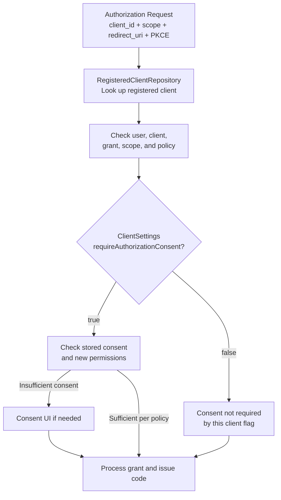
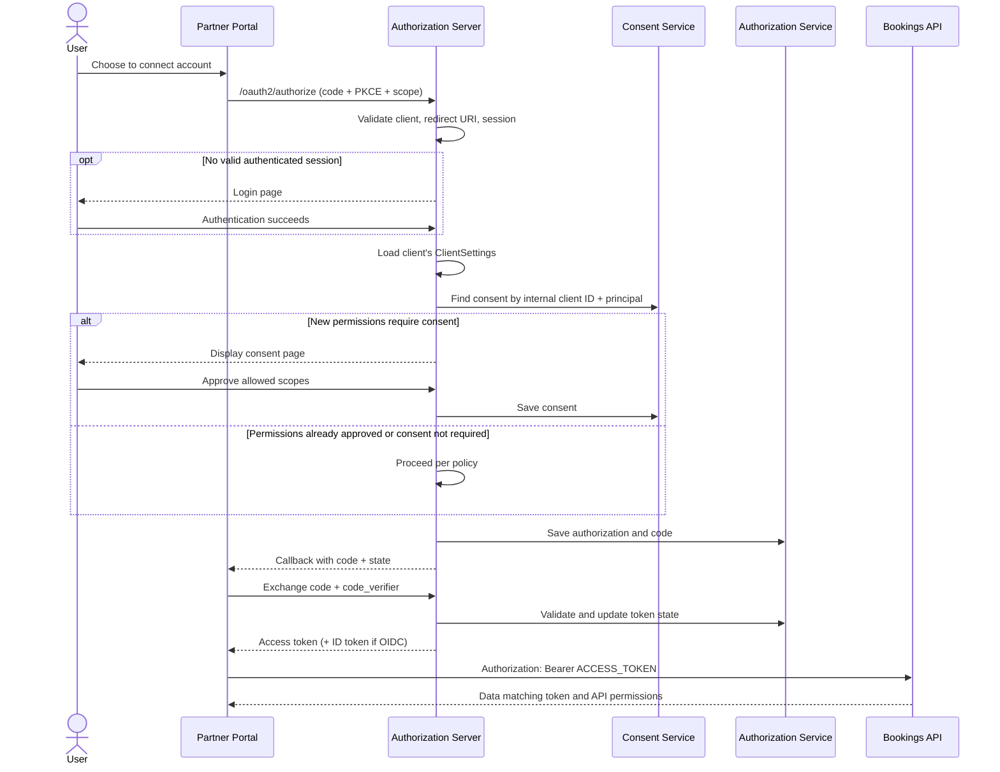

# Configuring requireAuthorizationConsent per Client

## 1. Context: Why Not Apply the Same Consent Policy to Every Client?

In an **OAuth 2.0/OpenID Connect (OIDC) Authorization Server** implemented with **Spring Security** and **Spring Authorization Server** on Spring Boot, each OAuth client has a different trust relationship and business requirement.

For example, a booking system has two applications:

- **Partner Portal**: a partner application that needs to read the list of bookings owned by the user. Users must know which permissions the partner is requesting and have the opportunity to approve or deny them.
- **Internal Booking Portal**: an internal portal managed by the organization, using only pre-approved scopes and policies. The enterprise may decide not to display a consent screen for certain governed flows, to avoid disrupting the user experience.

Both clients can use **Authorization Code + PKCE** and authenticate users at the Authorization Server (AS), yet have **different consent display policies**. Spring Authorization Server addresses this foundational requirement via configuration on each `RegisteredClient` object:

```java
ClientSettings.builder()
    .requireAuthorizationConsent(true)
    .build();
```

With `true`, the Authorization Server requires consent processing according to the framework's mechanism when actual conditions require asking the user. With `false`, the client is not forced through the consent step solely because of that property. **This is not an unconditional permission-granting switch**, nor does it replace user authentication, client validation, scope checks, PKCE, or policies at the Resource Server.

### After this lesson, you will be able to

1. Understand the exact meaning and scope of `ClientSettings.requireAuthorizationConsent(...)`.
2. Configure two clients with different consent requirements within the same Authorization Server.
3. Explain when the consent page appears, is skipped, or needs to reappear when scopes change.
4. Store, look up, and manage `OAuth2AuthorizationConsent` through the appropriate service.
5. Distinguish consent from an authentication session, an authorization grant, and issued tokens.
6. Build a custom consent page while preserving OAuth/OIDC checks.
7. Assess the impact of changing the consent flag on a live client, including multi-instance persistence.
8. Test approval, denial, incremental scope, revocation, and security failure scenarios.

## 2. Scope of `requireAuthorizationConsent`

This property is declared in **`ClientSettings` of a `RegisteredClient`**. It expresses a policy requirement for a **specific client**, stored and read alongside the registered client configuration.

| Value | Practical Meaning | Does Not Mean |
|---|---|---|
| `true` | The client is configured to require user approval of permissions through the AS consent mechanism. New or unapproved permissions may lead to a consent screen. | “Every request must show a popup” or “all client scopes are already approved”. |
| `false` | The AS does not enforce consent solely because of this flag; the flow can proceed according to other checks. | “The client has access to all data”, “skip login”, or “there will never be consent under any requirement/policy”. |

Runtime conditions such as **requested scopes**, stored consent, provider policies, grant types, and OIDC parameters (if supported) still influence behavior. Certain scopes have special handling depending on the protocol or implementation, so test against the version of Spring Authorization Server you are using rather than assuming every scope always has a checkbox.

### 2.1. This Is a Per-Client Setting, Not a Browser-Controlled Parameter

A client cannot simply send `requireAuthorizationConsent=false` on `/oauth2/authorize` to disable consent. The source of truth is the server-side configuration that the AS retrieves via `RegisteredClientRepository`.



The diagram is a conceptual model illustrating the **consent decision**; protocol validators run at specific steps in the pipeline. The `false` branch must still go through validation, login when required, scope checks, specialized consent if another policy requires it, and grant conditions.

### 2.2. Consent Is Not “Full Access” or “No Access”

If a client is registered with `bookings.read` and the user approves `bookings.read`, the API still needs to determine whether the user is allowed to read a **specific booking**. The scope in the access token conveys information about the granted scope, whereas ownership rules and resource-level authorization belong to the Resource Server.

Even when `requireAuthorizationConsent(false)` is set, the client can only request grants, redirect URIs, and scopes permitted by its policy. A consent flag does not grant any additional scopes to a `RegisteredClient`.

## 3. Consent in the Authorization Code + PKCE Flow

A browser-based Authorization Request typically contains:

```http
GET /oauth2/authorize?response_type=code&client_id=partner-portal
    &redirect_uri=https%3A%2F%2Fpartner.example.com%2Fcallback
    &scope=openid%20profile%20bookings.read
    &state=RANDOM_STATE
    &nonce=RANDOM_NONCE
    &code_challenge=DERIVED_CHALLENGE
    &code_challenge_method=S256
```

This example is wrapped across lines for readability; the actual URL must be properly encoded and use HTTPS. The client retains `state`, `nonce`, and `code_verifier` on its side to verify the callback and exchange the authorization code.

When the AS receives the request:

1. Verify `client_id`, redirect URI, response type, scope, and required grant conditions.
2. Determine whether the user is already logged in at the AS; if not, go through the user authentication flow.
3. Retrieve the `ClientSettings` of the matching `RegisteredClient` to check the consent requirement.
4. When consent is required, look up the authorities previously approved by the user.
5. If there are still permissions to request, present them to the user and process the consent decision.
6. If the request is valid, generate an authorization code, which the client then exchanges using PKCE at the Token Endpoint.
7. For OIDC, the client verifies the ID token; for APIs, the client uses the appropriate access token.



The sequence diagram illustrates a successful authorization grant. When the user **denies** consent, the AS must not treat denied permissions as approved; the flow may terminate with an appropriate OAuth error response, typically `access_denied`, according to the endpoint mechanism.

### 3.1. Consent Is Not a Login Requirement

A user may already be logged in at the AS without ever having approved the client. Conversely, consent may already be saved in the database while the login session has expired. Therefore:

- Having a valid session **does not automatically skip new consent** when the flag requires it.
- Having saved consent **does not automatically skip login** if the session is no longer valid.
- Successful login **does not automatically issue a token** before the authorization request has been validated and processed.

### 3.2. Consent Is Not a Refresh Token Requirement

`requireAuthorizationConsent` is tied to processing authorization requests through the appropriate endpoint, particularly the Authorization Code Flow. A client holding a valid refresh token can typically send a `refresh_token` grant to the Token Endpoint without opening a browser and showing the consent page on every refresh.

If the product requires users to re-approve after a period of time or when permissions change, you must design appropriate refresh token expiration/revocation and re-authorization policies; do not assume enabling `requireAuthorizationConsent(true)` will handle all of that automatically.

## 4. Creating Individual `RegisteredClient` Instances with Different Consent Policies

Spring Authorization Server manages clients through `RegisteredClientRepository`. Each `RegisteredClient` holds its own `ClientSettings`, making it possible to configure two clients in the same application without modifying a global filter.

### 4.1. Example Partner Client Requiring Consent

```java
RegisteredClient partnerPortal = RegisteredClient
    .withId(UUID.randomUUID().toString())
    .clientId("partner-portal")
    .clientSecret(passwordEncoder.encode(partnerSecretFromSecureStore))
    .clientAuthenticationMethod(
        ClientAuthenticationMethod.CLIENT_SECRET_BASIC)
    .authorizationGrantType(
        AuthorizationGrantType.AUTHORIZATION_CODE)
    .authorizationGrantType(
        AuthorizationGrantType.REFRESH_TOKEN)
    .redirectUri("https://partner.example.com/callback")
    .scope(OidcScopes.OPENID)
    .scope(OidcScopes.PROFILE)
    .scope("bookings.read")
    .clientSettings(ClientSettings.builder()
        .requireProofKey(true)
        .requireAuthorizationConsent(true)
        .build())
    .build();
```

Key settings:

- `requireAuthorizationConsent(true)` requires consent processing for the `partner-portal` client.
- `requireProofKey(true)` forces the Authorization Code Flow to use PKCE; this requirement is **independent** of consent.
- `clientSecret` is supplied from a server-side secret management system and hashed using an appropriate encoder.
- `redirectUri` must match a registered URI according to the Authorization Server's rules.
- `scope(...)` represents only **the permissions the client is allowed to request**, not permissions already approved by the user.

This is an example of a **confidential client** performing the code exchange on the backend. For an SPA/mobile public client, use `ClientAuthenticationMethod.NONE` together with PKCE and an appropriate token storage policy; do not embed a client secret in the frontend.

### 4.2. Example Internal Client Without Mandatory Consent

```java
RegisteredClient internalPortal = RegisteredClient
    .withId(UUID.randomUUID().toString())
    .clientId("internal-booking-portal")
    .clientSecret(passwordEncoder.encode(internalSecretFromSecureStore))
    .clientAuthenticationMethod(
        ClientAuthenticationMethod.CLIENT_SECRET_BASIC)
    .authorizationGrantType(
        AuthorizationGrantType.AUTHORIZATION_CODE)
    .authorizationGrantType(
        AuthorizationGrantType.REFRESH_TOKEN)
    .redirectUri("https://internal.example.com/callback")
    .scope(OidcScopes.OPENID)
    .scope("bookings.read")
    .clientSettings(ClientSettings.builder()
        .requireProofKey(true)
        .requireAuthorizationConsent(false)
        .build())
    .build();
```

This client **is not forced to prompt for consent by the configuration flag**, yet it still requires user login, authorization request validation, PKCE, and other grant policies. If the organization still needs privacy confirmation or regulatory compliance, do not choose `false` merely because the application is “internal”.

**Two objects have different consent flags.** There is no need to mutate a global variable on every request to toggle behavior based on `client_id`.

### 4.3. Registering Both Clients in the Repository

If you only need a learning example on a single instance:

```java
@Bean
RegisteredClientRepository registeredClientRepository(
        PasswordEncoder passwordEncoder) {

    RegisteredClient partner = createPartnerClient(passwordEncoder);
    RegisteredClient internal = createInternalClient(passwordEncoder);

    return new InMemoryRegisteredClientRepository(partner, internal);
}
```

Here `createPartnerClient(...)` and `createInternalClient(...)` represent the two `RegisteredClient` creation blocks above, which should be implemented with secrets loaded from a secure source. This is a snippet illustrating how to wire the repository, not a complete Spring Boot class; avoid initializing real secrets as hard-coded strings.

For production, choose `JdbcRegisteredClientRepository` or a durable storage implementation so client registrations remain consistent across multiple nodes. At the same time, you still need to configure `OAuth2AuthorizationService`, `OAuth2AuthorizationConsentService`, JWK/issuer, and the appropriate `SecurityFilterChain` beans.

## 5. Understanding `ClientSettings`

`ClientSettings` contains multiple client-side policies. In this topic, distinguish at least two flags:

| Property | Question Answered | Impact |
|---|---|---|
| `requireAuthorizationConsent` | Should the Authorization Server require user consent for the client via supported mechanisms? | Determines whether user interaction regarding permissions is needed |
| `requireProofKey` | Is the client required to provide PKCE for the Authorization Code Flow? | Binds the code exchange to the client's verifier |

Example:

```java
ClientSettings settings = ClientSettings.builder()
    .requireAuthorizationConsent(true)
    .requireProofKey(true)
    .build();
```

There is no rule that “enabling consent also enables PKCE” or vice versa. **Consent is permission approval; PKCE is a protection mechanism for the authorization code.** Both should be designed independently based on the client's risk profile.

In addition, `TokenSettings` governs concerns such as access token TTL, refresh token TTL, token format, and refresh token reuse policy. Changing consent does not automatically change token lifetimes.

### 5.1. Default Values and Configuration Transparency

With standard builder APIs, `requireAuthorizationConsent` is typically not enabled if omitted, but when designing lessons and production configurations, you should **explicitly set the intended value** for each client. Do not rely on default assumptions during data migrations or framework upgrades.

For systems that expose a client management API, expose the configured `requireAuthorizationConsent` field in a safe DTO and include it in change history. Enforce authorization checks when modifying this flag because switching from `true` to `false` changes the user experience and level of user permission control.

## 6. Consent Storage Model: `OAuth2AuthorizationConsent`

When the AS persists consent, Spring Authorization Server uses the `OAuth2AuthorizationConsent` model. Three core fields:

| Field | Meaning |
|---|---|
| `registeredClientId` | The **internal** ID of the `RegisteredClient`, not necessarily the public `clientId` |
| `principalName` | Identifier of the approving principal, from a trusted authentication context |
| `authorities` | Set of approved `GrantedAuthority` instances; scopes are typically represented as `SCOPE_<scope>` |

Logical example:

```text
RegisteredClient:
  id       = "rc-partner-01"
  clientId = "partner-portal"
  ClientSettings.requireAuthorizationConsent = true

OAuth2AuthorizationConsent:
  registeredClientId = "rc-partner-01"
  principalName      = "user-42"
  authorities        = [
    "SCOPE_bookings.read",
    "SCOPE_profile"
  ]
```

The `authorities` set represents approval data. It is not an access token, not `ROLE_ADMIN`, and does not prove the user currently has a valid login session.

### 6.1. Service for Saving and Querying Consent

The main methods of `OAuth2AuthorizationConsentService`:

```java
OAuth2AuthorizationConsent findById(
    String registeredClientId, String principalName);

void save(OAuth2AuthorizationConsent consent);

void remove(OAuth2AuthorizationConsent consent);
```

An example solely for **reading consent status**, assuming `registeredClient` and `authenticatedUser` have been verified server-side:

```java
OAuth2AuthorizationConsent consent =
    consentService.findById(
        registeredClient.getId(),
        authenticatedUser.getName());

boolean readApproved = consent != null
    && consent.getAuthorities().stream()
        .map(GrantedAuthority::getAuthority)
        .anyMatch("SCOPE_bookings.read"::equals);
```

Do not call `findById(registeredClient.getClientId(), ...)` when the service expects the internal ID. Also, never accept `principalName` from an arbitrary client form and trust that that person gave consent.

### 6.2. Deleting Consent and Granted Permissions

`consentService.remove(consent)` only deletes the consent record. It **does not automatically**:

- Terminate the login session at the AS or client application.
- Revoke any unexpired signed access tokens.
- Revoke issued refresh tokens.
- Delete related `OAuth2Authorization` records.

If the product provides a “Disconnect application” button, you must combine deleting consent with **token revocation**, session handling if needed, and choosing a mechanism to block active access tokens at the Resource Server. In particular, self-verifying JWTs may still be accepted by APIs until `exp` or unless the API performs additional revocation checks.

## 7. First-Time Consent, Subsequent Logins, and Requesting Additional Scopes

Suppose `partner-portal` is registered with scopes `profile`, `bookings.read`, and `bookings.cancel`, with `requireAuthorizationConsent(true)`.

| Grant Attempt | Requested Scopes | Stored Consent | Expectation |
|---|---|---|---|
| 1 | `bookings.read` | None | Requires approval per policy |
| 2 | `bookings.read` | Approved `bookings.read` | Consent screen can be skipped unless a re-prompt condition applies |
| 3 | `bookings.read bookings.cancel` | Only `bookings.read` approved | `bookings.cancel` must be evaluated as a new permission |
| 4 | `bookings.read` | Consent has been deleted | Must be re-evaluated; may prompt for consent |
| 5 | `bookings.read` | Approved, but AS requires re-prompt | Displays consent again according to supported policy/parameters |
| 6 | `admin.superuser` | Irrelevant | Rejected if client is not registered for it or policy disallows it |

**Prior consent does not automatically grant new scopes.** If a user previously allowed reading data but the client asks for permission to cancel bookings, the Authorization Server must not treat that as the same permission.

### 7.1. Intersection Rule of the Three Scope Sets

You can visualize three sets:

- **Registered scopes**: what the client is allowed to request per `RegisteredClient.getScopes()`.
- **Requested scopes**: the scopes present in the current authorization request.
- **Approved/consented scopes**: what the user has approved or what has been processed under the consent policy.

The **authorized scopes** set of a specific authorization is formed strictly by validating those sets together with system policy. You should never automatically grant the union of all registered scopes or all previously consented scopes.

Example:

```text
registered = {profile, bookings.read, bookings.cancel}
requested  = {bookings.read}
consented  = {profile, bookings.read}

authorized (illustrative) = {bookings.read}
```

Simply because a prior consent included `profile` does not mean a new access token, which only requested `bookings.read`, should automatically receive `profile`.

### 7.2. Denying Consent

If the user denies permissions, the server must respect that decision and respond via the appropriate protocol. Do not treat a “Deny” button click as a login failure. Typically the OAuth Authorization Endpoint can respond with `access_denied` when appropriate, provided the redirect URI has been verified and error redirect rules permit it.

Never generate an authorization code for denied permissions or record them in consent as approved.

## 8. Registering `OAuth2AuthorizationConsentService` for Real Environments

A simple in-memory example:

```java
@Bean
OAuth2AuthorizationConsentService consentService() {
    return new InMemoryOAuth2AuthorizationConsentService();
}
```

This is convenient for tests/demos, but data can be lost on restart and is not automatically shared across nodes.

In environments requiring durable persistence, Spring Authorization Server provides a JDBC solution:

```java
@Bean
OAuth2AuthorizationConsentService consentService(
        JdbcOperations jdbcOperations,
        RegisteredClientRepository registeredClients) {

    return new JdbcOAuth2AuthorizationConsentService(
        jdbcOperations,
        registeredClients);
}
```

To run this, the application needs:

1. A configured `DataSource` and `JdbcOperations`.
2. A database schema for consent compatible with the version of Spring Authorization Server in use.
3. `RegisteredClientRepository` and Authorization Server services properly declared.
4. Migrations, backups, database permissions, and data protection mechanisms.
5. Consistency policies across multiple instances (including registered client store, authorization state, sessions, and signing keys).

**Do not confuse the client repository with the consent service:** `RegisteredClientRepository` stores `ClientSettings.requireAuthorizationConsent`; `OAuth2AuthorizationConsentService` stores the permissions **approved by users**.

### 8.1. What Happens If Consent Is Not Shared Across Multiple Nodes?

Suppose nodes A and B both serve `/oauth2/authorize`:

- Node A saves consent after the user approves.
- The next request hits node B.
- If A and B use two independent `InMemoryOAuth2AuthorizationConsentService` instances, B may fail to find the saved consent and prompt again.
- If both read from a shared consent store, they are able to see the same decision data.

Sharing consent storage alone is still not enough for the entire flow: the AS request cache/session, authorization code/token state, client registration, and key material must also be configured consistently.

### 8.2. Combining Consent with Auditing

A consent record reflects the current state of permissions. Auditing reflects the history of who did what and when. You should not use a consent table as a replacement for all audit requirements.

An audit event can record: principal ID, registered client ID, granted or revoked scopes, timestamp, correlation ID, and outcome—**never logging authorization codes, access/refresh tokens, session cookies, or client secrets**. Access to audit logs must also enforce tenant and administrative scope authorization.

## 9. Do You Need a Custom Consent Page?

If the framework-provided consent UI and content are suitable, you can start with the default mechanism. If you need brand logos, user-friendly scope descriptions, permission grouping, or localization, Spring Authorization Server supports configuring a custom consent page path:

```java
OAuth2AuthorizationServerConfigurer authorizationServer =
    OAuth2AuthorizationServerConfigurer.authorizationServer();

http
    .securityMatcher(authorizationServer.getEndpointsMatcher())
    .with(authorizationServer, as -> as
        .authorizationEndpoint(endpoint -> endpoint
            .consentPage("/oauth2/consent")));
```

This is an **extension-point configuration** snippet. The application still requires a `SecurityFilterChain` and an actual `GET /oauth2/consent` page, along with all beans for the AS. Do not use the snippet above on its own as a complete runnable server configuration.

### 9.1. Responsibilities of a Custom Consent Page

The consent page should:

- Display the client name from a **trusted registered client**, without trusting self-declared query labels.
- Display the list of scopes actually being requested and permitted.
- Describe permissions in plain language: e.g., “Read booking history” instead of `bookings.read`.
- Distinguish already-approved permissions from newly requested permissions if helpful for UX.
- Allow the user to approve/deny according to the contract supported by the server.
- Bind the decision to the exact `state`, `client_id`, user session, and authorization request.
- Prevent request forgery and avoid creating open redirects.

A minimal visual layout:

```text
Partner Portal wants to access your account.

[ ] Read booking history (bookings.read)
[ ] View profile information (profile)

[Allow]       [Deny]
```

This is purely a **UI mockup**. Whether individual scopes can be toggled depends on the rules and mechanics of the consent page and Authorization Endpoint. Never design checkboxes and blindly add all permissions from the form into `OAuth2AuthorizationConsentService`.

### 9.2. The Page Only Renders; the Protocol Remains Handled by the AS

A controller serving GET can return a Thymeleaf view:

```java
@Controller
class ConsentPageController {

    @GetMapping("/oauth2/consent")
    String consentPage(Model model) {
        // In a real implementation, retrieve validated request data
        // and client metadata from a trusted source.
        return "consent";
    }
}
```

The example intentionally shows only the **view-rendering** responsibility. A real controller must pass the validated client, scopes, and state following the patterns/guides appropriate for the Spring Authorization Server version.

The POST step confirming consent must be handled by the Authorization Endpoint pipeline according to the framework contract or an extension designed with full validation. **Do not create a controller that saves consent and issues an authorization code itself**: doing so can bypass client/redirect validation, CSRF/session checks, PKCE, and scope policies.

### 9.3. CSRF and Binding to the Authorization Request

The consent page is an operation affecting user permissions. You must evaluate CSRF protection and bind the request to the session/authentication properly. In Spring Authorization Server, certain OAuth endpoints have specific CSRF rules depending on the configurer and request parameters such as `state`; do not assume that adding a hidden `_csrf` field yourself is sufficient or will always be picked up by the filter.

For a custom UI, use the contract and anti-forgery mechanisms actually supported by the version in use. Also test cases where a browser submits a form belonging to user A inside user B's session, and cases where the consent request has expired.

## 10. Changing `requireAuthorizationConsent` While a Client Is Active

Once a client is in production, changing this flag can affect user consent and experience. Do not treat it as a risk-free metadata tweak.

### 10.1. Changing from `false` to `true`

Goal: a client that previously did not prompt for consent must begin requiring consent for unrecorded permissions.

Expected impacts:

- Future authorization requests will go through the new consent decision.
- If no `OAuth2AuthorizationConsent` was ever stored, users may begin seeing the consent page.
- Users currently using the client may need to approve when they perform a new authorization flow.
- Already issued access tokens and refresh tokens **are not automatically revoked** simply because the flag is enabled.
- Refresh grants still need separate control if you want to force all sessions back to the consent page.

Therefore, if the new policy requires **all existing client tokens to be re-approved**, toggling the flag is not enough: you must design refresh/revocation lifecycles, token lifetimes, and re-authorization flows.

### 10.2. Changing from `true` to `false`

Goal: remove the consent requirement imposed by the client flag.

Impacts:

- New requests may skip the consent prompt under this flag's mechanism.
- Previously stored consent **is not automatically deleted**.
- Security/regulatory policies regarding data-sharing permissions must still be reviewed.
- It does not expand registered scopes, enable new grants, or bypass user authentication.
- Requires auditing and change approval if the client holds sensitive permissions.

Do not allow clients to propose changing the flag to `false` without administrative authorization, as this change can affect user permission transparency.

### 10.3. Updating a Client Must Preserve Other Settings

When modifying an existing `RegisteredClient`, **do not recreate the client from scratch just to change one flag**, because doing so can lose the client ID, authentication methods, grants, redirect URIs, scopes, token settings, or other configurations.

An update pattern using the supported builder API:

```java
RegisteredClient existing =
    registeredClientRepository.findByClientId("partner-portal");

if (existing == null) {
    throw new IllegalArgumentException("Unknown registered client");
}

ClientSettings changedSettings = ClientSettings
    .withSettings(existing.getClientSettings().getSettings())
    .requireAuthorizationConsent(false)
    .build();

RegisteredClient updated = RegisteredClient.from(existing)
    .clientSettings(changedSettings)
    .build();

registeredClientRepository.save(updated);
```

This code illustrates how to preserve other values in `ClientSettings` and `RegisteredClient`; updating a client in production additionally requires **operator authorization, validation, revision/optimistic locking, auditing, approval if needed, and cache invalidation**. Verify the specific builder APIs compatible with your version of Spring Authorization Server.

### 10.4. Do Not Use `clientId` as the Sole Ownership Key

`RegisteredClient` has an internal `getId()` and a protocol `getClientId()`. The consent service binds to the internal registered client ID. If you replace a record with a new `RegisteredClient` carrying a different ID, consent data tied to the old ID may no longer be found as expected.

Therefore, flag edits should preserve the internal ID and go through a controlled update mechanism. If migrating or merging clients, plan proper consent and authorization state migration rather than merely copying `clientId`.

## 11. Which Value Should You Choose for Each Client Group?

There is no universal table saying “every first-party client must be false, every third-party client must be true” that fits all systems. Decisions must be based on trust relationships, permission transparency, data sensitivity, and organizational policy.

| Scenario | Potentially Suitable Decision | Considerations |
|---|---|---|
| Partner application reading user data | `true` | Scope transparency, ability to deny/revoke, auditing |
| Centrally managed internal application | `false` or `true` depending on policy | Do not bypass privacy obligations and authorization checks |
| Application handling sensitive data | Usually `true` for user-facing flows | Consent does not replace step-up/MFA or API policies |
| Same-organization BFF with unified login experience | May be `false` | User authentication and API permissions remain mandatory |
| Client requesting additional scopes after a period of use | `true` helps represent incremental consent | Policy grants new scopes only when permitted |
| Machine-to-machine Client Credentials | User consent is generally irrelevant | No End-User involved; rely on client auth and grant policy |

### 11.1. Does Consent Guarantee Legal Compliance?

You cannot conclude compliance solely from `requireAuthorizationConsent(true)`. An OAuth consent UI is a **technical access-delegation mechanism**, whereas legal bases for data processing, retention, privacy notices, and right to withdraw consent may carry separate requirements.

A product may need to record timestamps and notice text, purpose/version, withdrawal conditions, and data-processing policies. If such requirements exist, build an additional governance/audit layer; do not try to cram all legal semantics into `OAuth2AuthorizationConsent.getAuthorities()`.

## 12. Relationship with OpenID Connect 1.0

OIDC uses OAuth to perform authentication for a Relying Party. An OIDC request has `scope` containing `openid` and may include `profile`, `email`, and custom API scopes.

Example:

```text
scope=openid profile email bookings.read
```

- `openid` signals an OIDC request.
- `profile`/`email` request standard claim sets, subject to data controls, policies, and scopes.
- `bookings.read` is a system-defined API permission.

Having approved a scope does not guarantee all corresponding claims will appear in the ID token; many claims may be served via UserInfo according to mechanism and policy. The RP must verify signature, issuer, audience, expiration, and nonce where applicable on the ID token.

### 12.1. `prompt=consent` and `requireAuthorizationConsent`

OIDC defines `prompt=consent` to ask the OP to take the user through consent interaction. This is a **protocol parameter requested by the RP**, distinct from the **server-side flag of the registered client**.

When both exist, the exact behavior depends on `prompt` support, session state, scopes, and OpenID Provider policy. In particular, `prompt=none` requests no interactive UI; if the flow cannot complete because login/consent is needed, the provider must return the appropriate OIDC error under supported rules.

Therefore, do not write a custom filter that inspects `prompt` to toggle consent on or off while bypassing endpoint logic. Test OIDC parameters against the Spring Authorization Server version you are deploying.

## 13. Security Risks When Misconfiguring Consent

| Risk | Example | Mitigation |
|---|---|---|
| Unintended consent bypass | Sensitive client switched from `true` to `false` | Role-based client administration, approval, and auditing |
| Scope escalation | Client form injects `bookings.cancel` | Validate registered scopes, requested scopes, and approved permissions at AS |
| Wrong principal's consent | Using `principalName` from the request | Derive identity from trusted authentication |
| Cross-tenant consent collision | Two tenants share the same principal string | Namespace principals and enforce tenant bindings properly |
| Wrong registered client key | Using public `clientId` instead of internal ID | Use `registeredClient.getId()` when accessing consent service |
| Consent CSRF | Forged request approving scopes | Protect consent flow via contract, session/state, and CSRF policy |
| Client spoofing in Consent UI | Taking app name from untrusted query parameter | Display metadata from the registered client store |
| Tokens continue working after consent removal | Deleting only the consent record | Combine with token revocation and Resource Server checks |
| Permissions exceeding scope | Holding `bookings.read` allows reading all bookings | Resource Server enforces ownership and business rules |
| Consent lost on restart | Using in-memory in production | Use JDBC / durable persistence |
| Consent drift across nodes | Each AS node keeps local state | Shared storage, consistency, and cache invalidation |
| Administrative data leakage | Logging consent requests/responses with tokens | Audit logging with redaction and access control |

### 13.1. Do Not Place Critical Security Logic in the Frontend

A consent page with nice checkboxes does not guarantee security on its own. Clients and browsers can submit altered data. The final decision must be verified at the AS based on:

1. **The right client**, properly registered and permitted.
2. **The right principal**, properly authenticated.
3. **The right authorization request**, still valid.
4. **The right scopes**, eligible to be granted and actually approved.
5. **The right conditions** for PKCE/redirect/grant and other protocol constraints.

Do not rely on disabled JavaScript checkboxes to treat a scope as denied; the server must validate the request independently.

### 13.2. Do Not Modify Internal Filters Just to Change Consent Policy

Because `requireAuthorizationConsent` is already a supported configuration API, you should not replace `OAuth2AuthorizationEndpointFilter` or write a custom controller that issues authorization codes just to implement “client A prompts for consent, client B does not”.

If requirements exceed the existing flag, evaluate the public extension points at the Authorization Endpoint, consent page, services, and policies. Replacing internal filters risks omitting redirect URI validation, PKCE, session checks, and OAuth error handling.

## 14. Testing Per-Client Configuration

A good test does not only verify getters in `ClientSettings`. It must demonstrate the HTTP behavior of **at least two differently configured clients** when sending valid Authorization Requests.

### 14.1. Integration Test Matrix

| Case | Configuration/State | Expected Result |
|---|---|---|
| A1 | `partner-portal` has `requireAuthorizationConsent(true)`, user has not consented | Authenticate user if needed, then require appropriate consent |
| A2 | A1, user denies | Do not grant denied permissions; appropriate OAuth error |
| A3 | `partner-portal`, user already approved sufficient scopes | Can proceed without prompting again, unless policy/`prompt` requires it |
| A4 | `partner-portal` requests new scope | Evaluate and request approval for new permission if needed |
| B1 | `internal-booking-portal` has `requireAuthorizationConsent(false)` | Does not require consent screen solely due to the client flag |
| B2 | B1 while not logged in | Must still authenticate user via the appropriate flow |
| B3 | B1 requests unregistered scope | Rejected; `false` does not mean “all scopes are valid” |
| C1 | Change partner from `false` to `true` | New authorization requests apply the new policy |
| C2 | Change partner from `true` to `false` | Old consent records remain if not deleted |
| D1 | Delete consent then attempt authorize | Client requiring consent is re-evaluated |
| D2 | Delete consent then call API with old access token | Result follows token validity/revocation policy, not automatically rejected |
| E1 | Restart or switch AS node | Consent behaves consistently with shared storage |
| E2 | Send wrong `code_verifier` | Token Endpoint rejects even if consent was given |
| E3 | Use unregistered `redirect_uri` | Authorization Request rejected even if consent was given |
| E4 | Tamper with principal/tenant in consent request | Cannot approve on behalf of another user/tenant |
| E5 | OIDC `prompt=consent` / `prompt=none` | Behavior matches OIDC support and rules of the implementation |

### 14.2. Unit-Testing Java Configuration

You can verify that the two `RegisteredClient` instances are constructed properly:

```java
@Test
void clientsHaveDifferentConsentRequirements() {
    RegisteredClient partner = createPartnerClient(passwordEncoder);
    RegisteredClient internal = createInternalClient(passwordEncoder);

    assertThat(partner.getClientSettings()
        .isRequireAuthorizationConsent()).isTrue();

    assertThat(internal.getClientSettings()
        .isRequireAuthorizationConsent()).isFalse();

    assertThat(partner.getClientSettings()
        .isRequireProofKey()).isTrue();

    assertThat(internal.getClientSettings()
        .isRequireProofKey()).isTrue();
}
```

`createPartnerClient`, `createInternalClient`, and `passwordEncoder` are illustrative components from a test fixture. Testing getters only checks configuration and **does not prove UI or protocol flow behavior**; HTTP integration tests with the AS, login, and consent service are required.

### 14.3. Integration Testing with Browser or MockMvc

When testing Authorization Code + PKCE:

1. Register two clients with valid redirect URIs, scopes, and secret/PKCE settings.
2. Create an authenticated user (or perform login via form).
3. Send `GET /oauth2/authorize` for the `true` client; verify the required consent step occurs.
4. Submit the approval form per contract; check that the redirect contains `code` and `state`.
5. Exchange the code at the Token Endpoint with the verifier; confirm a valid token response.
6. Repeat with the `false` client; confirm it does not go through consent due to the client flag.
7. Request a new scope for the `true` client and test denying it.
8. Verify database consent is tied to the exact registered client ID and principal.
9. Test CSRF/expired session branches, invalid redirect URI, code replay, and multi-instance behavior.

Avoid testing solely by mocking `OAuth2AuthorizationConsentService.save` and declaring the consent flow correct: bugs in the filter chain, request cache, form/state, or authorization policy may not surface in a unit test.

## 15. Debugging When Consent Does Not Appear or Repeats

| Symptom | Possible Cause | Check |
|---|---|---|
| `true` client does not see consent | Scopes already approved or policy/flow does not re-prompt | Consent store, requested scopes, OIDC parameters, framework version |
| `false` client still sees consent | OIDC `prompt=consent`, another policy, or custom logic | Actual request, AS hooks, consent page |
| Consent prompted every time | In-memory data loss, principal/client ID changed, requested scopes always new | Persistence, internal registered client ID, `principalName` |
| User approves then returns to login | Lost session/request cache or wrong chain | SecurityFilterChain, session cookie, reverse proxy |
| Consent submission returns error/403 | Invalid form state/CSRF, expired request, or missing field | Generated form HTML and endpoint contract |
| No authorization code issued after consent | Client/redirect/grant/scope rejected | OAuth error, validated registration, consent outcome |
| Consent saved under wrong client | Confused `clientId`/internal ID, wrong cache or mapping | `RegisteredClient.getId()` and consent key |
| Old behavior persists after flag change | Stale client cache, multiple nodes, DB config not updated | RegisteredClientRepository, cache invalidation, revision |
| Consent deleted but API still accepts token | JWT still unexpired or refresh token still valid | Token revocation, introspection/RS policy |
| Consent page shows unfamiliar client name | Name taken from request query | Trusted metadata from repository |

### 15.1. Ordered Diagnostic Procedure

When a bug occurs, answer in order:

1. **Which actual client is requesting?** Read `client_id` and look up the exact `RegisteredClient`.
2. **Which settings are active?** Inspect `isRequireAuthorizationConsent()` from the live record, not just from the intended config file.
3. **Which user is logged in?** Is `principalName` stable, in the right tenant, and in the right session?
4. **What are the requested scopes?** Are they within the client's registered scopes and permitted by policy?
5. **What permissions are in stored consent?** Look up using internal registered client ID + principal.
6. **Does the request carry OIDC parameters?** How do `prompt`, `max_age`, and login state affect it?
7. **Do the consent page and submission hit the right endpoint?** Do filter chains, state, CSRF, and redirects match?
8. **Is configuration shared across nodes?** Are the client repository, consent store, and session consistent?

Never log raw authorization codes, access/refresh tokens, client secrets, or session cookies while debugging. Use request IDs, client IDs, and safely classified metadata.

## 16. Checklist Before Taking a Consent Policy to Production

- **Per-client:** Does each `RegisteredClient` have `requireAuthorizationConsent` chosen intentionally and justified by policy?
- **PKCE:** Do Authorization Code clients have `requireProofKey` and appropriate code/redirect URI controls?
- **Identity:** Are principal and tenant derived from trusted data; can users never consent for the wrong client?
- **Scope:** Are registered/requested/approved/authorized scopes distinguished and validated?
- **UI:** Are the client name, permission descriptions, and approve/deny actions clear; does the page work across devices?
- **Privacy:** Does the consent UI align with the product's transparency and data management workflows?
- **Persistence:** Does `OAuth2AuthorizationConsentService` persist durably and consistently across restarts or scale-out?
- **Security:** Do CSRF, state, session, redirect URI, client authentication, and PKCE continue working properly?
- **Revocation:** Is there a path to withdraw consent; does “disconnect immediately” invalidate tokens as required?
- **Operations:** Do flag changes on clients have auditing, approval, revisioning, and node synchronization?
- **Testing:** Have you tested at least two `true/false` clients, first/subsequent consent, new scopes, denial, old tokens, and multi-tenancy?
- **Versioning:** Have you verified the hooks/APIs of the actual Spring Authorization Server version?

### Core Takeaway

`ClientSettings.requireAuthorizationConsent(true|false)` is a **per-registered-client configuration** in Spring Authorization Server. It guides when the Authorization Server asks the user to approve scopes during an authorization flow; the state of approved permissions is managed separately via `OAuth2AuthorizationConsentService`.

Enabling consent does not mean showing a screen on every request; disabling consent does not mean bypassing authentication, grant checks, redirects, scopes, PKCE, or API authorization. **Consent, session, authorization, and tokens have separate lifecycles**; changing the flag or deleting consent does not automatically revoke already issued credentials. A secure design requires explicit per-client configuration, proper persistence, spoof-resistant UI, controlled change management, and end-to-end testing across the full OAuth/OIDC flow.

## References

- [Spring Authorization Server — Core Model / Components](https://docs.spring.io/spring-authorization-server/reference/core-model-components.html)
- [Spring Authorization Server — Protocol Endpoints](https://docs.spring.io/spring-authorization-server/reference/protocol-endpoints.html)
- [Spring Authorization Server — How-to: Implement an Authorization Consent Page](https://docs.spring.io/spring-authorization-server/reference/guides/how-to-custom-consent-page.html)
- [Spring Authorization Server — Reference](https://docs.spring.io/spring-authorization-server/reference/)
- [Spring Security — Servlet Architecture](https://docs.spring.io/spring-security/reference/servlet/architecture.html)
- [RFC 6749 — The OAuth 2.0 Authorization Framework](https://www.rfc-editor.org/rfc/rfc6749)
- [RFC 7636 — Proof Key for Code Exchange](https://www.rfc-editor.org/rfc/rfc7636)
- [RFC 9700 — Best Current Practice for OAuth 2.0 Security](https://www.rfc-editor.org/rfc/rfc9700)
- [OpenID Connect Core 1.0](https://openid.net/specs/openid-connect-core-1_0.html)
