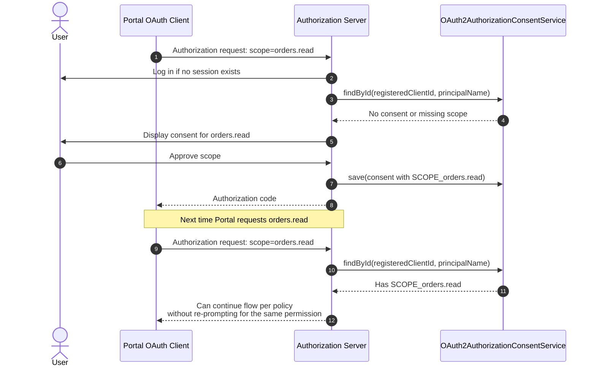
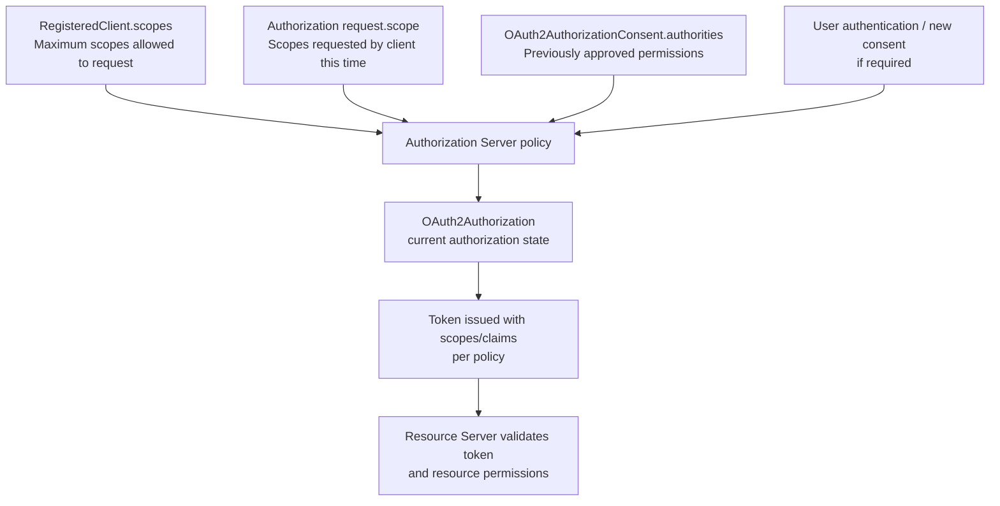
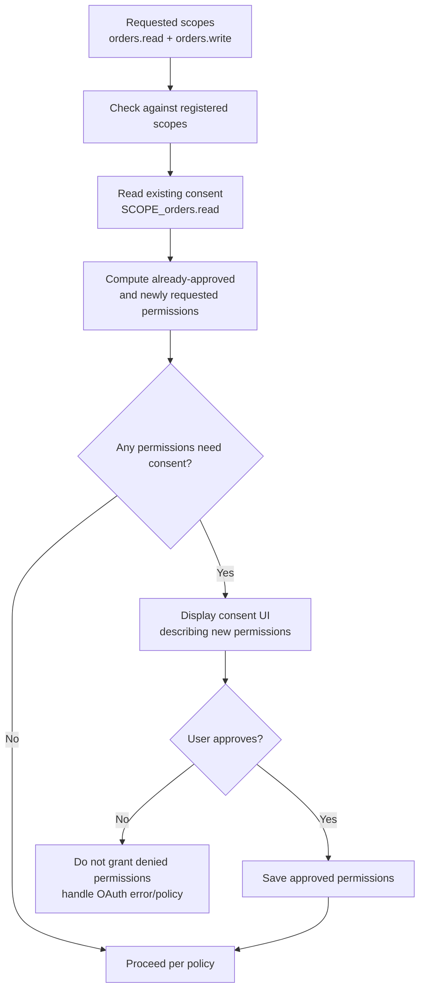

# Granted Permissions Model in OAuth2AuthorizationConsent

When a user logs in and allows an application to read their profile or data, the Authorization Server must decide **which permissions the user has already approved for that client** and whether to display the consent screen again when the application requests permissions on the next login.

In **Spring Authorization Server**, the `OAuth2AuthorizationConsent` object represents the stored approval result for **a registered OAuth client** and **a principal** (typically the user identifier). It holds a set of `GrantedAuthority` instances, where approved OAuth2 scopes are commonly represented as authorities with the `SCOPE_` prefix.

This lesson belongs to the **Consent** chapter of the **SPRING_SECURITY_OAUTH2_OIDC_AUTHORIZATION_SERVER** module. The objective is to understand, configure, secure, test, and operate approved-permission management in an OAuth 2.0/OpenID Connect Authorization Server using Spring Security and Spring Authorization Server in Spring Boot. The focus is on **the data model and consent lifecycle**; UI and filter chain examples are provided only to clarify how the model is used.

> **Key Principle:** Stored consent represents a principal's prior approval for a client. It **does not mean** a current access token holds all previously approved scopes, nor does it **replace** the client's scope allowlist policy or permission checks at the Resource Server.

## 1. The Problem: Does the User Approve Permissions Once or Multiple Times?

Suppose the system has three components:

- **Central Login** at `https://login.example.com`: Spring Authorization Server authenticates users, handles Authorization Code + PKCE, and stores consent.
- **Portal** at `https://portal.example.com`: an OAuth2/OIDC client permitted to request the scopes `openid`, `profile`, `orders.read`, and `orders.write`.
- **Orders API**: Resource Server that reads access tokens, verifies audience, scopes, and permissions for individual orders.

On the first attempt, Portal requests `orders.read`. After login, Central Login displays the permission “View permitted orders” for the user to approve. Once the user agrees, consent for the **Portal + that user** pair is recorded. A few days later, Portal requests only `orders.read` again: depending on client policy and consent state, the server may not need to ask again. However, if Portal this time also requests `orders.write`, the new unapproved permission may need to be presented for consent.



The diagram only illustrates consent logic. Whether a screen is shown also depends on `ClientSettings`, requested scopes, login state, Authorization Server policies, and OIDC parameters if supported.

## 2. Structure of OAuth2AuthorizationConsent

`OAuth2AuthorizationConsent` is the central model for **granted/approved permissions** in Spring Authorization Server. It typically contains three properties:

| Property | Data Type | Meaning |
|---|---|---|
| `registeredClientId` | `String` | **Internal** ID of the `RegisteredClient` to which consent was granted |
| `principalName` | `String` | Identifier of the approving principal |
| `authorities` | `Set<GrantedAuthority>` | Approved permissions, where scopes typically use the `SCOPE_` prefix |

Conceptual state example:

```text
OAuth2AuthorizationConsent
  registeredClientId = "portal-registration-001"
  principalName      = "user-123"
  authorities        = {
      "SCOPE_orders.read",
      "SCOPE_profile"
  }
```

Meaning: principal `user-123` has approved a set of permissions for the registered client with internal ID `portal-registration-001`. **Do not infer** that every subsequently issued token must contain both scopes above; the Authorization Server also considers the current request, the permissions the client is allowed to request, and token issuance policies.

### 2.1. registeredClientId Is the Internal ID, Not client_id

A `RegisteredClient` typically has two identifiers:

```java
RegisteredClient portal = RegisteredClient.withId("portal-registration-001")
        .clientId("portal-bff")
        // Other registration fields...
        .build();
```

- `id` (in the example: `portal-registration-001`) is the **internal** identifier key, used to link authorization/consent data to the registered client.
- `clientId` (in the example: `portal-bff`) is the **protocol** identifier that the client sends to `/oauth2/authorize` or `/oauth2/token`.

`OAuth2AuthorizationConsentService.findById(...)` expects the **registered client ID**, and does not accept `client_id` as a substitute parameter. If you pass `portal-bff` while the data store holds `portal-registration-001`, the lookup will generally fail to find the corresponding consent.

In production, `RegisteredClient.id` must remain stable. Generating a new random ID on every startup can cause old consents to no longer match the active registration.

### 2.2. principalName Must Reflect the Verified Authenticated Identity

`principalName` is usually obtained from `Authentication.getName()` of the logged-in user. However, do not assume it is always the UI display username or the `sub` claim in an ID token; the identifier depends on the integrated authentication mechanism.

In real systems, you should use a **stable, non-reusable principal identifier**. If the organization allows username changes or has multiple tenants sharing a username like `alex`, design a mapping so that one person's consent is never mistakenly applied to another.

Cases to verify:

- Does changing an email/username alter `principalName` and break the consent link?
- If an account is deleted and the old name is reused, could old consent be wrongly applied?
- Does federation from multiple IdPs produce a unique and stable principal identity?
- Could clients registered in different tenants unintentionally share IDs/consents?

**Never take `principalName` directly from a query parameter or client input.** The principal must be derived from the authenticated identity and the trust boundary of the Authorization Server.

### 2.3. authorities Are GrantedAuthority Objects, Not Plain Strings

The model stores `Set<GrantedAuthority>`. Each `GrantedAuthority` returns a permission name via `getAuthority()`. For OAuth2 scope-based consent, the common representation is:

```java
new SimpleGrantedAuthority("SCOPE_orders.read")
new SimpleGrantedAuthority("SCOPE_profile")
```

The `SCOPE_` prefix is meaningful: it distinguishes scope-style permissions from other authorities the application might use.

| `GrantedAuthority.getAuthority()` Value | Meaning in the Consent Model |
|---|---|
| `SCOPE_orders.read` | Scope `orders.read` has been approved |
| `SCOPE_orders.write` | Scope `orders.write` has been approved |
| `SCOPE_profile` | OIDC scope `profile` has been approved |
| `ROLE_ADMIN` | Role-convention authority; **not** automatically equivalent to scope `admin` |
| `orders.read` | Unprefixed authority string; should **not** be assumed by default to be a consented scope |

The model supports arbitrary `GrantedAuthority` values, but when extracting the list of **approved scopes** for an OAuth2 flow, follow the scope convention used by Spring Authorization Server and your application's policy. Do not blindly strip prefixes from every authority or turn user roles into consent.

## 3. Three Permission Layers That Must Stay Separate

In Authorization Server design, there are three important permission sets:

1. **Registered scopes:** the scopes a `RegisteredClient` is allowed to request.
2. **Consented scopes:** the scopes a principal has previously approved for the client, managed via `OAuth2AuthorizationConsent`.
3. **Granted scopes for an authorization/token:** the scopes actually accepted for the current request and placed into the authorization/token per policy.

Example:

| Layer | Contents |
|---|---|
| Portal's registered scopes | `openid`, `profile`, `orders.read`, `orders.write` |
| Currently stored consented scopes | `profile`, `orders.read` |
| Scopes requested this time | `openid`, `orders.read` |
| Scopes actually granted this time | Policy-dependent; never auto-add `orders.write` just because it is registered |

Under an allowlist scope policy, granted scopes must not exceed registered scopes and must satisfy the conditions of the authorization request and consent. `OAuth2AuthorizationConsent` **does not represent an access token**; it has no `accessTokenValue`, `expiresAt`, `jti`, or audience.



### 3.1. Consent Does Not Equal User Role

Suppose employee `user-123` has role `ROLE_EMPLOYEE` and has consented to scope `orders.read` for Portal. The Resource Server must still check:

- That the access token has the right issuer, signature/status, expiration, and audience for the Orders API;
- That the token carries the required scope, such as authority `SCOPE_orders.read`;
- That the user is authorized to read the **specific order**, within the requested tenant and business context.

Never assume that having `ROLE_ADMIN` automatically grants consent for every client across all scopes, or that having consent for `orders.read` lets a user read every order in the system.

### 3.2. Consent Differs from OAuth2Authorization and Login Sessions

| Object | What Does It Store? | Lifecycle |
|---|---|---|
| `OAuth2AuthorizationConsent` | Approved permissions per client + principal | Can persist across multiple authorizations until modified/deleted per policy |
| `OAuth2Authorization` | State of a single authorization, codes/tokens, and corresponding metadata | Depends on grant, token expiry/revocation, and persistence |
| `RegisteredClient` | Client ID, grants, authentication methods, redirect URIs, scopes, settings | Application registration lifecycle |
| `SecurityContext`/`HttpSession` | Authenticated identity and browser session state | Login/session lifecycle |
| Access token | Permissions/claims issued for a specific token, intended for Resource Servers | Independent TTL, validity, and verification conditions |

If you only delete consent, **already issued and still valid access tokens** are not necessarily invalidated immediately. If you only log out of the Authorization Server session, stored consent permissions may still remain. These two operations are distinct and must be designed alongside a revocation policy.

## 4. Creating, Reading, and Saving OAuth2AuthorizationConsent

Spring Authorization Server uses a builder to construct `OAuth2AuthorizationConsent`. The following snippet illustrates how to save approved permissions for an authenticated principal.

```java
import org.springframework.security.core.authority.SimpleGrantedAuthority;
import org.springframework.security.oauth2.server.authorization.OAuth2AuthorizationConsent;

OAuth2AuthorizationConsent consent =
        OAuth2AuthorizationConsent.withId(
                registeredClient.getId(),  // Internal ID of RegisteredClient
                authentication.getName())  // Authenticated principal
            .authority(new SimpleGrantedAuthority("SCOPE_orders.read"))
            .authority(new SimpleGrantedAuthority("SCOPE_profile"))
            .build();

authorizationConsentService.save(consent);
```

This is an example of **how the data is represented**, not advice to let a client send `authentication.getName()` or write consent directly. In the standard flow, the **Authorization Server** verifies the user, client, request, scopes, and consent decision, and uses the internal service to persist it. If you build a dedicated administrative flow, enforce proper admin authorization, CSRF protection, and auditing, and never create consent solely from an external client's request.

### 4.1. Looking Up Consent by Composite Key

```java
OAuth2AuthorizationConsent saved =
        authorizationConsentService.findById(
                registeredClient.getId(),
                authentication.getName());

if (saved == null) {
    // No consent stored yet for this client + principal pair.
}
```

A `null` value means no matching record was found. However, **a record existing** does not mean every scope the client is about to request has already been approved. You must inspect the authorities inside it.

### 4.2. Converting Stored Authorities into a Set of Scopes

An illustrative utility reading scopes following the `SCOPE_` convention:

```java
import java.util.Set;
import java.util.stream.Collectors;

import org.springframework.security.core.GrantedAuthority;
import org.springframework.security.oauth2.server.authorization.OAuth2AuthorizationConsent;

static Set<String> approvedScopes(OAuth2AuthorizationConsent consent) {
    if (consent == null) {
        return Set.of();
    }

    return consent.getAuthorities().stream()
            .map(GrantedAuthority::getAuthority)
            .filter(authority -> authority != null &&
                    authority.startsWith("SCOPE_"))
            .map(authority -> authority.substring("SCOPE_".length()))
            .collect(Collectors.toUnmodifiableSet());
}
```

If consent contains `SCOPE_orders.read` and `SCOPE_profile`, the function returns the set `{orders.read, profile}`. If consent contains an authority not starting with `SCOPE_`, the function does not turn it into an OAuth scope.

**Note:** This is an illustrative helper following the standard convention, not a reason to alter how Spring Authorization Server represents authorities on consent. When customizing scope/authority mapping, run integration tests against the authorization mechanism of the version in use.

### 4.3. Updating Approved Permissions

Suppose Portal was previously approved for `orders.read`, and now the user approves `orders.write` as well. An example model operation is building an update from the existing consent:

```java
OAuth2AuthorizationConsent existing =
        authorizationConsentService.findById(
                registeredClient.getId(), authentication.getName());

OAuth2AuthorizationConsent.Builder builder = existing != null
        ? OAuth2AuthorizationConsent.from(existing)
        : OAuth2AuthorizationConsent.withId(
                registeredClient.getId(), authentication.getName());

// Call only when the user actually approved the new scope and the server
// has verified that this scope belongs to the RegisteredClient's allowed scopes.
builder.authority(new SimpleGrantedAuthority("SCOPE_orders.write"));

OAuth2AuthorizationConsent updated = builder.build();
authorizationConsentService.save(updated);
```

The snippet shows **how to update the model**. It is not the entire grant process; the UI and Authorization Server providers must verify the client, principal, scopes, and consent state, and confirm that the user genuinely agreed.

Never add `SCOPE_orders.write` merely because Portal registered that scope. Registration is **permission to ask**, not proof that the user agreed.

## 5. OAuth2AuthorizationConsentService: The Persistence Port for Granted Permissions

`OAuth2AuthorizationConsentService` is the interface for managing stored consent, comprising these typical operations:

| Method | Purpose |
|---|---|
| `save(OAuth2AuthorizationConsent consent)` | Save a new or updated consent for the client/principal pair |
| `findById(String registeredClientId, String principalName)` | Look up consent by composite key |
| `remove(OAuth2AuthorizationConsent consent)` | Delete stored consent |

At the application level, these operations are typically called by **Spring Authorization Server** when handling the consent flow, or by a strictly authorized internal permission-management service as needed.

### 5.1. In-Memory Storage for Learning and Testing

```java
import org.springframework.context.annotation.Bean;
import org.springframework.security.oauth2.server.authorization.OAuth2AuthorizationConsentService;
import org.springframework.security.oauth2.server.authorization.InMemoryOAuth2AuthorizationConsentService;

@Bean
OAuth2AuthorizationConsentService authorizationConsentService() {
    return new InMemoryOAuth2AuthorizationConsentService();
}
```

`InMemoryOAuth2AuthorizationConsentService` is suitable for demos or short-lived unit/integration tests. When the process restarts, in-memory consent is lost. If multiple instances are deployed with separate in-memory stores, the same user/client may observe different consent states depending on which node handles the request.

**Do not use an isolated in-memory store as the primary consent source in multi-node production.**

### 5.2. JDBC for Environments Requiring Persistence

Spring Authorization Server provides `JdbcOAuth2AuthorizationConsentService` to persist consent to a database via JDBC:

```java
import org.springframework.context.annotation.Bean;
import org.springframework.jdbc.core.JdbcOperations;
import org.springframework.security.oauth2.server.authorization.OAuth2AuthorizationConsentService;
import org.springframework.security.oauth2.server.authorization.client.RegisteredClientRepository;
import org.springframework.security.oauth2.server.authorization.JdbcOAuth2AuthorizationConsentService;

@Bean
OAuth2AuthorizationConsentService authorizationConsentService(
        JdbcOperations jdbcOperations,
        RegisteredClientRepository registeredClients) {

    return new JdbcOAuth2AuthorizationConsentService(
            jdbcOperations, registeredClients);
}
```

The example assumes `JdbcOperations`, `RegisteredClientRepository`, and **a consent schema compatible with the library version** are already present. Do not assume Spring Boot will automatically create the consent table simply by declaring this bean. Schema deployment, migrations, indexes, backups, DB account privileges, and upgrade testing must be managed as part of releases.

In practice, the JDBC store typically holds information equivalent to:

```text
registered_client_id | principal_name | authorities
---------------------------------------------------------------
portal-registration-001 | user-123     | SCOPE_orders.read,SCOPE_profile
portal-registration-001 | user-456     | SCOPE_orders.read
reports-registration-1  | user-123     | SCOPE_reports.view
```

The table above **only illustrates data semantics**, not a guaranteed cross-version SQL migration. When designing indexes, the `registered_client_id + principal_name` pair is a key lookup predicate; ensure uniqueness and appropriate insert/update behavior.

### 5.3. When Should You Write a Custom Consent Service?

A custom implementation may be necessary when an enterprise wants to:

- Store consent in an existing centralized data store;
- Integrate tenant isolation and policy-driven data deletion;
- Maintain an audit trail, approval history, and custom administrative approval workflows;
- Encrypt sensitive data, separate read/write privileges, and manage backups;
- Support migration from a legacy OAuth2 system.

However, the basic consent service interface only operates on the **current state model**. If you need history of who approved when, terms version, device origin, or revocation reason, design a **separate audit/history model** rather than expecting the three properties of `OAuth2AuthorizationConsent` to carry all that information.

## 6. How Does Consent Appear in the Authorization Code Flow?

### 6.1. Step-by-Step Scope Verification

A sample request:

```http
GET /oauth2/authorize?response_type=code
    &client_id=portal-bff
    &redirect_uri=https%3A%2F%2Fportal.example.com%2Flogin%2Foauth2%2Fcode%2Fcentral
    &scope=openid%20profile%20orders.read
    &state=RANDOM_STATE
    &code_challenge=BASE64URL_CHALLENGE
    &code_challenge_method=S256 HTTP/1.1
Host: login.example.com
```

The sample URL is wrapped across lines for readability; the actual request must be encoded on a single line. Workflow:

1. The Authorization Server validates the request, `client_id`, `redirect_uri`, `response_type`, PKCE, and registration conditions.
2. If the user is not yet authenticated, the browser is sent to the login page.
3. Once a principal is established, the server looks up consent for **registered client ID + principal name**.
4. The server checks the requested scopes against registered scopes, stored consent, and policies requiring user prompting.
5. If new consent is needed, the server displays the consent page and processes the user's choice.
6. If permitted to continue, the server generates an authorization code and redirects to the trusted callback.
7. The client exchanges the code at the token endpoint according to client authentication/PKCE rules; the Resource Server later validates the token and data permissions.

Consent prompting **does not occur for every OAuth grant**. Client Credentials runs without an end user; the client is authorized by the workload's own identity, rather than a user clicking “Allow” as in Authorization Code.

### 6.2. requireAuthorizationConsent in RegisteredClient

At the Authorization Server, a client can be configured as:

```java
RegisteredClient portal = RegisteredClient.withId("portal-registration-001")
        .clientId("portal-bff")
        .clientAuthenticationMethod(
                ClientAuthenticationMethod.CLIENT_SECRET_BASIC)
        .authorizationGrantType(AuthorizationGrantType.AUTHORIZATION_CODE)
        .redirectUri(
                "https://portal.example.com/login/oauth2/code/central")
        .scope("orders.read")
        .scope("orders.write")
        .clientSettings(ClientSettings.builder()
                .requireProofKey(true)
                .requireAuthorizationConsent(true)
                .build())
        .build();
```

`requireAuthorizationConsent(true)` enables the consent workflow according to the client's policy. However, do not interpret this as meaning **every authorization request is guaranteed to show the consent screen**, because stored permissions, requested scopes, and protocol conditions can affect it.

Conversely, `requireAuthorizationConsent(false)` does not mean tokens are issued while skipping `redirect_uri`, client authentication, grants, scopes, user policies, or Resource Server validation. It only changes the requirement to prompt for consent in applicable flows.

### 6.3. OIDC Scopes and Consent

Common scopes:

| Scope | Purpose | Display Suggestion |
|---|---|---|
| `openid` | Triggers OpenID Connect login semantics | “Confirm your sign-in identity” |
| `profile` | Requests certain profile claims if policy permits | “View basic profile information” |
| `email` | Requests email claim if permitted | “View email address” |
| `orders.read` | Read order data | “View permitted orders” |
| `orders.write` | Modify order data per policy | “Create or update permitted orders” |

Do not assume every scope must appear verbatim on the consent screen, or that every scope is represented/stored under the exact same default rule. In particular, the `openid` scope has distinct protocol semantics; rely on the behavior of your pinned Spring Authorization Server version and test the actual consent logic.

## 7. Incremental Consent: Requesting Additional Permissions Later

A common scenario:

- **Attempt 1:** Portal requests `orders.read`; principal agrees. Consent stores `SCOPE_orders.read`.
- **Attempt 2:** Portal requests only `orders.read`; consent may be sufficient to proceed if no policy requires re-prompting.
- **Attempt 3:** Portal adds an order-update feature and requests `orders.read orders.write`. Scope `orders.write` is not yet in consent; the user must be presented with the new permission per policy.
- **Attempt 4:** User denies `orders.write`. The server must handle the decision per protocol; it must never silently treat the new scope as approved.



Example computing the set of scopes needing additional review:

```java
Set<String> requestedScopes = Set.of("orders.read", "orders.write");
Set<String> previouslyApproved = approvedScopes(existingConsent);

Set<String> newlyRequested = new java.util.HashSet<>(requestedScopes);
newlyRequested.removeAll(previouslyApproved);
// newlyRequested = {"orders.write"}
```

Computing the delta is useful for the UI, but before processing you must verify that all scopes **are within the `RegisteredClient`'s allowlist**. Never let a client self-register additional scopes via consent form values or query strings.

### 7.1. Previously Approved Consent Does Not Automatically Elevate Token Permissions

Suppose stored consent includes `orders.read` and `orders.write`. Portal sends an authorization request with only `scope=orders.read`. The Authorization Server **should not automatically issue a token with `orders.write`** just because that scope was previously consented. The token must still be constrained by the grant/request, client policy, and token issuance rules.

Especially with multi-tenant data, consent is a **decision to allow the client to request permissions**, not a guarantee that the user always has rights to act on every record. The Resource Server must still enforce authorization by tenant, role, and resource state.

### 7.2. When a Client Changes Its Name or Policy

If only the display `clientName` changes while `RegisteredClient.id` stays the same, old consent may remain attached to the right client. However, if the application changes ownership, data-processing purpose, redirect URIs, or adds sensitive scopes, product policy should evaluate whether re-consent is required or old permissions should be cleared.

Do not treat old consent as a “permanent license” across any client changes. Client governance and user notices must accurately reflect real application changes.

## 8. Custom Consent Screen and User Rights

Spring Authorization Server supports configuring a consent page on the Authorization Endpoint. An illustrative configuration:

```java
OAuth2AuthorizationServerConfigurer authorizationServer =
        OAuth2AuthorizationServerConfigurer.authorizationServer();

http
    .securityMatcher(authorizationServer.getEndpointsMatcher())
    .with(authorizationServer, configurer -> configurer
        .authorizationEndpoint(endpoint ->
            endpoint.consentPage("/oauth2/consent")))
    .authorizeHttpRequests(authorize -> authorize
        .anyRequest().authenticated());
```

The snippet above only introduces the integration point. In a real application, you must fully configure security filter chains, form login, registered clients, authorization/consent services, sessions, issuer, and token generation. If the consent page is an MVC route `GET /oauth2/consent` outside the protocol endpoint matcher, it may be handled by the **application security chain**. That is a request-routing concern that must be verified with real HTTP tests.

### 8.1. What Information Should the Consent Page Display?

A helpful screen should inform the user of:

- **The registered application name and owning organization**, noting that the display name is just metadata; trusting an application also requires client governance processes.
- **The list of requested scopes** with plain descriptions, distinguishing read access from write access.
- **Previously approved permissions** and newly requested ones, if displaying both is helpful.
- **Clear Allow/Deny actions**, without misleadingly pre-selecting all sensitive permissions.
- **Privacy policy/support information** if organizational workflows require it.

Information displayed in the UI must come from the **verified client registration and authorization context**. Never render an application name or scope list directly from client-supplied query parameters as trusted data.

### 8.2. Handling Submission Safely

Neither the client nor the browser should have an arbitrary endpoint calling `authorizationConsentService.save(...)` to mint permissions. The standard flow must verify:

1. The current user is authenticated, and the session and principal have not been swapped;
2. The consent submission belongs to the pending authorization request, matching the client and transaction;
3. All approved scopes belong to the validated requested and registered scope sets;
4. CSRF/correlation protection appropriate to the actual form and endpoint mechanism is in place;
5. Only after persisting does the authorization flow continue per protocol.

Some Spring Authorization Server samples submit the consent form to `/oauth2/authorize` with `client_id`, `state`, and the user-selected scopes. **Exact form action and field details must follow the contract of the framework version in use**; never copy an arbitrary controller that issues tokens directly inside `POST /oauth2/consent`.

User denial must result in a protocol-compliant error response, such as `access_denied` when the callback has been verified; never send a code/token to an unvalidated callback.

## 9. Withdrawing Consent and the Limits of Revocation

A user may want to “Stop letting Portal read my orders”. Designing a permission management feature requires distinguishing:

1. **Deleting the consent record:** prevents previously approved permissions from continuing to serve as proof of consent; subsequent requests must follow current consent policy.
2. **Revoking or invalidating issued authorizations/tokens:** handling the corresponding tokens/authorizations, potentially requiring revocation, introspection, or short TTLs.
3. **Blocking resource access:** the Resource Server must enforce business authorization and may apply application-layer access revocation policies.

Example deleting a record for an identified and authorized client/principal:

```java
OAuth2AuthorizationConsent consent =
        authorizationConsentService.findById(
                registeredClient.getId(),
                principalNameFromAuthenticatedContext);

if (consent != null) {
    authorizationConsentService.remove(consent);
}
```

**Do not assume** deleting consent immediately invalidates already issued JWT access tokens. Self-contained JWTs may continue to be accepted by Resource Servers until expiration unless an additional state/revocation check layer exists. Opaque tokens via introspection or centralized state checks carry their own operational trade-offs.

### 9.1. Revoking One Scope Instead of the Entire Consent

If the user only withdraws `orders.write` while keeping `orders.read`, the application can rebuild consent with the remaining approved authorities and save the replacement according to policy.

Illustrative model-handling example:

```java
OAuth2AuthorizationConsent existing =
        authorizationConsentService.findById(
                registeredClient.getId(), principalName);

if (existing != null) {
    OAuth2AuthorizationConsent.Builder remaining =
            OAuth2AuthorizationConsent.withId(
                    registeredClient.getId(), principalName);

    existing.getAuthorities().stream()
            .filter(authority ->
                    !authority.getAuthority().equals("SCOPE_orders.write"))
            .forEach(remaining::authority);

    OAuth2AuthorizationConsent updated = remaining.build();

    if (updated.getAuthorities().isEmpty()) {
        authorizationConsentService.remove(existing);
    } else {
        authorizationConsentService.save(updated);
    }
}
```

This is an illustrative algorithm for **an authenticated and authorized revocation request**. With JDBC/concurrency, you must account for the latest state, transactions, and concurrent write conflicts; do not assume a read-modify-write on stale data is always safe.

### 9.2. Account Deletion, Client Deletion, and Permission Expiration

When a user leaves the organization, a client is disabled, or data-usage rights change, the system should have a policy to clean up related consent. The `OAuth2AuthorizationConsent` model **does not have a built-in expiration field** like a token's `expiresAt`, so if the business requires expiring consent, you must add a policy, audit metadata, or a dedicated governance layer.

Do not equate consent lifetime with access token/refresh token TTLs. Each object has an independent lifecycle and needs appropriate revocation/recovery procedures.

## 10. Multi-Tenancy, Concurrency, and Data Consistency

### 10.1. Separating Principals and Clients Across Tenant Boundaries

Suppose two tenants both have a user named `alex` and the same display client ID. If `principalName` does not distinguish tenants or `registeredClientId` is mistakenly reused, the consent key pair can collide and lead to **applying one tenant's permissions to another tenant**.

Prevent this by using stable principal identifiers with clear tenant context in identity design (or mapping), and managing registered client IDs/issuers within defined boundaries. Never alter `principalName` mid-protocol without checking compatibility with `OAuth2AuthorizationService`, sessions, and OIDC subjects.

### 10.2. Avoiding Overwriting Consent During Concurrent Requests

For example, two tabs for the same user concurrently request:

- Tab A: `orders.read`;
- Tab B: `orders.write`.

If both handlers read the old record and save the entire permission set derived from the old snapshot, the last write can **overwrite** the permission the other tab just added or removed. With shared persistence, you need transactions, serialization/locking, or safe business-level merging policies.

This is why you should not roll a custom consent service without concurrency testing. In multi-node environments, the same data store and consistency strategy must apply to both reads and writes of consent.

### 10.3. Protecting Consent Data

Consent data touches user identity and authorization choices allowing applications to access data. You should:

- Restrict read/write permissions on the consent table following the principle of least privilege;
- Perform regular backups and restore drills according to operational targets;
- Establish retention/deletion policies aligned with product and legal requirements;
- Log sufficient audit trails to investigate permission changes without exposing tokens/secrets;
- Never log raw cookies, authorization codes, access/refresh tokens, or sensitive profile data in audit logs.

## 11. Testing the OAuth2AuthorizationConsent Model

A thorough test suite must verify both the **data contract** and the **Authorization Server's authorization behavior**.

### 11.1. Unit Tests or Service-Level Tests

| Scenario | Operation | Result to Verify |
|---|---|---|
| Create new consent | `save` consent for client A/user X with `SCOPE_orders.read` | `findById(A, X)` returns expected permissions |
| Look up wrong principal | `findById(A, Y)` | Does not receive X's consent |
| Look up wrong client | `findById(B, X)` | Does not receive A's consent |
| Read scopes | Consent has `SCOPE_orders.read` and `ROLE_USER` | Only `orders.read` is extracted as an approved scope by the utility |
| Add approved scope | From `orders.read` add `orders.write` | Record contains permissions matching policy |
| Withdraw one scope | Remove `SCOPE_orders.write` | Other permissions remain |
| Delete entire consent | `remove(consent)` | `findById(A, X)` returns `null` |
| Restart | JDBC saves consent; restart server | Record persists; in-memory does not |
| Two concurrent updates | Same principal/client, changing different scopes | No data loss or misgranted permissions under chosen concurrency control |

For pure service tests, you can construct fixed `RegisteredClient` and `OAuth2AuthorizationConsent` instances, then save, read, and compare `Set<GrantedAuthority>`. You do not need to run the full OAuth flow merely to prove basic repository operations.

### 11.2. Authorization Code + Consent Integration Tests

| Scenario | Input | Expectation |
|---|---|---|
| First-time consent | Client requires consent, user has not approved `orders.read` | Shows consent page or handles per policy, never over-grants |
| Approve valid scope | User approves `orders.read` | Consent service holds `SCOPE_orders.read` |
| Re-request approved permission | Client requests `orders.read` again | Behavior matches configured policy, no gratuitous re-prompt |
| Request additional permission | Requests `orders.read orders.write`, only `orders.read` exists | Must treat `orders.write` as needing approval |
| User denies | User declines requested scopes | Does not record denied permissions and does not issue code/token |
| Scope outside allowlist | Client sends `orders.admin` | Authorization Server rejects, does not record unknown consent |
| Different principal | User Y logs into the same client | Does not reuse user X's consent |
| Different client | Same user but application B | Does not reuse application A's consent |
| Token scopes | User consented to two scopes, request asks for only one | Never automatically adds unrequested scopes to token |
| Revocation | Delete consent while old access token is still valid | Consent is gone; test token/revocation behavior separately per architecture |
| Cluster | Consent approved on node A then read on node B | Same state when shared persistence is configured properly |

**Do not merely mock a principal and assert HTTP 200.** An end-to-end flow must verify the client, redirect URI, scopes, login, consent UI, consent persistence, code exchange, and token validation. Tests that only read entities validate the repository but do not prove the authorization endpoint uses consent properly.

### 11.3. Pattern for Testing Read/Save in Integration Tests

```java
// Pseudocode adaptable into an integration test with a Spring context.
String clientIdInternal = registeredClient.getId();
String principalName = "user-123";

OAuth2AuthorizationConsent consent =
        OAuth2AuthorizationConsent.withId(
                        clientIdInternal, principalName)
                .authority(new SimpleGrantedAuthority("SCOPE_orders.read"))
                .build();

consentService.save(consent);

OAuth2AuthorizationConsent loaded =
        consentService.findById(clientIdInternal, principalName);

// Example test assertions:
// assertThat(loaded).isNotNull();
// assertThat(approvedScopes(loaded)).containsExactly("orders.read");

consentService.remove(loaded);

// assertThat(consentService.findById(clientIdInternal, principalName)).isNull();
```

The `registeredClient` and `consentService` variables must be real fixtures/beans in the test. `approvedScopes` is the illustrative utility shown earlier. Tests here should use an isolated database if using JDBC, avoiding deleting real consent data.

## 12. Common Errors and Troubleshooting

| Symptom | Possible Cause | How to Check |
|---|---|---|
| User is prompted for consent on every login | Record not saved, in-memory lost on restart, wrong key pair, or policy forces re-prompt | Check `findById`, internal client ID, principal, settings |
| User A sees User B's permissions | Faulty principal mapping / tenant isolation | Verify `principalName`, identity provider, and data store |
| Scope approved but not recognized next time | Saved authority `orders.read` instead of `SCOPE_orders.read`, wrong mapping | Inspect `GrantedAuthority.getAuthority()` and convention |
| Consented scope missing from token | Current request did not ask for scope, or grant/policy restricted it | Compare requested/granted scopes; do not expand unconditionally |
| Unregistered scope gets recorded | Custom controller trusted form/query input | Restrict consent to verified registered/requested scopes |
| Consent lost after restart | Using `InMemoryOAuth2AuthorizationConsentService` | Switch to persistent storage if required |
| JDBC table or column error | Migrations not run / incompatible schema | Match schema to SAS version and DB privileges |
| Different nodes see different consent states | Nodes use local stores/separate DBs or unsynced caches | Inspect cluster/persistence configuration |
| Consent deleted but old token still calls API | Consent is not token revocation | Design separate token/authorization/TTL revocation |
| Removing one scope drops another | Read-modify-write bug or concurrent overwrite | Inspect merging and transaction handling |
| Consent screen shows cryptic scopes | Missing scope metadata/description catalog | Maintain clear user-facing labels/descriptions |
| Consent granted to spoofed client | Skipped client registration, redirect, and authorization transaction checks | Use framework authorization pipeline; avoid direct-write endpoints |

### 12.1. Safe Observability

You can record business-level logs/audits of **client ID, internal principal ID, scope name, action type (grant/revoke), timestamp, and correlation ID** in accordance with data protection policies. Never log access tokens, refresh tokens, authorization codes, client secrets, or cookies.

Useful metrics include consent display rate, denial rate, frequency of new scope requests, and DB persistence errors. Never use a “user consented” metric to infer that the user holds all API permissions or permanently consented to every data-processing purpose.

## 13. Practical Scenario: Read and Update Order Permissions

An organization wants Portal to be able to read orders, but only enable editing after the user grants additional approval.

**Initial configuration:**

```text
RegisteredClient:
  id = portal-registration-001
  clientId = portal-bff
  scopes = {orders.read, orders.write}
  requireAuthorizationConsent = true

Principal:
  name = user-123

Initial consent:
  authorities = {}
```

Recommended implementation steps:

1. Portal sends an authorization request for `orders.read`, using Authorization Code + PKCE.
2. Authorization Server identifies user and client; checks that consent does not yet exist.
3. UI displays the description “View permitted orders”; user clicks allow.
4. Consent is saved with `SCOPE_orders.read`. Portal only receives a token matching the current request/policy.
5. When the user opens the update feature, Portal sends a new authorization request including `orders.write` per the incremental permission design.
6. Authorization Server compares registered scopes and stored consent, prompting the user to decide on the unapproved permission.
7. If the user agrees, consent is updated; if denied, `SCOPE_orders.write` is not added.
8. Orders API still verifies that the access token has the right audience, scopes, and per-order edit rights within the tenant.

**Acceptance criteria:** initial login and consent succeed, new scope is saved only after user approval, client cannot obtain scopes outside the allowlist, consent is never shared across users/clients, deleting consent does not leak tokens, and access token revocation policies are tested separately.

## 14. Self-Assessment Questions

1. What are the three main properties of `OAuth2AuthorizationConsent`? Why must `registeredClientId` not be confused with `client_id`?
2. Why should `principalName` use a stable, authenticated identifier, especially in multi-tenant systems?
3. How is scope `orders.read` represented in `Set<GrantedAuthority>` under Spring Authorization Server's convention?
4. Does a `ROLE_ADMIN` authority in consent automatically equate to scope `admin`?
5. How does `OAuth2AuthorizationConsent` differ from `OAuth2Authorization`?
6. Why does stored consent for `orders.write` not mean every subsequent access token must contain that scope?
7. When Portal requests a new scope not present in prior consent, what must be verified before letting the user click “Approve”?
8. What are the basic methods of `OAuth2AuthorizationConsentService`, and what composite key does it use for lookup?
9. Why can using `InMemoryOAuth2AuthorizationConsentService` cause repeated consent prompts after a restart?
10. When consent is deleted, why might already issued JWT tokens continue working?
11. If two consent requests for the same user/client arrive concurrently, what conflict should you watch out for?
12. When should you build a separate consent audit/history model instead of overloading assumptions onto the default model?

## 15. References

- [Spring Authorization Server — Core Model / Components](https://docs.spring.io/spring-authorization-server/reference/core-model-components.html): the `OAuth2AuthorizationConsent`, `OAuth2Authorization`, and `RegisteredClient` models and their corresponding services.
- [Spring Authorization Server — Protocol Endpoints](https://docs.spring.io/spring-authorization-server/reference/protocol-endpoints.html): how to configure the Authorization Endpoint and consent page.
- [Spring Authorization Server — How-to: Customize the Authorization Consent Page](https://docs.spring.io/spring-authorization-server/reference/guides/how-to-custom-consent-page.html): reference on building a custom consent interface.
- [RFC 6749 — OAuth 2.0](https://www.rfc-editor.org/rfc/rfc6749): authorization requests, scopes, and resource owner consent.
- [OpenID Connect Core 1.0](https://openid.net/specs/openid-connect-core-1_0.html): OIDC scopes and rules related to user authentication.

**Remember:** `OAuth2AuthorizationConsent` stores **the set of permissions a user has approved for a client**, identified by the `registeredClientId` and `principalName` pair. Scopes are typically stored as `GrantedAuthority("SCOPE_<scope>")`; `OAuth2AuthorizationConsentService` is responsible for reading, saving, and removing that data. To design Consent safely, cleanly separate registered permissions, approved permissions, current token scopes, Resource Server permissions, and revocation lifecycles. A well-operated Spring Authorization Server must properly handle initial consent, incremental consent, permission withdrawal, data consistency, and access-denial testing.
