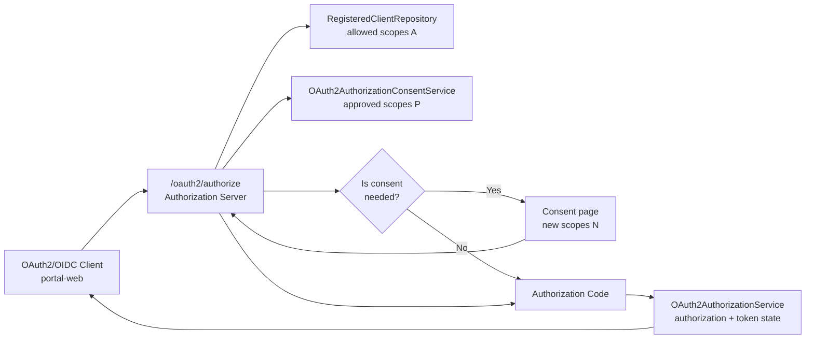

# Distinguishing New Scopes from Previously Approved Scopes

> **Chapter: Consent.** This lesson belongs to the **SPRING_SECURITY_OAUTH2_OIDC_AUTHORIZATION_SERVER** module, focusing on designing, configuring, securing, testing, and operating an OAuth 2.0/OpenID Connect Authorization Server with Spring Security and Spring Authorization Server in Spring Boot. The goal is to distinguish **scopes the client is currently requesting**, **scopes previously approved by the user**, **new scopes requiring approval**, and **scopes actually granted for the current transaction**.

## 1. Context: Same User, Same Client, Yet Permission Requests Can Change

In the OAuth 2.0 Authorization Code Flow, an application (OAuth Client) sends the user to the Authorization Server to request permissions. The Authorization Server authenticates the user, checks the client registration, evaluates consent policy, and may display a page informing the user which permissions the application is requesting. When the user approves, the Authorization Server proceeds to issue an authorization code; after exchanging the code, the client receives an access token with the scopes granted per protocol and policy.

Running example:

- **Authorization Server / OpenID Provider:** `https://login.example.vn`, issuer `https://login.example.vn`.
- **Client:** application `portal-web`, registered callback `https://portal.example.vn/login/oauth2/code/portal`.
- **User:** `user-123`, authenticated at the Authorization Server.
- **Business scopes:** `orders.read` (read orders) and `orders.write` (modify orders).
- **OIDC scopes:** `openid` (identity authentication request) and `profile` (request for a set of profile attributes, subject to claims-release policy).

Initially, the application requests `openid profile orders.read`. Later, the application adds an order-editing feature and requests `orders.write` as well. On the second attempt, if the user already approved the old scopes, the consent page should **highlight the new permission** so they understand what changed. The system must never treat every scope in the client registration as a permission the user has already approved.

| Question | Where the Answer Lives |
|---|---|
| Which scopes is the application **allowed to request**? | `RegisteredClient.getScopes()` |
| In the **current transaction**, which scopes is the application requesting? | `scope` from the validated authorization request |
| Which scopes has the user **previously approved**? | `OAuth2AuthorizationConsentService` → `OAuth2AuthorizationConsent.getScopes()` |
| Which scopes are **newly appearing** in the request and not yet approved? | Set difference: *requested scopes minus previously approved scopes* |
| Which scopes can the final token carry? | Scopes actually granted in the authorization, constrained by request, registration, consent, and policy |

**Consent is user agreement**, not a client authentication mechanism or a replacement for API authorization checks. An access token carrying scope `orders.write` must still be validated by the Resource Server together with issuer, audience, expiration, subject, and relevant business rules.

## 2. The Four-Set Model and Accurate Comparison

Let:

- **A — Allowed:** The set of scopes registered for the client, taken from `RegisteredClient.getScopes()`.
- **R — Requested:** The set of scopes sent by the client in the current authorization request, after parsing and validation.
- **P — Previously approved:** The set of scopes the user previously approved for **that exact client**, retrieved from the consent service.
- **G — Granted now:** The set of scopes actually granted by the Authorization Server for the current transaction, **never inferred directly** from P or A.

Once the request is valid (with respect to scopes, client ID, redirect URI, and other conditions):

```text
New scopes needing consent       N = R \ P
Already approved, requested now  E = R ∩ P
Already approved, not requested  O = P \ R
Unregistered scopes requested    X = R \ A  → must be rejected per policy/spec
```

The formulas above are a **classification model for presentation and decision-making**. `G` must be determined by the Authorization Server from the actual consent/authorization outcome, never `G = A` or automatically `G = P ∪ R`. In addition, certain scopes may receive special handling under OIDC policies and framework implementations; do not treat set differences as a replacement for full protocol validators.

### 2.1. Illustrative Table

Suppose the client registration allows:

```text
A = {openid, profile, orders.read, orders.write}
```

| Transaction | Previously Approved (P) | Client Requesting (R) | Approved and Requested (E) | New, Unapproved (N) |
|---|---|---|---|---|
| First time | `∅` | `openid, profile, orders.read` | `∅` | `openid, profile, orders.read` |
| Requesting write access | `openid, profile, orders.read` | `openid, profile, orders.read, orders.write` | `openid, profile, orders.read` | `orders.write` |
| Read orders only | `openid, profile, orders.read` | `openid, orders.read` | `openid, orders.read` | `∅` |
| Requesting another unregistered permission | `openid, profile, orders.read` | `openid, payments.admin` | `openid` | `payments.admin`, but **request is invalid** because `payments.admin ∉ A` |

In the last row, never show `payments.admin` as a checkbox for the user to “self-grant”. The client is not registered for that scope; the Authorization Server must **reject the invalid request** via protocol handling, typically an `invalid_scope` error.

### 2.2. Confusions That Easily Cause Vulnerabilities

1. **A is not P:** `RegisteredClient.scope("orders.write")` only states that the client *is allowed to request* it, not that the user agreed to it.
2. **P is not R:** stored consent from earlier may include `profile`, while the current request asks only for `orders.read`; the token must not by default carry every previously approved scope.
3. **N does not always equal every scope shown in the UI:** a custom consent page may also display previously approved permissions for context, but must clearly distinguish “already allowed” from “newly requested”.
4. **N is not permission to auto-grant:** the user can uncheck or deny new permissions; the outcome depends on actual processing at the authorization endpoint.
5. **An empty N does not mean everything is satisfied:** re-authentication, re-consent due to a new policy, or OIDC `prompt=consent` may still apply; these conditions are independent of the set comparison.

### 2.3. Scopes Previously Approved That the Client Is No Longer Registered For

An old consent record may contain `reports.export` even after an administrator removed that scope from `RegisteredClient`. In that case `P` can be broader than `A`. Never grant a permission removed from registration just because old consent still exists. Maintain a process to review/clean up old consents when client registrations change, and always bound granted permissions by **the valid request, current client configuration, and policy**.

## 3. Where Does Spring Authorization Server Store Consent?

Spring Authorization Server represents approval via `OAuth2AuthorizationConsent`. A record binds granted `GrantedAuthority` instances to the pair:

- `registeredClientId` — the **internal ID** of the `RegisteredClient` (e.g., `registration-portal-web`), **not** the OAuth `client_id=portal-web` string.
- `principalName` — the principal identity of the approving user (e.g., `user-123`), according to the system's authentication mechanism.

`OAuth2AuthorizationConsentService` is the retrieval and persistence interface, with core methods:

```java
OAuth2AuthorizationConsent findById(
        String registeredClientId, String principalName);

void save(OAuth2AuthorizationConsent authorizationConsent);

void remove(OAuth2AuthorizationConsent authorizationConsent);
```

These are the core signatures for learning. In Spring Authorization Server 1.5.x, the two commonly used implementations are:

| Implementation | Suitable For | Limitations |
|---|---|---|
| `InMemoryOAuth2AuthorizationConsentService` | Demos, unit/integration tests, single instance | Data is lost on restart, not synchronized across pods |
| `JdbcOAuth2AuthorizationConsentService` | Production with RDBMS requiring consent persistence | Must create version-compatible schema, operate DB, enforce privileges and backups |

Spring Authorization Server may default to an in-memory consent service if no bean is defined; multi-instance production deployments should choose synchronized persistence so consent outcomes remain consistent across requests.

### 3.1. `getScopes()` and `getAuthorities()`

`OAuth2AuthorizationConsent.getAuthorities()` returns a set of `GrantedAuthority` instances, which may represent scopes or other authorities. `OAuth2AuthorizationConsent.Builder.scope("orders.read")` stores scopes as authorities prefixed with `SCOPE_`, such as `SCOPE_orders.read`. In Spring Authorization Server 1.5.x versions that provide `getScopes()`, this method **accurately extracts the scopes** from the authorities.

Therefore, to compare against scopes in an authorization request, prefer:

```java
OAuth2AuthorizationConsent consent =
        consentService.findById(client.getId(), principalName);

Set<String> previouslyApprovedScopes =
        consent == null ? Set.of() : consent.getScopes();
```

Do not take `getAuthorities().map(GrantedAuthority::getAuthority)` directly and compare against `orders.read`, because the authority string may be `SCOPE_orders.read` or another authority type. If a project uses an older API version without `getScopes()`, only process authorities prefixed with `SCOPE_` per that version's contract; **never assume every authority is a scope**.

### 3.2. Consent Is Not a Token Store



`RegisteredClientRepository` stores **client application configuration and policies**. `OAuth2AuthorizationConsentService` stores **prior approval decisions**. `OAuth2AuthorizationService` stores **authorizations and token state**. These three responsibilities are distinct; deleting consent does not automatically revoke an unexpired access token.

## 4. Declaring a Client with Consent Enabled in Spring Boot

Example of a confidential web client using Authorization Code + PKCE and OIDC. The code below focuses on client registration, not a complete Authorization Server:

```java
import org.springframework.security.oauth2.core.AuthorizationGrantType;
import org.springframework.security.oauth2.core.ClientAuthenticationMethod;
import org.springframework.security.oauth2.core.oidc.OidcScopes;
import org.springframework.security.oauth2.server.authorization.client.RegisteredClient;
import org.springframework.security.oauth2.server.authorization.settings.ClientSettings;

static RegisteredClient portalClient(
        String encodedClientSecret) {

    return RegisteredClient.withId("registration-portal-web")
            .clientId("portal-web")
            .clientName("Order Portal")
            .clientSecret(encodedClientSecret)
            .clientAuthenticationMethod(
                    ClientAuthenticationMethod.CLIENT_SECRET_BASIC)
            .authorizationGrantType(
                    AuthorizationGrantType.AUTHORIZATION_CODE)
            .redirectUri(
                    "https://portal.example.vn/login/oauth2/code/portal")
            .scope(OidcScopes.OPENID)
            .scope(OidcScopes.PROFILE)
            .scope("orders.read")
            .scope("orders.write")
            .clientSettings(ClientSettings.builder()
                    .requireProofKey(true)
                    .requireAuthorizationConsent(true)
                    .build())
            .build();
}
```

The example assumes `encodedClientSecret` has been hashed with a secure `PasswordEncoder` (such as a `{bcrypt}`-prefixed string); the plaintext secret must be provisioned to the client via a secret store, not hard-coded into the lesson or repository. The rest of the application must register `RegisteredClientRepository`, `AuthorizationServerSettings`, `SecurityFilterChain` beans, user authentication, and signing key material / JWK when using JWTs/ID Tokens.

`requireAuthorizationConsent(true)` tells the framework to evaluate consent via the Authorization Server's mechanism. When scopes are already approved and no condition forces re-prompting, the flow can proceed without showing the consent page. This is **not** a promise that every request will always display a form, nor does it mean the client gets blanket permission for all registered scopes.

`requireProofKey(true)` requires the client to use PKCE when requesting an authorization code, binding the code to the initiating request. PKCE, `state`, and valid redirect URIs must still be verified even when the user has previously consented.

### 4.1. Example Authorization Requests

First time:

```http
GET /oauth2/authorize?response_type=code
    &client_id=portal-web
    &redirect_uri=https%3A%2F%2Fportal.example.vn%2Flogin%2Foauth2%2Fcode%2Fportal
    &scope=openid%20profile%20orders.read
    &state=STATE_RANDOM
    &nonce=NONCE_RANDOM
    &code_challenge=PKCE_CHALLENGE
    &code_challenge_method=S256
Host: login.example.vn
```

Next time, the client wants the additional `orders.write` permission:

```http
GET /oauth2/authorize?response_type=code
    &client_id=portal-web
    &redirect_uri=https%3A%2F%2Fportal.example.vn%2Flogin%2Foauth2%2Fcode%2Fportal
    &scope=openid%20profile%20orders.read%20orders.write
    &state=NEW_STATE_RANDOM
    &nonce=NEW_NONCE_RANDOM
    &code_challenge=NEW_PKCE_CHALLENGE
    &code_challenge_method=S256
Host: login.example.vn
```

The requests above are line-wrapped for readability; real HTTP URLs must be joined on a single line and properly encoded. `state`, `nonce`, and PKCE values must be generated **per transaction**, with sufficient randomness and security properties. Do not store these values in unnecessary logs or tracking systems.

When consent is already saved for `openid, profile, orders.read`, the second request has:

```text
E (approved, requested now): {openid, profile, orders.read}
N (new, needs review):       {orders.write}
```

In practice, consent handling for special scopes like `openid` or OIDC `prompt=consent` must be verified against the framework version; the example above illustrates the **conceptual model** when the consent record stores those scopes.

## 5. Computing New Scopes in Java Without Granting Beyond Registration

The purpose of this computation is to help **display new permissions** and decide whether consent evaluation is needed; it is **not** a place to issue authorization codes or grant tokens directly.

Example using `OAuth2AuthorizationConsent.getScopes()` from Spring Authorization Server 1.5.x:

```java
import java.util.LinkedHashSet;
import java.util.Set;
import org.springframework.security.oauth2.server.authorization.OAuth2AuthorizationConsent;
import org.springframework.security.oauth2.server.authorization.OAuth2AuthorizationConsentService;
import org.springframework.security.oauth2.server.authorization.client.RegisteredClient;

record ScopeComparison(
        Set<String> requested,
        Set<String> previouslyApproved,
        Set<String> approvedAndRequested,
        Set<String> newlyRequested) {}

static ScopeComparison compareScopes(
        RegisteredClient client,
        String principalName,
        Set<String> requestedScopes,
        OAuth2AuthorizationConsentService consentService) {

    // Validate against current client registration before any UI processing.
    if (!client.getScopes().containsAll(requestedScopes)) {
        throw new IllegalArgumentException("Invalid requested scope");
    }

    OAuth2AuthorizationConsent consent = consentService.findById(
            client.getId(), principalName);

    Set<String> previouslyApproved = consent == null
            ? Set.of()
            : consent.getScopes();

    Set<String> approvedAndRequested =
            new LinkedHashSet<>(requestedScopes);
    approvedAndRequested.retainAll(previouslyApproved);

    Set<String> newlyRequested =
            new LinkedHashSet<>(requestedScopes);
    newlyRequested.removeAll(previouslyApproved);

    return new ScopeComparison(
            Set.copyOf(requestedScopes),
            Set.copyOf(previouslyApproved),
            Set.copyOf(approvedAndRequested),
            Set.copyOf(newlyRequested));
}
```

Invoke this from a controller/service layer where you already have the `RegisteredClient`, the `principalName` of the **authenticated user**, the **validated** scope set from the authorization request, and `OAuth2AuthorizationConsentService`. The framework's authorization endpoint handlers remain the final protocol validators.

**Reading the result correctly:**

- `requested`: scopes the client is asking for **this time**, not all scopes in the registration.
- `previouslyApproved`: scopes remembered from previous times; may include scopes **not requested** this time.
- `approvedAndRequested`: the intersection `R ∩ P`, which can be displayed as “already allowed by you”.
- `newlyRequested`: `R \ P`, permissions requiring the user's attention.
- None of the operations above **produce G**; G depends on the user's consent decision, policies, and Authorization Server validation.

On a public endpoint, never return raw `IllegalArgumentException` messages to the client as a protocol error. The snippet above is an **illustrative classification helper**; invalid scope requests must be handled by the Authorization Server per OAuth2 (such as `invalid_scope`) and never redirected to an unverified `redirect_uri`.

### 5.1. Why Prefer `client.getId()` Over `client.getClientId()`?

`OAuth2AuthorizationConsentService.findById(...)` takes `registeredClientId`, which is `RegisteredClient.getId()`. For example:

```text
RegisteredClient.id = "registration-portal-web"
RegisteredClient.clientId = "portal-web"
Principal.getName() = "user-123"
Consent key = ("registration-portal-web", "user-123")
```

Looking up with `"portal-web"` instead of the internal ID can always return `null` and cause every request to be treated as having no prior consent. Also avoid reading `principalName` from browser query/body parameters; derive it only from trusted server-side authentication.

### 5.2. What About `Set<String>` and Display Order?

A `Set` is for set comparison; Java does not guarantee a pleasant display order across all implementations by default. In the UI, sort by **risk level or a product-defined ordering**, such as highlighting `orders.write` more prominently than `profile`. Never use the order of scopes sent in the HTTP request to determine sensitivity or approval priority.

## 6. Rendering the Consent Page: Old Permissions, New Permissions, and User Choices

Spring Authorization Server lets you configure a custom consent page via `OAuth2AuthorizationEndpointConfigurer.consentPage("/oauth2/consent")`. If this path is omitted, the framework can generate a default consent page. When using a custom page, the application must serve `GET /oauth2/consent` itself and submit choices via **POST to the configured authorization endpoint** (typically `/oauth2/authorize`).

Per the Spring Authorization Server 1.5.x configuration API, the custom consent page typically receives these query parameters:

- `client_id`: the client requesting permissions;
- `scope`: the scopes in the authorization request;
- `state`: the value linking the consent transaction to the server-side authorization request.

The server layer must retrieve client metadata from `RegisteredClientRepository` and the user from current authentication. The consent page is an interface for **displaying and collecting a decision**, not for directly granting permissions or writing consent from arbitrary POSTed scopes.

### 6.1. Clearly Displaying the Difference

A good consent page helps the user answer:

| UI Section | Displayed Content |
|---|---|
| **Which app is asking?** | Trusted app name from client registration, e.g., “Order Portal” |
| **What have you already allowed?** | Scopes in `R ∩ P`, explained plainly; can be collapsed |
| **What extra permissions is the app asking for?** | Scopes in `R \ P`, clearly explaining new permissions and their impact |
| **What can you decide?** | Approve selectable permissions, or deny if unwilling to grant |
| **How can you manage permissions later?** | Link to the permission management and revocation section, if provided by the product |

Example copy for an incremental request:

> **Order Portal wants additional permissions.** You already allowed this application to view orders. This time it also wants to **modify orders**. You can approve the additional permission or deny it.

Scope translations in the UI must come from a **dictionary managed by the Authorization Server**, such as `orders.read → View orders` and `orders.write → Create/edit orders`. Never display raw meaningless scope names, and never render raw HTML/JavaScript from `client_name` or unvetted dynamic registration data.

### 6.2. Configuring the Custom Consent Page Path

Core configuration snippet (inside the Authorization Server filter chain bean):

```java
OAuth2AuthorizationServerConfigurer authorizationServer =
        OAuth2AuthorizationServerConfigurer.authorizationServer();

http.securityMatcher(authorizationServer.getEndpointsMatcher())
    .with(authorizationServer, server ->
        server.authorizationEndpoint(endpoint ->
            endpoint.consentPage("/oauth2/consent")))
    .authorizeHttpRequests(authorize ->
        authorize.anyRequest().authenticated());
```

To make this a complete configuration, you also need browser login handling, a separate security filter chain for `GET /oauth2/consent`, an authentication provider/user store, a `JWKSource` (if signing JWTs), an issuer, and repositories. If the application also uses OIDC, enable `server.oidc(...)` with the appropriate OIDC configuration. The `GET /oauth2/consent` page must only be served to **authenticated users**, and never expose a consent management API driven by arbitrary query parameters.

### 6.3. Example Thymeleaf Form with New Scope Grouping

Suppose the controller has safely populated the model with `clientName`, `clientId`, `state`, `approvedScopes`, and `newScopes`. Elements in `newScopes` in the example are objects containing `code` and `description` constructed server-side from an allowlist.

```html
<!doctype html>
<html lang="en" xmlns:th="http://www.thymeleaf.org">
<head>
  <meta charset="UTF-8">
  <title>Confirm Access Permissions</title>
</head>
<body>
  <main>
    <h1>Confirm Permissions for Application</h1>
    <p th:text="${clientName}">Application</p>

    <section th:if="${!#lists.isEmpty(approvedScopes)}">
      <h2>Permissions you already allowed</h2>
      <ul>
        <li th:each="scope : ${approvedScopes}"
            th:text="${scope.description}">Granted permission</li>
      </ul>
    </section>

    <section>
      <h2>Additional permissions requested</h2>
      <form th:action="@{/oauth2/authorize}" method="post">
        <input type="hidden" name="client_id" th:value="${clientId}">
        <input type="hidden" name="state" th:value="${state}">
        <input type="hidden"
               th:name="${_csrf.parameterName}"
               th:value="${_csrf.token}">

        <label th:each="scope : ${newScopes}">
          <input type="checkbox" name="scope"
                 th:value="${scope.code}">
          <span th:text="${scope.description}">Additional permission</span>
        </label>

        <button type="submit">Approve selected permissions</button>
      </form>
      <form th:action="@{/oauth2/authorize}" method="post">
        <input type="hidden" name="client_id" th:value="${clientId}">
        <input type="hidden" name="state" th:value="${state}">
        <input type="hidden"
               th:name="${_csrf.parameterName}"
               th:value="${_csrf.token}">
        <button type="submit">Deny</button>
      </form>
    </section>
  </main>
</body>
</html>
```

This is a **UI skeleton**, not sufficient on its own for every POST scenario: some versions/configurations require submitting the full set of user-approved scopes (including previously approved or default OIDC scopes) depending on the protocol handler and UI design. Test the scenario with existing consent plus a new requested scope to verify that the server actually **retains old permissions and adds only newly selected ones**, and does not grant unchecked scopes. In the form above, submitting no scopes serves as the denial path; exact final behavior/errors must be verified on the actual framework version.

Some Thymeleaf/Spring Security setups **automatically inject a hidden CSRF input**; when adding one manually as shown, inspect the rendered HTML to avoid sending duplicate tokens unnecessarily. Prefer one consistent CSRF mechanism. OAuth2 `state` links the consent response to the authorization request, and **does not replace the application's POST CSRF token**. Never disable CSRF just to get a form working.

### 6.4. Avoiding Losing Previously Approved Permissions in the UI

There are two common UI policies:

1. **Incremental consent:** only asks the user about new permissions; previously approved permissions are shown for reference. The Authorization Server must merge/retain existing permissions accurately per design.
2. **Full-request re-consent:** displays all requested scopes again and asks the user to confirm, typically in special cases or `prompt=consent` (when OIDC supports it). Clearly distinguish already-approved permissions from new ones, and especially never pre-check a high-impact new scope.

UI choices must never weaken the security logic of the authorization endpoint. **Never let JavaScript or the browser determine “already approved” using `localStorage`, custom cookies, or hidden fields**. Approval history must come from the consent service and be used only after the server validates the client, principal, request, and transaction state.

## 7. Saving and Reloading Consent Correctly

### 7.1. Creating Sample Consent in Tests / Controlled Seeding

The code below illustrates constructing consent for **one principal** and **one `RegisteredClient`**, using `Builder.scope(...)`:

```java
import org.springframework.security.oauth2.server.authorization.OAuth2AuthorizationConsent;
import org.springframework.security.oauth2.server.authorization.OAuth2AuthorizationConsentService;
import org.springframework.security.oauth2.server.authorization.client.RegisteredClient;

static void seedTestConsent(
        RegisteredClient client,
        String principalName,
        OAuth2AuthorizationConsentService service) {

    OAuth2AuthorizationConsent consent = OAuth2AuthorizationConsent
            .withId(client.getId(), principalName)
            .scope("openid")
            .scope("profile")
            .scope("orders.read")
            .build();

    service.save(consent);
}
```

This is a **test fixture**, not a procedure permitted to auto-create consent on behalf of users in production. In real applications, **approval decisions** must come from an authenticated consent flow tied to an authorization transaction and clear policy. Never “seed all scopes” into the consent store to suppress consent screens, and never let a public endpoint call `service.save(...)` from a client-supplied scope list.

### 7.2. Updating Consent and Understanding Its Lifecycle

When a user approves an additional scope, previous consent can be **updated**. `OAuth2AuthorizationConsent` is immutable, so a valid management flow can use `OAuth2AuthorizationConsent.from(existing)` to create a builder, add/remove authorities, and call `save(...)`. Avoid custom code that overwrites consent with “only the scopes POSTed this time” if the application intends to preserve valid previously approved permissions.

However, **do not blindly merge all scopes** from the request: merge only scopes allowed by client registration, genuinely approved by the user, and still valid per policy. In particular, never turn a browser-injected `scope=orders.write` into newly saved consent.

### 7.3. JDBC Persistence

Example bean when `JdbcTemplate` and `RegisteredClientRepository` are available:

```java
@Bean
OAuth2AuthorizationConsentService authorizationConsentService(
        JdbcTemplate jdbcTemplate,
        RegisteredClientRepository registeredClientRepository) {
    return new JdbcOAuth2AuthorizationConsentService(
            jdbcTemplate, registeredClientRepository);
}
```

Imports belong to `org.springframework.security.oauth2.server.authorization`, `org.springframework.security.oauth2.server.authorization.client`, and `org.springframework.jdbc.core`. Use the exact SQL schema matching your Spring Authorization Server version and apply it via migrations; the JDBC service **does not verify or create tables automatically**. This snippet defines a service bean, not system-wide transaction/persistence configuration.

Keep in mind:

- Ensure all Authorization Server instances see the same consent data so node A does not re-prompt for permissions already approved on node B.
- Keep internal `RegisteredClient.id` stable. Deleting and recreating a `RegisteredClient` with a new ID may orphan old consent even if `client_id` stays the same.
- Plan DB privileges, backups, encryption at rest, retention periods, and deletion policies per organizational standards.
- If caching consent, implement invalidation when users revoke permissions or client registrations change.
- Never write directly to the consent table to “allow all scopes” in production.

## 8. New Scopes, OIDC Scopes, and `prompt=consent`

### 8.1. Consent and OIDC Do Not Completely Overlap

In OpenID Connect, `openid` marks an OIDC authentication request; `profile`, `email`, and `offline_access` carry additional semantics. Distinguish:

- **Registered scope:** the application is allowed to request a permission/claim group.
- **Scope consent:** user approval per policy; does not guarantee all attributes for that scope actually exist.
- **Claims in ID Token/UserInfo:** data is released only if protocol, scopes, consent, and claim mappers/policies permit it.
- **Refresh token:** issuing a refresh token also depends on grant types, client type, and token issuance policies; having `offline_access` in the request does not automatically guarantee a refresh token is issued.

Some frameworks/policies treat `openid` as a foundational scope handled specially on the consent page rather than a normal checkbox. The `N = R \ P` model remains useful, yet the UI and protocol handler must respect real OIDC behavior; do not mechanically strip `openid` from a token request just because it was not shown as a checkbox.

### 8.2. `prompt=consent` and `prompt=none`

An OIDC RP may send:

- `prompt=consent`: asks the OP to **re-display the consent step** per OIDC semantics, even if the scopes were previously approved.
- `prompt=none`: forbids interactive UI; if login or consent is required and cannot be resolved silently, the OP must return an appropriate error such as `login_required` or `consent_required`, never displaying a form.
- `prompt=login`: primarily requests re-authentication; it does not automatically imply re-prompting for all consent.

Exact support and behavior in Spring Authorization Server may vary by version and configuration. Therefore, **test real requests** combining `prompt`, stored/absent consent, active sessions, and new scopes. Do not assume `requireAuthorizationConsent(true)` automatically implements every edge case of `prompt=consent` or `prompt=none`.

### 8.3. Partial Approval and Denial

OAuth2 allows users to grant a **subset** of requested permissions where supported. For example, a client requests `orders.read` and `orders.write`, and the user checks only read access. If policy and token issuance support partial consent, the access token must reflect **granted permissions** rather than automatically adding `orders.write`.

On the other hand, a client may **require all scopes** for a feature; when the user declines some, the RP must handle missing permissions gracefully, communicate clearly, and avoid blindly calling a sensitive API only to fail with 403. If the user denies everything, the authorization flow must end with the appropriate protocol error (typically `access_denied`), never silently issuing a token with the original requested scopes.

## 9. Revoking Consent Differs from Revoking Tokens

A production application should give users a “Manage connected apps” feature. If a user revokes `orders.write` or deletes all consent for `portal-web`, distinguish:

| Action | Primary Effect | What Does **Not Automatically** Happen |
|---|---|---|
| Delete/update `OAuth2AuthorizationConsent` | **Future** authorization requests are re-evaluated against the newly stored permissions | Already issued JWT access tokens are not necessarily invalidated immediately |
| Revoke access/refresh token via the appropriate mechanism | Tokens are revoked according to token format and architecture | Does not necessarily delete the consent record |
| Remove scope from `RegisteredClient` | Client can no longer request that scope | Old consents or unexpired tokens are not automatically purged |
| Log out of OP/RP session | Ends login session per design | Does not automatically revoke all active tokens |
| Delete RegisteredClient | Ends client registration per policy | Do not assume related tokens, consents, and logs are automatically deleted synchronously |

If you want to **immediately revoke** API access upon consent withdrawal, combine revocation/introspection, short access token lifetimes, Resource Server state checks, or a suitable token-blocking mechanism. If access tokens are locally verified JWTs, deleting consent in the database **does not automatically invalidate signed JWTs** until the API performs an independent revocation check or the JWT expires.

### 9.1. Consistent Principals and Tenants

Consent must be bound to a **stable user identifier** and the exact client. In multi-tenant systems, avoid letting two tenants use the same `principalName` and `registeredClientId` and collide into one permission scope. Depending on architecture, include tenant context in principal identifiers, separate issuers/registries, or implement a custom service with explicit isolation.

Never use a mutable display email or username as a security key without a migration policy, preventing a user from inheriting another account's consent when a name/email is recycled.

## 10. Protecting the Consent Page and Approval Data

### 10.1. Enforcing Every Trust Boundary

- **Client registration:** only governed and vetted scopes, redirect URIs, names, and metadata may serve as the basis for consent.
- **Authenticated principal:** only an authenticated user may change their own consent; never take `principalName` from query/form inputs.
- **Authorization transaction:** bind `client_id`, `state`, requested scopes, redirect URI, and subject to the pending request session; do not rely solely on hidden inputs.
- **CSRF:** protect consent POSTs with the application's CSRF token alongside protocol `state`.
- **Output encoding:** render client names and scope descriptions with text escaping (e.g., Thymeleaf `th:text`); never use raw HTML from dynamic registration or query parameters.
- **Request validation:** accept only valid selections within the transaction's requested scopes; any scope outside client registration or not requested must be rejected or excluded per protocol.
- **Audit and privacy:** log who approved which client, scopes, and timestamp if policy allows, while never logging passwords, access tokens, authorization codes, full cookies, or unnecessary personal data.

The consent page helps protect users from **scope escalation**, but does not replace API authorization. The Resource Server must still validate tokens and permission policies; never allow stale scopes to keep granting access after an administrator removes a scope.

### 10.2. Common Attack Scenarios

| Risk | Illustration | Defense |
|---|---|---|
| **Scope injection** | Browser adds `scope=admin` to POST | Authorization endpoint accepts only selections within validated request/registration |
| **Consent CSRF** | Another site tricks user into approving new permissions | Session binding, CSRF token, SameSite cookies, and transaction validation |
| **Client impersonation** | Rogue client mimics an official app's name/logo | Governed metadata provisioning, client authentication, and trusted data sources |
| **Consent phishing** | UI hides sensitive write access behind vague labels | Plain descriptions, separate sensitive permissions, never pre-check high-risk new scopes |
| **Open redirect** | Arbitrary `returnUrl` after approve/deny | Redirect strictly to registered and verified redirect URIs |
| **Cross-tenant consent leak** | Principal A sees someone else's consent | Tenant isolation and deriving principal from trusted authentication |
| **Cached stale consent** | Revoked already, yet one pod holds stale cache | Cache invalidation, shared data source, version tracking |
| **Token outlives consent** | User revokes today, JWT access token remains valid | Short TTLs + revocation/status checks as required |

## 11. Test Matrix: Distinguishing Old and New Scopes

Create test `RegisteredClient` entries, users, and mock consents in an isolated test environment; never use production credentials. This section verifies both the **classification helper** and **real authorization/token flow outcomes**.

| Case | RegisteredClient Allowed (A) | Previously Approved (P) | Requested (R) | Expected |
|---|---|---|---|---|
| First time | `read,write` | `∅` | `read` | `N={read}`, may require consent |
| Same permission second time | `read,write` | `read` | `read` | `N=∅`; consent may be skipped if policy permits |
| Requesting elevated permission | `read,write` | `read` | `read,write` | `N={write}`; UI highlights new permission |
| Requesting fewer permissions | `read,write` | `read,write` | `read` | `N=∅`; token does not automatically include `write` |
| Requesting only new permission | `read,write` | `read` | `write` | `N={write}`, `read` is not automatically added to request |
| Unregistered scope | `read` | `read` | `read,admin` | Reject `invalid_scope`, never show `admin` as grantable |
| Consent saved, scope removed from client | `read` | `read,write` | `read` | Never grant `write`; review/prune old consent |
| Different user, same client | `read,write` | User A approved `read` | User B requests `read` | User B does not inherit User A's consent |
| Different client, same user | Clients A and B have `read` | Consent for A | Client B requests `read` | B does not inherit A's consent |
| Changed `RegisteredClient.id` | Client ID still `portal-web` | Consent keyed by old ID | Requests `read` | Lookup by new ID misses old consent; requires proper migration |
| Deny new permission | `read,write` | `read` | `read,write` | Never auto-grant `write`; RP handles missing permission/error |
| Policy-mandated re-consent | `read,write` | `read,write` | `read,write` | If policy forces re-consent, form still appears even though `N=∅` |
| Multi-instance | `read,write` | User just approved on node A | Requests again on node B | Node B reads saved consent from shared storage |
| Revocation | `read,write` | Approved `read,write` then deleted consent | Requests `read` again | Consent is re-prompted per policy; old tokens handled separately |
| `prompt=none` with new scope | `read,write` | `read` | `read,write` | No UI shown; returns appropriate OIDC error when interaction is needed |

### 11.1. Useful Unit Test for Set Comparison

Assuming `client` and `consentService` are initialized in the test using an in-memory repository, and prior consent is seeded as in Section 7:

```java
@Test
void detectsOnlyTheNewScope() {
    ScopeComparison result = compareScopes(
            client,
            "user-123",
            Set.of("openid", "profile", "orders.read", "orders.write"),
            consentService);

    assertEquals(Set.of("orders.write"), result.newlyRequested());
    assertEquals(
            Set.of("openid", "profile", "orders.read"),
            result.approvedAndRequested());
}
```

Add JUnit 5 imports and fixture setup accordingly. This unit test verifies **set classification**, not the consent UI, CSRF, validators, grant issuance, or final token scopes. Integration tests must cover authorization redirect → login → consent POST → authorization code → token response, including user denial and invalid cases.

### 11.2. Common Troubleshooting

| Symptom | Causes to Check | Resolution |
|---|---|---|
| Consent screen always reappears | In-memory across restarts/pods, looking up by `clientId` instead of `RegisteredClient.id`, or wrong principal | Check `(registeredClientId, principalName)` key and persistence |
| Consent does not appear for new permission | `requireAuthorizationConsent(false)`, custom policy, or over-seeded consent | Inspect `ClientSettings`, consent predicate, and consent store |
| New scope granted even though user didn't select it | Auto-merging `R` or `A` into token/consent, trusting hidden inputs | Let authorization endpoint control selection; inspect final granted scopes |
| UI labels approved scope as “new” | Comparing raw `SCOPE_`-prefixed `getAuthorities()` to scope strings | Use `getScopes()` or normalize per version |
| User B sees User A's permissions | Principal key lacks tenant/user identity, unpartitioned cache | Use stable principal identifiers and tenant isolation |
| Consent lost after restart | `InMemoryOAuth2AuthorizationConsentService` | Switch to JDBC or managed durable service |
| API calls succeed after consent revocation | Consent and access tokens have independent lifecycles | Implement revocation/token status checks at Resource Server |
| Consent POST returns 403 | Invalid/missing CSRF token, broken session cookie, or misconfigured filter chain | Check form, CSRF, session, proxy, and security matchers |
| `prompt=none` opens consent form | OIDC policy not enforced properly for the version | Run protocol tests; return `consent_required` when interaction is needed |

## 12. Checklist and Self-Check Questions

- [ ] Clearly understand `A`, `R`, `P`, `N`, and `G`; never equate registered scopes with approved scopes.
- [ ] Compute `N = R \ P` and `E = R ∩ P` **after validating** the request and `RegisteredClient`.
- [ ] Look up consent by `RegisteredClient.id` and trusted principal; enforce clear isolation in multi-tenant setups.
- [ ] Use `OAuth2AuthorizationConsent.getScopes()` or version-accurate normalization; never compare raw `SCOPE_...` against scope strings.
- [ ] Enable `requireAuthorizationConsent(true)` for clients/policies requiring consent and verify actual framework behavior.
- [ ] Custom consent page distinguishes previously allowed permissions from newly requested ones; permission labels are transparent.
- [ ] Never allow the browser to alter consent history, inject permissions, or choose redirect URIs after approve/deny.
- [ ] Consent form POSTs to the authorization endpoint with transaction-matched `client_id`/`state`, protected by CSRF and session checks.
- [ ] Production uses a durable consent service when needed; avoid losing consent across restarts or pod inconsistencies.
- [ ] Have a revocation workflow and understand consent revocation **differs from** token revocation; Resource Servers continue enforcing authorization.
- [ ] Test incremental consent, partial grants, denial, invalid scopes, removed scopes, OIDC `prompt`, sessions, and multi-instance deployments.

**Self-check questions:**

1. If `A={read,write}`, `P={read}`, and `R={read,write}`, what are `N` and `E`?
2. Why can `RegisteredClient.getScopes()` never substitute for `OAuth2AuthorizationConsent.getScopes()`?
3. Why must you pass `RegisteredClient.getId()` when calling `findById(...)` on the consent service?
4. A user previously approved `read,write`, yet the client requests only `read` this time. Should the token automatically carry `write`?
5. Why shouldn't you use a browser-submitted hidden `previouslyApprovedScopes` field to decide which scopes were consented?
6. Does deleting consent immediately invalidate an unexpired JWT access token?
7. When `prompt=none` is sent and an app requests a new scope requiring consent, how should the OP respond?
8. Which tests prove there is no scope escalation through a custom consent form?

## References

- [Spring Authorization Server — Core Model / Components](https://docs.spring.io/spring-authorization-server/reference/core-model-components.html): `OAuth2AuthorizationConsent` and `OAuth2AuthorizationConsentService`.
- [Spring Authorization Server — OAuth2AuthorizationConsent API](https://docs.spring.io/spring-authorization-server/reference/api/java/org/springframework/security/oauth2/server/authorization/OAuth2AuthorizationConsent.html): `getScopes()`, `getAuthorities()`, and consent identifier keys.
- [Spring Authorization Server — OAuth2AuthorizationConsent.Builder API](https://docs.spring.io/spring-authorization-server/reference/api/java/org/springframework/security/oauth2/server/authorization/OAuth2AuthorizationConsent.Builder.html): `scope(...)` and the `SCOPE_` prefix.
- [Spring Authorization Server — OAuth2AuthorizationEndpointConfigurer API](https://docs.spring.io/spring-authorization-server/reference/api/java/org/springframework/security/oauth2/server/authorization/config/annotation/web/configurers/OAuth2AuthorizationEndpointConfigurer.html): custom consent page and POST requirements.
- [Spring Authorization Server — OAuth2AuthorizationCodeRequestAuthenticationProvider API](https://docs.spring.io/spring-authorization-server/reference/api/java/org/springframework/security/oauth2/server/authorization/authentication/OAuth2AuthorizationCodeRequestAuthenticationProvider.html): consent request evaluation policy.
- [RFC 6749 — The OAuth 2.0 Authorization Framework](https://www.rfc-editor.org/rfc/rfc6749): authorization requests, scopes, and authorization codes.
- [RFC 9700 — Best Current Practice for OAuth 2.0 Security](https://www.rfc-editor.org/rfc/rfc9700): protecting redirect URIs, PKCE, and authorization flows.
- [OpenID Connect Core 1.0](https://openid.net/specs/openid-connect-core-1_0.html): `openid`, `prompt`, consent, and OIDC requirements.
