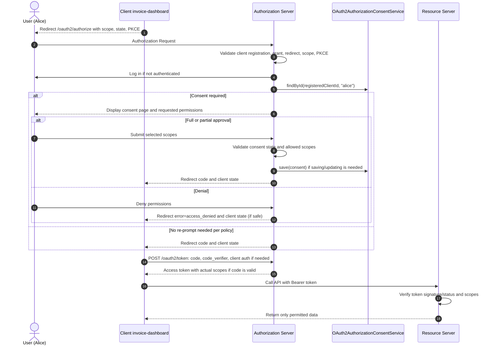

# Handling Approval, Denial, and Scope Selection

## 1. Where Does Consent Fit in OAuth 2.0 / OpenID Connect?

In the **Consent** chapter of the **SPRING_SECURITY_OAUTH2_OIDC_AUTHORIZATION_SERVER** module, an Authorization Server built with **Spring Security**, **Spring Authorization Server**, and **Spring Boot** must answer three questions before granting access to a user's resources:

1. **Is the client registered and permitted to use this flow?**
2. **Who is the authenticated user?**
3. **Which permissions does the user approve for the client to exercise?**

The third question is **authorization consent**: the Resource Owner's decision to allow or deny an application (client) access to resources under the requested permission scopes. Consent typically appears in the **Authorization Code Flow** when an application requests permissions on behalf of a user.

For example, the `invoice-dashboard` application requests two scopes:

- `invoice.read`: view invoice lists and details;
- `invoice.export`: download invoice data.

User Alice may agree to viewing invoices but not want to allow data export. The Authorization Server must preserve the exact approved scopes rather than automatically granting every permission the client requested.

> **Core Distinction:** Login proves *who the user is*. Consent expresses *which permissions the user approves for the client*. Having a registered application and a logged-in user is still not sufficient to assume all scopes are granted.

### Lesson Objectives

After completing this lesson, you will be able to:

1. Distinguish **full approval**, **partial approval**, and **denial** of an authorization request.
2. Explain how Spring Authorization Server uses `RegisteredClient`, `OAuth2AuthorizationConsent`, `OAuth2AuthorizationConsentService`, and `OAuth2Authorization`.
3. Enable consent requirements for a client via `ClientSettings.requireAuthorizationConsent(true)`.
4. Design a consent screen that displays permissions clearly and submits the exact user-selected scopes.
5. Distinguish stored consent status from **actual scopes in the access token** and authorization checks at the Resource Server.
6. Build tests for approval, denial, partial grants, prior consent, and permission revocation.

## 2. Three Outcomes of a Consent Screen

Suppose a `RegisteredClient` allows `invoice.read` and `invoice.export`, and the client sends:

```http
GET /oauth2/authorize?response_type=code&client_id=invoice-dashboard&redirect_uri=https%3A%2F%2Fdashboard.example.com%2Fcallback&scope=invoice.read%20invoice.export&state=CLIENT_STATE&code_challenge=PKCE_CHALLENGE&code_challenge_method=S256 HTTP/1.1
Host: auth.example.com
```

The values `CLIENT_STATE` and `PKCE_CHALLENGE` are illustrative only. In a real request, the client must generate an unpredictable `state`, a secure `code_verifier`, and a valid PKCE `code_challenge`.

| Decision | User Selection | Intended Business Outcome | Behavior to Verify |
| --- | --- | --- | --- |
| **Full approval** | `invoice.read` and `invoice.export` | Client is permitted both requested scopes | Authorization is granted with the corresponding permission set |
| **Partial approval** | Only `invoice.read` | Client is permitted only to read invoices | Authorization/token does **not** include `invoice.export` |
| **Denial** | Declines granting access to the app | No authorization code or token issued from this request | Returns appropriate error, typically `access_denied` when callback is valid |

In Spring Authorization Server's implementation, the consent model supports granting a **subset** of requested authorities/scopes. However, a product may also have mandatory scopes or custom rules: if partial selection fails to meet minimum requirements, the Authorization Server must reject or clearly explain the additional requirement. **Never issue a token with unapproved scopes.**

### Consent Is Not a Grant Type

| Term | Role |
| --- | --- |
| `authorization_code` | **Grant type** defining how the client exchanges an authorization code for tokens |
| `response_type=code` | Request parameter at the Authorization Endpoint to obtain a code |
| `scope=invoice.read` | Access permissions **proposed** by the client |
| Consent | The Resource Owner's decision on the proposed permissions |
| `OAuth2Authorization.authorizedScopes` | Scopes granted in a **specific authorization** |
| `OAuth2AccessToken.scopes` | Set of scopes bound to an **issued access token** |

With `client_credentials`, there is no end user interacting with an Authorization Code Flow consent screen. The client authenticates itself and receives tokens according to application-level permissions. Never mechanically apply end-user consent rules to service tokens.

## 3. Consent Across the Full Authorization Code Flow



**Reading the diagram properly:** The denial branch **terminates the request**, so the client has no valid code to send a token request. The arrows calling the Token Endpoint and Resource Server apply only to branches **where an authorization code was issued**.

Logical steps:

1. The Authorization Server verifies the client, `response_type=code`, redirect URI, scopes, and PKCE.
2. The user logs in if the current session is not yet authenticated.
3. The AS evaluates the `requireAuthorizationConsent` policy and stored consent for the client–principal pair.
4. If permissions remain to be asked, the AS shows a screen with the client's identity and descriptions of each permission.
5. The user selects scopes, approves, or denies.
6. The AS binds the outcome to the **exact request, client, and user session**, then processes the authorization response.
7. When the code is exchanged for tokens, granted scopes must serve as the limit for the token. The Resource Server enforces permissions directly from the token and authorization policy.

The **internal order** of filters, authentication providers, consent persistence, and login screens depends on version and configuration. The diagram shows business behavior, not a method-by-method source trace.

## 4. Two Data Layers: Stored Consent and Active Authorization

Spring Authorization Server separates **remembered approval decisions** from a **specific authorization that issued tokens**.

| Object | Represents | Lifecycle |
| --- | --- | --- |
| `RegisteredClient` | Application identity and allowed capabilities: grant types, redirect URIs, scopes, consent policy | Lives with client registration |
| `OAuth2AuthorizationConsent` | Authorities approved by a Resource Owner for a client | Can be reused across subsequent authorization requests |
| `OAuth2Authorization` | A single authorization/session and its corresponding granted tokens and scopes | Tied to a specific grant and code/token lifecycle |
| `OAuth2AccessToken` | Credential used to call APIs | Has its own expiration, scopes, and revocation/verification mechanism |

### 4.1. Structure of `OAuth2AuthorizationConsent`

In terms of data, consent is keyed by:

```text
OAuth2AuthorizationConsent
  registeredClientId : String
  principalName      : String
  authorities        : Set<GrantedAuthority>
```

- **`registeredClientId`** is the internal ID of the `RegisteredClient`, **different** from the `client_id` string sent by the application over HTTP.
- **`principalName`** identifies the authenticated user, such as `alice`.
- **`authorities`** are the permitted `GrantedAuthority` values. They can represent scopes (typically formatted as `SCOPE_invoice.read`) or other authorities depending on design/extensions.

Consent normally binds to the **client–user pair**, not to a single authorization code. Thus, when Alice returns to use the same client, the server can reuse previously agreed permissions according to policy.

### 4.2. Why Do `OAuth2AuthorizationConsent` and `OAuth2Authorization` Differ?

Suppose Alice approves `invoice.read` on Monday. On Tuesday the app requests that scope again. The consent service may still hold Monday's record, even though Monday's authorization code and access token have already expired.

```text
Client registration:
  RegisteredClient.scopes = {invoice.read, invoice.export}

Stored consent for (client, alice):
  authorities = {SCOPE_invoice.read}

Authorization for new request:
  authorizedScopes = {invoice.read}

Corresponding access token:
  scopes = {invoice.read}
```

Stored consent **does not automatically create a new access token**. Tokens must still be issued through a valid grant after all authentication and authorization conditions pass.

**Conversely, deleting stored consent does not automatically delete existing authorizations/tokens.** If a user withdraws permissions and the business requires immediate access blocking, you must also design token/authorization revocation and how Resource Servers recognize revocation.

## 5. Enabling the Consent Screen on `RegisteredClient`

Spring Authorization Server allows a client to require user consent via `ClientSettings.requireAuthorizationConsent(true)`. The example below registers a confidential web client supporting Authorization Code and refresh tokens:

```java
package com.example.authserver;

import java.util.UUID;

import org.springframework.context.annotation.Bean;
import org.springframework.context.annotation.Configuration;
import org.springframework.security.crypto.password.PasswordEncoder;
import org.springframework.security.oauth2.core.AuthorizationGrantType;
import org.springframework.security.oauth2.core.ClientAuthenticationMethod;
import org.springframework.security.oauth2.server.authorization.client.InMemoryRegisteredClientRepository;
import org.springframework.security.oauth2.server.authorization.client.RegisteredClient;
import org.springframework.security.oauth2.server.authorization.client.RegisteredClientRepository;
import org.springframework.security.oauth2.server.authorization.settings.ClientSettings;

@Configuration
class DemoClientConfig {
    @Bean
    RegisteredClientRepository registeredClients(PasswordEncoder passwordEncoder) {
        RegisteredClient dashboard = RegisteredClient
                .withId(UUID.randomUUID().toString())
                .clientId("invoice-dashboard")
                .clientName("Invoice Dashboard")
                .clientSecret(passwordEncoder.encode("demo-secret-change-me"))
                .clientAuthenticationMethod(
                        ClientAuthenticationMethod.CLIENT_SECRET_BASIC)
                .authorizationGrantType(
                        AuthorizationGrantType.AUTHORIZATION_CODE)
                .authorizationGrantType(
                        AuthorizationGrantType.REFRESH_TOKEN)
                .redirectUri("https://dashboard.example.com/callback")
                .scope("invoice.read")
                .scope("invoice.export")
                .clientSettings(ClientSettings.builder()
                        .requireProofKey(true)
                        .requireAuthorizationConsent(true)
                        .build())
                .build();

        return new InMemoryRegisteredClientRepository(dashboard);
    }
}
```

**This is a client configuration snippet**, not a complete Spring Boot application. The Authorization Server also needs security filter chains, user login, JWK/signing keys, issuer, authorization persistence services, password encoder configuration, and related components. The sample secret is strictly for learning; never commit it into real environment sources.

### Role of Each Setting

| Setting | Effect |
| --- | --- |
| `authorizationGrantType(AUTHORIZATION_CODE)` | Client can execute the Authorization Code Flow |
| `redirectUri(...)` | Allowed callback destination for receiving codes and returned state |
| `scope(...)` | Scopes the client is permitted to **request** |
| `requireProofKey(true)` | Authorization requests must use valid PKCE |
| `requireAuthorizationConsent(true)` | Authorization Server may prompt the user to approve consent-required permissions |
| `clientName(...)` | Friendly name for the UI to identify the application, if configured |

Setting `requireAuthorizationConsent(true)` **does not mean every access is guaranteed to show the screen**. If the same principal and client already have valid consent for the requested scopes, the server may skip prompting depending on policy and configuration. If the client requests additional unapproved permissions, the screen may appear for the user to decide on those additions.

**Likewise, do not infer that `requireAuthorizationConsent(false)` means “disable authorization”.** This value only affects whether the user consent prompt is required; the client must still pass grant, redirect URI, scope, PKCE, authentication, and server security policies. An organization might require separate legal or data-specific consent even when some flows skip the prompt.

### Scenarios After the User Has Agreed

Suppose consent already stores `SCOPE_invoice.read`. On the next attempt:

- Client requests only `invoice.read`: typically does not need to prompt again for the already approved scope.
- Client requests `invoice.read invoice.export`: must evaluate the unapproved `invoice.export`; may require incremental consent.
- Client requests `invoice.admin` not present in `RegisteredClient.scopes`: **must be rejected per registration/policy**; never use the consent UI to grant permissions beyond registration.

If the user also approves `invoice.export`, the consent service can update the stored authority set. How approved authorities are merged and what is actually granted in each authorization depends on server handling logic; when testing, always verify both the consent record **and** the token response.

## 6. `OAuth2AuthorizationConsentService`: Reading, Saving, and Removing Decisions

The `OAuth2AuthorizationConsentService` interface provides the core operations:

| Method | Purpose |
| --- | --- |
| `findById(registeredClientId, principalName)` | Look up stored consent for **an internal client and principal** |
| `save(OAuth2AuthorizationConsent)` | Save a new or updated set of approved authorities |
| `remove(OAuth2AuthorizationConsent)` | Delete stored consent per user or policy decision |

Spring Authorization Server provides two standard implementations: `InMemoryOAuth2AuthorizationConsentService` for development/testing and `JdbcOAuth2AuthorizationConsentService` for database persistence via JDBC.

### 6.1. In-Memory Configuration in Labs

```java
import org.springframework.context.annotation.Bean;
import org.springframework.security.oauth2.server.authorization.InMemoryOAuth2AuthorizationConsentService;
import org.springframework.security.oauth2.server.authorization.OAuth2AuthorizationConsentService;

@Bean
OAuth2AuthorizationConsentService authorizationConsentService() {
    return new InMemoryOAuth2AuthorizationConsentService();
}
```

In-memory consent is lost when the application restarts; if multiple Authorization Server instances do not share state, users may be re-prompted or experience inconsistent consent across nodes.

### 6.2. JDBC Configuration When Persistence Is Required

```java
import org.springframework.context.annotation.Bean;
import org.springframework.jdbc.core.JdbcTemplate;
import org.springframework.security.oauth2.server.authorization.JdbcOAuth2AuthorizationConsentService;
import org.springframework.security.oauth2.server.authorization.OAuth2AuthorizationConsentService;
import org.springframework.security.oauth2.server.authorization.client.RegisteredClientRepository;

@Bean
OAuth2AuthorizationConsentService authorizationConsentService(
        JdbcTemplate jdbcTemplate,
        RegisteredClientRepository registeredClients) {
    return new JdbcOAuth2AuthorizationConsentService(
            jdbcTemplate, registeredClients);
}
```

When using JDBC, you must configure a DataSource, `JdbcTemplate`, client repository, and create the `oauth2_authorization_consent` table using the **official SQL schema for the exact version in use**. Do not guess column names or authority serialization from the Java interface. In real systems, alongside consent, you also need to consider `RegisteredClientRepository`, `OAuth2AuthorizationService`, and multi-node configuration.

### 6.3. Reading Consent and Checking an Approved Authority

```java
import org.springframework.security.core.authority.SimpleGrantedAuthority;
import org.springframework.security.oauth2.server.authorization.OAuth2AuthorizationConsent;
import org.springframework.security.oauth2.server.authorization.OAuth2AuthorizationConsentService;
import org.springframework.security.oauth2.server.authorization.client.RegisteredClient;

public boolean hasReadConsent(
        OAuth2AuthorizationConsentService consents,
        RegisteredClient client,
        String principalName) {

    OAuth2AuthorizationConsent consent =
            consents.findById(client.getId(), principalName);

    return consent != null && consent.getAuthorities().contains(
            new SimpleGrantedAuthority("SCOPE_invoice.read"));
}
```

This snippet illustrates a lookup **within a trusted administration context**. It **does not replace** authorization request evaluation, does not prove an existing access token carries the scope, and must never be exposed as an API for arbitrary callers to query others' consents.

### 6.4. Constructing a Consent Record with the Java API

To understand how data is stored, inspect this model:

```java
import org.springframework.security.core.authority.SimpleGrantedAuthority;
import org.springframework.security.oauth2.server.authorization.OAuth2AuthorizationConsent;

OAuth2AuthorizationConsent consent = OAuth2AuthorizationConsent
        .withId(registeredClient.getId(), "alice")
        .authority(new SimpleGrantedAuthority("SCOPE_invoice.read"))
        .build();

// Call only when Alice actually approved through a valid flow:
// authorizationConsentService.save(consent);
```

**Do not treat the application calling `save(...)` on its own as proof Alice agreed.** The decision must come from an authenticated consent flow bound to the right request and principal, or another explicitly authorized policy. Non-scope authorities may also be supported by the model, but granted permissions must comply with client registration and Authorization Server policy.

## 7. Designing the Consent Screen and Submission Flow

Spring Authorization Server can generate a **default consent page** when prompting the user. When you want to customize branding, language, and permission descriptions, you can configure a custom page using `OAuth2AuthorizationEndpointConfigurer.consentPage(...)`.

### 7.1. Configuring the Custom Consent Page URI

Example snippet of a SecurityFilterChain for the Authorization Server:

```java
import org.springframework.context.annotation.Bean;
import org.springframework.core.annotation.Order;
import org.springframework.security.config.annotation.web.builders.HttpSecurity;
import org.springframework.security.oauth2.server.authorization.config.annotation.web.configurers.OAuth2AuthorizationServerConfigurer;
import org.springframework.security.web.SecurityFilterChain;

@Bean
@Order(1)
SecurityFilterChain authorizationServerSecurityFilterChain(HttpSecurity http)
        throws Exception {
    OAuth2AuthorizationServerConfigurer as =
            OAuth2AuthorizationServerConfigurer.authorizationServer();

    http.securityMatcher(as.getEndpointsMatcher())
            .with(as, configurer -> configurer
                    .authorizationEndpoint(endpoint -> endpoint
                            .consentPage("/oauth2/consent")))
            .authorizeHttpRequests(authorize ->
                    authorize.anyRequest().authenticated());

    return http.build();
}
```

This is **only the consent routing piece**; a complete Authorization Server also requires a SecurityFilterChain for login, a mechanism redirecting unauthenticated users to `/login`, client registration, issuer, JWK/token services, related beans, and OIDC configuration if needed. If `GET /oauth2/consent` is served by Spring MVC outside the AS endpoint matcher, protect that route in the application's filter chain.

When redirecting to the custom consent page, Spring Authorization Server can supply query parameters:

- `client_id`: identifier of the client requesting permissions;
- `scope`: scopes associated with the authorization request that the consent page needs to present;
- `state`: **state token for the consent step**, used to correlate and prevent forged requests.

**Especially important:** the `state` that the **Authorization Server passes to the consent page** must not be confused with an arbitrary copy of the `state` generated by the **OAuth client** at the start of the authorization request. In Spring Authorization Server, the consent state is the value the AS uses to link back to the pending authorization. After completion, the callback to the client still preserves the client's original `state`. Never invent, alter, or replace the consent state with the client state.

### 7.2. A Minimal Consent Form

Per Spring Authorization Server's consent page contract, the form submits:

1. **HTTP POST** to the authorization endpoint, `/oauth2/authorize` by default.
2. `client_id` received from the consent flow.
3. `state` of the **server-issued consent request**.
4. The `scope` values actually approved by the user (checked boxes).

Illustrative UI example using Thymeleaf. Model variables such as `clientId`, `consentState`, and `requestedScopes` are supplied by the server-side controller after verifying registration, principal, and request data:

```html
<h1>Application Access Request</h1>
<p>
  <strong th:text="${clientDisplayName}">Application Name</strong>
  wants to use the following permissions.
</p>

<form method="post" th:action="@{/oauth2/authorize}">
  <input type="hidden" name="client_id" th:value="${clientId}">
  <input type="hidden" name="state" th:value="${consentState}">

  <div th:each="item : ${requestedScopes}">
    <input type="checkbox"
           name="scope"
           th:id="${item.value}"
           th:value="${item.value}">
    <label th:for="${item.value}"
           th:text="${item.description}">Permission description</label>
  </div>

  <button type="submit">Allow selected permissions</button>
</form>
```

This is a **template fragment showing consent data**, excluding controller logic, “Deny” branch handling, CSS, accessibility, previously granted permission status, and system-specific CSRF setup. Do not copy this as a production page without completing those parts.

**CSRF Note:** Spring Authorization Server binds consent POSTs to the AS-issued `state`. If the application adds its own CSRF layer to the related endpoint/form, pass and verify the CSRF token per Spring Security configuration. Never treat OAuth client `state`, consent state, and the form's `_csrf` as the same value.

### 7.3. Turning Technical Scope Names into Understandable Explanations

Displaying bare scope names like `invoice.export` is insufficient when permissions involve sensitive data. The UI should use a **server-controlled description dictionary**:

| Scope | Display Label | Suggested Explanation |
| --- | --- | --- |
| `invoice.read` | View invoices | The app can read invoice lists and details you are permitted to view |
| `invoice.export` | Export invoice data | The app can download invoice data from the system within granted scope |
| `profile.read` | View profile information | The app can read profile fields defined in policy |

These descriptions are examples; actual data access must match API behavior and product policy. Avoid vague labels like “Allow access to your account” when the permission actually permits downloading data or performing sensitive actions.

The interface should clearly show:

- **Who is requesting access:** client name and identity from trusted registration, never verbatim caller-supplied parameters.
- **Who is granting access:** the signed-in account name, if display policy allows.
- **What is being requested:** descriptions, impact, new permissions versus already granted ones, and mandatory permissions (if any).
- **Two clearly distinct choices:** “Allow selected permissions” and “Deny”, avoiding pre-checking dangerous permissions that users might overlook.
- **Ability to review/revoke permissions:** link to the connected-apps management page, if provided by the product.

### 7.4. Never Trust Form Data by Default

A user or attacker can modify checkbox values via Developer Tools, add unlisted scopes, change `client_id`, replay an old form, or tamper with `state`. The server must verify:

1. The consent state exists, is valid, has not been misused, and points to the pending authorization request.
2. The current user session matches the principal bound to that authorization request.
3. Client ID, redirect URI, grant, PKCE, and initial scopes are all valid.
4. Selected scopes are a **permitted subset** of the original request's scopes and client policy; never accept extra browser-injected permissions.
5. The outcome applies strictly to that request, never issuing tokens if the request was denied or lost state.

Rendering two checkboxes in a template provides zero security on its own. **The server is the final enforcer of permission scope.**

## 8. Handling Full Approval, Partial Approval, and Denial

### 8.1. Full Approval

The initial request asks for:

```text
scope = invoice.read invoice.export
```

Alice checks both boxes. The form POST sends the selected scopes to the authorization endpoint:

```http
POST /oauth2/authorize HTTP/1.1
Host: auth.example.com
Content-Type: application/x-www-form-urlencoded

client_id=invoice-dashboard&state=CONSENT_STATE&scope=invoice.read&scope=invoice.export
```

`CONSENT_STATE` is a placeholder for the actual consent state token sent by the AS to the page. A real browser must also send cookies/session and appropriate protection tokens; the example above shows only the relevant body structure.

Once the AS validates it, it can update consent and issue an authorization code. The client exchanges the code at the token endpoint using the PKCE verifier and appropriate client authentication, after which the access token holds the corresponding scopes.

### 8.2. Partial Approval

Alice checks only `invoice.read`:

```http
POST /oauth2/authorize HTTP/1.1
Host: auth.example.com
Content-Type: application/x-www-form-urlencoded

client_id=invoice-dashboard&state=CONSENT_STATE&scope=invoice.read
```

Security goal of the partial-grant flow:

```text
Requested scopes       = {invoice.read, invoice.export}
Approved scopes        = {invoice.read}
Authorization scopes   = {invoice.read}
Access token scopes    = {invoice.read}  // when token reflects granted permissions
Missing scope          = invoice.export
```

In real applications, the result may depend on previously approved scopes and AS rules. If a scope is mandatory to proceed, the system may need to reject the authorization rather than issuing a token that violates policy. The invariant is **never expand a token beyond actually permitted scopes**.

Resource Server example:

```java
import org.springframework.http.HttpMethod;

// Illustrative rules in a Resource Server SecurityFilterChain configuration:
http.authorizeHttpRequests(auth -> auth
        .requestMatchers(HttpMethod.POST, "/api/invoices/export")
            .hasAuthority("SCOPE_invoice.export")
        .requestMatchers(HttpMethod.GET, "/api/invoices/**")
            .hasAuthority("SCOPE_invoice.read")
        .anyRequest().authenticated());
```

The snippet above is **configuration pseudocode**, omitting the full SecurityFilterChain and matcher ordering that must be tuned in a real project. Here, the specific rule `POST /api/invoices/export` must come before broader matchers if routes overlap. The Resource Server must still configure Bearer token validation and verify issuer, audience, lifetime, and required policies.

Because the user selected only `invoice.read`, export requests using that token must be rejected by the API for lacking `SCOPE_invoice.export`, regardless of whether the client was registered to *request* the export scope.

### 8.3. Denying the Entire Request

The **“Deny”** button must be an intentional, observable, and testable branch of the UI. When the user denies:

1. Do not issue a valid authorization code from that request.
2. Do not record unapproved scopes as new consent.
3. If `redirect_uri` has been safely verified, return error details per OAuth 2.0 rules, typically `error=access_denied` and the **original OAuth client state** so the client can correlate it.
4. If no safe callback exists or the request is malformed, handle the error at the Authorization Server—never redirect to a browser-supplied arbitrary URI.

Example error redirect:

```http
HTTP/1.1 302 Found
Location: https://dashboard.example.com/callback?error=access_denied&state=CLIENT_STATE
```

**Implementation Note:** How the “Deny” button is processed depends on the consent page and framework behavior in use. Do not assume submitting the form with **no checkboxes selected** always equals a denial action: some applications interpret it differently or have mandatory/previously approved scopes. Use the designed denial path, test to confirm **no code/token is issued**, and never trust client-manipulated callback URLs.

**Distinction:** Clicking “Deny” on **a new authorization request** does not automatically mean deleting all consent saved from previous times. If the product wants a “Withdraw all prior permissions” action, that is a separate administrative feature requiring its own token revocation policy.

### 8.4. Denial Does Not Mean Previously Issued Tokens Are Deleted

Suppose Alice allowed `invoice.read` yesterday, the access token is still unexpired, and today she denies a new request asking for `invoice.export`. Denying the new request **is not sufficient** to conclude the old access token was canceled. If “deny the new request” is intended to also terminate prior access, the product must actively enforce that policy and clearly inform the user.

## 9. Managing Stored Consent, Adding Permissions, and Withdrawing Permissions

Consent is not used only at the moment the user clicks “Allow”. In real applications, you must manage **approved permissions over time** and handle requests to expand or withdraw permissions.

### 9.1. Approving Existing and Additional Permissions

Suppose:

```text
T0: Alice allowed invoice.read
    Consent = {SCOPE_invoice.read}

T1: invoice-dashboard requests invoice.read
    No new scopes to prompt for, if policy allows reusing prior consent.

T2: invoice-dashboard requests invoice.read + invoice.export
    invoice.export has not been approved by Alice.
    If consent is required, clearly show the new permission and let Alice decide.

T3: Alice approves only invoice.read
    Must not auto-grant invoice.export.

T4: Alice additionally approves invoice.export
    Consent can be updated per the new decision.
```

**Do not think of consent as a “permanent checkbox”** for all client permissions. When a client changes its permission policies, name, usage purpose, or data scope, re-approval may be required under product and legal rules. To avoid confusing users, the UI should distinguish “permissions you already granted” from “new permissions the app is asking for”.

### 9.2. Deleting Stored Consent

On a “Connected Applications” screen, Alice may ask to stop remembering approval for `invoice-dashboard`. Once ownership of the consent is verified, the management app can call:

```java
import org.springframework.security.oauth2.server.authorization.OAuth2AuthorizationConsent;
import org.springframework.security.oauth2.server.authorization.OAuth2AuthorizationConsentService;
import org.springframework.security.oauth2.server.authorization.client.RegisteredClient;

public void removeConsentForCurrentUser(
        OAuth2AuthorizationConsentService consentService,
        RegisteredClient registeredClient,
        String authenticatedPrincipalName) {

    OAuth2AuthorizationConsent existing = consentService.findById(
            registeredClient.getId(), authenticatedPrincipalName);

    if (existing != null) {
        consentService.remove(existing);
    }
}
```

In a real management endpoint, **`authenticatedPrincipalName` must come from a server-verified session/authentication**, never allowing callers to pass an arbitrary name to delete someone else's consent. Similarly, the client must be looked up from a trusted repository; the operation requires authentication, authorization, CSRF protection for state-changing actions, and proper auditing.

**Consequences of deleting consent:**

- On new authorization requests, the AS may need to prompt the user again.
- Previously stored consent can no longer be used as grounds to skip prompting.
- **Already issued access tokens/refresh tokens are not automatically revoked** merely by calling `OAuth2AuthorizationConsentService.remove(...)`.
- Sessions holding issued tokens must be handled under token lifecycle policies if the user expects immediate access termination.

### 9.3. Withdrawing One Scope Instead of the Whole Consent

If the product lets Alice withdraw only `invoice.export` while keeping `invoice.read`, implement an update operation on the authority set:

```java
import org.springframework.security.core.GrantedAuthority;
import org.springframework.security.oauth2.server.authorization.OAuth2AuthorizationConsent;

OAuth2AuthorizationConsent previous =
        consentService.findById(client.getId(), principalName);

if (previous != null) {
    OAuth2AuthorizationConsent.Builder builder =
            OAuth2AuthorizationConsent.withId(client.getId(), principalName);

    for (GrantedAuthority authority : previous.getAuthorities()) {
        if (!"SCOPE_invoice.export".equals(authority.getAuthority())) {
            builder.authority(authority);
        }
    }

    // When no authorities remain, policy may choose remove(previous).
    // If authorities remain, build the new consent and save via consentService.save(...).
}
```

This is an **illustrative authority-set manipulation pattern**, intentionally omitting the `save` call. Production must decide how to handle empty consent, concurrent updates, and auditing; most importantly, bind the action to the authenticated user. Never delete one scope from consent and claim permissions on **all existing tokens** have been revoked.

### 9.4. Consent Revocation Differs from OAuth Token Revocation

| Action | Direct Impact | What Is Not Guaranteed? |
| --- | --- | --- |
| `OAuth2AuthorizationConsentService.remove(...)` | No remaining approval record to reuse | That old tokens stopped working |
| Replace consent's authority set | Next authorization considers the newly remembered permission set | That old JWT access tokens had their scopes changed |
| Revocation endpoint / authorization update | Token or authorization is marked invalid per policy | That every offline-verifying Resource Server knows this status immediately |
| JWT access token hits `exp` | Token is no longer valid by lifetime | That stored consent is automatically deleted |

When immediate access termination is required, the Authorization Server and Resource Server must coordinate a revocation strategy: short-lived tokens, introspection, token denylists, or an equivalent mechanism. The choice depends on availability, latency, and API protection requirements.

## 10. Security and User Experience of Consent

### 10.1. Preventing Spoofed Prompts and Phishing

The consent page must run on the **Authorization Server's trusted origin**. Users need to know they are on the AS page, which application they are granting permissions to, and what data those permissions affect. Never render a `client_name` taken directly from the request; displayed information must come from vetted `RegisteredClient` records or a trusted management system.

Avoid bouncing users across unfamiliar domains, unnecessary external links, or labels that trick them into thinking “Sign in” equals “Allow all permissions”. If the UI must collect extra information, clearly separate what condition it is and who handles it.

### 10.2. Preventing XSS When Rendering Scopes, Client Name, and Parameters

Every value potentially influenced by the client/request must be **HTML-escaped** before display. Use `th:text` instead of unescaped HTML interpolation, avoid inserting raw query strings into the DOM, avoid passing unvetted values to JavaScript, and deploy an appropriate Content Security Policy.

**Version-specific security note:** Spring published XSS advisories regarding the *default consent page* in certain 2026 versions of Spring Authorization Server and Spring Security. Check your exact branch and upgrade to patched versions; if building a custom consent page, still review escaping and UI protections. See [Spring Authorization Server advisory CVE-2026-59316](https://spring.io/security/cve-2026-59316/) and [Spring Security advisory CVE-2026-47877](https://spring.io/security/cve-2026-47877/).

### 10.3. Protecting Consent State

Key threats:

| Threat | Mitigation |
| --- | --- |
| Altering `client_id` in the form | Validate consent state and match client against stored request |
| Injecting unrequested scopes | Use server-side allowlist from request/registration; do not trust checkboxes |
| Replaying old consent state | Bind state to pending session/authorization, enforce expiry and replay protection |
| Using another user's consent state | Bind to principal/login session and prevent session fixation |
| Tricking user into clicking “Allow” in an iframe | Enforce framing/clickjacking policies and appropriate headers |
| CSRF on custom form/controller | Protect state-changing requests; combine consent state with configured CSRF mechanism |
| Information leakage in logs | Never log raw authorization codes, tokens, consent state, client secrets, or cookies |

**OAuth client state** is generated when the client initiates authorize and must be verified by the client at callback. Spring Authorization Server's **consent state** links the consent screen to the pending authorization request. The **application form CSRF token** is an additional layer when required by configuration. Never substitute one mechanism for another just because they share names like “state/token”.

### 10.4. Principle of Least Privilege and Clear Purpose Descriptions

A good consent screen does not inflate permissions. When an app asks for `invoice.export` yet the user only needs to view invoices, let them understand the consequences of export access and choose appropriately. If the product requires a mandatory scope, clearly explain why the app cannot continue without agreement; avoid misleading layouts or hidden checked boxes.

For OIDC-specific scopes like `openid`, the framework has special rules for authentication scopes. **Do not assume all scopes are identical optional checkboxes**; preserve the protocol contract and required OIDC scopes/claims. When using `offline_access`, inspect consent requirements and refresh token issuance policies for your specific OIDC configuration.

## 11. Testing Approval, Denial, and Scope Selection

A thorough consent test must observe **three layers**: UI/request state, stored consent data, and actual permissions on tokens/APIs. Seeing the consent page render is not enough to prove the authorization mechanism is correct.

### 11.1. Functional and Security Test Matrix

| ID | Scenario | Result to Verify |
| --- | --- | --- |
| CONSENT-01 | Valid client, no prior consent, requests `invoice.read` | Displays permissions needing approval per policy |
| CONSENT-02 | User approves all requested scopes | Valid authorization, token contains only granted scopes |
| CONSENT-03 | Selects `invoice.read` but leaves out `invoice.export` | Token/API does **not** grant export permission |
| CONSENT-04 | User clicks “Deny” | No authorization code/token issued from that request; appropriate error |
| CONSENT-05 | Consent for `invoice.read` stored, client requests same scope again | May skip re-prompting per policy |
| CONSENT-06 | Client additionally requests unapproved `invoice.export` | Requires approval for new permission or follows incremental policy |
| CONSENT-07 | Client requests scope outside registration | Rejected; consent form never expands client permissions |
| CONSENT-08 | Form POST injects scope absent from authorization request | Not approved via forged payload |
| CONSENT-09 | Form POST uses a `client_id` different from original request | Decision is not applied to another client |
| CONSENT-10 | Invalid, expired, or replayed consent state | Rejected; no code issued |
| CONSENT-11 | Alice's session submits Bob's consent state | Rejected; never creates consent for wrong principal |
| CONSENT-12 | Valid consent yet original `redirect_uri` is unregistered | Never redirects code to untrusted URI |
| CONSENT-13 | Delete consent from store then request new authorization | Does not blindly reuse deleted decision |
| CONSENT-14 | Delete consent while prior JWT is still unexpired | Result reflects separate token revocation policy; never claim automatic token cancellation |
| CONSENT-15 | Select export scope yet token only gets read per server policy | Client uses **actually granted** scopes, not checkbox values to decide API access |
| CONSENT-16 | Client name or scope contains special HTML/script strings | Page renders safely without executing scripts |
| CONSENT-17 | Restart AS using in-memory consent | Consent is gone; prompt may reappear |
| CONSENT-18 | Run multiple AS instances sharing JDBC consent | All nodes see identical decisions and consistent updates |
| CONSENT-19 | Two near-simultaneous consent updates for same client/principal | Final state respects policy; no dangerous lost updates |
| CONSENT-20 | OIDC `openid` and optional scope request | ID Token and access token issued properly per OIDC and consent policy |

### 11.2. Verifying the Consent Record After Partial Selection

After Alice approves only `invoice.read`, test verification code can look like:

```java
OAuth2AuthorizationConsent saved =
        consentService.findById(registeredClient.getId(), "alice");

assertNotNull(saved);
assertTrue(saved.getAuthorities().contains(
        new SimpleGrantedAuthority("SCOPE_invoice.read")));
assertFalse(saved.getAuthorities().contains(
        new SimpleGrantedAuthority("SCOPE_invoice.export")));
```

This is a **JUnit 5 assertion excerpt**; when using it, add imports and test fixtures, ensure tests start from an empty consent record, and execute consent through a valid flow before reading back. If Alice already approved `invoice.export` earlier, `assertFalse` will no longer hold; the test must actively clear fixtures or account for the consent update policy.

Next, exchange the valid authorization code for tokens and verify:

```text
Token response may contain:
scope = "invoice.read"

GET /api/invoices/42
  Authorization: Bearer <access-token>
  -> succeeds if permissions and other validators pass

POST /api/invoices/export
  Authorization: Bearer <access-token>
  -> denied due to missing SCOPE_invoice.export
```

Do not merely decode the JWT payload and mark the test “passed”. The Resource Server must genuinely verify signature, issuer, audience, token expiration, and authorities; a token carrying unverified self-crafted claims could be forged.

### 11.3. Accurately Testing the Denial Branch

1. Create a new authorization request with valid `state` and PKCE, and a registered redirect URI.
2. Log in with a test principal who has not approved the requested scopes.
3. Open the consent screen and trigger the UI's dedicated **“Deny”** action.
4. Check the final result: appropriate protocol error, no valid authorization code for the denied request.
5. Ensure the consent record did not add the denied scopes and no new access token was issued for that request.
6. Retry with a fresh request, avoiding reusing completed consent/authorization states.

Test separately the scenario where a user previously granted `invoice.read` and today denies adding `invoice.export`. Expectations for keeping or removing old consent must be based on **published UI behavior**, not by assuming “denying a new request” wipes all prior permissions.

### 11.4. Testing Security Failures with Form Data

Sensitive test cases include:

- Adding `scope=invoice.admin` to the body even though that scope is not registered.
- Replacing consent state with a string from another request.
- Resubmitting the consent form after the authorization request already completed or expired.
- Accessing the consent page while unauthenticated.
- Switching sessions from Alice to Bob between opening the screen and POSTing.
- Sending an unfamiliar callback URI in the original request then trying to continue with a valid form.
- Rendering a string containing `<script>` from an untrusted label; HTML must be escaped.
- Altering requested scopes while the consent page is open, checking whether state is bound to the initial request data.

These test cases should run in an isolated environment with dummy data. In production, prevent logs from containing secrets, codes, tokens, state, or detailed user information; log only classified outcomes and correlation IDs.

## 12. Common Design Decisions

### 12.1. Should Already Approved Permissions Be Re-Prompted?

There is no single UI suitable for every application. A product may remember consent for the same client–user pair to reduce prompt fatigue, while weighing data sensitivity and legal requirements. For high-risk actions, re-authentication or per-transaction approval may be needed; that is an **additional policy**, not something provided automatically by `requireAuthorizationConsent(true)`.

### 12.2. Should Users Be Forced to Select Every Permission?

If an app only works when both scopes are granted, the UI must clearly explain why each scope is mandatory and why it cannot proceed if one is missing. For optional permissions, partial selection should be supported. Regardless of policy, the server must never grant scopes that are unpermitted or lack valid authorization grounds.

### 12.3. What Happens If a Client Changes Its Name?

A consent record links to `registeredClientId` and principal, not solely to the display name. If a developer significantly changes `clientName` or usage purpose, the product may need to revisit prior approvals and ask users to re-confirm. Never treat a new name as sufficient grounds to reuse all old permissions.

### 12.4. Can Scopes Be Controlled Solely on the Frontend?

No. Checkboxes are only a means to collect a decision. The Authorization Server must validate requests/registrations and persist granted scopes; the Resource Server validates the access token on every API call. Any mechanism granting permissions based solely on frontend state can be forged.

### 12.5. When a User Withdraws Permission, Is the API Blocked Immediately?

Not necessarily. Deleting consent only changes remembered approval. Old tokens must be handled through token lifetimes and appropriate revocation strategies if immediate access termination is the goal. Make this behavior explicit in the permission-management UI.

### 12.6. Production Deployment Checklist

- [ ] Clients are registered with exact grant types, redirect URIs, scopes, and PKCE policies.
- [ ] Consent page displays client identity from trusted registration data.
- [ ] All scopes have plain descriptions matching actual API data scope.
- [ ] Partial approval is offered where product and protocol permit.
- [ ] Dedicated deny action exists, terminates the request safely, and issues no code.
- [ ] Form POST uses exact `client_id`, **consent state**, and selected scopes.
- [ ] Consent state is bound to the right principal, client, and authorization request.
- [ ] Browser-submitted scopes are validated server-side.
- [ ] Displayed data is escaped, clickjacking/CSP reviewed, and relevant security patches applied.
- [ ] Consent uses durable persistence across multiple instances with a schema migration process.
- [ ] Consent management/revocation UI exists if required by product, with proper authentication and auditing.
- [ ] Token revocation policy is defined separately from consent deletion.
- [ ] Tested scenarios include new scope requests, denial, invalid scopes, invalid state, and stale sessions.
- [ ] Resource Server enforces actual scopes in tokens, never trusting UI-side permissions.

### Memory Map

```text
RegisteredClient (which scopes is the client allowed to request?)
               |
               v
Authorization Request (scopes proposed by client)
               |
               v
Is user logged in?
       | no
       +--> Authenticate user
               |
               v
OAuth2AuthorizationConsentService
  findById(registeredClientId, principalName)
               |
               v
Does policy require prompting for consent?
       | no
       +--> Continue processing authorization per policy
       |
       | yes
       v
Consent UI: display permissions, allow scope selection
       |
       +--> Full approval
       |       -> Save/update consent -> issue appropriate code
       |
       +--> Partial approval
       |       -> Grant only valid permitted scopes
       |
       +--> Denial
               -> Issue no code from that request
               -> Return safe error when valid callback exists

After obtaining a code:
  Token Endpoint -> access token with actual scopes
  Resource Server -> validate token and scopes at API

Deleting stored consent:
  -> alters decision used for future requests
  -> does NOT automatically revoke previously issued tokens
```

**Key Takeaway:** Consent is a **bounded decision tied to the exact client and user**, persisted as `OAuth2AuthorizationConsent` when needed. The Authorization Server must cleanly handle approval, denial, and partial grants; the Resource Server must accept only the token's actual permission scopes. Proper consent management also requires a secure UI, state binding, appropriate persistence, and transparent revocation policies.

## Authoritative Reference Documentation

- [Spring Authorization Server — Core Model / Components](https://docs.spring.io/spring-authorization-server/reference/core-model-components.html): `OAuth2AuthorizationConsent`, `OAuth2AuthorizationConsentService`, `RegisteredClient`, and `OAuth2Authorization`.
- [Spring Authorization Server — Protocol Endpoints](https://docs.spring.io/spring-authorization-server/reference/protocol-endpoints.html): Authorization Endpoint, consent converters/providers, and consent page customization.
- [Spring Authorization Server — OAuth2AuthorizationEndpointConfigurer API](https://docs.spring.io/spring-authorization-server/reference/api/java/org/springframework/security/oauth2/server/authorization/config/annotation/web/configurers/OAuth2AuthorizationEndpointConfigurer.html): HTTP POST, `client_id`, `state`, and `scope` requirements for consent forms.
- [RFC 6749 — The OAuth 2.0 Authorization Framework](https://www.rfc-editor.org/rfc/rfc6749): authorization requests, scopes, and `access_denied`.
- [RFC 7009 — OAuth 2.0 Token Revocation](https://www.rfc-editor.org/rfc/rfc7009): token revocation, distinct from deleting consent.
- [RFC 7662 — OAuth 2.0 Token Introspection](https://www.rfc-editor.org/rfc/rfc7662): verifying token state when needed.
- [OpenID Connect Core 1.0](https://openid.net/specs/openid-connect-core-1_0.html): `openid` scope requirements, ID Tokens, and related consent rules.
- [Spring Security — OAuth 2.0 Resource Server](https://docs.spring.io/spring-security/reference/servlet/oauth2/resource-server/index.html): validating Bearer tokens and authorities at APIs.
