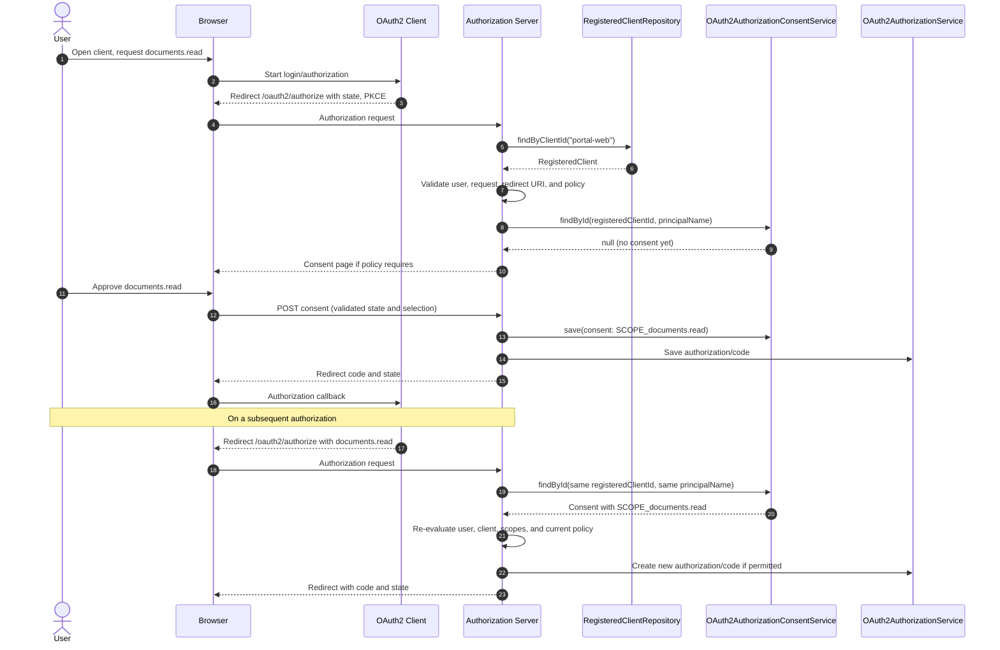

# Saving and Looking Up Consent on Subsequent Authorizations

When a user first allows an application to access documents, the Authorization Server may ask them to confirm permissions such as `documents.read`. On subsequent authorizations, if the application and user remain the same principal–client pair, previously approved permissions can be **looked up from stored consent**, enabling the system to avoid unnecessary re-prompting. If the application requests a new permission such as `documents.write`, the Authorization Server must evaluate **the new permission**, never implicitly treating old consent as approving every scope.

In a **Spring Security OAuth2/OIDC Authorization Server** built with Spring Boot and Spring Authorization Server, the two core components of this mechanism are **`OAuth2AuthorizationConsent`** and **`OAuth2AuthorizationConsentService`**. This lesson in the **Consent** chapter covers the data model, save and lookup flows, InMemory/JDBC implementations, incremental consent, revocation, security controls, multi-instance operations, and testing.

> **Scope:** OAuth 2.0 consent is the user's approval to grant certain permissions to an OAuth2 Client. It is **different** from user login, different from client authentication itself, different from business authorization enforced by the Resource Server, and does not automatically satisfy legal consent requirements under data protection laws. Endpoint, DSL, and bean examples below must be cross-checked against the Spring Authorization Server version in use.

## 1. Why Persist Consent?

Suppose a web portal `portal-web` is registered at `https://identity.example.com`, and a user has the stable identifier `user-42`:

1. **First time:** the user logs in, the application requests `documents.read`, and the Authorization Server presents the permissions to grant. The user approves. The AS saves the approval for that exact **client and principal**, then completes the authorization code flow.
2. **Next time, same permissions:** the application requests `documents.read` again. The AS can look up prior consent and proceed to issue a code per policy, provided login, client, request, and other requirements are all met.
3. **Next time, additional permissions:** the application requests `documents.read documents.write`. The AS cannot infer the user approved `documents.write` merely because they approved `documents.read`; incremental consent or appropriate policy must be evaluated.
4. **User revokes permissions:** the AS deletes/updates the consent record. The next authorization must re-evaluate current state; at the same time, a separate policy must handle already issued tokens and sessions.

Persisting consent provides three benefits: **controlled remembering of decisions**, **reducing unnecessary user interactions**, and **establishing a baseline to compare against when requested permissions change**. However, consent is an **input to the grant decision**, not a permanent automatic pass for every request.

### 1.1. Distinguishing Four Decisions Frequently Conflated

| Decision | Question | Related Components |
|---|---|---|
| **User authentication** | Is the user authenticated, and does the session still meet assurance requirements? | Spring Security login/MFA, session/assurance policy |
| **Client authentication and registration** | Is the application valid, and allowed to use this grant/redirect URI/scope? | `RegisteredClientRepository`, client authentication providers |
| **Authorization consent** | Which permissions has the user approved for this client? | `OAuth2AuthorizationConsentService` |
| **Tokens and API access rights** | Is the token valid, unexpired, intended for this API, and authorized by business rules? | `OAuth2AuthorizationService`, Resource Server |

Having stored consent **does not replace login or MFA**. A user who consented last month may still need to log in again today. Nor does it mean the API must return data: the Resource Server still evaluates audience, scopes, subject, and per-resource permissions.

## 2. The `OAuth2AuthorizationConsent` Model

In Spring Authorization Server, `OAuth2AuthorizationConsent` represents the consent state of **a principal toward a registered client**. The model has these core properties:

| Property | Purpose | Example |
|---|---|---|
| `registeredClientId` | **Internal ID** of the `RegisteredClient` to which consent applies | `d5ac...` |
| `principalName` | Name/identifier of the principal used by the AS to bind consent | `user-42` |
| `authorities` | Set of approved `GrantedAuthority` instances | `SCOPE_documents.read` |

**The lookup key is the pair `(registeredClientId, principalName)`**, not `(clientId, email)`. `registeredClientId` must be the value of `RegisteredClient.getId()`; the protocol `clientId`, such as `portal-web`, is a separate field.

An illustrative record:

```text
RegisteredClient.id       = "d5ac-auth-server-internal-id"
RegisteredClient.clientId = "portal-web"
Authentication.getName()  = "user-42"

OAuth2AuthorizationConsent:
  registeredClientId = "d5ac-auth-server-internal-id"
  principalName      = "user-42"
  authorities        = ["SCOPE_documents.read", "SCOPE_profile"]
```

### 2.1. Scopes Are Represented as GrantedAuthority

In Spring Authorization Server's standard consent mechanism, approved scopes are stored as authorities prefixed with **`SCOPE_`**. For example:

```java
new SimpleGrantedAuthority("SCOPE_documents.read")
```

`authorities` is a `Set` of `GrantedAuthority`; it is not a JSON string holding the entire request, nor is it a list of the user's business-system roles. When checking scopes, follow this mapping convention; **never equate `ROLE_ADMIN` with scope `documents.read`**.

### 2.2. Why Must `principalName` Be Stable?

Spring uses `principalName` to look up consent. If a previous login used `alice@example.com` and the next login changes `Authentication.getName()` to `alice`, the lookup may fail to find the prior approval. Emails, display names, or usernames can change or be recycled, so use a **stable internal identifier, unique within the required scope**, as the principal name.

If the AS serves multiple tenants, never allow two people in different tenants to share the same `principalName` in the same key space without an isolation strategy. You can use tenant-partitioned subjects or another controlled data layout; what matters is consistency across login, consent saving, querying, and permission deletion.

### 2.3. Consent Does Not Store All Legal Context Out of the Box

The default model focuses on client, principal, and authorities. It is **not** a complete system for terms version history, acceptance timestamps, data-processing purposes, electronic signatures, or audit logs. If a product needs that information, design an additional audit/consent-management layer rather than stuffing arbitrary metadata into an authority like `SCOPE_terms_v7_accepted_at_...` and treating it as valid.

## 3. Contract of `OAuth2AuthorizationConsentService`

Spring Authorization Server provides an interface for saving and looking up consent:

```java
public interface OAuth2AuthorizationConsentService {
    void save(OAuth2AuthorizationConsent authorizationConsent);

    void remove(OAuth2AuthorizationConsent authorizationConsent);

    OAuth2AuthorizationConsent findById(
        String registeredClientId,
        String principalName);
}
```

Method semantics:

| Method | Input | Result/Action |
|---|---|---|
| `save(consent)` | Valid `OAuth2AuthorizationConsent` object | Persists consent state per implementation semantics |
| `findById(registeredClientId, principalName)` | Both parts of the identifier key | Returns `OAuth2AuthorizationConsent` or **`null` if absent** |
| `remove(consent)` | Consent to remove | Deletes the corresponding consent record from storage |

This is a **persistence** interface, not an HTTP endpoint for arbitrary clients to call, and it does not natively provide:

- APIs to search consent by email, client name, or across all users;
- Full approval history logging;
- Automatic per-scope expiration;
- APIs to delete a single scope or revoke all issued tokens;
- Administrative/audit access control over consent records.

If those capabilities are needed, build an additional business layer with appropriate authorization checks.

### 3.1. Looking Up with the Right Key

```java
RegisteredClient client = registeredClientRepository
    .findByClientId("portal-web");

if (client == null) {
    throw new IllegalStateException("Client registration not found");
}

String principalName = authenticatedUser.getName();
OAuth2AuthorizationConsent consent = authorizationConsentService.findById(
    client.getId(),
    principalName
);

if (consent == null) {
    // No consent record yet for this registeredClientId/principalName pair.
}
```

`authenticatedUser` is an illustrative variable representing the principal authenticated by Spring Security. Never pass `client.getClientId()` as the first argument, and never use `request.getParameter("userId")` as a trusted source of identity.

### 3.2. Creating a Consent Record with Approved Scopes

```java
OAuth2AuthorizationConsent consent = OAuth2AuthorizationConsent.withId(
        client.getId(),
        principalName)
    .authority(new SimpleGrantedAuthority("SCOPE_documents.read"))
    .build();

authorizationConsentService.save(consent);
```

This is an **example data operation inside a protected service layer**. Never invoke this code merely because the frontend sent `approved=true`. In a production flow, **the authorization endpoint and Spring Authorization Server providers** must verify the user/session, client, authorization request, scopes, and genuine consent decision before saving.

### 3.3. Updating or Adding Scopes

Suppose consent already contains `documents.read` and after a valid request the user additionally approves `documents.write`:

```java
OAuth2AuthorizationConsent existing = authorizationConsentService.findById(
    client.getId(), principalName);

OAuth2AuthorizationConsent.Builder builder = existing == null
    ? OAuth2AuthorizationConsent.withId(client.getId(), principalName)
    : OAuth2AuthorizationConsent.from(existing);

OAuth2AuthorizationConsent updated = builder
    .authority(new SimpleGrantedAuthority("SCOPE_documents.write"))
    .build();

authorizationConsentService.save(updated);
```

The example only illustrates **merging approved permissions**; the user must have genuinely approved the new scope in a validated authorization transaction. If instead of adding you want to **reduce permissions**, reconstruct the consent with only the retained authorities or remove it completely, per implementation semantics and business requirements.

**Do not assume `save` automatically merges scopes.** The object passed in must hold the final authority state you intend to persist. Concurrent update logic must be protected against two transactions overwriting each other.

## 4. First-Time Flow and Subsequent Flow with Existing Consent



**Important distinction:** Each authorization code issuance remains a distinct OAuth transaction and must satisfy current policies. Previously stored consent can **reduce the need to show the consent screen again**, but it never means the AS skips checking the client, user session, MFA, redirect URI, PKCE, or code-issuance conditions.

### 4.1. When Does the AS Typically Re-Prompt?

| Request | Existing Consent | Expected Outcome When Client Requires Consent |
|---|---|---|
| `documents.read` | None | Displays permissions needing approval |
| `documents.read` | Has `documents.read` | Can skip consent screen if policy permits |
| `documents.read documents.write` | Only `documents.read` | Must review new permission `documents.write` |
| `documents.read` | Consent was deleted | Prompts again per policy |
| `documents.read` | Has consent, but user is not logged in | Still requires login before authorization |
| `documents.read` | Has consent, client/redirect URI no longer valid | AS must reject request per protocol rules |

With OpenID Connect, behaviors involving `openid`, `offline_access`, `prompt=consent`, `prompt=none`, and claims policies may follow special rules. Do not apply a blanket “if consent exists, always skip” rule to every OIDC request; verify library version behavior, OP configuration, and Relying Party contract.

## 5. Configuring Spring Authorization Server to Require Consent

In `RegisteredClient`, configuring `ClientSettings.requireAuthorizationConsent(true)` indicates the client requires a consent flow via Spring Authorization Server's mechanism:

```java
RegisteredClient portal = RegisteredClient.withId(
        "registered-client-portal-internal-id")
    .clientId("portal-web")
    .clientSecret(passwordEncoder.encode(secretFromSecureStore))
    .clientAuthenticationMethod(
        ClientAuthenticationMethod.CLIENT_SECRET_BASIC)
    .authorizationGrantType(
        AuthorizationGrantType.AUTHORIZATION_CODE)
    .authorizationGrantType(
        AuthorizationGrantType.REFRESH_TOKEN)
    .redirectUri(
        "https://portal.example.com/login/oauth2/code/company")
    .scope(OidcScopes.OPENID)
    .scope(OidcScopes.PROFILE)
    .scope("documents.read")
    .scope("documents.write")
    .clientSettings(ClientSettings.builder()
        .requireProofKey(true)
        .requireAuthorizationConsent(true)
        .build())
    .build();
```

`secretFromSecureStore` is an illustrative variable; never hard-code or log raw secrets. To run end-to-end, you also need a `RegisteredClientRepository`, issuer config, keys/JWK, security filter chains, user authentication, and authorization/consent persistence.

### 5.1. Meaning of `requireAuthorizationConsent`

- `true`: the Authorization Server may require the user to approve permissions during the authorization flow; previously stored consent is consulted for already approved permissions.
- `false`: default configuration does not enforce showing consent via this flag; the AS must still enforce all other security policies and protocol requirements.
- It **does not automatically implement a permission-management UI**, does not guarantee users understand scope details, and does not automatically create database tables.
- It **does not replace** grant/redirect URI validation, user login/MFA, or API policies.

Do not disable consent for an untrusted client merely to eliminate the approval screen. For internal or first-party clients, decide whether consent is needed based on the trust model, permission types, and product requirements—not sheer UI convenience.

### 5.2. Consent and Authorization Code + PKCE

Suppose the client sends:

```http
GET /oauth2/authorize?response_type=code&client_id=portal-web&redirect_uri=https%3A%2F%2Fportal.example.com%2Flogin%2Foauth2%2Fcode%2Fcompany&scope=openid%20profile%20documents.read&state=STATE_RANDOM&code_challenge=PKCE_CHALLENGE&code_challenge_method=S256&nonce=NONCE_RANDOM HTTP/1.1
Host: identity.example.com
```

The AS must validate the request, authenticate the user, verify consent per policy, and only then issue an authorization code. **Consent differs from PKCE:** PKCE binds the code to `code_verifier` to prevent unauthorized code exchange; consent is a decision about permissions. Having consent never allows skipping PKCE or reusing an authorization code.

## 6. Implementing `InMemoryOAuth2AuthorizationConsentService`

Spring Authorization Server provides `InMemoryOAuth2AuthorizationConsentService`, suited for lessons, experimental apps, or cases intentionally using in-memory data:

```java
@Bean
OAuth2AuthorizationConsentService authorizationConsentService() {
    return new InMemoryOAuth2AuthorizationConsentService();
}
```

When integrated, Spring Authorization Server picks up the service bean and uses it in the consent flow. There is no need to call `save` manually from a controller to replace standard logic. If multiple beans of the same type are defined in an application without clear wiring, verify the configuration so the endpoint uses the intended service.

**InMemory limitations:**

- Consent data is lost when the AS process restarts.
- Two AS instances can see different consent states if each node maintains its own memory.
- There is no built-in approval history, paginated querying, backup mechanism, or synchronized revocation.
- Hard-coding consent seeds in code can inadvertently treat unapproved permissions as granted.

For systems serving multiple users that must retain consent across restarts and support multiple AS nodes, use shared durable storage.

### 6.1. Lookup Example with the InMemory Service

```java
RegisteredClient client = registeredClientRepository
    .findByClientId("portal-web");
String principalName = "user-42"; // Test data example only.

OAuth2AuthorizationConsent first = consentService.findById(
    client.getId(), principalName);
// first == null if not saved yet.

OAuth2AuthorizationConsent saved = OAuth2AuthorizationConsent.withId(
        client.getId(), principalName)
    .authority(new SimpleGrantedAuthority("SCOPE_documents.read"))
    .build();

consentService.save(saved);

OAuth2AuthorizationConsent second = consentService.findById(
    client.getId(), principalName);
// second != null, contains authority SCOPE_documents.read.
```

This snippet illustrates the persistence contract; in real products, use an authenticated subject and genuine user approval. Never accept an arbitrary `principalName` from an HTTP request to grant consent for another account.

## 7. Implementing `JdbcOAuth2AuthorizationConsentService`

For durable consent storage, Spring Authorization Server provides `JdbcOAuth2AuthorizationConsentService`, built on `JdbcOperations` and `RegisteredClientRepository`:

```java
@Bean
OAuth2AuthorizationConsentService authorizationConsentService(
        JdbcTemplate jdbcTemplate,
        RegisteredClientRepository registeredClientRepository) {

    return new JdbcOAuth2AuthorizationConsentService(
        jdbcTemplate, registeredClientRepository);
}
```

The bean above only provides DB access; the application still needs a datasource, a schema compatible with the Spring Authorization Server version, migrations, and minimum DB privileges. **Creating the bean does not automatically create the table**.

### 7.1. Typical Table Model

Spring Authorization Server's reference schema typically includes an **`oauth2_authorization_consent`** table, keyed by the composite of `registered_client_id` and `principal_name`; the `authorities` column stores the approved permission set.

| Column (common name) | Meaning | Notes |
|---|---|---|
| `registered_client_id` | Internal ID of the registered client | Links to registration; must stay stable across deploys |
| `principal_name` | Authenticated principal | Never take from untrusted input; must be unique per tenant scope |
| `authorities` | Stored consent authorities | Must round-trip faithfully with the official mapper |

Illustration of a logical query:

```sql
SELECT registered_client_id, principal_name, authorities
FROM oauth2_authorization_consent
WHERE registered_client_id = ?
  AND principal_name = ?;
```

**Never copy a guessed table structure into production.** Use the official SQL reference schema and JDBC mapper compatible with your exact **Spring Authorization Server version**, deploying changes via Flyway/Liquibase or an equivalent migration workflow. If you customize authority encoding/mapping or use a custom store, test two-way read/write round-trips.

### 7.2. Why Is a Stable Internal Client ID Needed?

Consent is keyed by `registered_client_id`. If every startup recreates the same `clientId=portal-web` with a new `UUID.randomUUID()` while the authorization/consent DB retains old rows, prior consent records will no longer match the internal ID. **Preserve `RegisteredClient.id` when updating a registration**, even when changing display name, allowed scopes, or credentials.

### 7.3. Concurrency and Transaction Issues

Two concurrent requests can add two different scopes for the same key pair:

1. Request A reads consent containing `documents.read`.
2. Request B also reads the same state.
3. A adds `documents.write` and saves.
4. B adds `reports.read` based on the stale record and saves.
5. If each `save` overwrites the entire `authorities` set, A's update may be lost.

Depending on the implementation, design **transactions, optimistic locking/serialization, or atomic merge operations** when concurrent authorization requests are possible. The default repository does not expose an atomic `addScopeIfAbsent` API. You may need an extra persistence layer if this scenario matters.

In multi-node environments, all AS instances should read/write to the same data source or use a verified consistency mechanism. Do not cache consent indefinitely when the system supports revocation or permission changes.

## 8. Consent Screen, Form Processing, and Saving Data

Spring Authorization Server includes an authorization consent flow; if a custom UI is needed, configure the authorization endpoint via a method like `consentPage("/oauth2/consent")` on the corresponding configurer:

```java
@Bean
@Order(1)
SecurityFilterChain authorizationServerChain(HttpSecurity http)
        throws Exception {

    OAuth2AuthorizationServerConfigurer authorizationServer =
        OAuth2AuthorizationServerConfigurer.authorizationServer();

    http.securityMatcher(authorizationServer.getEndpointsMatcher())
        .with(authorizationServer, server -> server
            .oidc(Customizer.withDefaults())
            .authorizationEndpoint(endpoint ->
                endpoint.consentPage("/oauth2/consent")))
        .authorizeHttpRequests(auth ->
            auth.anyRequest().authenticated());

    return http.build();
}
```

This code skeleton illustrates the configuration point; it is not a complete Authorization Server. You still need a login filter chain, client registration beans, authorization/consent services, JWK/issuer, and a controller/view for the custom consent page, while verifying the DSL APIs against your exact version.

### 8.1. Illustrative Consent Form

With a custom page, the form normally submits the user's selections to the authorization endpoint. Example **HTML with placeholders, solely to show the fields**:

```html
<form method="post" action="/oauth2/authorize">
  <input type="hidden" name="client_id" value="portal-web">
  <input type="hidden" name="state" value="STATE_FROM_PENDING_REQUEST">
  <input type="hidden" name="_csrf" value="CSRF_TOKEN_FROM_SERVER">

  <label>
    <input type="checkbox" name="scope" value="documents.read">
    Read documents
  </label>
  <label>
    <input type="checkbox" name="scope" value="documents.write">
    Edit documents
  </label>
  <button type="submit">Approve selected permissions</button>
</form>
```

A real page must render the **CSRF token from Spring Security**, the AS-correlated state/transaction, valid scopes, and trusted client name; the raw HTML above lacks rendering/protection mechanisms and cannot be deployed as-is to production.

### 8.2. Checks That Must Never Be Skipped

**Never trust checkboxes, hidden fields, or URLs just because the AS rendered the page.** A forged request can inject arbitrary scopes or swap client IDs. The Authorization Server must:

1. Bind the form to the validated authorization transaction and the current principal's session.
2. Verify client/redirect URI and the **requested and registered** scope set, rejecting extra permissions outside the valid request.
3. Validate CSRF on the consent POST; never disable CSRF just to make a form work.
4. Ensure **only genuinely approved scopes** are written to consent.
5. Refuse to issue an authorization code for unapproved scopes when policy requires consent.
6. Prevent user A from saving consent on behalf of user B by tampering with `principalName`.
7. Verify scope/application descriptions are escaped to prevent XSS or deceptive UI content.

The **Deny** button needs explicit corresponding behavior; for a request with a verified redirect URI, the authorization endpoint can return `error=access_denied` via redirect per the OAuth contract. Never call `save` when the user denies.

### 8.3. UX of Per-Scope Consent

On the consent page, display descriptions closely reflecting actual impact: “Read documents you have permission to view”, “Edit permitted documents”. Avoid vague labels like “Basic permissions” for a scope that modifies data. Indicate **which application** is asking, which permissions are **already granted**, which are **new**, and offer clear choices where policy allows.

The consent UI helps users understand delegation scope, yet policy must still be enforced server-side. Never let clients self-define permission labels in ways that misrepresent API reality.

## 9. Incremental Consent When a Client Requests Additional Scopes

**Incremental consent** means the client only needs to ask for unapproved permissions rather than auto-granting them or forcing the user to re-approve everything from scratch.

Suppose:

```text
Registered scopes:
  documents.read, documents.write, reports.read

Requested scopes (attempt 1):
  documents.read
Saved consent:
  SCOPE_documents.read

Requested scopes (attempt 2):
  documents.read, reports.read

Previously approved for this request:
  documents.read
New scope needing evaluation:
  reports.read
```

### 9.1. Computing the Missing Scopes

To illustrate reading the data, assume the request has already passed client and allowed-scope validation:

```java
Set<String> requestedScopes = Set.of(
    "documents.read", "reports.read");

OAuth2AuthorizationConsent consent = authorizationConsentService.findById(
    registeredClient.getId(), authentication.getName());

Set<String> approvedScopes = consent == null
    ? Set.of()
    : consent.getAuthorities().stream()
        .map(GrantedAuthority::getAuthority)
        .filter(authority -> authority.startsWith("SCOPE_"))
        .map(authority -> authority.substring("SCOPE_".length()))
        .collect(Collectors.toSet());

Set<String> missingScopes = new HashSet<>(requestedScopes);
missingScopes.removeAll(approvedScopes);
```

This code only clarifies the model; it does not capture consent rules for individual OIDC scopes and **does not replace Spring Authorization Server's default providers**. Imports and `registeredClient`/`authentication` variables must be resolved in a real application. In production, also account for client settings, OIDC prompts/policies, revoked consent, user sessions, and forced re-prompt rules.

### 9.2. Never “Auto-Expand” Consent

For example, a client was previously approved for `documents.read` and then an administrator added `documents.write` to `RegisteredClient.scopes`. That only means the AS **may let the client request** `documents.write`. **It is not proof the user agreed to grant the new scope.**

When the user chooses to approve only part of the requested scopes, the Authorization Server must honor the approved subset and client contract; never write all requested scopes into consent merely because client registration permits them.

### 9.3. When Should Old Permissions Be Re-Prompted?

Stored consent may no longer suffice when:

- The user previously revoked permissions.
- Data-usage purpose, terms, or internal policies changed.
- The client added sensitive scopes or requests higher privileges.
- OIDC requires appropriate interaction, such as `prompt=consent`, per OP support.
- A consent scope has a custom-policy TTL (the default model has no per-scope expiration).
- The account/client is restricted or the request requires step-up authentication/MFA.

Never rely solely on the presence of a DB row to conclude “no interaction needed”.

## 10. Consent, OpenID Connect, and Edge Cases

In OIDC, an application can request `openid`, `profile`, `email`, and other claims/scopes. The OP authenticates the user and issues an ID Token per the appropriate flow; at the same time, consent may be needed for UserInfo access, refresh tokens, or user data.

| OIDC Scenario | Point to Watch |
|---|---|
| `openid` | Triggers an OIDC request; does not mean “all personal info is publicly consented by the user” |
| `profile`/`email` | Check actual scopes/claims the AS discloses; clearly present permissions when policy requires consent |
| `offline_access` | Relates to access when the user is absent; follow OIDC rules/consent policy, never blindly issue refresh tokens |
| `prompt=consent` | RP asks OP to perform consent interaction; verify OP support and policy |
| `prompt=none` | OP must not interact with user; if missing consent is required, may have to return an OIDC error like `consent_required` instead of showing UI |
| User consented previously but is not logged in | OP must still complete authentication before issuing results |

These details depend on the **OIDC specification and the deployed version's features**, so do not assume every `prompt` or `offline_access` variant automatically works fully just by enabling `.oidc(Customizer.withDefaults())`.

Consent is not proof that the subject satisfied a high MFA assurance level. If the AS requires stronger authentication for a sensitive scope, still verify actual assurance before issuing a code. If the ID Token contains `acr`/`amr`/`auth_time`, those claims must reflect actual authentication events, never fabricated from a consent flag.

## 11. Revoking Consent and Impact on Issued Tokens

A user may want to withdraw permissions from an application. Per the repository contract, the record can be deleted:

```java
OAuth2AuthorizationConsent existing = authorizationConsentService.findById(
    registeredClient.getId(), principalName);

if (existing != null) {
    authorizationConsentService.remove(existing);
}
```

This snippet must sit behind **authentication and authorization for the revocation action**, never letting a request supply arbitrary client ID and user ID values to delete someone else's permissions. A permission-management UI usually needs to list clients a user has approved, yet the `OAuth2AuthorizationConsentService` interface **has no API to list all consents**: that feature requires a controlled query layer or custom repository.

### 11.1. Deleting Consent Differs from Revoking Tokens

| Action | Primary Effect | What Does Not Automatically Happen |
|---|---|---|
| `authorizationConsentService.remove(...)` | Deletes stored consent for future authorizations | Does not guarantee all issued tokens/codes immediately become invalid |
| Remove one authority from consent and save | Narrows recorded permissions | Does not automatically alter already issued access tokens |
| Revocation endpoint / token service | Requests token revocation per token type and supported mechanism | Does not automatically delete all user consent |
| Withdraw permission at Resource Server | API denies specific operations/resources | Does not automatically update consent records at the AS |
| Delete client registration | Client no longer has previous metadata | Does not immediately invalidate every issued JWT |

Self-contained signed JWT access tokens may continue to be accepted by Resource Servers until expiration unless a revocation-status check or additional policy exists. Refresh tokens also need dedicated handling: depending on implementation, deleting consent alone **does not guarantee** existing refresh tokens are revoked or that scopes on the next refresh shrink automatically.

For a “Revoke app access” action, product workflows typically must **combine consent management with authorization/token management**:

1. Verify the acting user or administrator holds appropriate permissions.
2. Delete/narrow consent for the exact principal and registered client pair.
3. Locate and revoke related authorizations/refresh tokens per system policy and storage.
4. Consider JWT access token lifetimes, introspection/denylists, or immediate restriction measures when the threat model demands it.
5. Record an audit entry and reflect the new state in the permission-management UI.

**Never promise users “access has ended immediately” if valid unrevoked access tokens still exist in the system.** Product messaging must match actual runtime behavior.

### 11.2. Revoking One Scope Instead of All

The service only has `remove(consent)` for the entire record. To withdraw only `documents.write` while keeping `documents.read`, reconstruct a new consent containing the remaining permitted authorities and call `save` per the data model. Be careful not to accidentally drop unrelated authorities during updates; conversely, never retain an authority the user just revoked.

To do this safely in concurrent systems, control ordering/races between a user revocation action and another concurrent authorization request adding a scope, preventing the revocation from being overwritten by a stale record.

## 12. Integrating with the Other Three Persistence Types

In Spring Authorization Server, similarly named components serve distinct purposes:

| Repository / Service | What Does It Store? | Typical Query |
|---|---|---|
| `RegisteredClientRepository` | Client metadata: client ID, grants, scopes, redirects, auth methods | `findByClientId(clientId)` |
| `OAuth2AuthorizationConsentService` | Consent of **a principal toward a registered client** | `findById(registeredClientId, principalName)` |
| `OAuth2AuthorizationService` | Authorizations, authorization codes, and related tokens/metadata | `findById(...)` or `findByToken(...)` |
| User store / identity provider | User information, login, and MFA | By system user ID/username |

Consent is **per user–client pair** data; authorization/tokens are **per grant or issuance event** data. The same user and client can generate many authorizations/tokens over time, while a single consent record aggregates approved authorities.

If using JDBC in production, create migrations for **registered clients**, **authorizations**, and **authorization consents** using version-compatible schemas—do not create only the consent table. Keep internal client IDs and principal names consistent across all services.

## 13. When Should You Implement a Custom Consent Service?

Typical scenarios calling for a custom `OAuth2AuthorizationConsentService`:

- An existing shared permission/consent store already exists in the organization.
- Need tenant partitioning or compliance with a specialized data-isolation model.
- Need versioned consent history, expiration times, and grant/revocation reasons.
- Need complex permission storage policies or consent synchronization across multiple services.
- Need management, filtering, and search UIs not provided by the default API.

An outline sketch:

```java
public final class CustomConsentService
        implements OAuth2AuthorizationConsentService {

    private final ConsentStore store;
    private final ConsentMapper mapper;

    @Override
    public void save(OAuth2AuthorizationConsent consent) {
        store.upsert(mapper.toRecord(consent));
    }

    @Override
    public void remove(OAuth2AuthorizationConsent consent) {
        store.delete(consent.getRegisteredClientId(),
                     consent.getPrincipalName());
    }

    @Override
    public OAuth2AuthorizationConsent findById(
            String registeredClientId, String principalName) {
        ConsentRecord record =
            store.findById(registeredClientId, principalName);
        return record == null ? null : mapper.toConsent(record);
    }
}
```

`ConsentStore`, `ConsentMapper`, and `ConsentRecord` are **project-designed illustrative types**; the snippet is not a drop-in runnable class. The data layer must enforce composite-key uniqueness, lossless authority mapping, update consistency, and DB error handling.

### 13.1. Invariants to Maintain in a Custom Service

1. **Right key:** one record per `(registeredClientId, principalName)` pair within the proper tenant scope.
2. **Preserve authorities intact:** read/write approved permissions faithfully; never turn role names into scopes by guesswork.
3. **Zero cross-subject leakage:** never look up using a client-supplied unverified user ID.
4. **Distinguish not-found from infrastructure failure:** `null` for absent consent differs from a database outage; an outage must never degrade into “treat as consented”.
5. **Atomicity:** prevent lost updates when two requests concurrently add/withdraw scopes.
6. **Never log sensitive data:** audit actor, action, scopes, and correlation ID within necessary limits; never log tokens, OTPs, or excess PII.
7. **Enforce lifecycle:** deletion, export, retention, and data partitioning per applicable policies.

### 13.2. Caching Consent and Stale Data Issues

Caching can lower latency yet raises the risk of **revoked consent still being read as valid**. When caching:

- Key by **both** registered client ID and principal name, adding tenant boundaries if required.
- Invalidate on save/update/revocation of consent.
- With multiple AS nodes, use an appropriate invalidation broadcast or consistency mechanism.
- Do not cache `null` for too long when users might have just approved permissions.
- Verify cached entries cannot live indefinitely when policies or revocations change.

Consent is sensitive data about **relationships between users and applications**, even though it contains no tokens or passwords. DB read permissions, storage encryption, and log retention still matter.

## 14. Testing the Repository and the Full Authorization Flow

Testing must cover both the **persistence contract** and **actual runtime decisions when consent is present or missing**. Unit tests of `OAuth2AuthorizationConsentService` alone cannot prove the authorization endpoint uses that data properly.

### 14.1. Unit Tests for save/find/remove

Example with the in-memory implementation:

```java
@Test
void consentCanBeSavedReadAndRemoved() {
    OAuth2AuthorizationConsentService service =
        new InMemoryOAuth2AuthorizationConsentService();

    OAuth2AuthorizationConsent consent = OAuth2AuthorizationConsent.withId(
            "registered-client-123", "user-42")
        .authority(new SimpleGrantedAuthority("SCOPE_documents.read"))
        .build();

    assertThat(service.findById("registered-client-123", "user-42"))
        .isNull();

    service.save(consent);
    OAuth2AuthorizationConsent found =
        service.findById("registered-client-123", "user-42");

    assertThat(found).isNotNull();
    assertThat(found.getAuthorities()).contains(
        new SimpleGrantedAuthority("SCOPE_documents.read"));

    service.remove(consent);
    assertThat(service.findById("registered-client-123", "user-42"))
        .isNull();
}
```

The test assumes JUnit and AssertJ are imported. It proves service save/read/remove behavior, **not genuine user approval**; the authorization endpoint remains responsible for validating OAuth requests.

### 14.2. Behavioral Integration Matrix

| Scenario | Result to Verify |
|---|---|
| No consent yet and client requires it | User receives permission prompt per policy; no code issued prior to approval |
| User approves valid scopes | Service saves exact registeredClientId/principalName pair and approved authorities |
| User denies consent | No new consent written, no code issued for denied permissions; appropriate authorization error |
| Repeat with same client/user/scopes | Service finds consent; screen may be skipped per policy |
| Switch to a different user | Never reuses the old user's consent |
| Switch to a different client | Never reuses the old client's consent |
| Unapproved new scope | Not auto-approved; triggers incremental consent per policy |
| Client requests unregistered scope | Never grants scopes beyond registration even if form is tampered with |
| Forged consent submission or missing CSRF | Does not save consent and does not issue code |
| Redirect URI tampered with | Never redirects code to an unauthorized URI |
| Consent deleted | Subsequent authorization flow evaluates consent fresh |
| Consent revoked while old token remains | Test token revocation mechanism separately; never assume deleting consent suffices |
| Consent DB error or timeout | Never grants permissions on unverified records; fails safely |
| Multiple nodes and restarts | Consent is read consistently from shared storage |
| Two tabs concurrently approve different scopes | Does not lose an approval or resurrect revoked permissions |
| OIDC `prompt=none` when consent is required | Returns appropriate OIDC error; never renders interactive UI |

### 14.3. Sample End-to-End Scenario

```text
Given:
  - RegisteredClient "portal-web" has requireAuthorizationConsent(true).
  - User "user-42" has a valid authenticated session.
  - No consent exists yet for (portal-web's registeredClientId, user-42).

When:
  - Client sends authorization_code request with scope documents.read.
Then:
  - Authorization Server presents the consent step.
  - No authorization code is issued before the user decides.

When:
  - User approves documents.read via a valid form with matching CSRF/state.
Then:
  - Service saves SCOPE_documents.read for the exact key pair.
  - Authorization endpoint completes flow, redirecting code + state.

When:
  - User initiates a new authorization request, same client and scope.
Then:
  - Prior consent is found; consent page may be skipped per policy.
  - User authentication, client, PKCE, and consent policy are still checked.

When:
  - Client additionally requests documents.write.
Then:
  - The new permission is not treated as already approved.
  - Incremental consent or rejection is handled per policy.
```

In automated tests with Spring Security, use MockMvc and login/registered-client fixtures; the key is **going through the Authorization Server filter chain**, not merely creating `OAuth2AuthorizationConsent` manually and claiming the whole flow is secure.

### 14.4. JDBC Testing During Upgrades

Test round-trips for scopes containing dots/underscores, multiple authorities, Unicode principals per identity policy, stable client IDs, schema migrations, DB connection drops, and concurrent operations. Verify column length limits on `authorities` and storage capacity in both staging and production; never assume one default schema works identically across every DB engine.

## 15. Operational Observability and Privacy

Consent reflects user trust in applications. You should be able to audit who approved which permissions and when per product requirements, while avoiding excessive data collection.

| Event / Metric | Meaning | What Must Be Protected |
|---|---|---|
| `consent_required` | User/client/request requires approval UI | Never log authorization codes or tokens |
| `consent_approved` | Scopes approved by user | Store only appropriate scope/actor info; avoid sensitive payloads |
| `consent_denied` | User denied permissions | Never mark as granted |
| `consent_found`/`consent_missing` | Reuse rate vs. fresh consent prompts | Never turn metrics into a public user–client directory |
| `consent_revoked` | Permissions removed from storage | Coordinate with token revocation mechanisms |
| DB/cache read/write error | Consent service availability | Never fail-open when consent cannot be verified |

**Never log raw requests containing tokens, session cookies, OTPs, client secrets, or authorization codes** to diagnose consent bugs. Log correlation IDs, event types, safe client identifiers, minimal necessary scopes, and timestamps per data-access policies.

### 15.1. What Can Consent Data Reveal?

Even if it stores only client/user IDs and scopes, consent reveals **which applications users interact with** and which data categories they might engage with. Therefore the consent table needs proper access control, retention, backup/restore, deletion/export policies, and access governance. A consent record should never be repurposed as an unauthorized user-analytics source.

### 15.2. Data Migration When Identities or Client Registrations Change

- If changing `RegisteredClient.id`, plan migration for consent/authorization references.
- If changing how `Authentication.getName()` is generated, map/migrate `principalName` in a controlled way.
- If migrating from InMemory to JDBC, never assume old in-memory data is preserved automatically; plan a transition or re-consent per policy.
- If changing scope semantics, review whether prior consent still matches the intended meaning or requires user re-confirmation.

Test these changes on staging with synthetic data before applying them to a multi-node cluster.

## 16. Common Design Pitfalls

| Misconception / Wrong Practice | Consequence | Fix |
|---|---|---|
| Passing `clientId` instead of `RegisteredClient.id` to `findById` | Fails to find saved consent | Look up by the exact **internal** ID |
| Using mutable email/display name as principal | Changing email loses consent or mixes users | Use a stable, unique, tenant-scoped subject |
| Consent to scope A implies scope B is fine too | Grants permissions beyond user intent | Enforce incremental consent for new scopes |
| Saving a consent with only the new scope, dropping old ones | Loses previously approved state | Build from existing consent or perform controlled merge |
| Setting `requireAuthorizationConsent(true)` without durable storage | Re-prompts after restarts/across nodes | Choose JDBC/custom shared storage when needed |
| Consent page trusts all hidden/checkbox inputs | Users can submit forged scopes/clients | Verify transaction, registered scopes, principal, and CSRF |
| Skipping login/MFA because consent is stored | Issues codes without sufficient user assurance | Enforce user authentication on every flow |
| Assuming deleting consent immediately invalidates all access tokens | Old tokens keep calling APIs | Design separate revocation/token lifetimes |
| User A uses User B's consent due to bad key lookup | Cross-account permission leakage | Composite keys, principal binding, and tenant isolation |
| Caching consent without invalidation | Honors decisions that were already revoked | Invalidate on updates/deletes; keep nodes consistent |
| Treating consent as a complete legal record | Lacks history, purpose, and compliance workflows | Build dedicated consent-management/auditing when required |
| Treating DB errors as “already consented” | Fail-open granting unverified permissions | Fail closed whenever state cannot be verified |

## 17. Pre-Production Checklist

1. **Accurate client registration:** Does `requireAuthorizationConsent` match the trust model, with bounded scopes, redirect URIs, and grants?
2. **Stable consent identifiers:** Are you using `RegisteredClient.id` and a trusted `principalName` with zero cross-tenant collisions?
3. **Durable storage:** Does your choice of InMemory/JDBC/custom match restart, backup, migration, and multi-node requirements?
4. **Clear consent page:** Does it display the app and scope meanings clearly, saving only permissions the user actually selected?
5. **Server-side form checks:** Are request/CSRF/state, client, requested/allowed scopes, and identity binding validated?
6. **Incremental consent:** Are new permissions prompted separately, without auto-expanding or wrongly overwriting prior permissions?
7. **OIDC and policies:** Have `prompt=none`, `prompt=consent`, `offline_access`, login/MFA, and mandatory consent behaviors been verified?
8. **Effective revocation:** Does the UI action deleting consent pair with appropriate authorization/token/refresh-token revocation policies?
9. **Concurrency and caching:** Are multi-tab/multi-node operations free of lost updates or “resurrected” revoked scopes?
10. **Observability and security:** Is auditing governed, free of logged tokens/secrets, with restricted access to consent data?
11. **Two-layer testing:** Have you tested both `save/findById/remove` and the authorization flow through the filter chain for first-time/repeat/new-scope/revocation cases?
12. **Durable migration:** Do changes to internal client IDs or usernames/subjects have plans to preserve data linkages?

## 18. Summary

**`OAuth2AuthorizationConsent`** stores the permissions a principal has approved for **a registered client**, while **`OAuth2AuthorizationConsentService`** provides `save`, `remove`, and `findById(registeredClientId, principalName)`. When the Authorization Server handles subsequent authorizations, stored consent helps avoid re-prompting for already approved scopes, while login, MFA, client validity, scopes, and consent policies must still be verified.

**`InMemoryOAuth2AuthorizationConsentService`** fits learning and testing; **`JdbcOAuth2AuthorizationConsentService`** is better suited for durability and multi-instance AS deployments once proper schemas and migrations are in place. A secure system must also handle incremental consent, concurrent writes/deletes, tenant isolation, auditing, and token revocation when users withdraw permissions.

Understanding the boundary between consent and tokens is foundational for designing, configuring, securing, testing, and operating a **Spring Security OAuth2/OIDC Authorization Server** on Spring Boot consistently and verifiably.

## 19. References

- [Spring Authorization Server Reference](https://docs.spring.io/spring-authorization-server/reference/): `OAuth2AuthorizationConsent`, `OAuth2AuthorizationConsentService`, `RegisteredClient`, and consent configuration.
- [Spring Security Reference](https://docs.spring.io/spring-security/reference/): authentication, CSRF, OAuth2 Client, and Resource Server.
- [RFC 6749 — OAuth 2.0 Authorization Framework](https://www.rfc-editor.org/rfc/rfc6749): authorization codes, scopes, and resource owner consent.
- [RFC 9700 — OAuth 2.0 Security Best Current Practice](https://www.rfc-editor.org/rfc/rfc9700): security recommendations and OAuth2 threats.
- [RFC 7009 — OAuth 2.0 Token Revocation](https://www.rfc-editor.org/rfc/rfc7009): token revocation as a distinct concern from storing consent.
- [RFC 7662 — OAuth 2.0 Token Introspection](https://www.rfc-editor.org/rfc/rfc7662): inspecting token state at Resource Servers when using appropriate mechanisms.
- [OpenID Connect Core 1.0](https://openid.net/specs/openid-connect-core-1_0.html): consent, `prompt`, `offline_access`, and OIDC claims/permissions.
