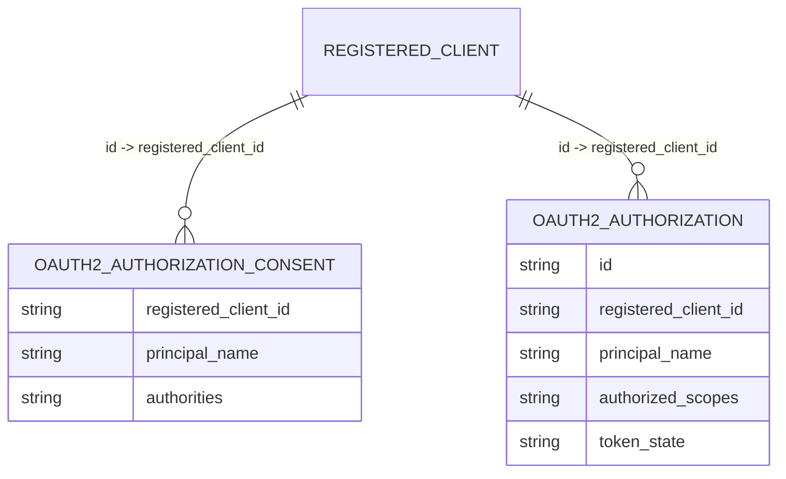
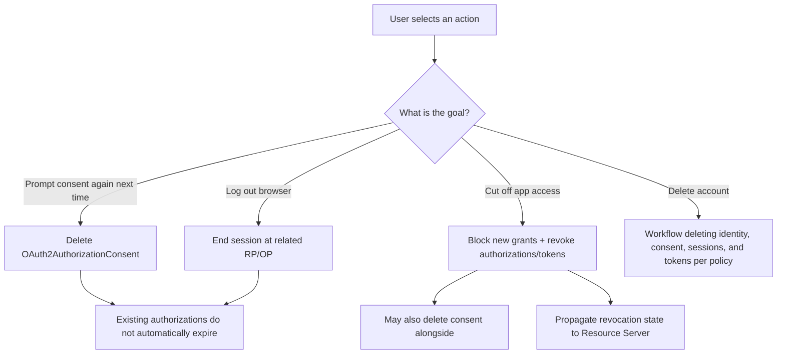
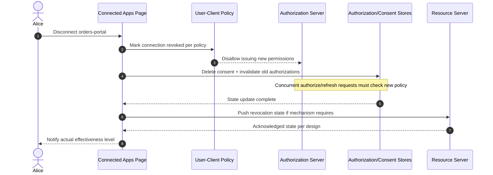

# Revoking Consent and Determining the Impact on Existing Authorizations

## 1. Scenario: The User Clicks “Disconnect Application”

An Authorization Server implemented with **Spring Boot**, **Spring Security**, and **Spring Authorization Server (SAS)** allows the `orders-portal` application to request scopes `orders.read` and `orders.write`. User Alice logged in, approved both scopes, and the client received an access token—and possibly a refresh token depending on configuration.

A few days later, Alice opens the **Connected Applications** page and clicks **Revoke approved permissions**. The question is not merely deleting a row in the database: can the already issued access token still be used? Can the refresh token still request a new access token? Will consent appear again on the next login? Does an API verifying JWTs offline recognize the revocation immediately?

The core takeaway of this lesson in the **Consent** chapter:

> **Revoking a consent record, revoking an authorization/token, and ending a login session are distinct operations.** Depending on product goals, you may need to coordinate several actions, but never assume calling `OAuth2AuthorizationConsentService.remove(...)` invalidates every existing token.

This lesson guides you through defining data boundaries, building a consent-withdrawal flow, choosing policies for existing authorizations, handling refresh tokens/JWTs, and designing security tests for a real-world Authorization Server.

## 2. Distinguishing Consent, Authorization, Tokens, and Login Sessions

| Object | SAS / Spring Security Component | What Does It Contain? | What Happens When Deleting Only That Object? |
| --- | --- | --- | --- |
| **Client registration** | `RegisteredClient`, `RegisteredClientRepository` | Client identity, grants, scopes, redirect URIs, consent settings | Editing/deleting the client affects registration and future request processing; does not itself guarantee already issued JWTs stop working at APIs |
| **Stored consent** | `OAuth2AuthorizationConsent`, `OAuth2AuthorizationConsentService` | Authorities/scopes the user approved for the client | Erases remembered consent; does not automatically delete `OAuth2Authorization` or existing access/refresh tokens |
| **Stored authorization** | `OAuth2Authorization`, `OAuth2AuthorizationService` | Associated client, principal, authorized scopes, codes and tokens, metadata/state | Deleting/invalidating can block code/refresh reuse and state-backed introspection; JWTs verified offline by APIs require separate handling |
| **Access token** | `OAuth2AccessToken` inside authorization or token response | Permission to call Resource Servers within applicable lifetime/conditions | Whether APIs still accept the token depends on token format and how APIs validate validity |
| **Refresh token** | `OAuth2RefreshToken` / authorization state | Credential to obtain new tokens when permitted | If still usable, can keep minting access tokens per refresh rules; deleting consent alone does not automatically block this path |
| **Login session** | `SecurityContext`, session, cookies, IdP/RP sessions | Authenticated user in browser or application | Revoking consent does not automatically log the user out of the AS or other clients |

### 2.1. Consent Is Not an Access Token

In SAS, a consent is typically identified by the pair:

```text
(registeredClientId, principalName)
```

Example:

```text
RegisteredClient:
  id       = "UUID-CLIENT-A"
  clientId = "orders-portal"

OAuth2AuthorizationConsent:
  registeredClientId = "UUID-CLIENT-A"
  principalName      = "alice-sub-17"
  authorities        = ["SCOPE_orders.read", "SCOPE_orders.write"]
```

**`registeredClientId` is the internal `RegisteredClient.id`**, not the `client_id` sent by the application in OAuth requests. `principalName` must match the user identifier used by the AS's authentication mechanism. In multi-tenant systems, use a stable, unambiguous user identifier across tenants rather than relying solely on a potentially colliding login name.

`authorities` is a set of `GrantedAuthority`; SAS typically uses `SCOPE_orders.read` for approved scopes. Do not assume every authority is a scope or can be deleted arbitrarily. A stored consent can be reused across **multiple subsequent authorizations** of the same client and principal.

### 2.2. Authorizations and Consent Are Related Yet Have Independent Lifecycles



This is a simplified logical model. `OAuth2AuthorizationConsent` attaches to **client + principal**, whereas `OAuth2Authorization` has its own ID and stores the state of each individual authorization/token issuance per flow. One client and one user may have **multiple authorizations** yet only one aggregated consent record in the standard consent store.

## 3. What Does Revoking Consent Actually Do?

`OAuth2AuthorizationConsentService` in the Spring Authorization Server 1.x line provides these core operations:

```java
public interface OAuth2AuthorizationConsentService {
    void save(OAuth2AuthorizationConsent authorizationConsent);
    void remove(OAuth2AuthorizationConsent authorizationConsent);
    OAuth2AuthorizationConsent findById(
            String registeredClientId, String principalName);
}
```

Workflow to withdraw a user's entire consent for a client:

1. Authenticate the user performing the connection-management action.
2. Resolve the `RegisteredClient` from the chosen `client_id`; retrieve **`RegisteredClient.id`**.
3. Look up consent via `findById(registeredClient.getId(), principalName)`.
4. If present, call `remove(existingConsent)`.
5. Decide separately whether to revoke existing authorizations/tokens per **product policy**.
6. Record an audit entry, return the outcome, and clearly communicate revocation effectiveness in the UI.

**Direct result of step 4:** the stored consent record is deleted per service semantics. Existing authorizations/codes/tokens are not automatically removed simply because this method was called.

### 3.1. Java Example: Deleting Only the Signed-In User's Consent

```java
@Service
public class ConsentManagementService {
    private final RegisteredClientRepository registeredClients;
    private final OAuth2AuthorizationConsentService consents;

    public ConsentManagementService(
            RegisteredClientRepository registeredClients,
            OAuth2AuthorizationConsentService consents) {
        this.registeredClients = registeredClients;
        this.consents = consents;
    }

    public void revokeStoredConsent(String principalName, String clientId) {
        RegisteredClient client = registeredClients.findByClientId(clientId);
        if (client == null) {
            return; // Idempotent; error policy may vary by product.
        }

        OAuth2AuthorizationConsent consent =
                consents.findById(client.getId(), principalName);
        if (consent != null) {
            consents.remove(consent);
        }
    }
}
```

At the web layer, the principal must come from the **request's trusted authentication context**, such as `Authentication.getName()` once the application standardizes on a stable identifier:

```java
@RestController
@RequestMapping("/account/connected-apps")
public class ConnectedAppsController {
    private final ConsentManagementService service;

    public ConnectedAppsController(ConsentManagementService service) {
        this.service = service;
    }

    @DeleteMapping("/{clientId}/consent")
    public ResponseEntity<Void> revokeConsent(
            @PathVariable String clientId,
            Authentication authentication) {
        service.revokeStoredConsent(authentication.getName(), clientId);
        return ResponseEntity.noContent().build();
    }
}
```

The example assumes the endpoint is protected by Spring Security (callable only by authenticated users), has **CSRF protection** when using session cookies, validates tenants, and enforces appropriate access limits. Never use a browser-supplied `principalName` parameter to delete someone else's consent. This code **only deletes consent**; never label the API “revoke all tokens” if that part is not implemented.

### 3.2. Why Should Idempotency Be Preserved?

Users may click twice or the browser may retry the request. If consent was already deleted, a subsequent withdrawal call should not produce an unnecessary business error. Returning `204 No Content` even when the record is already gone is appropriate; the UI does not necessarily need to learn whether a given `client_id` exists in the system.

Idempotency here describes only the outcome of deleting consent; it does **not** replace handling race conditions when a concurrent new authorization request writes consent back.

## 4. How Does the Next Authorization Request Behave?

Suppose the client registered `orders.read`, `orders.write` and has `ClientSettings.requireAuthorizationConsent(true)`.

| Consent State Before Request | Scopes Requested by Client | Behavior to Expect / Test |
| --- | --- | --- |
| No stored consent | `orders.read` | New request may need to show consent page per enabled policy |
| Already approved `orders.read` | `orders.read` | Can reuse stored consent without re-prompting if policy permits |
| Already approved `orders.read` | `orders.read orders.write` | May require approval for the new scope portion |
| Just deleted all consent | `orders.read` | New authorization may display the consent page again |
| Client has `requireAuthorizationConsent(false)` | `orders.read` | Deleting consent **does not guarantee** a prompt will reappear |
| Client requests unregistered scope | `orders.admin` | Must be rejected per scope validation policy; never show in consent for user “approval” |

The “re-prompt” condition depends on SAS version, client configuration, consent page implementation, principal, and authorization state. **Revoking consent does not automatically block a client from requesting permissions again.** If the product needs to ban a client from re-requesting access for a period, store a separate **denial/block state** and enforce it in authorization endpoint policy.

### 4.1. Withdrawn Consent Differs from Blocking a Client

- **Withdraw consent:** removes previously approved decision; client may request new consent.
- **Deny current request:** declines an in-progress authorization request.
- **Block client:** server policy prevents the client from receiving new authorizations/tokens (or restricts by principal), even if requests are otherwise valid.
- **Revoke token:** prevents already issued tokens from being used or refreshed per the designed assurance level.

The UI must use accurate wording; never lump four different actions into one “Delete” button without describing the consequences.

## 5. Impact on Issued Authorizations and Tokens

### 5.1. Deleting Consent Does Not Mean Deleting `OAuth2Authorization`

`OAuth2AuthorizationConsentService.remove(consent)` operates on the consent store. It does not automatically call `OAuth2AuthorizationService.remove(authorization)`, does not call the token revocation endpoint, and does not alter login session cookies.

Example:

```text
T0  Alice approves orders.read.
T1  AS issues access token A (expires at T1 + 10 minutes)
    and refresh token R (per policy).
T2  Alice deletes consent for orders-portal.
T3  Client keeps sending A to orders-api.
T4  Client tries using R to obtain a new access token.
```

If only the action at T2 is taken:

- At T3, **A may still be accepted** if the API validates tokens by signature/time/status and has no knowledge that consent was deleted.
- At T4, **R may still be accepted** per `OAuth2Authorization`, client, and refresh-token policy; never assume the refresh grant automatically re-checks deleted consent.
- If the client returns to the authorization endpoint for **a new authorization**, whether consent is required is evaluated against the consent policy and state at that moment.

Therefore, when a product promises “immediate disconnection”, deleting consent alone is not enough.

### 5.2. Distinguishing JWT Access Tokens and Opaque/Reference Tokens

| API Token Verification Mechanism | After Deleting Consent Only | After Revoking Authorization/Token at the AS |
| --- | --- | --- |
| **Signed JWT, Resource Server verifies offline** | JWT may stay valid until `exp` | API may still accept JWT until `exp` unless extra status checks exist |
| **Opaque token, Resource Server calls introspection** | Typically remains active if authorization/token is still valid | Introspection can report token inactive once state updates and caches align |
| **JWT with API status/denylist/token-version check** | Depends on whether custom policy queries consent/authorization state | Can invalidate faster if all APIs enforce the check and updates propagate promptly |
| **API caching introspection results** | Depends on cache TTL | May keep accepting until cache expires if not invalidated |

Do not equate a **validly signed access token** with **still-valid user consent**. Without a channel propagating revocation state to Resource Servers, offline signature verification cannot know the user just clicked a consent revocation button.

### 5.3. Refresh Tokens Risk Perpetuating Access After Consent Withdrawal

If policy requires “no further access”, consider **revoking the refresh token before or together with the related authorization**. If you merely wait for the access token to expire while leaving refresh enabled, the client can keep minting new access tokens.

Questions to check:

1. Which client and principal does the refresh token belong to, and does it bind to the right authorization?
2. How long is the refresh token valid, and is rotation or reuse in effect?
3. Can **multiple authorizations/refresh tokens** exist for the same principal and client?
4. Could a refresh request run concurrently with the revocation action?
5. After revocation, must APIs immediately reject still-unexpired JWTs?

**Dropping consent while keeping refresh tokens** may fit an action meaning “forget my approval so you ask me next time”, but it is inappropriate if the UI promises cutting off active access.

## 6. Three Revocation Policy Levels to Choose Explicitly

| Policy | Minimum Action | What May Remain Valid | When to Use |
| --- | --- | --- | --- |
| **A. Forget stored consent** | `OAuth2AuthorizationConsentService.remove` | Existing authorizations, access tokens, refresh tokens, and sessions | User wants to see the consent screen again on the next permission request |
| **B. Disconnect client** | Delete consent **and** invalidate/remove related authorizations, codes, and refresh tokens; handle access tokens per design | Offline JWTs may remain valid if APIs do not check revocation | “Connected Apps” page promising to stop issuing and refreshing permissions for the client |
| **C. Revoke specific scopes** | Update remaining consent, constrain policy for new grants, and handle authorizations/tokens containing withdrawn scopes | Old tokens carrying revoked scopes unless invalidated or checked additionally | User keeps `orders.read` but withdraws `orders.write` |

Depending on the system, “revoke access” may need immediate enforcement across **every Resource Server**, or merely guarantee **no new tokens are issued** while letting short-lived access tokens expire naturally. These commitments must be stated clearly in product design and operational documentation.

### 6.1. Modeling Distinct Service Actions

```text
forgetSavedConsent(user, client)
    -> delete OAuth2AuthorizationConsent

disconnectClient(user, client)
    -> set disconnected state / block new grants per policy
    -> delete consent
    -> locate and invalidate related authorizations
    -> ensure Resource Servers observe revocation state within SLA

withdrawScopes(user, client, scopes)
    -> update remaining consent
    -> inspect active grants / tokens carrying withdrawn scopes
    -> apply token issuance and revocation policies
```

This is **workflow pseudocode**, not built-in SAS APIs with those method names. SAS provides building blocks; the application must orchestrate workflows and data access appropriately.

## 7. Finding and Revoking Existing `OAuth2Authorization` Records

`OAuth2AuthorizationService` in SAS 1.x exposes basic operations such as:

```java
void save(OAuth2Authorization authorization);
void remove(OAuth2Authorization authorization);
OAuth2Authorization findById(String id);
OAuth2Authorization findByToken(String token, OAuth2TokenType tokenType);
```

This contract **does not provide a standard `findAllByPrincipalNameAndRegisteredClientId(...)`** to batch-fetch a user's authorizations. Therefore, a “disconnect completely” feature requires a **controlled query mechanism** built by the application or an index maintained alongside the authorization store.

### 7.1. Keys Used to Locate the Right Data

A business query typically needs both predicates:

```text
OAuth2Authorization.registeredClientId == RegisteredClient.id
OAuth2Authorization.principalName      == currentPrincipalName
```

Never query solely by request `client_id` and delete every authorization for that client, as that would destroy tokens belonging to **other users**. Never let callers pass an arbitrary `principalName` of another account.

With SAS 1.x's reference JDBC schema, an internal query can be designed along these lines:

```sql
SELECT id
FROM oauth2_authorization
WHERE registered_client_id = :registered_client_id
  AND principal_name = :principal_name
ORDER BY id;
```

This is **illustrative SQL**; verify the actual schema and parameter types of your version/dialect, tenant policies, pagination, transactions, and indexes. For large datasets, do not load full token payloads into RAM or logs; fetch only the IDs needed to load `OAuth2Authorization` via the service.

### 7.2. Pattern for Processing an Authorized List of Authorizations

```java
// Pseudocode: authorizationIndex is an application-implemented abstraction.
void revokeAuthorizationsFor(String principalName, RegisteredClient client) {
    for (String authorizationId : authorizationIndex.findIds(
            client.getId(), principalName)) {

        OAuth2Authorization authorization =
                authorizationService.findById(authorizationId);

        if (authorization != null
                && client.getId().equals(authorization.getRegisteredClientId())
                && principalName.equals(authorization.getPrincipalName())) {
            authorizationService.remove(authorization);
        }
    }
}
```

This snippet illustrates **re-validating the loaded object**, preventing a stale/wrong index ID from revoking out-of-scope data. `authorizationIndex` is **not a built-in SAS class**. Whether `remove` is appropriate or individual tokens should be invalidated depends on history-retention policies, auditing, and token types; in production, consider keeping non-sensitive metadata for investigation rather than permanently erasing all traces.

### 7.3. Using the Token Revocation Endpoint When Appropriate

OAuth 2.0 Token Revocation (RFC 7009) lets a client submit a token to revoke to an endpoint such as `/oauth2/revoke`, accompanied by **applicable client authentication**. This endpoint is primarily meant for the token-owning client and is server-validated; **a user's browser cannot impersonate a confidential client to call it**.

In an account owner's “Disconnect” feature, a trusted backend normally performs authorization/token administration with proper authority; never hand client secrets to the frontend or ask the user to submit raw access/refresh tokens of other apps. If multiple tokens must be revoked, locate all corresponding authorizations accurately.

### 7.4. Handling Unexchanged Authorization Codes

If a user withdraws consent right after the AS issues an authorization code but before the client exchanges it, **the authorization code may still be valid** unless the authorization holding that state is revoked. A “disconnect” policy must account for unexchanged codes and in-flight authorization requests; searching only for refresh tokens misses this case.

## 8. Revoking Individual Scopes Instead of the Entire Consent

Suppose Alice wants to keep read permission `orders.read` while withdrawing `orders.write`. Initial consent contains:

```text
SCOPE_orders.read
SCOPE_orders.write
```

The application can reconstruct consent with only the remaining permitted authorities, or delete consent if nothing remains to store. The example below illustrates **updating only the consent data**, excluding revocation of existing authorizations/tokens carrying the withdrawn scope:

```java
void removeConsentedScopes(
        String principalName, RegisteredClient client, Set<String> revokedScopes) {

    OAuth2AuthorizationConsent existing =
            consentService.findById(client.getId(), principalName);
    if (existing == null) {
        return;
    }

    List<GrantedAuthority> remaining = existing.getAuthorities().stream()
            .filter(authority -> {
                String value = authority.getAuthority();
                if (!value.startsWith("SCOPE_")) {
                    return true; // Preserve non-scope authorities.
                }
                String scopeName = value.substring("SCOPE_".length());
                return !revokedScopes.contains(scopeName);
            })
            .toList();

    if (remaining.isEmpty()) {
        consentService.remove(existing);
        return;
    }

    OAuth2AuthorizationConsent.Builder updated =
            OAuth2AuthorizationConsent.withId(client.getId(), principalName);
    remaining.forEach(updated::authority);
    consentService.save(updated.build());
}
```

**Limitations to keep in mind:**

- `revokedScopes` must be normalized and validated; callers may withdraw only **their own** permissions within managed clients.
- Never delete non-scope authorities if policy has not defined their meaning.
- Read → modify → save carries a **lost update** risk if another consent request is processed concurrently; with JDBC/JPA, use transactions/locking or an appropriate synchronization strategy.
- Some existing `OAuth2Authorization` records may still hold `authorizedScopes` including `orders.write`. **Updating consent does not automatically modify those authorizations.**
- To guarantee `orders.write` can no longer be used, handle tokens carrying that scope, govern refresh grants, and enforce permissions at the API.

### 8.1. When Should You Revoke the Whole Authorization Instead of Trimming Scopes?

If an authorization carries both `orders.read` and `orders.write`, you cannot assume editing consent turns a signed JWT containing both scopes into a JWT containing only `orders.read`. An existing JWT cannot be edited in place while keeping a valid signature.

An easily verifiable policy is to **revoke authorizations/tokens containing the withdrawn scope** and require the client to obtain a new token with only the remaining permitted scopes. If the product requires per-scope revocation while keeping other connections intact, design in detail how each authorization relates to its granted scopes.

## 9. Revoking Consent Differs from Logout and Account Deletion



**Logout** aims to terminate a user's authentication session across one or more applications. **Consent** is a decision allowing a client to request permissions. **Token revocation** affects issued credentials. **Account deletion** is a larger workflow that must also address retention, auditing, and related data requirements.

A “Log out” button should not silently perform “delete all consents” unless product policy specifies it; conversely, a “Disconnect application” button must not promise logging out of all devices if it only deletes consent.

## 10. Designing a Safe Disconnect Workflow

### 10.1. Recommended Processing Steps

1. **Authenticate the user:** obtain a stable subject from `Authentication`; for sensitive operations, consider requiring step-up re-authentication.
2. **Verify permissions and tenant:** users may act only on their own consents/authorizations and clients permitted within the corresponding tenant/issuer.
3. **Resolve `RegisteredClient.id`:** look up by `client_id`, validating client status and governance policy.
4. **Set disconnected policy state:** if immediate blocking of new grants is required, consider a user–client policy state to block concurrent authorize/refresh attempts.
5. **Withdraw consent:** call `consentService.remove` or update consent when withdrawing partially.
6. **Revoke authorizations:** retrieve the exact records matching `registeredClientId` and `principalName`; invalidate codes/refresh/access tokens per policy.
7. **Sync Resource Servers:** define how JWTs, opaque tokens, introspection caches, or denylists reflect the change.
8. **Audit and respond:** record who revoked permissions, which client, timestamp, status, and any pending failures; avoid logging tokens/secrets.

If the consent service, authorization service, and policy store reside in separate stores, **a single DB transaction cannot guarantee cross-store atomicity**. When a step fails, provide retry/idempotency mechanisms, in-progress states, clear feedback, and monitoring. Never report “fully disconnected” before the system's promised conditions have taken effect.

### 10.2. Race Conditions to Resolve



The diagram is a **business solution design**, not an out-of-the-box SAS API sequence. If policy is checked only during authorize and not during refresh grants, a client can refresh concurrently with revocation. Ensure every relevant token-issuance path checks the policy, or use proper synchronization/locking so revocation cannot “lose” to an in-flight request.

### 10.3. The UI Must Accurately Convey the Effectiveness Level

Example UI copy for two separate features:

| Feature | Message to Display |
| --- | --- |
| **Clear remembered permissions** | “The next permission request may ask for your approval again, depending on the application's policy.” |
| **Disconnect application** | “The application will no longer be granted new permissions; access from currently valid tokens will end according to the system's revocation policy.” |

If production guarantees a maximum propagation time, state a figure grounded in real token TTLs and sync mechanisms—never an unmeasured guess.

## 11. Storage, Caching, and Operations

### 11.1. InMemory and JDBC

SAS includes implementations such as `InMemoryOAuth2AuthorizationConsentService` and `JdbcOAuth2AuthorizationConsentService` in the 1.x line. Multi-instance systems require durable stores and suitable cache-synchronization policies; if one instance stores consent in its local memory, revoking consent on instance A will not be seen by instance B.

When using JDBC, verify the official schema for your version, indexes on `registered_client_id` + `principal_name`, transactions when updating consent, and migration processes. The authorization store must also be durable if you want to manage refresh tokens and code states across restarts.

### 11.2. Audits Must Never Log Raw Tokens

A useful audit record might include:

```text
action: CONSENT_REVOKED
principal_ref: stable internal identifier
registered_client_id: internal client id
client_id: orders-portal
revoked_scopes: [orders.write]
actor_type: END_USER
result: SUCCESS / PARTIAL_FAILURE
correlation_id: ...
event_time: ...
```

Never log access tokens, refresh tokens, client secrets, authorization codes, raw ID tokens, or JWT assertion payloads in audits/logs. In systems with personal-data protection requirements, also minimize unnecessarily logging usernames and client details.

### 11.3. Metrics and Signals to Monitor

- Number of consent-withdrawal and disconnect events per client/tenant.
- Number of authorizations/tokens processed, failures, and retries needed.
- Refresh/authorize attempts occurring after the revocation timestamp.
- Introspection still reporting `active` after a token was marked revoked.
- JWTs still accepted by APIs past the committed disconnection SLA.
- Cache drift across instances and connection errors to consent/authorization stores.

## 12. Real-Impact Test Matrix

| Test Case | Expectation to Prove |
| --- | --- |
| Delete existing consent | `findById(registeredClientId, principalName)` returns `null` after deletion |
| Delete already deleted consent | Idempotent; creates no new authorizations/tokens |
| One user has consent for two clients | Revoking consent for client A does not delete consent for client B |
| Two users approved the same client | Revoking Alice's consent does not remove Bob's consent |
| `client_id` differs from `RegisteredClient.id` | System still finds the right consent via internal ID |
| Client requires consent, no consent exists | New authorization request shows consent per policy |
| Client does not require consent | Do not promise a consent screen will appear merely from deleting the record |
| Withdraw `orders.write` while keeping `orders.read` | Consent retains exact remaining authorities without removing others |
| Delete consent while keeping tokens | Test confirms access/refresh tokens may **still be valid**, avoiding false assumptions |
| “Disconnect” with authorization revocation | Matching authorizations/codes/refresh tokens are invalidated or no longer found per design |
| Offline JWT after revocation | Measure how long APIs still accept it against the committed revocation SLA |
| Opaque token via introspection | After invalidation, introspection returns inactive per configured mechanism and cache |
| Refresh right before/after disconnect | No path mints new access tokens once the blocking policy takes effect |
| Client re-requests consent after disconnect | Behavior matches explicit design: either re-prompted or blocked |
| Unexchanged authorization code on disconnect | Can no longer be exchanged for tokens if disconnect policy requires it |
| Consent and authorizations across multiple instances | All instances observe updates within committed sync bounds |
| Concurrent consent withdrawal and re-approval | No lost updates or policy-violating consent resurrection |
| Different client/tenant with identical username | Does not mistakenly revoke someone else's consent/authorizations |
| Revocation API missing login or CSRF token | Blocked by application auth and CSRF mechanisms |
| Policy/DB failure mid-workflow | State is recorded accurately with retry/alerts and no false success reported |
| Request/response logs | No raw codes, tokens, or secrets appear |

### 12.1. Example Service Test for Deleting Consent

```java
@Test
void removesOnlyTheCurrentUsersConsentForTheChosenClient() {
    RegisteredClient client = registeredClients.findByClientId("orders-portal");
    assertThat(client).isNotNull();

    service.revokeStoredConsent("alice-sub-17", "orders-portal");

    assertThat(consents.findById(client.getId(), "alice-sub-17")).isNull();
    assertThat(consents.findById(client.getId(), "bob-sub-23")).isNotNull();
}
```

This illustrates using AssertJ and requires fixtures pre-populating consent for Alice/Bob. It verifies **correctness of deleting consent**, not token validity. For a “disconnect” policy, add end-to-end integration tests covering the token endpoint and Resource Server.

### 12.2. HTTP Test Scenario for Disconnection

1. Register client `orders-portal`, have Alice approve `orders.read`, and issue access/refresh tokens.
2. Confirm the API accepts the access token before revocation.
3. Call the management endpoint with **Alice's authenticated session** and valid CSRF token if cookie-based.
4. Verify the consent record is gone.
5. If performing only **forget consent**, observe and verify that the old token may still be accepted.
6. If performing **disconnect**, confirm refresh/code can no longer create new permissions; introspection/APIs reflect revocation within SLA.
7. Run the same flow for Bob to prove Bob's data is unaffected.
8. Trigger concurrent authorize/refresh requests during consent withdrawal to evaluate race conditions.

Merely observing HTTP 204 from the management endpoint does not prove the access token has lost validity at the API.

## 13. Common Design Mistakes

### 13.1. “Deleting Consent Means Deleting All Tokens”

False. The two services store different datasets. You must decide on and implement token/authorization revocation separately when the product requires it.

### 13.2. “The Refresh Token Grant Always Re-Checks Consent”

Do not assume that. Verify the exact providers/grants of the version in use. If policy requires disconnection, explicitly block or invalidate the corresponding refresh tokens.

### 13.3. “A Signed JWT Can Never Be Revoked”

A JWT can be **rejected via an additional revocation policy**; the challenge is that a Resource Server checking only signature and `exp` does not automatically know revocation status. You can use a denylist, token version, reference token/introspection, or short TTLs as required.

### 13.4. “Deleting Consent Logs Out of All Applications”

No. RP/OP sessions, tokens, and consents have separate lifecycles. Single logout is a separate feature.

### 13.5. Deleting Authorizations by `client_id` Without Filtering by User

Risks revoking other people's data. Look up using the exact `RegisteredClient.id` and trusted `principalName`, verify tenant, and double-check each record.

### 13.6. Updating Consent Without Updating Permissions of Old Authorizations

If `orders.write` is withdrawn, old tokens containing `orders.write` can still access APIs. Design matching revocation and Resource Server enforcement.

### 13.7. Adding Policy Only at the Authorization Endpoint

A client holding a refresh token or valid authorization code can obtain tokens without passing through a new consent screen. Govern every relevant token-issuance path per disconnect policy.

### 13.8. Using a Frontend Token List as the Source of Truth

Users cannot know every token issued to a client across other devices/sessions. The backend must query authorizations from trusted stores and enforce subject ownership.

## 14. Case-Study Analysis Exercise

The system has:

```text
Client: orders-portal
Registered scopes: orders.read, orders.write
Principal: alice-sub-17

Stored consent: SCOPE_orders.read, SCOPE_orders.write

OAuth2Authorization #A:
  authorizedScopes = {orders.read, orders.write}
  accessToken = JWT, exp in 15 minutes
  refreshToken = valid for 7 days

OAuth2Authorization #B:
  authorizedScopes = {orders.read}
  accessToken = opaque, exp in 5 minutes
```

Alice clicks **Revoke write permission**, while still wanting the app to read orders.

Solve the following questions:

1. How do you update `OAuth2AuthorizationConsent` to keep `SCOPE_orders.read` and remove `SCOPE_orders.write`?
2. Does updating consent modify the already issued JWT of authorization #A?
3. If #A still has a refresh token, what must change so the client does not receive a new token containing `orders.write`?
4. Can #B continue to be kept? What conditions at the Resource Server ensure read-only access?
5. If the product promises “write access ends immediately”, by what mechanism must the Resource Server handle #A's JWT?
6. How do you safely locate authorizations for Alice and `orders-portal` when `OAuth2AuthorizationService` lacks a per-user listing API?
7. What should you test when Alice clicks revoke concurrently with the client refreshing a token?

**Hint:** rebuild consent with only `SCOPE_orders.read`, and identify authorizations carrying write access for handling; signed JWT #A cannot be mutated in place. You may need to revoke #A and re-issue read-only permissions when the client validly requests them. #B may continue per policy if it holds only read access and the token properly binds to the API/user. To guarantee immediate effect, Resource Servers must check revocation status beyond the JWT signature or apply an equivalent mechanism. Every query and update must bind to the exact internal client, principal, tenant, and transaction/race policy.

## 15. Production Deployment Checklist

1. **Feature definition:** distinguish deleting stored consent, withdrawing one scope, disconnecting, and logout; document token-revocation effectiveness accurately.
2. **Identifiers:** use `RegisteredClient.id` and a trusted subject/principal; enforce tenant boundaries and never take arbitrary principals from requests.
3. **Right data stores:** consent service, authorization service, and authorization lookup index are durable; migrations and caches remain consistent.
4. **New grants:** when disconnection is required, block new authorizations/grants across all relevant issuance paths, including refresh.
5. **Unexpired tokens:** define handling for JWT/opaque tokens, introspection caches, authorization codes, and refresh tokens.
6. **Web security:** connection management requires login, authorization, CSRF protection, and optionally step-up authentication.
7. **Concurrency:** test races between withdraw/consent/authorize/refresh; implement transactions or consistent synchronization and retries.
8. **Observability and auditing:** log revocation events cleanly; never log tokens/codes/secrets and never over-promise success.
9. **End-to-end testing:** verify real impact at both AS and Resource Server across multiple clients, multiple users, and multiple instances.

## 16. Reference Documentation

- [Spring Authorization Server — Core Model Components](https://docs.spring.io/spring-authorization-server/reference/core-model-components.html): `OAuth2AuthorizationConsent`, `OAuth2Authorization`, and related services.
- [Spring Authorization Server — Protocol Endpoints](https://docs.spring.io/spring-authorization-server/reference/protocol-endpoints.html): Authorization Endpoint, Consent, Token Revocation/Introspection, and providers.
- [Spring Security — OAuth 2.0 Resource Server](https://docs.spring.io/spring-security/reference/servlet/oauth2/resource-server/index.html): validating JWT/opaque access tokens and API authorization.
- [RFC 6749 — OAuth 2.0](https://www.rfc-editor.org/rfc/rfc6749): Authorization Grant, scopes, and refresh tokens.
- [RFC 7009 — OAuth 2.0 Token Revocation](https://www.rfc-editor.org/rfc/rfc7009): token revocation mechanism.
- [RFC 7662 — OAuth 2.0 Token Introspection](https://www.rfc-editor.org/rfc/rfc7662): how Resource Servers query token status.
- [RFC 9700 — OAuth 2.0 Security Best Current Practice](https://www.rfc-editor.org/rfc/rfc9700): modern security recommendations.
- [OpenID Connect RP-Initiated Logout](https://openid.net/specs/openid-connect-rpinitiated-1_0.html): distinguishing session logout from consent/token management.

**Remember:** `OAuth2AuthorizationConsentService.remove` **withdraws the stored approval decision**, whereas `OAuth2AuthorizationService` and revocation mechanisms govern reuse of authorizations, authorization codes, and refresh tokens. JWT access tokens may continue to be accepted by Resource Servers until expiration unless APIs perform revocation checks. A trustworthy “Disconnect application” feature must clearly define its effectiveness level, scope accurately to user–client–scopes, handle concurrent token-issuance flows, and test actual behavior at both the Authorization Server and Resource Server.
