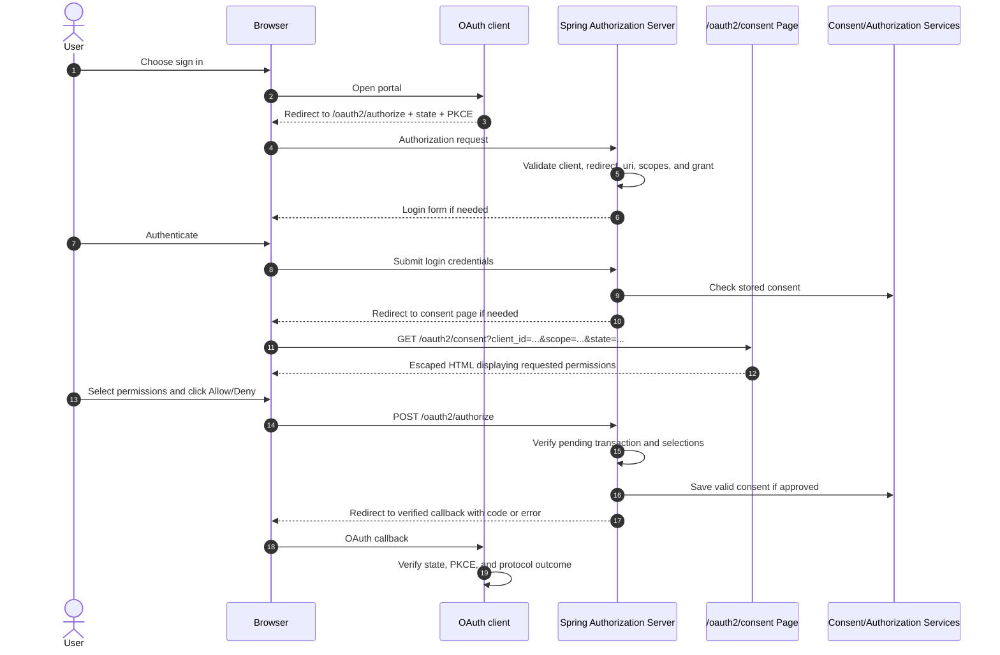
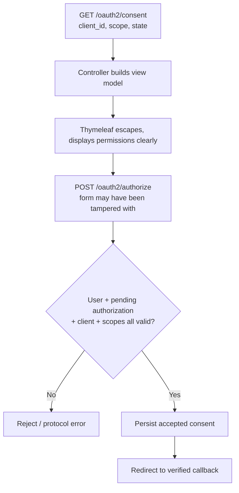
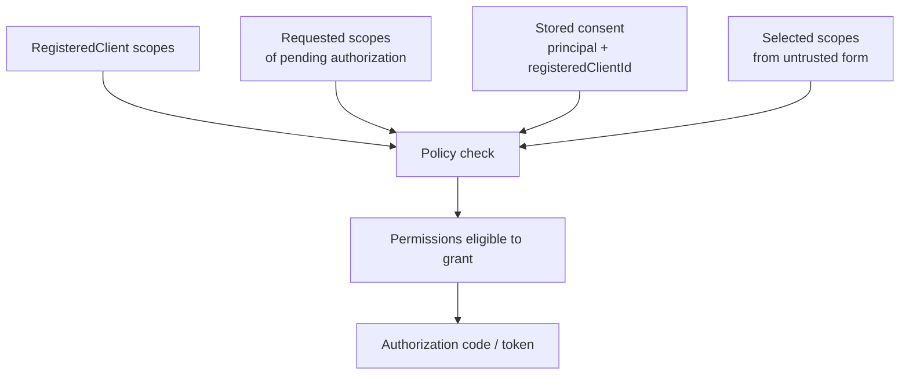

# Protecting the Consent Form, Navigation Parameters, and Displayed Content

In OAuth 2.0/OpenID Connect (OIDC), **authorization consent** is the step where a user decides whether to allow an OAuth client to exercise the requested permissions. When using Spring Authorization Server, you can replace the default consent UI with a page rendered by your Spring Boot application. This page reads client information, requested scopes, and transaction state, then lets the user make a choice. Because it runs on the Authorization Server's domain and directly affects granted permissions, it is a critical security component.

This lesson belongs to the **Consent** chapter of the **SPRING_SECURITY_OAUTH2_OIDC_AUTHORIZATION_SERVER** module, aimed at teaching how to design, configure, secure, test, and operate Spring Authorization Server in Spring Boot. The focus is on protecting the **consent form**, **navigation parameters**, and **displayed content** against CSRF, hidden-field tampering, scope escalation, XSS, clickjacking, and open redirects.

**Learning Objectives:**

- Distinguish the consent UI from the Authorization Server's actual permission-granting decision.
- Understand why `client_id`, `state`, and `scope` in query parameters or hidden inputs can all be tampered with and must be bound to the pending authorization.
- Configure a custom consent page in Spring Authorization Server, building the display model from `RegisteredClientRepository` and `OAuth2AuthorizationConsentService`.
- Use Thymeleaf escaping and security headers to prevent XSS, clickjacking, and data leakage.
- Design **Allow / Deny** choices and post-consent navigation without turning the Authorization Server into an open redirect.
- Write tests for scope tampering, CSRF, state replay, multiple tabs, mid-flow logout, and rendering bugs.

## 1. Consent Flow and Trust Boundaries

Consider a system with Authorization Server `https://login.example.com`, client `orders-portal` at `https://portal.example.com`, registered callback `https://portal.example.com/login/oauth2/code/sas`, and API `https://api.example.com`.



The consent screen's sole responsibility is to **help the user understand and express their choice**. It has no authority to mint authorization codes, issue access tokens, or write arbitrary scopes from the form directly into the database. The final decision belongs to the **Authorization Endpoint** together with Spring Authorization Server's services and validators.

**Not every login shows the consent page.** Policies like `RegisteredClient.clientSettings.requireAuthorizationConsent`, scopes already approved by the user, scope types, and OIDC rules can influence whether the AS needs to prompt again.

## 2. Every Form Parameter Can Be Modified

The browser is under the user's control: they can edit URLs, the DOM, checkboxes, hidden inputs, or send POSTs via scripts or HTTP clients. An attacker can also send a victim a GET link containing crafted `client_id`, `scope`, or `state` values.

| Data | How to Use | Do Not Infer |
| --- | --- | --- |
| `client_id` | Look up the registered client and match against the pending transaction. | Presence of `client_id` means the request came from the legitimate client. |
| `state` on consent page | Used by the AS to link the consent action to the pending authorization per framework design. | Hidden state is standalone proof of authorization or replaces all CSRF tokens. |
| GET `scope` | Hint of permissions to display; must be checked against transaction scopes and registration. | Whatever scope appears in the query will be granted. |
| POST `scope` (checkboxes) | Reflects permissions the user selected; the AS must constrain by transaction. | Adding a checkbox via DevTools can expand permissions. |
| `redirect_uri` | AS retrieves it from the validated authorization request and matches against registered callbacks. | Arbitrary redirect targets can be taken from the consent form. |
| `client_name`, `logo_uri`, policy links | Registered and governed metadata; require source verification, escaping, and URL checks. | Content from queries or dynamic registration is safe to render as HTML. |
| `next`, `returnUrl`, `continue` | Use only if restricted to safe internal routes. | Submitted path is a valid post-consent redirect target. |
| CSRF token | Effective only when **server-side CSRF validation** actually verifies it. | Simply appearing in a hidden input makes the form CSRF-proof. |

Distinguish **OAuth client `state`** (used by the client to correlate the callback to its initial request), **pending consent state** (managed by the AS), and **HTTP session CSRF token**. They all relate to anti-forgery, yet do not automatically share values or substitute for one another.



**Checks at GET do not replace checks at POST.** A user can open the page in a tab, let the session expire, have client policy change, or alter the request body before submitting.

## 3. Configuring a Custom Consent Page in Spring Authorization Server

The following examples target **Spring Boot 3.x compatible with Spring Authorization Server 1.x**. Rendering Thymeleaf requires the `spring-boot-starter-thymeleaf` dependency in addition to Spring Security and Spring Authorization Server. APIs may differ across release lines; cross-check the documentation for your chosen version.

### 3.1. Per-`RegisteredClient` Consent Policy

```java
RegisteredClient portal = RegisteredClient.withId("portal-internal-id")
    .clientId("orders-portal")
    .clientAuthenticationMethod(ClientAuthenticationMethod.CLIENT_SECRET_BASIC)
    .authorizationGrantType(AuthorizationGrantType.AUTHORIZATION_CODE)
    .redirectUri("https://portal.example.com/login/oauth2/code/sas")
    .scope(OidcScopes.OPENID)
    .scope("orders.read")
    .scope("orders.write")
    .clientSettings(ClientSettings.builder()
        .requireProofKey(true)
        .requireAuthorizationConsent(true)
        .build())
    .build();
```

This is only the client registration snippet. A complete application must also configure secrets, the registration repository, signing keys, users, and `SecurityFilterChain` beans. `requireAuthorizationConsent(true)` sets the policy to prompt the user; persisting consent belongs to `OAuth2AuthorizationConsentService`, while issuing codes/tokens belongs to other protocol components.

### 3.2. Setting Up `consentPage` and Two Filter Chains

```java
package com.example.authserver.config;

import org.springframework.context.annotation.Bean;
import org.springframework.context.annotation.Configuration;
import org.springframework.core.annotation.Order;
import org.springframework.http.MediaType;
import org.springframework.security.config.Customizer;
import org.springframework.security.config.annotation.web.builders.HttpSecurity;
import org.springframework.security.oauth2.server.authorization.config.annotation.web.configurers.OAuth2AuthorizationServerConfigurer;
import org.springframework.security.web.SecurityFilterChain;
import org.springframework.security.web.authentication.LoginUrlAuthenticationEntryPoint;
import org.springframework.security.web.util.matcher.MediaTypeRequestMatcher;

@Configuration(proxyBeanMethods = false)
public class ConsentSecurityConfig {

    @Bean
    @Order(1)
    SecurityFilterChain authorizationServerChain(HttpSecurity http)
            throws Exception {

        OAuth2AuthorizationServerConfigurer asConfigurer =
            OAuth2AuthorizationServerConfigurer.authorizationServer();

        http.securityMatcher(asConfigurer.getEndpointsMatcher())
            .with(asConfigurer, as -> as
                .authorizationEndpoint(endpoint ->
                    endpoint.consentPage("/oauth2/consent"))
                .oidc(Customizer.withDefaults()))
            .authorizeHttpRequests(authorize ->
                authorize.anyRequest().authenticated())
            .exceptionHandling(exceptions ->
                exceptions.defaultAuthenticationEntryPointFor(
                    new LoginUrlAuthenticationEntryPoint("/login"),
                    new MediaTypeRequestMatcher(MediaType.TEXT_HTML)));

        return http.build();
    }

    @Bean
    @Order(2)
    SecurityFilterChain applicationChain(HttpSecurity http)
            throws Exception {

        http.authorizeHttpRequests(authorize -> authorize
                .requestMatchers("/oauth2/consent").authenticated()
                .anyRequest().authenticated())
            .formLogin(Customizer.withDefaults())
            .headers(headers -> headers
                .frameOptions(frame -> frame.deny())
                .contentSecurityPolicy(csp -> csp.policyDirectives(
                    "frame-ancestors 'none'; object-src 'none'; base-uri 'none'")));

        return http.build();
    }
}
```

Here `GET /oauth2/consent` is an MVC page belonging to the application chain (typically after login), whereas **`POST /oauth2/authorize`** remains in the Authorization Server protocol chain. Never write a custom code-issuing endpoint just to build a prettier UI.

`frameOptions(DENY)` and CSP `frame-ancestors 'none'` prevent clickjacking by blocking the consent page from being embedded in an iframe. This configuration is not a complete Authorization Server, and the CSP should be refined and tested if external scripts, styles, or resources are used.

## 4. Building Display Data from Client Registration

A consent page must show the **registered client name** and **scope meanings**, never taking a name or HTML snippet directly from request parameters.

The controller below uses Spring MVC with Java 17 and only **renders the view**. It does not write consent itself, issue tokens, or use a `returnUrl` query parameter to redirect.

```java
package com.example.authserver.web;

import java.security.Principal;
import java.util.Arrays;
import java.util.LinkedHashSet;
import java.util.List;
import java.util.Map;
import java.util.Set;
import java.util.stream.Collectors;

import org.springframework.http.HttpStatus;
import org.springframework.security.core.GrantedAuthority;
import org.springframework.security.oauth2.server.authorization.OAuth2AuthorizationConsent;
import org.springframework.security.oauth2.server.authorization.OAuth2AuthorizationConsentService;
import org.springframework.security.oauth2.server.authorization.client.RegisteredClient;
import org.springframework.security.oauth2.server.authorization.client.RegisteredClientRepository;
import org.springframework.stereotype.Controller;
import org.springframework.ui.Model;
import org.springframework.web.bind.annotation.GetMapping;
import org.springframework.web.bind.annotation.RequestParam;
import org.springframework.web.server.ResponseStatusException;

@Controller
public class ConsentPageController {

    private static final Map<String, String> SCOPE_LABELS = Map.of(
        "profile", "View basic profile information",
        "orders.read", "View order lists and details",
        "orders.write", "Create or update orders"
    );

    private final RegisteredClientRepository clients;
    private final OAuth2AuthorizationConsentService consents;

    public ConsentPageController(
            RegisteredClientRepository clients,
            OAuth2AuthorizationConsentService consents) {
        this.clients = clients;
        this.consents = consents;
    }

    @GetMapping("/oauth2/consent")
    public String consent(
            Principal principal,
            @RequestParam("client_id") String clientId,
            @RequestParam("scope") String scope,
            @RequestParam("state") String state,
            Model model) {

        if (principal == null) {
            throw new ResponseStatusException(HttpStatus.UNAUTHORIZED);
        }

        RegisteredClient client = clients.findByClientId(clientId);
        if (client == null) {
            throw new ResponseStatusException(HttpStatus.BAD_REQUEST);
        }

        Set<String> requested = Arrays.stream(scope.trim().split("\\s+"))
            .filter(value -> !value.isBlank())
            .collect(Collectors.toCollection(LinkedHashSet::new));

        if (requested.isEmpty()
                || !client.getScopes().containsAll(requested)) {
            throw new ResponseStatusException(HttpStatus.BAD_REQUEST);
        }

        OAuth2AuthorizationConsent previous =
            consents.findById(client.getId(), principal.getName());

        Set<String> approved = previous == null
            ? Set.of()
            : previous.getAuthorities().stream()
                .map(GrantedAuthority::getAuthority)
                .filter(value -> value.startsWith("SCOPE_"))
                .map(value -> value.substring("SCOPE_".length()))
                .collect(Collectors.toSet());

        List<Map<String, String>> pending = requested.stream()
            .filter(value -> !approved.contains(value))
            .map(value -> Map.of(
                "code", value,
                "label", SCOPE_LABELS.getOrDefault(
                    value, "Requested permission: " + value)))
            .toList();

        String displayName = client.getClientName();
        if (displayName == null || displayName.isBlank()) {
            displayName = client.getClientId();
        }

        model.addAttribute("clientName", displayName);
        model.addAttribute("clientId", client.getClientId());
        model.addAttribute("state", state);
        model.addAttribute("pendingScopes", pending);
        model.addAttribute("approvedScopes", approved);

        return "consent";
    }
}
```

**Limitation of this GET example:** it checks that the client is registered and requested scopes are a subset of registered scopes, but does not itself prove that `state` corresponds to a valid pending authorization for the current user. The Spring Authorization Endpoint performs this check upon receiving POST. In a production system, consider validating the server-side transaction even before rendering GET to prevent **fake consent prompts** constructed from attacker-crafted query parameters.

In particular, `client.getClientName()` must come from a governed registration; if your system allows third-party clients to choose names via dynamic registration, vet labels and owner identities. `OAuth2AuthorizationConsentService.findById(...)` uses the **internal registered client ID and principal**, unlike the public `client_id` in the URL.

## 5. Thymeleaf Template: Escaping, Checkboxes, and Hidden Inputs

Create `src/main/resources/templates/consent.html` with the required fields. Thymeleaf expressions must escape output on render. Use `th:text`, never `th:utext` with external data.

```html
<!doctype html>
<html lang="en" xmlns:th="http://www.thymeleaf.org">
<head>
  <meta charset="UTF-8">
  <meta name="viewport" content="width=device-width, initial-scale=1">
  <title>Confirm Permissions</title>
</head>
<body>
  <main>
    <h1>Confirm Permissions</h1>

    <p>
      Application <strong th:text="${clientName}">Application Name</strong>
      is requesting the following permissions:
    </p>

    <form method="post" th:action="@{/oauth2/authorize}">
      <input type="hidden" name="client_id" th:value="${clientId}">
      <input type="hidden" name="state" th:value="${state}">

      <fieldset>
        <legend>Select the permissions you agree to grant</legend>
        <div th:each="item, iter : ${pendingScopes}">
          <input type="checkbox" name="scope"
                 th:id="${'scope-' + iter.index}"
                 th:value="${item.code}">
          <label th:for="${'scope-' + iter.index}"
                 th:text="${item.label}">Permission description</label>
        </div>
      </fieldset>

      <button type="submit">Allow selected permissions</button>
    </form>

    <section>
      <h2>Previously approved permissions</h2>
      <ul>
        <li th:each="scope : ${approvedScopes}"
            th:text="${scope}">Granted permission</li>
      </ul>
    </section>
  </main>
</body>
</html>
```

### 5.1. Why Does `th:text` Matter?

Thymeleaf `th:text` escapes data when inserting into text nodes. If an application name is set to:

```text
App 
```

the browser renders this string literally as **text**, without creating an image element or executing the event handler. Conversely, `th:utext` or `innerHTML` with untrusted data can trigger XSS directly on the Authorization Server's origin.

`th:value` escapes HTML attribute syntax, yet does not make scope, state, or client ID trustworthy values. Hidden fields like:

```html
<input type="hidden" name="client_id" th:value="${clientId}">
<input type="hidden" name="state" th:value="${state}">
```

can still be altered via DevTools or a crafted HTTP POST. The AS must verify the user, pending authorization, client, request scopes, and grant conditions when handling POST.

### 5.2. Providing a Deny Option

Users must have a way to **decline**; avoid designs forcing them to click Allow just to leave the screen. In some custom consent page patterns, submitting the transaction **without any newly approved scopes** represents denial. Illustrative form showing the idea:

```html
<form method="post" th:action="@{/oauth2/authorize}">
  <input type="hidden" name="client_id" th:value="${clientId}">
  <input type="hidden" name="state" th:value="${state}">
  <!-- Do not send new scopes. -->
  <button type="submit">Deny</button>
</form>
```

**Verify against the exact Spring Authorization Server version in use.** The endpoint may return `access_denied` or a consent error depending on the implementation; never invent `approved=false` and assume the framework understands it. Tests must prove: no extra consent is written, no code/token is issued for the denied transaction, and responses go strictly to a **verified callback**.

### 5.3. Never Put an Arbitrary `redirect_uri` in the Form

The consent form does not need to accept a new `redirect_uri` or `returnUrl` to determine `Location`. The AS must retrieve the callback from the previously validated authorization transaction. If the UI has a “Help” or “Back to home” button, use only a fixed internal path or a route ID from a server-managed allowlist.

## 6. CSRF, OAuth State, and Session Cookies

**CSRF** occurs when an external site causes a browser logged into the AS to send a state-changing request without the user's intent. Session cookies can be sent automatically, so merely checking whether the user is logged in is insufficient.

| Mechanism | Primary Role | Does Not Replace |
| --- | --- | --- |
| Client OAuth `state` | Client matches callback to initial login request. | CSRF validation for custom forms at the AS. |
| Pending authorization/consent state | AS binds user's choice to the pending request, client, and scopes. | All HTTP/session checks in other endpoints. |
| Spring Security CSRF token | Proves POST belongs to a protected session/transaction when the filter actually validates it. | Client registration, pending state, and permission scope checks. |
| `SameSite` cookie | Mitigates certain cross-site requests carrying cookies. | CSRF protection in all scenarios. |

### 6.1. A Hidden CSRF Token Is Not Guaranteed to Be Checked

In Spring MVC + Thymeleaf applications, `th:action` can instruct Spring Security to inject a hidden CSRF token via `RequestDataValueProcessor` when enabled. However, OAuth endpoints may have **CSRF exemptions** in their filter chain. Therefore:

1. Check the exact matcher and filter chain actually applied to **POST `/oauth2/authorize`**.
2. If you create a custom POST endpoint to record consent, protect it with a server-validated CSRF token or an equivalent tested request-binding mechanism.
3. Never disable CSRF application-wide just because the token endpoint uses POST. OAuth protocol endpoints and login/consent forms need separate policies.
4. Test POSTs with missing tokens, forged tokens, cross-site POSTs, and invalid state using a logged-in session. Conclude it is safe only when **unintended consent cannot be created**.

When not relying on Thymeleaf's automatic token injection, a hidden CSRF field can be rendered as follows; it is effective only if the server actually **validates** that token:

```html
<input type="hidden" th:if="${_csrf != null}"
       th:name="${_csrf.parameterName}"
       th:value="${_csrf.token}">
```

Never inject tokens twice mechanically or rely on `state` to waive other validations.

### 6.2. Cookies and Login Sessions

On a public Authorization Server, cookies need `Secure` over HTTPS, `HttpOnly`, and `SameSite` compatible with OAuth/OIDC flows. `SameSite=Lax` helps in many cases but does not stop every CSRF vector; certain redirect/form-post flows have different cookie requirements. Test in real browsers.

If the session expires before the user clicks Allow, the consent POST must be rejected or require re-authentication per policy. Never treat a `state` still sitting in stale HTML as grounds to bypass authentication.

## 7. Scope Tampering: Do Not Trust Checkboxes or Self-Declared Permissions

Suppose the AS only asked for consent on `orders.read`. A browser could alter the form to also submit `orders.write`:

```http
POST /oauth2/authorize HTTP/1.1
Host: login.example.com
Content-Type: application/x-www-form-urlencoded

client_id=orders-portal&state=PENDING_STATE&scope=orders.read&scope=orders.write
```

Even if `orders.write` is in registration, it is **not automatically among the scopes requested in the pending transaction**. The AS must simultaneously check:

- **Registered scopes**: scopes the client is registered to request.
- **Requested scopes**: scopes in the validated authorization request.
- **Existing consent**: scopes previously approved by the principal.
- **Selected scopes**: current choices submitted from the form, constrained to a valid subset.
- **Policy/issued scopes**: final permissions the AS can grant based on both server policy and valid choices.



**Never** write a custom POST controller that calls `OAuth2AuthorizationConsentService.save(...)` directly with every `scope` supplied by the request. If extra checks are needed, use Spring Authorization Server's appropriate extension points while preserving standard constraints.

`OAuth2AuthorizationConsentService` stores approved permissions by **internal registered client ID** and **principal name**. Consent may spare users from re-approving, yet it never means existing access tokens are unbounded or APIs can skip verifying audience, scopes, and object-level permissions.

## 8. Protecting Application Name, Logo, Links, and Scope Descriptions

Because the consent page renders on the Authorization Server's trusted domain, XSS or phishing flaws here directly undermine the grant flow.

| Content | Risk | Mitigation |
| --- | --- | --- |
| Client name | Stored/reflected XSS; impersonating reputable apps. | Load from governed registration; `th:text`; vet owner names. |
| Scope descriptions | Malicious HTML, vague wording, or hiding write/delete access. | Server-vetted description mapping; escape; never take raw HTML from queries. |
| `logo_uri` | Tracking, images from untrusted hosts, dangerous SVGs. | Approved HTTPS origins only; CSP; consider image proxying or omitting logos. |
| `policy_uri`/`tos_uri` | Phishing links, `javascript:` scheme, tabnabbing. | URL allowlist, `https`, `rel="noopener noreferrer"` when opening new tabs. |
| Error messages | Reflected XSS, stack trace leaks. | Controlled messages, escaping, and minimal detail. |
| `next`/`continue` | Open redirect after approval or denial. | Server-defined internal routes. |

**Escaping does not equal a safe URL.** A `javascript:...` URL placed in `href` remains dangerous even after attribute-syntax escaping. Validate the scheme, hostname, and URL source before rendering links; limit embedded content from client metadata.

The UI must also show **read permissions differently from write permissions**, and new permissions differently from already approved ones. Never silently pre-select all new scopes, use misleading button labels, or describe `orders.write` as “view only”. Scopes are a technical permission boundary; the Resource Server must still enforce per-resource authorization.

## 9. Preventing Open Redirects via Navigation Parameters

Anti-pattern:

```java
// DO NOT implement: attacker controls the redirect destination.
String returnUrl = request.getParameter("returnUrl");
response.sendRedirect(returnUrl);
```

A URL such as `https://login.example.com/oauth2/consent?returnUrl=https://attacker.example` turns the AS domain into a phishing vector if the controller uses that parameter directly.

For **OAuth responses**, the AS must use the `redirect_uri` from the authorization transaction validated against `RegisteredClient.redirectUris`, never a `returnUrl` or a new callback from the consent form. If the callback is invalid, **do not redirect even protocol errors** to that URI.

For **internal UI navigation** (help/home pages), use a route ID from an allowlist:

```java
private static String safeInternalRoute(String routeId) {
    if ("help".equals(routeId)) {
        return "/help";
    }
    if ("home".equals(routeId)) {
        return "/home";
    }
    return "/";
}
```

This helper does not determine OAuth callbacks and must not be used to grant permissions. Reject variants like `//attacker.example`, `%2F%2Fattacker.example`, backslashes, userinfo `@`, or absolute URLs as internal paths.

## 10. Clickjacking, CSP, Caching, and Resource Origins

Clickjacking tricks users into thinking they are clicking a button on another site while actually clicking **Allow** on an invisible consent page inside an iframe. Verify `X-Frame-Options: DENY` or CSP `frame-ancestors 'none'` on the real consent page response.

Example header configuration on the `SecurityFilterChain` serving the page:

```java
http.headers(headers -> headers
    .frameOptions(frame -> frame.deny())
    .contentSecurityPolicy(csp -> csp.policyDirectives(
        "default-src 'self'; " +
        "script-src 'self'; " +
        "style-src 'self'; " +
        "object-src 'none'; " +
        "base-uri 'none'; " +
        "form-action 'self'; " +
        "frame-ancestors 'none'")));
```

Tune CSP to the resources actually needed and minimize third-party JavaScript. Prefer a server-rendered consent page with simple forms, avoiding `innerHTML` or unvetted UI libraries.

Given transaction data in URLs, consider `Referrer-Policy: no-referrer` to avoid leaking `state` to external pages and `Cache-Control: no-store` to prevent proxies/CDNs from caching user-specific content. Never log authorization codes, tokens, cookies, CSRF tokens, or sensitive state. Security headers are defense-in-depth; they do **not** replace transaction/CSRF/scope validation.

## 11. Multiple Tabs, Session Timeouts, and Policy Changes

**Two tabs logged in simultaneously:** Tab A requests `orders.read`, Tab B requests `orders.write`. If custom code uses a single session variable `pendingScopes` overwritten between tabs, clicking Allow in A could grant B's permissions. Each consent must bind to its **own pending authorization**; test swapping `state` between two tabs and confirm no wrong permissions are granted.

**Expired session:** A form rendered while the user was logged in must never succeed on POST after the session has expired. Require re-authentication or a new transaction per policy.

**Admin changes scopes while user is reading:** Even if the GET page showed old scopes, the AS must verify current policy on POST. Never assume the rendered UI is the final source of truth.

**Multiple instances:** `RegisteredClientRepository`, `OAuth2AuthorizationService`, and `OAuth2AuthorizationConsentService` require shared/distributed state storage so all instances process transactions consistently. In-memory stores can lose consent and pending authorizations across restarts or between instances.

**Revoking consent:** Deleting stored consent does not automatically revoke all previously issued JWT access tokens. If immediate invalidation is required, add token revocation, introspection, or dynamic authorization checks as needed.

## 12. Security Test Matrix

| Scenario | Expected Secure Outcome |
| --- | --- |
| Unauthenticated user opens consent page | Redirects to login or denies; never leaks another user's data. |
| Query contains non-existent `client_id` | Never displays as a valid app; cannot grant consent. |
| Client B uses `state` from Client A's transaction | Never grants permissions to B from A's state. |
| Invalid, expired, or another user's `state` | Never writes consent or issues code/token. |
| GET `scope` not in registration | Controller/AS refuses to show as a valid scope. |
| POST injects scope outside pending request | Never grants new scope simply because it appeared in checkboxes. |
| Alter hidden `client_id` after render | AS matches against pending transaction and rejects. |
| Missing/forged CSRF token where required | Never creates unauthorized consent; verify exact filter matcher. |
| Cross-site POST with logged-in AS cookie | Never approves outside user intent. |
| Client name is `` | Rendered as literal text; executes no JavaScript. |
| Scope description contains HTML/script | Escaped; never renders unvetted HTML. |
| `returnUrl=https://attacker.example` | No `Location` pointing to attacker. |
| `next=//attacker.example` and URL-encoded variant | Blocked by route allowlist. |
| Consent page embedded in an iframe | Denied by `frame-ancestors`/X-Frame-Options. |
| User denies | Records no additional consent and issues no code/token for that transaction. |
| User selects only `orders.read` | Does not auto-grant `orders.write`. |
| Two tabs swap state | Never merges Tab A's scopes with Tab B's. |
| Session expires before POST | Never saves consent; forces re-login or returns error. |
| Initial callback not in registration | Never sends code **or error** to unfamiliar callback. |
| Scopes/registration change between GET and POST | Server re-validates against current policy. |

### 12.1. Testing at the Right Layer of Responsibility

**View tests:** use client names containing HTML or deceptive Unicode, assert escaped output, vetted metadata links, no arbitrary form redirects, and proper CSP/frame/cache headers.

**Protocol integration tests:** initiate a real authorization request, authenticate the user, open the consent page, and submit allowed permissions. Verify the code goes only to the right callback and consent is saved for the exact principal/client. Repeat with unknown scopes, invalid state, swapped client, and the deny button.

**CSRF tests:** using an authenticated session, test POST without a CSRF token or with a mismatched token under your active config; if the protocol endpoint is CSRF-exempt, verify transaction binding blocks unintended grants and add CSRF protection to any custom endpoints.

**Browser tests:** check iframes, absolute and protocol-relative links, XSS, Deny button behavior, concurrent tabs, and cross-site cookies. Do not assert only HTTP status codes, since Spring may return an OAuth error or redirect to login depending on where handling occurs.

## 13. Troubleshooting

**Clicking Allow loops back to consent forever:** confirm the form POSTs to the exact `/oauth2/authorize`, `client_id`/`state` match, scopes are sent properly, and `OAuth2AuthorizationConsentService` persists state for the exact registered client ID and principal. In-memory stores or multiple instances can cause inconsistent consent.

**POST returns 403:** check the CSRF token, matcher, filter chain, and session—never strip system-wide protections just to make POST pass.

**Checkbox had the scope, yet the token lacks that permission:** distinguish registered scopes, requested scopes, granted scopes, and policies. Forms cannot elevate token permissions; inspect the transaction before blaming the UI.

**Client name renders as HTML:** search for `th:utext`, `innerHTML`, or raw HTML string concatenation from untrusted data; switch to `th:text` and vetted metadata.

**Denying redirects to an unfamiliar host:** search for `returnUrl`/`next`/`continue` passed directly into `sendRedirect` or JavaScript. OAuth callbacks must come from validated AS transactions, and UI navigation routes must use an allowlist.

**Proxy generates wrong host in form action:** verify public issuer, `th:action="@{/oauth2/authorize}"`, context path, and forwarded headers from trusted proxies. Never trust `X-Forwarded-Host` headers sent directly from the public Internet.

## 14. Applied Exercise

An Authorization Server serves three clients:

| Client | Application Type | Scopes |
| --- | --- | --- |
| `employee-portal` | Internal web backend | `profile`, `employees.read` |
| `partner-reports` | Partner web client | `profile`, `reports.read`, `reports.export` |
| `mobile-customer` | Public native app | `openid`, `orders.read` |

On the `partner-reports` consent page, an attacker tries adding an `admin.write` checkbox, changing the hidden `client_id` to `employee-portal`, and appending `returnUrl=https://attacker.example`.

Answer on your own:

1. Why are query parameters/hidden inputs not trusted sources for authenticating clients or granting scopes?
2. Which data must Spring Authorization Server cross-check before saving consent?
3. Where is `state` used, and how does it differ from a form's CSRF token?
4. Where must app names, scope descriptions, and logos come from? Does `th:text` replace URL validation?
5. If only `reports.read` is selected, how must the response and authorization state reflect that choice?
6. When the user denies, may the AS use `returnUrl` to construct `Location`?
7. Does an already issued JWT access token immediately become invalid when a user withdraws consent?
8. What should you test to catch XSS, clickjacking, scope tampering, two-tab state swapping, and CSRF?

**Hint:** the form only conveys the user's **intent**. The AS must validate registered client, pending authorization, principal, and scopes before granting permissions; the view must escape output, links must be vetted, and OAuth callbacks must be validated independently.

## 15. Pre-Operations Checklist

- [ ] `requireAuthorizationConsent` is configured properly per registered client, and the consent service persists state appropriately.
- [ ] `GET /oauth2/consent` requires an authenticated user and renders client name and scopes from trusted sources.
- [ ] Query/hidden fields are never treated as permission sources; `POST /oauth2/authorize` verifies pending transaction, client, user, and scopes.
- [ ] OAuth state, consent transaction, and CSRF token are clearly distinguished; tests verify protection on real endpoints.
- [ ] HTML uses escaping (`th:text`/`th:value`), never rendering raw HTML from client metadata/requests.
- [ ] A Deny path works for the AS version in use and issues no code/token on denial.
- [ ] Navigation buttons use a route allowlist; OAuth callbacks go strictly to registered URIs, never arbitrary `returnUrl`.
- [ ] Names, logos, policy links, and scope descriptions follow governance/review processes.
- [ ] HTTPS, cookies, CSP, X-Frame-Options, Referrer-Policy, and Cache-Control are configured and tested.
- [ ] Tested XSS, CSRF, scope tampering, state replay, concurrent tabs, session expiry, and policy updates.
- [ ] No authorization codes, tokens, cookies, CSRF tokens, or sensitive states are written to logs.
- [ ] Instances share client, authorization, and consent state as needed for consistency.

**Remember:** The consent page is the **UI for displaying permissions and collecting choices**, while Spring Authorization Server is responsible for **validating transactions and granting permissions**. Effective form protection requires combining server-side validation, CSRF protection, escaping, CSP, session management, and safe redirects. A hidden field can be edited, a displayed scope is not guaranteed to be grantable, and a URL on the login domain is not automatically a safe redirect target.

**References:**

- [Spring Authorization Server — Customize the Authorization Consent Page](https://docs.spring.io/spring-authorization-server/reference/guides/how-to-custom-consent-page.html): configuring `consentPage(...)` and example controller/template.
- [Spring Authorization Server — Protocol Endpoints](https://docs.spring.io/spring-authorization-server/reference/protocol-endpoints.html): Authorization Endpoint and extension points.
- [Spring Authorization Server — Core Model and Components](https://docs.spring.io/spring-authorization-server/reference/core-model-components.html): `RegisteredClient`, `ClientSettings`, and `OAuth2AuthorizationConsentService`.
- [Spring Security — CSRF Protection](https://docs.spring.io/spring-security/reference/servlet/exploits/csrf.html): tokens, filter chains, and Thymeleaf integration.
- [RFC 6749 — OAuth 2.0](https://www.rfc-editor.org/rfc/rfc6749.html): authorization requests/responses, scopes, and `state`.
- [RFC 9700 — OAuth 2.0 Security Best Current Practice](https://www.rfc-editor.org/rfc/rfc9700.html): protecting authorization flows and redirects.
- [OpenID Connect Core 1.0](https://openid.net/specs/openid-connect-core-1_0.html): authentication requests, consent, and ID token validation.
