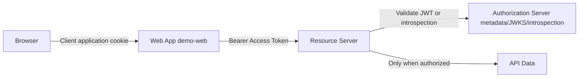

# The Complete Authorize, Login, Consent, Callback, and Token Sequence

## 1. Objective: Tracing an OAuth 2.0/OIDC Transaction from Start to Finish

In the **Authorization Code and PKCE** chapter of the **SPRING_SECURITY_OAUTH2_OIDC_AUTHORIZATION_SERVER** module, we learn how to design, configure, secure, test, and operate an **OAuth 2.0/OpenID Connect Authorization Server** using Spring Security and Spring Authorization Server in a Spring Boot application. The topic of this lesson is **the complete sequence from the moment an application starts logging in until it receives tokens**:

```text
Client initiates request
  → /oauth2/authorize
  → Login at Authorization Server
  → Consent if needed
  → Authorization Code + redirect callback
  → Client verifies state and exchanges code + PKCE verifier
  → /oauth2/token
  → Access Token (+ ID Token/Refresh Token when eligible)
```

A single working endpoint does not prove the entire protocol is correct. This sequence is only secure when the **user identity**, **client identity**, **user-consented permissions**, **authorization code**, **redirect URI**, **`state`**, and **PKCE** are accurately bound across multiple HTTP requests.

After this lesson, learners can:

- Identify the responsibilities of the browser, OAuth client, Authorization Server, and Resource Server in the Authorization Code flow with PKCE.
- Explain how Spring Security maintains login/CSRF state at the Authorization Server and how the OAuth client maintains its own transaction state.
- Trace `GET /oauth2/authorize`, redirection to login, consent, the `302` callback, and `POST /oauth2/token` with the proper parameters.
- Distinguish between an authorization code, `state`, `code_verifier`, `code_challenge`, Access Token, ID Token, and Refresh Token.
- Configure a sample Spring Authorization Server and Spring Security OAuth2 Client to observe a full login cycle.
- Analyze error scenarios and design end-to-end test cases, including code reuse, invalid PKCE, invalid redirect, denied consent, and multiple instances.

### 1.1. Prerequisites and Assumptions

The example uses the **Authorization Code Flow**, enables **PKCE S256**, and includes the `openid` scope to demonstrate OpenID Connect. Neither the Implicit Grant nor the Resource Owner Password Credentials Grant is used. The configurations, passwords, and `localhost`/loopback URLs below are **for development environments only**. Public deployments require HTTPS, persistent signing keys, protected client secrets, and an appropriate authorization/consent store.

For a pure OAuth 2.0 flow, if `openid` is not requested, there may be no ID Token; that does not prevent the client from receiving an Access Token when the grant succeeds.

## 2. Roles and Two Types of Login to Distinguish

| Component | Example | Responsibility |
| --- | --- | --- |
| **Resource Owner / End User** | User `dev.user` | Logs in and decides whether to grant the requested permissions. |
| **User Agent** | Browser | Follows `302 Location` redirects, sends cookies, and displays login/consent UIs. |
| **OAuth Client / OIDC Relying Party** | Web app `demo-web` at `http://127.0.0.1:8081` | Creates requests, stores `state` and the PKCE verifier, handles callbacks, exchanges the code for tokens, and manages the application session. |
| **Authorization Server / OpenID Provider** | Spring Authorization Server at `http://localhost:9000` | Authenticates users/clients, handles consent, issues codes and tokens, and publishes metadata/JWKS. |
| **Resource Server** | Protected API at `https://api.example.com` | Verifies the Access Token and decides whether to allow access to resources. |

The Resource Server appears at the end to illustrate how the Access Token is used; **a separate API is not required to observe the callback and token exchange** in this hands-on lesson.

There are **two distinct types of authentication**: the user authenticates with the Authorization Server (for example, form login + session cookie), whereas the OAuth client may authenticate itself at the token endpoint (for example, `client_secret_basic` or `private_key_jwt`). PKCE does not turn a public client into a confidential client, nor does it replace the user's login password.

### 2.1. Overall Diagram

```mermaid
sequenceDiagram
    autonumber
    actor U as User
    participant B as Browser
    participant C as OAuth Client :8081
    participant AS as Authorization Server :9000
    participant DB as Authorization/Consent Store
    U->>B: Opens page requiring login
    B->>C: GET /whoami
    C-->>B: 302 to authorize request
    Note over C: Generates state, verifier; computes S256 challenge
    B->>AS: GET /oauth2/authorize?...code_challenge=S256...
    AS-->>B: 302 /login when no session exists
    B->>AS: GET /login
    AS-->>B: Login form + CSRF token
    U->>B: Enters username/password
    B->>AS: POST /login over HTTPS (in production)
    AS-->>B: Session cookie + continues authorize
    B->>AS: Continues authorization request
    AS->>DB: Checks client, login, consent
    opt User approval required
        AS-->>B: Consent UI
        U->>B: Approves allowed scopes
        B->>AS: POST consent + CSRF
        AS->>DB: Saves consent when appropriate
    end
    AS->>DB: Saves authorization code + PKCE challenge
    AS-->>B: 302 redirect_uri?code=...&state=...
    B->>C: GET /login/oauth2/code/demo-web?code=...&state=...
    C->>C: Matches state, retrieves verifier for the transaction
    C->>AS: POST /oauth2/token + code + verifier + client authentication
    AS->>DB: Verifies code: unexpired, unused, matching client/redirect/PKCE
    AS-->>C: Access Token (+ ID Token/Refresh Token if applicable)
    C-->>B: Establishes application session / redirects page
```

The diagram illustrates the logical flow: how Spring Security saves and restores the request after login, the consent UI URL, and cookie types depend on the version and configuration. Do not assume every step maps to an identical mandatory endpoint or page across all applications.

## 3. What Data Travels with the Transaction?

A secure Authorization Code Flow involves several easily confused values:

| Value | Generated By | Where It Appears | Purpose |
| --- | --- | --- | --- |
| `client_id` | Pre-registered | Authorize/token request | Identifies the client. Not a secret. |
| `redirect_uri` | Pre-registered | Authorize, token request when required, redirect response | Restricts callbacks to those matching the client/transaction. |
| `state` | Client | Authorize request and redirect response | Binds the response back to the transaction created by the client, mitigating CSRF/session mix-ups. |
| `code_verifier` | Client, random per transaction | **Token request** | One-time secret used to prove authority to exchange the code. |
| `code_challenge` | Client, derived from verifier | **Authorize request** | Binding digest stored alongside the authorization code. |
| `code_challenge_method` | Chosen by client | Authorize request | Describes the verifier transformation; prefer `S256`. |
| `nonce` | OIDC client, when used | Authorize request, ID Token | Binds the ID Token to the authentication request; does not replace PKCE. |
| AS `session cookie` | Authorization Server | Browser ↔ AS | Maintains user login state at the AS. |
| **Authorization code** | Authorization Server | Redirect callback, then token request | Short-lived, single-use credential to exchange for tokens. |
| Access Token | Authorization Server | Token response; then Resource Server | Grants access to resources within approved scopes. |
| ID Token | OpenID Provider | Token response in OIDC flow | Client verifies the user authentication result. |
| Refresh Token | Authorization Server, when allowed | Token response and refresh request | Requests a new Access Token per policy without repeating full login every time. |

`state`, `code_verifier`, and `nonce` should be generated using a cryptographic random generator, with lifecycles and storage scoped to the transaction. **Never place `code_verifier` in the authorize URL, callback, logs, analytics, or `state`**.

## 4. Step 1 — Client Initiates the Authorize Request

### 4.1. Why Does the Browser Go to the Authorization Endpoint?

The `demo-web` application needs to authenticate the user or request permissions, but an OAuth client should not directly collect the user's password to log in on behalf of the Authorization Server. Instead, the client initiates an **authorization request** and instructs the browser to navigate to the Authorization Server.

Example of a request with PKCE:

```http
GET /oauth2/authorize?response_type=code&client_id=demo-web&redirect_uri=http%3A%2F%2F127.0.0.1%3A8081%2Flogin%2Foauth2%2Fcode%2Fdemo-web&scope=openid%20profile%20api.read&state=<random-state>&code_challenge=<base64url-sha256-verifier>&code_challenge_method=S256 HTTP/1.1
Host: localhost:9000
```

This is a condensed illustrative URL; in practice, each parameter value must be properly URL-encoded.

| Parameter | Meaning and Conditions |
| --- | --- |
| `response_type=code` | Selects the Authorization Code Flow. The client must be registered to use `authorization_code`. |
| `client_id=demo-web` | Selects the corresponding `RegisteredClient`. |
| `redirect_uri` | The callback must match a registered URI and cannot be arbitrarily altered by the user. |
| `scope=openid profile api.read` | Requests OIDC and API permissions; the server constrains this via client registration and consent/policy. |
| `state` | The client must store this before redirecting so it can match it at callback time. |
| `code_challenge` | Value derived from `code_verifier`, bound to the authorization code. |
| `code_challenge_method=S256` | Selects `BASE64URL(SHA256(ASCII(code_verifier)))`. |

### 4.2. Generating PKCE S256

According to RFC 7636, a verifier is **43–128 characters** long, consisting of Latin letters, digits, `-`, `.`, `_`, and `~`. With `S256`:

```text
code_challenge = BASE64URL_NO_PADDING(SHA256(ASCII(code_verifier)))
```

The client should generate at least 256 bits of entropy (for example, 32 bytes from a CSPRNG), Base64URL-encode it without padding into a 43-character verifier, and then compute the challenge. Standard test vector pair for verifying the formula:

```text
code_verifier  = dBjftJeZ4CVP-mB92K27uhbUJU1p1r_wW1gFWFOEjXk
code_challenge = E9Melhoa2OwvFrEMTJguCHaoeK1t8URWbuGJSstw-cM
method         = S256
```

The pair above is a **public test vector**, intended solely for verification and never to be used as a verifier in a real session.

RFC 7636 defines `plain` as `code_challenge=code_verifier` and specifies that **if a challenge is present without a method, it defaults to `plain`**. Systems should use `S256`; if policy permits only `S256`, the server must actively reject `plain` or a missing method rather than silently defaulting to `S256`. Some APIs like `ClientSettings.requireProofKey(true)` require PKCE, but you should not assume they **also** enforce S256-only across all versions.

### 4.3. Storing State Before Redirecting

The OAuth client must remember at least `state`, `code_verifier`, and the post-login destination, bound to the specific transaction. For a web app/BFF, this can be stored in the server session; for a browser client, the OAuth/OIDC library manages state storage according to its security design.

If a user opens two tabs and starts login simultaneously in both, **the two verifiers must be associated with two distinct `state` values**. A global variable such as `currentVerifier` can easily be overwritten, causing a code from request A to be exchanged using the verifier from request B.

## 5. Step 2 — Authorization Server Receives and Validates Authorize

### 5.1. Checks Before Proceeding

Spring Authorization Server typically uses `OAuth2AuthorizationEndpointFilter`, converters, and authentication providers/validators to process the request. Key logical checks:

1. Does `client_id` point to a valid `RegisteredClient`?
2. Is the client allowed to use `authorization_code` and the requested response type?
3. Does `redirect_uri` match a registered address? If invalid, **do not redirect to an unverified URI**.
4. Are the scopes valid and within the registered permissions?
5. For a client requiring PKCE, is `code_challenge` present and is the method supported/compliant with policy?
6. Does the request contain duplicate parameters, malformed syntax, or ambiguous values that must be rejected?
7. Is the user already logged in, and is consent or re-authentication required?

Before issuing the code, the challenge/method is validated against policy and stored/bound to the transaction. **The Authorization Endpoint does not require `code_verifier`**; the verifier is sent later in the token request.

### 5.2. AuthorizationServerContext and SecurityContext

The Authorization Server needs to know the **current issuer** to handle metadata/tokens consistently; Spring Authorization Server uses `AuthorizationServerSettings` and the request context. However, whether the user is logged in is the responsibility of Spring Security's `Authentication`/`SecurityContext`. These two contexts are distinct:

- **Authorization Server issuer**: which server issues tokens and handles requests.
- **Principal/User authentication**: which user is performing the authorization.
- **Registered client**: which application is requesting permissions.

A request with a valid issuer and registered client is still not enough to issue an authorization code if login/consent requirements are not yet satisfied.

## 6. Step 3 — Login at the Authorization Server

### 6.1. What Happens When Not Logged In?

When the browser calls `/oauth2/authorize` without an appropriate user `Authentication`, Spring Security can redirect to a form login page, for example:

```http
HTTP/1.1 302 Found
Location: http://localhost:9000/login
```

Real-world applications may use a custom login page, SSO, MFA, or federation. Returning to the authorization request after login typically relies on Spring Security's request saving/restoration mechanism or the ongoing protocol state, depending on version/configuration. Do not blindly assume the server will always resume a specific URL if you have customized `RequestCache`, the entry point, or the success handler.

### 6.2. User Accounts, Sessions, and Cookies

With form login, the user submits credentials over HTTPS to the Authorization Server:

```http
POST /login HTTP/1.1
Host: auth.example.com
Content-Type: application/x-www-form-urlencoded
Cookie: JSESSIONID=<browser-session-id>

username=dev.user&password=<password>&_csrf=<csrf-token>
```

This example only illustrates the form format; the body must be URL-encoded, and in practice the CSRF token may be sent via a parameter name/field/header depending on `CsrfTokenRepository`, login page configuration, and version. Never expose a real `password` in public traces.

Spring Security can verify the account via `UserDetailsService`, `AuthenticationProvider`, or another mechanism, then store/restore `Authentication` across the session and `SecurityContextRepository`. The browser sends the Authorization Server's session cookie on subsequent requests. **A login session cookie is not an Access Token**.

Cookies require `Secure`, `HttpOnly`, and appropriate `SameSite` attributes in production. Form login and session-based actions must be protected against CSRF. The fact that the OAuth protocol uses redirects **is not a reason to disable CSRF application-wide**.

### 6.3. Returning to Authorize After Login

After successful authentication, the browser returns to the pending authorization flow. The Authorization Server resumes using the original request that was securely preserved; client parameters, redirect URI, scopes, `state`, and PKCE must not be modifiable by a third party during the transition to/from login.

Having a user logged in at the Authorization Server does not mean **the OAuth client also has an application session**. The client only establishes/restores its own login state after processing the callback and receiving/validating the appropriate tokens.

## 7. Step 4 — Consent and Granted Scopes

### 7.1. When Does Consent Appear?

The Authorization Server may ask the user to confirm **which client** is requesting **which scopes**, for example:

```text
Client: demo-web
Requested scopes:
  openid
  profile
  api.read
```

In Spring Authorization Server, `ClientSettings.requireAuthorizationConsent(true)` can be used to require consent by policy; whether the screen actually appears also depends on scopes, previously saved consent, the protocol, and application mechanics. Do not assume that **every authorize request always shows a consent screen**, especially if the user already approved it and configuration allows consent reuse.

### 7.2. Authentication Is Not Consent

**Login** answers: *who is the user?* **Consent** answers: *which permissions does the user grant to the client?* A user may log in successfully yet deny the `api.read` scope or reject the entire request. In that case, the server must not proceed as if the user had approved everything.

`OAuth2AuthorizationConsent` and `OAuth2AuthorizationConsentService` handle storing and retrieving consent per user/client. Granted scopes must conform to the client registration, request, and actual consent/policy.

### 7.3. Consent Form and Request Protection

The consent page is a browser interaction, so it requires session validation, CSRF protection, and transaction mismatch prevention. Do not build a custom form that simply accepts `client_id` and a scope list from the browser and trusts them without matching against the server-stored authorization request.

Consent handling in Spring Authorization Server can flow through `OAuth2AuthorizationConsentAuthenticationProvider` and its dedicated consent model. The URL and appearance of the consent page (default or custom) depend on configuration; project code should not hardcode internal details of a specific library version as an OAuth standard rule.

### 7.4. Denied Consent

When the user denies authorization, the server can return the `access_denied` OAuth error according to protocol rules, accompanied by the original request's `state` if present and if a verified callback exists. The client must handle **error callbacks** rather than assuming `code` will always be returned.

Never redirect to an unregistered/unverified `redirect_uri`, even when that URI was sent in the request during an error condition.

## 8. Step 5 — Issuing the Authorization Code and Callback

### 8.1. When Is the Authorization Code Created?

Once the client/request is valid, the user is authenticated, and consent is satisfied per policy, the Authorization Server issues a **short-lived, unpredictable, single-use authorization code**. Associated state is typically stored via `OAuth2AuthorizationService`:

```text
registered client: demo-web
principal: dev.user
redirect URI: http://127.0.0.1:8081/login/oauth2/code/demo-web
approved scopes: openid, profile, api.read
code: <random-one-time-code>
code challenge: <S256-challenge>
code challenge method: S256
code expiry: <short-expiry>
```

This is a logical learning model, not the exact database schema of every Spring Authorization Server version. `TokenSettings.authorizationCodeTimeToLive(...)` can configure the TTL, for example 3 minutes.

### 8.2. Browser Receives the Redirect

The Authorization Server sends a `302 Location` to the **registered redirect URI**, containing the code and `state`:

```http
HTTP/1.1 302 Found
Location: http://127.0.0.1:8081/login/oauth2/code/demo-web?code=<authorization-code>&state=<original-state>
Cache-Control: no-store
```

In the default OAuth Authorization Code Flow, the browser **sees the code** in the callback URL; this is why the code must be short-lived, single-use, and protected by PKCE. Tokens are not sent at this step.

The client must verify that the returned `state` **matches a pending request**. If `state` does not match, is missing, or the transaction has expired, the client must reject it and must not arbitrarily exchange the code.

### 8.3. The Callback Is Not the Token Endpoint

The callback `/login/oauth2/code/demo-web` belongs to the **OAuth client**, not the Authorization Server. When the browser hits the callback:

1. The client looks up the saved transaction using `state`/session according to its library.
2. The client validates the callback, error parameters, `state`, and binding conditions.
3. The client retrieves the **`code_verifier` generated before the redirect**, tied specifically to that transaction.
4. The client sends a token request directly to the Authorization Server to exchange the code.
5. Only after the token response is verified/processed successfully does the client consider the login transaction complete.

A callback URL opening in the browser does not prove the token exchange succeeded. Conversely, if no application is running on the callback port, the browser may report connection refused even though the Authorization Server generated the code and redirected properly; in that case, the end-to-end flow is **not yet complete**.

## 9. Step 6 — Exchanging the Code at the Token Endpoint

### 9.1. What Does the Token Request Contain?

For a **confidential client** `demo-web` registered with `client_secret_basic` and PKCE, the client backend sends a request like:

```http
POST /oauth2/token HTTP/1.1
Host: auth.example.com
Authorization: Basic <base64-of-client-id-and-secret>
Content-Type: application/x-www-form-urlencoded

grant_type=authorization_code&
code=<authorization-code>&
redirect_uri=https%3A%2F%2Fclient.example.com%2Flogin%2Foauth2%2Fcode%2Fdemo-web&
code_verifier=<original-code-verifier>
```

In a local environment, the URI in the body must match the exact value used during authorization (`http://127.0.0.1:8081/login/oauth2/code/demo-web` in our example). `Authorization: Basic` carries client credentials syntactically encoded with Base64, **not encrypted**; a real token endpoint must use HTTPS.

For a **public client**, there is no trustworthy client secret to send via `client_secret_basic`; the client uses the `none` method and sends `client_id` according to applicable rules. PKCE remains mandatory by the security design of the flow.

### 9.2. Conditions Checked by the Token Endpoint

Spring Authorization Server typically uses `OAuth2TokenEndpointFilter` and a provider handling `authorization_code`. Key checks include:

- Is the client allowed to use the grant, and has it authenticated via its registered method or been identified as a valid public client?
- Does the authorization code exist, is it unexpired, and has it **never been used**?
- Does the code belong to the **exact client** and prior authorization request?
- Does `redirect_uri` (when applicable) match the original transaction?
- Is a valid `code_verifier` provided, and does recomputing `code_challenge` using the **stored method** match the original challenge?
- Does the authorization/consent/user state satisfy the requirements for the grant/token issuance?

With PKCE `S256`:

```text
expected = stored code_challenge from authorization request
actual   = BASE64URL_NO_PADDING(SHA256(ASCII(code_verifier)))

actual == expected  → continue validation and potentially issue tokens
actual != expected  → reject
```

Do not allow the client to **re-select `code_challenge_method` in the token request** to alter the calculation bound to the code. Never turn a code into a reusable credential, even when concurrent token exchange requests arrive.

### 9.3. Token Response

On success, an example token endpoint response is:

```json
{
  "access_token": "<signed-jwt-or-opaque-access-token>",
  "token_type": "Bearer",
  "expires_in": 900,
  "refresh_token": "<refresh-token-if-issued>",
  "scope": "openid profile api.read",
  "id_token": "<signed-id-token-if-oidc>"
}
```

`expires_in` is measured in seconds and depends on the client's `TokenSettings` policy. `id_token` is issued only when the OIDC flow and corresponding conditions are met. `refresh_token` depends on the grant, client type, and policy; not every response includes one.

Distinction:

| Token | Primary Consumer | Notes |
| --- | --- | --- |
| **Access Token** | Resource Server/API | Verify issuer, signature or introspection, audience, scopes, and expiration. |
| **ID Token** | OAuth/OIDC client | Verify signature, `iss`, `aud` (client ID), `exp`, and `nonce` when applicable. Do not use as a Bearer Token for APIs. |
| **Refresh Token** | OAuth client ↔ Authorization Server | Protect as a secret credential; apply rotation/revocation per policy. |

For a JWT Access Token, Base64URL-decoding **does not prove a valid signature**. The Resource Server must perform cryptographic verification and check the necessary claims/authorization. An Authorization Server issuing JWTs does not automatically make an API accept the right tokens; the API needs its own configuration.

## 10. Step 7 — Client Creates Its Own Session and Calls APIs

When performing an OIDC login, the `demo-web` application can use the ID Token and necessary user info to establish an application `Authentication`/session, depending on Spring Security OAuth2 Client. This is the **client's session**, separate from the login session at the Authorization Server.



In a backend-for-frontend (BFF) architecture, the backend can hold the tokens while the browser only holds an application session cookie, avoiding storing Access Tokens in JavaScript. For a pure SPA, token storage and API invocation differ and require accounting for XSS, CORS, PKCE, and refresh token risks. Regardless of client type, never place Access Tokens, Refresh Tokens, or client secrets in URLs.

## 11. Sample Spring Authorization Server Configuration

### 11.1. Two-Application Model

To verify the flow end-to-end, we run **two independent Spring Boot applications**:

| Application | Port | Role |
| --- | --- | --- |
| `authorization-server` | `9000` | User login, consent, authorize, token, OIDC discovery, ID Token signing. |
| `demo-web` | `8081` | OAuth/OIDC client backend: generates state/PKCE, receives callbacks, exchanges tokens. |

Use dependencies compatible with the same Spring Boot/Spring Security/Spring Authorization Server generation. On Spring Boot 3.x, the Authorization Server typically uses `spring-boot-starter-oauth2-authorization-server` along with `spring-boot-starter-security` and `spring-boot-starter-web`; the client uses `spring-boot-starter-oauth2-client` plus web/security.

### 11.2. Authorization Server Configuration (Dev Environment)

The following example applies to Spring Authorization Server 1.x / Spring Security 6.x versions supporting `OAuth2AuthorizationServerConfigurer.authorizationServer()` and `HttpSecurity.with(...)`. Place it in a `@Configuration` class with profile `dev`, and **avoid registering duplicate beans** if the project already configures the corresponding components.

```java
package com.example.authserver;

import java.security.KeyPair;
import java.security.KeyPairGenerator;
import java.security.interfaces.RSAPrivateKey;
import java.security.interfaces.RSAPublicKey;
import java.time.Duration;
import java.util.UUID;

import com.nimbusds.jose.jwk.JWKSet;
import com.nimbusds.jose.jwk.RSAKey;
import com.nimbusds.jose.jwk.source.JWKSource;
import com.nimbusds.jose.proc.SecurityContext;
import org.springframework.context.annotation.Bean;
import org.springframework.context.annotation.Configuration;
import org.springframework.context.annotation.Profile;
import org.springframework.core.annotation.Order;
import org.springframework.http.MediaType;
import org.springframework.security.config.Customizer;
import org.springframework.security.config.annotation.web.builders.HttpSecurity;
import org.springframework.security.config.annotation.web.configuration.EnableWebSecurity;
import org.springframework.security.core.userdetails.User;
import org.springframework.security.core.userdetails.UserDetailsService;
import org.springframework.security.crypto.factory.PasswordEncoderFactories;
import org.springframework.security.crypto.password.PasswordEncoder;
import org.springframework.security.oauth2.core.AuthorizationGrantType;
import org.springframework.security.oauth2.core.ClientAuthenticationMethod;
import org.springframework.security.oauth2.core.oidc.OidcScopes;
import org.springframework.security.oauth2.jwt.JwtDecoder;
import org.springframework.security.oauth2.server.authorization.client.InMemoryRegisteredClientRepository;
import org.springframework.security.oauth2.server.authorization.client.RegisteredClient;
import org.springframework.security.oauth2.server.authorization.client.RegisteredClientRepository;
import org.springframework.security.oauth2.server.authorization.config.annotation.web.configuration.OAuth2AuthorizationServerConfiguration;
import org.springframework.security.oauth2.server.authorization.config.annotation.web.configurers.OAuth2AuthorizationServerConfigurer;
import org.springframework.security.oauth2.server.authorization.settings.AuthorizationServerSettings;
import org.springframework.security.oauth2.server.authorization.settings.ClientSettings;
import org.springframework.security.oauth2.server.authorization.settings.TokenSettings;
import org.springframework.security.provisioning.InMemoryUserDetailsManager;
import org.springframework.security.web.SecurityFilterChain;
import org.springframework.security.web.authentication.LoginUrlAuthenticationEntryPoint;
import org.springframework.security.web.util.matcher.MediaTypeRequestMatcher;

@Configuration(proxyBeanMethods = false)
@EnableWebSecurity
@Profile("dev")
public class DevAuthorizationServerConfig {

    @Bean
    @Order(1)
    SecurityFilterChain authorizationServerChain(HttpSecurity http) throws Exception {
        OAuth2AuthorizationServerConfigurer configurer =
                OAuth2AuthorizationServerConfigurer.authorizationServer();

        http.securityMatcher(configurer.getEndpointsMatcher())
                .with(configurer, server -> server.oidc(Customizer.withDefaults()))
                .authorizeHttpRequests(authorize -> authorize.anyRequest().authenticated())
                .exceptionHandling(ex -> ex.defaultAuthenticationEntryPointFor(
                        new LoginUrlAuthenticationEntryPoint("/login"),
                        new MediaTypeRequestMatcher(MediaType.TEXT_HTML)));
        return http.build();
    }

    @Bean
    @Order(2)
    SecurityFilterChain applicationChain(HttpSecurity http) throws Exception {
        http.authorizeHttpRequests(authorize -> authorize.anyRequest().authenticated())
                .formLogin(Customizer.withDefaults());
        return http.build();
    }

    @Bean
    PasswordEncoder passwordEncoder() {
        return PasswordEncoderFactories.createDelegatingPasswordEncoder();
    }

    @Bean
    UserDetailsService users(PasswordEncoder encoder) {
        return new InMemoryUserDetailsManager(
                User.withUsername("dev.user")
                        .password(encoder.encode("dev-pass-only-123"))
                        .roles("USER")
                        .build());
    }

    @Bean
    RegisteredClientRepository clients(PasswordEncoder encoder) {
        RegisteredClient demoWeb = RegisteredClient.withId(UUID.randomUUID().toString())
                .clientId("demo-web")
                .clientSecret(encoder.encode("dev-client-secret-only-123"))
                .clientAuthenticationMethod(ClientAuthenticationMethod.CLIENT_SECRET_BASIC)
                .authorizationGrantType(AuthorizationGrantType.AUTHORIZATION_CODE)
                .authorizationGrantType(AuthorizationGrantType.REFRESH_TOKEN)
                .redirectUri("http://127.0.0.1:8081/login/oauth2/code/demo-web")
                .scope(OidcScopes.OPENID)
                .scope(OidcScopes.PROFILE)
                .scope("api.read")
                .clientSettings(ClientSettings.builder()
                        .requireProofKey(true)
                        .requireAuthorizationConsent(true)
                        .build())
                .tokenSettings(TokenSettings.builder()
                        .authorizationCodeTimeToLive(Duration.ofMinutes(3))
                        .accessTokenTimeToLive(Duration.ofMinutes(15))
                        .refreshTokenTimeToLive(Duration.ofHours(8))
                        .reuseRefreshTokens(false)
                        .build())
                .build();
        return new InMemoryRegisteredClientRepository(demoWeb);
    }

    @Bean
    AuthorizationServerSettings authorizationServerSettings() {
        return AuthorizationServerSettings.builder()
                .issuer("http://localhost:9000")
                .build();
    }

    @Bean
    JWKSource<SecurityContext> jwkSource() {
        try {
            KeyPairGenerator generator = KeyPairGenerator.getInstance("RSA");
            generator.initialize(2048);
            KeyPair pair = generator.generateKeyPair();
            RSAKey rsa = new RSAKey.Builder((RSAPublicKey) pair.getPublic())
                    .privateKey((RSAPrivateKey) pair.getPrivate())
                    .keyID(UUID.randomUUID().toString())
                    .build();
            JWKSet keySet = new JWKSet(rsa);
            return (selector, context) -> selector.select(keySet);
        } catch (Exception exception) {
            throw new IllegalStateException("Cannot create demo signing key", exception);
        }
    }

    @Bean
    JwtDecoder jwtDecoder(JWKSource<SecurityContext> source) {
        return OAuth2AuthorizationServerConfiguration.jwtDecoder(source);
    }
}
```

Run on port `9000`, for example `application-dev.yml`:

```yaml
server:
  port: 9000
```

The code includes **two `SecurityFilterChain` beans**: a higher-priority chain for protocol endpoints and a secondary chain for form login. `requireAuthorizationConsent(true)` lets you observe consent when conditions require it. The `JwtDecoder` and JWK beans enable the required OIDC functionality.

**For dev only:** user/password and client secret are hardcoded for learning. A fresh RSA key pair is generated on every restart, which means previously issued tokens may no longer verify. In-memory authorization/consent storage does not persist across restarts and is unsuitable for multi-node setups. In production, use HTTPS, secret management, a keystore/KMS, and appropriate persistence.

### 11.3. Client Using Spring Security OAuth2 Login and PKCE

This is a **separate** application running on port `8081` with the web, security, and oauth2-client starters. Client configuration file:

```yaml
server:
  port: 8081

spring:
  security:
    oauth2:
      client:
        registration:
          demo-web:
            provider: local-as
            client-id: demo-web
            client-secret: dev-client-secret-only-123
            client-authentication-method: client_secret_basic
            authorization-grant-type: authorization_code
            redirect-uri: http://127.0.0.1:8081/login/oauth2/code/demo-web
            scope:
              - openid
              - profile
              - api.read
        provider:
          local-as:
            issuer-uri: http://localhost:9000
```

Note that the client in this example is a **confidential backend**, so the secret lives only on the `demo-web` server. Do not place this secret in HTML pages, JavaScript, or mobile apps. Spring Security OAuth2 Client can use OIDC Discovery when `issuer-uri` is configured and the Authorization Server has OIDC enabled. Start the Authorization Server first so the client can retrieve its metadata.

For a confidential client that requires PKCE, explicitly configure the OAuth2 Client to generate `code_challenge`/`code_verifier`. One approach supported in Spring Security 6.x is `OAuth2AuthorizationRequestCustomizers.withPkce()`:

```java
package com.example.demoweb;

import org.springframework.context.annotation.Bean;
import org.springframework.context.annotation.Configuration;
import org.springframework.security.config.annotation.web.builders.HttpSecurity;
import org.springframework.security.oauth2.client.registration.ClientRegistrationRepository;
import org.springframework.security.oauth2.client.web.DefaultOAuth2AuthorizationRequestResolver;
import org.springframework.security.oauth2.client.web.OAuth2AuthorizationRequestCustomizers;
import org.springframework.security.web.SecurityFilterChain;

@Configuration(proxyBeanMethods = false)
public class DemoWebSecurityConfig {

    @Bean
    SecurityFilterChain clientChain(
            HttpSecurity http,
            ClientRegistrationRepository registrations) throws Exception {

        DefaultOAuth2AuthorizationRequestResolver resolver =
                new DefaultOAuth2AuthorizationRequestResolver(
                        registrations, "/oauth2/authorization");
        resolver.setAuthorizationRequestCustomizer(
                OAuth2AuthorizationRequestCustomizers.withPkce());

        http.authorizeHttpRequests(auth -> auth
                        .requestMatchers("/error").permitAll()
                        .anyRequest().authenticated())
                .oauth2Login(oauth -> oauth.authorizationEndpoint(endpoint ->
                        endpoint.authorizationRequestResolver(resolver)));

        return http.build();
    }
}
```

`withPkce()` instructs Spring Security Client to generate a new verifier, compute the S256 challenge, and store the verifier alongside the authorization request state for use during code exchange. If you are on a different Spring Security generation, check the API supported by that version. When testing, verify directly in the authorize request that `code_challenge_method=S256` is present, rather than assuming it just because the OAuth2 Client dependency was added.

Add an endpoint to inspect the authenticated user on the client side:

```java
package com.example.demoweb;

import java.util.Map;
import org.springframework.security.core.annotation.AuthenticationPrincipal;
import org.springframework.security.oauth2.core.oidc.user.OidcUser;
import org.springframework.web.bind.annotation.GetMapping;
import org.springframework.web.bind.annotation.RestController;

@RestController
public class WhoAmIController {

    @GetMapping("/whoami")
    public Map<String, String> whoami(@AuthenticationPrincipal OidcUser user) {
        return Map.of("subject", user.getSubject());
    }
}
```

When the browser opens `http://127.0.0.1:8081/whoami` while unauthenticated, the web app will trigger OAuth2 login as configured. If the default login screen shows a selection link, click `demo-web` or go directly to `http://127.0.0.1:8081/oauth2/authorization/demo-web` to start the flow. After a successful callback, visiting `/whoami` again will display the user's `subject` from the OIDC ID Token.

**Do not access the client via `http://localhost:8081` if the registered callback is `http://127.0.0.1:8081/...` and the policy requires an exact URI match.** A different hostname can cause callback or session/cookie mismatches; here the example consistently uses `127.0.0.1` for the client and `localhost` for the Authorization Server.

## 12. Step-by-Step Walkthrough and Verification

### 12.1. Starting Both Applications

With Maven Wrapper, each application resides in its own directory and runs with the appropriate profile. PowerShell example on Windows:

```powershell
# Inside the Authorization Server project directory:
$env:SPRING_PROFILES_ACTIVE = 'dev'
.\mvnw.cmd spring-boot:run
```

Once the Authorization Server is running on `9000`, start `demo-web` on `8081` with the corresponding command in another terminal. Ensure there are no duplicate beans from earlier example configurations.

Verify the OIDC Discovery and public JWKS endpoints:

```powershell
curl.exe -i http://localhost:9000/.well-known/openid-configuration
curl.exe -i http://localhost:9000/oauth2/jwks
```

Discovery should publish `issuer=http://localhost:9000`, the authorization endpoint, token endpoint, and `jwks_uri` matching the actual configuration. JWKS exposes only the public key portion and never returns the private key.

### 12.2. Observing the Sequence in Network/DevTools

Open a fresh browser window or private window in your test environment, then navigate to:

```text
http://127.0.0.1:8081/whoami
```

In the browser's Network tab, trace:

1. The client-side request leading to OAuth2 authorization.
2. `GET http://localhost:9000/oauth2/authorize` containing `response_type=code`, `client_id=demo-web`, `redirect_uri`, `state`, and `code_challenge_method=S256`.
3. Redirect to `/login` if the user is not yet logged in at the Authorization Server.
4. Enter `dev.user` / `dev-pass-only-123` on the dev login page; verify the login request has proper CSRF protection.
5. If consent is shown, approve only the valid requested scopes.
6. The server returns `302` to `http://127.0.0.1:8081/login/oauth2/code/demo-web` with `code` and `state`.
7. The client backend sends a **server-to-server** `POST /oauth2/token` containing the code, `code_verifier`, and client authentication. This request **does not necessarily appear in browser DevTools**, because it runs from the client backend to the Authorization Server.
8. The client saves the authentication/session and responds to `/whoami` with the subject.

If the browser does not show the token request, **that can be normal behavior** for a backend OAuth2 Client. Inspect secret-redacted server logs, test-environment HTTP tracing, or a test harness to verify the backend transaction.

### 12.3. Manually Constructing the Token Request to Inspect Parameters

In a manual lab exercise, you can replace the OAuth2 Client app with a browser and `curl.exe` to observe the exchange in detail. Keep the matching verifier/challenge pair, record `state`, and use a **fresh, unexchanged authorization code**. The example uses the RFC 7636 test vector and the callback URL registered in the dev environment; in production, never extract codes by copying them from the address bar.

```powershell
$verifier = 'dBjftJeZ4CVP-mB92K27uhbUJU1p1r_wW1gFWFOEjXk'
$challenge = 'E9Melhoa2OwvFrEMTJguCHaoeK1t8URWbuGJSstw-cM'
$state = [guid]::NewGuid().ToString('N')
$redirect = [uri]::EscapeDataString(
    'http://127.0.0.1:8081/login/oauth2/code/demo-web')
$url = 'http://localhost:9000/oauth2/authorize' +
    '?response_type=code&client_id=demo-web' +
    "&redirect_uri=$redirect" +
    '&scope=openid%20profile%20api.read' +
    "&state=$state" +
    "&code_challenge=$challenge&code_challenge_method=S256"
Start-Process $url
```

Once login/consent completes, **a running client might automatically receive the callback and consume the code first**, causing a copied code to be rejected when exchanged again. To test completely manually, stop the demo client on port `8081` locally before starting this test flow; the browser will report that the callback cannot connect, while the redirect URL still contains the code. Verify that `state` matches `$state` before sending the token request.

Then:

```powershell
$code = '<fresh-code-from-local-callback>'

curl.exe -sS -X POST 'http://localhost:9000/oauth2/token' -u 'demo-web:dev-client-secret-only-123' -H 'Content-Type: application/x-www-form-urlencoded' --data-urlencode 'grant_type=authorization_code' --data-urlencode "code=$code" --data-urlencode 'redirect_uri=http://127.0.0.1:8081/login/oauth2/code/demo-web' --data-urlencode "code_verifier=$verifier"
```

`curl.exe -u` uses HTTP Basic client authentication. Because `demo-web` is a confidential client, it can store the client secret on the backend; never embed a mock secret in JavaScript. `code` expires quickly and is single-use, so perform this step before the code expires.

### 12.4. Inspecting the Access Token and ID Token

In your test environment, inspect `token_type`, `expires_in`, scopes, and the presence of the ID Token when `openid` is granted. If the Access Token is a JWT, decode it to **inspect** claims, but still perform signature verification via a trusted library when actually making access control decisions. For the ID Token, the OIDC client must check `iss`, `aud`, `exp`, the signature, and `nonce` when applicable.

Do not call an API using an ID Token merely because both tokens are JWTs. The Resource Server expects a valid Access Token and the API's scope/audience policies.

## 13. Common Errors by Stage

| Stage | Symptom | Causes to Investigate |
| --- | --- | --- |
| Client initiation | `/oauth2/authorization/demo-web` missing or 404 | OAuth2 Client starter/registration is misconfigured; the client app does not have `oauth2Login` enabled. |
| Discovery | Client cannot read `/.well-known/openid-configuration` | OIDC is not enabled, wrong issuer, server not running, or inconsistent URL/metadata. |
| Authorize | `invalid_request` when `code_challenge` is missing | Server requires PKCE but client did not generate a challenge; enable `withPkce()` or equivalent. |
| Authorize | `invalid_request` due to invalid `code_challenge_method` | Unsupported method, malformed syntax, or S256-only policy rejecting `plain`. |
| Authorize | Invalid redirect URI | Host, port, path, or scheme does not match the registered URI. |
| Login | Redirect loop on `/login` | Wrong security chain, authentication/session not persisted, or faulty custom request cache/success handler. |
| Login | Form POST returns 403 | Incorrect CSRF token/cookie/session or misconfigured CSRF protection. |
| Consent | Consent UI not shown | `requireAuthorizationConsent` / saved consent / scopes / config do not trigger it; not every flow displays a page. |
| Consent | User denies | Callback may receive `error=access_denied`; client must handle error callbacks. |
| Callback | `state` mismatch | Wrong session, lost transaction, mixed-up tabs, or callback does not belong to a client-initiated request. |
| Callback | Browser 404 / connection refused | Web app is not listening at the redirect URI, or the callback path is not handled by OAuth2 Login. |
| Token | `invalid_client` | Wrong client secret/authentication method or unregistered client. |
| Token | `invalid_grant` | Expired/already-used code, wrong client, wrong redirect URI, or `code_verifier` mismatch. |
| Token | Missing `id_token` | Missing `scope=openid`, OIDC disabled, or flow/registration does not satisfy conditions. |
| Resource Server | `Invalid issuer` or invalid JWT | Misconfigured public issuer, mismatched key/JWKS, clock skew, or token failed validation. |

**Never disable PKCE, CSRF, or issuer validation just to make a failing case "pass".** Read the request, client config, server config, callback, and OAuth error codes in order to find the root cause.

### 13.1. Distinguishing Errors Before vs. After a Safe Callback Is Established

If `redirect_uri` is unregistered or untrusted, the Authorization Server **must not use that URI to return the error response**. Once the client and callback are verified, the server can return OAuth errors via redirect with `error` and `state` according to the protocol. The client must handle both success responses (`code`) and error responses (`error`).

### 13.2. When Can `invalid_grant` Be Misleading?

`invalid_grant` can happen for multiple reasons. To test PKCE specifically, generate a **fresh code** for each test case and only vary `code_verifier`, because an already-used or expired code produces a similar error. Looking at the error code alone is not enough to prove the exact reason; inspect sanitized server logs in the test environment.

## 14. Security and Operations Across the Entire Chain

### 14.1. Protections at Each Boundary

| Boundary | What Must Be Protected |
| --- | --- |
| Browser → Authorization Server | HTTPS, login, session cookie, CSRF, redirect URI, consent. |
| OAuth client → Authorization Endpoint | `state`, PKCE, client registration, and scopes. |
| Authorization Server → Client callback | Short-lived code, transaction-bound `state`, registered callback, avoiding URL/code leakage via logs and referrer. |
| OAuth client → Token Endpoint | TLS, client authentication when required, single-use code, PKCE verifier, exact redirect URI. |
| Authorization Server → Resource Server | JWT/JWKS or introspection, issuer/audience, TTL, and access permissions. |
| Authorization Server storage | Authorization code, refresh token, user/consent state, and signing keys according to their lifecycle. |

PKCE protects against intercepted authorization codes, but **it does not replace HTTPS**, does not automatically prevent XSS across the application, and does not authenticate users/clients or validate the Access Token's audience.

### 14.2. Distributed State in Multi-Node Deployments

In multi-instance deployments, login sessions, pending authorization requests, consent, authorization codes, and signing keys require an appropriate synchronization/partitioning strategy. If node A issues a code and node B cannot read the authorization state, the token exchange fails. If two nodes hold different signing keys, an ID Token or JWT Access Token created on one node may fail verification on another.

Use shared persistence/services where appropriate; ensure **single-use** code updates have atomic semantics; maintain a key rotation strategy, a unified HTTPS issuer, and test actual load balancer routing. Sticky sessions are not a universal substitute for designing state properly across the relevant layers.

### 14.3. Refresh Tokens and Logout

A successful Authorization Code Flow can provide a Refresh Token to eligible clients. When the Access Token expires, the client can use `grant_type=refresh_token` to obtain a new token per policy; this is a **follow-up** flow, not a mandatory step during initial authorization.

Logging out of the client application, logging out of the Authorization Server session, revoking a Refresh Token, and invalidating an active Access Token are **distinct tasks**. A self-contained JWT may continue to be accepted by APIs until `exp` unless an additional stateful mechanism is in place.

### 14.4. Safe Logging and Observability

Never log raw `code`, `code_verifier`, Access Tokens, ID Tokens, Refresh Tokens, client secrets, session cookies, or login credentials. Monitor metrics/labels such as:

- authorize request counts, login successes/failures, approved/denied consents;
- successful token grants, `invalid_client`, `invalid_grant`;
- callback/token exchange latency, key/JWKS/discovery health;
- correlation IDs and verified client IDs.

Do not use `code_challenge` or tokens as long-lived correlation IDs; use a dedicated observability identifier to avoid unnecessary data correlation.

## 15. Exercises and End-to-End Test Matrix

### 15.1. Testing Each Path

| Case | How to Reproduce | Expected Outcome |
| --- | --- | --- |
| Happy path | Unauthenticated browser, client with valid PKCE, user approves. | Code is returned to callback; backend exchanges code and creates user session. |
| Existing AS session | Start a new flow in the same browser. | Login may be skipped per policy, while client/consent/PKCE are still checked. |
| New consent | Request an additional permitted scope not yet consented. | User is prompted / policy re-evaluates scopes. |
| Denied consent | User chooses deny. | No code issued for the denied request; client handles error callback. |
| Missing challenge | Client requiring PKCE omits `code_challenge`. | Authorization Endpoint rejects. |
| Invalid method | Send unsupported method or `plain` when policy allows only `S256`. | Authorization Endpoint rejects. |
| Invalid `state` | Callback `state` is modified. | Client rejects and does not exchange code. |
| Invalid verifier | Fresh code, but send a different verifier. | Token Endpoint rejects, typically `invalid_grant`. |
| Code reuse | Exchange a code successfully, then resend it. | Token Endpoint rejects. |
| Expired code | Wait past `authorizationCodeTimeToLive` before exchanging. | Token Endpoint rejects. |
| Invalid redirect URI | Send unregistered URI during authorize. | Server rejects and does not redirect to arbitrary URI. |
| Wrong client secret | Confidential client sends wrong secret. | Token Endpoint rejects with `invalid_client`. |
| Excess scope | Request an unpermitted scope. | Permissions beyond policy are not granted. |
| Multiple tabs | Start two concurrent flows. | Each code binds to its own `state` and verifier. |
| Multiple instances | Issue code on node A, exchange on node B. | Authorization state and PKCE are shared accurately. |
| JWT wrong issuer/audience | Call API with token mismatching policy. | Resource Server rejects. |

### 15.2. Exercise A — Redraw the Sequence Diagram

Draw a sequence diagram with Browser, Client, Authorization Server, Authorization Store, and Resource Server. Clearly mark **where** the verifier is generated, **where** the challenge is stored, **where** `state` is checked, **where** the verifier is checked, and **where** the Access Token is used. Highlight the two distinct moments of user authentication and client authentication.

### 15.3. Exercise B — Login and Consent

Create two test users and a client requesting `openid profile api.read`. Test an unauthenticated browser, a browser with an existing session, and a case where the user denies consent. Explain why **successful login does not guarantee successful consent**.

### 15.4. Exercise C — Code and PKCE

Generate a verifier using `SecureRandom`, compute the `S256` challenge, run authorize, capture a fresh code, and exchange it for tokens. Repeat with an incorrect verifier and prove no token is issued. Do not reuse an old code to test the wrong-verifier case.

### 15.5. Exercise D — Backend Client and Browser

Inspect Browser DevTools for the backend app. Explain why you see the authorize/callback requests but **may not see the token exchange**; the token request runs server-to-server. Describe the appropriate place to store the client secret and tokens in the BFF model.

### 15.6. Exercise E — Two Nodes

Assume Spring Authorization Server runs two instances behind a load balancer. Propose how to store authorization/consent/login state, enforce single-use code semantics, and manage signing keys so transactions do not fail when requests shift across nodes.

### Completion Checklist

- [ ] Can recite the exact sequence authorize → login → consent → callback → token.
- [ ] Identifies Browser, Client, Authorization Server, and Resource Server at each request.
- [ ] Knows `state` and PKCE verifier are created **before redirect** and stored per transaction.
- [ ] Understands user login at the Authorization Server differs from client authentication at the token endpoint.
- [ ] Knows when consent is requested and how to handle denied consent.
- [ ] Explains short-lived, single-use codes bound to client, redirect URI, and challenge/method.
- [ ] Verifies `state` at the client before token exchange; uses verifier at the Token Endpoint.
- [ ] Distinguishes Access Token, ID Token, and Refresh Token in the response.
- [ ] Can run the two-application example or accurately describe how they connect.
- [ ] Can design happy-path and typical rejection test cases.
- [ ] Knows how to operate securely with HTTPS, sessions, CSRF, shared state stores, and signing keys.

## 16. References

- [Spring Authorization Server Reference](https://docs.spring.io/spring-authorization-server/reference/) — Authorization Server architecture and configuration, authorization endpoint, token endpoint, client/consent/authorization models.
- [Spring Authorization Server: Protocol Endpoints](https://docs.spring.io/spring-authorization-server/reference/protocol-endpoints.html) — filters/providers for `/oauth2/authorize`, `/oauth2/token`, and OIDC.
- [Spring Authorization Server: PKCE Guide](https://docs.spring.io/spring-authorization-server/reference/guides/how-to-pkce.html) — registering public clients and configuring `requireProofKey`.
- [Spring Security OAuth2 Login](https://docs.spring.io/spring-security/reference/servlet/oauth2/login/index.html) — OAuth2 Client request initiation, callback, and application login session.
- [RFC 6749 — OAuth 2.0 Authorization Framework](https://www.rfc-editor.org/rfc/rfc6749) — authorization code grant, redirect, token request, and error response.
- [RFC 7636 — Proof Key for Code Exchange](https://www.rfc-editor.org/rfc/rfc7636) — `code_verifier`, `code_challenge`, `S256`, and code binding.
- [RFC 9700 — Best Current Practice for OAuth 2.0 Security](https://www.rfc-editor.org/rfc/rfc9700) — modern guidance for securing OAuth flows.
- [OpenID Connect Core 1.0](https://openid.net/specs/openid-connect-core-1_0.html) — `openid`, ID Token, nonce, and OIDC verification requirements.
- [OpenID Connect Discovery 1.0](https://openid.net/specs/openid-connect-discovery-1_0.html) — issuer and metadata used by clients to discover endpoints and JWKS.

**Key takeaway:** the **authorize → login → consent → callback → token** flow is a multi-hop transaction. The Authorization Server must maintain the correct user, client, granted permissions, and PKCE binding on the authorization code; the OAuth client must validate the callback/`state`, protect the verifier, and perform the token exchange securely. Only when all these stages remain consistent do the resulting tokens carry valid meaning in an OAuth 2.0/OIDC system.
