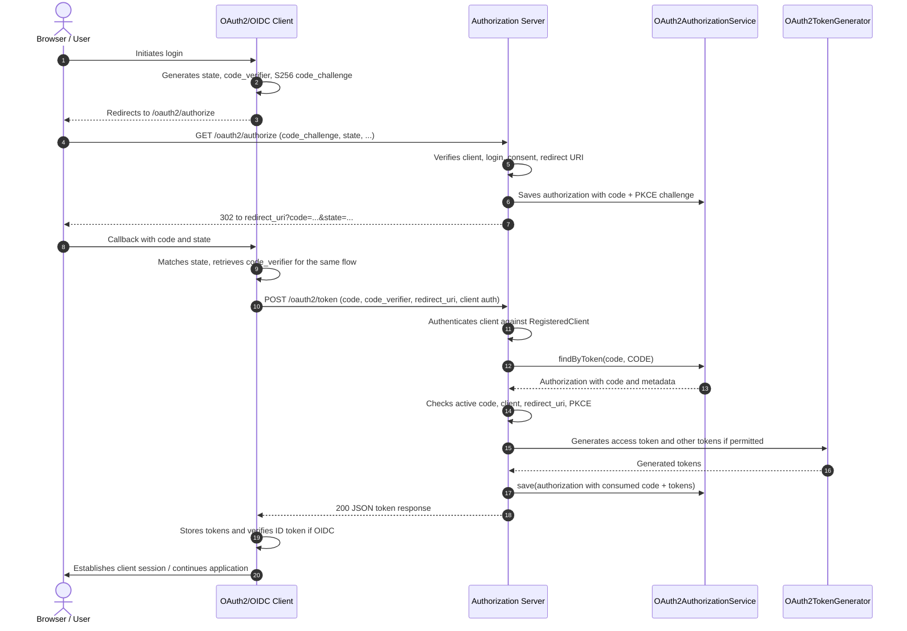
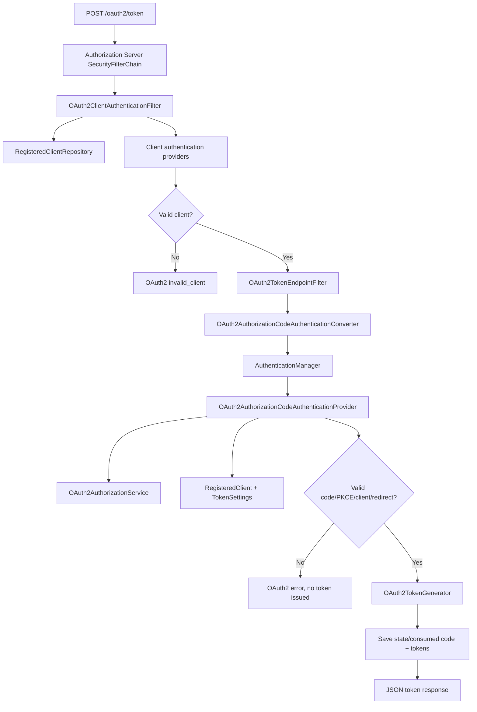
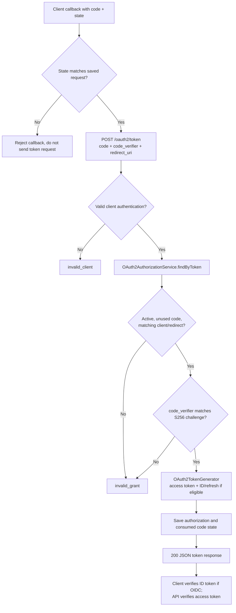

# Exchanging an Authorization Code for Tokens at the Token Endpoint

## 1. Objective and Scope

In the **Authorization Code and PKCE** chapter of the **SPRING_SECURITY_OAUTH2_OIDC_AUTHORIZATION_SERVER** module, exchanging an **authorization code** at the **Token Endpoint** is the transition point from browser-based interaction to a token issuance request under the OAuth 2.0/OpenID Connect (OIDC) protocol. For **Spring Boot** applications using **Spring Security** and **Spring Authorization Server (SAS)**, this is one of the most essential steps to design, configure, secure, test, and operate an Authorization Server properly.

After completing this lesson, you will be able to:

- Explain why an **authorization code is not an access token**, and why the code must be exchanged at `/oauth2/token`.
- Construct a `grant_type=authorization_code` request from the client, including `code`, `redirect_uri`, `code_verifier`, and client authentication credentials when applicable.
- Trace how SAS authenticates the client, retrieves the authorization, and verifies PKCE, expiration, and single-use code semantics.
- Distinguish how requests are sent by a **confidential client** versus a **public client**.
- Understand how `OAuth2TokenGenerator` conditionally issues access tokens, OIDC ID tokens, and refresh tokens.
- Read successful token responses, `invalid_grant`/`invalid_client` errors, and related error responses.
- Design end-to-end tests, replay tests, multi-instance tests, and observability without leaking codes or tokens.

**Scope:** This lesson focuses on the Token Endpoint with **Authorization Code Grant + PKCE (S256)**. Code issuance at the Authorization Endpoint must already have succeeded before performing the exchange. Examples target common APIs of Spring Authorization Server 1.x, Spring Security 6.x, and Spring Boot 3.x; verify against your actual dependency versions when applying them, especially on newer Spring releases.

## 2. Distinguishing the Authorization Endpoint and Token Endpoint

The Authorization Code Flow involves two protocol calls with distinct responsibilities.

| Aspect | Authorization Endpoint | Token Endpoint |
| --- | --- | --- |
| Typical path | `GET /oauth2/authorize` | `POST /oauth2/token` |
| Who sends the request? | Browser on behalf of the client via navigation | The OAuth2 client itself via HTTP request |
| Primary payload | `response_type=code`, `client_id`, `redirect_uri`, `scope`, `state`, `code_challenge` | `grant_type=authorization_code`, `code`, `redirect_uri`, `code_verifier`, client authentication if required |
| Required authentication | Interactive user login; client identified via registered client | Client authenticated if confidential; code/PKCE verified |
| State accessed | Client, consent, user session, authorization | Issued authorization code, client binding, PKCE, and token state |
| Success outcome | Redirect to client carrying **code** and `state` | JSON token response containing **access token** and other tokens if granted |
| Risks to control | Redirect URI, login/consent, CSRF, code leakage via URL | Code replay, code interception, client impersonation, invalid PKCE, token leakage |

**Key point:** The AS should not issue an access token directly to the browser in a standard `response_type=code` response. The client only receives the **code** via the callback; the code exchange step at `/oauth2/token` enforces bindings that a browser redirect alone cannot guarantee.

## 3. Diagram of the Complete Code Exchange Process

Suppose client `portal-web` is registered at AS `https://auth.example.com` and wants to log in a user and then call an API.



The diagram illustrates responsibilities and expected behavior; the exact internal call order may differ across SAS versions. What matters is that **the authorization code must be bound to data saved from the authorize request**, and tokens are only issued once grant checks succeed.

### 3.1. Who Holds Which Secrets?

| Party | Holds / Uses | Should Avoid |
| --- | --- | --- |
| Browser | Carries redirect response with `code`, `state` | Storing access/refresh tokens in URLs or sending the code to unregistered domains |
| Client | Stores `state`, session-bound `code_verifier`, and received tokens | Mixing a verifier from another flow or accepting callbacks without checking state |
| Authorization Server | Holds authorization state, challenge, client config, signing keys | Returning tokens for invalid/expired/used codes or skipping PKCE |
| Resource Server | Receives access token from client, validates token and permissions | Accepting an ID token or authorization code instead of an access token |

**`state`** protects callback binding on the client side; **PKCE** protects the **code exchange** via proof of verifier possession. Both mechanisms address different risks and should be used together.

## 4. Data the Client Must Prepare Ahead of Time

The Token Endpoint will only accept a valid code if the initial authorization request established the required bindings.

### 4.1. `code_verifier` and `code_challenge`

PKCE (RFC 7636) defines `code_verifier` as a random string **43–128 characters** long, using unreserved characters: letters, digits, `-`, `.`, `_`, and `~`. The client keeps the verifier in a context linked to the authorization request.

With the **S256** method:

```text
code_challenge = BASE64URL-ENCODE(SHA256(ASCII(code_verifier)))
```

Here BASE64URL omits `=` padding. The client sends the **challenge** in the authorize request, then sends the **verifier** in the token request.

An illustrative example with placeholder values:

```text
Authorization request:
  code_challenge=GENERATED_S256_CHALLENGE
  code_challenge_method=S256

Token request after callback:
  code_verifier=ORIGINAL_RANDOM_VERIFIER
```

Do not send the verifier in the authorize request, and do not generate a new verifier at callback time: a new value will not match the challenge stored on the AS.

### 4.2. `state` and OIDC `nonce`

- **`state`:** the client generates an unpredictable value, stores it alongside the authorize request, and verifies it upon receiving the callback. If the callback has a mismatched or unexpectedly missing `state`, the client must reject it **before calling the Token Endpoint**.
- **`nonce`:** an OIDC client may send this in the authorize request; it is matched against the `nonce` claim in the ID token per OIDC requirements. Do not send `nonce` instead of `code_verifier` in the token request.
- **`redirect_uri`:** the client uses a callback URI matching the one sent in the authorize request and registered with the AS. If the authorize request included `redirect_uri`, the token request must preserve that value per protocol rules.

The client should store these values scoped to each **authorization request session**; an application can have two concurrent login tabs. A global variable shared across all tabs easily mixes up `state` and `code_verifier`.

### 4.3. Which Session Does an Authorization Code Belong To?

A code issued by the AS is bound to:

- The matching `RegisteredClient` and `authorization_code` grant.
- The principal and granted scopes.
- Issuance/expiration timestamps and usage status.
- `redirect_uri` and associated PKCE binding.
- Other protocol-required attributes, such as OIDC context.

Therefore, **a code obtained by client A cannot be arbitrarily used by client B**. Even if the code string is exposed, all bindings must still be verified at the Token Endpoint.

## 5. The HTTP Request to Exchange an Authorization Code

### 5.1. Confidential Client with `client_secret_basic`

A backend client capable of keeping a secret registers:

```java
.clientAuthenticationMethod(
        ClientAuthenticationMethod.CLIENT_SECRET_BASIC)
.authorizationGrantType(
        AuthorizationGrantType.AUTHORIZATION_CODE)
.clientSettings(ClientSettings.builder()
        .requireProofKey(true)
        .build())
```

After validating the callback, the client sends an **HTTP POST** to the token endpoint with content type `application/x-www-form-urlencoded`.

Example over HTTPS:

```http
POST /oauth2/token HTTP/1.1
Host: auth.example.com
Content-Type: application/x-www-form-urlencoded
Authorization: Basic <BASE64_ENCODED_CLIENT_CREDENTIALS>
Accept: application/json

grant_type=authorization_code&code=ONE_TIME_CODE&redirect_uri=https%3A%2F%2Fportal.example.com%2Flogin%2Foauth2%2Fcode%2Fportal-web&code_verifier=ORIGINAL_CODE_VERIFIER
```

HTTP Basic is constructed from client credentials according to OAuth 2.0 rules; plain Base64 encoding is **not** security encryption. The client secret must travel over **TLS**, and OAuth2 client libraries typically handle form encoding and Basic encoding properly. Avoid manually building the Authorization header by naive string concatenation when IDs or secrets contain special characters.

| Field | When Required | Purpose |
| --- | --- | --- |
| `grant_type=authorization_code` | Always for this grant | Selects the provider handling code exchange |
| `code` | Always | One-time credential from the authorization response |
| `redirect_uri` | When used in the authorize request; per grant binding rules | AS matches it against the redirect URI bound to the code |
| `code_verifier` | For codes with PKCE; mandatory when client/policy requires PKCE | Proves possession of the verifier matching the challenge |
| `Authorization: Basic ...` | For confidential clients registered with `client_secret_basic` | Authenticates the client |
| `client_id` in body | For public clients or authentication methods requiring it | Identifies the client; does not replace a secret for confidential clients |

Do not send `code_challenge` instead of `code_verifier` at the Token Endpoint. `state` and `nonce` are not standard code-exchange parameters; they are handled by the client/OIDC flow for their own purposes.

### 5.2. Public Client Without a Client Secret

For SPAs, native/mobile apps, or clients unable to hold a secret, register `ClientAuthenticationMethod.NONE` and require PKCE:

```java
.clientAuthenticationMethod(ClientAuthenticationMethod.NONE)
.authorizationGrantType(AuthorizationGrantType.AUTHORIZATION_CODE)
.clientSettings(ClientSettings.builder()
        .requireProofKey(true)
        .build())
```

The code exchange request in that case may look like:

```http
POST /oauth2/token HTTP/1.1
Host: auth.example.com
Content-Type: application/x-www-form-urlencoded

grant_type=authorization_code&client_id=mobile-app&code=ONE_TIME_CODE&redirect_uri=com.example.app%3A%2Fcallback&code_verifier=ORIGINAL_CODE_VERIFIER
```

`client_id` is not a secret credential. A public client must not embed a `client_secret` in source code and pretend to be a confidential client. When using redirect URIs for native clients, appropriate URI profiles and registration rules must apply; the URI above is illustrative only.

**PKCE does not replace all client authentication mechanisms.** It proves that the code exchange request holds the verifier tied to the authorize request; when a client is confidential, the AS must still authenticate the client using its registered method.

## 6. Where Does Spring Authorization Server's Token Endpoint Handle This?

In SAS, Spring Security components collaborate to receive, authenticate, and process the code exchange.



The diagram depicts the conceptual processing pipeline and does not guarantee exact internal call ordering across every framework version.

| Component | Role |
| --- | --- |
| `OAuth2ClientAuthenticationFilter` | Extracts client authentication before the grant is processed; selects Basic, POST, private-key JWT, or none based on configuration. |
| `RegisteredClientRepository` | Looks up the client and checks registered method, grant type, scope/redirect/token settings. |
| `OAuth2TokenEndpointFilter` | Receives the token request, converts it to an authentication request, and returns the token response or OAuth error. |
| `OAuth2AuthorizationCodeAuthenticationConverter` | Converts the `grant_type=authorization_code` form request and parameters into the corresponding authentication token. |
| `OAuth2AuthorizationCodeAuthenticationProvider` | Verifies the code and grant bindings before issuing tokens. |
| `OAuth2AuthorizationService` | Finds the authorization by code, reads state, and saves the authorization once the code is consumed/tokens are issued. |
| `OAuth2TokenGenerator<?>` | Generates access tokens, refresh tokens, and ID tokens where permitted. |
| `AuthorizationServerSettings` | Defines the token endpoint path, issuer, and related endpoints. |

**Name distinction:** `OAuth2AuthorizationCodeRequestAuthenticationProvider` handles the **authorization request** when issuing a code at `/oauth2/authorize`. `OAuth2AuthorizationCodeAuthenticationProvider` handles the **token request** when exchanging a code at `/oauth2/token`. Confusing the two providers easily leads to attaching custom logic to the wrong protocol stage.

## 7. Validating Code, Client, Redirect, and PKCE at the Token Endpoint

### 7.1. Looking Up the Authorization by Code

The provider looks up the stored authorization via the interface:

```java
OAuth2Authorization authorization =
        authorizationService.findByToken(
                codeValue,
                new OAuth2TokenType(OAuth2ParameterNames.CODE));
```

Then it can inspect the code token:

```java
OAuth2Authorization.Token<OAuth2AuthorizationCode> code =
        authorization == null
                ? null
                : authorization.getToken(OAuth2AuthorizationCode.class);
```

`findByToken` can return `null` if the code is not found. If a record exists, checking `code != null` **is not enough**: the token must be unexpired, not invalidated, and satisfy all grant conditions. Standard SAS providers perform these checks; never create tokens in a custom controller that merely calls `findByToken` and mints a JWT.

### 7.2. Conditions That Must Be Checked

| Condition | Why It Matters | On Failure |
| --- | --- | --- |
| Code exists and has correct type | Prevents exchanging arbitrary strings or other token types | Rejected with grant error |
| Code is unexpired | Prevents use of stale credentials | Rejected with `invalid_grant` or equivalent error |
| Code is unused/not invalidated | Prevents replay | Rejected, no extra tokens issued |
| Current client matches client bound to authorization | Prevents client B from using client A's code | Rejected |
| Registered client permits `authorization_code` | Prevents issuing grants outside registration | Rejected |
| `redirect_uri` matches authorize request | Prevents callback/flow swapping | Rejected |
| `code_verifier` matches challenge and method | Prevents code interception/injection | Rejected |
| Valid client authentication if client is confidential | Authenticates the party making the token request | Rejected with `invalid_client` |
| Valid issuer, token policy, and persistence config | Prevents issuing tokens with bad config or lost state | No token issued if unable to complete |

The token endpoint must authenticate **the exact client**. A request carrying a valid code and verifier but sent by a different client must not receive tokens.

### 7.3. Verifying PKCE S256

If the authorization request stored:

```text
code_challenge_method = S256
code_challenge = EXPECTED_CHALLENGE
```

then on the token request SAS compares the stored challenge against the value computed from the received verifier:

```text
expected = BASE64URL(SHA256(ASCII(code_verifier)))
valid = expected equals stored code_challenge
```

This comparison should be handled by a tested library/provider to avoid string/encoding bugs and leaks from ad-hoc implementations. Never switch `S256` to `plain` to "fix" a failing request. Never accept an empty verifier, a tampered verifier, or a verifier from another session.

**Valid example:** Client generates `V1`, sends `SHA256(V1)` on authorize and `V1` on token request. **Invalid example:** Client generates `V2` at callback time and sends `V2`; even if callback `state` matches, PKCE still fails.

### 7.4. How Is Single-Use Enforced?

An authorization code is a **single-use** credential. After a successful code exchange, SAS updates the authorization state so the code can no longer be used as an active code. Any subsequent attempt to exchange the same code must be rejected. Detecting reuse may cause the framework to invalidate associated tokens per implementation rules; do not rewrite logic to bypass replay checks.

**Concurrency note:** `findByToken` and `save` on `OAuth2AuthorizationService` are separate storage API operations. In systems with concurrent requests and multiple instances, test single-use semantics and consistency explicitly. When implementing a custom repository/provider, you may need transactions, locking, or an "atomic code consumption" mechanism to prevent two concurrent requests from both seeing the code as active. Do not assume a custom store backed only by a `HashMap` or plain CRUD guarantees atomicity in every environment.

## 8. Issuing Tokens Once the Code Is Valid

### 8.1. Role of `OAuth2TokenGenerator`

After grant validation succeeds, SAS builds a token context from the registered client, principal, authorized scopes, authorization, and token type. Depending on configuration, `OAuth2TokenGenerator<?>` delegates to generators:

- **`JwtGenerator`:** creates JWTs when required by token format/features (such as OIDC ID tokens and JWT access tokens).
- **`OAuth2AccessTokenGenerator`:** creates opaque/reference access tokens depending on the token format setting.
- **`OAuth2RefreshTokenGenerator`:** creates refresh tokens if permitted by grant/client/policy.

These components may be configured by SAS defaults or supplied by the application. If you replace `OAuth2TokenGenerator`, ensure you do not accidentally drop the ability to generate the ID token, access token, or refresh token required by your flow.

### 8.2. Access Token and Resource Server

An access token lets the client call APIs within granted scopes. An access token may be a JWT or opaque, depending on `TokenSettings` and system design.

- For **JWTs**, the Resource Server verifies the signature, `iss`, `exp`, **`aud`** matching the API, and permissions (`scope`/`authority`). Never check only the signature.
- For **opaque tokens**, the Resource Server typically uses introspection or an equivalent token status check mechanism.
- An access token must **not** be used as an OIDC ID token proof for the client and must never be placed in an authorize callback URL.
- The actual `scope` in the token response may reflect the granted scopes; do not assume all scopes requested by the client were granted.

### 8.3. ID Token When Using OpenID Connect

If the client uses OIDC, requested the `openid` scope, and OIDC is enabled/configured, a standard Authorization Code Flow token response includes an **ID token**. The client verifies the signature and claims—at minimum `iss`, `aud`, `exp`, and applicable conditions; when `nonce` is used, it must be verified as part of the flow.

The ID token's intended audience is the **OIDC Client/Relying Party**; do not use it instead of an access token to call APIs. Never share ID tokens indiscriminately with Resource Servers or third parties.

### 8.4. Conditional Refresh Token

A refresh token is **not guaranteed to always appear**. SAS evaluates client registration, permitted grant types, client type, and token policy. For example, a confidential client can register `AuthorizationGrantType.REFRESH_TOKEN`; that does not mean every public client will receive a refresh token across all versions/configurations.

The token endpoint returns a refresh token when permitted; the client must store it securely and apply rotation/revocation policies. Avoid sending refresh tokens through browser redirects or storing them where untrusted JavaScript can read them.

## 9. Successful Token Response

For a successful grant, the Token Endpoint typically returns HTTP `200 OK` with OAuth 2.0 JSON.

```http
HTTP/1.1 200 OK
Content-Type: application/json;charset=UTF-8
Cache-Control: no-store
Pragma: no-cache

{
  "access_token": "<ACCESS_TOKEN_VALUE>",
  "token_type": "Bearer",
  "expires_in": 300,
  "scope": "openid profile",
  "id_token": "<OIDC_ID_TOKEN_IF_ISSUED>",
  "refresh_token": "<REFRESH_TOKEN_IF_ISSUED>"
}
```

This is an **illustrative response** for an OIDC case where both an ID token and a refresh token are issued; optional fields may be **absent**. Angle-bracketed values are placeholders, not usable tokens.

| Field | Meaning |
| --- | --- |
| `access_token` | Credential used by the client to access the Resource Server |
| `token_type` | How to use the access token, typically `Bearer` |
| `expires_in` | Number of seconds the access token remains valid at response time |
| `scope` | Granted scopes, included when differing from requested scopes or required by protocol |
| `id_token` | OIDC identity token if `openid` was processed and conditions are met |
| `refresh_token` | Token used to request a new access token when allowed by grant/policy |

### 9.1. How Does the Client Process the Response?

For a backend web client:

1. Receive JSON over HTTPS and verify HTTP status, content type, and required fields.
2. Validate the ID token per OIDC if an OIDC login was performed; do not use `access_token` to infer identity from non-contract claims.
3. Store tokens in backend-only storage, restrict access permissions, and set appropriate TTL/rotation.
4. Establish the **client application's** session if needed; the client session is separate from the Authorization Server login session.
5. Call the Resource Server with `Authorization: Bearer <access_token>` and handle 401/403 meaningfully.

If the Token Endpoint fails or times out, the client must never drop PKCE to retry with a weaker grant. Recovery depends on whether the code has already been consumed; when uncertain, starting a fresh authorization flow is generally safest.

### 9.2. Keep Tokens Out of Logs

Every token field in the JSON response is a sensitive credential. Do not enable full response-body logging for `/oauth2/token` in production. When diagnostics are needed, log correlation IDs, grant type, error category, latency, and permitted client IDs; never log raw `code`, `code_verifier`, `client_secret`, `access_token`, `id_token`, or `refresh_token`.

## 10. Error Responses at the Token Endpoint

### 10.1. Key Errors

| OAuth2 Error | Typical Cause | Correct Handling |
| --- | --- | --- |
| `invalid_client` | Non-existent client, wrong secret, wrong client authentication method, or expired credentials | Check `RegisteredClient` and client authentication setup; never weaken security |
| `invalid_grant` | Invalid/expired/used code, code bound to another client, or invalid PKCE/redirect | Start a new flow; investigate code/PKCE/client/redirect |
| `unsupported_grant_type` | `grant_type` is not supported by the server | Client must send `authorization_code` properly |
| `invalid_request` | Missing parameters, illegal duplicate parameters, wrong form content/type | Review request format and required fields |
| `unauthorized_client` | Client is not permitted to use the chosen grant | Check `authorizationGrantTypes` on the registered client |
| `invalid_scope` | Impermissible or invalid scope when applicable to the grant | Do not grant scopes broader than approved |
| `server_error` / HTTP 5xx | Internal error, DB/KMS/token generator unavailable | Resolve infrastructure failure; never expose secrets/stack traces to the client |

HTTP status codes can vary by error and provider handling. For example, client authentication failures may return HTTP 401 with appropriate headers, whereas `invalid_grant` is typically returned in an error JSON body with HTTP 400. Tests should verify against OAuth2 rules and the behavior of your deployed SAS version.

### 10.2. Example Invalid Code Error

```http
HTTP/1.1 400 Bad Request
Content-Type: application/json;charset=UTF-8
Cache-Control: no-store
Pragma: no-cache

{
  "error": "invalid_grant"
}
```

Never return `code_verifier`, raw codes, or details like "code belongs to user X/client Y" in a public `error_description`. Overly specific explanations can leak authorization data and aid guessing attacks.

### 10.3. Do Not Confuse Callback Errors with Token Exchange Errors

- The **Authorization Endpoint** may redirect errors back to a verified callback.
- The **Token Endpoint** returns an **HTTP JSON response** to the client sending the POST; it never redirects the browser with an access token or OAuth error.
- `state mismatch` is an error the client must detect at the callback, before making the token request.
- An invalid `code_verifier` or expired code is a token exchange error.

If `/oauth2/token` returns an HTML login form to the backend client, inspect the security filter chain, matcher, and authentication entry point: the request may be misrouted or the security configuration is incorrect.

## 11. Spring Authorization Server Example: Wiring the Components

The following snippets illustrate essential wiring. They do not replace a complete AS configuration: the application still needs users/login, authorization consent if used, signing keys/JWKs, repositories, and corresponding dependencies.

### 11.1. Security Filter Chain

```java
@Configuration(proxyBeanMethods = false)
@EnableWebSecurity
class AuthorizationServerConfig {

    @Bean
    @Order(1)
    SecurityFilterChain authorizationServerChain(HttpSecurity http)
            throws Exception {

        OAuth2AuthorizationServerConfigurer as =
                OAuth2AuthorizationServerConfigurer.authorizationServer();

        http
            .securityMatcher(as.getEndpointsMatcher())
            .with(as, configurer ->
                    configurer.oidc(Customizer.withDefaults()))
            .authorizeHttpRequests(authorize ->
                    authorize.anyRequest().authenticated())
            .exceptionHandling(exceptions ->
                    exceptions.defaultAuthenticationEntryPointFor(
                            new LoginUrlAuthenticationEntryPoint("/login"),
                            new MediaTypeRequestMatcher(MediaType.TEXT_HTML)))
            .oauth2ResourceServer(oauth2 ->
                    oauth2.jwt(Customizer.withDefaults()));

        return http.build();
    }

    @Bean
    @Order(2)
    SecurityFilterChain applicationChain(HttpSecurity http)
            throws Exception {

        http.authorizeHttpRequests(authorize ->
                    authorize.anyRequest().authenticated())
            .formLogin(Customizer.withDefaults());

        return http.build();
    }

    @Bean
    AuthorizationServerSettings authorizationServerSettings() {
        return AuthorizationServerSettings.builder()
                .issuer("http://localhost:9000")
                .build();
    }
}
```

`as.getEndpointsMatcher()` routes `/oauth2/token` to the SAS filter chain. The Authorization Server handles client authentication and grant processing via standard providers; you do not need to write a custom `@PostMapping("/oauth2/token")` controller.

In the local example, `http://localhost:9000` is the issuer and port 9000 must be configured in Spring Boot. In production, the issuer must be a stable public HTTPS URL matching discovery metadata and the token's `iss` claim.

### 11.2. Registered Client with Authorization Code + PKCE

```java
@Bean
PasswordEncoder passwordEncoder() {
    return new BCryptPasswordEncoder();
}

@Bean
RegisteredClientRepository registeredClientRepository(
        PasswordEncoder encoder,
        @Value("${LOCAL_CLIENT_SECRET}") String rawSecret) {

    RegisteredClient client = RegisteredClient
            .withId("portal-web-local-001")
            .clientId("portal-web")
            .clientSecret(encoder.encode(rawSecret))
            .clientAuthenticationMethod(
                    ClientAuthenticationMethod.CLIENT_SECRET_BASIC)
            .authorizationGrantType(
                    AuthorizationGrantType.AUTHORIZATION_CODE)
            .authorizationGrantType(
                    AuthorizationGrantType.REFRESH_TOKEN)
            .redirectUri(
                    "http://127.0.0.1:8080/login/oauth2/code/portal-web")
            .scope(OidcScopes.OPENID)
            .scope(OidcScopes.PROFILE)
            .clientSettings(ClientSettings.builder()
                    .requireProofKey(true)
                    .requireAuthorizationConsent(true)
                    .build())
            .tokenSettings(TokenSettings.builder()
                    .authorizationCodeTimeToLive(Duration.ofMinutes(2))
                    .accessTokenTimeToLive(Duration.ofMinutes(5))
                    .build())
            .build();

    return new InMemoryRegisteredClientRepository(client);
}

@Bean
OAuth2AuthorizationService authorizationService() {
    return new InMemoryOAuth2AuthorizationService();
}

@Bean
OAuth2AuthorizationConsentService authorizationConsentService() {
    return new InMemoryOAuth2AuthorizationConsentService();
}
```

Place these `@Bean` definitions in a dedicated `@Configuration` class, and provide only **one implementation** per service. The example registers `portal-web` as a confidential client requiring a secret; the raw secret must come from an environment variable or secret manager and never be committed in source code.

For OIDC (`openid`), you also need to configure signing keys/`JWKSource` and `JwtDecoder` appropriately. This example intentionally focuses on registration, PKCE, and the code exchange state store.

### 11.3. Replacing In-Memory Storage with JDBC

When deploying multiple AS instances or needing authorization state to survive restarts, replace the in-memory service:

```java
@Bean
OAuth2AuthorizationService authorizationService(
        JdbcTemplate jdbcTemplate,
        RegisteredClientRepository registeredClientRepository) {

    return new JdbcOAuth2AuthorizationService(
            jdbcTemplate, registeredClientRepository);
}
```

This is a **replacement for the in-memory bean**; do not register both simultaneously without an explicit selection mechanism. It requires the schema matching your SAS version, a database connection, and an appropriate registered client repository.

With multiple nodes, authorization data must be shared; at the same time, align the **issuer**, signing keys, and browser login sessions across your architecture. Using shared JDBC for authorizations does not automatically solve all code-exchange race conditions when two concurrent POSTs arrive; add appropriate integration tests.

## 12. Local Practice with PowerShell and curl

### 12.1. Environment Setup

Assume:

```text
Authorization Server: http://localhost:9000
OAuth2 client ID:      portal-web
OAuth2 redirect URI:  http://127.0.0.1:8080/login/oauth2/code/portal-web
Client method:         client_secret_basic
Code challenge method: S256
```

Local values are solely for learning on loopback. When exchanging credentials over a real network, HTTPS is required.

### 12.2. Generating PKCE Verifier, Challenge, and State

In Windows PowerShell:

```powershell
$bytes = New-Object byte[] 32
$rng = [System.Security.Cryptography.RandomNumberGenerator]::Create()
try {
    $rng.GetBytes($bytes)
} finally {
    $rng.Dispose()
}

$verifier = [Convert]::ToBase64String($bytes).
    TrimEnd('=').Replace('+','-').Replace('/','_')

$sha256 = [System.Security.Cryptography.SHA256]::Create()
try {
    $hash = $sha256.ComputeHash(
        [System.Text.Encoding]::ASCII.GetBytes($verifier))
} finally {
    $sha256.Dispose()
}

$challenge = [Convert]::ToBase64String($hash).
    TrimEnd('=').Replace('+','-').Replace('/','_')

$state = [guid]::NewGuid().ToString("N")
$nonce = [guid]::NewGuid().ToString("N")
```

`$verifier` is about 43 Base64URL characters long, fitting PKCE limits. Reuse the exact same `$verifier` variable during the code exchange; do not re-initialize it at callback time.

In production systems, the client library should manage `state`/PKCE per request session, isolating storage across concurrent login flows. The PowerShell snippet simply helps observe the calculation.

### 12.3. Initiating the Authorize Request

```powershell
$redirectUri = "http://127.0.0.1:8080/login/oauth2/code/portal-web"
$redirect = [uri]::EscapeDataString($redirectUri)

$authorizeUrl =
    "http://localhost:9000/oauth2/authorize" +
    "?response_type=code" +
    "&client_id=portal-web" +
    "&redirect_uri=$redirect" +
    "&scope=openid%20profile" +
    "&state=$state" +
    "&nonce=$nonce" +
    "&code_challenge=$challenge" +
    "&code_challenge_method=S256"

Start-Process $authorizeUrl
```

Log in and grant consent as configured. The browser is redirected to the client callback containing code and state. **Only use the authorization code from the exact request you just initiated**, verifying that state matches `$state`.

If no application is running at `127.0.0.1:8080`, the browser may report connection refused; you can still inspect the redirect URI in the address bar **in an isolated test environment**, though never copy raw codes into logs or external services. For a real client, the client library should handle the callback, state validation, and token exchange.

### 12.4. Exchanging the Code with `curl.exe`

In the **same PowerShell session** that still holds `$verifier`:

```powershell
$code = Read-Host "Authorization code from valid callback"

curl.exe --user portal-web --data-urlencode "grant_type=authorization_code" --data-urlencode "code=$code" --data-urlencode "redirect_uri=$redirectUri" --data-urlencode "code_verifier=$verifier" http://localhost:9000/oauth2/token
```

`curl.exe --user portal-web` omits the password on the command line; curl will prompt for the client secret interactively. This avoids recording the secret in shell history, though the response prints raw tokens to the terminal; use only in an isolated lab and never save or share the output. Use HTTPS for non-loopback environments.

**Conditions for success:** a freshly received, unused, unexpired code; secret matching `portal-web`; `redirect_uri` matching the authorization request; verifier matching the S256 challenge; and a configured token generator and signing key on the server if issuing JWT/OIDC ID tokens.

### 12.5. Controlled Error Testing

Create **a fresh authorization flow for each test case**:

1. Use a wrong verifier and expect `invalid_grant`.
2. Use the right verifier but alter the redirect URI, expecting rejection.
3. Use a wrong client secret and expect `invalid_client`.
4. Exchange a valid code successfully, then retry the same code, expecting rejection.
5. Wait for the code to expire and attempt the exchange, expecting no tokens issued.
6. Send a request missing `grant_type` or `code`, expecting the corresponding request error.
7. Attempt to use a different client ID with a code bound to `portal-web`, expecting rejection.

Never solve failures by making code lifetimes infinite, disabling PKCE, or bypassing client authentication just to make tests pass. For automated tests, build isolated fixtures and control time rather than making test runners wait passively.

## 13. Automated Testing and Security Matrix

### 13.1. Success/Failure Matrix

| Scenario | Condition | Expected Result |
| --- | --- | --- |
| Authorization Code + PKCE success | Valid code, valid client, matching verifier and redirect URI | Token Endpoint returns access token; OIDC ID token and refresh token per policy |
| Non-existent code | Arbitrary string never issued | `invalid_grant`; no tokens issued |
| Expired code | Past `authorizationCodeTimeToLive` | Rejected, no tokens issued |
| Already-used code | Repeat POST after successful exchange | Rejected per single-use semantics |
| Wrong PKCE verifier | Mismatches challenge | Rejected, no tokens issued |
| Missing PKCE verifier | Client has `requireProofKey(true)` or code has a challenge | Rejected |
| Different `redirect_uri` | Does not match URI bound to authorize request | Rejected |
| Invalid client authentication | Secret/method does not match registered client | `invalid_client` or appropriate auth error |
| Different client exchanges code | `client_id` does not match authorization | No tokens issued |
| Disallowed grant | Client does not register `authorization_code` | No tokens issued |
| OIDC `openid` scope | OIDC enabled, valid grant | ID token issued per OIDC rules |
| `openid` not requested | Standard OAuth2 flow | ID token not issued by default |
| Refresh token disallowed | Client/policy conditions unmet | Response omits refresh token |
| Token store failure | Unable to read/write state | Must not return a false success token |
| Two concurrent POSTs with same code | Concurrency/replay | Must not allow code usage violating single-use policy |
| Multiple AS instances | Code issued on node A, exchanged on node B | Works when storage/session/issuer/keys are properly configured |

### 13.2. Testing PKCE Logic Independently

PKCE should have unit tests verifying the **S256** rule and invalid input handling. For example, using the public test vector from RFC 7636:

```text
code_verifier:
dBjftJeZ4CVP-mB92K27uhbUJU1p1r_wW1gFWFOEjXk

S256 code_challenge:
E9Melhoa2OwvFrEMTJguCHaoeK1t8URWbuGJSstw-cM
```

Sample code verifying the transformation in Java:

```java
String verifier = "dBjftJeZ4CVP-mB92K27uhbUJU1p1r_wW1gFWFOEjXk";

byte[] sha = MessageDigest.getInstance("SHA-256")
        .digest(verifier.getBytes(StandardCharsets.US_ASCII));

String challenge = Base64.getUrlEncoder()
        .withoutPadding()
        .encodeToString(sha);

assertEquals(
        "E9Melhoa2OwvFrEMTJguCHaoeK1t8URWbuGJSstw-cM",
        challenge);
```

This tests the PKCE calculation and **does not replace** testing the actual provider/token endpoint. For services with custom logic, also test invalid verifier charsets, lengths under 43 or over 128, mismatched challenges, mismatched methods, and duplicate/repeated fields.

### 13.3. Integration Testing with Spring Security / MockMvc

Rather than mocking `OAuth2TokenGenerator` alone and concluding the Token Endpoint is secure, run at least one flow covering:

- A `RegisteredClientRepository` containing a confidential client requiring PKCE.
- An appropriate `OAuth2AuthorizationService` and consent store.
- An authorization code created via the authorize flow or a semantically valid fixture.
- A `POST /oauth2/token` request with form content type and Basic client authentication.
- Verification of the token response and authorization state after the exchange.
- Error tests for code replay, wrong verifier, wrong client, and redirect URI mismatch.

You can use Spring Security Test/MockMvc for the filter layer, whereas JDBC persistence and race conditions should be tested via integration tests against a real database or Testcontainers. Test assertions depend on your SAS version, as converters/providers and error details may evolve.

### 13.4. Testing Tokens on the Client and API

Even when the Token Endpoint returns HTTP 200, verify that:

- The OIDC client checks ID token `iss`, `aud`, signature, `exp`, and `nonce` where applicable.
- The Resource Server validates the access token by format/token type, issuer, audience, expiry, and authority/scope.
- The token response contains no scopes beyond granted permissions.
- Tokens are stored with appropriate TTL/rotation and never appear in URLs/logs.
- Logging out of the Authorization Server **does not automatically** cause an unexpired JWT access token to be rejected at an API if the API performs offline-only validation.

## 14. Operating the Token Endpoint Securely

### 14.1. Key Metrics and Signals

| Observation Point | Useful Signals | Data to Avoid |
| --- | --- | --- |
| `/oauth2/token` | Request count, P50/P95/P99 latency, sanitized error rates by grant/client | Raw code, `code_verifier`, Basic Authorization header, response tokens |
| Client authentication | `invalid_client`, abnormal spike in failure rate | Client secrets, password hashes |
| Authorization store | Lookup/save latency, DB connection errors, expired code count | Raw tokens/codes and full authorization payloads |
| Token generation | JWT/JWK signing errors, KMS unavailability, token generation duration | Private keys, token bodies |
| PKCE validation | Invalid/replay request counts by category | Original verifier/challenge when unnecessary |
| Multi-instance | Cross-node code exchange stability, persistence errors | Raw session IDs, full callback URLs |

Use a credential-free **correlation ID** to connect requests and events across components. Never use an authorization code or access token as a correlation ID.

### 14.2. Reverse Proxy, Issuer, and HTTPS

- Both Token Endpoint and Authorization Endpoint require HTTPS over real networks.
- `AuthorizationServerSettings.issuer` must match the public URL and the `iss` claim in tokens/metadata.
- Proxies must handle trusted forwarded headers and prevent Internet clients from spoofing scheme/host.
- Endpoint paths configured in the gateway must stay consistent with discovery metadata and the URLs used by clients.
- If a client runs inside a container, `localhost` inside that container only reaches the container's own loopback; use proper network names while keeping the verified issuer consistent.

### 14.3. Common Incidents

| Symptom | Likely Cause | What to Check |
| --- | --- | --- |
| `POST /oauth2/token` returns HTML login | Token request routed to wrong `SecurityFilterChain` or auth entry point | Matchers, chain order, client authentication filter, and token endpoint config |
| `invalid_client` | Wrong secret, unregistered method, expired credential | `RegisteredClient`, `PasswordEncoder`, Basic/POST formatting |
| `invalid_grant` after valid callback | Lost verifier, mismatched redirect URI, expired/used code, or token request hit a node unable to read store | Correlation ID, request state, PKCE, `OAuth2AuthorizationService` |
| Client creates a new challenge after callback | Failed to preserve `code_verifier` from original flow | Store PKCE verifier bound to `state`, keep across redirect |
| Token endpoint returns 404 | Token endpoint path changed or chain did not match | `AuthorizationServerSettings`, `getEndpointsMatcher()`, gateway |
| Cannot sign tokens | Missing or misconfigured `JWKSource`/signing key | JWKSource, `kid`, algorithm, provider/KMS |
| Access token present but no ID token | OIDC not enabled, missing `openid`, or incorrect OIDC config | OIDC configurer, registered scopes, token generator |
| No refresh token | Disallowed by grant/client/policy | `RegisteredClient`, `TokenSettings`, and client type |
| Code received on A fails exchange on B | Per-node in-memory authorization store | JDBC/shared store, consistency, session, and issuer |
| JWT rejected by API | Wrong issuer/audience/key/clock or insufficient permissions | Resource Server validation and JWKS/discovery |
| Network drop after token response | Unknown whether code was consumed | Do not assume retries are always safe; initiate a new flow when needed |

## 15. Implementation Checklist

- [ ] Client stores `state` and `code_verifier` separately per authorization flow.
- [ ] Authorization Endpoint issued the code for the right client, scopes, redirect URI, and PKCE S256.
- [ ] Client validates `state` before sending the code to the Token Endpoint.
- [ ] Code exchange request uses `POST /oauth2/token` with `Content-Type: application/x-www-form-urlencoded`.
- [ ] Includes `grant_type=authorization_code`, `code`, `code_verifier`, and `redirect_uri` as required.
- [ ] Confidential client authenticates with its registered method; public client does not fake a shared secret.
- [ ] SAS verifies the code exists, is active, unused, and bound to the right client and redirect URI.
- [ ] PKCE S256 is verified against the original verifier with no fallback to weaker mechanisms.
- [ ] Code is consumed upon successful exchange; replays are rejected.
- [ ] Token response includes an access token and only adds ID/refresh tokens when eligible.
- [ ] Client/API validate tokens according to their roles and audience/scopes.
- [ ] Codes, verifiers, secrets, tokens, or private signing keys are never logged.
- [ ] In multi-instance deployments, the authorization store is shared and issuer/keys are consistent across nodes.
- [ ] Tested expired code, code reuse, redirect mismatch, PKCE mismatch, client authentication failure, and database failure cases.
- [ ] Monitoring covers latency, token generator errors, store errors, and TLS/proxy setup.

## 16. Summary Map



Exchanging an authorization code at the Token Endpoint is **the final verification step before issuing tokens**: the AS must match the code against the stored authorization, authenticate the right client, verify the redirect URI and `code_verifier`, reject expired/used codes, and then issue the appropriate tokens. Spring Authorization Server implements these protocol checks through filters, providers, and services; Spring Security provides the HTTP security and client authentication layer. Maintaining these boundaries cleanly lets Authorization Code + PKCE run securely from local Spring Boot setups to multi-instance OAuth2/OIDC systems.
