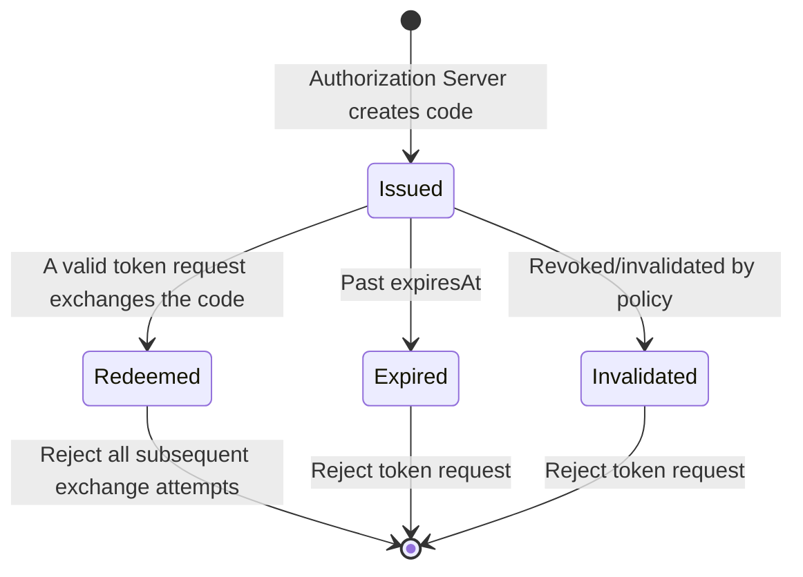
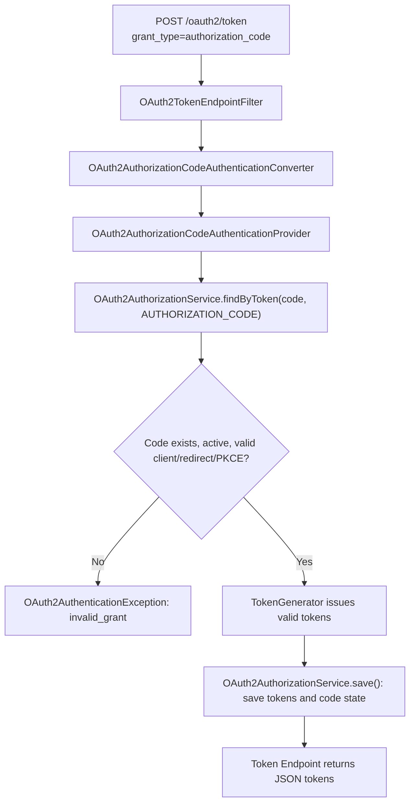

# Code Lifetime and the Single-Use Principle

## 1. Lesson Objectives

In the **Authorization Code and PKCE** chapter of the `SPRING_SECURITY_OAUTH2_OIDC_AUTHORIZATION_SERVER` module, we explore how an **Authorization Code is only valid for a short window and can only be exchanged for tokens once**. This is an essential requirement when designing, configuring, securing, testing, and operating an **OAuth 2.0/OpenID Connect Authorization Server with Spring Security and Spring Authorization Server in a Spring Boot application**.

For example, a user visits the web app `portal.example.com`, the app redirects the browser to the Authorization Server `auth.example.com`, and the user logs in and grants consent. The Authorization Server returns a `code` via redirect. The client sends that code to the Token Endpoint to receive an Access Token, optionally accompanied by a Refresh Token and ID Token depending on the grant, scopes, and issuance policy.

A code is a **temporary authorization artifact** that travels through the browser redirect channel. If a code is exposed and could still be used for a long time or multiple times, someone else gains additional opportunity to exchange it for tokens. Therefore, both **short-lived** and **single-use** constraints must be enforced on the Authorization Server side rather than relying on client discipline.

After this lesson, you will be able to:

1. Distinguish the moment a code is created, the moment it expires, and the moment it is marked as used.
2. Explain why `code` is not an Access Token and why PKCE does not replace time limits or reuse prevention.
3. Configure `TokenSettings.authorizationCodeTimeToLive(...)` on a `RegisteredClient` in Spring Authorization Server.
4. Describe how `OAuth2AuthorizationService` and `OAuth2AuthorizationCodeAuthenticationProvider` participate in validating the code.
5. Analyze `invalid_grant` errors, duplicate request scenarios, and testing requirements in multi-instance systems.

## 2. Where Is an Authorization Code Created and Used?

An **Authorization Code** is an intermediate artifact of the Authorization Code Grant, issued by the Authorization Server once the authorization request satisfies all required conditions. The code is delivered to the client's `redirect_uri` through the browser and **is exchanged at the Token Endpoint**, typically via a back-channel POST request.

```mermaid
sequenceDiagram
    autonumber
    actor U as User
    participant B as Browser
    participant C as Client (backend/BFF)
    participant AS as Authorization Server
    participant DB as OAuth2AuthorizationService
    U->>C: Selects login
    C-->>B: Redirects to /oauth2/authorize (state, PKCE)
    B->>AS: GET /oauth2/authorize
    AS->>U: Login and consent if needed
    AS->>DB: Saves authorization and code with issuedAt/expiresAt
    AS-->>B: 302 redirect_uri?code=...&state=...
    B->>C: Callback carrying code and state
    C->>C: Checks state; retrieves stored code_verifier
    C->>AS: POST /oauth2/token, grant_type=authorization_code
    AS->>DB: Looks up code, checks validity and bindings
    AS->>AS: Verifies client, redirect URI, PKCE
    AS->>DB: Saves code-used state and issued tokens
    AS-->>C: Access Token (+ other tokens if eligible)
```

**Do not confuse three timestamps:** when the user starts logging in, when the user completes login/consent, and when the Authorization Server **actually issues the code** can be separated by several seconds or minutes. **The code's lifetime starts from the moment the code is issued**, not when the client first opens the login page. If a user takes five minutes to enter MFA before the code is generated, those five minutes do not prematurely expire the newly issued code.

### 2.1. How Do Code, Tokens, and Sessions Differ?

| Value | Who Holds/Uses It? | Lifecycle Limit | Used to Call APIs? |
| --- | --- | --- | --- |
| **Authorization Code** | Client receives via callback, sends to AS once | Expires quickly or invalidated after exchange | **No** |
| **Access Token** | Client presents to Resource Server | Has its own TTL and revocation policy | **Yes**, when valid and authorized |
| **Refresh Token** | Client sends to AS when needing new tokens | Own TTL/rotation/revocation | **No** |
| **ID Token** | OIDC Client uses to verify login outcome | ID Token's own lifetime | **No**, never use in place of Access Token |
| **HTTP session** | Browser and app/Authorization Server maintain login state | Independent session policy | Not an OAuth2 Bearer Token |

A used code cannot become a "second Refresh Token". When a fresh Access Token is needed, the client uses a Refresh Token if issued, or initiates a new valid authorization flow.

## 3. Standard Rules: Short-Lived and Exchanged Only Once

RFC 6749 specifies that an Authorization Code **must be short-lived**. The RFC recommends a maximum lifetime of **10 minutes** for a code; this is a **recommended upper bound**, not a suggestion to always configure exactly 10 minutes. A system may set 2–5 minutes or another value appropriate for risk, network latency, and client behavior.

RFC 6749 also states:

- The client **must not use an Authorization Code more than once**.
- If an Authorization Code is used more than once, the Authorization Server **must deny the request** and **should revoke all tokens previously issued based on that code**.

The second point is especially important: **returning `invalid_grant` on a second exchange** is the mandatory behavior of single-use enforcement; revoking already-issued tokens is an additional mitigation recommended by the RFC. With a given library/architecture, test the actual revocation mechanism, especially for JWT Access Tokens validated offline by a Resource Server.

### 3.1. Code State Model



This is a **logical model**. An implementation may keep the code record in its data store and mark it `invalidated` rather than deleting it immediately. A code still appearing in the database **does not mean it is still valid**.

In terms of validation at time `t`, a code can only be considered a valid candidate if:

```text
t < expiresAt
AND code has not been invalidated
AND code is bound to the exact authorization and client
AND redirect_uri / PKCE / grant and related conditions are valid
```

Validation must never be reduced to matching the raw code string from the request against a stored value and issuing tokens. The code must also pass state checks and protocol bindings.

### 3.2. Timeline Example

Suppose code `c-123` is issued at **10:00:00** with a **3-minute** TTL:

| Time | Event | Expected Outcome |
| --- | --- | --- |
| 09:55:00 | User starts logging in | **No code yet**, TTL has not started |
| 10:00:00 | AS issues `c-123` | Code can be exchanged, `expiresAt=10:03:00` |
| 10:00:20 | Client successfully exchanges `c-123` | Code is marked as used |
| 10:00:21 | Client resends the exact same code | **Rejected** even though 10:03 has not passed |
| 10:03:00 or later | If code was never used | **Rejected** because code has expired |

These are two independent rules: **an unexpired code still cannot be used a second time**; **an unused code still cannot be exchanged once expired**. A code must never be "extended" simply because the user is still logged in at the Authorization Server.

## 4. Bindings Verified When Exchanging a Code

An Authorization Code **is not freely redeemable by any client**. When a token request arrives at `POST /oauth2/token`, the Authorization Server must verify the conditions tied to the stored transaction.

| Check | Reason | Invalid Example |
| --- | --- | --- |
| Code exists and was issued by the AS | Rejects fabricated or forged values | `code=random-string` |
| Code is unexpired | Limits the window in which an exposed code can be abused | `expiresAt` has passed |
| Code is unused / not invalidated | Prevents replay and double redemption | Resending a just-exchanged code |
| Code belongs to the right client | Prevents using a code issued to app A to get tokens for B | `client_id=B` with A's code |
| `redirect_uri` matches original transaction | Prevents callback swapping and preserves authorize binding | URI in token request differs from URI used when requesting code |
| PKCE verifier matches stored challenge | Binds code exchange to the party that initiated the request | Wrong `code_verifier` or missing when required |
| Client authentication matches registration | Verifies confidential clients; public clients use their registered method | Wrong secret, unregistered method |
| Permitted scopes/grant/authorization state | Prevents privilege escalation during code exchange | Requesting tokens beyond granted scopes |

**Having a short code lifetime does not make PKCE optional.** PKCE protects against an intercepted code or a code injected into an invalid transaction. TTL limits the time window; single use prevents replay; PKCE binds code exchange to the `code_verifier` held by the client. These are **three complementary layers of protection**.

### 4.1. PKCE Follows the Code Lifecycle

```text
Client generates high-entropy random code_verifier
code_challenge = BASE64URL(SHA256(ASCII(code_verifier)))

Authorization Request: code_challenge + code_challenge_method=S256
Authorization Server: stores PKCE data with the authorization

Token Request: authorization code + code_verifier
Authorization Server: verifies verifier before issuing tokens
```

`code_verifier` **must never be placed in the authorization URL**. In the Authorization Code Flow, `state` is verified by the client at the callback; `code_verifier` is verified by the AS at the Token Endpoint. They serve distinct responsibilities.

## 5. Configuring Authorization Code TTL in Spring Authorization Server

In Spring Authorization Server, the Authorization Code TTL is configured via **`TokenSettings.authorizationCodeTimeToLive(Duration)`**, typically on a `RegisteredClient`. This lets you set different TTLs by client type or application policy.

Example of a confidential web client with Authorization Code + PKCE:

```java
import java.time.Duration;
import java.util.UUID;

import org.springframework.context.annotation.Bean;
import org.springframework.context.annotation.Configuration;
import org.springframework.security.oauth2.core.AuthorizationGrantType;
import org.springframework.security.oauth2.core.ClientAuthenticationMethod;
import org.springframework.security.oauth2.core.oidc.OidcScopes;
import org.springframework.security.oauth2.server.authorization.client.InMemoryRegisteredClientRepository;
import org.springframework.security.oauth2.server.authorization.client.RegisteredClient;
import org.springframework.security.oauth2.server.authorization.client.RegisteredClientRepository;
import org.springframework.security.oauth2.server.authorization.settings.ClientSettings;
import org.springframework.security.oauth2.server.authorization.settings.TokenSettings;

@Configuration(proxyBeanMethods = false)
class ClientRegistrationConfiguration {

    @Bean
    RegisteredClientRepository registeredClientRepository() {
        RegisteredClient portal = RegisteredClient.withId(UUID.randomUUID().toString())
                .clientId("portal-web")
                .clientSecret("{bcrypt}<hash-generated-from-test-secret>")
                .clientAuthenticationMethod(ClientAuthenticationMethod.CLIENT_SECRET_BASIC)
                .authorizationGrantType(AuthorizationGrantType.AUTHORIZATION_CODE)
                .authorizationGrantType(AuthorizationGrantType.REFRESH_TOKEN)
                .redirectUri("https://portal.example.com/callback")
                .scope(OidcScopes.OPENID)
                .scope("orders.read")
                .clientSettings(ClientSettings.builder()
                        .requireProofKey(true)
                        .requireAuthorizationConsent(true)
                        .build())
                .tokenSettings(TokenSettings.builder()
                        .authorizationCodeTimeToLive(Duration.ofMinutes(3))
                        .accessTokenTimeToLive(Duration.ofMinutes(10))
                        .refreshTokenTimeToLive(Duration.ofHours(8))
                        .reuseRefreshTokens(false)
                        .build())
                .build();

        return new InMemoryRegisteredClientRepository(portal);
    }
}
```

**Points to read carefully:**

1. `authorizationCodeTimeToLive(Duration.ofMinutes(3))` governs the **code**, not the Access Token.
2. `accessTokenTimeToLive(...)` and `refreshTokenTimeToLive(...)` are two **separate** policies.
3. `requireProofKey(true)` requires PKCE; it **does not set the TTL or allow redeeming a code multiple times**.
4. `requireAuthorizationConsent(true)` may prompt the user to approve permissions before the AS issues the code. Code TTL only runs after the code is created.
5. `clientSecret("{bcrypt}<hash-generated-from-test-secret>")` is purely a **format placeholder**, not a valid BCrypt hash for execution. You must store a BCrypt hash generated from a real test secret, and keep the raw secret on the client backend via proper secret management.
6. `InMemoryRegisteredClientRepository` is suitable for local illustration; production requires durable client and authorization stores, stable ID management, and a cross-node state-sharing strategy.

The example includes the `openid` scope to demonstrate OIDC capability; to actually run OIDC, the application must also configure OIDC support, JWT/JWK keys, user authentication, and the required beans. **Declaring a `RegisteredClient` alone does not make a runnable Authorization Server.**

### 5.1. What TTL Should You Choose?

The TTL must be short enough to reduce exposure if a code leaks, yet long enough for **the browser to finish redirecting to the callback** and **the client to send the token request**. Evaluate real latency across gateways, the client backend, devices, and network environments; do not base code TTL directly on how long a user takes to enter a password or MFA, because the code is normally created only after those steps.

| Scenario | Consideration |
| --- | --- |
| Web backend/BFF in the same network region | Can be a few minutes when end-to-end redirect/token exchange is stable |
| Native app via system browser | Account for control handoff between browser and app, while still keeping TTL short and using PKCE |
| Multi-proxy or high-latency systems | Measure actual latency distributions; do not "fix" errors by raising TTL to hours |
| Client with elevated callback/code leak risk | Tighten redirect URI, HTTPS, PKCE, and safe callback handling; TTL is only one layer |

Do not configure a lifetime so short that clients routinely hit `invalid_grant` under normal conditions; conversely, do not keep codes alive for hours to "accommodate slow logins". Slow login flows should be handled by session/login and timeout policies instead.

### 5.2. TTL Policies Apply Per Client

Spring Authorization Server uses the `RegisteredClient`'s `TokenSettings` to determine expiration when issuing a code. If `portal-web` has a 3-minute TTL and `mobile-app` has a 2-minute TTL, codes for each client follow their respective configuration at **issuance time**.

Do not assume that changing a registration's TTL will **retroactively extend** all previously issued codes. Codes are typically stored with concrete `issuedAt` and `expiresAt` timestamps; when changing configuration, evaluate the effect on existing codes and your rollout policy.

## 6. How Does Spring Authorization Server Enforce "Single Use"?

In the standard flow, `OAuth2AuthorizationCodeRequestAuthenticationProvider` handles **code requests** at the Authorization Endpoint. When the client brings the code to the **Token Endpoint**, the central component is **`OAuth2AuthorizationCodeAuthenticationProvider`**. The two providers have similar names but execute at two different stages.



`OAuth2AuthorizationService` provides lookup and persistence for `OAuth2Authorization` objects. In Spring Authorization Server's model, token status is represented via metadata; the `OAuth2Authorization.Token` API includes checks such as `isExpired()`, `isInvalidated()`, and `isActive()`. Once a code is successfully exchanged, it is invalidated so it cannot be redeemed again.

You should not—**and must not**—write a custom `AuthenticationProvider` just to get basic TTL or single-use behavior: use Spring Authorization Server's standard mechanism, then test how state is persisted on your chosen infrastructure.

### 6.1. Illustrating Code State Inspection in Diagnostic Code

If diagnostic code inspects **a validly retrieved `OAuth2Authorization` object**:

```java
import org.springframework.security.oauth2.server.authorization.OAuth2Authorization;
import org.springframework.security.oauth2.server.authorization.token.OAuth2AuthorizationCode;

// authorization comes from OAuth2AuthorizationService,
// never from raw data sent by the browser.
OAuth2Authorization.Token<OAuth2AuthorizationCode> codeHolder =
        authorization.getToken(OAuth2AuthorizationCode.class);

if (codeHolder != null) {
    boolean expired = codeHolder.isExpired();
    boolean invalidated = codeHolder.isInvalidated();
    boolean active = codeHolder.isActive();
    // Log only status/aggregate error counts; never log codeHolder.getToken().getTokenValue().
}
```

This snippet is for understanding the state structure; **it does not replace validation inside the standard provider**. An active code must still satisfy client binding, redirect URI, PKCE, and all other grant conditions. Across versions, package/API names may differ; check the Javadoc for your version.

### 6.2. In-Memory vs. JDBC Differ in State Persistence

| Storage | Best Fit | Risks to Consider |
| --- | --- | --- |
| `InMemoryOAuth2AuthorizationService` | Demo or single-node tests | Codes/authorizations are lost on restart; not shared across JVMs |
| `JdbcOAuth2AuthorizationService` | SQL apps requiring durable state | Requires matching schema, transactions, and concurrency handling |
| Custom store | Specialized infra, HA, or performance constraints | Must preserve exact code expiry, single-use, lookup, and atomic save semantics |

**A durable database does not by itself prove immunity to concurrent double redemption.** When two requests carrying the same code reach two nodes nearly simultaneously, a pattern like "both read `active` → both issue tokens → both write `invalidated`" can fail if state updates are not properly coordinated. In multi-instance deployments, verify the exact behavior of your Spring Authorization Server version, your store's transactions/locking, and run concurrency tests. If implementing a custom `OAuth2AuthorizationService`, design the single-use constraint with contention-safe atomic operations or appropriate synchronization.

## 7. HTTP Request: Exchange Once, Reuse Rejected

Suppose the client receives `code=c-example` (placeholder, not a real value) and kept `code_verifier` from PKCE generation. For a **confidential web client**, the code exchange request looks like:

```http
POST /oauth2/token HTTP/1.1
Host: auth.example.com
Content-Type: application/x-www-form-urlencoded
Authorization: Basic <base64-client-id-and-secret>

grant_type=authorization_code&
code=<fresh-authorization-code>&
redirect_uri=https%3A%2F%2Fportal.example.com%2Fcallback&
code_verifier=<original-pkce-verifier>
```

If all conditions are valid, the Token Endpoint returns a response like:

```json
{
  "access_token": "<new-access-token>",
  "token_type": "Bearer",
  "expires_in": 600,
  "scope": "openid orders.read",
  "id_token": "<id-token-if-oidc>"
}
```

This is an **illustrative example**: `id_token` is issued only when requested and OIDC is properly configured; `refresh_token` may or may not be included depending on policy. A successful Access Token response **does not allow the Authorization Code to be exchanged again**.

If the client resends the same code in an equivalent request:

```http
POST /oauth2/token HTTP/1.1
Host: auth.example.com
Content-Type: application/x-www-form-urlencoded
Authorization: Basic <base64-client-id-and-secret>

grant_type=authorization_code&
code=<the-same-already-redeemed-code>&
redirect_uri=https%3A%2F%2Fportal.example.com%2Fcallback&
code_verifier=<original-pkce-verifier>
```

The expected result is **no additional tokens issued**, typically with the error:

```http
HTTP/1.1 400 Bad Request
Content-Type: application/json

{
  "error": "invalid_grant"
}
```

`invalid_grant` can also occur due to an expired code, non-existent code, wrong client, wrong redirect URI, or invalid PKCE; **this error code does not pinpoint a single cause**. Never include raw codes, secrets, or verifiers in `error_description` or logs to explain errors to the client.

### 7.1. How Does a Public Client Differ?

An SPA or native app is typically a **public client**, using `ClientAuthenticationMethod.NONE` and Authorization Code + PKCE. A public client sends `client_id` at the Token Endpoint per the applicable profile, without embedding a `client_secret` in JavaScript or installation packages.

```http
POST /oauth2/token HTTP/1.1
Host: auth.example.com
Content-Type: application/x-www-form-urlencoded

grant_type=authorization_code&
client_id=mobile-public-client&
code=<fresh-authorization-code>&
redirect_uri=com.example.app%3A%2Foauth2redirect&
code_verifier=<original-pkce-verifier>
```

**Single use and TTL remain mandatory** for public clients. PKCE is especially critical for clients that cannot hold a static secret, but it is never a reason to extend code lifetimes or allow multiple redemptions.

## 8. What Happens When the Network Fails After the First Exchange?

This is a realistic scenario that easily causes confusion:

1. Client sends `POST /oauth2/token` with a valid code.
2. Authorization Server succeeds, issues tokens, and saves the code-used state.
3. The network drops before the response reaches the client.
4. The client does not know whether the first request succeeded and resends the same code.
5. The Authorization Server returns `invalid_grant` because the code has already been used.

**Never switch to a "reusable code on retry" mechanism** to work around network errors. That breaks the single-use guarantee. The client must handle uncertain outcomes safely: if no tokens were received, start a new valid authorization flow or use a dedicated session-recovery mechanism; avoid retry loops with the same code.

On the server side, detecting a replayed code should emit a **safe monitoring signal** (error code, client ID, correlation ID, timestamp) and trigger review of token revocation per the spec and actual system capabilities. Never assume a previously issued JWT Access Token becomes invalid immediately just because the second attempt returned `invalid_grant`.

### 8.1. When a Client Sends Duplicate Token Requests Due to a Bug

For example, a callback endpoint is invoked twice, or two threads process the callback URL concurrently and both try to exchange the code. If the client does not mark the transaction as already handled, one request may succeed while the other fails with `invalid_grant`.

The client should:

- Tie the callback to its own transaction/`state` and process it only once at the application level.
- Guard against race conditions in the callback handler, especially on multi-instance backends.
- Avoid re-running the same transaction simply because the user refreshes the callback page.
- Never store raw codes in analytics, access logs, or error messages.

**Client-side deduplication improves UX and cuts down wasted retries; decisive single-use enforcement must still live at the Authorization Server.**

## 9. Expired Codes: Causes, Handling, and Clock Skew

### 9.1. Why Can a Code Expire Even When the User Just Logged In?

- The browser received the code, but the application navigated across several pages before the callback backend sent the Token Endpoint request.
- A proxy or task queue delayed the callback/token exchange longer than the TTL.
- The client stored the code and tried to exchange it later when the user reopened an old tab.
- The client hit a 5xx error and retried the same code too late.
- Authorization Server nodes have skewed clocks, or use inconsistent clocks/stores.

A user having just logged in **does not extend a previously issued code**. If a code expires, the client must start a new authorization transaction. Adding hours to code TTL is usually the wrong fix for client flow bugs.

### 9.2. Timing Rules

A code receives `issuedAt` and `expiresAt` when issued. At validation time, the code is no longer active once past expiry per the library's rules. A new code must be generated from a **new valid authorization transaction**; clients must never alter timestamps or ask the AS to bump `expiresAt` on an issued code.

In a multi-instance cluster, synchronize time (NTP or equivalent infrastructure) and monitor clock drift. Never configure a "30-minute clock skew" just to avoid code expiration errors; large skew undermines short TTLs.

### 9.3. How to Diagnose Without Leaking Codes

Recommended diagnostics:

| Diagnostic Data | Should Log? | Notes |
| --- | --- | --- |
| Client ID/issuer, grant type, endpoint | Yes, per log access policy | Helps categorize requests |
| OAuth2 error code and correlation ID | Yes | Correlates events across gateway, AS, and client |
| Latency from code issuance to token request | Yes, as metric or bucket | Never attach raw codes to metric labels |
| Expired/invalidated status (without code value) | Yes, in access-controlled internal logs | Requires a retention policy |
| Values of `code`, `code_verifier`, client secret, tokens | **No** | Sensitive credentials; also avoid full request URLs |

OAuth2 intentionally uses a generic `invalid_grant` across multiple failure modes to limit transaction disclosure; internal logs can support finer diagnosis without exposing secrets externally.

## 10. Testing Code Lifetime and Single Use

We need to verify both that **the TTL configuration takes effect** and that **the Token Endpoint rejects invalid codes**.

### 10.1. Testing `TokenSettings` Configuration

JUnit 5 example verifying the value the application intends to use:

```java
import static org.junit.jupiter.api.Assertions.assertEquals;

import java.time.Duration;

import org.junit.jupiter.api.Test;
import org.springframework.security.oauth2.server.authorization.settings.TokenSettings;

class AuthorizationCodeTtlSettingsTest {

    @Test
    void codeTtlIsThreeMinutes() {
        TokenSettings settings = TokenSettings.builder()
                .authorizationCodeTimeToLive(Duration.ofMinutes(3))
                .build();

        assertEquals(Duration.ofMinutes(3),
                settings.getAuthorizationCodeTimeToLive());
    }
}
```

This test only verifies **the builder and property**; it does not prove a `RegisteredClient` uses those settings, nor does it prove a code actually expires or cannot be reused. In a real project, inspect settings on the `RegisteredClient` retrieved from your active repository.

### 10.2. Integration Test: One Code, Two Exchange Attempts

Prepare a test environment with a running Authorization Server, registered client, user state, and valid redirect URI. Sequence:

1. Client creates `state`, `code_verifier`, and `code_challenge` (`S256`), then opens the Authorization Endpoint.
2. Complete login and consent if required; capture **a fresh code** at the callback. Do not use a hardcoded fixture code.
3. Send `POST /oauth2/token` with the code, matching client, redirect URI, and verifier. **Expect HTTP 200 and a valid token response.**
4. Resend **that exact same code** with the same bindings. **Expect `invalid_grant`; no new tokens received.**
5. Send concurrent requests with the same code across multiple nodes (if clustered); **at most one exchange succeeds**.
6. Verify issued tokens and replay revocation policy according to your system's security requirements.

Two test requests with a confidential client (test data only):

```bash
# Attempt 1: valid request with newly received code and original verifier.
curl -i -X POST 'https://auth-test.example.com/oauth2/token' \
  -u 'portal-web:<test-client-secret>' \
  -H 'Content-Type: application/x-www-form-urlencoded' \
  --data-urlencode 'grant_type=authorization_code' \
  --data-urlencode 'code=<fresh-code-from-callback>' \
  --data-urlencode 'redirect_uri=https://portal.example.com/callback' \
  --data-urlencode 'code_verifier=<original-verifier>'

# Attempt 2: reuse the EXACT code already exchanged; expect invalid_grant.
curl -i -X POST 'https://auth-test.example.com/oauth2/token' \
  -u 'portal-web:<test-client-secret>' \
  -H 'Content-Type: application/x-www-form-urlencoded' \
  --data-urlencode 'grant_type=authorization_code' \
  --data-urlencode 'code=<same-code-as-first-request>' \
  --data-urlencode 'redirect_uri=https://portal.example.com/callback' \
  --data-urlencode 'code_verifier=<original-verifier>'
```

`<...>` values are placeholders. Avoid entering real secrets directly on shared shells or letting tokens/codes appear in transcripts, shell history, or CI logs. In automated tests, keep them in secure test fixtures and never print them to the console.

### 10.3. Testing Expiration Without Waiting with Sleep

Avoid writing tests that call `Thread.sleep(180_000)` before checking the code: such tests are slow, flaky, and only test one point in time. Prefer one of the strategies supported by your architecture:

- **Control time** via `Clock` or a time abstraction when supported by the version/components in use.
- **Expired authorization fixture** in an isolated test store, then send a token request and assert `invalid_grant`. Make sure the fixture matches the exact token schema/metadata of your Spring Authorization Server version.
- **Short integration test** with a small valid TTL if time control is unavailable, only when justified and without making tests flaky.

Checkpoints to verify:

| Test Case | Expected |
| --- | --- |
| Unexpired, unused code with all valid bindings | Exchanged **once** |
| Unexpired code already successfully exchanged | `invalid_grant` |
| Expired code never used | `invalid_grant` |
| Code absent from `OAuth2AuthorizationService` | `invalid_grant` |
| Code issued to client A, exchanged by client B | Rejected |
| Valid code, wrong `redirect_uri` | `invalid_grant` or appropriate protocol error |
| Valid code, wrong `code_verifier` | Rejected, no tokens issued |
| Two nodes exchange the same code nearly simultaneously | At most one token exchange succeeds |
| Restart or failover while code is valid | Behavior consistent with chosen storage policy |

For end-to-end verification with `MockMvc`, perform login/consent or set up the security context and obtain a real code before posting to the token endpoint. **Mocking an arbitrary `code` string and asserting `invalid_grant` only proves the server rejects non-existent codes; it does not prove single-use enforcement.**

## 11. Common Mistakes in Spring Applications

### 11.1. Using the Wrong TTL Property

Setting `accessTokenTimeToLive(Duration.ofMinutes(3))` does not change the Authorization Code TTL. Use `authorizationCodeTimeToLive` in the right place and verify the effective `TokenSettings` on the client.

### 11.2. Re-Issuing Tokens When a Code Has Already Been Used

A custom `AuthenticationProvider` that reads a code and mints JWTs without checking token state can accidentally allow replay. Unless business requirements truly demand a custom grant, **keep the standard provider** and configure the client and `TokenSettings` properly. If a custom provider is unavoidable, verify the code is still active and ensure consumption is concurrency-safe.

### 11.3. Deleting the Code Immediately Upon Sending the Redirect

If you delete/invalidate the code right when sending the `/oauth2/authorize` redirect, the client will receive `invalid_grant` before it even reaches the Token Endpoint. Ensure the code stays valid **during the TTL so it can be redeemed once**, then expires or becomes invalidated.

### 11.4. Extending Code TTL to Hours to Accommodate Form Login

Code TTL **does not govern** how long a user takes to complete login or consent before the code is issued. Extending TTL only widens the window of exposure if a code leaks. Handle login UX using appropriate session, callback, cookie, MFA, and redirect design.

### 11.5. Failing to Recognize an Already-Exchanged Code When Callback Reruns

Reloading a callback URL or an automatic retry can trigger a second token request that receives `invalid_grant`. Do not ask the Authorization Server to relax single-use enforcement; fix callback handling to perform the token exchange only once and manage transaction state properly.

### 11.6. Multiple Instances Not Sharing State

Two nodes using separate `InMemoryOAuth2AuthorizationService` instances will not share authorization data. A code issued by node A cannot be found by node B. Use an appropriate shared store, synchronize keys/issuer, and test concurrency; do not assume sticky sessions alone suffice for authorization state.

### 11.7. Treating the Code as an Access Token or Keeping It in URLs Too Long

The code travels in the callback URL, but it **is not a Bearer Token for a Resource Server**. The callback page should exchange the code promptly over the proper channel, strip sensitive parameters from the URL where design allows, and avoid loading third-party assets that could receive a `Referer` header containing the code. Use HTTPS, an appropriate `Referrer-Policy`, log filtering, and avoid storing codes in `localStorage` or analytics.

## 12. Handling Replay in Operations and Incident Response

If multiple `invalid_grant` errors from code reuse appear, do not immediately conclude an attack is underway: the cause might be duplicate callback execution, client retries after timeouts, or two competing instances. Still, **replay of an issued code is an investigation-worthy signal**, especially alongside unusual network addresses, unrecognized clients, or suspected callback exposure.

An operational runbook may include:

1. **Triage root cause** using correlation ID, client, grant, code issuance/exchange timestamps, and error type (without logging raw codes).
2. **Verify how many successful token issuances** occurred for the same transaction, including concurrent requests.
3. **Evaluate token revocation** for tokens tied to the replayed code per RFC 6749, security policy, and actual system support.
4. **Assess impact on issued JWT Access Tokens**: signatures and `exp` may remain valid even if the Refresh Token/code is revoked; use revocation/denylist/introspection strategies if near-real-time invalidation is required.
5. **Fix the underlying issue**, such as buggy client retries, session/callback handling, missing shared state, or PKCE/redirect URI misconfiguration.
6. **Add regression tests**, including a Token Endpoint race condition test.

For an Authorization Server serving multiple applications, measure the code-issuance-to-exchange latency distribution (e.g., P50/P95/P99), `invalid_grant` rate, and duplicate callback count. Use those metrics to tune TTL rather than arbitrarily extending lifetimes.

## 13. Design, Testing, and Operations Checklist

1. **Short code TTL:** configure `TokenSettings.authorizationCodeTimeToLive` per client and verify the effective value from the repository.
2. **Mandatory single use:** a code issues tokens at most once; every subsequent exchange is rejected.
3. **Keep PKCE enabled:** use Authorization Code + PKCE `S256`, especially for public clients; bind verifier and challenge to the exact transaction.
4. **Preserve client binding:** authenticate clients per registered method and validate `redirect_uri`, grant, and code ownership.
5. **Maintain state:** `OAuth2AuthorizationService` must store and retrieve codes reliably across nodes and restarts per policy.
6. **Test expired/redeemed cases:** test fresh codes, expired codes, second-use attempts, wrong client, wrong verifier, and multi-node concurrency.
7. **Prevent code leakage:** enforce HTTPS; never log raw codes, verifiers, access/refresh tokens, or secrets; minimize code exposure in URLs and analytics.
8. **Monitor replays:** track correlation IDs, error codes, code reuse metrics, and incident procedures for tokens issued prior to detected reuse.
9. **Separate TTL from login session:** code expiration starts at code issuance, not when the user opens the login page.
10. **Review after upgrades:** whenever upgrading Spring Authorization Server or storage backends, re-verify expiration, invalidation, and concurrency.

## 14. Exercises and Self-Assessment Questions

**Exercise A — Calculating Lifetime:** a client starts authorization at 09:50, the user finishes MFA at 10:02, and the code is created at 10:03 with a 2-minute TTL. Can the code still be exchanged at 10:04:30, and what about at 10:05:01? Assume the code has not been used or revoked.

**Exercise B — Configuration:** create two test `RegisteredClient` instances: a web client with a 3-minute code TTL and a native client with a 2-minute code TTL. Both use Authorization Code + PKCE; verify `getAuthorizationCodeTimeToLive()` for each client.

**Exercise C — Replay:** execute the full Authorization Code Flow to obtain a real code in a test environment, call the Token Endpoint twice with that same code, and explain why the second call must fail even before the TTL expires.

**Exercise D — Race Condition:** simulate two concurrent Token Endpoint requests across two instances; verify at most one succeeds, and propose a fix if a custom store allows both to issue tokens.

**Exercise E — Lost Response:** the server successfully processes a token request, but the client times out before receiving the response. Why does retrying the same code result in `invalid_grant`? How should the client recover while respecting single use?

**Review Questions:**

1. What maximum lifetime in minutes does RFC 6749 recommend for an Authorization Code?
2. Does code TTL start when the user opens the login page or when the AS creates the code?
3. What is the difference between `isExpired()`, `isInvalidated()`, and `isActive()` on token metadata?
4. Why does a valid `code_verifier` still not allow exchanging an already-used code?
5. At which stage does `OAuth2AuthorizationCodeRequestAuthenticationProvider` differ from `OAuth2AuthorizationCodeAuthenticationProvider`?
6. Why does `invalid_grant` alone not prove a replay attack?
7. If you change a client's code TTL today, are codes issued yesterday automatically extended?
8. Why does a multi-node system still need concurrent single-use testing even when using JDBC?
9. Why should you never automatically retry a code after a network timeout without knowing whether the first request succeeded?
10. When code reuse is detected, what does the RFC require and recommend?

## 15. References

- [RFC 6749 — OAuth 2.0 Authorization Framework, Authorization Code](https://www.rfc-editor.org/rfc/rfc6749#section-4.1.2)
- [RFC 6749 — Authorization Code Grant, Access Token Request](https://www.rfc-editor.org/rfc/rfc6749#section-4.1.3)
- [RFC 7636 — Proof Key for Code Exchange (PKCE)](https://www.rfc-editor.org/rfc/rfc7636)
- [RFC 9700 — Best Current Practice for OAuth 2.0 Security](https://www.rfc-editor.org/rfc/rfc9700)
- [Spring Authorization Server — Core Model Components](https://docs.spring.io/spring-authorization-server/reference/core-model-components.html)
- [Spring Authorization Server — Protocol Endpoints](https://docs.spring.io/spring-authorization-server/reference/protocol-endpoints.html)
- [Spring Authorization Server — Configuration Model](https://docs.spring.io/spring-authorization-server/reference/configuration-model.html)
- [Spring Security — OAuth2 Login](https://docs.spring.io/spring-security/reference/servlet/oauth2/login/index.html)

**Remember:** an Authorization Code is issued with a **short lifetime**, **bound to the client, redirect URI, and PKCE**, and exchanged **only once**. In Spring Authorization Server, `TokenSettings.authorizationCodeTimeToLive` sets the issuance lifetime; the Token Endpoint together with `OAuth2AuthorizationService` enforces state. Always test expired codes, already-exchanged codes, and concurrent requests before deploying an Authorization Server into a multi-instance environment.
