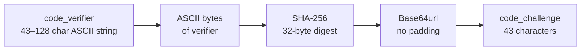

# Generating `code_verifier` and `code_challenge` with S256

## 1. Context and Objectives

In the OAuth 2.0/OpenID Connect (OIDC) **Authorization Code** flow, the Authorization Server sends an **authorization code** back to the client through the browser. If an attacker intercepts the code and exchanges it at the Token Endpoint, they can obtain access tokens on behalf of the legitimate client. **PKCE (Proof Key for Code Exchange)** was standardized in [RFC 7636](https://www.rfc-editor.org/rfc/rfc7636) to mitigate this risk.

PKCE introduces two related values used at two different times:

- `code_verifier`: an unpredictable random string generated and **retained** by the client to prove it is the party that initiated the authorization request.
- `code_challenge`: a value derived from the verifier, sent to the Authorization Server up front in the authorization request.
- `code_challenge_method=S256`: specifies that the challenge is computed using **SHA-256**, then encoded with **unpadded Base64url**.

When the client exchanges the code for tokens, it presents the verifier. The Authorization Server recomputes the challenge from that verifier and compares it with the challenge bound to the authorization code. A party that only intercepted the code typically **lacks the verifier** and cannot complete the code exchange.

This lesson belongs to the **Authorization Code and PKCE** chapter, in the curriculum on designing, configuring, securing, testing, and operating an OAuth 2.0/OIDC Authorization Server using **Spring Security**, **Spring Authorization Server**, and Spring Boot.

After this lesson, you will be able to:

1. State the exact format, length, entropy, and lifecycle rules for `code_verifier`.
2. Compute `code_challenge` using the **S256** method per RFC 7636.
3. Generate secure verifier/challenge pairs in Java and with the Web Crypto API.
4. Include the challenge in the Authorization Request and preserve the verifier until the Token Request.
5. Configure Spring Authorization Server to require PKCE for a `RegisteredClient`.
6. Distinguish the roles of PKCE, `state`, `nonce`, client authentication, and redirect URIs.
7. Write tests with the official vector and identify common implementation mistakes.

## 2. What Problem Does PKCE Solve?

The basic Authorization Code Flow has two key steps:

1. The client sends the browser to the Authorization Endpoint; after the user logs in and grants approval, the Authorization Server returns an **authorization code** via the registered redirect URI.
2. The client sends the code to the Token Endpoint to exchange it for tokens.

The authorization code travels over the **front channel** (the browser), where risks of leakage exist through insecure callback handlers, another app hijacking a URI scheme, URL-handling bugs, or malware. PKCE binds the code to a short-lived secret held only by the client that initiated the request.

```mermaid
sequenceDiagram
    participant C as OAuth Client
    participant B as Browser
    participant AS as Authorization Server

    C->>C: Generates random verifier and S256 challenge
    C->>C: Stores verifier keyed by transaction/state
    C->>B: Starts authorization redirect
    B->>AS: /oauth2/authorize?code_challenge=...&code_challenge_method=S256
    AS->>AS: Stores challenge and method bound to authorization code
    AS-->>B: Redirect carrying authorization code
    B-->>C: Delivers callback with code, state
    C->>C: Verifies state, looks up verifier
    C->>AS: POST /oauth2/token: code + code_verifier
    AS->>AS: S256(verifier) == stored challenge?
    alt Matches and all other checks pass
        AS-->>C: Access token (+ ID token if OIDC)
    else Mismatch / invalid code
        AS-->>C: OAuth error; no tokens issued
    end
```

**PKCE does not encrypt the authorization code, nor does it make the code harmless in every leakage scenario.** It protects when an attacker intercepts the code without possessing the verifier for that same transaction. If both the code and the verifier are stolen, PKCE can no longer protect that pair on its own.

### 2.1. Who Needs PKCE?

PKCE is especially vital for **public clients**, such as native apps or browser apps that cannot securely hold a client secret. Modern OAuth design also recommends Authorization Code + PKCE for **confidential clients**, such as web backends/BFFs.

| Client Type | Can Keep a Client Secret Safe? | PKCE |
|---|---|---|
| Native/mobile app | Typically **no** | Mandatory per modern security design |
| SPA running JavaScript in browser | **No** | Requires PKCE plus additional token/XSS risk evaluation |
| Web backend/BFF | Yes | Recommended alongside client authentication |
| Service using Client Credentials | Does not use Authorization Code Flow | PKCE does not apply to this grant |

**PKCE does not replace client authentication.** Confidential clients must still authenticate using their registered method, such as `client_secret_basic` or `private_key_jwt`.

## 3. `code_verifier`: Exact Rules per RFC 7636

`code_verifier` is a **high-entropy** string, fresh for every authorization request, following the syntax:

```abnf
code-verifier = 43*128unreserved
unreserved = ALPHA / DIGIT / "-" / "." / "_" / "~"
```

In other words:

| Rule | Value |
|---|---|
| Length | Between **43 and 128 characters** |
| Allowed characters | ASCII letters `A-Z`, `a-z`; digits `0-9`; `-`, `.`, `_`, `~` |
| Entropy | Sufficiently unpredictable; RFC recommends a cryptographic random number generator |
| Lifecycle | One **fresh verifier per authorization attempt** |
| Secrecy | Kept on the client, sent only when exchanging the code at the Token Endpoint |
| Encoding for S256 calculation | **ASCII bytes of the verifier string** |

A simple, RFC-compliant way to create one is to **generate 32 random bytes using a CSPRNG and encode with unpadded Base64url**. The output is typically **43 characters** long and carries 256 bits of entropy prior to encoding.

```text
32 random bytes (256 bits)
            |
            v
BASE64URL(unpadded)
            |
            v
43-character code_verifier
```

Example valid verifier from RFC 7636:

```text
dBjftJeZ4CVP-mB92K27uhbUJU1p1r_wW1gFWFOEjXk
```

This value serves as a **test vector** and must never be used as a static verifier in a real application.

### 3.1. Non-Compliant Verifiers

| Example | Problem |
|---|---|
| `123456` | Too short and predictable |
| `user-42-session` | Built from predictable data and too short |
| A single `UUID.randomUUID().toString()` | Standard UUID format is only 36 characters, below the 43-character minimum; entropy also falls short of the 32-byte recommendation |
| Strings containing `+`, `/`, `=` | Outside the `unreserved` character set for verifiers |
| Strings containing spaces or Unicode characters | Violates `unreserved` syntax |
| A constant reused across all requests | Loses secrecy and per-transaction independence |
| `Math.random()` or timestamps | Not a suitable cryptographic randomness source |

**Length does not equal entropy.** A 100-character string of `a` is still insecure. Generating the verifier from a CSPRNG is essential; never concatenate timestamps, user IDs, client names, or hand-crafted strings that merely "look random".

## 4. How Is `code_challenge` Computed with S256?

RFC 7636 defines:

```text
code_challenge = BASE64URL-ENCODE(
    SHA256(ASCII(code_verifier))
)
```

Step-by-step process:

1. Take the **complete verifier string** generated in the previous step.
2. Convert the verifier characters into **ASCII bytes** (all valid characters are ASCII).
3. Compute **SHA-256** over the bytes of the **verifier string**.
4. Obtain the 32-byte digest.
5. Encode the digest using **Base64url**.
6. **Strip `=` padding** to obtain `code_challenge`.

For SHA-256, the unpadded Base64url encoding of the 32-byte digest is **43 characters** long.



### 4.1. How Does This Differ from Standard Base64?

Base64url is a variant safe for URLs and form payloads:

| Standard Base64 | Base64url |
|---|---|
| `+` | `-` |
| `/` | `_` |
| May include `=` padding | For PKCE S256: **no padding** |

Do not call `Base64.getEncoder()`, leave `+`, `/`, `=` intact, and assume the result is a valid challenge. In Java, use `Base64.getUrlEncoder().withoutPadding()` directly.

**Never take the SHA-256 of the initial 32 random bytes to build the challenge.** Per the RFC, the hash input is the **ASCII bytes of the Base64url-encoded verifier string**. Hashing the raw random bytes is a subtle bug that causes PKCE mismatch even though the verifier itself looks valid.

### 4.2. Official Test Vector from RFC 7636

RFC 7636 Appendix B provides a pair of values to verify your S256 implementation:

```text
code_verifier:
dBjftJeZ4CVP-mB92K27uhbUJU1p1r_wW1gFWFOEjXk

code_challenge (S256):
E9Melhoa2OwvFrEMTJguCHaoeK1t8URWbuGJSstw-cM
```

If your code does not produce this exact challenge from the corresponding verifier, double-check your step ordering, hash function, encoding, and padding.

## 5. Java: Generating Verifier and Challenge Safely

A Spring Boot application can rely purely on the **JDK** without extra cryptography libraries. The example below targets Java 17 and later.

```java
import java.nio.charset.StandardCharsets;
import java.security.MessageDigest;
import java.security.NoSuchAlgorithmException;
import java.security.SecureRandom;
import java.util.Base64;
import java.util.regex.Pattern;

public final class PkceUtil {

    private static final SecureRandom SECURE_RANDOM = new SecureRandom();

    private static final Pattern VERIFIER_PATTERN =
        Pattern.compile("[A-Za-z0-9._~-]{43,128}");

    private PkceUtil() {
    }

    public record PkcePair(String verifier, String challenge) {
    }

    public static PkcePair generate() {
        byte[] randomBytes = new byte[32]; // 256-bit entropy
        SECURE_RANDOM.nextBytes(randomBytes);

        String verifier = Base64.getUrlEncoder()
            .withoutPadding()
            .encodeToString(randomBytes);

        return new PkcePair(verifier, s256(verifier));
    }

    public static String s256(String verifier) {
        if (verifier == null ||
                !VERIFIER_PATTERN.matcher(verifier).matches()) {
            throw new IllegalArgumentException(
                "PKCE verifier must be 43-128 unreserved ASCII characters");
        }

        try {
            byte[] ascii = verifier.getBytes(StandardCharsets.US_ASCII);
            byte[] digest = MessageDigest.getInstance("SHA-256")
                .digest(ascii);

            return Base64.getUrlEncoder()
                .withoutPadding()
                .encodeToString(digest);
        } catch (NoSuchAlgorithmException exception) {
            throw new IllegalStateException(
                "SHA-256 is unavailable", exception);
        }
    }
}
```

**Why each choice matters:**

- `SecureRandom` produces practically unpredictable bytes under a properly configured JDK.
- `new byte[32]` supplies 256 bits of entropy; unpadded Base64url produces a 43-character verifier string.
- The pattern validates both the 43–128 length range and the `unreserved` character set before hashing.
- `StandardCharsets.US_ASCII` mirrors the exact RFC formula.
- `MessageDigest.getInstance("SHA-256")` computes the 32-byte digest.
- `getUrlEncoder().withoutPadding()` produces output free of `+`, `/`, and `=`.

`SecureRandom` is shared here only to draw random bytes per call; **never share generated verifiers** across users or authorization transactions. Usernames, client IDs, and timestamps should never be mixed into a verifier as a homemade "secret".

### 5.1. Usage

```java
PkceUtil.PkcePair pkce = PkceUtil.generate();

String verifier = pkce.verifier();   // Keep secret on the client
String challenge = pkce.challenge(); // Send to the Authorization Endpoint

// Never log the verifier or store it in URLs/freely accessible cookies.
```

For a web backend/BFF, store the verifier **server-side per authorization request** in a secure session/transaction store with a TTL. Never record the verifier in access logs, redirect URLs, or query strings.

### 5.2. Why Not Hash the Verifier Before Storing It?

The client needs the **original verifier value** when sending `POST /oauth2/token`. If you only store `SHA-256(verifier)` and discard the verifier, the client cannot complete the Token Request under PKCE. You may protect or encrypt the storage appropriately, but when sending the Token Request you must retrieve the **original verifier** for that exact transaction.

### 5.3. Java Version Note

`record` requires modern Java (Java 16+, commonly Java 17+ for Spring Boot 3 branches). If a project uses an older Java version, replace `record PkcePair` with an immutable class containing two `final` fields. The PKCE formula remains identical.

## 6. Web Crypto API: Generating S256 for Browser Public Clients

A browser public client application can generate a verifier with **`crypto.getRandomValues`** and compute the digest with **`crypto.subtle.digest`**. Example:

```javascript
function base64url(bytes) {
  const binary = String.fromCharCode(...bytes);

  return btoa(binary)
    .replace(/\+/g, "-")
    .replace(/\//g, "_")
    .replace(/=+$/g, "");
}

async function createPkcePair() {
  const randomBytes = new Uint8Array(32);
  crypto.getRandomValues(randomBytes);

  const verifier = base64url(randomBytes);
  const asciiBytes = new TextEncoder().encode(verifier);

  const hashBuffer = await crypto.subtle.digest("SHA-256", asciiBytes);
  const challenge = base64url(new Uint8Array(hashBuffer));

  return { verifier, challenge, method: "S256" };
}
```

This example uses standard browser APIs in a **secure context (HTTPS or a development environment treated as secure)**. `TextEncoder` produces identical ASCII bytes because the verifier contains only valid ASCII characters. Never replace `crypto.getRandomValues` with `Math.random()`.

For SPAs, evaluate **XSS** risks and how tokens/verifiers are stored. Storing verifiers in long-lived `localStorage` widens exposure to JavaScript access; use a short-lived transaction store suited to your architecture, keyed by `state`, or adopt a **backend-for-frontend (BFF)** architecture so tokens and verifiers stay on the backend.

**This is only a PKCE pair generator example**, not a complete OAuth client. A client must also generate `state`, handle redirects, protect transaction state, validate callbacks, and perform the code exchange per the grant.

## 7. Adding the Challenge to the Authorization Request

The client initiates an authorization attempt by:

1. Generating a `(verifier, challenge)` pair.
2. Generating a random `state` to bind the callback to the request and mitigate CSRF-related attacks.
3. If using OIDC and a nonce is needed, generating an independent `nonce` to bind the ID token.
4. Storing `verifier` **keyed by `state`/authorization transaction**, with an appropriate TTL.
5. Passing the **challenge**, not the verifier, to `/oauth2/authorize`.

Example request for a public client:

```http
GET /oauth2/authorize?response_type=code&client_id=booking-spa
    &redirect_uri=https%3A%2F%2Fapp.example.com%2Fcallback
    &scope=openid%20profile%20bookings.read
    &state=RANDOM_STATE
    &nonce=RANDOM_NONCE
    &code_challenge=E9Melhoa2OwvFrEMTJguCHaoeK1t8URWbuGJSstw-cM
    &code_challenge_method=S256
```

The challenge in this request is a **static vector purely for reading and testing**. In a real product, generate a fresh value for each request from a fresh verifier. Line breaks are for readability; the actual URL must be properly URL-encoded.

| Parameter | Purpose |
|---|---|
| `response_type=code` | Requests the Authorization Code Flow |
| `client_id` | Identifies the registered OAuth client |
| `redirect_uri` | Permitted callback target per registration |
| `scope` | Permissions and OIDC requests such as `openid` |
| `state` | Ties callback to transaction, mitigating CSRF/mix-up by design |
| `nonce` | Binds ID token to the OIDC authentication request when used |
| `code_challenge` | S256 value derived from the verifier |
| `code_challenge_method=S256` | Selects challenge transformation method per RFC 7636 |

**Never include `code_verifier` in the Authorization Request.** Sending the verifier at this step exposes it over the same channel as the authorization code and undermines PKCE's protection.

### 7.1. One `state` Must Not Share One Verifier Across Tabs

Two browser tabs can start login nearly simultaneously:

```text
Tab A: state=A1, verifier=VA, challenge=S256(VA)
Tab B: state=B2, verifier=VB, challenge=S256(VB)
```

When Tab A's callback returns first, the client must use **VA**, not the most recently saved verifier (VB). A global variable such as `lastPkceVerifier` easily triggers `invalid_grant` errors and can cause transaction mix-ups.

Keep a separate record per transaction, for example:

```text
state A1 -> verifier VA, redirect metadata, createdAt
state B2 -> verifier VB, redirect metadata, createdAt
```

Delete the record after successful use or when the transaction expires; avoid reusing verifiers on retry. If a callback lacks the expected `state`, never pick an arbitrary verifier and try exchanging the code.

## 8. Sending the Verifier at the Token Endpoint

After the user completes authentication/consent, the Authorization Server redirects to the callback with the authorization code and `state`. The client:

1. Verifies that `state` matches the initiated request.
2. Looks up the verifier for that exact transaction.
3. Sends `code`, `code_verifier`, and required Token Request parameters.
4. Only when the Token Request succeeds does it process the access token, ID token (if OIDC), and refresh token (if issued).

Example for a **public client** without a client secret:

```http
POST /oauth2/token
Content-Type: application/x-www-form-urlencoded

grant_type=authorization_code&client_id=booking-spa&code=AUTHORIZATION_CODE&redirect_uri=https%3A%2F%2Fapp.example.com%2Fcallback&code_verifier=dBjftJeZ4CVP-mB92K27uhbUJU1p1r_wW1gFWFOEjXk
```

This is illustrative data; a real authorization code must be issued by the Authorization Server from an **authorization request containing the matching challenge**. You cannot pair the RFC vector's verifier with an arbitrary code.

For a **confidential backend client**, the Token Request must also include registered **client authentication**, such as `client_secret_basic` via HTTP Basic, alongside the verifier in the body. PKCE does not allow skipping confidential client authentication.

### 8.1. How Does the Authorization Server Verify It?

When receiving a code exchange request, the AS must verify OAuth conditions before and during exchange:

- Does the authorization code exist, is it unexpired, unused, and bound to the right client?
- Is the client authenticated or identified properly per client type and registration?
- Does `redirect_uri` match the value bound to the authorization request per applicable rules?
- What `code_challenge` and `code_challenge_method` did the original authorization record?
- Does the Token Request contain a valid, properly formatted verifier for that code?
- Does `BASE64URL(SHA256(ASCII(verifier)))` match the stored challenge when the method is `S256`?
- Are all other grant, token policy, scope, and state conditions valid?

When the verifier does not match, the server **issues no tokens** and returns an appropriate OAuth error, typically `invalid_grant` when the code cannot be validly redeemed. Exact error names for missing/malformed parameters depend on protocol rules and implementation version; tests should assert appropriate error codes without assuming every case produces the exact same error.

### 8.2. Binding the Challenge to the Code

The AS must store the challenge/method attached to the **specific authorization** created when handling the request. Never store a global challenge for all clients or look it up solely by user ID.

```text
Authorization:
  registeredClientId = rc-123
  authorizationCode  = CODE_X
  codeChallenge      = CHALLENGE_X
  codeChallengeMethod= S256

Token Request:
  code_verifier      = VERIFIER_X

PKCE Condition:
  S256(VERIFIER_X) == CHALLENGE_X
```

If the code has already been used, no tokens may be issued on a second attempt even if the verifier is right. PKCE must work together with **single-use** semantics and short authorization code lifetimes.

## 9. Configuring Spring Authorization Server to Require PKCE

With Spring Authorization Server, requiring PKCE for an Authorization Code client can be declared in `ClientSettings`:

```java
RegisteredClient publicClient = RegisteredClient
    .withId(UUID.randomUUID().toString())
    .clientId("booking-spa")
    .clientAuthenticationMethod(ClientAuthenticationMethod.NONE)
    .authorizationGrantType(AuthorizationGrantType.AUTHORIZATION_CODE)
    .redirectUri("https://app.example.com/callback")
    .scope(OidcScopes.OPENID)
    .scope("bookings.read")
    .clientSettings(ClientSettings.builder()
        .requireProofKey(true)
        .build())
    .build();
```

Meaning:

- `ClientAuthenticationMethod.NONE`: public client unable to safely hold a shared secret.
- `AuthorizationGrantType.AUTHORIZATION_CODE`: uses the flow through the Authorization Endpoint.
- `requireProofKey(true)`: requires the client to satisfy PKCE for the Authorization Code Flow.
- `redirectUri`: callback must be registered precisely.
- `openid`: scope for OIDC when OpenID Provider support is enabled and fully configured.

In practice, you also need `RegisteredClientRepository`, `OAuth2AuthorizationService`, signing keys/issuer, login/consent, and the corresponding `SecurityFilterChain`. This is a **client configuration snippet**, not a complete runnable Authorization Server.

### 9.1. Why `requireProofKey(true)` Alone Is Not the Whole Policy

This flag instructs the framework to enforce PKCE for the client. A system must also verify:

- Is `code_challenge_method=plain` accepted? With an **S256-only** policy, configuration/validation must actively **reject `plain` or a missing method**.
- Are `redirect_uri`, scopes, consent, and user state valid?
- Are client secrets or private key JWTs verified for confidential clients?
- Is the authorization code stored with its challenge/method and redeemed only once?
- Does the Authorization Server avoid logging `code_verifier`?

**Do not assume `requireProofKey(true)` means "the server accepts only S256".** Under RFC 7636, `plain` exists as an alternate method, and when `code_challenge_method` is omitted, the specification defaults to `plain`. If your security baseline requires **S256-only**, enforce and test that condition explicitly using supported extension points of your Spring Authorization Server version, paired with an integration test proving `plain` requests are rejected.

### 9.2. Spring Security OAuth2 Client Can Generate PKCE

When a **Spring Security OAuth2 Client** application acts as the client/Relying Party, OAuth2 Client components can generate verifiers/challenges depending on configuration and client type. For confidential clients, do not assume PKCE is automatically enabled across every version/configuration.

A public extension point provided by Spring Security is customizing the authorization request resolver. Illustrative structure:

```java
DefaultOAuth2AuthorizationRequestResolver resolver =
    new DefaultOAuth2AuthorizationRequestResolver(
        clientRegistrationRepository,
        "/oauth2/authorization");

resolver.setAuthorizationRequestCustomizer(
    OAuth2AuthorizationRequestCustomizers.withPkce());

http.oauth2Login(oauth2 -> oauth2
    .authorizationEndpoint(endpoint -> endpoint
        .authorizationRequestResolver(resolver)));
```

This snippet belongs inside the **client application's** `SecurityFilterChain` configuration, with `ClientRegistrationRepository` and appropriate imports. Before applying, verify the API against your project's Spring Security version. The framework must also persist the OAuth2 Authorization Request containing PKCE attributes so it can retrieve the verifier at callback; keep the repository/transaction state secure.

**Never write a filter on the Authorization Server to generate a verifier on the client's behalf.** PKCE requires the client to hold the verifier from the start of the authorization request.

## 10. When to Use S256 and Why Avoid `plain`?

RFC 7636 defines two common methods:

```text
plain:
  code_challenge = code_verifier

S256:
  code_challenge = BASE64URL(SHA256(ASCII(code_verifier)))
```

With `plain`, the value in the Authorization Request equals the verifier itself. This weakens protection when front-channel requests are observed or leaked. `S256` avoids exposing the original verifier in the authorization request and should be preferred for new clients.

| Aspect | `plain` | `S256` |
|---|---|---|
| Generated challenge | Direct copy of the verifier | SHA-256(verifier) then Base64url |
| Verifier appears on front channel? | Yes, as the challenge | No; only derived digest |
| Protection if attacker sees authorization request | Weaker | Stronger |
| New design recommendation | Avoid | **Preferred/mandatory under modern baselines** |

If a client claims it "cannot use SHA-256", investigate the exact reason before lowering requirements. SHA-256 and Base64url are standard primitives built into the JDK and Web Crypto. Downgrading from S256 to `plain` should never be a routine workaround for integration issues.

### 10.1. Preventing PKCE Downgrade

When the AS enforces an S256-only policy:

1. Require a valid `code_challenge`.
2. Require explicit `code_challenge_method=S256`.
3. Reject `plain`, missing methods, or unsupported methods.
4. Store the actual method with the authorization code.
5. Never allow the Token Request to change the method or challenge bound to the code.

Never accept a Token Request that re-declares `code_challenge_method=S256` to override the original authorization data; the transformation method must be locked when the AS receives the authorization request.

## 11. How Does PKCE Differ from `state`, `nonce`, and Client Authentication?

Many integrations fail by treating PKCE as "sufficient security" for all OAuth/OIDC concerns. These mechanisms address distinct risks:

| Mechanism | Created/Used By | Primary Goal |
|---|---|---|
| **PKCE verifier/challenge** | Created by OAuth client; verified by AS on code exchange | Prevents a party holding only a stolen code from exchanging it for tokens |
| **`state`** | Created and verified by client upon receiving authorization response | Links callback to original request, mitigating CSRF and transaction mix-ups |
| **`nonce`** | Created by OIDC RP; verified in ID token when used | Links ID token to authentication request, preventing replay where applicable |
| **Client authentication** | Confidential client and AS | Proves client identity at authenticated endpoints |
| **Redirect URI validation** | AS | Prevents sending authorization responses to unregistered targets |
| **TLS** | Communicating parties | Protects data in transit, including Token Requests containing the verifier |

PKCE does not universally replace `state`; using `state`/CSRF protections depends on the client, framework, and threat analysis of the flow. With OIDC, if `nonce` was sent in the request, the RP must verify the corresponding claim in the ID token per protocol rules.

**Wrong example:** Because PKCE is enabled, the client skips checking `state` and accepts any callback containing `code`. That opens the door to request mix-up or login CSRF in setups lacking equivalent protections.

### 11.1. PKCE Does Not Solve Every Kind of Theft

PKCE alone does not protect when:

- XSS in an SPA lets an attacker read the verifier from memory or storage.
- Issued access tokens or refresh tokens are stolen.
- A confidential client's secret or private key is exposed.
- Redirect URIs are misconfigured or loosely validated.
- The Authorization Server / Token Endpoint implementation skips validation.
- Both the authorization code and verifier for the same transaction are compromised together.

Therefore, combine PKCE with browser protections, TLS, redirect bindings, sessions, cookies, safe token storage, and thorough endpoint testing.

## 12. Common Implementation Mistakes

| Mistake | Consequence | Fix |
|---|---|---|
| Generating a 36-char verifier from a UUID string | Fails `43–128` length requirement | Generate 32 CSPRNG bytes and encode with unpadded Base64url |
| Using `Math.random()` or timestamps | Predictable | Use `SecureRandom` / `crypto.getRandomValues` |
| Using standard Base64 instead of Base64url | Contains invalid `+`, `/`, `=` characters | Use URL-safe encoder without padding |
| Hashing raw random bytes before Base64url | Challenge does not equal S256(verifier) | Hash **ASCII bytes of the verifier string** |
| Hashing twice | Challenge mismatch | Single SHA-256 per RFC |
| Sending verifier in `/authorize` | Leaks secret over front channel | Send only the challenge in `/authorize` |
| Sending challenge instead of verifier in `/token` | `invalid_grant` | Send the original verifier |
| Using a different verifier for the same code | Challenge mismatch | Key transactions by `state` |
| Keeping a single global verifier variable | Breaks when opening multiple tabs/parallel flows | Store separately per authorization transaction |
| Reusing a verifier across authorizations | Reduces independence, causes confusion | Generate a fresh one per request |
| Omitting `code_challenge_method` | RFC defaults to `plain`; may be rejected | Send `S256` explicitly |
| Allowing `plain` despite S256-only policy | Fails to enforce baseline | Reject missing/invalid/`plain` methods |
| Skipping client authentication because PKCE is present | Confidential client goes unauthenticated | Keep registered client auth method |
| Logging verifier/authorization code | Exposes proof pair | Redact request bodies and callbacks |
| Skipping `state` or redirect URI checks | Risks CSRF/open redirect/mix-up | Verify every layer thoroughly |
| Token Endpoint accepts a code twice | Authorization code replay | Enforce single-use codes |

### 12.1. Log Clues and Diagnostics

When the server returns `invalid_grant` on code exchange, do not immediately assume the verifier is wrong. Common causes include:

1. The authorization code expired or was already used.
2. The code was issued to another client.
3. `redirect_uri` in the Token Request does not match the original authorization.
4. The client used a verifier belonging to another tab/transaction.
5. The challenge was computed incorrectly due to Base64url, hashing, or charset errors.
6. The Authorization Server failed to save or read authorizations across instances.
7. Client configuration or token/grant policy changed.

Use **correlation IDs, masked client IDs, transaction IDs, and error categories** for diagnostics; never log raw codes or verifiers to "compare easily". If you need to test a specific pair, use the **RFC vector in a test environment**, never live production credentials.

## 13. Unit Testing S256 with the RFC Vector

A first unit test should verify the standard formula. Example with JUnit 5:

```java
import static org.junit.jupiter.api.Assertions.*;

import org.junit.jupiter.api.Test;

class PkceUtilTest {

    @Test
    void s256MatchesRfc7636AppendixB() {
        String verifier =
            "dBjftJeZ4CVP-mB92K27uhbUJU1p1r_wW1gFWFOEjXk";

        String expected =
            "E9Melhoa2OwvFrEMTJguCHaoeK1t8URWbuGJSstw-cM";

        assertEquals(expected, PkceUtil.s256(verifier));
    }

    @Test
    void generatedPairHasValidShapeAndMatchingChallenge() {
        PkceUtil.PkcePair pair = PkceUtil.generate();

        assertTrue(pair.verifier()
            .matches("[A-Za-z0-9._~-]{43,128}"));

        assertTrue(pair.challenge()
            .matches("[A-Za-z0-9_-]{43}"));

        assertEquals(PkceUtil.s256(pair.verifier()),
            pair.challenge());
    }

    @Test
    void invalidVerifierIsRejected() {
        assertThrows(IllegalArgumentException.class,
            () -> PkceUtil.s256("too-short"));
    }
}
```

This test verifies the S256 function and the shape of generated pairs. It **does not statistically prove that the CSPRNG is perfectly random**, nor does it replace HTTP testing of the Authorization Server. To check that verifiers are not reused, you can generate multiple pairs and assert uniqueness within an appropriate test, though do not rely on that test as primary proof of entropy.

## 14. Integration Testing Authorization Server with PKCE

For Spring Authorization Server, cover at least the following cases:

| Case | Authorization Request / Token Request | Expected Result |
|---|---|---|
| **Valid S256** | Valid challenge, `S256` method; matching verifier | Token Request succeeds when other conditions hold |
| **Missing challenge** | Client has `requireProofKey(true)` but omits challenge | AS rejects request failing PKCE |
| **`plain` method** | Baseline accepts only S256 | AS rejects under S256-only policy |
| **Unsupported method** | `code_challenge_method=unknown` | Request rejected |
| **Wrong verifier** | Exchanges code with verifier from another transaction | No tokens issued |
| **Missing verifier** | Exchanges PKCE-bound code without `code_verifier` | No tokens issued |
| **Verifier too short / bad chars** | `code_verifier=abc` or contains `+` | Rejected |
| **Used code** | Exchanges same code twice | Only the first attempt may succeed |
| **Expired code** | Waits past authorization code TTL | No tokens issued |
| **Wrong client** | Client B exchanges Client A's code | Rejected |
| **Wrong redirect URI** | Token Request mismatches original request | Rejected |
| **Multiple tabs** | Two separate `state` and verifier pairs | Each callback retrieves its own verifier |
| **Different nodes** | Authorize on node A, token on node B | Succeeds when authorization state is shared properly |
| **Wrong `state`** | Callback carries value differing from transaction | Client rejects callback before exchanging code |
| **Confidential client + PKCE** | Valid verifier but wrong client secret | Rejected despite valid PKCE |
| **Public client** | No secret, sends client ID and valid verifier | Works per registration and policy |
| **No secrets logged** | Inspect tracing/logging system | Contains no raw code/verifier/token |

Some tests require the client to go through full login/consent. When using `MockMvc`, preserve sessions, cookies, and request caches; when testing over real HTTP, configure TLS and redirects to mirror the target deployment.

### 14.1. Layering Failures to Fix the Right Place

- **Failure before code issuance:** check Authorization Endpoint, client registration, redirect URI, challenge/method, login/consent.
- **Failure at Token Endpoint:** check code state, client authentication, verifier, redirect URI, expiry, token policy.
- **Failure after token issuance:** check RP/Resource Server, token signature and claims, audience/scope; do not assume PKCE is at fault.

If your formula is exact yet the Token Endpoint rejects the request, verify that **the exact same authorization transaction** was carried from start to finish. Transaction mismatches are a very common failure source when users open multiple tabs or lose sessions.

## 15. Operating and Securing PKCE in Spring Boot

### 15.1. Assets to Protect

| Data | Where It Appears | Protection |
|---|---|---|
| `code_verifier` | Client transaction state, Token Request body | Keep out of URLs/logs; short TTL; delete after use |
| `code_challenge` | Authorization Request and AS authorization state | Bind strictly to code/method; cannot be altered by Token Request input |
| Authorization code | Redirect callback, token exchange | Short-lived, single-use, never logged |
| `state` | Authorization Request/Response | Cryptographically random, verified at callback, bound to transaction |
| `nonce` (OIDC) | Authentication Request, ID token | Verified per protocol when nonce is sent |
| Client credential | Token Endpoint for confidential clients | Keep secrets backend-only; manage and rotate properly |
| Access/refresh token | Client and Resource Server/AS per architecture | TLS, secure storage, TTL/revocation, and log redaction |

### 15.2. Multi-Instance Data

A multi-node Authorization Server must be able to read authorization state containing the challenge and method. For example:

1. Node A receives `/oauth2/authorize` and saves the authorization code with its challenge.
2. The load balancer routes the Token Request to node B.
3. Node B must look up the code/challenge in a shared `OAuth2AuthorizationService` or consistent state mechanism.
4. If A and B each use isolated in-memory authorization stores, code exchange will fail even with the right verifier.

**`OAuth2AuthorizationConsentService` and HTTP sessions are separate layers.** Sharing consent or sessions alone does not ensure node B can look up the authorization code/challenge. Production typically needs durable persistence, unified key management, and token/code expiration policies.

### 15.3. Do Not Retain Verifiers Indefinitely

On the client, the verifier is a single-use secret for one authorization transaction. Once the callback is processed or the transaction expires:

- Delete the verifier and no-longer-needed metadata.
- Never reuse it for a new login attempt.
- Never leave it in URLs, browser history, analytics events, or logs.
- When a callback lacks a valid `state`, reject it rather than scanning for a random verifier.
- Design timeout/retry behavior so an expired request generates **a fresh PKCE pair**.

When using a standard library like Spring Security OAuth2 Client, let the framework manage storing the verifier with the authorization request per its contract, customizing only when clearly required.

## 16. Summary and Implementation Checklist

Before deploying Authorization Code + PKCE to a real environment, confirm:

1. The client uses **Authorization Code** and has `requireProofKey(true)` configured where applicable.
2. Each authorization transaction draws **32 bytes from a CSPRNG** to generate the verifier.
3. The verifier is **43–128 characters** long, using only RFC `unreserved` characters.
4. `code_challenge = BASE64URL(SHA256(ASCII(code_verifier)))`, **without padding**.
5. The Authorization Request sends `code_challenge` and `code_challenge_method=S256`, never the verifier.
6. The client stores the verifier keyed by **the exact transaction/state** and keeps it secret until the Token Request.
7. The client checks `state` before exchanging the code, and uses `nonce` properly when requesting OIDC.
8. The Token Request sends the **original verifier**; confidential clients still authenticate themselves.
9. The AS binds challenge/method to the code, and codes have a short TTL and single-use enforcement.
10. Unit and integration tests cover the RFC vector, wrong verifier, code replay, multiple tabs, and S256-only enforcement.
11. Logs/traces/audits contain no raw codes, verifiers, tokens, or client secrets.
12. Multi-instance deployments share authorization state and manage keys/sessions consistently.

**Rule to remember:** `code_verifier` is a random secret belonging to **one client authorization attempt**; `code_challenge` is its derived digest sent ahead to the Authorization Server. With **S256**, only the client holding the original verifier can prove that the code being exchanged belongs to the request it initiated, provided all other OAuth validations succeed.

## References

- [RFC 7636 — Proof Key for Code Exchange by OAuth Public Clients](https://www.rfc-editor.org/rfc/rfc7636)
- [RFC 7636, Appendix B — Example for the S256 code_challenge_method](https://www.rfc-editor.org/rfc/rfc7636#appendix-B)
- [RFC 6749 — The OAuth 2.0 Authorization Framework](https://www.rfc-editor.org/rfc/rfc6749)
- [RFC 9700 — Best Current Practice for OAuth 2.0 Security](https://www.rfc-editor.org/rfc/rfc9700)
- [RFC 8252 — OAuth 2.0 for Native Apps](https://www.rfc-editor.org/rfc/rfc8252)
- [OpenID Connect Core 1.0](https://openid.net/specs/openid-connect-core-1_0.html)
- [Spring Authorization Server — Core Model / Components](https://docs.spring.io/spring-authorization-server/reference/core-model-components.html)
- [Spring Authorization Server — Protocol Endpoints](https://docs.spring.io/spring-authorization-server/reference/protocol-endpoints.html)
- [Spring Security — OAuth 2.0 Client](https://docs.spring.io/spring-security/reference/servlet/oauth2/client/index.html)
