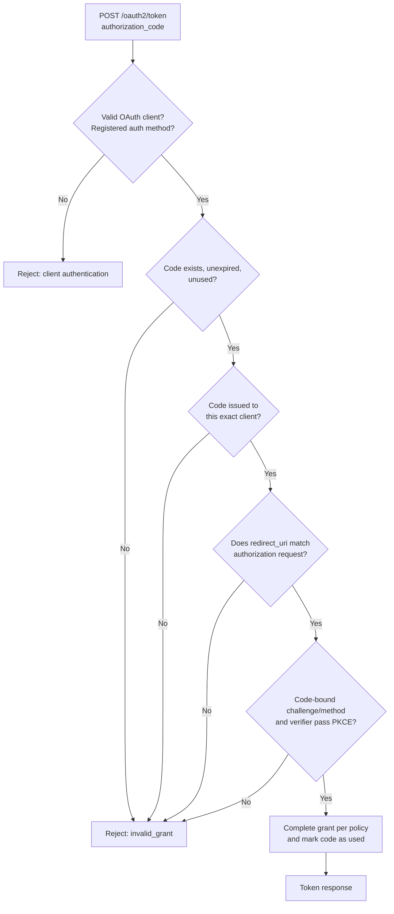

# Verifying PKCE at Code Exchange and Handling Invalid Verifiers

In the **Authorization Code Flow**, an OAuth 2.0/OpenID Connect (OIDC) client receives an **authorization code** through the browser and sends that code to the **Token Endpoint** to exchange it for tokens. For a public client, if an attacker intercepts the code without an additional binding, they can attempt to exchange that code for an access token. **Proof Key for Code Exchange (PKCE)** addresses this risk by binding the code to a short-lived secret generated by **the client itself** for each transaction: `code_verifier`.

The decisive moment of PKCE happens at the **`POST /oauth2/token`** request: the Authorization Server receives `code_verifier`, applies the transformation declared during the authorize step, and compares the result against the `code_challenge` bound to the authorization code. A missing, incorrect, malformed, or mismatched-transaction verifier must cause the server to refuse issuing tokens.

This lesson belongs to the **Authorization Code and PKCE** chapter of the **SPRING_SECURITY_OAUTH2_OIDC_AUTHORIZATION_SERVER** module. Within the curriculum for designing, configuring, securing, testing, and operating an OAuth 2.0/OIDC Authorization Server with **Spring Security** and **Spring Authorization Server** on Spring Boot, this lesson focuses on **the PKCE verification path at the Token Endpoint**, error handling, and required security tests. API examples target the Spring Authorization Server 1.x / Spring Security 6.x family; verify compatibility when working with other versions.

## 1. How Does PKCE Protect the Authorization Code Exchange?

### 1.1. Two Phases Within the Same Transaction

When starting the Authorization Code Flow:

1. The client generates a fresh `code_verifier` using a cryptographically secure random generator.
2. The client computes `code_challenge` from the verifier, typically using `S256`.
3. The client redirects the browser to `/oauth2/authorize`, sending the challenge and `code_challenge_method=S256`.
4. The Authorization Server validates the authorization request, authenticates the user, handles consent, and issues an **authorization code** bound to the challenge/method.
5. The client receives the code at its redirect URI, verifies `state`, and calls `/oauth2/token`, sending **the code and original verifier**.
6. The Authorization Server validates the code, client, redirect URI, and PKCE; it issues tokens only if all conditions are satisfied.

```mermaid
sequenceDiagram
    autonumber
    actor U as User
    participant C as OAuth Client
    participant AS as Authorization Server
    participant Attacker as Holder of leaked code

    C->>C: Generates per-transaction verifier
    C->>C: challenge = BASE64URL(SHA256(ASCII(verifier)))
    C->>AS: GET /oauth2/authorize + challenge + S256 + state
    AS->>U: Authentication / consent if needed
    AS->>AS: Saves code bound to client, redirect, challenge
    AS-->>C: 302 callback?code=CODE&state=STATE
    C->>C: Matches state and retrieves stored verifier

    par Code stolen by attacker
        Attacker->>AS: POST /oauth2/token + CODE + wrong verifier
        AS-->>Attacker: OAuth error; no tokens issued
    and Legitimate client
        C->>AS: POST /oauth2/token + CODE + valid verifier
        AS-->>C: Token response if code is still valid
    end
```

The last two branches only illustrate two **independent** scenarios. In real testing, never use the same authorization code expecting both a successful and a failing request at the same time: a code is **single-use**, and whether a failed request alters code state depends on the execution path and implementation. Each test should generate a fresh code.

### 1.2. What Must Be Kept Secret?

| Value | Where Can It Appear? | Property |
|---|---|---|
| `client_id` | Authorization request, token request | Public, not a credential |
| `code_challenge` | Query of `/oauth2/authorize` | Derived value safe to expose publicly |
| `code_challenge_method` | Authorization request | Transformation name; `S256` recommended |
| `authorization_code` | Redirect callback, token request | Short-lived, single-use; avoid leakage |
| `code_verifier` | Client transaction state and **token request** | Short-lived transaction secret; never put in authorize URL |
| `state` | Authorization request and callback | Used by client to correlate response with its initiated request |
| `client_secret` | Token endpoint of confidential client | Long-lived client credential; public clients have none |

Never send `code_verifier` in `/oauth2/authorize`. Putting both the verifier and the challenge in the URL lets an observer of the authorization request learn the value needed to exchange the code, undermining PKCE.

### 1.3. PKCE Does Not Replace Client Authentication or `state`

**PKCE** proves that the party exchanging the code possesses the verifier corresponding to the challenge. For a **confidential client**, the Token Endpoint may still require `client_secret_basic`, `private_key_jwt`, or another registered client authentication method. For a **public client**, `ClientAuthenticationMethod.NONE` means no secret is used, making PKCE especially essential.

**`state`**, on the other hand, is used by the **client** to match callbacks; it is not a replacement for PKCE at the Token Endpoint. **OIDC `nonce`** lets the client bind an ID token to an authentication request; it does not replace PKCE either. A secure system relies on multiple checks serving distinct purposes.

## 2. The S256 Algorithm and Verifier Validity Rules

### 2.1. Essential Formula

Per RFC 7636, with `code_challenge_method=S256`:

```text
code_challenge = BASE64URL-ENCODE(SHA256(ASCII(code_verifier)))
```

During code exchange, the Authorization Server must recompute the transformation using the **verifier received in the token request** and compare it with the **challenge stored alongside the code**:

```text
computed = BASE64URL-ENCODE(SHA256(ASCII(received_code_verifier)))

If computed == original_code_challenge:
    PKCE verification succeeds
Otherwise:
    Reject token request
```

`BASE64URL-ENCODE` here means Base64URL **without `=` padding**. Standard Base64 characters `+` and `/` must be replaced by `-` and `_` per Base64URL. Do not use standard Base64, padded Base64, or hex-encoded SHA-256 instead of the specified format.

### 2.2. `code_verifier` Format

Per RFC 7636, `code_verifier` is a string of:

- **43 to 128 characters**;
- Containing only unreserved ASCII characters: letters `A-Z`, `a-z`, digits `0-9`, and `-`, `.`, `_`, `~`;
- High entropy; the recommended method is **32 cryptographically random bytes**, Base64URL-encoded without padding into 43 characters.

Example syntax pattern:

```text
^[A-Za-z0-9._~-]{43,128}$
```

This pattern checks **syntax**, not entropy. A 43-character string of repeated `a`s passes the syntax check yet is **insecure**. Generating an unpredictable random verifier is the client's responsibility; the server must still enforce protocol requirements and bindings.

### 2.3. Why Choose S256 Over `plain`?

RFC 7636 describes two methods: `S256` and `plain`. With `plain`, the challenge is the verifier itself; if an attacker sees the authorize request, they immediately know the value to send to the token endpoint. `S256` makes reversing the verifier from the challenge computationally infeasible when the verifier has sufficient entropy.

In modern deployments, **choose S256**. Spring Authorization Server can require **PKCE** via `requireProofKey(true)`, but do not assume that flag automatically enforces an **S256-only** policy across all versions. If your security policy requires rejecting `plain`, verify your version's behavior or customize validation and add dedicated tests.

### 2.4. Java Code for Generating Verifier and Challenge on the Client

This is **OAuth client or test-tool code**, not Token Endpoint logic to reimplement on the Authorization Server:

```java
import java.nio.charset.StandardCharsets;
import java.security.MessageDigest;
import java.security.SecureRandom;
import java.util.Base64;

public final class PkceClientValues {
    private static final SecureRandom RANDOM = new SecureRandom();

    private PkceClientValues() {
    }

    public static String newVerifier() {
        byte[] random = new byte[32];
        RANDOM.nextBytes(random);
        return Base64.getUrlEncoder()
                .withoutPadding()
                .encodeToString(random); // 43 Base64URL characters
    }

    public static String s256Challenge(String verifier) throws Exception {
        byte[] digest = MessageDigest.getInstance("SHA-256")
                .digest(verifier.getBytes(StandardCharsets.US_ASCII));
        return Base64.getUrlEncoder()
                .withoutPadding()
                .encodeToString(digest);
    }
}
```

The application calls `newVerifier()` **for each authorization request**, stores the verifier with its transaction, and sends only the challenge in the URL. In JavaScript, use `crypto.getRandomValues` and `crypto.subtle.digest("SHA-256", ...)`; never use `Math.random()` or timestamps.

## 3. What Parameters Does the Token Endpoint Receive?

Once the client has the code and finishes callback validation, it sends **`POST /oauth2/token`** with URL-encoded form parameters.

### 3.1. Public Client Using `none` + PKCE

Example public SPA with `client_id=dashboard-spa`:

```http
POST /oauth2/token HTTP/1.1
Host: login.example.com
Content-Type: application/x-www-form-urlencoded

grant_type=authorization_code&client_id=dashboard-spa&code=AUTH_CODE&redirect_uri=https%3A%2F%2Fdashboard.example.com%2Foauth%2Fcallback&code_verifier=ORIGINAL_VERIFIER
```

This is illustrative; `AUTH_CODE` and `ORIGINAL_VERIFIER` must come from the same real transaction. A public client never sends a `client_secret` or HTTP Basic header with a secret embedded in JavaScript.

### 3.2. Confidential Client Still Requires Client Authentication

Example Portal BFF using `client_secret_basic` with PKCE enabled:

```http
POST /oauth2/token HTTP/1.1
Host: login.example.com
Authorization: Basic <base64(client_id:client_secret)>
Content-Type: application/x-www-form-urlencoded

grant_type=authorization_code&code=AUTH_CODE&redirect_uri=https%3A%2F%2Fportal.example.com%2Flogin%2Foauth2%2Fcode%2Fcentral&code_verifier=ORIGINAL_VERIFIER
```

For a confidential client, `client_id` is determined from its authentication method; how the client ID is transmitted in actual requests depends on the registered client authentication method. **A valid secret with a wrong verifier must still be rejected**, because the two checks serve independent purposes.

### 3.3. What the Token Endpoint Must Not Accept

During code exchange:

- **Do not accept a new `code_challenge`** to replace the original challenge; the server must use the challenge bound to the code.
- **Do not accept a new `code_challenge_method`** to switch from `S256` to `plain`; the method must be locked at the authorization request.
- **Do not send `state` as a substitute for `code_verifier`**; `state` is validated by the client at the callback.
- **Do not send new `scope` values to expand permissions** of the authorization code; token issuance is bounded by the granted authorization and policy.
- **Do not use a different `redirect_uri`** from the URI bound to the code when sent in the authorization request and required to match.
- **Do not send the user's password** to the token endpoint to "bypass PKCE".

## 4. What Does the Authorization Server Check When Receiving Code and Verifier?

Conceptually, the Token Endpoint does more than compare two strings. It must verify **the entire authorization grant**.



This diagram shows **logical validation**, without guaranteeing exact filter/provider ordering or error codes for every edge case. Spring Authorization Server handles these steps through the **OAuth2 Token Endpoint**, `AuthenticationManager`, and corresponding `AuthenticationProvider` implementations. Use the built-in mechanism instead of writing a custom code-exchange endpoint.

### 4.1. Code Must Be Bound to the Initial Client and Authorization

An authorization code is issued within a specific context:

- The `registeredClientId`/OAuth client that sent the authorization request;
- The authenticated Resource Owner/`principal` and granted permissions, if any;
- The accepted `redirect_uri`;
- `code_challenge` and `code_challenge_method` when using PKCE;
- Expiration lifetime, unused status, and related authorization parameters.

At code exchange, the token endpoint must look up the code in the authorization store and verify it belongs to **the exact client**, rather than just checking that the code looks like a random string. If a code issued to client A is submitted by client B, the request must be rejected even if B has its own secret or verifier.

### 4.2. The Server Does Not Store the Original `code_verifier`

In PKCE, the client retains `code_verifier`; the Authorization Server stores the **challenge and method** tied to the authorization request/code. Requiring the client to send the verifier at the authorize step so the server stores plaintext would defeat PKCE's purpose.

At the token step, the server uses the received verifier to compute the challenge and match it against the stored one. Downstream APIs protecting resources do not need `code_verifier`: once the code is exchanged for tokens, PKCE's job is done.

### 4.3. Why Never Trust a New Challenge Sent by the Client?

An attacker who steals a code could generate their own verifier and send its matching challenge **in the token request**. If the server verified against the challenge the attacker just supplied, the check would always pass, breaking the binding completely. Therefore, the source of truth must be the **challenge stored when issuing the code**.

### 4.4. Single-Use Codes and Competing Requests

Authorization codes typically have a very short TTL and are single-use. Two requests attempting to exchange the same code nearly simultaneously must be handled so that **two token sets cannot be issued in violation of policy**. In multi-node Authorization Server setups, the `OAuth2AuthorizationService` store, transactional behavior, and contention handling must be consistent.

A request with a wrong verifier may affect whether the code remains usable depending on the processing path. Never design a client assuming it can brute-force hundreds of verifiers against the same code; on a PKCE failure, **abort the transaction and restart the Authorization Code Flow**.

## 5. Where Does Spring Authorization Server Process PKCE?

### 5.1. Components on the Path

In Spring Authorization Server's Servlet architecture, the overall flow includes:

1. **`OAuth2AuthorizationEndpointFilter`** receives the authorization request at `/oauth2/authorize`.
2. Authorization request providers validate the client, redirect URI, response type, and PKCE/consent parameters per configuration.
3. `OAuth2AuthorizationService` persists the authorization state, including the code and request data needed for later verification.
4. **`OAuth2TokenEndpointFilter`** receives `POST /oauth2/token` and converts parameters into the corresponding authentication token.
5. `OAuth2ClientAuthenticationFilter` and related providers handle client authentication (including `none` for public clients under valid conditions).
6. **`OAuth2AuthorizationCodeAuthenticationProvider`** performs token issuance checks for the authorization code grant, including PKCE when the code has a registered challenge.
7. Once all checks succeed, the token generator issues tokens per policy and the authorization record is updated.

Exact filter/provider names and invocation order depend on version and configuration. Do not write custom checks that depend on the positional order in the list above; use the **Spring Authorization Server configurer** to register supported components.

### 5.2. Related Beans

| Spring Component | Role |
|---|---|
| `RegisteredClientRepository` | Defines permitted grants/auth methods, redirect URIs, scopes, and PKCE policy per client |
| `RegisteredClient` | Represents each OAuth client's configuration |
| `ClientSettings.requireProofKey` | Requires authorization requests to supply PKCE |
| `OAuth2AuthorizationService` | Persists and queries authorization codes and binding metadata |
| `OAuth2AuthorizationEndpointFilter` | Entry point for authorization requests |
| `OAuth2TokenEndpointFilter` | Entry point for token requests |
| `OAuth2AuthorizationCodeAuthenticationProvider` | Enforces validation and issues tokens for the code grant |
| `OAuth2TokenGenerator` | Generates access/refresh/ID tokens per policy and flow |

If `OAuth2AuthorizationService` is in-memory per node, a code issued on node A may not be found when the exchange request hits node B. Production requires shared, durable persistence alongside proper protection of authorization data and TTL/cleanup management.

## 6. Configuring `RegisteredClient` to Require PKCE

PKCE policy configuration belongs in the **client registration**, not in a custom-written controller:

```java
package example.authserver.config;

import java.time.Duration;

import org.springframework.context.annotation.Bean;
import org.springframework.context.annotation.Configuration;
import org.springframework.security.oauth2.core.AuthorizationGrantType;
import org.springframework.security.oauth2.core.ClientAuthenticationMethod;
import org.springframework.security.oauth2.core.oidc.OidcScopes;
import org.springframework.security.oauth2.server.authorization.client.RegisteredClient;
import org.springframework.security.oauth2.server.authorization.client.RegisteredClientRepository;
import org.springframework.security.oauth2.server.authorization.client.InMemoryRegisteredClientRepository;
import org.springframework.security.oauth2.server.authorization.settings.ClientSettings;
import org.springframework.security.oauth2.server.authorization.settings.TokenSettings;

@Configuration(proxyBeanMethods = false)
public class PublicClientPkceConfig {

    @Bean
    RegisteredClientRepository registeredClientRepository() {
        RegisteredClient spa = RegisteredClient.withId("dashboard-spa-id")
                .clientId("dashboard-spa")
                .clientAuthenticationMethod(ClientAuthenticationMethod.NONE)
                .authorizationGrantType(AuthorizationGrantType.AUTHORIZATION_CODE)
                .redirectUri("https://dashboard.example.com/oauth/callback")
                .scope(OidcScopes.OPENID)
                .scope("orders.read")
                .clientSettings(ClientSettings.builder()
                        .requireProofKey(true)
                        .requireAuthorizationConsent(true)
                        .build())
                .tokenSettings(TokenSettings.builder()
                        .accessTokenTimeToLive(Duration.ofMinutes(5))
                        .build())
                .build();

        return new InMemoryRegisteredClientRepository(spa);
    }
}
```

Here:

- `ClientAuthenticationMethod.NONE` indicates a public client **with no secret**. Code exchange still requires `client_id`, code, redirect binding, and a valid verifier.
- `AuthorizationGrantType.AUTHORIZATION_CODE` allows only the appropriate interactive grant; never enable `CLIENT_CREDENTIALS` for an SPA that cannot authenticate a workload.
- `requireProofKey(true)` mandates PKCE for authorization codes, so requests lacking an appropriate challenge must be rejected.
- `requireAuthorizationConsent(true)` adds policy-driven consent; consent **does not replace** PKCE.
- `redirectUri(...)` is the exact registered callback. PKCE **does not permit** skipping redirect URI validation.
- `TokenSettings` and TTLs are illustrative and do not guarantee all OAuth/OIDC features are wired up.

### 6.1. How Can a Confidential Client Enable PKCE?

A Portal BFF holding a server-side client secret can register:

```java
RegisteredClient portal = RegisteredClient.withId("portal-bff-id")
        .clientId("portal-bff")
        .clientSecret(passwordEncoder.encode(portalSecret))
        .clientAuthenticationMethod(
                ClientAuthenticationMethod.CLIENT_SECRET_BASIC)
        .authorizationGrantType(AuthorizationGrantType.AUTHORIZATION_CODE)
        .authorizationGrantType(AuthorizationGrantType.REFRESH_TOKEN)
        .redirectUri("https://portal.example.com/login/oauth2/code/central")
        .scope(OidcScopes.OPENID)
        .scope("orders.read")
        .clientSettings(ClientSettings.builder()
                .requireProofKey(true)
                .build())
        .build();
```

This snippet assumes `portalSecret` from a secret manager and a `PasswordEncoder` bean already exist. For confidential clients, **client authentication** and **PKCE** are complementary checks. When a code is bound to an S256 challenge, sending a valid `client_secret` without `code_verifier` must never bypass PKCE.

**Note:** `InMemoryRegisteredClientRepository` suits experimentation. Production needs a persistent `RegisteredClientRepository` with environment-managed secrets, IDs, and redirect URIs. Never write secrets into source code, logs, or URLs.

### 6.2. `SecurityFilterChain` for the Token Endpoint

Spring Authorization Server configuration needs a dedicated protocol filter chain:

```java
@Bean
@Order(1)
SecurityFilterChain authorizationServerSecurityFilterChain(
        HttpSecurity http) throws Exception {
    OAuth2AuthorizationServerConfigurer as =
            OAuth2AuthorizationServerConfigurer.authorizationServer();

    http
        .securityMatcher(as.getEndpointsMatcher())
        .with(as, configurer -> configurer
            .oidc(Customizer.withDefaults()))
        .authorizeHttpRequests(authorize -> authorize
            .anyRequest().authenticated())
        .exceptionHandling(exceptions -> exceptions
            .defaultAuthenticationEntryPointFor(
                new LoginUrlAuthenticationEntryPoint("/login"),
                new MediaTypeRequestMatcher(MediaType.TEXT_HTML)))
        .oauth2ResourceServer(oauth2 -> oauth2
            .jwt(Customizer.withDefaults()));
    return http.build();
}

@Bean
@Order(2)
SecurityFilterChain applicationSecurityFilterChain(
        HttpSecurity http) throws Exception {
    http.authorizeHttpRequests(authorize -> authorize
            .anyRequest().authenticated())
        .formLogin(Customizer.withDefaults());
    return http.build();
}
```

Other imports and beans (issuer settings, `JWKSource`, `JwtDecoder` as needed, authorization/consent stores, user authentication) are omitted. The snippet strictly illustrates **the boundary**: `/oauth2/token` is handled by the protocol chain and must never fall into the form login chain and receive an HTML redirect.

Never implement a custom `@PostMapping("/oauth2/token")` just to check `MessageDigest` manually. Spring Authorization Server provides built-in handling for OAuth grants, token lifecycles, and protocol errors; rolling your own easily misses client binding, redirect URIs, single-use enforcement, and other rules.

## 7. Handling Invalid Verifiers at the Token Endpoint

### 7.1. Failure Modes to Distinguish

| Case | Example | Required Security Outcome |
|---|---|---|
| Missing `code_verifier` | Code has a bound challenge, but token request omits verifier | No tokens issued |
| Wrong verifier | A random verifier differing from the original transaction | No tokens issued |
| Tampered verifier | One character altered before sending | No tokens issued |
| Verifier too short | 20 characters | Malformed verifier rejected |
| Verifier too long | 129 characters | Rejected |
| Illegal characters | Spaces, non-allowed Unicode, `+`, or `/` | Rejected |
| Digest sent instead of verifier | Passing `code_challenge` as `code_verifier` | Recomputed S256 mismatches; rejected |
| Verifier from another tab | Code A paired with transaction B's verifier | No tokens issued |
| Wrong method | Challenge created with S256, client computes/assumes plain | Fails verification |
| New challenge sent at token endpoint | Attacker attaches challenge for their own verifier | Server must use the **stored** challenge |
| Another client redeems code | Code issued to client A, request sent by B | Rejected by client binding |
| Expired/used code | Valid verifier, but code is no longer valid | Rejected |
| Wrong redirect URI | Differs from redirect URI bound to authorization code | Rejected |

### 7.2. Typical Protocol Error

When PKCE verification **fails** in the Authorization Code Flow, OAuth2 typically responds with an **`invalid_grant`** error. Illustrative example:

```http
HTTP/1.1 400 Bad Request
Content-Type: application/json
Cache-Control: no-store
Pragma: no-cache

{
  "error": "invalid_grant"
}
```

This response is **illustrative**, not a guarantee of exact fields or HTTP status codes across every version. Requests missing parameters, malformed, or invalid at earlier checks may return `invalid_request` or another OAuth error; bad client authentication may return `invalid_client`. Verify exact `error_description` payloads and error codes against your Spring Authorization Server version and validation stage.

**Mandatory rule:** Never return a successful token response when the verifier is invalid. Never redirect a machine client to `/login` or output an HTML stack trace at the Token Endpoint.

### 7.3. Do Not Leak Verifiers or Verification Details in Errors

Never include any of the following in `error_description`, HTTP headers, or server logs:

- Original authorization code;
- Received `code_verifier`;
- Code-bound `code_challenge` if logs are broadly accessible;
- Client secret / client assertion;
- Access/refresh/ID tokens or sensitive token contents.

A generic message like `invalid_grant` is enough for the client to know the transaction cannot proceed. Internal logs can record **error category, verified client ID, endpoint, request/correlation ID**, and low-sensitivity metadata for investigation under proper log protection policies.

### 7.4. Client Behavior Upon Receiving `invalid_grant`

When token exchange fails due to an invalid/missing verifier:

1. **Do not try other verifiers** against the same code.
2. Clear temporary transaction state (`code`, `state`, `code_verifier`, `nonce`).
3. Do not create a client login session or assume partial tokens.
4. Start a **new Authorization Code Flow** if the user wishes to retry.
5. If errors persist, inspect the PKCE generator, transaction storage, callback handling, redirect URI, and clocks—never disable `requireProofKey(true)` to work around errors.

Retrying may make sense for network errors **before knowing whether the request reached the server**, but because authorization codes are single-use, clients must handle uncertain states cautiously and never turn automatic retries into a verifier-guessing loop.

## 8. Common Client-Side PKCE Implementation Mistakes

### 8.1. Sending Challenge Instead of Verifier

Wrong:

```text
Authorize: code_challenge = BASE64URL(SHA256(verifier))
Token:    code_verifier  = code_challenge  // WRONG
```

Right:

```text
Authorize: code_challenge = BASE64URL(SHA256(verifier))
Token:    code_verifier  = verifier       // RIGHT
```

Because the Token Endpoint hashes **the value received in `code_verifier`**, passing the digest instead of the verifier causes the server to hash it a second time, failing to match the original challenge.

### 8.2. Regenerating the Verifier on Every Request

Another mistake:

```javascript
// Wrong: generates a new verifier each time the function runs.
async function exchangeCode(code) {
  const verifier = createCodeVerifier(); // Not the verifier from authorize.
  return tokenRequest({ code, code_verifier: verifier });
}
```

The client must **store the original verifier alongside the authorization transaction** when building the authorization URL, then retrieve that exact value at callback time. Never use a single global variable that gets overwritten across multiple tabs or concurrent login requests.

### 8.3. Incorrect S256 Encoding

Frequent mistakes:

- Hex-encoded hash instead of Base64URL of the **32-byte SHA-256 digest**.
- Standard Base64 containing `+`, `/`, and `=` padding.
- Hashing the URL-encoded string instead of the original verifier.
- Sending strings with spaces, CRLF, or accidental trimming/concatenation.
- Decoding storage with the wrong encoding or double URL-encoding the body.
- Writing a custom verifier generator using a predictable random source.

When errors occur, check the **client-side algorithm** against the RFC 7636 test vector and log only non-sensitive data in test environments. Never print verifiers in production for manual comparison.

### 8.4. Mixing Transactions Across Multiple Tabs

Suppose Portal launches two requests:

| Transaction | `state` | `code_verifier` | `code_challenge` |
|---|---|---|---|
| Tab A | `state-A` | `verifier-A` | `S256(verifier-A)` |
| Tab B | `state-B` | `verifier-B` | `S256(verifier-B)` |

When callback A arrives, the client must look up `verifier-A` from state bound to `state-A`. If only a single `currentVerifier` was stored and Tab B overwrote it, A's token request receives `invalid_grant`. Manage multiple independent transactions, expire them, and clean them up after use.

## 9. When Is PKCE Rejected at the Authorization Endpoint?

With `ClientSettings.requireProofKey(true)`, the client must send PKCE in the **authorization request**, before any code exists. Cases such as a missing `code_challenge`, an unsupported `code_challenge_method`, or a malformed challenge can be rejected right at `/oauth2/authorize` depending on policy and version.

This differs from **verifier errors at the Token Endpoint**:

| Stage | Parameter | Error Condition | Consequence |
|---|---|---|---|
| `GET /oauth2/authorize` | `code_challenge`, `code_challenge_method` | Missing or unsupported when client requires PKCE | No authorization code should be issued |
| `POST /oauth2/token` | `code_verifier` | Missing, malformed, or mismatches stored challenge | No tokens issued |
| `POST /oauth2/token` | `code`, `client_id`, `redirect_uri` | Code invalid or mismatches client/redirect | No tokens issued |
| OAuth client callback | `state` | State mismatched or missing per client policy | Client must halt before exchanging code |

**Never move PKCE validation exclusively to the OAuth client and skip server validation.** Clients can be modified or buggy; the Authorization Server must be the authority verifying the binding at the Token Endpoint.

### 9.1. When a Code Record Has No Challenge

If a client is configured with `requireProofKey(true)` yet an authorization request lacks a valid challenge, the server must reject it at the authorize step per policy. If due to a storage or deployment bug a code still exists without a challenge, **the Token Endpoint must never "backfill a challenge" from a new request**. Handle it according to the stored grant state and policy; for public clients, never open a path to issue tokens by skipping PKCE.

For confidential clients under legacy configurations that did not require PKCE, an authorization code without a challenge might exist; handling must follow the policy registered when the code was issued. When rolling out PKCE enforcement, test the transition and avoid surprising failures on in-flight authorizations.

## 10. Hands-On with `curl`: Valid Verifier vs. Invalid Verifier

### 10.1. Generating the Two PKCE Values on the Client

A script or OAuth client generates `code_verifier` and its S256 challenge. The Java helper was shown in Section 2.4. Remember:

```text
code_verifier  = <43-128 characters, high entropy>
code_challenge = BASE64URL(SHA256(ASCII(code_verifier)))
method         = S256
```

Never put the verifier in the authorization URL; keep it on the client for the token step.

### 10.2. Starting the Authorization Request

```bash
curl --get --include "https://login.example.com/oauth2/authorize" \
  --data-urlencode "response_type=code" \
  --data-urlencode "client_id=dashboard-spa" \
  --data-urlencode "redirect_uri=https://dashboard.example.com/oauth/callback" \
  --data-urlencode "scope=openid orders.read" \
  --data-urlencode "state=$OAUTH_STATE" \
  --data-urlencode "code_challenge=$CODE_CHALLENGE" \
  --data-urlencode "code_challenge_method=S256"
```

This command assumes `OAUTH_STATE` and `CODE_CHALLENGE` were generated securely; it does not perform login/consent on its own. In a real test, the browser must complete those steps for the client to receive an authorization code.

### 10.3. Exchanging the Code with the Right Verifier

Once you have the code and verified `state`:

```bash
curl --request POST "https://login.example.com/oauth2/token" \
  --header "Content-Type: application/x-www-form-urlencoded" \
  --data-urlencode "grant_type=authorization_code" \
  --data-urlencode "client_id=dashboard-spa" \
  --data-urlencode "code=$AUTHORIZATION_CODE" \
  --data-urlencode "redirect_uri=https://dashboard.example.com/oauth/callback" \
  --data-urlencode "code_verifier=$CODE_VERIFIER"
```

This example is for a **public client** (`none`), so there is no client secret. When all checks pass, the server can return:

```json
{
  "access_token": "<example-access-token>",
  "token_type": "Bearer",
  "expires_in": 300,
  "scope": "openid orders.read",
  "id_token": "<example-id-token>"
}
```

`id_token` appears only if requested and OIDC configuration satisfies requirements. `access_token` may be a JWT or opaque token per policy and does not necessarily share the structure of an ID token.

### 10.4. Testing a Wrong Verifier

For a negative test, **obtain a fresh authorization code** using the challenge of verifier A. At token exchange, send an independently generated verifier B:

```bash
curl --request POST "https://login.example.com/oauth2/token" \
  --header "Content-Type: application/x-www-form-urlencoded" \
  --data-urlencode "grant_type=authorization_code" \
  --data-urlencode "client_id=dashboard-spa" \
  --data-urlencode "code=$FRESH_AUTHORIZATION_CODE" \
  --data-urlencode "redirect_uri=https://dashboard.example.com/oauth/callback" \
  --data-urlencode "code_verifier=$WRONG_CODE_VERIFIER"
```

What you must prove: **no access token, ID token, or refresh token is issued**; the response reflects an appropriate OAuth error, typically `invalid_grant` for a mismatched verifier. Use a fresh code for each case; never share real tokens or verifiers through insecure log systems.

### 10.5. Testing a Missing Verifier

Obtain a fresh code bound to a challenge, then send a token request **without `code_verifier`**. It must be rejected. The exact error code may depend on version and validation path; tests should assert exact expected behavior for your version while always asserting that **no tokens are issued**.

## 11. PKCE Security Testing Matrix

A realistic test suite must exercise the Authorization Endpoint, login/consent, code storage, and Token Endpoint. Tests that merely mock `Authentication` or bypass the Token Endpoint **do not prove** PKCE is enforced.

| Test | Condition | Expected |
|---|---|---|
| Valid S256 | Registered client, matching challenge/verifier, unexpired code | Tokens issued per policy |
| Authorize missing challenge | `requireProofKey(true)` | Authorization request rejected |
| Authorize unsupported method | Unknown method, e.g., `XYZ` | Rejected |
| S256-only policy | Sends `plain` | Rejected when policy is configured |
| Token missing verifier | Code bound to S256 challenge | No tokens issued |
| Token verifier mismatch | Uses a different random verifier | No tokens issued |
| Verifier too short | Under 43 characters | Rejected |
| Verifier too long | Over 128 characters | Rejected |
| Invalid characters | Contains `+`, `/`, spaces, or disallowed Unicode | Rejected |
| Verifier equals challenge | Client sends digest instead of verifier | Mismatches, rejected |
| Case mismatch | Changes letter case in verifier | Mismatches, rejected |
| Tab A/B verifier swap | Code from A, verifier from B | No tokens issued |
| Client A's code redeemed by B | Different client attempts exchange | No tokens issued |
| Wrong redirect URI at exchange | URI differs from URI bound to code | No tokens issued |
| Expired code | Valid verifier, but code is past TTL | No tokens issued |
| Used code | Resends code after successful exchange | No tokens issued on second try |
| Concurrent exchange of same code | Sent simultaneously from two connections | Must not issue multiple tokens violating single-use |
| Confidential client valid secret, wrong verifier | Client auth passes, PKCE fails | No tokens issued |
| Confidential client wrong secret, valid verifier | PKCE passes, client auth fails | No tokens issued |
| Invalid scope | Token request tries to add unapproved scopes | Must not escalate permissions |
| Wrong callback `state` | OAuth client receives mismatched state | Client aborts before sending token request |
| Wrong OIDC `nonce` | ID token nonce mismatches transaction | Client rejects login |
| Resource Server wrong audience | Token passed PKCE, but intended for another API | API rejects per policy |

### 11.1. Two-Layer Testing

**Protocol / Authorization Server layer:** Set up a valid client and session, run real authorize and token exchanges; assert `invalid_grant`/appropriate errors, no tokens issued, code state updates, and concurrent-request behavior. With `MockMvc` or real HTTP integration tests, preserve sessions, cookies, and request caches, and execute full login/consent when required by the scenario.

**OAuth client layer:** Test the CSPRNG, verifier format, S256 calculation, transaction storage, `state`, callback synchronization, and verifier cleanup after errors. Client-side bugs in generating or passing the verifier are a common cause of `invalid_grant` even when the server works properly.

### 11.2. Using the RFC 7636 Test Vector

RFC 7636 provides an **S256 test vector** to verify your algorithm:

```text
code_verifier:
dBjftJeZ4CVP-mB92K27uhbUJU1p1r_wW1gFWFOEjXk

expected code_challenge (S256):
E9Melhoa2OwvFrEMTJguCHaoeK1t8URWbuGJSstw-cM
```

If your client's S256 helper does not return this exact challenge, check SHA-256, input encoding, or unpadded Base64URL. The vector tests only the mathematical transformation and **does not prove** the server stores and enforces the challenge on authorization codes; protocol integration tests are still required.

### 11.3. Pseudocode for a Code-Exchange Test

```java
// Pseudocode illustrating intent; helper authorizeAndLogin()
// must execute the real flow and return a code bound to the sent challenge.
String verifier = PkceClientValues.newVerifier();
String challenge = PkceClientValues.s256Challenge(verifier);

String code = authorizeAndLogin(
        "dashboard-spa", redirectUri, challenge, "S256");

// Negative test case uses a different verifier.
String wrongVerifier = PkceClientValues.newVerifier();

TokenResponse response = exchangeAuthorizationCode(
        "dashboard-spa", code, redirectUri, wrongVerifier);

assertThat(response.isSuccess()).isFalse();
assertThat(response.getAccessToken()).isNull();

// Do not reuse this code for the happy path; start a new flow.
```

Helper names are illustrative only and are not part of Spring Authorization Server's default API. In real tests, use an actual HTTP/MockMvc client with sessions and a registered test client rather than mocking the token provider.

## 12. Troubleshooting Verifier Errors in Operations

| Symptom | Likely Cause | How to Check |
|---|---|---|
| Every request returns `invalid_grant` | Client hashes/generates verifier wrong, loses verifier at callback, or redirect mismatch | Check RFC vector, transaction state, redirect URI |
| Fails only with multiple tabs | Global verifier variable overwritten | Store verifier per `state`/transaction |
| Fails after SPA reload | Verifier kept only in memory and lost | Design short-lived transaction storage carefully; evaluate XSS |
| Challenge sent instead of verifier | Confused `code_challenge` with `code_verifier` | Inspect frontend code; send original verifier only at token endpoint |
| Error with Base64 library | Used padded Base64 with `+`/`/` | Use unpadded Base64URL |
| Fails only for certain characters | Wrong URL/form encoding | Use proper form encoder; avoid double-encoding |
| Fails after multi-node deploy | Authorization code/challenge missing on node handling token request | Use durable shared authorization store |
| Fails after restart | In-memory code store wiped | Use proper persistence; do not expect codes to survive restarts |
| Confidential client fails PKCE | Client secret valid, verifier missing/wrong | Check `requireProofKey` and code-bound challenge |
| Token endpoint returns HTML login | Request hit wrong `SecurityFilterChain` or entry point | Check protocol matcher and `@Order` |
| Verifier appears in logs | HTTP logging, tracing, or APM logs request bodies | Redact `code_verifier`, codes, and tokens |
| Flaky tests | Code reused, race condition, or shared test state | Fresh code per case, test isolation, check concurrency |
| Failure after OAuth client library upgrade | Library changed PKCE storage or redirect handling | Run Authorization Code + PKCE regression suite |

### 12.1. Should You Log Verifier Values for Debugging?

**Never log real verifiers in production.** The verifier is a short-lived secret that can redeem the corresponding authorization code. Also avoid logging both the challenge and raw code together in shared logs, as doing so increases replay/reconstruction risk.

Instead, log safely:

- Verified `client_id` and correlation/request ID;
- Timestamp, token endpoint error type, and failure category such as missing verifier, invalid format, or PKCE mismatch;
- Grant type, HTTP status code, latency, and code age (without exposing sensitive values);
- Alerts when error rates spike after a deployment.

Avoid logging raw request bodies or headers at `/oauth2/token`; client secrets, authorization codes, verifiers, and tokens may appear in them.

### 12.2. Handling Recurring Incidents

If a client suddenly shows a high `invalid_grant` rate:

1. Identify the client type, client library version, and deployment time.
2. Verify the server still issues codes with policy-compliant challenges and methods.
3. Check whether the client generates one verifier per authorize request and restores it accurately at the callback.
4. Validate the client's algorithm against the RFC 7636 test vector using **test data**.
5. Verify `redirect_uri`, `client_id`, issuer, proxy routing, and the shared authorization store.
6. Retest end-to-end with a fresh code; never disable PKCE or loosen redirect URIs as a temporary workaround.

## 13. Security Beyond PKCE

PKCE protects only one segment of the Authorization Code Flow. Production systems still require:

| Control | Risk Addressed |
|---|---|
| Random `state` and callback validation | Prevents response injection/CSRF and binds transactions |
| Exact redirect URI, no wildcards/open redirects | Reduces risk of codes leaking to untrusted destinations |
| HTTPS for authorize/token/callback | Protects codes, verifiers, and tokens in transit |
| OIDC ID token validation | Signature, issuer, audience, expiry, and nonce per profile |
| Client authentication for confidential clients | Proves client identity at the token endpoint |
| Short-lived, single-use codes | Shrinks the window for abusing leaked codes |
| Token TTL, audience, scopes | Limits token privileges and blast radius |
| Resource Server authorization | Protects tenant and data boundaries |
| XSS/CSP/token storage in SPAs | Reduces verifier/token theft by malicious scripts |
| Auditing, rate limiting, and monitoring | Detects abuse and deployment bugs |

PKCE does not enable a public client to hold a secret, does not attest that an app binary is genuine, and does not protect against XSS when a malicious same-origin script can read the verifier or tokens.

## 14. Pre-Deployment Checklist

1. **Client registration:** uses `authorization_code`; public clients use `none`, confidential clients use proper authentication; `requireProofKey(true)` enabled as needed.
2. **S256:** client generates a 43–128 character high-entropy verifier, transforms it via `Base64URL(SHA256(ASCII(verifier)))`, and S256 policy is enforced/verified.
3. **Authorization request:** sends challenge and method, never the verifier; `redirect_uri` is registered exactly; `state`/`nonce` are handled properly.
4. **Authorization storage:** code binds client, redirect, challenge, method, subject, and TTL using a secure persistence model.
5. **Token request:** sends original `code_verifier`, matching client and redirect; client secret appears only on confidential clients via the registered method.
6. **Verification:** never trusts a new challenge at the token endpoint; rejects missing/invalid codes or verifiers and issues no tokens.
7. **Errors:** OAuth2-compliant responses, no HTML login pages, no codes/verifiers/secrets/tokens in error bodies or logs.
8. **Single use:** a code cannot be exchanged successfully more than once, even concurrently across nodes.
9. **Testing:** covers S256 test vector, missing/wrong/malformed verifier, cross-tab, cross-client, redirect mismatch, replay, and proxy/HA.
10. **Operations:** tracks errors by client/correlation ID, keeps keys/issuer/authorization store consistent, and never turns off PKCE when troubleshooting errors.

### 14.1. Practice Scenarios

**Dashboard SPA** registers `ClientAuthenticationMethod.NONE`, `authorization_code`, `requireProofKey(true)`, and an exact HTTPS callback. A developer notices that when opening two login windows, the first window consistently receives `invalid_grant`. A likely hypothesis is that the client stores one global verifier, so the second window overwrites the first. The fix is to **store per-transaction state keyed by `state`**, retrieve the exact verifier on callback, and test two parallel flows with independent codes. Never disable PKCE or move a client secret into JavaScript.

**Portal BFF** uses `client_secret_basic` + PKCE. When token requests are rejected despite a valid secret, inspect `code_verifier`, code binding, and redirect URI. Never allow a confidential client to bypass PKCE simply because it proved its client secret.

## 15. Self-Assessment Questions

1. When starting the Authorization Code Flow, does the client send `code_challenge` or `code_verifier` to the Authorization Endpoint?
2. At the Token Endpoint, why must the server use the challenge **stored with the code** rather than a new challenge supplied by the client?
3. How does `S256` compute the challenge? Why does unpadded Base64URL differ from standard Base64?
4. What are the valid length range and character set of `code_verifier` per RFC 7636? Why is matching the regex alone not enough?
5. Should a confidential client sending a valid secret but an incorrect verifier be issued tokens?
6. Which different steps do `state`, `nonce`, and PKCE protect?
7. Why does storing the verifier in a global variable cause two-tab logins to fail?
8. When a verifier mismatches, what OAuth2 error is typically returned? Why should the verifier never appear in error responses?
9. Why is an authorization code single-use, and why must concurrent exchange be tested in multi-node systems?
10. Does a unit test calling a SHA-256 helper prove the Authorization Server enforces PKCE properly? What protocol tests are still needed?
11. If the Token Endpoint returns an HTML redirect to `/login`, which Spring Security configuration should you inspect?
12. After PKCE succeeds, what must the Orders API verify before returning data?

## 16. Foundational References

- [RFC 7636 — Proof Key for Code Exchange](https://www.rfc-editor.org/rfc/rfc7636): defines `code_verifier`, `code_challenge`, `S256`, and Token Endpoint verification; Section 4.6 covers verification.
- [RFC 6749 — OAuth 2.0](https://www.rfc-editor.org/rfc/rfc6749): Authorization Code Grant, Token Endpoint, and error codes such as `invalid_grant`.
- [RFC 9700 — OAuth 2.0 Security Best Current Practice](https://www.rfc-editor.org/rfc/rfc9700): modern security guidance for PKCE and the Authorization Code Flow.
- [Spring Authorization Server — Core Model](https://docs.spring.io/spring-authorization-server/reference/core-model-components.html): `RegisteredClient`, `ClientSettings`, and `OAuth2AuthorizationService`.
- [Spring Authorization Server — SPA with PKCE](https://docs.spring.io/spring-authorization-server/reference/guides/how-to-pkce.html): configuring a public client using `none` and PKCE.
- [Spring Authorization Server — Protocol Endpoints](https://docs.spring.io/spring-authorization-server/reference/protocol-endpoints.html): configuring the Authorization Endpoint / Token Endpoint and extension points.

**Remember:** at code exchange, Spring Authorization Server must verify the `code_verifier` received at `/oauth2/token` against the `code_challenge` and method **bound to the code from the authorize request**. A missing, incorrect, or non-compliant verifier must fail the token request; a valid client secret must never bypass PKCE. Properly integrating `RegisteredClient`, the authorization store, callback/redirect bindings, and negative tests protects against code interception while keeping OAuth2/OIDC consistent on Spring Boot.
