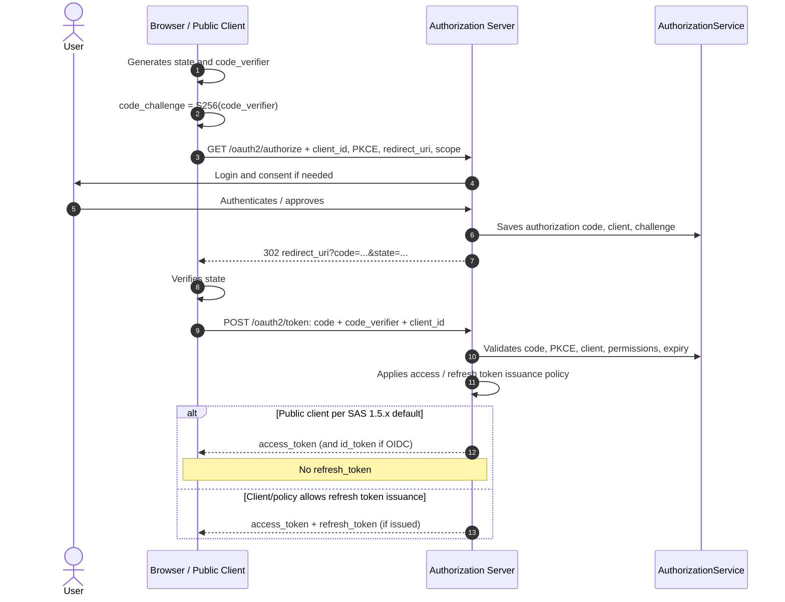
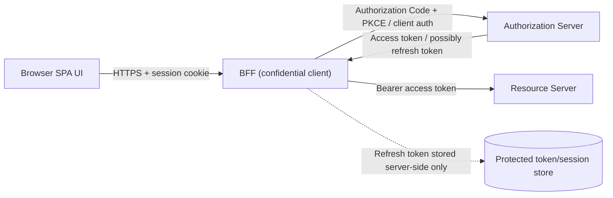

# Public Clients, Refresh Token Issuance, and Configuration/Version Limits

## 1. The Problem: PKCE Succeeds, but No Refresh Token Is Returned

Suppose a **Single Page Application (SPA)** uses **Authorization Code + PKCE** to log in through Spring Authorization Server. The browser is redirected to the Authorization Endpoint, the user logs in, and the client receives an authorization code and sends `code_verifier` to the Token Endpoint. The server returns an `access_token`—optionally alongside an `id_token` if using OpenID Connect (OIDC)—but **no `refresh_token`**.

Many development teams assume this is a bug because the client enabled PKCE or added `AuthorizationGrantType.REFRESH_TOKEN` to its configuration. In fact, three independent decision layers must be distinguished:

1. **The OAuth 2.0 specification** allows an Authorization Server to issue refresh tokens per policy, but does not guarantee every authorization code exchange receives a refresh token.
2. **Public client nature**: SPAs/mobile apps cannot keep long-lived secrets the way a controlled backend can. PKCE protects the **authorization code exchange**; it does not turn a public client into a confidential client.
3. **Spring Authorization Server version behavior**: the official **Spring Authorization Server 1.5.8** guide explicitly states that the server **does not issue refresh tokens to public clients** in the documented flow. Therefore, do not infer behavior solely from grant types or `TokenSettings`. Other Spring Security / Authorization Server lines must be verified against the exact artifact, version, and configuration in use.

This lesson belongs to the **Authorization Code and PKCE** chapter in the `SPRING_SECURITY_OAUTH2_OIDC_AUTHORIZATION_SERVER` module. The goal is to learn how to **design, configure, secure, test, and operate an OAuth 2.0/OpenID Connect Authorization Server** with Spring Security and Spring Authorization Server in a Spring Boot application, particularly when deciding **whether to issue refresh tokens to public clients**.

### Learning Objectives

After this lesson, you will:

- Distinguish `public client`, `confidential client`, PKCE, refresh tokens, and user login sessions.
- Explain why registering the `refresh_token` grant or setting `refreshTokenTimeToLive` **does not guarantee** receiving a refresh token.
- Configure `RegisteredClient`, `ClientSettings`, and `TokenSettings` for scenarios aligned with Spring Authorization Server 1.x.
- Compare **pure SPA**, **native application**, and **Backend for Frontend (BFF)** models when long-lived sessions are needed.
- Design tests that distinguish **framework limits**, **token issuance policies**, and **protocol/configuration errors**.

> **Version Note:** API examples target **Spring Authorization Server 1.x**, specifically the official 1.5.8 guide. Do not treat a statement about 1.x as a guarantee for every Spring Security 7.x release or other Authorization Servers. When upgrading, read the reference guide / release notes and **run tests verifying the token response**.

## 2. Three Artifacts to Distinguish

| Artifact | Nature | Function |
| --- | --- | --- |
| **Authorization code** | Short-lived, single-use code bound to an authorization transaction | Allows the client to exchange for tokens at the Token Endpoint |
| **Access token** | Credential presented to the Resource Server | Accesses APIs according to issuer, audience, scope, expiration, and permissions |
| **Refresh token** | Credential used at the Token Endpoint to obtain a new access token | Extends granted permissions without repeating full user interaction, when policy allows |

In OIDC there is also an **ID token** for the client to verify the user's login result. **An ID token does not replace an access token** when calling APIs, nor is it a refresh token.

Both authorization codes and refresh tokens are critical credentials, but their lifetimes and usage locations differ. Authorization codes typically live only a few minutes and are exchanged **once**; refresh tokens can live much longer and usually require secure storage, revocation, rotation, and reuse detection.

### 2.1. Public Clients Lack Trustworthy Secret Credentials

A **public client** is an application unable to keep a client secret confidential from the user or device owner: a browser JavaScript SPA, or a mobile/desktop app distributed to user devices. In Spring Authorization Server, the typical registration uses:

```java
.clientAuthenticationMethod(ClientAuthenticationMethod.NONE)
```

`client_id` still identifies the client configuration, but it is **not a secret** and does not prove a request genuinely originated from an unmodified build of the application.

A **confidential client** is a backend capable of protecting credentials: a server-side web service, BFF, or server application. It can use `client_secret_basic`, `private_key_jwt`, or another appropriate authentication method at the Token Endpoint. Client classification is determined by **trust boundaries**, not merely whether the application has a web UI.

### 2.2. What Exact Problem Does PKCE Solve?

PKCE (**Proof Key for Code Exchange**, RFC 7636) uses a pair:

- `code_verifier`: a fresh random value per transaction, kept by the client until code exchange.
- `code_challenge`: a public value computed from the verifier, typically `BASE64URL(SHA256(ASCII(code_verifier)))`.

The client sends `code_challenge` with `code_challenge_method=S256` in the authorization request; on code exchange, the client sends `code_verifier`, and the Authorization Server verifies it matches the challenge bound to the code.

**PKCE protects the authorization code exchange**; it does not authenticate a public client with a long-lived secret, nor does it automatically protect an **issued refresh token** from theft on the device. Issuing a refresh token is a **separate** credential decision with its own risks and lifecycle policy.

## 3. Authorization Code + PKCE Flow and Potential Refresh Token Issuance Point



**Key point:** Successful PKCE verification **is not a mandate to issue a refresh token**. The server can issue an access token without issuing a refresh token. When no refresh token is in the response, the client must not assume it can simply call `grant_type=refresh_token` later to get new tokens.

### 3.1. Public Response Without a Refresh Token

Illustrative response for a valid Authorization Code + PKCE flow:

```http
HTTP/1.1 200 OK
Content-Type: application/json
Cache-Control: no-store
Pragma: no-cache

{
  "access_token": "ACCESS_TOKEN_EXAMPLE",
  "token_type": "Bearer",
  "expires_in": 300,
  "scope": "orders.read"
}
```

If the request is OIDC with scope `openid`, the response may also include `id_token`. **The absence of `refresh_token` is valid** and is the documented behavior of Spring Authorization Server 1.5.8 for public clients.

### 3.2. Confidential Client Response When a Refresh Token Is Issued

Example when **the server actually issues** a refresh token:

```http
HTTP/1.1 200 OK
Content-Type: application/json
Cache-Control: no-store
Pragma: no-cache

{
  "access_token": "ACCESS_TOKEN_EXAMPLE",
  "token_type": "Bearer",
  "expires_in": 300,
  "refresh_token": "REFRESH_TOKEN_EXAMPLE",
  "scope": "orders.read"
}
```

This is not a guarantee that every confidential client receives a refresh token. That decision also depends on grant type, policy, client type, version, and token grant processing. For instance, the **Client Credentials Grant** normally does not receive a refresh token because the client can simply re-authenticate for a new access token.

## 4. Separating Specification Permissions from Spring Authorization Server Defaults

### 4.1. OAuth Spec Does Not Require Every Client to Get a Refresh Token

Under RFC 6749, an Authorization Code Flow token response **may** contain a `refresh_token`. It is an optional field, not mandatory like `access_token` on a successful token grant. The Authorization Server decides based on client type and security policy.

If another OAuth server issues refresh tokens to public clients, that **does not mean** Spring Authorization Server 1.5.x must do the same. Conversely, Spring Authorization Server 1.5.x not issuing them by default does not mean OAuth **categorically forbids** public clients from ever using refresh tokens.

### 4.2. Official Behavior in Spring Authorization Server 1.5.8

The Spring Authorization Server **1.5.8** guide **How-to: Authenticate using a Single Page Application with PKCE** explicitly states that this implementation **does not issue refresh tokens to public clients** and recommends a **Backend for Frontend (BFF)** architecture instead of exposing a pure public client if sessions need to be maintained that way.

In this context:

- Registering `ClientAuthenticationMethod.NONE` marks the client as public.
- `ClientSettings.requireProofKey(true)` requires PKCE for the Authorization Code Flow.
- Adding `AuthorizationGrantType.REFRESH_TOKEN` to `RegisteredClient` **does not alter the default token issuance provider's behavior**.
- `TokenSettings.refreshTokenTimeToLive(...)` and `reuseRefreshTokens(...)` apply only when **a refresh token is issued**; they are not an `issueRefreshTokenForPublicClients(true)` switch.

Verify with real tests against your exact dependency set, because defaults and feature support across Spring Security / Spring Authorization Server generations can evolve.

### 4.3. Comparing Spring Authorization Server 1.x and Spring Security 7.x

| Comparison Point | Spring Authorization Server 1.5.x | Spring Security 7.x or Another Generation |
| --- | --- | --- |
| SPA + PKCE guide | Dedicated guide illustrating `none` and `requireProofKey(true)` | Read the matching reference guide |
| Refresh tokens for public clients | 1.5.8 guide explicitly states **not issued** | **Do not guess**; verify docs and token response of the running version |
| `RegisteredClient` builder | Has `ClientSettings` and `TokenSettings` | Check exact APIs/packages of the version in use |
| PKCE requirement | Explicitly set `requireProofKey(true)` to avoid relying on defaults | Defaults may differ across generations; verify explicitly |
| Changing token issuance behavior | May require a carefully designed and thoroughly tested extension | Do not assume upgrades preserve the same implementation or behavior |

**Practical takeaway:** In design reviews, document the **artifact, version, client type, and refresh token issuance test**. Never vaguely claim "Spring supports refresh tokens for public clients" just because a method exists on `TokenSettings`.

## 5. Configuring a Public Client with `RegisteredClient`

**Spring Authorization Server 1.x** example supporting an SPA with Authorization Code + PKCE:

```java
@Bean
RegisteredClientRepository registeredClientRepository() {
    RegisteredClient spa = RegisteredClient.withId(
                    UUID.randomUUID().toString())
            .clientId("orders-spa")
            .clientAuthenticationMethod(ClientAuthenticationMethod.NONE)
            .authorizationGrantType(AuthorizationGrantType.AUTHORIZATION_CODE)
            .redirectUri("https://orders.example.com/callback")
            .scope("orders.read")
            .clientSettings(ClientSettings.builder()
                    .requireProofKey(true)
                    .requireAuthorizationConsent(true)
                    .build())
            .build();

    return new InMemoryRegisteredClientRepository(spa);
}
```

Imports are omitted to focus on policy. `InMemoryRegisteredClientRepository` is only suited for examples/tests; production needs a persistent repository and client governance policy. The redirect URI must be an actually permitted URI and use HTTPS in deployed environments.

Key points:

1. `ClientAuthenticationMethod.NONE`: no trustworthy secret is used to authenticate the client.
2. `AuthorizationGrantType.AUTHORIZATION_CODE`: enables the authorization code flow rather than `password` or implicit flow.
3. `requireProofKey(true)`: requires valid `code_challenge`/`code_verifier`; prefer `S256` to reduce code interception and downgrade risk.
4. Omit `REFRESH_TOKEN` if the application is not issued or does not use refresh tokens per policy.

**This is not a trick to get a refresh token:** adding the following to a public client does not guarantee different behavior:

```java
// ONLY REGISTERS THE GRANT: does not force SAS 1.5.x to issue refresh tokens to public clients.
.authorizationGrantType(AuthorizationGrantType.REFRESH_TOKEN)
```

Whether a grant is allowed and whether a token **is issued** are two separate conditions.

## 6. Configuring `TokenSettings`: Its Actual Scope of Control

`TokenSettings` holds settings for token lifetimes, formats, and reuse behavior. Example:

```java
TokenSettings tokenSettings = TokenSettings.builder()
        .authorizationCodeTimeToLive(Duration.ofMinutes(5))
        .accessTokenTimeToLive(Duration.ofMinutes(10))
        .refreshTokenTimeToLive(Duration.ofHours(1))
        .reuseRefreshTokens(false)
        .build();
```

Meaning:

| Setting | Effect | What It Does **Not** Do |
| --- | --- | --- |
| `authorizationCodeTimeToLive(...)` | Limits window to exchange code | Does not issue refresh tokens |
| `accessTokenTimeToLive(...)` | Limits access token lifetime | Does not replace refresh token issuance policy |
| `refreshTokenTimeToLive(...)` | Sets TTL **for refresh tokens if issued** | Does not force the provider to issue refresh tokens to public clients |
| `reuseRefreshTokens(true)` | Reuses the refresh token in refresh responses per supported logic | Does not prevent replay or auto-issue initial tokens |
| `reuseRefreshTokens(false)` | Requires refresh token rotation per supported implementation | Does not override whether **a token is initially issued** |

In Spring Authorization Server 1.5.8, the `TokenSettings` API exposes `refreshTokenTimeToLive` and `reuseRefreshTokens`, yet these parameters are not switches to bypass public client restrictions. `reuseRefreshTokens` governs behavior after a refresh token has been issued and is used in the appropriate grant.

Do not treat the TTL numbers above as universal standards for every environment. Choose TTLs based on risk, session duration, API sensitivity, revocation capability, and organizational security policy.

### 6.1. Why Rotation Is Important—Yet Not Enough on Its Own

If a refresh token is a bearer credential and gets stolen, an attacker can try exchanging it for new access tokens. **Refresh token rotation** issues a successor refresh token and invalidates the old one on each valid use; if the old token is reused, the system can detect replay and revoke the token family per policy.

However, rotation also requires:

- Consistent storage of token/family state, ideally in a durable store.
- Handling **concurrent races** between two closely timed refreshes and retries after network drops.
- Policy for detecting reuse of old tokens and revoking the corresponding authorization/token family.
- Monitoring, auditing, and incident response when credentials are compromised.

**Setting `reuseRefreshTokens(false)` alone does not prove** that full replay detection, token-family revocation, or concurrency-safe storage is in place. Test against your exact version and storage backend.

## 7. When Can a Confidential Client Receive a Refresh Token?

Consider a **web backend/BFF** able to hold a secret in a server environment. Illustrative `RegisteredClient`:

```java
RegisteredClient bff = RegisteredClient.withId(UUID.randomUUID().toString())
        .clientId("orders-bff")
        // Value already encoded by PasswordEncoder from secret manager.
        .clientSecret(encodedClientSecret)
        .clientAuthenticationMethod(
                ClientAuthenticationMethod.CLIENT_SECRET_BASIC)
        .authorizationGrantType(AuthorizationGrantType.AUTHORIZATION_CODE)
        .authorizationGrantType(AuthorizationGrantType.REFRESH_TOKEN)
        .redirectUri("https://orders.example.com/login/oauth2/code/orders-bff")
        .scope("orders.read")
        .clientSettings(ClientSettings.builder()
                .requireProofKey(true)
                .requireAuthorizationConsent(true)
                .build())
        .tokenSettings(TokenSettings.builder()
                .accessTokenTimeToLive(Duration.ofMinutes(10))
                .refreshTokenTimeToLive(Duration.ofHours(1))
                .reuseRefreshTokens(false)
                .build())
        .build();
```

In this snippet, `encodedClientSecret` comes from a secret management system and was encoded using `PasswordEncoder`; **never** put raw secrets in source code. Never use `{noop}` in production.

For this client, prerequisites include:

1. Configuration enabling both `authorization_code` and `refresh_token` grants.
2. The BFF performs client authentication via its registered method.
3. The user completes a valid authorization flow, including PKCE when required by policy.
4. The Authorization Server permits issuing refresh tokens for that client type and policy.
5. Token persistence, TTL, and rotation are properly configured and tested.

Even here, **there is no blanket promise** that every code exchange returns a refresh token. Always inspect the actual token response and the authorization server's policy.

### 7.1. Where Does the BFF Store Tokens?

The BFF can keep `access_token` and `refresh_token` **server-side**, sending only a protected **session cookie** to the browser. The browser calls APIs through the BFF or a controlled proxy instead of holding refresh tokens in JavaScript.



Benefits: reduces refresh token exposure to JavaScript/XSS and leverages backend client authentication. Trade-offs: session management, CSRF protection for cookies, token storage, multi-node scaling, logout/revocation, and backend hardening. **A BFF does not eliminate XSS or all attacks**, but it reduces the blast radius of browser-side token theft.

## 8. If an SPA Has No Refresh Token, How Does It Maintain Sessions?

There are several architectural options, with no single right answer for every system:

| Option | Best Fit | Watch Outs |
| --- | --- | --- |
| **Repeating Authorization Code + PKCE when needed** | SPAs not issued refresh tokens | May require interactive redirect again; relies on session at Authorization Server |
| **BFF using a confidential client** | Products needing longer sessions and server-side token security | Cookies/sessions/CSRF, scaling, protecting refresh tokens on backend |
| **Public client issued refresh tokens by an AS with supportive policy** | Authorization Server meets security requirements and token management capabilities | Rotation or sender constraints, storage protection, replay/revocation |
| **Native app with OS-level protections** | Mobile/desktop apps built to best practices | Secure storage reduces risk, though client remains public with no guaranteed secret |

### 8.1. A New Authorization Request Does Not Always Show a Login Form

When an access token expires, the SPA can initiate Authorization Code + PKCE again. If the user still has a valid session at the Authorization Server and policy allows it, login can be skipped. Still, prepare for:

- Expired or revoked sessions at the Authorization Server.
- MFA/re-authentication policies or new consent requirements.
- Cookies blocked in third-party contexts; **silent iframes** are not a durable solution.
- OIDC `prompt=none` cannot succeed if interaction is needed; the server may return `login_required` or `interaction_required` as applicable.

Never trigger an infinite redirect loop if re-authorization fails. The UI should distinguish expired tokens, logged-out users, network errors, and re-authentication prompts.

### 8.2. CORS Is Not a Refresh Token Switch

For an SPA on another origin, the Token Endpoint may need **CORS** so the browser can call `POST /oauth2/token`. CORS configuration only governs whether the browser may read the HTTP response; it **does not** turn a public client into a confidential client or change refresh token issuance policy.

Restrict allowed origins precisely and avoid wildcard + credentials combinations; TLS, registered redirect URIs, PKCE, and scope validation remain mandatory.

## 9. How Does the Refresh Token Protocol Work When the Server Issues One?

If a client actually receives a refresh token, it can use `grant_type=refresh_token` at the Token Endpoint per policy. For a **confidential client** using Basic auth:

```http
POST /oauth2/token HTTP/1.1
Host: auth.example.com
Authorization: Basic <BASE64_CLIENT_CREDENTIALS>
Content-Type: application/x-www-form-urlencoded

grant_type=refresh_token&
refresh_token=REFRESH_TOKEN_EXAMPLE
```

The server must check:

1. The client is registered and properly authenticated.
2. The refresh token exists, is unexpired, unrevoked, and bound to that client.
3. The client is permitted the `refresh_token` grant per registration and policy.
4. Any requested scope does not exceed the originally granted scopes.
5. Apply TTL, rotation/reuse policies, update token state, and return the response.

Example response when rotation is enabled:

```json
{
  "access_token": "NEW_ACCESS_TOKEN",
  "token_type": "Bearer",
  "expires_in": 600,
  "refresh_token": "NEW_REFRESH_TOKEN",
  "scope": "orders.read"
}
```

Do not use this example to conclude a public client on Spring Authorization Server 1.5.x can do the same. If the server **never issued a refresh token initially**, no valid credential exists to perform a refresh request.

### 9.1. Is a Refresh Token a Client Credential?

A refresh token is bound to a **granted authorization**, not a client's registered password. For a confidential client, the token endpoint still requires **client authentication**. For a public client, if an implementation supports refresh tokens, it must enforce appropriate authentication/binding and safeguards for that client type; never invent a fake secret in JavaScript to "pass" the check.

**PKCE from the earlier authorization code issuance does not automatically authenticate later refresh token requests.** For the refresh grant, the system must validate the refresh token, client binding, state/rotation, and dedicated security policies.

## 10. If You Want to Change the Default Refresh Token Behavior for Public Clients

**This is a security architecture decision, not a one-line configuration tweak.** In Spring Authorization Server 1.5.x, registering the refresh grant or changing TTL is not a documented toggle to enable this feature.

If business requirements genuinely mandate it, perform a full design and risk review before modifying the pipeline:

- Verify whether your framework/version provides an **official extension point** for the desired behavior. Never assume the default provider changes just because you supplied new `TokenSettings`.
- Design how to **bind refresh tokens to client/grant/authorization** and constrain lifetimes and scopes.
- Under OAuth 2.0 Security Best Current Practice (RFC 9700), public clients issued refresh tokens must have replay protections such as **refresh token rotation** or **sender-constrained refresh tokens** as required.
- Specify device-side token storage, XSS/exfiltration defenses, logout/revocation, reuse detection, and concurrent refresh handling.
- Add integration/security tests for token families, network failures, retries, race conditions, stolen tokens, and session recovery.

If customizing `AuthenticationProvider`, `OAuth2TokenGenerator`, or the token endpoint, understand the exact **refresh token issuance decision point** and `OAuth2Authorization` lifecycle. Using `OAuth2TokenCustomizer` to add a JWT claim **is not** how refresh token issuance is enabled. Building a custom `/oauth2/token` controller that bypasses the framework provider risks dropping client validation, PKCE, token binding, and standard error handling.

**Architectural recommendation:** For a pure SPA on Spring Authorization Server 1.5.x, evaluate a **BFF** or safe re-authorization before writing custom grant/refresh logic. Only extend refresh tokens to public clients when requirements clearly demand it and you can safely operate the full token lifecycle.

## 11. Common Misconceptions

| Claim | True or False? | Explanation |
| --- | --- | --- |
| "With PKCE enabled, the server must issue a refresh token." | **False** | PKCE secures code exchange; refresh token issuance is a separate policy |
| "Adding `AuthorizationGrantType.REFRESH_TOKEN` is enough." | **False** | Allows the grant once a token exists and policy permits; does not force initial issuance |
| "Setting `reuseRefreshTokens(false)` enables refresh tokens for SPAs." | **False** | Rotation only applies when a refresh token is issued |
| "Public clients must have a client secret to refresh." | **False as a universal rule** | Public clients cannot safely hold secrets; whether an implementation supports refresh for public clients is separate |
| "OAuth 2.0 strictly forbids refresh tokens for public clients." | **False** | OAuth allows them conditionally by policy; strong token protection is mandatory |
| "SAS 1.5.8 issues refresh tokens to SPAs using `none` by default." | **False** | The official guide explicitly states it does not issue them |
| "Without a refresh token, the user must always re-enter their password." | **False** | Re-authorization can leverage an active session, though silence is not guaranteed |
| "An ID token can be used instead of a refresh token." | **False** | ID tokens serve the OIDC client's authentication context |
| "A long-lived JWT access token is safer than a refresh token." | **Not necessarily true** | A leaked access token can be used until expiry; long TTLs increase risk |
| "A BFF makes the browser immune to attacks." | **False** | A BFF reduces token exposure but still requires CSRF/XSS/session hardening |

## 12. Test Matrix by Client, Grant, and Version

First lock down exact **dependency versions** of Spring Boot / Spring Security / Spring Authorization Server, record your `RegisteredClient` setup, and never place real tokens in logs.

| Test Case | Setup | Expected Observation |
| --- | --- | --- |
| **Standard public PKCE** | `none` + `authorization_code` + `requireProofKey(true)` | Valid code exchanges for access token |
| **No refresh token in SAS 1.5.x** | Public client per official guide | Token response **does not contain** `refresh_token` |
| **Adding refresh grant to public** | Public + `refresh_token` grant + PKCE | Do not assume issuance; verify response matches default behavior |
| **Changing `TokenSettings` on public** | `reuseRefreshTokens(false)`, new TTLs | Test proves this does not enable refresh token issuance |
| **Code exchange fails PKCE** | Wrong or missing `code_verifier` | Neither access nor refresh token issued |
| **PKCE downgrade** | Client requires PKCE, authorize request omits challenge | Authorization request rejected per policy |
| **Valid confidential client** | Basic/private-key JWT + authorization code + refresh grant | Observe presence/absence of `refresh_token` per actual policy |
| **Confidential client without refresh grant** | Omit `REFRESH_TOKEN` from registration | Refresh fails when grant is not permitted |
| **Refresh token rotation** | Client receives token, `reuseRefreshTokens(false)` | New/old tokens handled per policy and implementation |
| **Reusing an old refresh token** | Use old token after rotation | Observe replay detection/revocation per actual design; do not assume |
| **Two concurrent refresh requests** | Send same token nearly simultaneously | Must not issue tokens violating policy; deterministic race/retry behavior |
| **Expired/revoked refresh token** | Use invalidated token | `invalid_grant` or matching protocol error; no new tokens issued |
| **Wrong client on refresh** | Client B uses token bound to A | Rejected; A's tokens not exposed |
| **Unauthorized scope expansion** | Use refresh token to request extra scopes | Must not grant scopes beyond authorization |
| **Access token expired in SPA without refresh** | SPA restarts Authorization Code + PKCE | Redirects to login/restores session per policy without looping |
| **OIDC `prompt=none`** | No eligible session | Does not force login UI; returns appropriate OIDC error if supported |
| **Version upgrade** | Run same test suite before/after upgrade | Detects changes in PKCE defaults, refresh issuance, errors, and rotation |

### 12.1. Where Do Errors Belong?

- `invalid_request`: missing/malformed parameters, protocol-invalid request.
- `invalid_client`: client authentication failed or invalid auth method.
- `invalid_grant`: code, refresh token, redirect URI/PKCE binding, or grant credential is invalid in context.
- `unauthorized_client`: client is not permitted to use the requested grant type.
- `invalid_scope`: invalid or excess scope beyond allowed bounds.

Never guess an error code merely because a response lacks `refresh_token`: if the response is **200 with an access token** and no refresh token, that is not `invalid_grant`. Inspect the exact **processing stage and policy**.

### 12.2. Inspecting the Token Response in HTTP Tests

In tests, read the **entire JSON payload** from `POST /oauth2/token` and assert field presence/absence. A test for a Spring Authorization Server 1.5.x public client might assert:

```java
// Integration-test-style pseudocode:
assertThat(tokenResponse.statusCode()).isEqualTo(200);
assertThat(tokenResponse.json().get("access_token")).isNotNull();
assertThat(tokenResponse.json().has("refresh_token")).isFalse();

// Not a complete JUnit snippet; results depend on the exact
// SAS version and public-client policy under test.
```

A separate test for a **confidential client** should execute the full code exchange, verify whether a refresh token is issued per registration/policy, and only then test rotation and the refresh grant.

## 13. Operations and Production Choices

### 13.1. Decisions to Document

Before going to production, an architecture decision record should specify:

| Information | Example |
| --- | --- |
| Client type | `public SPA`, `native`, or `confidential BFF` |
| Authentication method | `none` / `client_secret_basic` / `private_key_jwt` |
| Authorized grant types | `authorization_code`, with/without `refresh_token` |
| PKCE policy | `S256`, `requireProofKey(true)` |
| Spring artifact/version | Spring Authorization Server 1.5.x or specific Spring Security version |
| Observed token response | Presence/absence of `refresh_token` verified by integration test |
| Token settings | TTL, rotation/reuse, and storage |
| Session renewal strategy | BFF refresh, re-authorization, or another supported mechanism |
| Threat model | XSS, token theft, replay, session fixation, device compromise |
| Logout/revocation | Token revocation, session cleanup, re-login conditions |

### 13.2. Observability Controls

Never log raw `refresh_token`, `access_token`, authorization codes, `code_verifier`, client secrets, or `Authorization` headers. Log correlation IDs, policy-masked/pseudonymized client IDs, grant types, issuance/refresh/revocation events, authentication outcomes, and timestamps.

If refresh tokens are used, monitor abnormal refresh rates, reuse/replay events, context-mismatched IPs/devices, and `invalid_grant` failures. If an SPA has no refresh token, monitor repeated authorization redirects, `login_required` errors, and session-expiration UX.

### 13.3. Framework Upgrades

When upgrading Spring Boot / Spring Security / Authorization Server:

1. Record both current and target versions.
2. Re-read the reference guide for `ClientAuthenticationMethod.NONE`, `requireProofKey`, `TokenSettings`, and refresh token policy.
3. Run code issuance/exchange integration tests for **both public and confidential clients**.
4. Run refresh rotation/reuse tests if your system issues refresh tokens.
5. Evaluate changes to storage, token TTLs, CORS, OIDC, and protocol errors before releasing.

Never treat upgrading from one API package to another as a mere import rename: default policies and endpoint behaviors can change.

## 14. Comprehensive Architectural Scenario

**Context:** An organization runs `orders-spa` at `https://orders.example.com`. Users work for several hours and the product team wants to avoid constant logins.

**Option A — Public SPA + PKCE:** register `none` and `requireProofKey(true)`. Per documented Spring Authorization Server 1.5.8 behavior, code exchange issues an access token without a refresh token. When the token expires, the SPA starts a new authorization request; if the Authorization Server session is still valid, no password prompt may be needed. Design for expired sessions and `prompt=none` failures.

**Option B — Confidential BFF:** the browser holds a session cookie; the BFF is the OAuth2 Client. It keeps tokens server-side, uses client authentication and PKCE, and can register the refresh grant per policy. If the Authorization Server issues a refresh token to the BFF, the backend handles refreshing without exposing the refresh token to the browser. You must manage CSRF, the session store, token rotation, logout, and revocation.

**Option C — Custom public refresh tokens:** consider only when a BFF does not fit and a clear business case and threat model justify it. Before replacing providers or token generators, evaluate compatibility, rotation/sender constraints, storage, replay, concurrency, token revocation, and tests for your running version.

To decide, answer:

- Do we truly need a refresh token in the browser, or simply a longer-lived user session experience?
- Can the team operate a BFF and secret management properly?
- For a public client, can we protect tokens and detect replay as required by RFC 9700?
- What is the impact if an access token or refresh token is stolen?
- Do we have integration test evidence for the exact behavior of our **specific framework version**?

## 15. Takeaways

**Four principles:**

1. **Public client + PKCE ≠ automatic right to a refresh token.** PKCE binds the authorization code to the verifier; it does not guarantee refresh issuance.
2. **`AuthorizationGrantType.REFRESH_TOKEN` and `TokenSettings` are permissions/settings, not commands forcing a provider to issue refresh tokens.**
3. **Spring Authorization Server 1.5.8 documents that public clients are not issued refresh tokens**; verify other versions against documentation and tests.
4. **When longer tokens/sessions are needed, evaluate a BFF or re-authorization first** before extending refresh token issuance to public clients.

In practice, the safe choice depends on **trust boundaries**, **token lifecycles**, **replay detection capabilities**, and **version-specific testing**—not a single flag in Spring configuration.

### References

- [Spring Authorization Server 1.5.8 — SPA with PKCE How-to](https://docs.spring.io/spring-authorization-server/reference/guides/how-to-pkce.html)
- [Spring Authorization Server — Core Model Components](https://docs.spring.io/spring-authorization-server/reference/core-model-components.html)
- [Spring Authorization Server — TokenSettings.Builder API](https://docs.spring.io/spring-authorization-server/reference/api/java/org/springframework/security/oauth2/server/authorization/settings/TokenSettings.Builder.html)
- [Spring Security — Authorization Server Core Model Components](https://docs.spring.io/spring-security/reference/servlet/oauth2/authorization-server/core-model-components.html)
- [Spring Security — OAuth 2.0 Client Authorization Grants](https://docs.spring.io/spring-security/reference/servlet/oauth2/client/authorization-grants.html)
- [RFC 6749 — OAuth 2.0 Authorization Framework](https://www.rfc-editor.org/rfc/rfc6749)
- [RFC 7636 — Proof Key for Code Exchange](https://www.rfc-editor.org/rfc/rfc7636)
- [RFC 9700 — Best Current Practice for OAuth 2.0 Security](https://www.rfc-editor.org/rfc/rfc9700)
- [OpenID Connect Core 1.0](https://openid.net/specs/openid-connect-core-1_0.html)
