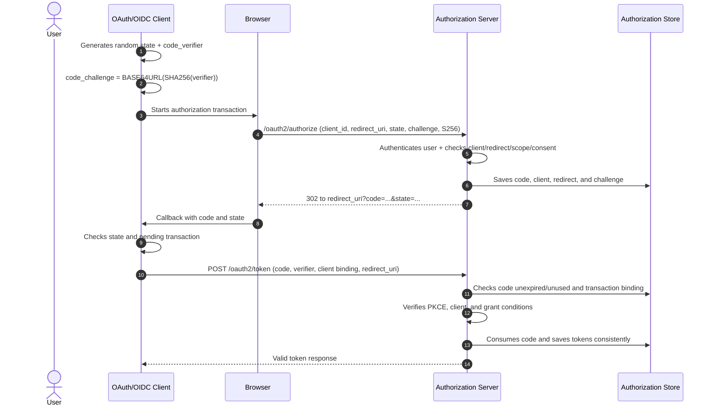
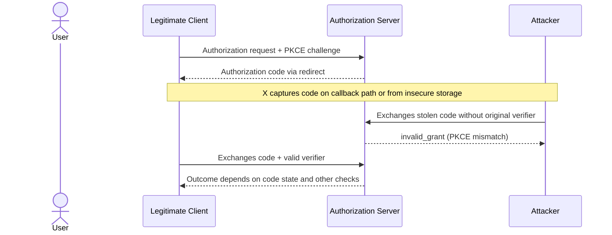
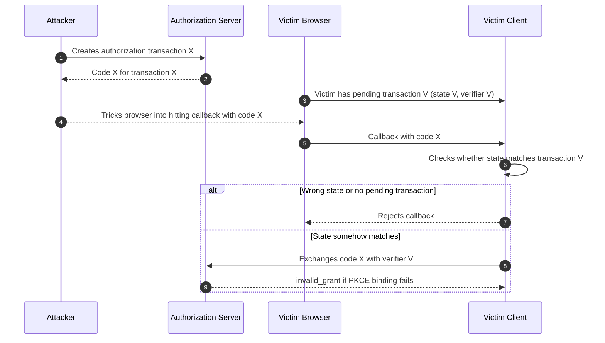
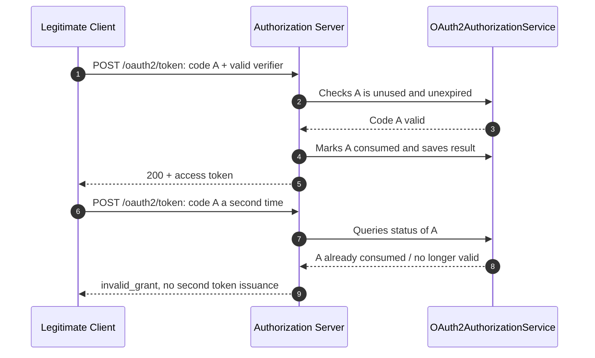

# Detecting Code Interception, Code Injection, and Authorization Code Replay

## 1. Objective: Understanding Three Attacks Against the Authorization Code Flow

In the OAuth 2.0 Authorization Code Flow, an **authorization code** is a short-lived value issued by the Authorization Server after processing an authorization request. The client receives the code via a registered redirect URI and then sends it to the token endpoint to request an access token. When using OpenID Connect (OIDC), the token response may also include an ID token.

Simply making the code short-lived **is not enough** to stop an attacker from redeeming a stolen code, injecting a code from another flow into a callback, or resubmitting an already-exchanged code. These are the three risk categories to recognize:

1. **Code interception**: an attacker obtains an authorization code **before the legitimate client exchanges it**.
2. **Code injection**: an attacker injects an authorization code **not belonging to the current login/authorization transaction** into the client's callback.
3. **Authorization code replay**: a code that has already been used or processed is submitted again to the token endpoint.

In Spring Boot applications using **Spring Security** and **Spring Authorization Server (SAS)**, key defenses include **Authorization Code + PKCE (`S256`)**, binding `state` to the client's transaction session, exact redirect URIs, short-lived single-use codes, client verification at the token endpoint, and safe anomaly logging.

This lesson in the **Authorization Code and PKCE** chapter focuses on designing, configuring, testing, and operating flows resistant to these three attack types. Learners should distinguish each scenario, the blocking controls on the **client** and **Authorization Server**, the limits of observable signals, and post-detection incident response.

> **Version boundary:** Java API examples illustrate the Spring Authorization Server 1.x / Spring Security 6.x model. For newer Spring Security versions with integrated Authorization Server, check the actual configuration and Javadoc. The OAuth 2.0/PKCE rules and security principles in this lesson apply independently of framework version.

## 2. Valid Flow and Where Codes Can Be Intercepted

A modern web or mobile client should use the Authorization Code Flow combined with **Proof Key for Code Exchange (PKCE)**. Each authorization request needs a fresh `code_verifier`/`code_challenge` pair; the client retains `code_verifier` to present **only when exchanging the code**.



The flow has distinct trust boundaries:

| Stage | Sensitive Data | Who Is Responsible for Protecting It? |
| --- | --- | --- |
| Before authorization request | `state`, `code_verifier`, `nonce` if OIDC requires | Client and OAuth/OIDC library |
| Authorization endpoint | `client_id`, `redirect_uri`, scopes, `code_challenge`, PKCE method | SAS and `RegisteredClient` configuration |
| Redirect through browser/OS | `code`, `state`, callback destination | AS validates redirect; client protects callback; browser/OS acts as transport |
| Token endpoint | Authorization code, `code_verifier`, client authentication (when applicable) | SAS, corresponding provider, and authorization store |
| After token issuance | Access/refresh tokens, login session | Client, AS, Resource Server, and session management policy |

**Do not confuse the three token types:** `authorization_code` is a short-lived proof to exchange for tokens; `access_token` calls the Resource Server; `id_token` (OIDC) lets the client verify the login outcome. Never send a code to a Resource Server as a Bearer access token.

## 3. Quick Map: Interception, Injection, and Replay

| Attack Type | What Does the Attacker Have or Do? | Goal | Primary Defenses | Signals to Investigate |
| --- | --- | --- | --- | --- |
| **Code interception** | Obtains a **fresh, unexchanged code** from a callback, redirect, or another app | Redeem the code ahead of the legitimate client | PKCE `S256`, client/redirect binding, HTTPS, secure callback | `invalid_grant` from verifier mismatch, unusual callback errors, code already gone before legitimate exchange |
| **Code injection** | Inserts a code from **another transaction** into the victim's callback | Cause login CSRF / session confusion or identity swap | Transaction-bound `state`, **per-transaction** PKCE, issuer/nonce check in OIDC | Callback with unknown/expired `state`, verifier mismatch against received code |
| **Code replay** | Resubmits **the same code** at the token endpoint after it was consumed | Obtain tokens again or exploit non-atomic handling | Single-use code, short TTL, atomic state updates, client binding | Same code processed multiple times; `invalid_grant`, transaction races |

You cannot conclude "we are under attack" from a single `invalid_grant` error. Similar errors also happen when a browser opens a callback twice, a client retries after a timeout, clocks drift, a server restarts and loses state, or `code_verifier` is miscomputed. Effective detection requires **correlating multiple signals and context** while keeping codes and verifiers confidential.

## 4. Code Interception: Capturing the Code Before the Legitimate Client

### 4.1. Attack Scenario

Suppose a user opens a mobile app that uses a custom URI scheme for redirects. A malicious app on the same device may register the same scheme, causing the authorization code to be routed to the unintended app. On the web, codes can also leak through overly broad callbacks, open redirects, URL history, proxy logs, URL analytics components, or malicious scripts.



PKCE makes a stolen code **insufficient** to obtain tokens, provided the attacker **does not know `code_verifier`** and the server properly enforces PKCE. For confidential clients, client authentication adds another layer, though it does not replace PKCE.

If an attacker controls the client itself, exploits XSS to read where the verifier is stored, hijacks the session, or steals the verifier too, PKCE may no longer protect the exchange. Thus PKCE does not replace XSS prevention, native app hardening, proper token storage, or device environment security.

### 4.2. Leakage Paths to Audit

- **Native apps:** custom schemes hijacked by another app; prefer the system browser and RFC 8252-compliant redirects; use verified HTTPS App Links/Universal Links where feasible; for loopback redirects, follow native-app port rules.
- **Web callbacks:** callback endpoints with open redirects or embedded third-party scripts; pages leaving the code in the URL too long.
- **Logs/telemetry:** reverse proxies, APM, web analytics, or debug traces capturing raw `code` and `state` query parameters.
- **Browser history / Referer:** callback navigating to external sites carrying sensitive URLs or third-party assets; enforce `Referrer-Policy` and clean up the URL after handling.
- **Redirect URI registration:** overly broad allowlists, domain/path wildcards, URIs not controlled by the client, or plain HTTP outside development/native rules.

**PKCE prevents redeeming a stolen code; it does not make the code harmless data safe to log.** Authorization codes must still be treated as short-lived credentials.

### 4.3. Detection Signals and Inference Limits

At the token endpoint, an unused code with a mismatched `code_verifier` often surfaces as `invalid_grant`. This is a useful signal when investigating interception, yet it also frequently occurs when an app loses transaction state or regenerates a verifier mid-flow.

If an attacker **never sends a code exchange request** or merely copies the code without redeeming it, the AS cannot tell the code leaked from token endpoint logs alone. Audit leak paths and monitor client/proxy logs, especially after suspicious anomalies.

## 5. Code Injection: A Valid Code That Does Not Belong to the Current Transaction

### 5.1. How Does Code Injection Differ from Interception?

In code interception, the attacker **steals the victim's transaction code**. In code injection, the attacker **feeds a code from another transaction** into the callback the victim is currently processing.

For instance, an attacker begins logging in with their own account and maneuvers the victim's browser into visiting the application's callback with the attacker's code. If the client fails to verify the transaction, it may log the victim in under the attacker's identity or bind the wrong data/session. This is a form of **login CSRF / session confusion**; impact depends on client architecture and how the login result is used.



The diagram illustrates independent layers of defense. `state` must be **randomly generated, stored with the pending transaction, and strictly verified at the callback**. Merely checking that a `state` parameter "is present" is insufficient. `code_verifier` must also be bound to the same transaction; if the client reuses a verifier across authorizations, protection against injection weakens.

### 5.2. Roles of `state`, PKCE, `nonce`, and Issuer

| Mechanism | What It Directly Protects | Should Not Replace |
| --- | --- | --- |
| `state` | Links callback to authorization transaction and client session/state; mitigates login CSRF | PKCE or token verification |
| PKCE `S256` | Binds code to a verifier known only to the client that initiated the transaction | `state`, `iss` validation, redirect checks |
| OIDC `nonce` | Binds OIDC/ID token outcome to the request and mitigates ID token replay/mix-up where applicable | `state` or PKCE at the token endpoint |
| `iss` / issuer binding | Identifies which Authorization Server issued the response/token; critical for multi-AS clients | `state` checks and signature/audience/expiry verification |
| Exact `redirect_uri` | Blocks sending codes to unregistered callbacks | PKCE or client authentication |

In the OIDC Authorization Code Flow, the client must validate the ID token per OIDC rules: issuer, audience, expiration, signature, and `nonce` if sent; **`nonce` does not by itself prove the authorization code was created for the pending transaction**. If a client integrates with multiple Authorization Servers, bind the expected issuer and consider RFC 9207 mechanisms to prevent authorization server mix-up. Never trust an issuer solely because the callback query string claims it.

### 5.3. Dangerous Anti-Patterns

```text
BAD: As soon as ?code=... is present, the client exchanges the code.
BAD: If state is wrong, start a new session and continue anyway.
BAD: The entire app uses one static code_verifier.
BAD: Pull the most recent verifier from a shared cache without transaction binding.
BAD: Two users/tenants share one global OAuth state.
BAD: Exchange the code at a token endpoint derived directly from callback issuer params.
```

When a client receives a callback with no pending transaction, mismatched `state`, or an expired transaction, it must **fail safely** and restart a valid login flow if requested by the user. Never fall back to "state-less login" to boost success rates.

## 6. Authorization Code Replay: Reusing a Single Code

Under OAuth 2.0, an authorization code **must be used only once**. After the token endpoint consumes it successfully, any subsequent attempt to use the same code must be rejected. RFC 6749 also specifies that upon detecting code reuse, the Authorization Server **should revoke all tokens previously issued based on that code when possible**, as reuse may signal code leakage.

### 6.1. Valid Flow vs. Replay



Replay may come from an attacker, or from a **retry after timeout**: the first token response reached the client late, the client assumed failure, and resent the same code. The token endpoint must never issue extra tokens merely because the second request carries the same valid verifier.

In multi-instance systems, checking "unused" and marking "used" must have strong enough semantics that **two concurrent requests** cannot both consume the same code and issue two sets of tokens. Verify transactions, locking, or optimistic concurrency in your actual persistence layer; never assume a naive read-then-write is atomic.

### 6.2. Authorization Code State That Must Be Protected

The code must be bound to:

- The registered client using the appropriate grant;
- The `redirect_uri` from the authorization request;
- The PKCE challenge and `S256` method, when required;
- Issuance and expiration timestamps;
- Used/unused status, associated authorization, and principal;
- Other grant conditions such as scopes and consent.

`OAuth2Authorization` and `OAuth2AuthorizationService` provide the required state model/store in SAS. Exact behavior depends on version, repository, and storage backend. Multi-instance deployments require a durable shared store; per-instance in-memory storage risks inconsistent code state across restarts or node hops.

### 6.3. Responding When Replay Is Detected

The minimum action is to **reject** the reused-code request with the appropriate protocol error, typically `invalid_grant`. Depending on risk policy and traceability, the system may also:

1. Emit a security event with correlation ID, client ID, code status, and timestamp, **without logging the raw code**.
2. Check whether tokens were previously issued from that code and whether corresponding access/refresh tokens should be revoked.
3. Determine whether the cause was a benign retry, duplicate callback invocation, multi-tab behavior, or suspicious activity.
4. Track repeated occurrences across the same client, user, device, or network over a meaningful time window.
5. Temporarily suspend compromised sessions/clients when necessary and require fresh authorization.

Never expose internal details such as "this code already issued token #X to Alice" to callers; distinguishing non-existent, expired, and already-used codes can help attackers gather information.

## 7. SAS Configuration: Enforcing PKCE and Limiting Code Lifetime

A `RegisteredClient` for a public client can be registered as follows (API illustrating SAS 1.x):

```java
RegisteredClient portal = RegisteredClient.withId(stableInternalClientId)
        .clientId("orders-portal")
        .clientName("Orders Portal")
        .clientAuthenticationMethod(ClientAuthenticationMethod.NONE)
        .authorizationGrantType(AuthorizationGrantType.AUTHORIZATION_CODE)
        .redirectUri("https://portal.example.com/login/oauth2/code/portal")
        .scope(OidcScopes.OPENID)
        .scope("orders.read")
        .clientSettings(ClientSettings.builder()
                .requireProofKey(true)
                .requireAuthorizationConsent(true)
                .build())
        .tokenSettings(TokenSettings.builder()
                .authorizationCodeTimeToLive(Duration.ofMinutes(3))
                .build())
        .build();
```

Meaning:

- `requireProofKey(true)`: requires PKCE for the client. Essential even when the client uses other identification mechanisms.
- `ClientAuthenticationMethod.NONE`: public client holding no secret; **does not mean codes can be exchanged without a verifier**, or that another client's code is accepted.
- Fixed redirect URI: codes return only to the registered callback; the server rejects arbitrary hosts/paths.
- A 3-minute TTL is an **illustrative value** that must be chosen for UX, latency, security policy, and operational needs.
- `requireAuthorizationConsent(true)` governs user consent decisions and does not replace PKCE or single-use code rules.

`stableInternalClientId` is generated once and persisted stably. This snippet illustrates only client registration; a complete Authorization Server also needs `RegisteredClientRepository`, `OAuth2AuthorizationService`, consent service, signing keys/token generator, login filter chain, issuer, and endpoint configuration. All of these must be wired consistently in Spring Boot.

### 7.1. Related Processing Classes

| SAS Component | Role in Authorization Code Flow |
| --- | --- |
| `OAuth2AuthorizationEndpointFilter` | Receives authorization requests at the authorization endpoint |
| `OAuth2AuthorizationCodeRequestAuthenticationProvider` | Validates request, client, redirect URI, PKCE, scopes, and required state |
| `OAuth2TokenEndpointFilter` | Receives code exchange requests at the token endpoint |
| `OAuth2AuthorizationCodeAuthenticationProvider` | Validates code, client, redirect URI, PKCE, expiry/status before issuing tokens |
| `OAuth2ClientAuthenticationFilter` | Handles client authentication per registered method |
| `OAuth2AuthorizationService` | Stores/queries authorization state and related codes/tokens |
| `OAuth2TokenGenerator` | Generates tokens once the grant is verified |

Never replace `OAuth2AuthorizationCodeAuthenticationProvider` with a custom provider that merely checks whether the code "exists". Preserve all client binding, PKCE, single-use, expiry, and version-specific checks.

## 8. How Should the Client Create and Maintain PKCE Transactions?

Per RFC 7636, `code_verifier` is a string **43–128 characters** long from the valid unreserved character set. For `S256`, the client computes:

```text
code_challenge = BASE64URL-ENCODE(SHA256(ASCII(code_verifier)))
```

Every time an authorization starts, generate a **fresh high-entropy verifier**; `state` must also be random and bound to the same transaction.

### 8.1. Java Example for Generating the Challenge

```java
import java.nio.charset.StandardCharsets;
import java.security.MessageDigest;
import java.security.NoSuchAlgorithmException;
import java.security.SecureRandom;
import java.util.Base64;

record PkcePair(String verifier, String challenge) {}

final class PkceSupport {
    private static final SecureRandom RNG = new SecureRandom();

    static PkcePair create() {
        byte[] randomness = new byte[32];
        RNG.nextBytes(randomness);

        String verifier = Base64.getUrlEncoder()
                .withoutPadding()
                .encodeToString(randomness);

        try {
            byte[] digest = MessageDigest.getInstance("SHA-256")
                    .digest(verifier.getBytes(StandardCharsets.US_ASCII));
            String challenge = Base64.getUrlEncoder()
                    .withoutPadding()
                    .encodeToString(digest);
            return new PkcePair(verifier, challenge);
        } catch (NoSuchAlgorithmException ex) {
            throw new IllegalStateException("SHA-256 unavailable", ex);
        }
    }
}
```

This creates a 43-character Base64URL verifier from 32 random bytes, complying with RFC 7636 length bounds. Never send `verifier` to the authorization endpoint; send only `challenge` and `code_challenge_method=S256`. Send `verifier` to the token endpoint only after a valid callback.

**Transaction storage:** backend apps typically store verifier/`state` server-side in a session or short-lived browser/user-bound store; SPAs use reputable OAuth/OIDC libraries to manage transactions while preventing XSS/log leaks. Every callback must match its exact originating transaction—never share a global "latest verifier" across tabs or users.

### 8.2. Sample Request and Client Validation Order

```http
GET /oauth2/authorize?response_type=code
  &client_id=orders-portal
  &redirect_uri=https%3A%2F%2Fportal.example.com%2Flogin%2Foauth2%2Fcode%2Fportal
  &scope=openid%20orders.read
  &state=RANDOM_STATE_FOR_THIS_TRANSACTION
  &code_challenge=CHALLENGE_FROM_VERIFIER
  &code_challenge_method=S256
```

When receiving the callback:

1. Verify the callback request matches the expected pending **URI/registration**.
2. Verify the received `state` equals the `state` stored for an unexpired transaction; reject if missing or mismatched.
3. Retrieve the exact `code_verifier` for **that transaction**; never generate a new verifier.
4. Verify the issuer if the client uses multiple Authorization Servers and the protocol supports issuer identification; for OIDC, prepare to verify the ID token's issuer, audience, and nonce.
5. Exchange the code exactly once at the proper token endpoint; on success, delete the short-lived transaction and strip the code from displayed URLs/history where appropriate.

Sample token request:

```http
POST /oauth2/token HTTP/1.1
Host: auth.example.com
Content-Type: application/x-www-form-urlencoded

grant_type=authorization_code
&client_id=orders-portal
&code=AUTHORIZATION_CODE
&redirect_uri=https%3A%2F%2Fportal.example.com%2Flogin%2Foauth2%2Fcode%2Fportal
&code_verifier=VERIFIER_FOR_THIS_TRANSACTION
```

Values like `RANDOM_*`, `CHALLENGE_*`, `AUTHORIZATION_CODE`, and `VERIFIER_*` are **placeholders**. Confidential clients also require client authentication per their registered method; public clients using `none` still undergo PKCE, grant, and redirect checks.

## 9. Which Controls Belong to the Authorization Server vs. the Client?

| Control | Authorization Server (SAS) | OAuth/OIDC Client |
| --- | --- | --- |
| Exact redirect URI | Matches URI against `RegisteredClient.redirectUris` and binds to code | Configures fixed callback; avoids open redirects |
| Mandatory PKCE | Requires challenge and safe method; verifies verifier at token endpoint | Generates fresh verifier, keeps it secret, binds to transaction |
| Short code lifetime | Sets TTL and enforces timestamps | Does not cache codes long-term or try exchanging expired codes |
| Single-use code | Consistent authorization state; rejects second exchange | Sends token request once; handles timeouts with a new flow |
| Client binding | Verifies code belongs to properly identified/authenticated client | Uses matching client registration and credentials |
| `state`/login CSRF | Preserves/echoes `state` per protocol | Generates, stores, matches, and consumes `state` per transaction |
| OIDC ID token/nonce | Issues per OIDC profile when enabled | Verifies issuer, audience, signature, expiry, and nonce when used |
| API authorization | Issues tokens with valid scopes/claims | Resource Server checks token, audience, scopes, and data permissions |
| Anomaly detection | Error telemetry, code state tracking, issuance monitoring | Monitors strange callbacks, state errors, and retry behavior |

**Key point:** SAS cannot fix an OAuth client that ignores `state`, uses a static verifier, or stores PKCE data where attackers can read it. Client and AS must both uphold their side of the contract.

## 10. Designing Safe Detection and Observability

### 10.1. OAuth Errors Alone Are Insufficient to Label an Attack

`invalid_grant` at the token endpoint can happen because:

- the code does not exist, expired, or was already used;
- `code_verifier` does not match `code_challenge`;
- the code is not bound to the valid client/redirect URI in the request;
- the transaction was deleted, lost persistence, or hit concurrent requests;
- client and AS configuration drifted out of sync.

Therefore, `invalid_grant` is an **investigation signal**, not standalone proof of interception or replay. You need **internal** root-cause categorization, sensitivity-minimized request metadata, and time-based correlation.

### 10.2. Suggested Structured Event

Example **internal** event payload:

```json
{
  "event": "authorization_code_exchange_rejected",
  "reason_category": "PKCE_MISMATCH",
  "client_id": "orders-portal",
  "request_id": "req-7f0e",
  "authorization_ref": "internal-nonsecret-ref",
  "time": "2026-11-16T10:00:00Z"
}
```

Labels like `PKCE_MISMATCH`, `CODE_ALREADY_CONSUMED`, `CODE_EXPIRED`, `CLIENT_BINDING_FAILED`, and `REDIRECT_URI_MISMATCH` are examples of **application-level observability categorization**, not standard OAuth error codes SAS emits externally by default. Client interfaces should receive the standard protocol error such as `invalid_grant` without exposing internal failure reasons.

**Never log** raw authorization codes, code verifiers, client secrets, access/refresh tokens, ID tokens, or callback URLs containing codes in events/logs. To correlate multiple requests using the same code, use an access-controlled internal authorization reference or a trace identifier designed not to leak credentials. Enforce log retention and access controls per security policy.

### 10.3. Metrics and Signals to Monitor

| Signal | May Indicate | Rule Out Before Concluding |
| --- | --- | --- |
| Sudden spike in `invalid_grant` by `client_id` | PKCE failure, expired code, replay, or client change | Bad deployment, duplicate callbacks, uncontrolled retries |
| Missing/mismatched `state` at client callback | Code injection / login CSRF or lost transaction state | Unsynchronized cookies/sessions, multi-tab usage, browser privacy settings |
| Multiple exchange attempts for the same code | Replay or client timeout retry | Network timeouts, double-submit, auto-submitting callbacks |
| Rising verifier mismatches on a specific app version | Code interception or transaction storage bug | Regenerating verifier at callback, wrong user-keyed cache |
| Token requests racing across multiple nodes | Single-use flaw in persistence or retries | Load balancer retries and DB transactions |
| Codes appearing in proxy/APM logs | Interception risk, credential exposure | Assess who can read logs and exposure scope |
| Errors concentrated on one redirect URI | Misconfiguration or callback abuse | URL changes, proxy headers, path/trailing slash issues |

Never automatically lock out all users over a few isolated `invalid_grant` errors; attackers could trigger denial of service by forcing errors. Use context-aware thresholds/rate limits, separate config bugs from attack signals, and choose mitigations that avoid unnecessary disruption.

## 11. Test Matrix for the Three Attack Categories

Test cases should exercise **real HTTP endpoints and persistence**, including multiple instances when distributed operation is expected.

| Test Case | How to Set Up in Test Environment | Expected Outcome |
| --- | --- | --- |
| Valid code + PKCE | Client requests code with `S256` challenge, exchanges with matching verifier | Receives tokens once; code cannot be reused |
| **Interception: code only** | Use valid code with another verifier or no verifier | `invalid_grant`, no tokens issued |
| Interception: another client redeems code | Client B tries exchanging code issued to Client A | Rejected by client binding |
| Interception: wrong redirect URI | Token request uses URI differing from bound URI | Rejected per protocol rules |
| Authorize without PKCE when required | Client configures `requireProofKey(true)` but omits challenge | Authorization request rejected |
| PKCE downgrade | Propose disallowed method, omit `code_challenge_method` against policy, or send `plain` under S256-only | Rejected rather than downgrading security |
| **Injection: wrong `state`** | Client awaits transaction A, callback receives transaction B's state | Client rejects before token request |
| Injection: no pending transaction | Callback arrives with code when client never started login | Client rejects; does not invent a transaction |
| Injection: code from another transaction | Callback A receives B's code, bypassing state hypothetically | A's PKCE verifier mismatches B's code; AS rejects |
| Injection: different issuer | Client integrates multiple ASs; callback/token has unexpected issuer | Client rejects per issuer binding |
| Wrong OIDC `nonce` | Client inspects ID token with nonce mismatching transaction | Client rejects login outcome |
| **Replay: sequential double exchange** | Token endpoint receives same code twice | First succeeds; second returns `invalid_grant`, no extra tokens |
| Replay: concurrent exchange | Two requests with same code from two workers/nodes | At most one grant succeeds per single-use; never two successful token responses |
| Replay after restart | Code already exchanged, restart one node and retry | Still rejected with durable persistence |
| Expired code | Wait past configured TTL in test environment | Rejected, no tokens created |
| Client retry on timeout | Resend code after lost token response | Grants no extra access; client starts fresh authorization |
| Credential leak prevention | Enable test logging/telemetry while running cases above | Zero codes/verifiers/tokens/secrets in logs |

### 11.1. Single-Use Testing Must Include Concurrency

Sequential tests are essential yet insufficient to prove single-use in distributed setups. With two parallel requests:

```text
Node A: reads valid code
Node B: reads valid code
Node A: consumes code and issues tokens
Node B: must fail because code was already consumed
```

If both return tokens, inspect transaction boundaries and store synchronization/locking. Test against a database and repository matching production behavior, because in-memory implementations can hide race conditions present in custom deployments.

### 11.2. Client-Side Testing Matters Just as Much as the Token Endpoint

The client must have tests verifying:

- Each authorization transaction generates its own `state` and verifier; callbacks find the right transaction.
- Callbacks with missing, wrong, or already-used `state` are rejected **before** any token request is sent.
- Multiple tabs do not overwrite each other's verifiers.
- Codes are stripped from URLs and sensitive `Referer` leakage to external assets is prevented.
- For OIDC, ID token issuer/audience/nonce are verified per the appropriate profile.
- After errors, no "fallback" drops PKCE or permits login without `state`.

## 12. Diagnosing Failures in Spring Authorization Server

### 12.1. Pinpointing the Failing Step

| Step | Related SAS Component | Symptom | What to Inspect |
| --- | --- | --- | --- |
| Code request | Authorization Endpoint / `OAuth2AuthorizationCodeRequestAuthenticationProvider` | Missing PKCE, wrong redirect URI, invalid scope/grant | `RegisteredClient`, client settings, URI, `code_challenge` |
| Browser returns to callback | **OAuth/OIDC client**, not SAS alone | Unknown/missing state/transaction, callback hit twice | Session, `state`, verifier storage, CSRF, and multi-tab flows |
| Code exchange | Token Endpoint / `OAuth2AuthorizationCodeAuthenticationProvider` | `invalid_grant` | Code expiry/unused state, PKCE, redirect, client binding |
| Issued tokens | `OAuth2AuthorizationService`, token generator, Resource Server | API rejects token or still accepts token that should be revoked | Persistence, issuer/audience, JWT/opaque validation, revocation |

Never assume every `invalid_grant` comes from a wrong `code_verifier`. Observe controlled internal causes and reproduce in tests before altering security settings.

### 12.2. Common Integration Bugs and Fixes

**Bug 1 — Client regenerates the verifier at callback.** Challenge in the authorization request was computed from verifier A; client generates verifier B at callback, so the token endpoint rejects it. Fix by saving verifier A with `state`/transaction and consuming it only after a valid callback.

**Bug 2 — Sharing `state`/verifier across users or tabs.** Callbacks pick the wrong verifier or accept codes from unrelated transactions. Fix with browser-session-bound state and a random transaction identifier; avoid global variables.

**Bug 3 — Disabling PKCE to "fix `invalid_grant`".** Turning off `requireProofKey` removes interception protection. Fix the client transaction state, endpoint, or encoding; keep PKCE enabled.

**Bug 4 — Unconstrained redirect URIs.** A callback assembled from unvetted input causes code leakage. Use an exact URI allowlist and block open redirects on the client.

**Bug 5 — Retrying codes after timeouts.** An already-exchanged code cannot be redeemed twice even if the first response was lost. Build client handling to surface errors cleanly and start a fresh authorization; never modify the server to permit code reuse.

**Bug 6 — Per-node in-memory authorization stores.** Token endpoint on node B cannot find codes issued on node A, or restarts wipe state. Use a durable shared authorization store and matching deployment configuration.

**Bug 7 — Logging URLs containing codes.** Anyone with log access can read credentials. Redact parameters, shorten retention, and restrict log access.

## 13. Incident Response Runbook for Suspected Attacks

A practical runbook should answer in order:

1. **Confirm scope:** which client, redirect URI, issuer, timeframe, environment, and deployment version show anomalies?
2. **Identify event type:** was an unexchanged code leaked, was a code from another transaction injected into a callback, or was a used code replayed? Distinguish from timeouts and bugs.
3. **Contain credentials:** check whether access/refresh tokens were issued from the affected authorization, their lifetimes, and which Resource Servers accept them.
4. **Stop further unauthorized issuance if needed:** patch callback/log leaks, audit client registrations, apply reasonable rate limiting, and evaluate temporarily suspending compromised sessions/clients.
5. **Revoke per policy:** invalidate authorizations/refresh tokens and enforce API revocation checks if active tokens must stop immediately. Offline JWTs do not auto-expire simply because a database row is deleted.
6. **Remediate root cause:** restore PKCE/`state`, eliminate open redirects, fix persistence/concurrency, and update client SDKs.
7. **Verify:** rerun interception, injection, and replay tests; confirm logs contain no codes/tokens; archive audit and incident records.

Never tell external callers whether a code existed or which user redeemed it. Return standard OAuth error codes while keeping categorized reasons inside access-controlled observability systems.

## 14. Integration Case Study

A system consists of `auth.example.com` (SAS), `portal.example.com` (Spring Security OAuth2 Client), and `api.example.com` (Resource Server). Portal uses Authorization Code + PKCE `S256` and stores transactions in the session. After a release, the team observes:

- 09:00: multiple `invalid_grant` errors after callbacks, mostly from users opening two tabs.
- 09:05: several callbacks carry a `state` missing from the session.
- 09:10: a code is sent to the token endpoint twice; the first succeeds, the second fails.
- 09:15: a reverse proxy is discovered logging full callback query strings verbatim.
- 09:20: mobile app users on a custom URI scheme report intermittent redirect failures.

Analyze:

1. Which events point to client transaction storage bugs, which could be replay, and which create interception risk?
2. Why should you not automatically label every `invalid_grant` as an attack?
3. Redesign how `state` and `code_verifier` are stored per authorization transaction so multiple tabs do not overwrite each other.
4. For the code sent twice, how must the AS respond? Should tokens issued on the first exchange be reviewed?
5. Propose mitigations for proxy code leakage and how to choose native-app redirect URIs per RFC 8252.
6. Design at least six negative tests: wrong verifier, wrong `state`, code from another transaction, sequential replay, concurrent replay, and unknown callback.

**Hints:** multiple tabs commonly expose "store only the latest verifier" bugs; missing `state` can stem from lost sessions or injection; duplicate code submissions can come from retries; proxy query logging is an immediate leak channel to fix. When tokens were already issued for a replayed code, assess revocation based on risk while keeping investigation logs free of sensitive secrets. For native clients, evaluate verified App Links/Universal Links or proper loopback redirects while keeping PKCE enabled.

## 15. Production Checklist for Authorization Code + PKCE

1. **Client registration:** Authorization Code Grant registered; exact HTTPS redirect URIs for production web; `requireProofKey(true)` per policy.
2. **PKCE:** every transaction generates its own random verifier of valid length and `S256` challenge; verifier never leaks into authorization requests or logs.
3. **State:** transaction bound to browser/session, validated before token exchange, multi-tab safe, and cleaned up after success/failure.
4. **OIDC:** ID token issuer, audience, signature, expiration, and `nonce` (when applicable) verified on the client.
5. **Authorization code:** reasonably short TTL, single-use; token endpoint verifies code, client binding, redirect URI, and PKCE.
6. **Persistence:** shared/durable authorization store across instances; atomic used-code updates prevent race conditions.
7. **Callback:** blocks open redirects, embeds no unvetted third-party assets, and keeps codes out of URLs longer than necessary.
8. **Observability:** tracks `invalid_grant`, mismatches, replays, and callback state errors via categorized internal events; never logs raw codes/verifiers/tokens/secrets.
9. **Incident response:** ability to revoke authorizations/refresh tokens and handle already-issued JWTs within security SLAs.
10. **Testing:** full coverage for interception/injection/replay, timeouts/retries, two tabs, multiple nodes, and restarts before deployment.

## 16. Standards and Spring References

- [RFC 6749 — The OAuth 2.0 Authorization Framework](https://www.rfc-editor.org/rfc/rfc6749): Authorization Code Grant, client/redirect bindings, and single-use code requirement.
- [RFC 7636 — Proof Key for Code Exchange](https://www.rfc-editor.org/rfc/rfc7636): `code_verifier`, `code_challenge`, `S256`, and the code interception threat model.
- [RFC 9700 — Best Current Practice for OAuth 2.0 Security](https://www.rfc-editor.org/rfc/rfc9700): PKCE, code injection prevention, redirect URI policies, and modern hardening.
- [RFC 8252 — OAuth 2.0 for Native Apps](https://www.rfc-editor.org/rfc/rfc8252): system browsers, native-app redirect URIs, and custom scheme risks.
- [RFC 9207 — OAuth 2.0 Authorization Server Issuer Identification](https://www.rfc-editor.org/rfc/rfc9207): preventing authorization server mix-up when clients integrate with multiple Authorization Servers.
- [OpenID Connect Core 1.0](https://openid.net/specs/openid-connect-core-1_0.html): `nonce`, ID token verification, and OIDC bindings.
- [Spring Authorization Server — Protocol Endpoints](https://docs.spring.io/spring-authorization-server/reference/protocol-endpoints.html): Authorization Endpoint / Token Endpoint, `OAuth2AuthorizationCodeRequestAuthenticationProvider`, and `OAuth2AuthorizationCodeAuthenticationProvider`.
- [Spring Authorization Server — Core Model Components](https://docs.spring.io/spring-authorization-server/reference/core-model-components.html): `RegisteredClient`, `OAuth2Authorization`, `OAuth2AuthorizationService`, and `TokenSettings`.
- [Spring Security — OAuth2 Login](https://docs.spring.io/spring-security/reference/servlet/oauth2/login/core.html): OAuth2 Client registration, authorization requests, and callbacks.

**Remember:** code interception is **stealing one transaction's code**, code injection is **inserting another transaction's code into a callback**, and authorization code replay is **reusing an already-processed code**. PKCE `S256`, transaction-bound `state`, exact redirect URIs, client binding, TTLs, and single-use semantics reinforce one another. Safe detection requires observing both the client callback and the SAS token endpoint, distinguishing attack signals from operational errors, and ensuring logging tools themselves never leak codes or verifiers.
