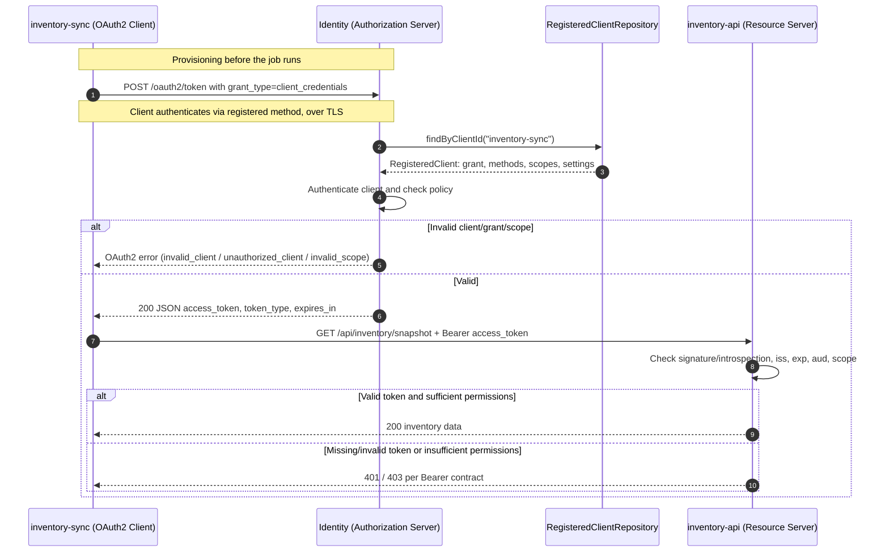

# Authorization Scenario for Services Without a User

In microservices architectures, scheduled tasks, queue worker processors, or system integration programs, a service often needs to call another service's API **without an active user interacting with it**. For example, an `inventory-sync` service runs every night, reads inventory data from `inventory-api`, and generates reports. Redirecting a browser to a login page or asking a user to click "Approve" is not appropriate for this kind of job.

The **OAuth 2.0 Client Credentials grant** solves that situation: a **confidential client** authenticates itself with the **Authorization Server (AS)**, requests permitted access rights, and receives an **access token** to call the **Resource Server**. The token represents permissions granted to the **application/service**, not the permissions of a user who just logged in.

This lesson in the **Client Credentials** chapter of the **SPRING_SECURITY_OAUTH2_OIDC_AUTHORIZATION_SERVER** module helps design, configure, secure, test, and operate machine-to-machine (M2M) flows using **Spring Security and Spring Authorization Server in a Spring Boot application**. It covers component roles, token requests/responses, server/client/API configuration, service identity models, scopes/audiences, common errors, credential protection, and integration testing.

> **Foundational principle:** `client_credentials` authenticates the **client** and grants permissions to the **client**. It **does not authenticate an end user**, does not create an OIDC user login session, has no authorization code, and has no user consent step in the grant itself.

## 1. The problem: a service needs to call an API when no user is present

Suppose an organization has three components:

- **`inventory-sync`:** a background Spring Boot application that periodically requests inventory data.
- **`identity.example.com`:** Spring Authorization Server, which manages registered clients, authenticates them, and issues tokens.
- **`inventory-api`:** a Resource Server exposing `GET /api/inventory/snapshot` only to clients permitted to read it.

When running at 02:00, no one is sitting in front of a browser to log in. `inventory-sync` needs to obtain a token using the configuration provisioned for the application itself and then call the API.

| Component | OAuth 2.0 Role | Responsibility |
|---|---|---|
| `inventory-sync` | **OAuth2 Client**, usually a confidential client | Holds credentials, requests access tokens, calls the API |
| `identity.example.com` | **Authorization Server** | Looks up the registered client, authenticates the client, checks grants/scopes, issues tokens |
| `inventory-api` | **Resource Server** | Verifies the access token and API permissions before returning data |
| End user | **Not present in this grant** | Must not be assumed to have a login session, consent, or user MFA |

### 1.1. Suitable scenarios

| Scenario | Why is it suitable for Client Credentials? | Example permission |
|---|---|---|
| Data synchronization worker | Runs automatically, needs service-level permissions | `inventory.read` |
| Report aggregation job | Runs on a schedule, does not act on behalf of a specific person | `reports.generate` |
| Backend communicating with infrastructure services | Two backends that are already registered and managed | `metrics.write` |
| Queue processing consumer | Background task receives a message and calls a business API | `orders.process` |
| Partner system calling technical APIs | Organization issues dedicated identity/credentials to the partner | `catalog.read` |
| One microservice calling another with its own permissions | Permissions belong to a workload with its own identity | `pricing.read` |

Using Client Credentials **does not mean every background task gets broad permissions**. Each workload needs a distinct identity and least-privilege scope, clear target resources, and a controlled credential lifecycle.

### 1.2. When is Client Credentials not appropriate?

If an application is performing an action **on behalf of a specific user**, such as "employee A approves contract B", the Resource Server usually needs to know **who performed the action** and what permissions that person has. Using a `client_credentials` token and manually adding an `X-User-Id: alice` header is not proof of user authorization.

In situations involving a user and requiring authorization on their behalf, evaluate **Authorization Code + PKCE**, token delegation, or **OAuth 2.0 Token Exchange** when the system genuinely supports it and the trust model allows it. Do not turn Client Credentials into a "fake login" for a technical account carrying user permissions.

## 2. How does the Client Credentials grant work?

RFC 6749 §4.4 defines **Client Credentials** for **confidential clients**. The client authenticates with the token endpoint and uses its own credentials as the authorization grant to request an access token. In this flow:

1. **Before execution**, an administrator or provisioning process registers the client and its allowed permissions at the AS.
2. **When a token is needed**, the client makes a direct HTTP POST to the token endpoint with `grant_type=client_credentials`.
3. **The AS authenticates the client** using its registered method, such as `client_secret_basic`, `private_key_jwt`, or mTLS if supported.
4. **The AS checks permissions**: whether the client is allowed to use the grant, which scopes are permitted, and which API the token is issued for.
5. **The AS issues an access token** when all conditions are valid.
6. **The client calls the Resource Server** with a Bearer access token; the RS independently verifies the token, audience, scope, and business rules.

In this standard model, **there is no** authorization endpoint redirect, browser callback, authorization code, PKCE, login page, user consent, or OIDC ID Token.

### 2.1. End-to-end diagram



**Difference from Authorization Code:** Client Credentials only requires the AS **token endpoint** and the target API; it does not send a user to `/oauth2/authorize`. Calling the token endpoint also does not imply permission to call every API: the Resource Server must verify **who the token is intended for and what it is allowed to do**.

## 3. HTTP request and response of Client Credentials

### 3.1. Client sends a token request over HTTPS

A confidential client using `client_secret_basic` may send:

```http
POST /oauth2/token HTTP/1.1
Host: identity.example.com
Authorization: Basic <REDACTED_BASE64_CLIENT_CREDENTIALS>
Content-Type: application/x-www-form-urlencoded
Accept: application/json

grant_type=client_credentials&scope=inventory.read
```

The `Authorization: Basic ...` header contains the encoded representation of the client ID and secret. **Base64 is not secure encryption**; HTTPS must be used and credential logging must be blocked. According to RFC 6749, client ID/secret values must be form URL-encoded according to the specification rules before building the Basic credential, especially when they contain special characters.

The client may use another authentication method if supported by the AS and the client registration. **`client_secret_post`** places `client_id`/`client_secret` in the `application/x-www-form-urlencoded` body; do not send both Basic and form credentials in the same token request.

### 3.2. Successful token response

Example:

```http
HTTP/1.1 200 OK
Content-Type: application/json;charset=UTF-8
Cache-Control: no-store
Pragma: no-cache

{
  "access_token": "REDACTED_ACCESS_TOKEN",
  "token_type": "Bearer",
  "expires_in": 600,
  "scope": "inventory.read"
}
```

These values are **placeholders**, not valid credentials. In an OAuth 2.0 token success response, `access_token` and `token_type` are key/required fields; `expires_in` and `scope` are conditional/optional depending on the case per the standard. Services should generally rely on the token lifetime returned by the AS and their own policy to manage token re-acquisition.

**Per RFC 6749 §4.4.3, a refresh token SHOULD NOT be included for the Client Credentials grant.** Because the client still possesses its own authentication credentials, when the access token expires, it normally **requests a new access token using `client_credentials`**, rather than requiring a refresh token.

### 3.3. Error response

If the client cannot authenticate:

```http
HTTP/1.1 401 Unauthorized
Content-Type: application/json;charset=UTF-8
WWW-Authenticate: Basic realm="oauth2"
Cache-Control: no-store
Pragma: no-cache

{
  "error": "invalid_client"
}
```

This example applies to a client authentication failure **when the client attempted HTTP Basic**; the actual status/headers depend on the method used and the token endpoint rules. Grant or scope errors typically return an OAuth2 JSON error with the appropriate status, such as `unauthorized_client` or `invalid_scope`. Do not treat every token request error as `invalid_client`.

## 4. Tokens represent service identity and permissions

An access token issued for Client Credentials represents the **application's access permissions**. It may be a **signed JWT** or an **opaque token** depending on AS policy; this choice does not change the fact that there is no end user.

### 4.1. Distinguishing token attributes

| Attribute | Role | Key takeaway |
|---|---|---|
| `iss` | Token issuer | The RS must only trust allowed issuers |
| `sub` | Token subject | In many Client Credentials implementations, this is the client identifier; **do not assume it is a user ID** |
| `client_id` | Client associated with the token, if the profile/AS emits this claim | Useful for identifying the workload; must not be self-asserted by the client without verification |
| `aud` | Intended target Resource Server/API | The RS must verify the token **is intended for that specific API** |
| `scope`/`scp` | Permissions granted by the AS per the agreed profile | Does not automatically grant read/write access to all records |
| `exp`, `iat`, `nbf` | Token lifetime and validity timestamps | The RS checks validity timestamps; prevents use of expired tokens |
| `jti` | Token ID if issued by the AS | Can support observability or revocation mechanisms by design |

Example **illustrative JWT payload**, unsigned:

```json
{
  "iss": "https://identity.example.com",
  "sub": "inventory-sync",
  "client_id": "inventory-sync",
  "aud": ["inventory-api"],
  "scope": "inventory.read",
  "iat": 1794850000,
  "exp": 1794850600
}
```

**Do not assume Spring Authorization Server always emits every claim shown in the example by default.** Access token structure depends on the version, token format, customizers, and applied profile. In particular, if an API requires `aud=inventory-api`, you must **design and test that the AS emits the appropriate audience**, and configure the Resource Server to **validate the audience**.

### 4.2. No ID Token or UserInfo for user identity

OIDC adds an **end-user authentication** layer, with an ID Token intended for the Relying Party. Client Credentials has no resource owner authentication interaction, so it is **not an OIDC login flow** and you should not expect an ID Token containing user information.

If the AS is also an OpenID Provider, enabling OIDC **does not turn** a `client_credentials` request into an OIDC login. Nor should a service's access token be used to assert that an employee has logged in or consented to a scope.

### 4.3. Client ID differs from a user and a service account

An organization may refer to an M2M identity as a "service account", but in OAuth architecture you should distinguish:

- **OAuth Client Identity:** the application's identifier at the AS, e.g., `inventory-sync`.
- **Workload Identity:** the identity of a specific process/container/pod/host, which may be proven via certificates, keys, or workload binding mechanisms.
- **End-user Identity:** a real person with their own authentication session and business permissions.

Client permissions should be tied to the workload and its access purpose. Using a single client ID/secret for all services destroys per-component revocation and auditability.

## 5. Scope, audience, and permissions at the Resource Server

**Scope** describes the range of permissions a client may be granted; **audience** identifies the intended resource receiving the token; **business authorization** decides whether the client may act on specific data.

| Check | Example | Consequence if skipped |
|---|---|---|
| Issuer | Only trust `https://identity.example.com` | Accepting tokens from an untrusted AS |
| Signature or introspection | JWT signed by a trusted key or opaque token still active | Trusting forged or invalidated tokens |
| Expiration | `exp` has not passed, `nbf` valid if present | Accepting expired or not-yet-valid tokens |
| Audience | `aud` contains `inventory-api` | Token issued for API A is reused against API B |
| Scope | Has `inventory.read` | Client is allowed to call endpoints beyond its scope |
| Business permissions | Only allowed to read warehouses belonging to the granted tenant/unit | Cross-tenant data leak despite a valid scope |

### 5.1. Scope is not automatically business RBAC/ABAC

A token containing `inventory.read` only states that the AS granted this scope. If the API stores data for multiple customers, the RS must also check **which tenant**, warehouse, and record types the client is allowed to read. An authorization rule based on `SCOPE_inventory.read` is necessary but may not be sufficient.

**Do not accept** a tenant ID, username, or role sent by the client in headers as proof that it was granted by the AS. If separate tokens per tenant or resource are needed, there must be a corresponding identity/authorization design and issuance policy.

### 5.2. Audience must be issued and verified explicitly

Consider two APIs sharing the same issuer:

```text
Access token A:
  aud = inventory-api
  scope = inventory.read

Access token B:
  aud = billing-api
  scope = invoices.read
```

`billing-api` must reject token A even when the signature, issuer, and expiration are valid. A system must not equate "signed by the same AS" with "authorized for every Resource Server".

If the AS does not yet have a mechanism to manage audience per client or request, you must design token customization and per-client/per-resource policies. **Do not let a client supply an arbitrary `aud` field that the AS accepts without validation.**

## 6. Configuring client_credentials in Spring Authorization Server

Spring Authorization Server stores client metadata using `RegisteredClientRepository`. To issue tokens via the Client Credentials grant, the client must be registered with the corresponding grant and an appropriate authentication method.

### 6.1. Registering a confidential client in RegisteredClient

Example registration for the `inventory-sync` client:

```java
@Bean
RegisteredClientRepository registeredClientRepository(
        PasswordEncoder passwordEncoder) {

    String rawSecret = System.getenv("INVENTORY_SYNC_CLIENT_SECRET");
    if (rawSecret == null || rawSecret.isBlank()) {
        throw new IllegalStateException(
            "Missing INVENTORY_SYNC_CLIENT_SECRET");
    }

    RegisteredClient worker = RegisteredClient.withId(
            "inventory-sync-internal-id")
        .clientId("inventory-sync")
        .clientName("Inventory Synchronization Worker")
        .clientSecret(passwordEncoder.encode(rawSecret))
        .clientAuthenticationMethod(
            ClientAuthenticationMethod.CLIENT_SECRET_BASIC)
        .authorizationGrantType(
            AuthorizationGrantType.CLIENT_CREDENTIALS)
        .scope("inventory.read")
        .tokenSettings(TokenSettings.builder()
            .accessTokenTimeToLive(Duration.ofMinutes(10))
            .accessTokenFormat(OAuth2TokenFormat.SELF_CONTAINED)
            .build())
        .build();

    return new InMemoryRegisteredClientRepository(worker);
}

@Bean
PasswordEncoder passwordEncoder() {
    return PasswordEncoderFactories.createDelegatingPasswordEncoder();
}
```

This is a **client registration illustration**, omitting imports and the complete Authorization Server configuration. Key points:

- `clientId("inventory-sync")` is the application's identifier in OAuth, **not a user account**.
- `clientSecret(...)` must contain a one-way encoded value matching the encoder used by the client authentication provider. The raw secret must be loaded and managed securely, never stored in source code.
- `CLIENT_SECRET_BASIC` corresponds to HTTP Basic; it can be replaced with a stronger method when supported.
- `CLIENT_CREDENTIALS` **allows only this grant**. No `redirectUri(...)`, `AUTHORIZATION_CODE`, `REFRESH_TOKEN`, or `openid` scope is needed for this M2M scenario.
- `scope("inventory.read")` restricts the scope the AS can grant in this example.
- `SELF_CONTAINED` typically produces a JWT access token if the AS is configured to sign tokens; `REFERENCE` is the option for opaque/reference tokens when supported by the system. The Resource Server must use the verification method matching the token type.
- `"inventory-sync-internal-id"` is an illustrative internal ID; production requires a unique and **stable** value if authorizations/registrations are persisted long-term.

Do not recreate registrations with different IDs/secrets on every production startup. For multi-instance deployments or persistence across restarts, consider `JdbcRegisteredClientRepository`, version-appropriate schema migrations, and provisioning/rotation processes.

### 6.2. What components does the Authorization Server need?

Beyond `RegisteredClientRepository`, the token-issuing application needs to configure:

| Component | Responsibility |
|---|---|
| `SecurityFilterChain` for the AS | Protects and routes protocol endpoints |
| `AuthorizationServerSettings` | Published issuer and endpoint paths |
| `JWKSource<SecurityContext>` or appropriate signing mechanism | Signs JWT access tokens and publishes public keys when applicable |
| `OAuth2AuthorizationService` | Persists authorization/token metadata per implementation |
| `OAuth2TokenGenerator` | Issues tokens according to policy and format |
| `RegisteredClientRepository` | Stores and looks up registered clients |
| Client authentication converter/provider | Authenticates clients according to registered methods |

An endpoint configuration skeleton for versions supporting the modern DSL:

```java
@Bean
@Order(1)
SecurityFilterChain authorizationServerChain(HttpSecurity http)
        throws Exception {

    OAuth2AuthorizationServerConfigurer authorizationServer =
        OAuth2AuthorizationServerConfigurer.authorizationServer();

    http.securityMatcher(authorizationServer.getEndpointsMatcher())
        .with(authorizationServer, Customizer.withDefaults())
        .authorizeHttpRequests(auth ->
            auth.anyRequest().authenticated());

    return http.build();
}
```

This is an **endpoint routing skeleton**, not standalone runnable source; the beans/infrastructure in the table above and version-specific configuration are still required. Client Credentials **does not require user login** at the token endpoint. Do not configure failed token requests to redirect to an HTML login page; machine clients need parseable OAuth2 error responses.

### 6.3. Is enabling OIDC necessary?

Not required. **Client Credentials is OAuth 2.0**, not OIDC Authorization Code login. The AS can simultaneously support OAuth 2.0 and OIDC for other clients, but this M2M client does not need UserInfo or an ID Token to call the API. Avoid mechanically adding `openid` to the scopes of a background job.

## 7. Adding audience to JWT access tokens with a token customizer

For systems with multiple APIs, you should explicitly specify that `inventory-sync`'s token is intended for `inventory-api`. In Spring Authorization Server, you can customize JWT access tokens using `OAuth2TokenCustomizer<JwtEncodingContext>`, provided tokens are actually issued in JWT format:

```java
@Bean
OAuth2TokenCustomizer<JwtEncodingContext> audienceCustomizer() {
    return context -> {
        if (!OAuth2TokenType.ACCESS_TOKEN.equals(context.getTokenType())) {
            return;
        }

        RegisteredClient client = context.getRegisteredClient();
        if ("inventory-sync".equals(client.getClientId())) {
            context.getClaims().audience(List.of("inventory-api"));
        }
    };
}
```

This code **only illustrates configuring the audience for a specific identified client**, omitting imports and JWT signing beans. A real system needs a mapping of **client → Resource Servers allowed to receive tokens** from trusted configuration, policy validation, change auditing, and tests. Do not derive the audience merely from an arbitrary client query parameter.

If the project already has an `OAuth2TokenCustomizer<JwtEncodingContext>` adding other claims, you must **compose/combine the customization responsibilities** properly so existing claims are not lost. For opaque tokens, the introspection profile/metadata source must be designed equivalently; the JWT customizer above does not issue audiences for every token type.

**The Resource Server must reject tokens with the wrong audience.** Having the AS emit the `aud` claim is only one side of the contract; the RS side also needs the proper validator.

## 8. Configuring the Resource Server to verify tokens and permissions

Suppose `inventory-api` is a Spring Boot Resource Server accepting JWT access tokens issued by `identity.example.com`.

### 8.1. Configuring the issuer

```yaml
spring:
  security:
    oauth2:
      resourceserver:
        jwt:
          issuer-uri: https://identity.example.com
```

Configuring `issuer-uri` allows Spring Security to fetch issuer/key metadata and build JWT verification using the appropriate mechanism. **Configuring only the issuer does not guarantee that every audience requirement is checked for the API**; declare an explicit audience validator if the API requires `aud=inventory-api`.

### 8.2. Scope-based authorization

```java
@Bean
SecurityFilterChain inventoryApiSecurity(HttpSecurity http)
        throws Exception {

    http.securityMatcher("/api/**")
        .authorizeHttpRequests(auth -> auth
            .requestMatchers(
                HttpMethod.GET, "/api/inventory/**")
                .hasAuthority("SCOPE_inventory.read")
            .anyRequest().denyAll())
        .oauth2ResourceServer(oauth2 ->
            oauth2.jwt(Customizer.withDefaults()));

    return http.build();
}
```

In standard default JWT configuration, Spring maps the scope claim to authorities prefixed with `SCOPE_`. If the AS uses a different claim or scope format, a corresponding converter must be configured. Endpoints outside `/api/**` need their own security chain/protection strategy; this example only illustrates the API.

The rule `hasAuthority("SCOPE_inventory.read")` **does not yet check tenant/data object ownership**. The API must add business authorization based on service identity and the resources it is allowed to access.

### 8.3. Illustrative audience validator

One way to configure `JwtDecoder` with issuer and audience validation:

```java
@Bean
JwtDecoder inventoryJwtDecoder(
        @Value("${spring.security.oauth2.resourceserver.jwt.issuer-uri}")
        String issuer) {

    NimbusJwtDecoder decoder =
        NimbusJwtDecoder.withIssuerLocation(issuer).build();

    OAuth2TokenValidator<Jwt> issuerAndTime =
        JwtValidators.createDefaultWithIssuer(issuer);

    OAuth2TokenValidator<Jwt> requiredAudience = jwt -> {
        if (jwt.getAudience().contains("inventory-api")) {
            return OAuth2TokenValidatorResult.success();
        }
        return OAuth2TokenValidatorResult.failure(
            new OAuth2Error("invalid_token", "Audience is not accepted", null));
    };

    decoder.setJwtValidator(
        new DelegatingOAuth2TokenValidator<>(
            issuerAndTime, requiredAudience));
    return decoder;
}
```

The snippet requires imports and API support matching your Spring Security version. Fetching issuer metadata/JWKS requires network access and proper trust/TLS. When configuring a custom decoder, **keep the required default validators** (signature, issuer, timestamps) and add the audience check rather than replacing them. Do not compare audiences using concatenated strings or only check for the claim's presence.

If the AS issues **opaque tokens**, the Resource Server uses introspection via the supported mechanism instead of a JWT decoder; the introspection client needs its own credentials and secret. An introspection response with `active=true` does not replace audience, scope, and business permission checks at the RS.

## 9. Configuring Spring Security OAuth2 Client for the worker

On the `inventory-sync` side, it is an **OAuth2 Client**, so it uses `ClientRegistration` and the authorized client management mechanism of **Spring Security OAuth2 Client**. This is **different** from `RegisteredClientRepository` located on the Authorization Server.

### 9.1. Configuring application.yml

```yaml
spring:
  security:
    oauth2:
      client:
        registration:
          inventory-sync:
            provider: company-identity
            client-id: inventory-sync
            client-secret: "${INVENTORY_SYNC_CLIENT_SECRET}"
            client-authentication-method: client_secret_basic
            authorization-grant-type: client_credentials
            scope: inventory.read
        provider:
          company-identity:
            token-uri: https://identity.example.com/oauth2/token
```

The variable `INVENTORY_SYNC_CLIENT_SECRET` is only an **environment configuration reference**; the real credential must be supplied via a secret manager or secure configuration system. Never commit secrets into YAML. `token-uri` must point to the exact token endpoint published by the AS, using HTTPS and certificate validation.

Client-side registration does not automatically add the client to the AS. On the AS, there must be a matching `RegisteredClient` with the same `client_id`, secret, method, grant, and allowed scopes.

### 9.2. Using OAuth2AuthorizedClientManager

In a backend running without user HTTP requests, `AuthorizedClientServiceOAuth2AuthorizedClientManager` can be used to manage access tokens for the Client Credentials grant:

```java
@Bean
OAuth2AuthorizedClientManager authorizedClientManager(
        ClientRegistrationRepository registrations,
        OAuth2AuthorizedClientService authorizedClientService) {

    OAuth2AuthorizedClientProvider provider =
        OAuth2AuthorizedClientProviderBuilder.builder()
            .clientCredentials()
            .build();

    AuthorizedClientServiceOAuth2AuthorizedClientManager manager =
        new AuthorizedClientServiceOAuth2AuthorizedClientManager(
            registrations, authorizedClientService);

    manager.setAuthorizedClientProvider(provider);
    return manager;
}
```

The code shows a **manager used in a service application**, independent of any browser session. An illustrative usage snippet:

```java
OAuth2AuthorizeRequest authorizeRequest =
    OAuth2AuthorizeRequest
        .withClientRegistrationId("inventory-sync")
        .principal("inventory-sync-worker")
        .build();

OAuth2AuthorizedClient authorizedClient =
    authorizedClientManager.authorize(authorizeRequest);

if (authorizedClient == null) {
    throw new IllegalStateException(
        "No authorized client for inventory-sync");
}

String accessToken = authorizedClient
    .getAccessToken().getTokenValue();

// Attach token to Authorization: Bearer when calling inventory-api over HTTPS.
// Do not log accessToken and do not use the token on APIs outside its audience.
```

**The principal string `"inventory-sync-worker"` here is a technical key/context used by the manager to store and look up the authorized client**, **not a user account authenticated at the AS**. This is an easy point of confusion when applying Spring Security APIs that can be used in both web flows and machine flows.

With the Client Credentials flow, the manager can reuse an existing authorized client until it is close to expiration, then request a new token via the provider mechanism. Real systems must consider storage/caching, synchronization when multiple workers run concurrently, token endpoint errors, and ensuring raw access tokens are never written to logs.

### 9.3. Calling the API with a Bearer token

At the HTTP level:

```http
GET /api/inventory/snapshot HTTP/1.1
Host: api.example.com
Authorization: Bearer <REDACTED_ACCESS_TOKEN>
Accept: application/json
```

This header targets the **Resource Server**, distinct from the Basic header used to authenticate the client with the **Authorization Server** at the token endpoint. Tokens must never be placed in URL query strings, analytics, traces, or exception messages.

In Spring, the token can be attached via `WebClient`/`RestClient` APIs or an interceptor/authorized-client integration appropriate for your version. Do not hand-roll token retrieval on every HTTP request when the framework already provides suitable caching and lifecycle management.

## 10. Managing service access token lifecycle

### 10.1. Short-lived tokens and controlled reuse

Client Credentials may be invoked frequently, yet a new token should not be fetched **for every API request** if the current token is still valid and policy allows reuse. Doing so increases AS load, credential transmission frequency, and rate-limit risk.

A sound design:

1. Obtain an access token when first needed.
2. Keep the token in memory/authorized client storage with appropriate access restrictions.
3. Reuse the token while it has not reached the expiration threshold and still matches the required scope/audience.
4. Proactively fetch a new token before expiration using a suitable clock-skew tolerance; avoid clock drift and simultaneous duplicate requests.
5. If the AS rejects the client or the token is revoked, handle the error and refresh state according to policy; do not retry infinitely.

Choosing the TTL depends on risk level, request volume, latency, revocation mechanisms, and AS operational capacity. **A very long TTL** widens the blast radius if a token leaks; **a too-short TTL** can cause heavy load and increase failure risk during temporary AS disruptions.

### 10.2. Why are refresh tokens usually not issued?

Per RFC 6749, for Client Credentials, **a refresh token SHOULD NOT be included**. Since the client already holds credentials to request a new access token, the standard renewal mechanism is repeating the authenticated token request. If an AS provides a custom extension for refresh tokens, you must understand its compatibility, security, and dedicated contract; do not treat it as default behavior.

### 10.3. Revoking a client or secret does not immediately invalidate existing JWTs

Rotating a secret can prevent **new token requests** using the old secret; however, **already-issued JWT access tokens** may be verified offline by the Resource Server and remain valid until expiration unless an additional blocking mechanism exists. Depending on security requirements, combine:

- Appropriate token TTL and strict scope/audience limits.
- Token revocation/introspection when supported by the format and deployment.
- A denylist or policy check at the Resource Server if early invalidation is required.
- Revoking/rotating client credentials in both the secret manager and the AS.
- Auditing anomalous tokens/activities to assess the scope of impact.

Never promise "rotating the client secret immediately invalidates all API tokens" when the architecture does not support it.

## 11. Client authentication options and security levels

**Client Credentials grant** and **client authentication method** are two separate concepts. The grant determines **why the client is issued a token**, while the authentication method proves **who the client is**.

| Method | How identity is proven | Best fit | Risks/notes |
|---|---|---|---|
| `client_secret_basic` | Shared secret via HTTP Basic header | Backends that store secrets securely, common integrations | Basic uses Base64; requires HTTPS and header redaction |
| `client_secret_post` | Shared secret in form body | Compatibility when client cannot use Basic | RFC 6749 recommends against it if Basic can be used; protect body/logs |
| `private_key_jwt` | Client signs an assertion using its private key | M2M requiring asymmetric authentication, strong key management | Must protect private key, validate assertion/audience/jti/timestamps |
| mTLS client authentication | Client certificate/TLS matching supported standards | Service-to-service connections with PKI/cert management | Requires certificate lifecycle, TLS proxy handling, and AS/RS configuration |
| Appropriate workload identity federation | Exchanging platform-issued workload identity proof | Cloud/containers avoiding static shared secrets | Requires a federation/token exchange mechanism genuinely supported by the AS |

Do not embed a client secret into an SPA, mobile app, or frontend to use `client_credentials`. Even if the UI can call the token endpoint, it is **not a confidential client capable of keeping secrets**. If a public app must be supported, use flows meant for public clients and users with PKCE where appropriate.

### 11.1. Least privilege and one client per workload

Issue **separate client IDs** for workloads with different lifecycles, permissions, or responsibilities:

```text
inventory-sync  -> inventory.read   -> inventory-api
invoice-export  -> invoices.export  -> billing-api
metrics-writer  -> metrics.write    -> telemetry-api
```

Sharing a single `"integration-all"` secret across every service can cause an incident in one worker to expose permissions across the entire system. Separating clients makes rotation, revocation, auditing, and blast-radius containment clear.

### 11.2. Never put credentials in source code or untrusted environments

- Use a secret manager/credential provider with access control, auditing, and rotation.
- Provision credentials only to workloads that need them; never share them in chat channels, tickets, or example documentation.
- Do not log raw client secrets, access tokens, Basic headers, private keys, or sensitive request bodies in logs/tracing.
- Verify TLS certificates and restrict egress to trusted token endpoints/APIs.
- Keep system clocks synchronized to prevent token expiration, JWT assertion, or mTLS certificate errors.
- Set up quotas/rate limits and alerts for spikes in token requests or consecutive client authentication failures.

## 12. Common OAuth2 errors and how to distinguish them

The token endpoint processes client authentication and the token grant in separate steps. A request with multiple issues may fail early during client authentication before the AS checks scope or grant.

| Situation | Typically appropriate error code | What to check |
|---|---|---|
| Non-existent client ID or wrong secret | `invalid_client` | Client registration, client authentication method, secret |
| Client uses an unregistered authentication method | `invalid_client` | `clientAuthenticationMethods` |
| Client authenticates properly but is not allowed Client Credentials | `unauthorized_client` | `authorizationGrantTypes` |
| Missing/wrong `grant_type` for the request | `invalid_request` or `unsupported_grant_type` depending on case | Form body, endpoint, grant |
| Requested scope is invalid/not permitted | `invalid_scope` | Requested scope compared against registration and policy |
| Token has wrong audience for the API | Resource Server rejects token, usually `invalid_token` | Token audience and RS validation |
| Valid access token but missing required scope | Resource Server rejects, usually `403`/`insufficient_scope` | Scope/authorization rules |
| Expired access token or wrong issuer/signature | Resource Server rejects, usually `401` | TTL, clocks, JWKS/issuer |
| AS unavailable/overloaded | HTTP/network failure depending on situation | Bounded retries, timeouts, monitoring, and dependency fallback |

### 12.1. Distinguishing token endpoint errors from API errors

The **token endpoint** returns OAuth2 token error JSON such as `invalid_client`, `unauthorized_client`, `invalid_scope`. The **Resource Server** returns Bearer errors per RFC 6750 when the access token is unsuitable, such as `invalid_token` or `insufficient_scope`. Rotating a client secret will not fix an API rejection caused by a wrong audience; adding a scope in registration is also not enough if an older cached token lacks that scope or the API still denies business permission.

### 12.2. Bounded retries without masking configuration errors

If you receive `invalid_client`, you generally need to fix the credential/registration—**do not retry continuously with the same wrong secret**. If the AS is temporarily unavailable, apply retries with backoff, timeouts, and a circuit breaker; avoid thousands of workers hitting the token endpoint simultaneously. When an API returns `401` due to an expired token, you may trigger bounded token re-acquisition, ensuring it never creates an infinite loop or escalates privileges.

## 13. Testing Client Credentials end-to-end

Testing must exercise the **token endpoint**, **client authentication**, and the **Resource Server** to prove the AS issues tokens properly and the API rejects invalid tokens. Unit tests for `RegisteredClientRepository` alone are not enough to prove this flow works.

### 13.1. Test matrix

| Case | What to verify |
|---|---|
| Valid confidential client using the right grant | Token endpoint returns `200` JSON with `access_token`, `token_type=Bearer` |
| Basic authentication with wrong secret | Returns `invalid_client`; no token issued |
| Missing client authentication | No token issued for a client requiring a confidential method |
| Public client using `none` requesting `client_credentials` | Token denied per policy/standard for confidential clients |
| Client registered only for Authorization Code requesting Client Credentials | Rejected, typically `unauthorized_client` |
| Scope outside registered scopes | Rejected or never granted beyond policy; appropriate error |
| Valid scope | Token receives granted scopes, does not self-acquire extra permissions |
| Response with or without refresh token | Behavior matches RFC 6749: Client Credentials normally **does not issue a refresh token** |
| Requesting authorization endpoint/login | Client Credentials flow does not require a browser, callback, or user consent |
| JWT with wrong signature or issuer | API rejects |
| Expired or not-yet-valid JWT | API rejects |
| Billing API token sent to inventory API | Inventory API rejects due to wrong audience |
| Token with right audience but missing `inventory.read` | API rejects due to missing scope |
| Client has right scope but outside allowed tenant | API rejects due to business policy |
| Multiple workers re-acquiring tokens concurrently | Does not overload AS; cache/rotation behaves as designed |
| Secret rotation | New secret accepted per policy; old secret retired on schedule |
| Tokens/secrets in logs, APM, errors | Zero credential leaks across all observability layers |

### 13.2. MockMvc example testing the token endpoint

Suppose the test application has a registered client `inventory-sync` with a **fixture-only** secret `test-inventory-secret`, method `client_secret_basic`, grant `client_credentials`, and scope `inventory.read`:

```java
@SpringBootTest
@AutoConfigureMockMvc
class ClientCredentialsGrantTests {

    @Autowired
    MockMvc mvc;

    @Test
    void validMachineClientObtainsAccessToken() throws Exception {
        mvc.perform(post("/oauth2/token")
                .with(httpBasic("inventory-sync", "test-inventory-secret"))
                .contentType(MediaType.APPLICATION_FORM_URLENCODED)
                .param("grant_type", "client_credentials")
                .param("scope", "inventory.read"))
            .andExpect(status().isOk())
            .andExpect(content().contentTypeCompatibleWith(
                MediaType.APPLICATION_JSON))
            .andExpect(jsonPath("$.access_token").isNotEmpty())
            .andExpect(jsonPath("$.token_type").value("Bearer"))
            .andExpect(jsonPath("$.refresh_token").doesNotExist());
    }

    @Test
    void wrongSecretIsRejected() throws Exception {
        mvc.perform(post("/oauth2/token")
                .with(httpBasic("inventory-sync", "incorrect-secret"))
                .contentType(MediaType.APPLICATION_FORM_URLENCODED)
                .param("grant_type", "client_credentials")
                .param("scope", "inventory.read"))
            .andExpect(jsonPath("$.error").value("invalid_client"));
    }
}
```

The example requires JUnit, Spring Test, MockMvc imports and appropriate token/signing/authorization beans. Test client secrets **must never be used in production**. If a custom extension differs from the RFC, the assertion verifying the absence of a refresh token must match that contract. These tests verify part of the token endpoint behavior; they do not yet fully test audience, claims, and Resource Server policies.

### 13.3. Testing permissions at the Resource Server

An important test is preparing **two validly signed JWTs from the same issuer**: token A intended for `inventory-api` and token B intended for `billing-api`. Call `GET /api/inventory/snapshot` with each token:

```text
Token A:
  iss = https://identity.example.com
  aud = inventory-api
  scope = inventory.read
  -> considered allowed (if business policy passes).

Token B:
  iss = https://identity.example.com
  aud = billing-api
  scope = inventory.read
  -> must be rejected due to wrong audience.

Token C:
  iss = https://identity.example.com
  aud = inventory-api
  scope = inventory.write
  -> GET requiring inventory.read must be rejected.
```

**Do not merely mock a `JwtAuthenticationToken` with arbitrary authorities and conclude that decoder/audience validation is correct.** You need at least one integration test exercising the real JWT decoder/validator path or equivalent environment to catch configurations that skip issuer/signature/audience checks.

### 13.4. Testing without an end user

Confirm that the token request **does not require**:

- Browser session cookies;
- user form login or MFA;
- a redirect URI or authorization code;
- resource owner consent;
- an OIDC ID Token.

If an HTTP machine client receives `302 /login` from the token endpoint, the security chain or entry point is likely misconfigured for the endpoint; inspect the endpoint matcher and client authentication setup, **do not open a browser to work around it**.

## 14. Multi-instance operations and real-world usage

### 14.1. M2M with multiple Authorization Server nodes

In a multi-node AS cluster, every instance needs:

1. **Consistent client registrations:** synchronized grants, secrets/keys, scopes, and token settings.
2. **Consistent signing keys and issuer:** Resource Servers verify tokens from any node using trusted JWKS; coordinate key rotation.
3. **Appropriate authorization/token data and revocation policies:** do not rely solely on a single node's memory if the architecture requires durable state.
4. **Synchronized system clocks:** reduces `exp`/`nbf`/client assertion timing errors.
5. **Unified security monitoring:** `invalid_client` errors, token issuance, client IDs, refresh/re-acquisition rates, and latency, without logging tokens.

If many workers request tokens concurrently, consider controlled caching and concurrency limits to prevent a "token stampede". Do not use a single global cache without distinguishing client, scope, or audience when requests carry different permissions.

### 14.2. A real-world workflow

A cycle of `inventory-sync` might look like this:

1. A scheduler wakes the worker with secure client ID/secret configuration.
2. The worker checks whether the authorized client/token is still valid and matches the required scope/target.
3. If needed, the worker calls the token endpoint using `client_credentials`.
4. The worker verifies a successful response was received; it does not log the access token.
5. The worker calls `inventory-api` with the Bearer token intended for that API.
6. The API validates the token, scope, and workload permissions for the inventory data.
7. The worker persists synchronization results under idempotency policies and reports status/correlation ID; on failure, it retries within limits by error class.

These steps involve no end user, yet still enforce complete **trust boundaries, permission scopes, credential management, token verification, and auditing**.

### 14.3. Separating job failures from security incidents

A request returning `403` due to missing business permissions should not be treated as a network error for repeated retries. Conversely, a token endpoint timeout caused by infrastructure may need backoff/circuit breaking. An `invalid_client` error may indicate an expired credential, rotation mismatch between client and AS, or wrong authentication method; alert operations without exposing the secret.

## 15. Common misconceptions

| Misconception | Correct understanding |
|---|---|
| "Client Credentials requires a user login to issue a token" | There is no direct resource owner; **the client authenticates itself** |
| "Client Credentials uses an authorization code" | This grant calls the token endpoint directly with `grant_type=client_credentials` |
| "Having a token proves employee X did the work" | The token normally represents the **client/workload**, not user X |
| "You must add `openid` to get a token" | Client Credentials belongs to OAuth 2.0; OIDC ID Tokens are for user authentication flows |
| "A refresh token is always issued" | RFC 6749 states a refresh token **SHOULD NOT** be issued for this grant |
| "All microservices share one client ID/secret for convenience" | Leads to overly broad permissions and poor revocation/auditing; separate identities per workload |
| "The Base64 secret in the Basic header is securely encrypted" | Base64 is only encoding; TLS must be used and headers/logs protected |
| "Having the right scope means the API must allow all resources" | The API still checks audience and data/tenant permissions |
| "A JWT with the right issuer works for any API" | Audience and API-specific scopes must be verified |
| "Rotating a secret immediately invalidates all issued JWTs" | Existing tokens may remain valid until expiration unless an early rejection mechanism exists |
| "Use client_credentials on behalf of a user by adding X-User-Id" | A self-asserted header is not proof of delegation or user authorization |
| "Enabling oauth2Login on the worker is enough" | Workers have no browser; use an OAuth2 Client provider/manager for Client Credentials |
| "Returning an HTML login page on wrong secret is normal" | Machine clients expect an OAuth2 error; fix the security chain/entry point |
| "The Resource Server can skip validation because it runs in the same cluster" | Access tokens and permissions must be verified regardless of deployment topology |

## 16. Pre-production design checklist

1. **Confirm the right flow:** does the request represent a service rather than acting under a specific user's permissions?
2. **Proper confidential client registration:** dedicated client ID, `client_credentials` grant, allowed authentication method, and secure secret/key?
3. **Permission boundaries:** least-privilege scopes, explicit target audience/API, and policies per tenant and business action?
4. **Token format and validation:** JWT or opaque, issuer, signature/introspection, expiration, audience, and scope all thoroughly checked?
5. **No misuse of OIDC:** no user session, consent, PKCE, authorization code, or ID Token required for this flow?
6. **Credential lifecycle:** secret manager, entropy, rotation, stronger client authentication where needed, revocation, and auditing?
7. **Token lifecycle:** appropriate TTL, caching/authorized-client storage, renewal before expiration, bounded retries, and not assuming refresh tokens?
8. **Transport protection:** HTTPS, certificate validation, proxy/egress controls, and log/tracing redaction?
9. **Multi-node and configuration changes:** consistent client registrations, signing keys, issuer, caches, clocks, and token state?
10. **Negative testing:** wrong secret, wrong method, unauthorized grant, invalid scope, wrong audience, expired token, missing tenant permissions?
11. **Background operation testing:** worker acquires tokens without a browser, manager reuses tokens per policy, and does not retry infinitely?
12. **Security monitoring:** track token issuance counts, `invalid_client` errors, anomalous requests, TTL/rotation, and API incidents without logging credentials?

## 17. Applied exercise

**Scenario:** There are two background services:

- `daily-report` is only permitted to read inventory data to generate reports.
- `stock-adjuster` is permitted to adjust inventory quantities.

A suitable design:

```text
Registered client: daily-report
  grant_type: client_credentials
  allowed scope: inventory.read
  expected audience: inventory-api

Registered client: stock-adjuster
  grant_type: client_credentials
  allowed scope: inventory.write
  expected audience: inventory-api

Resource Server:
  GET  /api/inventory/** -> SCOPE_inventory.read
  POST /api/inventory/** -> SCOPE_inventory.write
  Additional policy -> verify allowed warehouse/tenant
```

**Self-check questions:**

1. If `daily-report` requests `inventory.write`, how should the AS handle it?
2. If `stock-adjuster` sends a token with `aud=billing-api` to `inventory-api`, how should the RS handle it?
3. If `daily-report`'s secret is compromised, does rotating the secret immediately invalidate existing JWT tokens?
4. If a user interacting on the frontend wants to confirm an inventory change, should a Client Credentials access token be used to prove that user approved it?

**Evaluation hints:** (1) Do not grant scopes outside policy; return the appropriate OAuth error, typically `invalid_scope`. (2) Reject due to wrong audience even if the signature is valid. (3) Not automatically; requires TTL/revocation/denylist or other policies. (4) No; user identity and user authentication/authorization mechanisms are required, possibly via an appropriate delegated flow.

## 18. Summary

**Client Credentials** is an OAuth 2.0 grant for **confidential clients** accessing resources using **the service's own permissions**, with no end user involved. The client calls the token endpoint directly with `grant_type=client_credentials` and authenticates per its registration; the Authorization Server issues an access token if the grant, scope, and policies are valid. The Resource Server must still validate the token, audience, and data permissions.

With **Spring Authorization Server**, `RegisteredClient` must declare `AuthorizationGrantType.CLIENT_CREDENTIALS` and an appropriate client authentication method. Background applications can use **Spring Security OAuth2 Client** with `AuthorizedClientServiceOAuth2AuthorizedClientManager` to acquire and reuse access tokens. The API side uses **Spring Security OAuth2 Resource Server** to validate the issuer, signature or introspection, expiration, audience, and scope.

Secure design also requires separating identities per workload, protecting credentials, setting reasonable TTLs, handling token caching/rotation, testing all rejection cases, and monitoring without storing tokens. These principles help machine-to-machine systems operate reliably even when no browser or user account is present.

## 19. References

- [RFC 6749 — The OAuth 2.0 Authorization Framework](https://www.rfc-editor.org/rfc/rfc6749): §2.3 client authentication, §4.4 Client Credentials grant, §5 token response/error.
- [RFC 6750 — OAuth 2.0 Bearer Token Usage](https://www.rfc-editor.org/rfc/rfc6750): sending access tokens and Bearer error responses at the Resource Server.
- [RFC 9700 — Best Current Practice for OAuth 2.0 Security](https://www.rfc-editor.org/rfc/rfc9700): requirements for protecting clients, access tokens, and OAuth messages.
- [RFC 7662 — OAuth 2.0 Token Introspection](https://www.rfc-editor.org/rfc/rfc7662): validating opaque tokens via the Authorization Server.
- [RFC 7009 — OAuth 2.0 Token Revocation](https://www.rfc-editor.org/rfc/rfc7009): token revocation behavior.
- [RFC 9068 — JWT Profile for OAuth 2.0 Access Tokens](https://www.rfc-editor.org/rfc/rfc9068): JWT access token profile, `client_id`, and claims where applicable.
- [RFC 8693 — OAuth 2.0 Token Exchange](https://www.rfc-editor.org/rfc/rfc8693): token exchange protocol for conditional delegation/impersonation cases where appropriate.
- [Spring Authorization Server Reference](https://docs.spring.io/spring-authorization-server/reference/): RegisteredClient, token endpoint, token generator, and JWT customization.
- [Spring Security OAuth2 Client Reference](https://docs.spring.io/spring-security/reference/servlet/oauth2/client/index.html): ClientRegistration, authorized-client manager, and Client Credentials.
- [Spring Security OAuth2 Resource Server Reference](https://docs.spring.io/spring-security/reference/servlet/oauth2/resource-server/index.html): JWT/opaque token validation and authorization.
