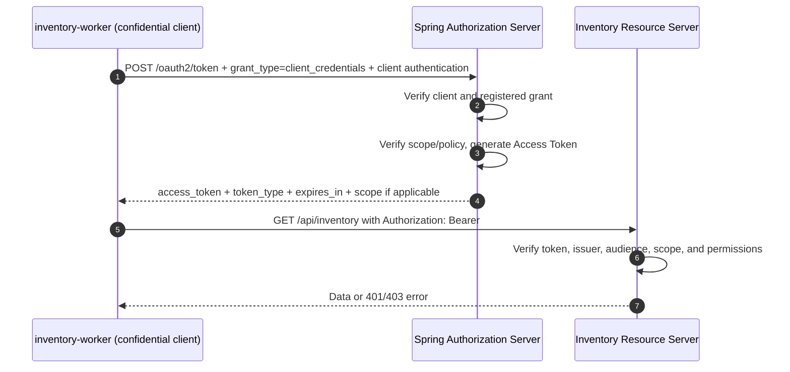
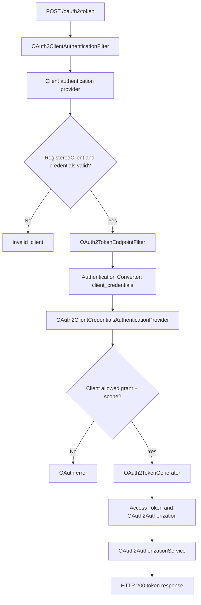

# Registering a confidential client for the client_credentials grant

## 1. Objectives and scope

In the **Client Credentials** chapter of the **SPRING_SECURITY_OAUTH2_OIDC_AUTHORIZATION_SERVER** module, we learn how to design, configure, secure, test, and operate an OAuth 2.0/OpenID Connect Authorization Server using Spring Security and Spring Authorization Server in a Spring Boot application.

This lesson solves the problem: **how do you register a backend application as a confidential OAuth client permitted to use `client_credentials` to obtain an Access Token for machine-to-machine (M2M) communication?**

For example, `inventory-worker` needs to call an API to check inventory levels. No user opens a browser or clicks a consent button during this transaction. Instead, the service authenticates itself with the Authorization Server using **its own** credentials, requests an Access Token for its registered scopes, and uses that token to call the Resource Server.

By the end of this lesson, you will be able to:

1. Explain why `client_credentials` is suitable only for **confidential clients** capable of authenticating and protecting credentials.
2. Create a `RegisteredClient` with `clientId`, `clientSecret`, `ClientAuthenticationMethod`, `AuthorizationGrantType.CLIENT_CREDENTIALS`, `scope`, and `TokenSettings`.
3. Distinguish between client identifier, secret, registered permissions, token permissions, and user identity.
4. Send a standard `application/x-www-form-urlencoded` token request over HTTPS using `client_secret_basic`, read the response, and understand common errors.
5. Integrate the Access Token into API calls and verify issuer, audience, expiration, and scope at the Resource Server.
6. Plan client registration persistence, credential issuance/rotation, auditing, and multi-instance operations.

**Scope:** the Java examples, `localhost` URLs, and illustrative secrets are for development environments only. They are not complete production configurations. This material uses APIs familiar in Spring Authorization Server 1.x / Spring Security 6.x; when using another version, consult the corresponding documentation before copying configurations.

## 2. Understanding the Client Credentials Grant properly

### 2.1. The client authenticates with its own identity

RFC 6749 Section 4.4 defines the **Client Credentials Grant** for confidential clients when the client is acting **on its own behalf**, or in a context where the client has already been pre-authorized to access resources. There is no step asking a user at the Authorization Endpoint.



Comparison with the Authorization Code Flow:

| Aspect | Authorization Code + PKCE | Client Credentials |
| --- | --- | --- |
| Authorized subject | Transaction involving user and client. | **The OAuth client itself**. |
| Browser, login, consent | Typically involved depending on policy. | **None** in this grant. |
| `/oauth2/authorize` | Yes. | **Not called**. |
| `/oauth2/token` | Client exchanges authorization code for token. | Client directly requests token using `client_credentials`. |
| PKCE `code_verifier` | Used when exchanging authorization code. | **Not applicable**, because there is no authorization code. |
| Client authentication | Can be confidential or public depending on model. | **Requires a confidential client** per RFC 6749. |
| Access Token | Intended for Resource Server per granted permissions. | Intended for API per the client's permissions. |
| Refresh Token | May be issued depending on policy. | Per RFC 6749, **SHOULD NOT** be issued. |
| OIDC ID Token | May be present when using OIDC. | **Not an outcome of this grant**, because no end user is authenticated. |

**Do not use `client_credentials` to fake a "user login"**: in this grant type there is no user principal from an interactive login session. If an API needs to know that a specific user approved an action, use the appropriate authorization flow—do not arbitrarily stuff a username or user `sub` into a client credentials token.

### 2.2. What is a confidential client?

A confidential client is capable of keeping credentials secret or using a secure client authentication mechanism at the token endpoint. Common examples:

- A backend service running in a managed server environment.
- A scheduled job, batch worker, or internal integration service.
- A Backend-for-Frontend that keeps secrets on the server side rather than pushing them to the browser.

**Pure JavaScript SPAs and mobile/desktop apps distributed to end users cannot be considered confidential merely because their source contains a `client_secret` string.** Users or attackers can extract secrets from the bundle/application. Those apps typically use Authorization Code + PKCE to operate with user permissions rather than `client_credentials` with an embedded secret.

`client_id` is an **identifier**, not a secret. `client_secret`, private keys, or mTLS credentials are authentication proof of the client and must be protected accordingly.

## 3. RegisteredClient: fields you must decide

Spring Authorization Server uses the `RegisteredClient` model to store what an OAuth client is allowed to do. Options directly relevant to the `client_credentials` grant:

| Field/configuration | Example | Why it is needed |
| --- | --- | --- |
| Internal `id` | Arbitrary UUID generated upon registration. | Record primary key in `RegisteredClientRepository`; **distinct from `client_id`**. |
| `clientId` | `inventory-worker` | Client identifier sent to the token endpoint. |
| `clientSecret` | Properly encoded/hashed secret value when stored. | Server uses it to verify `client_secret_basic`. |
| `clientAuthenticationMethod` | `CLIENT_SECRET_BASIC` | Declares which authentication method(s) the client may use. |
| `authorizationGrantType` | `CLIENT_CREDENTIALS` | Allows only the `client_credentials` grant. |
| `scope` | `inventory.read` | Restricts the set of scopes the client **is allowed to request**. |
| `TokenSettings` | 10-minute JWT Access Token. | Policy for token format and lifetime. |
| `ClientSettings` | Other settings if required by the application. | Settings like PKCE/consent have no direct role in this grant. |
| `redirectUri` | **Not needed**. | No browser redirect or authorization code in this grant. |

### 3.1. A client is only granted registered permissions

For example, `inventory-worker` is only registered with the `inventory.read` scope. A request asking for `inventory.write` must be rejected or not granted that scope per server policy. An Access Token containing `scope=inventory.read` **does not automatically grant access to all APIs**; the Resource Server must still check HTTP method, resource, audience, and specific permissions.

Permission scope should be small and tightly matched to the job: if a worker only reads inventory, do not register write or admin scopes. For many systems, you should register **separate clients** for read jobs and update jobs rather than a single client with all permissions.

### 3.2. A client can have multiple methods, but do not enable all of them indiscriminately

For instance, a `client_secret_basic` client is not automatically permitted to use `client_secret_post`, `private_key_jwt`, or mTLS. Client authentication methods are determined at registration and enforced by the provider at the token endpoint.

Do not add every method just for "easy compatibility"; each method increases configuration surface, key policy, and testing overhead. When migrating from a secret to a private key, plan the migration and update `RegisteredClient` through a governed process.

## 4. Configuring TokenSettings suitable for machine-to-machine

In an M2M model, the client can re-authenticate itself to obtain a new Access Token, so a **Refresh Token is generally unnecessary**. RFC 6749 recommends that an Authorization Server should not include a Refresh Token in a `client_credentials` response. Access Token TTL should be short enough to reduce credential exposure risk while not so short that the system hammers the token endpoint continuously.

Example:

```java
import java.time.Duration;
import org.springframework.security.oauth2.core.OAuth2TokenFormat;
import org.springframework.security.oauth2.server.authorization.settings.TokenSettings;

TokenSettings machineTokenPolicy = TokenSettings.builder()
        .accessTokenTimeToLive(Duration.ofMinutes(10))
        .accessTokenFormat(OAuth2TokenFormat.SELF_CONTAINED)
        .build();
```

`SELF_CONTAINED` typically produces a JWT when configured with an appropriate token generator/JWK. The Resource Server can verify signatures locally. Switching to `OAuth2TokenFormat.REFERENCE` usually produces an opaque token requiring introspection; that is a verification architecture change, not just flipping a single field.

A JWT Access Token may continue to be accepted by the Resource Server until `exp`, even after the client secret has been rotated, **unless** the system has a separate revocation or status-checking mechanism. Rotating a client secret protects **new token requests**; it does not automatically revoke all previously issued tokens.

## 5. Example client registration in Spring Authorization Server

### 5.1. Preparing dependencies and development configuration

The example assumes a Spring Boot project managing dependency versions compatible with Spring Authorization Server 1.x. With Maven:

```xml
<dependencies>
    <dependency>
        <groupId>org.springframework.boot</groupId>
        <artifactId>spring-boot-starter-web</artifactId>
    </dependency>
    <dependency>
        <groupId>org.springframework.boot</groupId>
        <artifactId>spring-boot-starter-security</artifactId>
    </dependency>
    <dependency>
        <groupId>org.springframework.boot</groupId>
        <artifactId>spring-boot-starter-oauth2-authorization-server</artifactId>
    </dependency>
</dependencies>
```

Individual dependency versions are omitted because the project is expected to use Spring Boot dependency management. If using a different Spring Boot/Spring Security version, check the corresponding API documentation rather than mixing configuration examples.

Set the local application port in `src/main/resources/application-dev.yml`:

```yaml
server:
  port: 9000
```

To **avoid putting client secrets in source code**, the example reads the secret from the `DEMO_INVENTORY_CLIENT_SECRET` environment variable. When running locally in PowerShell:

```powershell
$env:SPRING_PROFILES_ACTIVE = 'dev'
$env:DEMO_INVENTORY_CLIENT_SECRET = 'dev-secret-please-change-8b34c67aa11e'
.\mvnw.cmd spring-boot:run
```

The string above is only a mock secret. In production, you need a random secret with sufficient entropy, provisioned and injected into the application via a proper secret management mechanism. Also avoid exposing secrets in shell history, process arguments, or logs in an uncontrolled way.

### 5.2. Local Java configuration

The following class illustrates a `dev`-profile-only Authorization Server with one confidential client permitted to use `client_credentials`. It creates a `JWKSource` to sign JWT Access Tokens, defines the issuer, and configures the security chain for protocol endpoints:

```java
package com.example.authorizationserver.config;

import java.security.KeyPair;
import java.security.KeyPairGenerator;
import java.security.interfaces.RSAPrivateKey;
import java.security.interfaces.RSAPublicKey;
import java.time.Duration;
import java.util.UUID;

import com.nimbusds.jose.jwk.JWKSet;
import com.nimbusds.jose.jwk.RSAKey;
import com.nimbusds.jose.jwk.source.JWKSource;
import com.nimbusds.jose.proc.SecurityContext;
import org.springframework.context.annotation.Bean;
import org.springframework.context.annotation.Configuration;
import org.springframework.context.annotation.Profile;
import org.springframework.core.annotation.Order;
import org.springframework.security.config.Customizer;
import org.springframework.security.config.annotation.web.builders.HttpSecurity;
import org.springframework.security.config.annotation.web.configuration.EnableWebSecurity;
import org.springframework.security.crypto.factory.PasswordEncoderFactories;
import org.springframework.security.crypto.password.PasswordEncoder;
import org.springframework.security.oauth2.core.AuthorizationGrantType;
import org.springframework.security.oauth2.core.ClientAuthenticationMethod;
import org.springframework.security.oauth2.core.OAuth2TokenFormat;
import org.springframework.security.oauth2.server.authorization.client.InMemoryRegisteredClientRepository;
import org.springframework.security.oauth2.server.authorization.client.RegisteredClient;
import org.springframework.security.oauth2.server.authorization.client.RegisteredClientRepository;
import org.springframework.security.oauth2.server.authorization.config.annotation.web.configurers.OAuth2AuthorizationServerConfigurer;
import org.springframework.security.oauth2.server.authorization.settings.AuthorizationServerSettings;
import org.springframework.security.oauth2.server.authorization.settings.TokenSettings;
import org.springframework.security.web.SecurityFilterChain;

@Configuration(proxyBeanMethods = false)
@EnableWebSecurity
@Profile("dev")
public class DevMachineClientConfig {

    @Bean
    @Order(1)
    SecurityFilterChain authorizationServerChain(HttpSecurity http) throws Exception {
        OAuth2AuthorizationServerConfigurer configurer =
                OAuth2AuthorizationServerConfigurer.authorizationServer();

        http.securityMatcher(configurer.getEndpointsMatcher())
                .with(configurer, Customizer.withDefaults())
                .authorizeHttpRequests(authorize -> authorize.anyRequest().authenticated());
        return http.build();
    }

    @Bean
    @Order(2)
    SecurityFilterChain applicationChain(HttpSecurity http) throws Exception {
        // Demo has no login page or business endpoints on the AS.
        http.authorizeHttpRequests(authorize -> authorize.anyRequest().denyAll());
        return http.build();
    }

    @Bean
    PasswordEncoder passwordEncoder() {
        return PasswordEncoderFactories.createDelegatingPasswordEncoder();
    }

    @Bean
    RegisteredClientRepository registeredClientRepository(PasswordEncoder encoder) {
        String secret = System.getenv("DEMO_INVENTORY_CLIENT_SECRET");
        if (secret == null || secret.isBlank()) {
            throw new IllegalStateException(
                    "Set DEMO_INVENTORY_CLIENT_SECRET for the dev profile");
        }

        RegisteredClient inventoryWorker = RegisteredClient
                .withId(UUID.randomUUID().toString())
                .clientId("inventory-worker")
                .clientSecret(encoder.encode(secret))
                .clientAuthenticationMethod(ClientAuthenticationMethod.CLIENT_SECRET_BASIC)
                .authorizationGrantType(AuthorizationGrantType.CLIENT_CREDENTIALS)
                .scope("inventory.read")
                .tokenSettings(TokenSettings.builder()
                        .accessTokenTimeToLive(Duration.ofMinutes(10))
                        .accessTokenFormat(OAuth2TokenFormat.SELF_CONTAINED)
                        .build())
                .build();

        return new InMemoryRegisteredClientRepository(inventoryWorker);
    }

    @Bean
    AuthorizationServerSettings authorizationServerSettings() {
        return AuthorizationServerSettings.builder()
                .issuer("http://localhost:9000")
                .build();
    }

    @Bean
    JWKSource<SecurityContext> jwkSource() {
        try {
            KeyPairGenerator generator = KeyPairGenerator.getInstance("RSA");
            generator.initialize(2048);
            KeyPair pair = generator.generateKeyPair();
            RSAKey key = new RSAKey.Builder((RSAPublicKey) pair.getPublic())
                    .privateKey((RSAPrivateKey) pair.getPrivate())
                    .keyID(UUID.randomUUID().toString())
                    .build();
            JWKSet keySet = new JWKSet(key);
            return (selector, context) -> selector.select(keySet);
        } catch (Exception exception) {
            throw new IllegalStateException("Cannot create demo signing key", exception);
        }
    }
}
```

In this sample:

- `@Profile("dev")` restricts these example beans to the development environment.
- `RegisteredClient.withId(...)` generates an internal identifier; when a token request sends `client_id=inventory-worker`, the server looks it up by `clientId`.
- `encoder.encode(secret)` stores an encoded/hashed client secret via `DelegatingPasswordEncoder`, not plaintext. The server must use a compatible verification mechanism.
- `CLIENT_SECRET_BASIC` permits only HTTP Basic client authentication for this registration.
- `CLIENT_CREDENTIALS` restricts the grant; there is no `AUTHORIZATION_CODE`, `REFRESH_TOKEN`, redirect URI, user login, or consent.
- `scope("inventory.read")` defines the maximum registered permission of the client; it **does not automatically grant access to every API**.
- `TokenSettings` issues new Access Tokens with a 10-minute TTL and self-contained format.
- `issuer` is a consistent local address. In production, it must be a stable public HTTPS issuer.

**Important note:** generating a fresh RSA key pair on every startup is suitable only for demos; tokens signed before a restart can no longer be verified. `InMemoryRegisteredClientRepository` is also unsuitable for long-term client and credential management, especially across multiple instances.

### 5.3. Why are UserDetailsService and formLogin not needed?

This grant does not log a user in via a browser, so the illustrative configuration **does not need** `UserDetailsService` or `formLogin()`. The entity authenticated at the token endpoint is the **OAuth client** via HTTP Basic credentials, not a `dev.user` user.

If the same Authorization Server also serves the Authorization Code Flow, it may need a separate security chain for form login and a user authentication system, but that belongs to a different flow. Never create a dummy login screen just to make `client_credentials` work.

## 6. Journey of a token request at /oauth2/token

### 6.1. Standard request per RFC 6749

The client sends an HTTP POST to the token endpoint with an `application/x-www-form-urlencoded` body:

```http
POST /oauth2/token HTTP/1.1
Host: localhost:9000
Authorization: Basic <base64-of-inventory-worker-colon-secret>
Content-Type: application/x-www-form-urlencoded

grant_type=client_credentials&scope=inventory.read
```

The Basic header carries the Base64-encoded client ID and secret per HTTP Basic syntax. **Base64 does not secure data**: public token endpoints must use HTTPS to protect credentials in transit. Clients must avoid sending the same credentials via multiple methods in the same request or placing `client_secret` in the query string.

Per RFC 6749:

- `grant_type=client_credentials` is the required grant value.
- `scope` is an optional parameter at the protocol layer, though sending it explicitly in hands-on exercises helps observe requested permissions.
- A confidential client **must authenticate** at the token endpoint using its registered method.
- A successful request does not involve `code`, `code_verifier`, `redirect_uri`, or `nonce` from Authorization Code/OIDC login.

### 6.2. Internal processing pipeline in Spring Authorization Server



The exact names and order of certain filters/providers depend on the Spring Authorization Server version, but the **logical principle** matters: the server authenticates the client **first**, validates grant/scope **second**, and only then issues the token and saves related state per the framework model.

Successful client authentication **does not mean** the client may invoke any grant. A `RegisteredClient` might authenticate successfully, yet if the request sends `grant_type=authorization_code` when only `CLIENT_CREDENTIALS` is registered, the server must still reject it.

### 6.3. Token response

Example successful response:

```http
HTTP/1.1 200 OK
Content-Type: application/json
Cache-Control: no-store
Pragma: no-cache

{
  "access_token": "<issued-access-token>",
  "token_type": "Bearer",
  "expires_in": 600,
  "scope": "inventory.read"
}
```

`expires_in` of roughly 600 seconds corresponds to the 10-minute TTL in the example; the exact number can be affected by rounding or response timing. The `scope` field may be omitted in protocol situations where the granted scope matches the requested scope; do not depend on its constant presence.

A `client_credentials` response **does not need a Refresh Token** (RFC 6749 `SHOULD NOT` issue one), and **has no ID Token** because no OIDC end-user authentication takes place.

## 7. Hands-on requests with PowerShell and curl

### 7.1. Checking configuration

Start the server on port `9000` with the `dev` profile as shown in section 5. Inspect public metadata if the endpoints are supported/enabled in your configuration:

```powershell
curl.exe -i http://localhost:9000/.well-known/oauth-authorization-server
curl.exe -i http://localhost:9000/oauth2/jwks
```

Metadata reveals the token endpoint and supported capabilities; public JWKS contains the public keys used to verify JWTs, never private keys. If the app runs behind a reverse proxy, the public URLs must align with the configured HTTPS issuer.

### 7.2. Requesting an Access Token with client_secret_basic

```powershell
$credential = "inventory-worker:$env:DEMO_INVENTORY_CLIENT_SECRET"

curl.exe -sS -X POST 'http://localhost:9000/oauth2/token' -u $credential -H 'Content-Type: application/x-www-form-urlencoded' --data-urlencode 'grant_type=client_credentials' --data-urlencode 'scope=inventory.read'
```

If you ran the startup command in another terminal, set the secret environment variable to the **same value** in the testing terminal beforehand. `-u` is curl's flag for sending HTTP Basic; the example uses plain HTTP over `localhost` only in a dev environment.

In production, **never put secrets directly in shell history, process arguments, or logs**. Integrate an OAuth client library, vault/secret manager, or secure runtime credential injection mechanism. Never send credentials in a URL query string.

A successful response returns JSON containing `access_token`, `token_type`, and `expires_in`. If the token is a JWT, you can decode the header/payload to **inspect** the claims, though decoding does not prove signature validity.

### 7.3. Testing invalid requests to understand policy

Try requesting an unregistered scope:

```powershell
curl.exe -i -X POST 'http://localhost:9000/oauth2/token' -u $credential -H 'Content-Type: application/x-www-form-urlencoded' --data-urlencode 'grant_type=client_credentials' --data-urlencode 'scope=inventory.write'
```

The expected result is an OAuth error response such as `invalid_scope`, because `inventory-worker` is only allowed `inventory.read`. Inspect both status and error body from your running framework; do not rely on a single HTTP status code alone.

Try a wrong client secret (mock secret):

```powershell
curl.exe -i -X POST 'http://localhost:9000/oauth2/token' -u 'inventory-worker:wrong-secret' -H 'Content-Type: application/x-www-form-urlencoded' --data-urlencode 'grant_type=client_credentials' --data-urlencode 'scope=inventory.read'
```

It must be rejected during **client authentication**, usually with `invalid_client`. Never issue an Access Token solely because `client_id` is valid.

### 7.4. No mandatory refresh flow

When the Access Token expires, a confidential client can re-authenticate itself to request a new Access Token via another `client_credentials` request. Do not build a fake refresh flow:

```text
Access Token expired
  -> Client re-authenticates at token endpoint
  -> grant_type=client_credentials
  -> New Access Token
```

Some client libraries support caching the Access Token and proactively renewing before `exp`. Use the library's built-in mechanism rather than calling the token endpoint on **every** API request unnecessarily; protect the cache and coordinate concurrent requests to avoid traffic spikes.

## 8. How does the Resource Server verify an Access Token?

### 8.1. The token must be intended for the right API

Suppose `inventory-worker` uses the Access Token to call:

```http
GET /api/inventory/items HTTP/1.1
Host: api.example.com
Authorization: Bearer <access-token>
```

The API must verify that **the token was genuinely issued by a trusted Authorization Server**, has not expired, is intended for the appropriate Resource Server, contains `scope=inventory.read`, and satisfies required business permissions. Simply seeing `Bearer` or a three-part JWT string is **not enough** to grant access.

Verification options depend on the token format:

| Access Token Format | Common Verification Mechanism |
| --- | --- |
| JWT / `SELF_CONTAINED` | Verify signature via JWKS, `iss`, `exp`, `nbf`, `aud`, and relevant claims/authorities. |
| Reference / opaque | Call token introspection with proper Resource Server authentication; check `active`, scopes, audience, and policy. |

With Spring Security Resource Server's `issuer-uri` setting, the framework normally checks the issuer along with default JWT validations, but **audience is not automatically enforced to your API's needs from `issuer-uri` alone**. Add an explicit audience check when the architecture uses `aud` to restrict the intended resource.

### 8.2. Minimal Resource Server configuration

Example Spring Boot Resource Server with `spring-boot-starter-oauth2-resource-server` and Spring Security:

```yaml
spring:
  security:
    oauth2:
      resourceserver:
        jwt:
          issuer-uri: http://localhost:9000
```

This issuer value is **for local use only**. Production must use a public HTTPS issuer. A security chain allowing only the inventory read scope:

```java
import org.springframework.context.annotation.Bean;
import org.springframework.http.HttpMethod;
import org.springframework.security.config.Customizer;
import org.springframework.security.config.annotation.web.builders.HttpSecurity;
import org.springframework.security.web.SecurityFilterChain;

@Bean
SecurityFilterChain inventoryApiChain(HttpSecurity http) throws Exception {
    http.authorizeHttpRequests(authorize -> authorize
            .requestMatchers(HttpMethod.GET, "/api/inventory/**")
            .hasAuthority("SCOPE_inventory.read")
            .anyRequest().denyAll())
        .oauth2ResourceServer(oauth -> oauth.jwt(Customizer.withDefaults()));
    return http.build();
}
```

Spring Security normally maps the `scope` or `scp` claim in a JWT to authorities prefixed with `SCOPE_`. For instance, `inventory.read` becomes `SCOPE_inventory.read` if the active converter supports the actual claim format.

This example **focuses solely on JWT and scope verification**; a production API also needs method/resource policies, CORS management, session/CSRF handling if cookies exist, rate limiting, and error handling. Never open `anyRequest().permitAll()` just for testing convenience.

### 8.3. Audience is not automatically inferred from scope

The `inventory.read` scope describes the permission the client requested; it does not imply the JWT is meant for any API with `/inventory` in its path. If the Resource Server requires the `inventory-api` audience, the Authorization Server must emit the appropriate `aud` claim and the API must verify it.

Example **JWT customization** on the Authorization Server for the specific client's Access Token:

```java
import java.util.List;
import org.springframework.context.annotation.Bean;
import org.springframework.security.oauth2.core.AuthorizationGrantType;
import org.springframework.security.oauth2.core.OAuth2TokenType;
import org.springframework.security.oauth2.server.authorization.token.JwtEncodingContext;
import org.springframework.security.oauth2.server.authorization.token.OAuth2TokenCustomizer;

@Bean
OAuth2TokenCustomizer<JwtEncodingContext> inventoryAudienceCustomizer() {
    return context -> {
        if (OAuth2TokenType.ACCESS_TOKEN.equals(context.getTokenType())
                && AuthorizationGrantType.CLIENT_CREDENTIALS
                        .equals(context.getAuthorizationGrantType())
                && "inventory-worker".equals(
                        context.getRegisteredClient().getClientId())) {
            context.getClaims().audience(List.of("inventory-api"));
        }
    };
}
```

The corresponding Resource Server must be configured with a validator ensuring `aud` contains `inventory-api`. **Adding the `aud` claim on the server without checking it at the API leaves audience restriction incomplete.** If the project already has an `OAuth2TokenCustomizer<JwtEncodingContext>`, merge this logic into it rather than creating competing beans without controlled ordering.

## 9. Other client authentication methods

### 9.1. client_secret_basic

`CLIENT_SECRET_BASIC` is a straightforward choice for a confidential service capable of protecting a secret. The client sends a Basic header, and the server verifies it against the registered value. The secret must have adequate entropy, be stored in a secret manager on the client side, and never be shared across unrelated services.

The HTTP Basic header carries the secret in Base64 form, making HTTPS essential whenever communicating outside loopback.

### 9.2. client_secret_post

`CLIENT_SECRET_POST` sends `client_id` and `client_secret` in the form body. RFC 6749 permits it in certain cases but discourages sending passwords/secrets in the request body when the client supports HTTP Basic. Request bodies can be accidentally logged or traced; do not pick `client_secret_post` simply because it is a `POST`.

A client registered only with `CLIENT_SECRET_BASIC` **must not be treated as automatically allowed** to use `client_secret_post`.

### 9.3. private_key_jwt and client_secret_jwt

With `PRIVATE_KEY_JWT`, the client signs a JWT assertion using its private key and the Authorization Server verifies it with the registered public key/JWKS. The JWT assertion includes constraints such as `iss`, `sub`, `aud`, and `exp`; depending on the security profile, `jti` and replay protection are also required. The client must manage the private key and its rotation.

`CLIENT_SECRET_JWT` uses a shared secret suitable for MAC. Both methods pertain to **client authentication**, not the Access Token format issued by the Authorization Server. Choose a method with matching key policies and client libraries; do not trust a JWT simply because it contains an `alg` field.

### 9.4. Mutual TLS and certificate-bound tokens

With mTLS, the client proves possession of a private key via a TLS certificate and the server validates the certificate against the registration policy. You can apply OAuth mTLS client authentication or certificate-bound Access Tokens per RFC 8705 when security demands it.

This requires consistent TLS, truststore, reverse proxy, certificate, and `RegisteredClient` setup; merely selecting an enum on the client does not implement full mTLS.

| Method | Security asset | Special considerations |
| --- | --- | --- |
| `client_secret_basic` | Shared secret in Basic header. | TLS, secret manager, and rotation. |
| `client_secret_post` | Shared secret in body. | Avoid body logging; use only when registered/permitted by policy. |
| `private_key_jwt` | Client-side private key, registered public JWKS. | Signature, `aud`/`exp`, correct client key binding, rotation, and replay policy. |
| `client_secret_jwt` | Shared secret used to sign assertion. | Protect and manage symmetric key; do not confuse password hash with HMAC key. |
| mTLS | Client certificate and corresponding private key. | Trust chain, client identity mapping, proxy configuration, and certificate rotation. |

## 10. Storing and governing client registrations

### 10.1. InMemoryRegisteredClientRepository is for learning

`InMemoryRegisteredClientRepository` makes creating clients quick, but all registrations are tied to the process lifecycle. If each node generates its own `RegisteredClient.id` or receives a different secret, multi-instance systems can authenticate or persist state inconsistently.

In production, choose a durable repository (such as JDBC or an implementation with proper synchronization), consistent registration data, and credential provisioning/revocation workflows. Spring Authorization Server provides `JdbcRegisteredClientRepository`, though production also requires schema migrations, connection hardening, database protection, and change governance.

### 10.2. Never store raw client secrets in the repository

For `client_secret_basic`, the secret stored server-side should be processed through a suitable `PasswordEncoder`. In the example, `encoder.encode(secret)` creates an encoded value with an algorithm prefix understood by `DelegatingPasswordEncoder`.

When issuing a new secret:

1. Generate a secret with sufficient entropy using a CSPRNG—never derive it from a service name or timestamp.
2. Deliver the credential to the client over a secure channel and store it in an appropriate secret manager.
3. Store only the encoded form in the repository when using password/secret verification.
4. Design a rotation schedule, revocation capability, or transition window without leaving the old secret active indefinitely.
5. Monitor client authentication activity, failed-secret requests, and credential revocation needs upon compromise.

For `private_key_jwt`/mTLS, key/certificate policies differ from shared passwords; do not mechanically apply one-way hashing to every authentication method.

### 10.3. Safely updating a RegisteredClient

If a client already exists in the database, changing the Java initialization snippet will not update the stored record. Establish a registration governance workflow: authenticate the requester, approve scopes and grants, update the repository, record an audit trail, test, and support rollback.

Never expose a "self-register confidential client" endpoint to unauthenticated callers; issuing a `client_id` and credentials with `inventory.read` is an act of granting system privileges.

### 10.4. Multiple tenants or multiple issuers

If an Authorization Server serves multiple issuers, clients must be partitioned/bound to trusted tenants. Tenant A's `inventory-worker` must not use the same registration or secret to request tokens under issuer B unless policy explicitly allows it.

Partition repositories, token issuance, signing keys, and audits according to your real multi-tenancy design; `client_credentials` does not automatically identify a tenant from the client name alone.

## 11. Common errors and test matrix

### 11.1. OAuth error codes to understand

| Situation | Possible error/symptom | How to check |
| --- | --- | --- |
| `client_id` does not exist | `invalid_client`. | Match exact `RegisteredClient.clientId`, do not confuse with internal UUID. |
| Wrong or missing client secret | `invalid_client`. | Check secret, password encoder, and authentication method. |
| Sending `client_secret_post` when registered only for Basic | `invalid_client` or corresponding auth error. | Check registered `clientAuthenticationMethod`. |
| `grant_type` unsupported by server | `unsupported_grant_type`. | Verify endpoint/framework supports the grant. |
| Grant supported by server but forbidden for client | `unauthorized_client`. | Check `authorizationGrantTypes` on that specific client. |
| Requesting unregistered scope | `invalid_scope`. | Compare requested scope against registered scopes. |
| Wrong Content-Type/form body | `invalid_request` or corresponding error. | Send `application/x-www-form-urlencoded` with exact parameter names. |
| Token endpoint returns 404 | Wrong URL/path or security chain setup. | Check `AuthorizationServerSettings` and endpoint configuration. |
| API returns 401 | Missing/expired token, wrong signature/issuer/audience, or other validation failure. | Check Resource Server configuration and actual token. |
| API returns 403 | Authenticated token lacks required scope/policy permission. | Check `SCOPE_inventory.read` and endpoint authorization rules. |
| No Refresh Token | Usually expected for client credentials. | Do not automatically treat it as an error. |
| No ID Token | Expected since there is no OIDC end-user authentication. | Do not add `openid` just to try getting an ID Token. |
| JWT fails verification after demo restart | RSA key was randomly generated on each startup. | Use persistent key storage outside demo environments. |

Specific error codes and HTTP statuses may vary by root cause or version. Inspect **status + OAuth error body + secret-redacted logs** rather than drawing conclusions from a single HTTP status code.

### 11.2. Minimum test suite

| Test type | Input | Expected outcome |
| --- | --- | --- |
| Happy path | Valid client ID/secret, `grant_type=client_credentials`, `inventory.read`. | Receives appropriate Access Token without requiring browser login. |
| Wrong credential | Incorrect secret. | No token issued. |
| Unknown client | Unregistered `client_id`. | No token issued. |
| Wrong authentication method | Form-post secret or JWT when unregistered. | Fails client authentication. |
| Wrong grant | `authorization_code` or `refresh_token` on a client registered only for `CLIENT_CREDENTIALS`. | Token not issued for that grant. |
| Over-privileged scope request | `inventory.write`. | Unregistered scope not granted. |
| Omitted scope | Request without `scope`. | Behavior matches defined default policy and is explicitly tested; do not assume all scopes are granted. |
| TTL | Issue new token, inspect `expires_in`/`exp`. | Matches `TokenSettings`. |
| Valid API scope | Call GET API using `inventory.read` token. | Allowed if all other checks pass. |
| Invalid API scope | Call endpoint using token without required permission. | API rejects. |
| JWT wrong issuer | Token signed by another issuer. | Resource Server rejects. |
| JWT wrong audience | Token not intended for this API. | API rejects if audience validation is configured. |
| Expired token | Use token past `exp`. | Resource Server rejects per clock-skew policy. |
| Multi-node | Same client calls across two AS nodes. | Client registration, policy, and keys are synchronized. |
| Rotation | Rotate client secret in test environment. | Old secret invalidated per process; client succeeds with new secret. |

### 11.3. Do not test in ways that leak credentials

In test logs and CI output, never print `Authorization: Basic ...`, raw client secrets, or Bearer Access Tokens. Avoid pasting real tokens into public JWT decoding websites; use local JWT decoders and synthetic fixtures. Automated tests need secret-protection mechanisms and post-run cleanup.

## 12. Secure operations

### 12.1. Caching and renewing Access Tokens

Client services can cache an Access Token until a reasonable buffer before expiration, then call the token endpoint for a new token when needed. Scoping caches **by matching credential/issuer/scope/audience** prevents accidentally mixing tokens across services or tenants.

If multiple API requests concurrently observe an expired token, the client should use proper refresh synchronization rather than firing thousands of simultaneous token requests. Also handle token endpoint timeouts/`invalid_client` with a backoff retry policy and alerting, **never retrying infinitely with a wrong secret**.

### 12.2. Rate limiting and monitoring

At the Authorization Server, monitor:

- Token request counts per identified client and grant type.
- Rates of `invalid_client`, `invalid_scope`, and `unauthorized_client`.
- Token issuance latency, repository health, JWT signing, and JWK rotation.
- Unusual token issuance bursts, scope/registered-client changes, and administrative actions.

Never expose raw secrets or tokens in metric labels, logs, or traces. For large systems, consider rate limiting to prevent brute-force attacks and resource exhaustion while ensuring legitimate services are not overly throttled.

### 12.3. Responding when a client credential is compromised

When secret/private key exposure is suspected:

1. Identify the client, granted scopes, related APIs, and signs of anomalous usage.
2. Disable/rotate the credential following an auditable process.
3. Assess whether issued tokens require revocation, a denylist, or additional state checks.
4. Check affected Resource Servers and remaining token lifetimes.
5. Investigate root cause across CI, logs, source code, container images, or the secret manager.

**Rotating the secret does not automatically revoke already-issued JWT Access Tokens** if the API checks only signatures and `exp`. Have a strategy for handling existing tokens commensurate with incident severity.

### 12.4. Client Credentials is not complete business authorization

A client granted `inventory.read` is not necessarily entitled to read every warehouse or every organization's data. APIs may still need tenant policies, allowed-resource lists, operating-hour constraints, network policies, or context checks. These conditions do not appear automatically from `RegisteredClient.scope(...)` alone.

## 13. Hands-on exercises

### Exercise 1 — Create two confidential clients

Register `inventory-reader` with `inventory.read` and `inventory-writer` with `inventory.write`, both using `client_credentials` and distinct secrets. Test requesting valid/invalid scopes and explain why **a client ID is not an access permission**.

### Exercise 2 — Change authentication method

Outline a migration plan to move a client from `client_secret_basic` to `private_key_jwt`. Specify JWKS/client signing key requirements, `iss/sub/aud/exp` checks, key rotation, and change verification. Do not confuse an Access Token JWT with a client assertion JWT.

### Exercise 3 — Verify API scope enforcement

Have `inventory-worker` call GET `/api/inventory/items` with an `inventory.read` Access Token, then attempt to call an admin endpoint requiring another scope. Indicate when the Resource Server should return 401 versus 403.

### Exercise 4 — Leaked secret

Assume a client secret accidentally appeared in CI logs. Write an incident response plan covering secret rotation, auditing issued tokens, API restrictions, and recurrence prevention. Explain why merely shortening Access Token TTL **is not** the whole solution.

### Exercise 5 — Two Authorization Server nodes

A client sends consecutive requests across two nodes; each node uses `InMemoryRegisteredClientRepository` and a different RSA key pair. Analyze the risks and propose shared repository/key management along with a controlled deployment process.

### Completion checklist

- [ ] Can explain that `client_credentials` is an M2M grant without end-user login/consent.
- [ ] Can distinguish confidential and public clients; never embed client secrets in SPA/mobile bundles.
- [ ] Can create a `RegisteredClient` with `CLIENT_SECRET_BASIC` and `CLIENT_CREDENTIALS`.
- [ ] Sets minimal scopes and omits unnecessary redirect URIs/PKCE for this grant.
- [ ] Knows how to encode/hash server-stored secrets and use a secret manager on the client side.
- [ ] Can send a form-encoded POST `/oauth2/token` with valid `grant_type` and `scope`.
- [ ] Can distinguish `invalid_client`, `unauthorized_client`, `invalid_scope`, and API 401/403 errors.
- [ ] Understands Access Token TTL, that Refresh Tokens are normally omitted, and that ID Tokens do not belong to this grant.
- [ ] Can design a Resource Server validating issuer, audience, expiration, and scope.
- [ ] Knows how to deploy to production with a durable repository, stable signing keys, TLS, and credential rotation.

## 14. References

- [RFC 6749 — OAuth 2.0 Authorization Framework](https://www.rfc-editor.org/rfc/rfc6749) — especially Sections 4.4 (Client Credentials Grant), 3.2.1 (Client Authentication), and 5.1 (Successful Response).
- [RFC 6750 — OAuth 2.0 Bearer Token Usage](https://www.rfc-editor.org/rfc/rfc6750) — Bearer Access Tokens when calling a Resource Server.
- [RFC 8705 — OAuth 2.0 Mutual-TLS Client Authentication and Certificate-Bound Access Tokens](https://www.rfc-editor.org/rfc/rfc8705) — certificate-based client authentication options.
- [RFC 7523 — JWT Profile for OAuth 2.0 Client Authentication](https://www.rfc-editor.org/rfc/rfc7523) — client assertions such as `private_key_jwt` and `client_secret_jwt`.
- [RFC 7662 — OAuth 2.0 Token Introspection](https://www.rfc-editor.org/rfc/rfc7662) — verifying opaque/reference tokens.
- [RFC 7009 — OAuth 2.0 Token Revocation](https://www.rfc-editor.org/rfc/rfc7009) — token revocation mechanisms.
- [RFC 9700 — OAuth 2.0 Security Best Current Practice](https://www.rfc-editor.org/rfc/rfc9700) — modern OAuth 2.0 security recommendations.
- [Spring Authorization Server Reference](https://docs.spring.io/spring-authorization-server/reference/) — RegisteredClient, ClientAuthentication, TokenSettings, and token endpoint.
- [Spring Authorization Server Core Model Components](https://docs.spring.io/spring-authorization-server/reference/core-model-components.html) — `RegisteredClient`, `RegisteredClientRepository`, `OAuth2Authorization`, and `TokenSettings`.
- [Spring Security Resource Server](https://docs.spring.io/spring-security/reference/servlet/oauth2/resource-server/index.html) — JWT/opaque token verification and scope-based authorization.

**Key takeaway:** Registering a confidential client for `client_credentials` means **registering the application identity, authentication method, allowed grant, and minimal scopes**. Thereafter, the Authorization Server issues an Access Token only when the client validly authenticates itself and satisfies policy; the Resource Server must still validate the token and permissions on every request. This forms the secure foundation for machine-to-machine communication in Spring Authorization Server.
