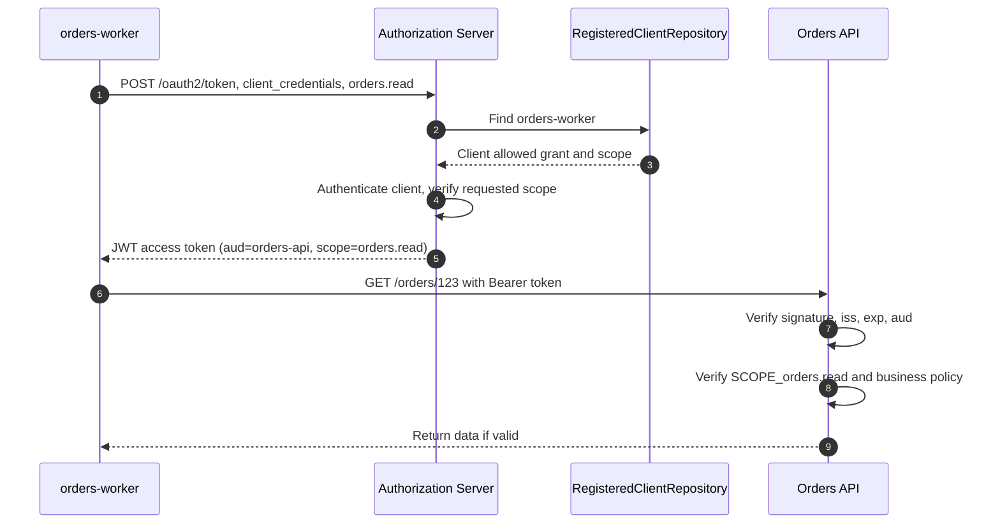
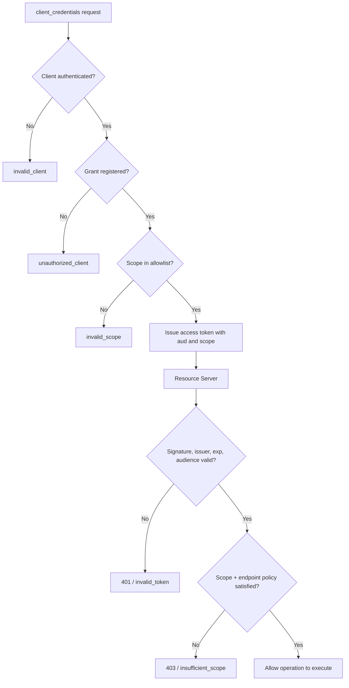
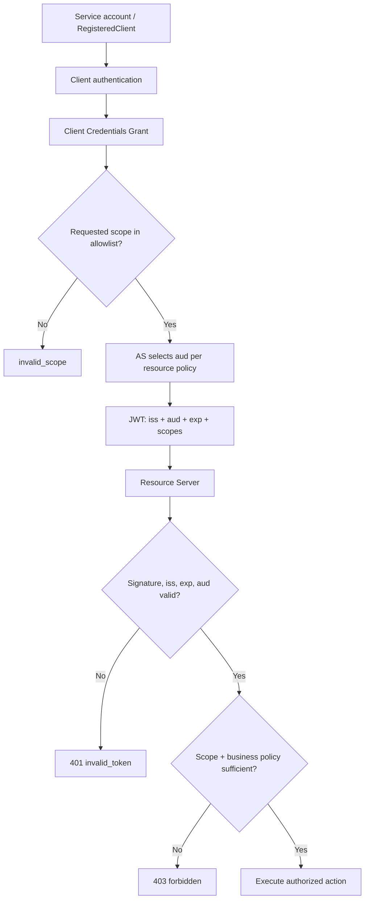

# Restricting scope, audience, and permissions per service account

## 1. Context and objectives

In the **Client Credentials** chapter of the **SPRING_SECURITY_OAUTH2_OIDC_AUTHORIZATION_SERVER** module, an Authorization Server implemented with **Spring Security**, **Spring Authorization Server (SAS)**, and **Spring Boot** must ensure that a machine-to-machine (M2M) application receives only the exact permissions it needs and can only use its token on authorized APIs.

This lesson helps you design, configure, secure, test, and operate an OAuth 2.0/OpenID Connect Authorization Server with three layers of enforcement:

1. **Client identity:** Which service account is allowed to authenticate and use `client_credentials`?
2. **Scope:** Which operational permissions is that service allowed to request, such as `orders.read` or `billing.reconcile`?
3. **Audience and authorization:** Which **Resource Server** is the token issued for, and does the endpoint on that API actually permit the requested action?

After this lesson, you will be able to register service accounts following the **least privilege** principle, attach `aud` safely to JWT access tokens, verify `iss`/`exp`/`aud`/scope at the Resource Server, distinguish 401 and 403 errors, design tests against cross-API token reuse, and operate the service credential lifecycle.

**Version scope:** Examples illustrate APIs commonly found in **Spring Authorization Server 1.x / Spring Security 6.x / Spring Boot 3.x**. For other versions, verify the API/auto-configuration against your actual dependencies. This lesson uses **self-contained JWT access tokens** to represent audience; opaque tokens require an equivalent policy through introspection and the Resource Server.

## 2. A service account is not an end user

The **Client Credentials Grant** (OAuth 2.0) is for an OAuth2 client that authenticates itself to request an access token based on permissions granted to **the client itself**. There is no browser login, resource owner consent screen, authorization code, or PKCE in this flow.



| Term | Role | Example | What not to confuse it with |
| --- | --- | --- | --- |
| `client_id` | OAuth2 client identifier | `orders-worker` | Not a secret or a human account |
| Client credential | Proof used to authenticate the client | Client secret, private-key JWT, mTLS | Not the access token used to call APIs |
| Service account | Identity assigned to a workload/job | Order synchronization worker | Does not represent an end user |
| `scope` | Capabilities granted inside the access token | `orders.read` | Does not identify the target API |
| `aud` | Intended API where the token may be used | `orders-api` | Not a role or client ID |
| `iss` | Trusted AS that issued the token | `https://auth.example.com` | Not an issuer chosen by the client |
| `sub` | Token subject per token profile | Typically the client in M2M | Must not be inferred as an end-user ID |
| Application role | Business permission group if defined | `order-exporter` | Not automatically a scope |

If a service needs to access an API **on behalf of a user**, that is a separate delegation/authorization problem. Never inject a caller-supplied `user_id` into a Client Credentials token to turn it into user permissions.

## 3. Three independent security barriers



**At the Authorization Server**, `RegisteredClientRepository` and the providers validate the client, grant, and requested scope; the token generator/customizer determines `aud` according to trusted policy.

**At the Resource Server**, the JWT decoder must verify that the token has the expected issuer, signature, expiration, and audience; the authorization mechanism must enforce the corresponding scope/role/tenant rules. Missing checks on either side weaken the entire system.

### 3.1. Why does scope not replace audience?

If the Orders API and Billing API trust the same AS, a valid JWT does not mean it should be usable on **every** API. A scope like `read` or `orders.read` describes an operational capability, but does not by itself force the Billing API to reject a token issued specifically for the Orders API.

**Audience `aud`** establishes the boundary for **which resource** the token may be sent to. **Scope** establishes the boundary within that resource: **which actions** may be performed. Combined, these two constraints reduce the risk of token reuse across different APIs (*cross-resource replay*).

### 3.2. Registered scope, requested scope, granted scope

- **Registered scopes:** The maximum set a client is allowed to request, stored in `RegisteredClient`.
- **Requested scopes:** The list in the `scope` parameter of the token request, if sent by the client.
- **Granted scopes:** The permissions the AS actually grants and places into the token according to the grant/policy.

Scopes outside registered scopes must never be granted. In some grant configurations, if `scope` is omitted, the AS may fall back to the client's registered scopes; therefore **restricting registered scopes upfront** is essential rather than relying on the client asking for fewer permissions.

## 4. Designing a workload permission matrix

Suppose an organization has two independent APIs and three workloads:

| Client/service account | Function | Grant | Registered scopes | Audience |
| --- | --- | --- | --- | --- |
| `orders-worker` | Read orders to sync inventory | `client_credentials` | `orders.read` | `orders-api` |
| `billing-reconciler` | Reconcile payments | `client_credentials` | `billing.reconcile` | `billing-api` |
| `orders-cancel-job` | Cancel approved orders | `client_credentials` | `orders.read`, `orders.cancel` | `orders-api` |

All names are illustrative. **Do not** create one shared `internal-client` with every scope and distribute the same secret to multiple development teams: if the secret leaks, the blast radius is huge, per-service revocation is difficult, and auditing the real actor is impossible.

Partition service accounts by: business function, owner, deployment environment, credential lifecycle boundary, and audit requirements. Multiple replicas of the same workload may share one workload identity if policy allows; you do not necessarily need a new client for every HTTP request or container.

### 4.1. Scope does not replace data permissions

A token with `orders.read` does not automatically entitle the caller to read every order across every **tenant**, organization, or region. The Resource Server still needs to enforce business policies: assigned tenant, ownership, order status conditions, data boundaries, and business approvals.

If claims like `tenant_id` are placed into the token, the AS must obtain the value from an authoritative source; never copy a `tenant_id` sent directly by the client in the request. Likewise, the API must never trust a caller-supplied `tenantId` parameter while skipping policy verification.

## 5. Minimal RegisteredClient declaration in SAS

This Spring Boot example uses `client_secret_basic` for local/lab use, storing hashed secrets via `PasswordEncoder` and restricting grants/scopes. Production can consider `private_key_jwt` or mTLS based on the threat model.

```java
@Configuration(proxyBeanMethods = false)
public class MachineClientsConfig {

    @Bean
    PasswordEncoder passwordEncoder() {
        return PasswordEncoderFactories
                .createDelegatingPasswordEncoder();
    }

    @Bean
    RegisteredClientRepository registeredClientRepository(
            PasswordEncoder encoder,
            @Value("${ORDERS_WORKER_CLIENT_SECRET}") String ordersSecret,
            @Value("${BILLING_RECONCILER_CLIENT_SECRET}") String billingSecret) {

        RegisteredClient ordersWorker = RegisteredClient
                .withId("orders-worker-local-001")
                .clientId("orders-worker")
                .clientSecret(encoder.encode(ordersSecret))
                .clientAuthenticationMethod(
                        ClientAuthenticationMethod.CLIENT_SECRET_BASIC)
                .authorizationGrantType(
                        AuthorizationGrantType.CLIENT_CREDENTIALS)
                .scope("orders.read")
                .tokenSettings(TokenSettings.builder()
                        .accessTokenFormat(
                                OAuth2TokenFormat.SELF_CONTAINED)
                        .accessTokenTimeToLive(
                                Duration.ofMinutes(5))
                        .build())
                .build();

        RegisteredClient billing = RegisteredClient
                .withId("billing-reconciler-local-001")
                .clientId("billing-reconciler")
                .clientSecret(encoder.encode(billingSecret))
                .clientAuthenticationMethod(
                        ClientAuthenticationMethod.CLIENT_SECRET_BASIC)
                .authorizationGrantType(
                        AuthorizationGrantType.CLIENT_CREDENTIALS)
                .scope("billing.reconcile")
                .tokenSettings(TokenSettings.builder()
                        .accessTokenFormat(
                                OAuth2TokenFormat.SELF_CONTAINED)
                        .accessTokenTimeToLive(
                                Duration.ofMinutes(5))
                        .build())
                .build();

        return new InMemoryRegisteredClientRepository(
                ordersWorker, billing);
    }
}
```

**Meaning of this configuration:**

1. `CLIENT_CREDENTIALS` is the only allowed grant; do not casually enable `authorization_code` or `refresh_token` for workers.
2. `scope(...)` forms a minimal allowlist; `orders-worker` cannot request `billing.reconcile` or `orders.cancel`.
3. `SELF_CONTAINED` produces JWT access tokens, suitable for demonstrating audience/JWKS and offline verification; requires real signing keys/`JWKSource`.
4. `accessTokenTimeToLive(5 minutes)` is an example policy; TTL should balance token exposure risk, latency, and token request frequency.
5. `PasswordEncoder` is only appropriate for storing secrets for Basic/POST methods; `private_key_jwt` or mTLS requires public-key/certificate verification mechanisms.
6. `InMemoryRegisteredClientRepository` is for labs. Production needs dedicated persistence, onboarding, rotation, and auditing.
7. Each secret comes from environment variables or a secret manager; never put plaintext secrets in Git, Docker images, or logs.

Do not assume every SAS version automatically uses a custom `@Bean PasswordEncoder` in `ClientSecretAuthenticationProvider`; ensure the encoder used when **writing** hashes matches the one used when **matching**, especially if choosing a non-default format.

## 6. Token requests and restricting requested scopes

### 6.1. Permitted case

```http
POST /oauth2/token HTTP/1.1
Host: auth.example.com
Authorization: Basic <BASE64_CLIENT_ID_AND_SECRET>
Content-Type: application/x-www-form-urlencoded

grant_type=client_credentials&scope=orders.read
```

Illustrative response, with the real token replaced by a placeholder:

```http
HTTP/1.1 200 OK
Content-Type: application/json
Cache-Control: no-store
Pragma: no-cache

{
  "access_token": "<JWT_ACCESS_TOKEN>",
  "token_type": "Bearer",
  "expires_in": 300,
  "scope": "orders.read"
}
```

The standard Client Credentials Grant **has no authorization code, PKCE, browser login, end-user consent, or OIDC ID token**. Under OAuth 2.0, refresh tokens normally **should not** be issued for `client_credentials`; the workload can re-authenticate to request a new access token when needed.

HTTP Basic only **Base64-encodes** credentials; it does not encrypt or protect secrets. Over real networks, **HTTPS/TLS** is mandatory, and the `Authorization` header must be redacted from logs.

### 6.2. Over-privileged scope request case

`orders-worker` requests:

```http
POST /oauth2/token HTTP/1.1
Host: auth.example.com
Authorization: Basic <ORDERS_WORKER_CREDENTIALS>
Content-Type: application/x-www-form-urlencoded

grant_type=client_credentials&scope=orders.cancel
```

Because the client lacks the `orders.cancel` scope, the AS must reject with `invalid_scope` or a policy-appropriate error, **never** issuing a token with excess scope.

Note: Never force the Resource Server to assume the AS will always be configured correctly. The API still inspects the actual token received; if the AS is misconfigured or altered, the API blocks actions the token is not permitted to perform.

## 7. Audience (`aud`) in the access token

**Audience** identifies one or more APIs/Resource Servers for which the JWT access token is issued. Example JWT payload:

```json
{
  "iss": "https://auth.example.com",
  "sub": "orders-worker",
  "aud": ["orders-api"],
  "scope": "orders.read",
  "iat": 1790000000,
  "exp": 1790000300
}
```

This is illustrative JSON, not a real signed token. `sub` in M2M typically relates to the client identity, though the issuance profile should be checked. `iss` is the issuer, `aud` is the target API, `scope` is the action permissions, and `exp` is expiration.

**Do not assume SAS automatically attaches the API's exact audience** solely from declaring registered scopes. You usually need an explicit `aud` policy during token generation and a validator on the Resource Server.

### 7.1. Naming audience identifiers consistently

You can use `orders-api` or a URI like `https://api.example.com/orders`. What matters is:

- System-governed, stable, and unambiguous.
- The AS and Resource Server match the **exact agreed value**.
- Clients cannot choose `aud=admin-api` via an arbitrary parameter.
- Environment isolation when needed, preventing staging/prod token crossover.
- Never create one broad `all-internal-services` audience if the goal is API isolation.

An audience URI is an **identifier**; it does not need to be a directly fetchable URL. Never use an untrusted request's `Host` header to derive an audience.

### 7.2. RFC 8707 and the `resource` parameter

OAuth 2.0 Resource Indicators (RFC 8707) defines the `resource` parameter so clients can indicate target resources in supported flows. However, **do not assume SAS understands and validates every `resource` parameter by default just because `client_credentials` is enabled**.

If a workload needs tokens for multiple APIs, design a resource selection mechanism with a **client → resource → scopes allowlist** and test the extension against your SAS version. The easiest controllable approach in this lesson is assigning each service account an AS-approved audience.

## 8. Attaching `aud` with `OAuth2TokenCustomizer<JwtEncodingContext>`

SAS provides an extension point for customizing JWT claims. For Client Credentials, you can map the **authenticated client ID** to its permitted audience.

```java
@Configuration(proxyBeanMethods = false)
public class MachineTokenCustomizerConfig {

    private static final Map<String, String> AUDIENCE_BY_CLIENT =
            Map.of(
                    "orders-worker", "orders-api",
                    "billing-reconciler", "billing-api");

    @Bean
    OAuth2TokenCustomizer<JwtEncodingContext> machineTokenCustomizer() {
        return context -> {
            if (!OAuth2TokenType.ACCESS_TOKEN.equals(
                    context.getTokenType())) {
                return;
            }

            if (!AuthorizationGrantType.CLIENT_CREDENTIALS.equals(
                    context.getAuthorizationGrantType())) {
                return;
            }

            String clientId = context.getRegisteredClient().getClientId();
            String audience = AUDIENCE_BY_CLIENT.get(clientId);

            if (audience == null) {
                // Fail closed: M2M client lacks an audience policy.
                throw new OAuth2AuthenticationException(
                        new OAuth2Error(
                                OAuth2ErrorCodes.UNAUTHORIZED_CLIENT));
            }

            context.getClaims().audience(List.of(audience));
            context.getClaims().claim("principal_type", "service");
        };
    }
}
```

**Rationale behind each choice:**

- `OAuth2TokenType.ACCESS_TOKEN` ensures we do not alter `aud` of an OIDC **ID token**, where the audience is the OIDC client.
- Checking `CLIENT_CREDENTIALS` avoids affecting other grants if the AS supports multiple flows.
- `AUDIENCE_BY_CLIENT` is a **server-side policy**; never copy an audience value from an unverified HTTP request.
- Rejecting token issuance when a mapping is missing prevents silently issuing a JWT without a clear target.
- The `principal_type=service` claim is illustrative metadata only; **never** rely on this claim alone to bypass scope/role checks.
- SAS must still validate requested scopes against `RegisteredClient`. The token customizer must never elevate scopes.

Throwing `OAuth2AuthenticationException` inside a customizer illustrates *fail closed*; how the framework translates it to an HTTP/OAuth2 error depends on version and integration point. In production, validate the policy **at client onboarding time** and add integration tests to ensure consistent error responses.

### 8.1. Do not derive audience from scope names

Avoid doing this:

```java
// Anti-pattern: parsing scope to guess audience.
String audience = scope.split("\\.")[0] + "-api";
```

Scope names are a naming convention, not a resource control mechanism. If a client has unusual scopes or inconsistent prefixes, the inferred audience can be wrong or overly broad. Use an **explicit allowlist**, approved and tested.

### 8.2. Workload calling two APIs: how to choose?

| Case | Design to consider |
| --- | --- |
| Service calls only Orders API | One token with `aud=["orders-api"]` and minimal orders scopes |
| Service calls only Billing API | One token with `aud=["billing-api"]` and minimal billing scopes |
| Service needs both APIs | Separate tokens per resource via a controlled mechanism, or split into two client registrations |
| API itself calls downstream API B | Design delegation/token exchange if needed; never blindly forward a token intended for API A |

Do not issue tokens with `aud=["orders-api","billing-api"]` for every workload request just for "convenience". Multiple audiences are appropriate only when explicitly justified by threat model, client policy, and use case; they widen the blast radius if a token leaks.

## 9. The Resource Server must verify audience itself

Having the AS set `aud` does not automatically cause the Orders API to reject a token meant for the Billing API. The Resource Server must verify **signature, issuer, expiration, audience, and scope** before serving a request.

### 9.1. JwtDecoder example at the Orders API

In the Spring Boot Resource Server, define API-specific settings:

```yaml
security:
  issuer-uri: https://auth.example.com
  jwk-set-uri: https://auth.example.com/oauth2/jwks
  required-audience: orders-api
```

Spring Security configuration:

```java
@Configuration(proxyBeanMethods = false)
public class OrdersResourceServerConfig {

    @Bean
    JwtDecoder jwtDecoder(
            @Value("${security.issuer-uri}") String issuer,
            @Value("${security.jwk-set-uri}") String jwksUri,
            @Value("${security.required-audience}") String expectedAudience) {

        NimbusJwtDecoder decoder =
                NimbusJwtDecoder.withJwkSetUri(jwksUri).build();

        OAuth2TokenValidator<Jwt> defaults =
                JwtValidators.createDefaultWithIssuer(issuer);

        OAuth2TokenValidator<Jwt> audience =
                new JwtClaimValidator<List<String>>(
                        JwtClaimNames.AUD,
                        actual -> actual != null
                                && actual.contains(expectedAudience));

        decoder.setJwtValidator(
                new DelegatingOAuth2TokenValidator<>(
                        defaults, audience));

        return decoder;
    }

    @Bean
    SecurityFilterChain apiSecurity(HttpSecurity http)
            throws Exception {

        http
            .authorizeHttpRequests(authorize -> authorize
                    .requestMatchers(HttpMethod.GET, "/orders/**")
                    .hasAuthority("SCOPE_orders.read")
                    .anyRequest().denyAll())
            .oauth2ResourceServer(oauth2 ->
                    oauth2.jwt(Customizer.withDefaults()))
            .sessionManagement(session ->
                    session.sessionCreationPolicy(
                            SessionCreationPolicy.STATELESS));

        return http.build();
    }
}
```

In this example:

1. `NimbusJwtDecoder` fetches public keys from the trusted JWKS URI to verify signatures.
2. `JwtValidators.createDefaultWithIssuer` validates the issuer and standard conditions (such as timestamps) per your Spring Security version.
3. `JwtClaimValidator` requires the `aud` claim **to contain `orders-api`**; tokens without an audience or containing only `billing-api` are rejected.
4. `hasAuthority("SCOPE_orders.read")` requires read permission for `GET /orders/**`. Spring Security normally maps `scope`/`scp` claims to `SCOPE_`-prefixed authorities; if using a custom converter, verify the actual mapping.
5. `anyRequest().denyAll()` demonstrates default-deny; real applications need additional endpoints configured (health/operations) per policy.
6. `STATELESS` suits APIs accepting only Bearer access tokens. Applications also using browser cookies/sessions must design separate CSRF protections and filter chains; never disable CSRF globally out of habit.

**Business policy checks are still required** at the controller/service layer if access depends on tenant, ownership, order state, or domain rules; scope is only one defense layer.

### 9.2. Distinguishing 401 and 403

| Token/request | Typical outcome | Cause |
| --- | --- | --- |
| Missing Bearer token | `401 Unauthorized` | No authentication present |
| JWT with bad signature or issuer | `401` / `invalid_token` | Invalid token |
| Expired JWT | `401` / `invalid_token` | Token is no longer valid |
| JWT with `aud=["billing-api"]` sent to Orders API | `401` / token validation failure | Token is not intended for this API |
| JWT with valid `aud=["orders-api"]` but missing `orders.read` | `403 Forbidden` | Token is valid but lacks sufficient permissions |
| JWT has scope but belongs to an unauthorized tenant | `403` or equivalent access error | Data-level permissions do not match |

Exact HTTP codes and headers depend on `AuthenticationEntryPoint`/`AccessDeniedHandler` and framework setup. Even so, distinguishing **invalid authentication** from **insufficient authorization** is essential for operations, observability, and incident response.

## 10. Preventing cross-API token replay

A token issued for the Orders API:

```json
{
  "iss": "https://auth.example.com",
  "sub": "orders-worker",
  "aud": ["orders-api"],
  "scope": "orders.read"
}
```

If that token is sent to the Billing API:

```http
GET /billing/transactions HTTP/1.1
Host: billing.example.com
Authorization: Bearer <ORDERS_ACCESS_TOKEN>
```

The Billing API **must reject it**, even though both APIs trust the same Authorization Server signature and the token has not expired. The risk when skipping `aud` validation is that a token issued for resource A gets abused against resource B (*cross-resource token replay*).

**Do not treat `client_id` or `sub` as the audience.** They describe the actor/subject, not the token's intended destination. Also never accept an **OIDC ID token** as an access token at an API.

### 10.1. Scope → authority → endpoint permission

```text
access token scope: "orders.read"
              |
              v
Spring GrantedAuthority: "SCOPE_orders.read"
              |
              v
GET /orders/{id}: hasAuthority("SCOPE_orders.read")
              |
              v
Business policy: tenant/ownership/data restriction
```

Example permission matrix:

| Endpoint | Required audience | Required scope |
| --- | --- | --- |
| `GET /orders/{id}` | `orders-api` | `orders.read` |
| `POST /orders/{id}/cancel` | `orders-api` | `orders.cancel` |
| `GET /billing/summary` | `billing-api` | `billing.summary.read` |
| `POST /billing/reconcile` | `billing-api` | `billing.reconcile` |

For sensitive operations, you can additionally enforce a client allowlist against the verified identity in the token. Never rely on a self-asserted `X-Client-Id` header to grant permissions without validating the token.

### 10.2. "Admin scope" is a common anti-pattern

A service that only needs to read orders should not receive `admin` or `orders.*` just to save registration effort. Define scopes around real actions, such as `orders.read`, `orders.cancel`, and `billing.reconcile`; introduce new scopes through an approval workflow accompanied by new tests.

## 11. Local testing practice

Suppose the AS runs at `http://localhost:9000` (loopback lab only) with an appropriate signing key/`JWKSource`. On Windows PowerShell:

```powershell
curl.exe --user orders-worker --data-urlencode "grant_type=client_credentials" --data-urlencode "scope=orders.read" http://localhost:9000/oauth2/token
```

With `--user orders-worker`, `curl.exe` prompts for the secret interactively when no password is supplied, avoiding hardcoding raw secrets on the command line. The token response is still sensitive; never paste this output into logs or shared chat channels. Outside loopback environments, HTTPS is mandatory.

Once you have a JWT in the test environment, verify the `aud` claim is `orders-api`. Call the Orders API with the Bearer token and observe GET access; then try calling the Billing API with the same token and expect rejection.

### 11.1. Mandatory test matrix

| Case | Outcome at AS | Outcome at Orders API | Outcome at Billing API |
| --- | --- | --- | --- |
| `orders-worker` requests `orders.read` | Issues token `aud=orders-api` | Allows GET when all checks pass | Rejects wrong audience |
| `orders-worker` requests `orders.cancel` | `invalid_scope` | No new token | No new token |
| `orders-worker` requests `billing.reconcile` | `invalid_scope` | No new token | No new token |
| `billing-reconciler` requests `billing.reconcile` | Issues token `aud=billing-api` | Rejects wrong audience | Allows reconcile per policy |
| Wrong client secret | `invalid_client` | No new token | No new token |
| Client lacks `client_credentials` | Rejects grant/client | No new token | No new token |
| JWT missing `aud` | Token issuance policy may be flawed | Rejects | Rejects |
| JWT `aud=["billing-api"]` at Orders API | Unrelated to token issuance | `401`/invalid token | Accepted if authorized |
| Expired JWT | Issued previously | `401` | `401` |
| JWT with tampered payload | Unrelated to token issuance | Rejects signature | Rejects signature |
| JWT right audience but missing scope | Not necessarily a token issuance bug | `403` on scope-protected endpoint | Per own policy |
| Token from unknown issuer | Not from a trusted AS | Rejects | Rejects |
| Unauthorized tenant | Token itself may be valid | `403`/deny at business layer | Per own policy |

**Crucial note:** Spring Security Test's MockMvc `jwt()` can pre-populate an `Authentication` and **bypass signature/decoder checks**, so mocked-authority tests **do not prove** audience validation works. Add at least an integration test with a signed JWT verified by the real `JwtDecoder` or test the decoder/validator directly.

### 11.2. Testing the audience validator

Minimum test cases:

- `aud=["orders-api"]` → passes if issuer, signature, and expiration are also valid.
- `aud=["billing-api"]` → fails at Orders API.
- `aud=[]` or missing `aud` → fails.
- Token with different `iss` than configured → fails.
- Expired token or `nbf` not yet reached → fails per validator.
- Token with right scope but wrong aud → fails **before** evaluating endpoint scope.
- Token with right audience but missing `orders.read` → cannot access `GET /orders/**`.
- Token with right audience/scope but unauthorized tenant → blocked by business policy.

### 11.3. Testing in a multi-instance environment

Verify AS instances A and B:

1. Both emit the same issuer, audience policy, and matching claims.
2. Signing keys/JWKS are consistent, with a rotation plan using new `kid` values.
3. After updating registered scopes, new tokens reflect updated permissions; old tokens are handled per TTL/revocation policy.
4. Resource Server replicas do not have differing audience validation configs.
5. When a policy mapping is missing, there is no fallback issuing tokens with overly broad audiences.

## 12. Operating service accounts securely

A service account needs an owner, workload, purpose, audiences, registered scopes, authentication method, credential lifetime/rotation, and a deprovisioning policy.

**Reducing blast radius when credentials leak:**

- `orders-worker` can request only `orders.read`.
- Token is scoped solely to `orders-api`.
- Short TTL (e.g., five minutes) limits the window for token abuse.
- API allows only approved data and operations.
- Rate limits, monitoring for `invalid_client`/`invalid_scope`, and anomaly detection are active.
- Client credentials are protected in a secret manager; never in source/images/logs.

### 12.1. Rotation and offboarding

A sound process:

1. Identify the owner and workload of the expiring or compromised credential.
2. Generate a new secret or key and update the secret management system.
3. Update the registered client per policy and verify token issuance.
4. Roll workload instances onto the new credential.
5. Revoke the old credential and monitor for `invalid_client` errors.
6. Assess already-issued tokens: with offline-verified JWTs, rotating the secret **does not automatically revoke** unexpired access tokens.

If near-instant revocation is required, consider short access token TTLs, introspection, denylists, or propagation mechanisms based on your threat model. Never assume updating `RegisteredClient` automatically causes every Resource Server to reject existing JWTs.

### 12.2. Environment isolation

Never reuse production secrets in dev/staging. Maintain separate client IDs/issuers/audiences and policies per environment where risk warrants it; never allow a production Resource Server to trust a test issuer or permit a shared wildcard audience by accident.

## 13. Common errors

| Symptom | Likely cause | How to resolve |
| --- | --- | --- |
| `invalid_client` when requesting token | Wrong secret, unregistered auth method, or incompatible encoder | Check RegisteredClient/auth provider/credential lifecycle; do not log secrets |
| `unauthorized_client` | Client lacks `client_credentials` grant | Add grant only after approval |
| `invalid_scope` | Requested scope exceeds registered scopes | Reduce requested scope or review policy change |
| Token has right scope but API returns 401 | Invalid audience, issuer, signature, or expiry | Inspect JwtDecoder, JWKS, `aud`, and `iss` |
| Token has right aud but API returns 403 | Missing scope or denied by business policy | Check `SCOPE_*` authority and tenant/ownership |
| Token accepted at unintended APIs | API skips audience check or AS sets overly broad audience | Add explicit audience validator |
| Token lacks `aud` | Token customizer not invoked or token format is not JWT | Check `OAuth2TokenCustomizer`, token type, and bean wiring |
| Client requests token without `scope` and still gets permissions | AS grants registered scopes by default policy | Narrow registered scopes and verify default policy |
| API treats `sub` as end user | Confusing M2M subject with user authentication | Separate service principals from end-user principals |
| API receives ID token instead of access token | Confusing OIDC ID token with Bearer API credential | Validate token type/profile/audience |
| Rotated secret yet API still accepts old token | Offline JWT is still within TTL | Define TTL/revocation strategy |
| Client hammers Token Endpoint continuously | Token not cached for TTL or infinite retry loop | Add protected caching, retry/backoff, and rate limits |
| Multi-instance AS emits inconsistent audiences | Client–audience mapping out of sync | Version policies and roll out/test consistently |

## 14. Acceptance checklist

- [ ] Every workload has a service account with a clear owner and purpose; credentials are never shared casually.
- [ ] Registered client has only `client_credentials` and the scopes strictly required.
- [ ] Requested scopes outside the allowlist are rejected; `invalid_scope` is tested.
- [ ] JWT access tokens carry `aud` set by trusted AS policy, never copied from unverified request input.
- [ ] API validates signature, issuer, expiration, audience, and scope.
- [ ] Cross-resource token replay is rejected even when signed by a trusted AS.
- [ ] Scopes map to endpoint policies with additional tenant/ownership checks where needed.
- [ ] M2M `sub` is never used as a user ID, and ID tokens are never used to call APIs.
- [ ] Access token TTL is appropriate; refresh tokens are not issued by default for Client Credentials.
- [ ] Credentials are generated, stored, distributed, and rotated securely; raw secrets/tokens are never logged.
- [ ] Dev/staging/prod never mix client credentials, issuers, or audiences.
- [ ] Tested `invalid_client`, `invalid_scope`, wrong audience, missing scope, wrong issuer, expired token, and tenant denial.
- [ ] Verified policy consistency across all AS instances and Resource Server replicas.
- [ ] Monitoring tracks token issuance, client authentication errors, latency, and rotation events without sensitive data.

## 15. Architecture summary



**Least privilege in Client Credentials is a two-way contract between the Authorization Server and the Resource Server.** The Authorization Server authenticates the workload, restricts scopes, and sets the audience by policy; the Resource Server independently verifies that the token is meant for it and enforces endpoint and data permissions. Only when every service account has its own credentials, tokens have narrow audiences and proper TTLs, and APIs reject cross-resource tokens does a Spring Security OAuth2/OIDC Authorization Server genuinely protect machine-to-machine boundaries in production.
