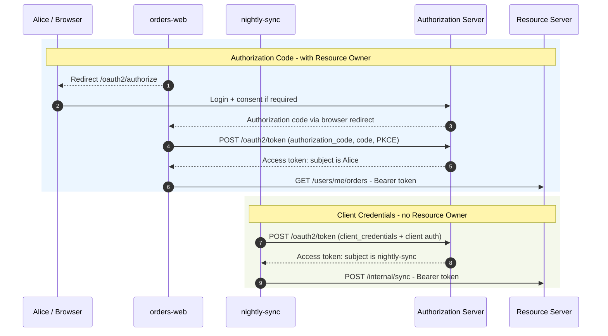

# Distinguishing a client subject from a user subject

## 1. The problem: is `sub` always a user ID?

In the **Client Credentials** chapter of the **SPRING_SECURITY_OAUTH2_OIDC_AUTHORIZATION_SERVER** module, we learn how to design, configure, secure, test, and operate an OAuth 2.0/OpenID Connect Authorization Server with **Spring Security**, **Spring Authorization Server**, and **Spring Boot**.

One of the most dangerous authorization bugs is treating the `sub` (*subject*) value in every access token as a **user ID**. That is only true when the token was issued in the right context, such as an Authorization Code Flow where a user logged in. With the **Client Credentials Grant**, the client obtains a token **on behalf of the application itself**, with no Resource Owner (end user) involved.

For example:

- A web app `orders-web` helps Alice view her orders. A token issued via `authorization_code` has a subject representing **Alice**; the token also needs to identify the `orders-web` application that requested authorization.
- A background task `nightly-sync` automatically synchronizes inventory. A token issued via `client_credentials` has a subject representing **nightly-sync** or a machine/application identifier managed by the Authorization Server. It **does not prove Alice, Bob, or any user is logged in**.

If an API handles both tokens with code like `findUserById(jwt.getSubject())`, a service token can be mistaken for a user account. When a client identifier matches the name of a privileged user, the consequence can be **identity confusion and privilege escalation**.

### Learning outcomes

After this lesson, you will be able to:

1. Explain `sub`, `client_id`, principal, Resource Owner, and grant type across both flows.
2. Distinguish a token representing an application from a token issued when a user grants authorization.
3. Understand how Spring Authorization Server stores principals and customizes access token claims.
4. Safely check the subject type in Spring Security Resource Server, beyond checking signatures and scopes.
5. Design machine-to-machine (M2M) APIs and user-facing APIs with separate policies.
6. Write tests preventing service tokens from impersonating users, even when `sub` shares a name.

## 2. Understanding `subject` and related identities

**Subject** is the entity to which a token refers. For a JWT, the `sub` claim must be interpreted according to the **issuer**, **token type**, **grant context**, and contract between the Authorization Server and Resource Server. A string like `"alice"` or `"nightly-sync"` alone does not prove whether it is a user or a client.

| Attribute | Question answered | Example |
| --- | --- | --- |
| `iss` (*issuer*) | Who issued the token and defines the subject identifier namespace? | `https://auth.example.com` |
| `sub` (*subject*) | Who/what is the primary entity the token refers to? | `user-1042` or `nightly-sync` |
| `client_id` | Which OAuth application was identified when receiving the token? | `orders-web`, `nightly-sync` |
| `aud` (*audience*) | Which Resource Server is the token issued for? | `orders-api` or `internal-sync-api` |
| `scope` | Which access scopes were granted to the token? | `orders.read`, `inventory.sync` |
| `exp`, `nbf`, `iat` | During which time window may the token be used? | Unix timestamps |
| Grant type | By which mechanism was the token issued? | `authorization_code`, `client_credentials` |
| Spring Security Principal | Who does the currently processed Authentication represent? | `JwtAuthenticationToken` at the API; logged-in principal or client at the Authorization Server |

**Note:** `grant_type` is an OAuth 2.0 request parameter at the token endpoint; it is **not a mandatory standard claim in every JWT access token**. If a Resource Server needs to distinguish by grant, the Authorization Server must provide a reliable signal per an agreed contract—such as an internal `principal_type` or `authorization_grant_type` claim—and the Resource Server must verify the token before trusting that signal.

### Easily misunderstood terms

- **Client**: the application accessing resources, typically identified via `client_id`.
- **Resource Owner**: the entity capable of granting access to resources, usually a human user.
- **Principal**: the authenticated entity in a processing step; it can be a client or a user depending on the endpoint/grant.
- **Subject**: the entity identified by the `sub` claim in a given token.
- **Actor (executing party)**: the application/delegate performing an action. In multi-tier delegation systems, actor and subject may differ and require separate modeling.

Never infer that because a token is presented by an application, `sub` must be a client; nor infer that because an API serves user data, the token always carries a user subject.

## 3. Comparing Authorization Code with Client Credentials

| Criterion | Authorization Code Flow | Client Credentials Flow |
| --- | --- | --- |
| Typical goal | Client accesses resources **on behalf of an authorizing user** | Application accesses resources **on its own behalf** |
| Interactive Resource Owner? | Yes in the standard authorization flow | **No** |
| Browser authorization request? | Yes, with `response_type=code` | No |
| Token request | `grant_type=authorization_code` and `code` | `grant_type=client_credentials` |
| Client authentication | Depends on registered client type; confidential clients authenticate, public clients use PKCE | Client must authenticate; this grant is for confidential clients |
| PKCE | Used to bind the authorization code | No code exists to use PKCE |
| User consent | May be required per configuration/policy | No end-user consent screen |
| Meaning of access token `sub` | Usually user identifier, per issuer rules | Usually application/client identifier, per issuer rules |
| `client_id` | Identifier of the authorized application | Identifier of the authenticated, authorized application |
| API permissions | Permissions granted to user/client in the authorization | Permissions intended for the application/service |
| OIDC ID Token | May be present on valid OIDC requests | Not an OIDC user login flow |
| Refresh token | May be issued per policy and client type | Per RFC 6749, **should not** issue refresh tokens in this grant |

### Diagram of both flows



**Key takeaway:** An API should only accept tokens with the right **audience**, right **principal type**, and sufficient **effective permissions**. A token from `nightly-sync` can have a valid signature and expiration yet still must be rejected on an endpoint requiring a logged-in user.

## 4. How does RFC 9068 guide subject interpretation?

**RFC 9068** defines an OAuth 2.0 JWT access token profile so Authorization Servers and Resource Servers can agree on a consistent token structure.

According to this profile:

- Tokens issued from grants **with a Resource Owner**, e.g., `authorization_code`: `sub` **SHOULD** correspond to the Resource Owner's subject identifier.
- Tokens issued from grants **without a Resource Owner**, e.g., `client_credentials`: `sub` **SHOULD** correspond to the identifier the Authorization Server uses to refer to the **client application**.
- The `client_id` claim is **REQUIRED** in the access token under this profile to identify the associated OAuth client.
- `iss`, `aud`, `exp`, `iat`, `jti`, and other JWT protection requirements belong to the profile; the Resource Server must verify them per applicable rules.

The **SHOULD** in an RFC is a reasoned standard recommendation; it does not mean every product uses the exact `client_id` string as `sub`. An Authorization Server may choose another stable client identifier, provided it is clearly defined and verified.

**Do not equate every Spring Authorization Server JWT access token with a fully RFC 9068-compliant token.** The framework can produce self-contained JWTs with default or customized claims and headers; claiming RFC 9068 profile compliance requires verifying **all** conditions around claims, `typ=at+jwt` header, audience, validation, and protocol rules—not just adding `client_id`.

### Two illustrative tokens

Token A: client `orders-web` executing Authorization Code Flow for Alice:

```json
{
  "iss": "https://auth.example.com",
  "sub": "user-1042",
  "client_id": "orders-web",
  "aud": ["orders-api"],
  "scope": "orders.read",
  "exp": 1800000000,
  "principal_type": "user"
}
```

Token B: service `nightly-sync` executing Client Credentials Flow:

```json
{
  "iss": "https://auth.example.com",
  "sub": "nightly-sync",
  "client_id": "nightly-sync",
  "aud": ["internal-sync-api"],
  "scope": "inventory.sync",
  "exp": 1800000000,
  "principal_type": "client"
}
```

These are **abbreviated, illustrative payloads**: `principal_type` is a **custom internal claim**, not a required RFC 9068 claim. Real tokens also have headers, signatures, and potentially other claims. The `exp` values merely illustrate format and must never be used as real tokens.

In Token A, `sub` and `client_id` are **different** because Alice is the subject, while `orders-web` is the client that requested authorization. In Token B, the two values **may be identical** because the client was chosen as the subject; this equality **is not a reliable check for determining principal type**.

### The identifier collision problem (subject collision)

Suppose an admin user has `sub=admin` and the Authorization Server lets a customer register a client with `client_id=admin`. If the service token also carries `sub=admin`, a Resource Server relying solely on `sub` could mistake the application for an administrator. RFC 9068 specifically warns about this class of risk.

Architectural solutions:

1. Control namespaces and approve `client_id` upon registration; never let clients choose names impersonating privileged user subjects.
2. Use **distinct, stable identifiers** between users and clients, such as `usr:1042` and `svc:nightly-sync` if the ecosystem follows that convention.
3. Emit a trusted subject-type claim such as `principal_type` at the issuer; never let clients pass it arbitrarily in the token request.
4. The Resource Server enforces grant/subject type per endpoint policy **after** validating the token.
5. When using multiple issuers or tenants, validate the `(iss, sub)` pair and tenant/namespace per contract rather than comparing `sub` in isolation.

## 5. Client Credentials: authenticating an application, not logging in a user

A backend client named `nightly-sync` has been registered with:

- `client_id=nightly-sync`;
- authentication method `client_secret_basic`;
- allowed grant `client_credentials`;
- allowed scope `inventory.sync`.

To get an access token, it calls the token endpoint over HTTPS:

```http
POST /oauth2/token HTTP/1.1
Host: auth.example.com
Authorization: Basic <base64-encoded-client-credentials>
Content-Type: application/x-www-form-urlencoded

grant_type=client_credentials&scope=inventory.sync
```

Values in angle brackets in the example are placeholders. In real requests, the client uses HTTP Basic per OAuth 2.0 credential encoding rules and **never writes secrets to URLs/logs**.

The Authorization Server performs:

1. Looks up `RegisteredClient` from the submitted credentials.
2. Authenticates the client using the registered method and checks credential status/expiry.
3. Verifies the client is allowed `AuthorizationGrantType.CLIENT_CREDENTIALS`.
4. Verifies requested scopes are valid and permitted per registration/policy.
5. Creates an `OAuth2Authorization` with the **client** as principal, and issues an access token representing the application.

An illustrative response:

```http
HTTP/1.1 200 OK
Content-Type: application/json
Cache-Control: no-store
Pragma: no-cache

{
  "access_token": "ACCESS_TOKEN_VALUE",
  "token_type": "Bearer",
  "expires_in": 300,
  "scope": "inventory.sync"
}
```

In the standard Client Credentials Flow, **there is no need for** `/oauth2/authorize`, `authorization_code`, `state`, PKCE, user login pages, or end-user consent screens. The token is issued to an authenticated client, so the API must never interpret it as proof that "Alice just logged in".

### Difference from Authorization Code Flow

A web application wanting to read Alice's invoices must interact with the user:

```http
GET /oauth2/authorize?response_type=code&client_id=orders-web&redirect_uri=https%3A%2F%2Forders.example.com%2Fcallback&scope=orders.read&state=CLIENT_STATE&code_challenge=PKCE_CHALLENGE&code_challenge_method=S256 HTTP/1.1
Host: auth.example.com
```

After valid login/consent and a callback containing the code, the client exchanges the code:

```http
POST /oauth2/token HTTP/1.1
Host: auth.example.com
Authorization: Basic <base64-encoded-web-client-credentials>
Content-Type: application/x-www-form-urlencoded

grant_type=authorization_code&code=CODE_VALUE&redirect_uri=https%3A%2F%2Forders.example.com%2Fcallback&code_verifier=PKCE_VERIFIER
```

The resulting token is issued in **user Alice's context**; it is still associated with client `orders-web`, yet `client_id` does not replace the user's `sub`. If OIDC is deployed, the ID Token holds the user's identity subject for the **Relying Party**; an ID Token is not an access token for calling APIs.

## 6. How does Spring Authorization Server store the principal?

Spring Authorization Server uses `RegisteredClient`, `OAuth2Authorization`, and `OAuth2TokenContext` to process each grant. Relevant classes/properties:

| Component | Role | Key takeaway |
| --- | --- | --- |
| `RegisteredClient.clientId` | Public client identifier | Not a user ID |
| `RegisteredClient.id` | Internal client registration ID | Distinct from `clientId` |
| `OAuth2Authorization.principalName` | Principal name of Resource Owner **or client** | Must be interpreted alongside `authorizationGrantType` |
| `OAuth2Authorization.authorizationGrantType` | Mechanism that created the authorization | `CLIENT_CREDENTIALS` or `AUTHORIZATION_CODE` |
| `OAuth2Authorization.authorizedScopes` | Scopes granted in the authorization | Not equivalent to user permission groups |
| `JwtEncodingContext.getPrincipal()` | Authentication of Resource Owner **or client** during token generation | Do not assume it is always a user |
| `JwtEncodingContext.getRegisteredClient()` | Client currently being processed | Used to retrieve client ID for consistent claims |
| `JwtEncodingContext.getAuthorizationGrantType()` | Grant of the token issuance operation | May be `REFRESH_TOKEN` when re-issuing a token |
| `JwtEncodingContext.getAuthorization()` | Associated authorization, if present | Useful for inspecting the **original grant** during refresh |

Spring Authorization Server models `OAuth2Authorization` as an authorization state granted to a client **by a Resource Owner or by the client itself** when using `client_credentials`. In this grant, an authorization typically holds only an access token; by default there is no refresh token or authorization code.

### Reading `principalName` together with grant type

Example **internal administrative** snippet reading a stored authorization:

```java
import org.springframework.security.oauth2.core.AuthorizationGrantType;
import org.springframework.security.oauth2.server.authorization.OAuth2Authorization;

public String describeSubject(OAuth2Authorization authorization) {
    AuthorizationGrantType grant = authorization.getAuthorizationGrantType();
    String principal = authorization.getPrincipalName();

    if (AuthorizationGrantType.CLIENT_CREDENTIALS.equals(grant)) {
        return "Application/client: " + principal;
    }
    if (AuthorizationGrantType.AUTHORIZATION_CODE.equals(grant)) {
        return "User/Resource Owner: " + principal;
    }
    return "Other grant: check the corresponding identity model";
}
```

This is a **model-reading** example, not authorization policy code for a Resource Server. For other grants (device authorization, token exchange, refresh token, etc.), inspect the original context and supported mechanisms. With a **refresh token**, the token request carries `grant_type=refresh_token` while the original authorization may still belong to a Resource Owner from the Authorization Code Flow.

Avoid using `principalName` as a unique key into a users table. Depending on issuer design, a principal name may be a client ID, user ID, alias, or another internal identifier.

### Verifying claims inside the JWT

For JWT access tokens, Spring Authorization Server can populate the subject from the principal in the token context and allow claim customization. **Inspect actual tokens from your running version/configuration**: default claims depend on the token generator, grant, token format, and registered `OAuth2TokenCustomizer`. Never build a Resource Server around guesswork about every claim present in every token.

Instead of forcing all subjects into one `users` table, model typed identities:

```text
Trusted issuer: https://auth.example.com

Access token A:
  principal_type = user
  sub            = user-1042
  client_id      = orders-web
  meaning        = orders-web granted permission in user-1042's context

Access token B:
  principal_type = client
  sub            = nightly-sync
  client_id      = nightly-sync
  meaning        = nightly-sync granted permission for the application itself
```

`principal_type` here is a convention **issued by the Authorization Server itself**, never taken from an untrusted request parameter.

## 7. Customizing access tokens so the Resource Server distinguishes subjects clearly

If an API exposes both user and machine-to-machine endpoints, relying solely on `sub` or checking `scope` may be insufficient. One option is adding a subject-type claim to the **JWT access token** in Spring Authorization Server.

### 7.1. Setting the `principal_type` claim from a trusted grant

Java example illustrating Spring Authorization Server APIs:

```java
package com.example.authserver;

import java.util.List;

import org.springframework.context.annotation.Bean;
import org.springframework.context.annotation.Configuration;
import org.springframework.security.oauth2.core.AuthorizationGrantType;
import org.springframework.security.oauth2.server.authorization.OAuth2Authorization;
import org.springframework.security.oauth2.server.authorization.OAuth2TokenType;
import org.springframework.security.oauth2.server.authorization.token.JwtEncodingContext;
import org.springframework.security.oauth2.server.authorization.token.OAuth2TokenCustomizer;

@Configuration
public class PrincipalTypeTokenConfig {

    @Bean
    OAuth2TokenCustomizer<JwtEncodingContext> accessTokenClaims() {
        return context -> {
            // Do not arbitrarily alter claims of an ID Token or authorization code.
            if (!OAuth2TokenType.ACCESS_TOKEN.equals(context.getTokenType())) {
                return;
            }

            String clientId = context.getRegisteredClient().getClientId();
            context.getClaims().claim("client_id", clientId);

            // On refresh, the current issuance grant is REFRESH_TOKEN.
            // Prefer the original grant stored in OAuth2Authorization if present.
            OAuth2Authorization authorization = context.getAuthorization();
            AuthorizationGrantType originalGrant = authorization != null
                    ? authorization.getAuthorizationGrantType()
                    : context.getAuthorizationGrantType();

            if (AuthorizationGrantType.CLIENT_CREDENTIALS.equals(originalGrant)) {
                context.getClaims().claim("principal_type", "client");
                context.getClaims().audience(List.of("internal-sync-api"));
            } else if (AuthorizationGrantType.AUTHORIZATION_CODE
                    .equals(originalGrant)) {
                context.getClaims().claim("principal_type", "user");
                context.getClaims().audience(List.of("orders-api"));
            }
            // Other grants: do not label as "user" by default.
            // Add explicit policy before the API accepts them.
        };
    }
}
```

**Scope and assumptions of this example:**

- There is one `OAuth2TokenCustomizer<JwtEncodingContext>` in the Authorization Server configuration. If the application already defines a bean of the same type, **merge the logic** instead of registering conflicting beans.
- The illustrative system has two primary grant groups: `CLIENT_CREDENTIALS` for services and `AUTHORIZATION_CODE` for users. `REFRESH_TOKEN` is resolved via the original authorization when available.
- Assigning `aud` based on grant here is **only an example**. Production must determine audience based on **target Resource Server, scope, client registration, and policy**. Multiple APIs/user flows can share a grant while having different audiences; do not copy this simple mapping directly for every client.
- The `principal_type` claim is an internal contract between issuer and Resource Server. When the claim is missing or the grant is unsupported, sensitive APIs must **deny by default**.
- The sample does not alter `sub`; for stability, never overwrite subject with `context.getPrincipal().getName()` across all grants. During refresh or certain extension grants, the current principal may be the client while the original authorization's subject is a user.
- If using **opaque/reference tokens** instead of JWTs, `JwtEncodingContext` is not the claim emission path for those tokens. Customize metadata/introspection or `OAuth2TokenCustomizer<OAuth2TokenClaimsContext>` per the appropriate generator.

### 7.2. Should you prefix `sub` with `svc:`?

Separating namespaces like `usr:1042` and `svc:nightly-sync` can help reduce collisions, yet **changing `sub` changes an identity contract**. Check:

- Does any existing Resource Server store `sub` as a foreign key linking data?
- Will the new claim stay stable across restarts and refreshes?
- Do OAuth2 Authorization Service, introspection, audits, or downstream systems need compatibility with the old subject?
- If OIDC is enabled, does the **user's ID Token subject** preserve the OIDC contract without arbitrary mutation?

If you choose to add a prefix, apply it in the **client-type access token** issuance path under a tested policy rather than applying it indiscriminately to every token. Adding `principal_type` also does not replace protecting `client_id` registration against impersonation.

## 8. Spring Security Resource Server: checking the right subject type

When Spring Security Resource Server accepts a Bearer JWT, it typically creates a `JwtAuthenticationToken`. With default configuration:

- `Authentication.getPrincipal()` is a **`Jwt`** object, not automatically a `UserDetails`.
- `Authentication.getName()` typically reads from the **`sub`** claim if present; reading that name **does not prove** the subject is a user.
- Scopes in the JWT are mapped to authorities like `SCOPE_inventory.sync` or `SCOPE_orders.read`.
- The JWT decoder validates signature, `iss`, expiration, and configured validators. **Audience** and **principal type** must be checked per API contract if not already handled by validators.

An anti-pattern:

```java
// Do not use for APIs accepting both client tokens and user tokens:
String userId = authentication.getName(); // usually JWT.sub
User user = userRepository.findById(userId).orElseThrow();
```

In M2M, `authentication.getName()` may be `nightly-sync`. The snippet above mistakes a client name for a user ID. The fix must start from **endpoint policy**, not merely tweaking the query.

### 8.1. Two distinct endpoint policies

| Example endpoint | Accepted subject | Audience | Authority |
| --- | --- | --- | --- |
| `POST /api/internal/sync` | `principal_type=client` | `internal-sync-api` | `SCOPE_inventory.sync` |
| `GET /api/users/me/orders` | `principal_type=user` | `orders-api` | `SCOPE_orders.read` |

For `/api/users/me/orders`, the user ID must come from the subject **after** verifying it is a user token—never from `client_id`, a query string, or a caller-supplied HTTP header.

### 8.2. Example rules at the Resource Server

This is **an example configuration on a standalone Resource Server**, tailored to the claim contract created in section 7. Each rule checks **audience, principal_type, and scope together**:

```java
package com.example.resource;

import java.util.function.Supplier;

import org.springframework.context.annotation.Bean;
import org.springframework.context.annotation.Configuration;
import org.springframework.http.HttpMethod;
import org.springframework.security.authorization.AuthorizationDecision;
import org.springframework.security.config.Customizer;
import org.springframework.security.config.annotation.web.builders.HttpSecurity;
import org.springframework.security.config.http.SessionCreationPolicy;
import org.springframework.security.core.Authentication;
import org.springframework.security.oauth2.jwt.Jwt;
import org.springframework.security.oauth2.server.resource.authentication.JwtAuthenticationToken;
import org.springframework.security.web.SecurityFilterChain;

@Configuration
public class ResourceApiSecurity {

    @Bean
    SecurityFilterChain apiFilterChain(HttpSecurity http) throws Exception {
        return http
                // Only for stateless APIs using Bearer tokens,
                // without cookies authenticating state-changing operations.
                .csrf(csrf -> csrf.disable())
                .sessionManagement(session -> session
                        .sessionCreationPolicy(SessionCreationPolicy.STATELESS))
                .authorizeHttpRequests(auth -> auth
                        .requestMatchers(HttpMethod.POST, "/api/internal/sync")
                        .access((authentication, context) -> allow(
                                authentication.get(),
                                "client", "internal-sync-api", "inventory.sync"))
                        .requestMatchers(HttpMethod.GET, "/api/users/me/orders")
                        .access((authentication, context) -> allow(
                                authentication.get(),
                                "user", "orders-api", "orders.read"))
                        .anyRequest().denyAll())
                .oauth2ResourceServer(resource -> resource
                        .jwt(Customizer.withDefaults()))
                .build();
    }

    private static AuthorizationDecision allow(
            Authentication authentication,
            String requiredPrincipalType,
            String requiredAudience,
            String requiredScope) {

        if (!(authentication instanceof JwtAuthenticationToken jwtAuth)
                || !authentication.isAuthenticated()) {
            return new AuthorizationDecision(false);
        }

        Jwt jwt = jwtAuth.getToken();
        boolean subjectTypeMatches = requiredPrincipalType.equals(
                jwt.getClaimAsString("principal_type"));
        boolean audienceMatches = jwt.getAudience().contains(requiredAudience);
        boolean scopeMatches = authentication.getAuthorities().stream()
                .anyMatch(authority -> ("SCOPE_" + requiredScope)
                        .equals(authority.getAuthority()));

        return new AuthorizationDecision(
                subjectTypeMatches && audienceMatches && scopeMatches);
    }
}
```

The rule above runs **after** Spring Security Resource Server receives and validates the token via `oauth2ResourceServer().jwt()`; inspecting claims inside a JWT without verifying its signature is unsafe.

Example issuer configuration so the Resource Server uses the Authorization Server's metadata:

```yaml
spring:
  security:
    oauth2:
      resourceserver:
        jwt:
          issuer-uri: https://auth.example.com
```

In real deployments, configure a JWT decoder and validators matching your version, verifying issuer, signature, TTL, audience/token type, allowed algorithms, and revocation policy where needed. In this rule example, **audience is checked per endpoint**; if a Resource Server serves only one audience, configure an audience validator at the decoder layer to reject JWTs intended for other systems early.

**Important caveat:** disabling CSRF with `csrf.disable()` in the example is appropriate only when the API is **purely stateless Bearer** and does not rely on cookies/sessions to authenticate requests. For web apps with cookies, configure proper per-endpoint CSRF policies instead of copying this blindly.

### 8.3. Why checking `SCOPE_orders.read` alone is still not enough

Suppose due to a configuration mistake, an M2M client is granted the `orders.read` scope. If the endpoint only has:

```java
// Incomplete example missing type check; do not use as a full policy.
auth.requestMatchers("/api/users/me/orders")
    .hasAuthority("SCOPE_orders.read");
```

The API may allow the application token past the scope rule. If the controller goes on to use `getName()` as the user ID, an authorization flaw occurs. You must check **both the right subject type** and **the specific scope**, along with audience, and read the user ID only in the branch that confirms a user token.

Sometimes **a service is permitted to access a user's orders under an explicit admin-assigned privilege**, yet that is a **service-to-resource access** policy (e.g., a managed service accessing an assigned set of users/tenants)—it **does not mean the service token is a user token**. The API must clearly represent and audit "service X accessed record Y under permission Z".

## 9. Security boundaries that are easy to break

### 9.1. Subject collision and arbitrary client ID registration

If a system lets clients choose a `client_id` matching a privileged user's `sub`, an API reading only `sub` can easily conflate the two identities. Safeguards must exist on **both** the Authorization Server (namespace governance, client registration) and the Resource Server (principal classification, audience, scope, policy).

### 9.2. Renaming a claim does not create user-delegated authorization

Adding a `user_id=alice` claim to an M2M token **does not turn** that token into an access token authorized by Alice. A client might process Alice's data under a legitimate business job, but that permission must derive from an approved service policy, tenant/resource authorization, and clear auditing of the action's source. Never let a client pass an arbitrary `user_id` parameter and copy it into the `sub` claim.

### 9.3. Tenant identity is not user identity

An M2M service may be deployed for tenant A while the API stores data for multiple tenants. `principal_type=client` and `scope=inventory.sync` do not determine whether the token may write **tenant B**'s data. Beyond type and scope, the API must verify a trusted tenant/resource binding (such as a `tenant_id` issued by the issuer from registration/policy, or a backend client–tenant mapping).

Never let a caller swap `tenant_id` in the request and treat that as sufficient proof; even a signed JWT does not guarantee tenant authorization if the Authorization Server populates claims from unchecked input.

### 9.4. Audience and token substitution

A valid token for `inventory-api` must never be accepted at `billing-api` even with the same issuer and overlapping scope names. Checking `aud` prevents cross-service token misuse; checking principal type and specific permissions prevents misuse across purposes.

When applying the full JWT Access Token Profile, also verify token type/headers to prevent an **ID Token from being used in place of an access token**. Never accept a token at an API merely because it decodes as a JWT or contains a `sub` claim.

### 9.5. Refresh tokens and the original identity

In the Authorization Code Flow, if a client receives a refresh token and uses it to get a new access token, that request carries `grant_type=refresh_token`. The client still authenticates if confidential; however, **the new access token's subject must still reflect the original authorization** per policy. Never grab the authenticating client's name at the refresh endpoint to overwrite the user's `sub`.

The standard Client Credentials Flow **has no refresh token**: the application re-authenticates when it needs a new access token.

### 9.6. When acting "on behalf of a user" across multiple services

Suppose service A receives Alice's request and needs to call service B with Alice's permissions:

- Use an appropriate flow involving the Resource Owner to obtain an access token with Alice's context and the proper audience; or
- Apply **OAuth 2.0 Token Exchange (RFC 8693)** / delegation if the Authorization Server genuinely supports it and enforces the required constraints, actor, and permissions.

Never issue a `client_credentials` access token and set `sub=alice` to simulate delegation. In token exchange, the subject/actor model is richer; inspect `sub`, `act`, audience, and delegation conditions carefully rather than collapsing everything into a single user ID string.

### 9.7. Warning about OAuth2 Client in web applications

Spring Security OAuth2 Client can manage/store an `OAuth2AuthorizedClient` keyed by a logged-in web app user principal to **cache** client-credentials access tokens. The framework storing the token under a username on the **OAuth2 Client integration** side does not change the token's meaning: a token issued via `client_credentials` still represents **the application** to the Resource Server. Do not confuse a "token cache key" with an "end-user-authorized subject".

## 10. Testing both subject types across the entire flow

Tests must traverse the **real Authorization Server, token issuance, and Resource Server validation**, rather than only checking a fixture-assigned `sub` string. Both token types must receive identities, audiences, and scopes according to defined policy.

### 10.1. Preparing fixtures

Suppose the test environment has:

| Client | Grant | Expected principal | Scope | Audience |
| --- | --- | --- | --- | --- |
| `nightly-sync` | `client_credentials` | `nightly-sync` (client) | `inventory.sync` | `internal-sync-api` |
| `orders-web` | `authorization_code` | `user-1042` (user) | `orders.read` | `orders-api` |
| `evil-same-name` | `client_credentials` | A simulated client | Restricted test scope | Test audience |

For the `evil-same-name` test, do not actually allow clients to self-register a `client_id` impersonating an admin in production. Simulate the collision via issuer/test fixtures in an isolated environment to verify the Resource Server **does not grant user permissions based on matching subject names**.

### 10.2. Test matrix

| ID | Scenario | Expected outcome |
| --- | --- | --- |
| SUB-01 | `nightly-sync` requests a token with valid `client_credentials` | Issues access token representing **client**, with no user authentication |
| SUB-02 | M2M JWT calls `POST /api/internal/sync` | Allowed if signature, issuer, audience, expiry, type, and scope are all valid |
| SUB-03 | Same M2M token calls `GET /api/users/me/orders` | **Rejected**, even if `sub` looks like a user ID |
| SUB-04 | `orders-web` completes Authorization Code Flow for Alice | Token has the proper user subject and `orders-web` client ID |
| SUB-05 | User token calls `GET /api/users/me/orders` | Allowed if audience, user type, and scope match |
| SUB-06 | User token calls `POST /api/internal/sync` | **Rejected** if endpoint allows only client tokens |
| SUB-07 | Client token has valid scope but wrong `aud` | **Rejected** at Resource Server |
| SUB-08 | Token has valid signature but lacks `principal_type` | **Denied by default** on endpoints requiring type |
| SUB-09 | Token has `principal_type=user` but only service scopes | Rejected because not all conditions are met |
| SUB-10 | M2M token has `sub` altered from client ID to user ID after signing | Rejected due to invalid signature |
| SUB-11 | Token has `sub` matching an admin username but `principal_type=client` | Never gains access as an admin user |
| SUB-12 | Client without `client_credentials` registered sends this grant | Token endpoint rejects |
| SUB-13 | Wrong client secret or authentication key | Token endpoint rejects client authentication |
| SUB-14 | Client has valid token but lacks `inventory.sync` scope | Sync endpoint rejects |
| SUB-15 | Client belonging to tenant A accesses tenant B data | Rejected per tenant/resource binding |
| SUB-16 | Expired user access token or wrong `iss` | Rejected before the controller uses the subject |
| SUB-17 | Client sends ID Token instead of Bearer access token | Rejected per token type and audience rules |
| SUB-18 | Refresh token from authorization code issues new access token | **Remains a user subject**; does not flip to client subject because token request used client auth |
| SUB-19 | Token receives an unclassified grant (e.g., extension) | Not labeled `user` by default; API grants no out-of-policy access |
| SUB-20 | Resource Server merely reads `authentication.getName()` as user ID | Test exposes the design flaw and confirms the new policy blocks client tokens |

### 10.3. Hands-on scenario 1: obtaining a service token

In PowerShell, using test credentials registered at the local Authorization Server:

```powershell
# For lab use. Do not put production client secrets into command history.
$serviceResponse = curl.exe -sS `
    -u "nightly-sync:lab-only-secret" `
    -H "Content-Type: application/x-www-form-urlencoded" `
    --data-urlencode "grant_type=client_credentials" `
    --data-urlencode "scope=inventory.sync" `
    "http://localhost:9000/oauth2/token" | ConvertFrom-Json

if (-not $serviceResponse.access_token) {
    throw "Did not receive service access token"
}
$serviceToken = $serviceResponse.access_token
```

In real systems, replace localhost HTTP with HTTPS, use a secret manager instead of inline credentials, and never output access tokens to logs.

Decode the JWT payload **only to inspect claims, not to verify the signature**:

```powershell
$segments = $serviceToken.Split('.')
if ($segments.Length -ne 3) {
    throw "Token is not a 3-part JWT; it may be an opaque token"
}
$base64 = $segments[1].Replace('-', '+').Replace('_', '/')
$base64 += "=" * ((4 - ($base64.Length % 4)) % 4)
$payload = [Text.Encoding]::UTF8.GetString(
    [Convert]::FromBase64String($base64)) | ConvertFrom-Json

$payload | Select-Object iss, sub, client_id, principal_type, aud, scope, exp
```

Expectation per the contract **customized in section 7**:

```text
sub             = nightly-sync (or client identifier defined by the issuer)
client_id       = nightly-sync
principal_type  = client
aud             = internal-sync-api
scope           = inventory.sync
```

Call both endpoints with that token:

```powershell
curl.exe -i -H "Authorization: Bearer $serviceToken" `
    "http://localhost:9100/api/internal/sync" -X POST

curl.exe -i -H "Authorization: Bearer $serviceToken" `
    "http://localhost:9100/api/users/me/orders"
```

In the matching demo setup, the sync endpoint should succeed while the endpoint requiring a user subject **must reject**. Ports 9000/9100 are example conventions; both apps must be running with matching issuer, JWK, endpoints, and policies to execute these commands.

### 10.4. Hands-on scenario 2: obtaining a user token

Complete Authorization Code + PKCE for `orders-web` in the browser, sign in as a test user, approve `orders.read` if prompted, and exchange the authorization code at the token endpoint. Compare:

```text
sub             = user-1042 (or user identifier defined by the issuer)
client_id       = orders-web
principal_type  = user
aud             = orders-api
scope           = orders.read
```

Do not test by hand-crafting the JSON above and treating it as a JWT. The token must be signed by the Authorization Server and verified by the Resource Server using the issuer's keys/validators. To isolate failure causes, add tests using validly signed JWTs with wrong scope/audience/type controlled by test fixtures.

### 10.5. Application-level principal type testing

When running tests, capture at minimum:

1. The grant processed by the Authorization Server and the authenticated client ID.
2. `sub`, `client_id`, and `principal_type` of the valid access token.
3. Audience and scopes.
4. API call outcomes on both allowed and denied paths.
5. Safe logs confirming which type/audience/scope policy blocked the request, **without containing raw tokens**.

Do not just verify HTTP 200 on one route and assume user routes are safe. Include at least one **negative test** at every machine/user boundary.

## 11. Layered troubleshooting

| Symptom | Possible failing layer | How to diagnose |
| --- | --- | --- |
| `invalid_client` at `/oauth2/token` | Client authentication | Check client ID, secret/key, method, expiry |
| `unauthorized_client` | Grant restricted on client registration | Check `RegisteredClient.authorizationGrantTypes` |
| `invalid_scope` | Requested scope exceeds registration or policy | Compare against permitted scopes |
| M2M token has client ID as `sub` | **Normal** in the Client Credentials model | Verify grant and issuer; do not treat as a user error |
| Token has user `sub` but different `client_id` | Authorization Code Flow or user-involved flow | Verify the authorized client; do not conflate the two claims |
| M2M token gets 403 on user route | Resource Server properly rejecting per type/policy | Do not relax rules just to make the request pass |
| User token gets 403 on machine route | Resource Server requires client subject | Clarify endpoint purpose; never arbitrarily alter `sub` |
| Token has right issuer and signature yet returns 401 | Audience, expiry, token type, or another validator | Inspect validation errors and JWT decoder configuration |
| API sees `authentication.getName()=nightly-sync` | Resource Server JWT principalName defaults to `sub` | Must check `principal_type` before user processing |
| Refreshed token unexpectedly has `principal_type=client` | Customizer inferred type from the **refresh request's** grant or current principal | Base subject type on the original authorization |
| Token lacks `client_id` | Token profile/creator has not added the claim | Check RFC 9068 requirements and issuer customization rules |
| API accepts user ID from body in an M2M request | Business authorization lacks resource/tenant binding | Re-evaluate policy, auditing, and client–resource mapping |

### Safe operational observability

In internal logs, you may record **correlation ID**, issuer, verified client ID, principal type, grant type, endpoint group, audience, authorization decision, and categorized error codes. Avoid logging:

- Raw Bearer access tokens, refresh tokens, authorization codes, or client secrets.
- ID Tokens, private keys, and full JWT payloads if they contain sensitive data.
- User identifiers beyond diagnostic needs and authorized access permissions.

When analyzing a rejected request, start at the token validation layer (issuer, signature, audience, expiry, type) before checking business authorization (scope, subject type, tenant/resource). This prevents misdiagnosing root causes and patching them incorrectly by adding scopes or disabling validators.

## 12. Applied scenarios and checklist

### Scenario A: service named like an administrator

A service has `client_id=admin` and a Client Credentials token carrying `sub=admin`. The API calls `findUserByUsername("admin")` and grants system-wide data access.

**Issue:** The API equated a client subject with a user. Fix this with safe registration namespaces, verifying `principal_type`, issuer, audience, scope, and separate policies. Never unconditionally treat `sub` as a user ID.

### Scenario B: cron job processing user data

A job runs at 02:00 to send reports to Alice. It uses Client Credentials to read data under approved service permissions.

**Assessment:** The job remains a **client/actor subject**. The fact that records belong to Alice does not mean Alice had a login session at 02:00. The API must verify the service is authorized for that tenant/data scope and audit both the service identity and the accessed data entity.

### Scenario C: API checks scope but forgets subject type

A `/users/me` endpoint requires only `SCOPE_profile.read`. The Authorization Server accidentally grants that scope to an M2M client.

**Assessment:** Right scope, wrong subject type. The endpoint must require a user subject and reject client tokens, or expose a separate M2M API if service-level access is genuinely needed.

### Scenario D: refresh token re-issuing an access token

A web app exchanges an authorization code for Alice's access token, then refreshes it. During the refresh request, the client authenticates itself to the Authorization Server.

**Assessment:** That is no reason to turn the new access token into an application-owned token. Read the **original authorization** and preserve the subject and principal type per the granted contract.

### Scenario E: using an ID Token for API authorization

A mobile app receives an ID Token from OIDC and sends that ID Token as a Bearer token when calling an API.

**Assessment:** An ID Token proves user identity to the OIDC client; the Resource Server requires an **access token** issued with the proper audience/permissions and validated for the correct token type.

### Self-check questions

**Q1.** Does `sub=nightly-sync` prove a user named `nightly-sync` logged in?  
**Answer:** No. In Client Credentials, the subject represents the application per the issuer's contract.

**Q2.** Do `client_id=orders-web` and `sub=user-1042` contradict each other?  
**Answer:** No. Client and user are two distinct roles in the Authorization Code Flow.

**Q3.** Can token type be inferred using `sub == client_id`?  
**Answer:** No. That could just be a string coincidence; the issuer may use a different client subject or collide with a user. Reliable identity and type policies are required.

**Q4.** Is checking only `SCOPE_orders.read` on `/users/me` enough?  
**Answer:** No. Verify token audience/issuer, enforce a user subject type, and apply user/resource rules.

**Q5.** Why shouldn't `context.getPrincipal().getName()` be assigned to `sub` for every new token?  
**Answer:** At steps like refresh, the current principal may be the authenticating client while the valid subject of the original authorization is the Resource Owner.

**Q6.** What should be done if a service truly needs to act on Alice's behalf?  
**Answer:** Design an authorized delegation flow—such as an access token in a user context or token exchange with controlled subject/actor and audience—rather than overwriting `sub` in a client token.

### Pre-production checklist

- [ ] Non-colliding conventions exist for client and user subjects, accounting for issuer/tenant.
- [ ] Unapproved clients cannot choose a `client_id` matching privileged users.
- [ ] Each client is registered with the right grant types, authentication methods, scopes, and audience.
- [ ] JWT access tokens or introspection responses expose **principal type** if APIs need to distinguish them.
- [ ] The principal-type claim is generated by the Authorization Server from a trusted grant/authorization; clients cannot set it.
- [ ] Refresh tokens never convert a user subject into a client subject.
- [ ] Resource Servers verify signature, issuer, audience, token expiry, and token type.
- [ ] Machine endpoints require service type + scope; user endpoints require user type + scope.
- [ ] All user lookups from `sub` happen only after confirming the token carries a user subject.
- [ ] Multi-tenant and resource-ownership policies are enforced independently.
- [ ] ID Tokens are never used to call APIs; users are never faked by modifying claims in M2M tokens.
- [ ] Negative tests cover subject collision, wrong type, wrong audience, wrong scope, and missing claims.
- [ ] Audits distinguish client actors from human users without logging raw tokens or secrets.

### Memory map

```text
Client Credentials:
  Authenticated client: nightly-sync
  Grant: client_credentials
  Access token sub: nightly-sync (or client subject defined by the issuer)
  principal_type: client
  client_id: nightly-sync
  Resource Server: enforce service policy, never treat as a user login

Authorization Code:
  Authenticated Resource Owner: user-1042
  OAuth Client: orders-web
  Grant: authorization_code
  Access token sub: user-1042
  principal_type: user
  client_id: orders-web
  Resource Server: enforce user policy and resource ownership

Common ground:
  JWT signature + iss + aud + exp + scope + subject type
  Claims must be guaranteed by the issuer; never trust unverified payloads
```

**Key takeaway:** With Client Credentials, **the subject is the application**; with an interactive Authorization Code Flow, **the subject is typically the Resource Owner**. `sub` values can look alike while carrying completely different meanings. Building secure Authorization Servers and Resource Servers requires collision-free identifiers, explicit claim contracts, and checking type/audience/scope before accessing data.

## Reference standards

- [RFC 6749 — OAuth 2.0 Authorization Framework](https://www.rfc-editor.org/rfc/rfc6749), especially §4.1 and §4.4 on Authorization Code and Client Credentials.
- [RFC 9068 — JWT Profile for OAuth 2.0 Access Tokens](https://www.rfc-editor.org/rfc/rfc9068), especially §2.2 on `sub` and `client_id`; §5 on subject collisions and token confusion.
- [RFC 8693 — OAuth 2.0 Token Exchange](https://www.rfc-editor.org/rfc/rfc8693), on delegation and actor models when deployed.
- [Spring Authorization Server — Core Model / Components](https://docs.spring.io/spring-authorization-server/reference/core-model-components.html), on `OAuth2Authorization`, `RegisteredClient`, token context, and token generator.
- [Spring Authorization Server — Customize JWT Access Token Claims](https://docs.spring.io/spring-authorization-server/reference/guides/how-to-custom-claims-authorities.html), on `OAuth2TokenCustomizer<JwtEncodingContext>`.
- [Spring Security — OAuth 2.0 Resource Server JWT](https://docs.spring.io/spring-security/reference/servlet/oauth2/resource-server/jwt.html), on JWT validation, `JwtAuthenticationToken`, and scope authorities.
- [Spring Security — OAuth 2.0 Client](https://docs.spring.io/spring-security/reference/servlet/oauth2/), on Client Credentials and storing OAuth2AuthorizedClient by application principal.
