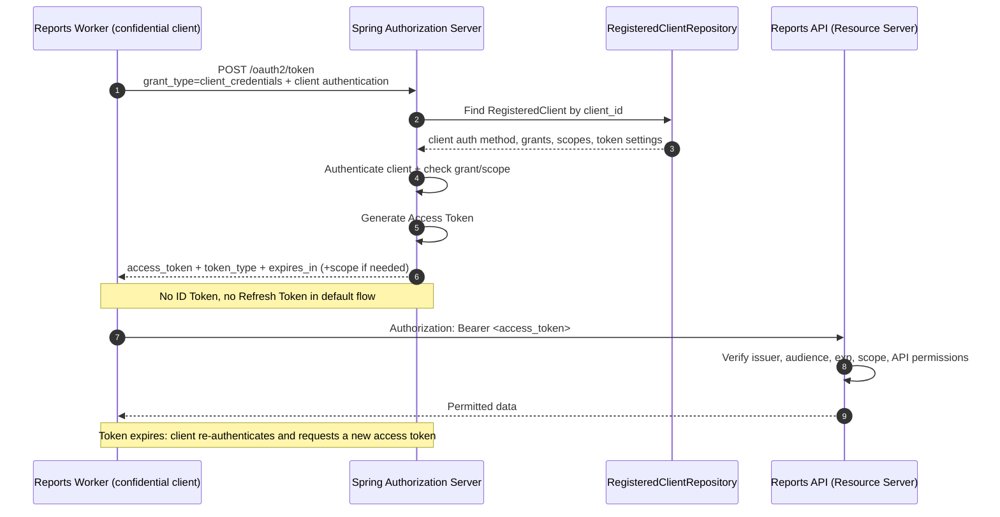
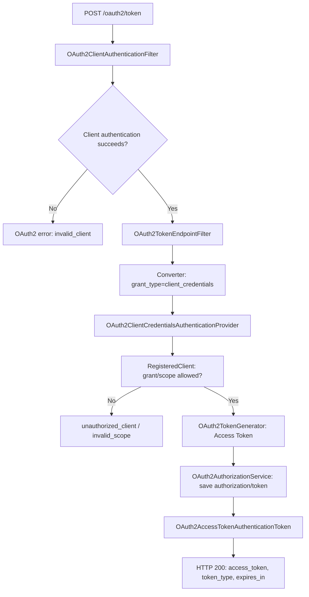
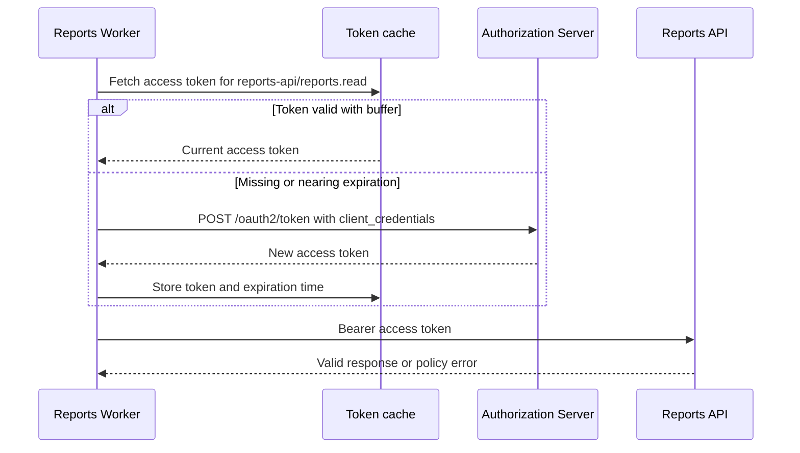

# Restrictions on issuing ID Tokens and Refresh Tokens in this flow

## 1. The problem: why does Client Credentials return only an Access Token?

A `reports-worker` service needs to call `reports-api` to generate scheduled reports. It is registered as a **confidential OAuth 2.0 client** and sends `grant_type=client_credentials` to Spring Authorization Server. The request succeeds; the response includes `access_token`, `token_type`, and `expires_in`, yet **contains no `id_token` or `refresh_token`**.

This is usually **not a bug**. The Client Credentials Grant is designed for **machine-to-machine (M2M)** communication where the client uses **its own identity/permissions**, with no end user logging in or authorizing as in the Authorization Code Flow.

In the Spring Boot context:

- **Spring Security** handles `SecurityFilterChain`s, client authentication, and access token verification at the Resource Server.
- **Spring Authorization Server** implements `/oauth2/token`, authenticates clients, validates allowed grants, and issues tokens.
- **OpenID Connect (OIDC)** adds an end-user authentication layer, notably the **ID Token**. Client Credentials does not establish a user login context for issuing an ID Token.

This lesson belongs to the **Client Credentials** chapter of the `SPRING_SECURITY_OAUTH2_OIDC_AUTHORIZATION_SERVER` module. The goal is to learn how to **design, configure, secure, test, and operate an OAuth 2.0/OpenID Connect Authorization Server with Spring Security and Spring Authorization Server in Spring Boot**, specifically understanding the **ID Token and Refresh Token issuance boundaries** of this grant.

### Learning outcomes

After this lesson, you will be able to:

1. Explain why an **ID Token is not a standard outcome of the Client Credentials Grant**.
2. Distinguish the **`SHOULD NOT`** rule for issuing refresh tokens in RFC 6749 from an absolute prohibition.
3. Understand why `RegisteredClient`, `TokenSettings`, and `OAuth2TokenGenerator` do not automatically turn Client Credentials into a grant that issues refresh/ID tokens.
4. Configure Spring Authorization Server and Spring Security OAuth2 Client to **re-acquire access tokens via client authentication**, without depending on refresh tokens.
5. Design tests, logging, permission limits, and architecture properly when a system serves both human users and machine-to-machine jobs.

> **Version scope:** Primary examples use APIs familiar in **Spring Authorization Server 1.x and Spring Security 6.x**. Certain DSL/extension points may change in Spring Security 7.x. In real deployments, verify exact dependency versions and test token responses against a running server rather than inferring behavior merely from a builder method's existence.

## 2. Whom does the Client Credentials Grant represent?

The **Client Credentials Grant** is defined in **RFC 6749, Section 4.4**: a confidential client can request an access token by authenticating itself at the Token Endpoint. Permissions granted to the client are typically pre-governed between the client-owning organization and the Authorization Server.



There is no browser, redirect URI, authorization code, `code_verifier`, login page, or user consent in the basic machine-to-machine flow. A service may also use an API gateway, workload identity, or certificates, yet those components do not turn this flow into a human login.

### 2.1. Four easily confused identities

| Subject | Example | What it proves |
| --- | --- | --- |
| **Client ID** | `reports-worker` | Public identifier used to look up `RegisteredClient`; not a secret |
| **Client authentication** | Basic secret, `private_key_jwt`, or mTLS | Caller possesses the credential registered for the client |
| **M2M access token principal** | `reports-worker` | Permission context of the service/client; not an end user |
| **OIDC end-user principal** | Employee Alice logging in via Authorization Code + OIDC | User authentication context required for an ID Token |

**Successful client authentication does not mean "a user has logged in".** Using the client's name as `sub` in an M2M JWT access token (when so configured) also **does not** turn `sub` into an OIDC End-User identifier.

## 3. Role of each token type

| Token | Purpose | Recipient/verifier | Client Credentials default |
| --- | --- | --- | --- |
| **Access Token** | Grants permission to call a Resource Server | API verifies token, scope, and policy | **Yes**, if request/grant/client are valid |
| **ID Token** | Conveys claims about an **End-User authentication event** | OIDC Client verifies issuer, audience, `sub`, nonce where applicable | **No** |
| **Refresh Token** | Obtains new access tokens without repeating the full grant flow | Token Endpoint, with client/authorization binding | **No** in default Spring Authorization Server Client Credentials; OAuth spec recommends against issuing |
| **Authorization Code** | Lets a client exchange for tokens after a user authorization request | Token Endpoint and client holding PKCE verifier | **No** |

**An Access Token is not an ID Token.** The Resource Server verifies access tokens; the OIDC Client verifies ID Tokens to trust user authentication information. The two have different audiences, claims, and semantics; never rename a JWT access token to `id_token` just so an integration partner "has all the fields".

### 3.1. Example valid token response

The client sends a request over HTTPS:

```http
POST /oauth2/token HTTP/1.1
Host: auth.example.com
Authorization: Basic <base64-client-id-and-secret>
Content-Type: application/x-www-form-urlencoded
Accept: application/json

grant_type=client_credentials&scope=reports.read
```

`Authorization` here illustrates HTTP Basic; Base64 strings **do not encrypt secrets**, so TLS and secret management remain mandatory. Per OAuth, client ID/secret must be properly formatted for HTTP Basic, including RFC 6749 form-encoding rules when containing special characters. Never build a Basic header via non-standard string concatenation for Unicode or special characters.

Illustrative response:

```http
HTTP/1.1 200 OK
Content-Type: application/json
Cache-Control: no-store
Pragma: no-cache

{
  "access_token": "ACCESS_TOKEN_EXAMPLE",
  "token_type": "Bearer",
  "expires_in": 600,
  "scope": "reports.read"
}
```

The `expires_in=600` value and scope are illustrative only; actual values depend on `TokenSettings` and policy. Never use the string `ACCESS_TOKEN_EXAMPLE` as a real credential. A response containing an **access token without ID/refresh tokens is still a success**.

## 4. Why is there no ID Token?

### 4.1. What does an ID Token mean in OpenID Connect?

Under **OpenID Connect Core 1.0**, an ID Token is a JWT containing authentication claims about an **End-User** at an OpenID Provider. Core claims include:

- `iss`: issuer identifier.
- `sub`: end-user subject identifier per provider policy.
- `aud`: client receiving the ID Token.
- `exp`, `iat`: expiration and issuance timestamps.
- Other claims such as `auth_time`, `nonce`, `acr`, or `amr` appearing per flow/request.

It is evidence for an **OIDC Client** about a user authentication session. In Client Credentials, **there is no End-User authentication step** to determine "which user logged in". The service proves only its own credentials.

You cannot infer a user login event solely from:

```text
client_id = reports-worker
client authentication = success
grant_type = client_credentials
```

Therefore, **an ID Token is not a standard outcome of the Client Credentials Grant**. If user login is required, choose an appropriate OIDC flow such as **Authorization Code Flow** instead of forcing an ID Token in M2M.

### 4.2. Does adding `openid` to scope produce an ID Token?

**Do not assume so.** `openid` is a protocol scope signaling an OIDC authentication request, whereas Client Credentials provides neither the interaction nor the user principal required.

Example request:

```http
POST /oauth2/token HTTP/1.1
Host: auth.example.com
Authorization: Basic <base64-client-id-and-secret>
Content-Type: application/x-www-form-urlencoded

grant_type=client_credentials&scope=openid%20reports.read
```

Possible outcomes:

- **`invalid_scope`** if `openid` is unregistered or disallowed by policy;
- or the token endpoint processes registered scopes yet **issues no ID Token**, per default Client Credentials provider behavior.

Exact behavior depends on configuration, validators, and version. If an organization has a policy **forbidding `openid` in Client Credentials**, enforce and test that policy; never treat seeing `openid` in an access token as proof that an OIDC login occurred.

### 4.3. A JWT client assertion is not an ID Token either

A confidential client can authenticate at the Token Endpoint using **`private_key_jwt`** or **`client_secret_jwt`**, sending a `client_assertion` JWT signed by **the client**.

| JWT | Who creates it? | What is it for? |
| --- | --- | --- |
| **Client assertion** | OAuth2 Client | Proves the client is entitled to its client identity at the Token Endpoint |
| **JWT Access Token** | Authorization Server | Presented to a Resource Server to call APIs |
| **OIDC ID Token** | OpenID Provider / Authorization Server | Proves an End-User authentication event to an OIDC Client |

They may share the JWT format, yet **their purpose, audience, validation criteria, and verifier differ**. Never turn a client assertion into an ID Token or allow an API to accept an ID Token instead of an access token.

## 5. Why is there no Refresh Token?

### 5.1. What does the OAuth 2.0 standard say?

In **RFC 6749, Section 4.4.3 (Access Token Response)**, for the Client Credentials Grant, the specification states:

> A refresh token SHOULD NOT be included.

**`SHOULD NOT` is a strong standard recommendation**, not synonymous with an absolute `MUST NOT` prohibition across all systems. If an authorization server deliberately issues a refresh token in an exceptional case, the system must have **an analyzed and justified security/compatibility rationale**.

The design reasoning is natural: a confidential client already holds valid credentials and can **re-authenticate to obtain a new access token**. It does not need to maintain a user authorization session and normally does not need an extra long-lived credential in the form of a refresh token.

### 5.2. Default behavior of Spring Authorization Server

In Spring Authorization Server 1.x, a `grant_type=client_credentials` request is handled by **`OAuth2ClientCredentialsAuthenticationProvider`**. This flow focuses on verifying the client, validating grant/scope, generating an **access token**, saving authorization state, and returning an `OAuth2AccessTokenAuthenticationToken`. By default, the provider **does not issue an ID Token or a Refresh Token** for Client Credentials.

A general `OAuth2TokenGenerator` may be configured to generate multiple token types for other grants. However, having an `OAuth2RefreshTokenGenerator` in the application **does not force** the Client Credentials provider to invoke it. **Deciding which token types to emit belongs to the grant/provider execution path**, not merely the presence of generator beans.

### 5.3. Why do servers generally not issue refresh tokens in this grant?

- **No End-User session/consent** to "extend": the client already authenticates with machine identity.
- **Can request a new access token** using the exact same registered client authentication method.
- **Fewer credentials to protect**: a refresh token is another secret at risk of copying, replay, or long persistence.
- **Simpler operational state**: avoids managing refresh-token families, rotation/reuse detection, revocation, and concurrent refresh races for a grant that does not need them.
- **Cleaner authorization boundaries**: short-lived M2M access tokens, minimal scopes/audiences, and independently managed/rotated client credentials.

This **does not mean M2M access tokens must always be JWTs** or cannot be revoked. Access tokens can be JWTs or opaque tokens per policy, and the Resource Server must verify them properly either way.

## 6. Why do configuration flags not make these two tokens appear?

### 6.1. `RegisteredClient.authorizationGrantTypes`

Suppose you write:

```java
// Illustrates only the difference between registered grant and issued token.
.authorizationGrantType(AuthorizationGrantType.CLIENT_CREDENTIALS)
.authorizationGrantType(AuthorizationGrantType.REFRESH_TOKEN)
```

Also registering `refresh_token` means the client **is allowed to invoke the refresh grant when it already holds a valid refresh token**, not that every Client Credentials response must include a refresh token to use that grant.

Because the default Client Credentials provider does not issue a refresh token, the client **never receives an initial refresh token** to send with `grant_type=refresh_token`. Configuring both grants does not change that.

### 6.2. `TokenSettings.refreshTokenTimeToLive`

Example:

```java
TokenSettings settings = TokenSettings.builder()
        .accessTokenTimeToLive(Duration.ofMinutes(10))
        .refreshTokenTimeToLive(Duration.ofDays(7))
        .reuseRefreshTokens(false)
        .build();
```

| Setting | What it affects | What it **does not** do |
| --- | --- | --- |
| `accessTokenTimeToLive` | Access token TTL when created | Does not issue ID Tokens or Refresh Tokens |
| `refreshTokenTimeToLive` | Refresh token TTL **if the corresponding grant issues that token** | Does not instruct the Client Credentials provider to issue refresh tokens |
| `reuseRefreshTokens(false)` | Rotation policy when the refresh grant runs | Does not enable refresh token issuance for Client Credentials |
| `accessTokenFormat` | Self-contained JWT vs. reference/opaque access token per policy | Does not turn an access token into an ID Token |

To alter token issuance behavior, you must understand **the grant's provider** and version constraints; tweaking TTL settings alone does not override that logic.

### 6.3. `oidc(Customizer.withDefaults())`

Enabling OIDC in `OAuth2AuthorizationServerConfigurer` lets the Authorization Server expose OIDC endpoints and corresponding user authentication flows. It **does not** turn every `client_credentials` response into an OIDC authentication response.

**Never issue a "fake" ID Token** containing `sub=client_id` just to satisfy an integration contract demanding `id_token`. If a counterparty wants **service authentication**, use client authentication, JWT client assertions, mTLS, or tokens recognized by the API contract rather than labeling a machine principal with an End-User ID Token.

## 7. Proper RegisteredClient configuration for M2M

**Spring Authorization Server 1.x** example: a confidential client `reports-worker` allowed only Client Credentials and the `reports.read` scope.

```java
@Bean
RegisteredClientRepository registeredClientRepository() {
    RegisteredClient worker = RegisteredClient.withId(
                    UUID.randomUUID().toString())
            .clientId("reports-worker")
            // encodedClientSecret: value already encoded with PasswordEncoder
            // and supplied from a secret store; never hardcode raw secrets.
            .clientSecret(encodedClientSecret)
            .clientAuthenticationMethod(
                    ClientAuthenticationMethod.CLIENT_SECRET_BASIC)
            .authorizationGrantType(AuthorizationGrantType.CLIENT_CREDENTIALS)
            .scope("reports.read")
            .tokenSettings(TokenSettings.builder()
                    .accessTokenTimeToLive(Duration.ofMinutes(10))
                    .build())
            .build();

    return new InMemoryRegisteredClientRepository(worker);
}
```

**Example scope note:** `encodedClientSecret` is prepared outside the snippet, not an auto-generated variable in the sample. `InMemoryRegisteredClientRepository` is for testing only; production needs a durable repository, scope-granting policies, and secret management/rotation procedures.

Notable points:

1. `ClientAuthenticationMethod.CLIENT_SECRET_BASIC` requires the confidential client to prove its secret at the Token Endpoint.
2. `AuthorizationGrantType.CLIENT_CREDENTIALS` is the only allowed grant; do not add `REFRESH_TOKEN` just to "make sure there is a refresh token".
3. Scopes cover only machine permissions `reports.read`; do not register `openid`, `profile`, or `offline_access` when the service performs no user authentication.
4. Access token TTL should balance renewal frequency against the window an attacker could exploit a stolen token.

When stronger security is needed, a confidential client can use **`private_key_jwt`** or **mTLS** if supported by the Authorization Server and infrastructure. Those methods change **client authentication**; they do not cause ID/Refresh Tokens to be issued in the Client Credentials Flow.

### 7.1. Authorization Server filter chain and Token Endpoint

The configurer defines the protocol endpoints:

```java
@Bean
@Order(1)
SecurityFilterChain authorizationServerSecurityFilterChain(HttpSecurity http)
        throws Exception {
    OAuth2AuthorizationServerConfigurer authorizationServer =
            OAuth2AuthorizationServerConfigurer.authorizationServer();

    http
        .securityMatcher(authorizationServer.getEndpointsMatcher())
        .with(authorizationServer, Customizer.withDefaults())
        .authorizeHttpRequests(authorize ->
            authorize.anyRequest().authenticated());

    return http.build();
}
```

This is a **filter chain skeleton**, not a standalone runnable application. Beans such as `RegisteredClientRepository`, `OAuth2AuthorizationService`, `AuthorizationServerSettings`, and `OAuth2TokenGenerator`/`JWKSource` (depending on token format) plus proper security configs are required. If the application also supports browser flows, user login chains and OIDC endpoints can be configured separately.

Do not write a custom `POST /oauth2/token` controller to force extra `id_token` or `refresh_token` fields: doing so easily bypasses client authentication, scope/grant validation, and standard error responses.

## 8. Inside Spring Authorization Server's Token Endpoint



In a typical pipeline:

1. **Client Authentication Filter** extracts client credentials (Basic/JWT assertion/mTLS per registration), queries the repository, and authenticates the client.
2. **Token Endpoint Filter** parses `grant_type=client_credentials` into an `OAuth2ClientCredentialsAuthenticationToken`.
3. **`OAuth2ClientCredentialsAuthenticationProvider`** validates the grant type, scopes, and authenticated client.
4. The provider creates an **access token** via `OAuth2TokenGenerator`, persists `OAuth2Authorization`, and returns the result.
5. The success handler writes the HTTP response. **There is no OIDC End-User ID Token step** or grant-specific refresh issuance in this default pipeline.

**Customizing a generator is not the same as changing grant semantics:** `OAuth2TokenCustomizer<JwtEncodingContext>` can add trusted claims to a JWT access token. It does not cause the Client Credentials provider to invoke generators for ID Tokens or Refresh Tokens.

## 9. Adding purposeful machine-to-machine claims

An M2M JWT access token can carry claims useful to the API, for example:

```json
{
  "iss": "https://auth.example.com",
  "sub": "reports-worker",
  "aud": ["reports-api"],
  "scope": ["reports.read"],
  "iat": 1784000000,
  "exp": 1784000600,
  "actor_type": "service"
}
```

This is an **illustrative claims example**, not a validly signed JWT or a guarantee of default claims across all versions. `sub` may represent the client depending on configuration and token customizers; `scope`/`scp`, `aud` type, or custom claims vary by product. The Resource Server must validate a cryptographically verified token and policy rather than just decoding JSON.

### 9.1. Token Customizer example

```java
@Bean
OAuth2TokenCustomizer<JwtEncodingContext> machineTokenCustomizer() {
    return context -> {
        if (!OAuth2TokenType.ACCESS_TOKEN.equals(context.getTokenType())) {
            return;
        }
        if (!AuthorizationGrantType.CLIENT_CREDENTIALS.equals(
                context.getAuthorizationGrantType())) {
            return;
        }

        String clientId = context.getRegisteredClient().getClientId();
        if ("reports-worker".equals(clientId)) {
            context.getClaims().audience(List.of("reports-api"));
            context.getClaims().claim("actor_type", "service");
        }
    };
}
```

The example adds an audience/claim only for a registered client. In real systems, map audiences from **server-side policy**, never from arbitrary values suggested by the client in the request body. `JwtEncodingContext` runs when the generator builds a matching JWT; if you configure a custom `OAuth2TokenGenerator`, ensure the token customizer is wired into that generator.

**Never add `user_id`, `email`, `auth_time`, or `amr` to a machine token as if a user had authenticated.** If a task must run on behalf of a user, evaluate delegated authorization/token exchange or a user-context flow rather than "borrowing" Client Credentials to fake a user.

## 10. Re-acquiring an Access Token upon expiration without a Refresh Token

With Client Credentials, the standard strategy is to **call the Token Endpoint again with client authentication** when the access token expires or nears expiration.



### 10.1. How should tokens be cached?

Do not call `/oauth2/token` **for every individual API request** if the token is still valid. Overly frequent token issuance loads the Authorization Server, raises rate-limit risk, and creates bottlenecks across many service instances.

An M2M client should:

- Cache access tokens by **client registration + audience/resource + scope/tenant** if policies distinguish those contexts.
- Use `expires_in`/`exp` and **clock skew** to renew early with a safety buffer.
- Synchronize token renewal across threads when a **cache stampede** is possible.
- Never share access tokens across services/tenants with differing permissions just because they share an issuer.
- When an API returns 401, distinguish **expired/invalid token** from **403 insufficient permissions**; never retry infinitely or self-escalate scopes.
- Redact tokens from logs, metric labels, and exceptions; protect token storage if cached outside the process.

### 10.2. Spring Security OAuth2 Client registration for Client Credentials

In a **separate `reports-worker` application** (acting as OAuth2 Client), illustrative configuration:

```yaml
spring:
  security:
    oauth2:
      client:
        registration:
          reports-service:
            provider: internal-as
            client-id: ${REPORTS_CLIENT_ID}
            client-secret: ${REPORTS_CLIENT_SECRET}
            client-authentication-method: client_secret_basic
            authorization-grant-type: client_credentials
            scope:
              - reports.read
        provider:
          internal-as:
            token-uri: https://auth.example.com/oauth2/token
```

`REPORTS_CLIENT_ID`/`REPORTS_CLIENT_SECRET` are illustrative environment variables; in production, manage secrets properly, restrict config read access, and keep raw secrets out of repositories. This YAML configures the **OAuth2 Client**—do not mistakenly place it in the Authorization Server expecting it to register a server-side `RegisteredClient`.

### 10.3. Using OAuth2AuthorizedClientManager for a browserless service

In a **service/application** process (not running per-user servlet login flows), you can use `AuthorizedClientServiceOAuth2AuthorizedClientManager` with a provider supporting `client_credentials`:

```java
@Bean
OAuth2AuthorizedClientManager authorizedClientManager(
        ClientRegistrationRepository registrations,
        OAuth2AuthorizedClientService authorizedClients) {

    OAuth2AuthorizedClientProvider provider =
            OAuth2AuthorizedClientProviderBuilder.builder()
                    .clientCredentials()
                    .build();

    AuthorizedClientServiceOAuth2AuthorizedClientManager manager =
            new AuthorizedClientServiceOAuth2AuthorizedClientManager(
                    registrations, authorizedClients);
    manager.setAuthorizedClientProvider(provider);
    return manager;
}
```

When a job needs a token:

```java
OAuth2AuthorizeRequest request = OAuth2AuthorizeRequest
        .withClientRegistrationId("reports-service")
        .principal("reports-worker-job")
        .build();

OAuth2AuthorizedClient authorized =
        authorizedClientManager.authorize(request);

if (authorized == null) {
    throw new IllegalStateException("Unable to obtain access token for job");
}

String tokenValue = authorized.getAccessToken().getTokenValue();
// Send the token only over HTTPS to the designated API; never log tokenValue.
```

These snippets are **illustrative configuration fragments** requiring the right Spring Security OAuth2 Client imports and corresponding registration/service beans. The manager can reuse an unexpired authorized client and call the Token Endpoint again when needed per provider/clock skew; actual cache behavior depends on `OAuth2AuthorizedClientService`. **There is no requirement to receive a refresh token** to obtain a new access token under the Client Credentials Grant.

## 11. Choosing an appropriate Client Authentication method

Client Credentials is suitable only when the client can protect credentials. Never use this grant directly from a JavaScript SPA or widely distributed mobile app with an embedded secret.

| Method | Example client | Risks/conditions |
| --- | --- | --- |
| `client_secret_basic` | Internal backend | Protect shared secret, TLS, and secret rotation |
| `client_secret_post` | Backend needing compatibility | Secret in request body is easily logged; avoid if Basic is suitable |
| `private_key_jwt` | Service with its own key store | Manage JWKS/kid, signatures, audience, assertion expiry, and replay |
| `client_secret_jwt` | Service using JWT assertion with shared secret | Still must protect symmetric secret; control algorithm and assertion TTL |
| `tls_client_auth` / `self_signed_tls_client_auth` | Service with suitable mTLS | TLS stack must validate certificate and bind it to client registration |

**JWT client assertions used for client authentication are not OIDC ID Tokens.** Using mTLS or `private_key_jwt` also **does not automatically** cause Client Credentials to issue refresh tokens.

In distributed systems, prefer managing keys/secrets in an appropriate secret manager or KMS; perform phased rotations, enforce least privilege, and alert on anomalous credential usage. When terminating mTLS at a proxy, never trust self-asserted certificate headers from the Internet.

## 12. Distinguishing Client Credentials from other flows

| Scenario | Typically suitable grant/flow | End-User? | ID Token? | Refresh Token? |
| --- | --- | --- | --- | --- |
| Cron job fetching report data with service permissions | **Client Credentials** | No | No | Not by default behavior; spec advises against |
| User logging into a web app via OIDC | **Authorization Code + PKCE + OIDC** | Yes | Yes on valid OIDC requests | Possible, per policy/client |
| Web backend maintaining a user session | Authorization Code + PKCE, confidential client/BFF | Yes | May have OIDC ID Token | Possible if issued by server |
| Pure mobile/SPA needing user login | Authorization Code + PKCE, public client | Yes | Possible when using OIDC | Depends on server/version/policy |
| API needing to verify a service caller | Client authentication at AS + access token at RS | No | No | Not needed |
| Task acting **on behalf of a user** with delegated permissions | Delegated authorization or system-supported token exchange | Has user context | Not inferred from M2M | Depends on model and policy |

### 12.1. If an API "demands an ID Token" for a service

That is usually a sign of a **confused API contract**. The Resource Server should require an **access token** with the right issuer, audience, scope, and service permissions. If the system wants to verify the service directly, use mTLS, signed client assertions, or workload identity per architecture. **Never force issuing an ID Token without an End-User** and let the API check it as if it were a login.

### 12.2. If a service "needs a Refresh Token" for long-running work

A service can normally **request a new access token** by re-authenticating with `client_credentials`. For a job running many hours, build **client-side access token renewal** rather than assuming a refresh token is required.

If the problem genuinely involves a human user and delegated permissions, re-evaluate the chosen grant: you likely need Authorization Code/Refresh Token for **a confidential client with user context**, or a dedicated token exchange/delegation mechanism, rather than Client Credentials.

## 13. Common conceptual mistakes

| Statement | Assessment | Explanation |
| --- | --- | --- |
| "Enabling OIDC makes every grant return an ID Token." | **False** | ID Tokens belong to End-User authentication; Client Credentials lacks that context |
| "Adding the `openid` scope guarantees an ID Token." | **False** | Scopes do not create an End-User or transform the client_credentials grant |
| "Because the Token Generator knows how to build refresh tokens, Client Credentials gets one." | **False** | The grant provider decides which token types are generated |
| "Adding `AuthorizationGrantType.REFRESH_TOKEN` makes the response include a refresh token." | **False** | Registering the grant differs from issuing an initial refresh token |
| "`reuseRefreshTokens(false)` enables refresh for M2M." | **False** | Applies only when a refresh token exists and the grant is supported |
| "OAuth strictly forbids any refresh token with Client Credentials." | **Inaccurate** | RFC 6749 uses **`SHOULD NOT`**, not `MUST NOT` |
| "Without a refresh token, the job must stop when the access token expires." | **False** | Confidential clients re-authenticate to obtain a new access token |
| "A token with `sub=reports-worker` proves user reports-worker logged in." | **False** | `sub` in M2M can represent the client/service, not an End-User |
| "Using an ID Token to call a Resource Server is the same as an Access Token." | **False** | Different purpose, audience, and validation |
| "Client Credentials is best for SPAs because no login is needed." | **False** | SPAs cannot keep client secrets and must never embed credentials |

## 14. Securing M2M Access Tokens instead of trying to issue other tokens

### 14.1. Minimal scopes and audience

Never grant `reports.write` to a client that only needs to read reports. The Resource Server must verify an **audience** matching the API itself and avoid confusing scopes from another resource. A JWT with a valid signature yet wrong audience must be rejected by policy.

Each client/service may need its own registration so secrets can be rotated and permissions revoked without disrupting unrelated services.

### 14.2. Access Token TTL and revocation

Overly long-lived access tokens widen the window for attackers to exploit stolen tokens. Shorter TTLs reduce risk while increasing token request load. Balance based on workload, rate limits, and caching. With self-contained JWTs, immediate revocation may require mechanisms like short lifetimes, denylists, or separate key policies; with opaque tokens, introspection/authorization storage must be consistent.

### 14.3. Limiting credential exposure

Never log literal client secrets, assertion JWTs, access tokens, or HTTP Authorization headers in logs, traces, or error messages. Enable TLS; restrict connectivity to the Token Endpoint; use a secret manager and workload-identity-based access controls where appropriate.

### 14.4. Sender-constrained Access Tokens

In threat models risking bearer token theft, consider **mTLS-bound access tokens** or **DPoP** if supported across the Authorization Server, client, and Resource Server. Sender constraints must be **enforced by the Resource Server**, not merely configured during token issuance.

These are protections for M2M access tokens, **not ways to issue ID Tokens or Refresh Tokens**.

## 15. Default behavior test matrix

| Test case | Setup | Expected result |
| --- | --- | --- |
| Valid Client Credentials | Confidential client, valid secret/PKI, allowed scope | HTTP 200 with `access_token`, `token_type`, and appropriate TTL info |
| Check ID Token | Standard Client Credentials response | **No `id_token`** |
| Check Refresh Token | Default Spring Authorization Server Client Credentials | **No `refresh_token`** |
| Client adds unregistered `openid` | Scope request violates policy | Rejected with `invalid_scope` or appropriate protocol error |
| Client registered with `openid` using Client Credentials | Scope config can cause confusion | Default provider issues no ID Token; block via policy where needed |
| Add `REFRESH_TOKEN` to RegisteredClient | Keep Client Credentials Flow | Does not automatically issue an initial refresh token |
| Change `refreshTokenTimeToLive` | Adjust TokenSettings | Does not affect token types issued in the default flow |
| Enable `oidc(...)` | OpenID Provider active | Does not turn Client Credentials responses into OIDC ID Token responses |
| Wrong secret | Invalid Basic/JWT assertion authentication | `invalid_client` or matching client-auth response; no token issued |
| Unregistered grant type | Client tries `client_credentials` when registration forbids it | `unauthorized_client` or appropriate error |
| Over-privileged scope | Client requests `reports.admin` when only `reports.read` is allowed | Excess scope not granted, typically `invalid_scope` |
| Expired access token | Client calls Token Endpoint again with valid credentials | Receives a new access token without needing a refresh token |
| Token with wrong audience | Token used against wrong API | Resource Server rejects per audience policy |
| Attempting fabricated refresh token | `grant_type=refresh_token` request without valid token | Rejected; exact error depends on validation stage |
| Mixing user ID into machine token | Token customizer tries injecting a user principal | Policy test detects claim lacking a trusted source |
| Multiple jobs requesting tokens together | Cache expires across concurrent threads | Tests cache stampede protection, rate limits, retry/backoff |
| Secret/certificate rotation | Rotate client credentials per policy | Token requests work across rotation window; permissions do not expand |
| Framework upgrade | Test on old vs. new versions | Record changes in errors, defaults, or token structure; never guess |

### 15.1. HTTP test verifying absent tokens

**Integration-test-style pseudocode** example, not a standalone runnable JUnit test:

```java
var response = exchangeClientCredentials(
        "reports-worker", "reports.read");

assertThat(response.status()).isEqualTo(200);
assertThat(response.json().get("access_token")).isNotNull();
assertThat(response.json().has("id_token")).isFalse();
assertThat(response.json().has("refresh_token")).isFalse();
```

Stand up a real `RegisteredClient`, client authentication, Token Endpoint, and token generator; run tests against the **exact SAS/Spring Security version**. What matters is asserting **the presence/absence of response fields**, not inferring from `TokenSettings`.

### 15.2. Testing a new token after expiry

1. Acquire an initial access token and record **expiry metadata** (never record the raw token).
2. Simulate expiration or use a controlled clock.
3. Call `client_credentials` again with valid client credentials.
4. Verify the new access token has the expected lifetime/scope/audience and the API accepts it.
5. Verify the job does not depend on a refresh token and does not retry infinitely if the Token Endpoint errors.

Do not wait out production token lifetimes with `sleep` in tests; use suitable clocks/configs/test fixtures.

## 16. Diagnosing integration issues

| Symptom | Primary possibility | Action |
| --- | --- | --- |
| Token response lacks `refresh_token` | Standard/default Client Credentials behavior | Request a new access token via client authentication when needed |
| Token response lacks `id_token` | No End-User / OIDC authentication flow | If user login is needed, use Authorization Code + OIDC |
| Added `openid` yet received only access token | Grant does not issue ID Tokens; scope may still be allowed | Separate OIDC scopes from M2M scopes and review policy |
| `invalid_client` | Wrong secret/JWT assertion/mTLS or method | Check client authentication, repository, expiry, and TLS |
| `unauthorized_client` | Grant missing from `RegisteredClient` | Check authorizationGrantTypes and policy |
| `invalid_scope` | Requested scope unregistered/disallowed | Check client scopes, grant, and resource policy |
| API returns 401 with fresh JWT | Issuer, signature, audience, expiry, or key mismatch | Check `iss`, `aud`, JWKS, clock, and token type |
| API returns 403 | Token may be valid yet lacks permissions/scope | Check API permissions rather than just requesting another token |
| Job requests tokens too often | Cache broken/ignoring TTL or concurrency | Fix caching/clock skew; add synchronization/backoff |
| Client requests refresh token despite never receiving one | Client logic uses the wrong grant | Fix renewal flow to request a new access token; never invent refresh credentials |

Verify these symptoms using safe logs/metrics: correlation ID, grant type, redacted/anonymized client ID, error code, and timing; **never** include raw secrets or tokens in error reports.

## 17. Architectural scenario: reporting service and web application

A platform has two needs:

**A. Reports Worker** runs overnight reports without an active user. This service:

1. Registers confidential client `reports-worker` with `client_credentials` and `reports.read`.
2. Authenticates with securely managed secrets/keys/certificates.
3. Receives an **access token** with the proper audience for the Reports API.
4. Caches the token until near expiration and re-authenticates to get a new one.
5. **Does not expect an ID Token or Refresh Token** in the default token response.

**B. Reports Web** lets employees log in and view reports by role. This web app:

1. Uses **Authorization Code + PKCE + OIDC** to authenticate users.
2. Can receive an **ID Token** to verify the login outcome per the OIDC protocol.
3. Can be issued a **refresh token** if allowed by the Authorization Server, client type, and policy.
4. Presents an **access token with user context** to the Reports API so the API can enforce per-report permissions.

**Never use Reports Worker's access token to impersonate an employee**; machine-to-machine tokens represent **the service's** permissions, not authorization from a specific human user. If a background job truly needs to execute on behalf of a user, design explicit delegation and verify permission boundaries separately.

## 18. Production checklist

- [ ] `RegisteredClient` registers only `client_credentials` and strictly required scopes; avoid `openid`/`offline_access` for M2M unless there is a clear standard reason.
- [ ] Token response tests confirm **absence of `id_token` and `refresh_token`** under the default provider.
- [ ] Client implements caching and **re-acquires access tokens** via client authentication before expiration.
- [ ] Secrets/keys/certificates are protected and rotated per policy; never embed credentials in frontend/mobile apps.
- [ ] Access tokens have proper issuer, audience, and scope with balanced TTL; Resource Server validates thoroughly.
- [ ] Client assertion JWTs, JWT access tokens, and OIDC ID Tokens are never confused.
- [ ] HTTP 401 (authentication/token) is distinguished from 403 (insufficient permissions); no infinite retries or scope self-escalation.
- [ ] Monitor Token Endpoint errors, cache stampedes, rate limits, and mTLS/JWKS/secret rotation without logging raw tokens.
- [ ] Document exact running Spring versions and maintain integration tests to catch behavior changes on upgrades.

## 19. Summary

**The Client Credentials Grant authorizes the OAuth2 Client itself, rather than authenticating an end user.** Therefore:

1. **ID Token:** Because there is no End-User authentication, **no ID Token is issued** in the standard flow.
2. **Refresh Token:** **RFC 6749, Section 4.4.3 recommends against issuing refresh tokens (`SHOULD NOT`)**; Spring Authorization Server's Client Credentials provider **does not issue refresh tokens** by default.
3. **Access Token:** Is the token needed for M2M APIs; upon expiration, the confidential client **re-authenticates and requests a new token**.
4. **Configuration:** `TokenSettings`, `AuthorizationGrantType.REFRESH_TOKEN`, or enabling OIDC **does not alter the semantics** of Client Credentials.

When you need to **prove a user logged in**, use OIDC Authorization Code Flow. When you need to **sustain machine-to-machine jobs**, manage access token and client credential lifecycles rather than forcing the Authorization Server to emit inappropriate ID Tokens or Refresh Tokens.

### References

- [RFC 6749 — OAuth 2.0 Authorization Framework, Client Credentials (Section 4.4)](https://www.rfc-editor.org/rfc/rfc6749#section-4.4)
- [RFC 6749 — Client Credentials Access Token Response (Section 4.4.3)](https://www.rfc-editor.org/rfc/rfc6749#section-4.4.3)
- [RFC 9700 — OAuth 2.0 Security Best Current Practice](https://www.rfc-editor.org/rfc/rfc9700)
- [OpenID Connect Core 1.0 — ID Token](https://openid.net/specs/openid-connect-core-1_0.html)
- [Spring Authorization Server — Configuration Model](https://docs.spring.io/spring-authorization-server/reference/configuration-model.html)
- [Spring Authorization Server — Core Model Components / TokenSettings](https://docs.spring.io/spring-authorization-server/reference/core-model-components.html)
- [Spring Authorization Server — Protocol Endpoints](https://docs.spring.io/spring-authorization-server/reference/protocol-endpoints.html)
- [Spring Security — OAuth2 Client Credentials Grant](https://docs.spring.io/spring-security/reference/servlet/oauth2/client/authorization-grants.html#oauth2Client-client-credentials-grant)
- [Spring Security — Resource Server JWT Validation](https://docs.spring.io/spring-security/reference/servlet/oauth2/resource-server/jwt.html)
