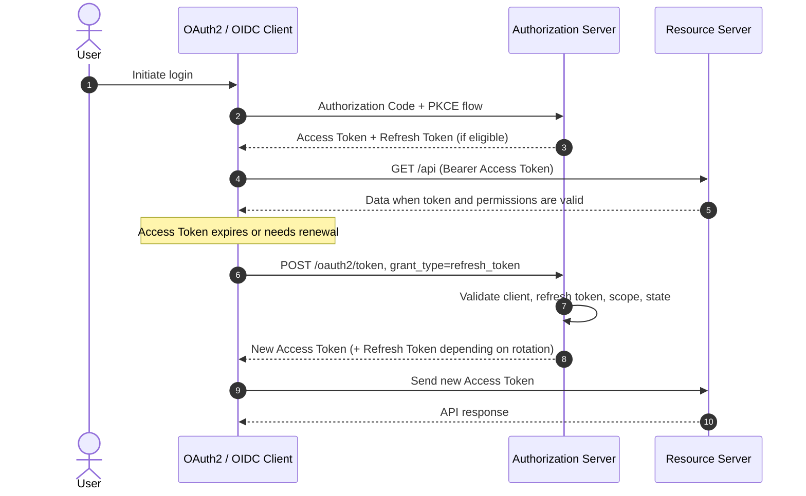
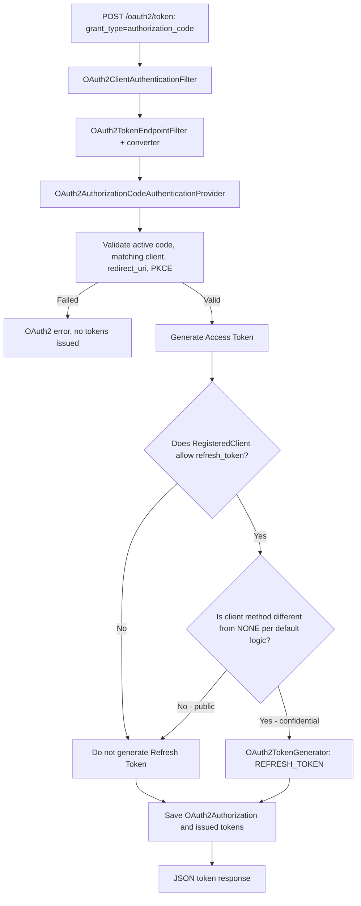
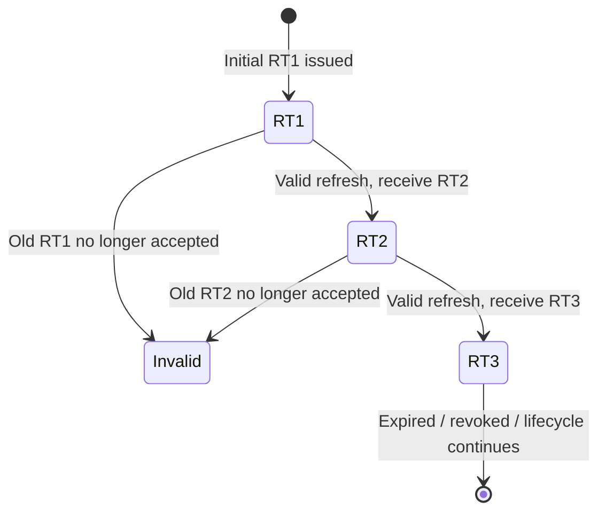

# Refresh Token Issuance Conditions by Grant and Client Type

## 1. Why Doesn't Every Client Receive a Refresh Token?

In the **Refresh Token** chapter of the `SPRING_SECURITY_OAUTH2_OIDC_AUTHORIZATION_SERVER` module, we examine **when an OAuth 2.0 Authorization Server issues a Refresh Token, when it intentionally does not, and which configuration factors determine that behavior**. This knowledge is essential for designing, configuring, securing, testing, and operating an OAuth 2.0/OpenID Connect Authorization Server with **Spring Security** and **Spring Authorization Server in Spring Boot**.

Suppose a system has three applications:

- **Portal Web**: a web application with a backend, signing users in via OIDC Authorization Code + PKCE.
- **Mobile App**: a native app running on mobile phones, which is a public client, using Authorization Code + PKCE.
- **Reporting Service**: a backend service using Client Credentials to obtain an Access Token itself and call APIs.

All three can receive an Access Token through an appropriate flow, but **that does not mean all three are issued a Refresh Token by default**. A Refresh Token allows requesting a new Access Token after the old Access Token expires without re-executing the entire initial authorization transaction. Consequently, it extends the client's access capability, increasing requirements for credential protection, storage, revocation, and anomaly detection.

After this lesson, you will be able to:

1. Distinguish **initial Refresh Token issuance** from **using a Refresh Token to refresh an Access Token**.
2. Identify the impact of grant type, client authentication method, client type, and Authorization Server policy.
3. Understand the notable default behavior of **Spring Authorization Server 1.x** regarding Authorization Code and public clients.
4. Declare `AuthorizationGrantType.REFRESH_TOKEN`, `TokenSettings`, and `ClientSettings` for their intended purpose.
5. Explain why OIDC `offline_access`, PKCE, and Refresh Token rotation **do not automatically** guarantee Refresh Token issuance.
6. Design tests and operational observability to detect misconfigurations, unintended token issuance, and common refresh errors.

> **Version scope:** the content regarding Java classes and default behavior below focuses on **Spring Authorization Server 1.x / Spring Security 6.x** with Servlet Spring Boot 3.x applications. For Spring Security 7.x or later Authorization Server integrations, check the documentation and source code of the actual version before applying provider-level implementation rules. OAuth 2.0/OIDC protocol principles are distinguished separately from the library's default policies.

## 2. What Is a Refresh Token, and How Does It Differ from an Access Token?

| Attribute | Access Token | Refresh Token |
| --- | --- | --- |
| Purpose | Presented by the client to the **Resource Server** to access protected resources | Presented by the client to the **Authorization Server Token Endpoint** to request a new Access Token |
| Where used | API/Resource Server | Token Endpoint, typically `POST /oauth2/token` |
| Lifetime | Usually short; governed by issuance policy | Usually longer than an Access Token, though it can still expire or be revoked |
| Permissions | Bound to the token's scopes, audience, subject, and conditions | Represents the ability to continue requesting tokens within the bounds of the authorization and client policy |
| Protection | Must prevent leakage; validate signature/introspection, expiry, issuer, audience, scope | Must protect against theft and replay; store with great care |
| Is it a JWT? | Can be a JWT or opaque | Should not be assumed to be a JWT; Spring Authorization Server typically generates an **opaque value** using an appropriate token generator |
| Can call APIs directly? | Yes, if matching the resource/permissions and still valid | **No**; do not use as a Bearer Access Token for APIs |

**Do not equate "refresh token is configured" with "tokens never expire."** A Refresh Token can expire, be invalidated, or lose validity due to authorization revocation or policy changes. A valid Refresh Token does not grant new permissions beyond the authorization already permitted by the user and the Authorization Server.

### 2.1. Position in the Token Lifecycle



The diagram illustrates the case where **a Refresh Token was already issued** during the initial code exchange. If the client only received an Access Token, it cannot create a Refresh Token on its own by sending `grant_type=refresh_token`; it must re-run another valid authorization flow.

## 3. Two Different Questions: Issuance and Usage

To avoid design mistakes, separate two decisions:

**Decision A — Should a Refresh Token be issued in the first place?**

- Which **grant** is the request using?
- Does `RegisteredClient` allow `refresh_token`?
- Is the client **confidential** or **public**, and which method is it authenticating with?
- Does the provider for that grant have a policy to issue a Refresh Token?
- What additional OIDC, consent, token policy, or custom rules does the Authorization Server apply?

**Decision B — Is the client allowed to use an existing Refresh Token?**

- Is `grant_type=refresh_token` registered for the client?
- Does the Refresh Token exist, remain active, and belong to the **correct client**?
- Is the client authentication method valid?
- Are the requested scopes within the originally granted scope?
- Has the token been revoked, expired, or replaced due to rotation?

Allowing `AuthorizationGrantType.REFRESH_TOKEN` on `RegisteredClient` is a **necessary condition in many default flows**, but it is **not a promise that every initial grant will issue a Refresh Token**.

## 4. Grant Type and Refresh Token Issuance Matrix

| Grant at token issuance time | Issues Refresh Token initially? | Reason / conditions |
| --- | --- | --- |
| **Authorization Code** | **Possible** | Depends on `RegisteredClient` allowing `refresh_token`, client type/authentication method, provider, and AS policy |
| **Client Credentials** | **No in the standard default Spring Authorization Server implementation** | The client can re-authenticate with its credentials to obtain a new Access Token; RFC 6749 states a Refresh Token **SHOULD NOT** be issued for this grant |
| **Refresh Token** | **Not an initial issuance step** | Requires using an existing Refresh Token; the response may retain the same token or return a new Refresh Token according to rotation |
| **Device Authorization Grant / Device Code** | **Depends on the specific version and provider** | Verify the supported grant and issuance conditions; do not infer solely from the client registering `refresh_token` |
| **Token Exchange / extension grant** | **Depends on the specific design and implementation** | Must have an explicit provider and policy; do not assume a Refresh Token is issued by default |
| **Resource Owner Password Credentials** | **Not a default choice in Spring Authorization Server** | Legacy grant not recommended for new applications; do not design new systems around the password grant |

**Note:** the table does not say the RFC strictly forbids a Refresh Token in every Client Credentials scenario. RFC 6749 uses **SHOULD NOT** language, whereas Spring Authorization Server by default **does not issue** a Refresh Token in the `client_credentials` provider. When evaluating a custom grant or library extension, distinguish **protocol specifications** from **framework behavior**.

### 4.1. Authorization Code: The Appropriate Grant for Receiving a Refresh Token

The Authorization Code Flow typically corresponds to a user authorizing a client. If policy allows maintaining access after the initial sign-in, the Authorization Server may issue an Access Token along with a Refresh Token.

Typical conditions for the **default Authorization Code provider in Spring Authorization Server 1.x**:

1. The Authorization Code is valid and unused; client, redirect URI, and PKCE are verified.
2. `RegisteredClient.getAuthorizationGrantTypes()` contains `AuthorizationGrantType.REFRESH_TOKEN`.
3. The client is identified/authenticated using a method matching provider policy; **a public client using `ClientAuthenticationMethod.NONE` is not issued a Refresh Token in this default branch**.
4. The token generator is configured to generate the required token types and no other policy blocks issuance.

The third point is a **critical implementation behavior**: a public client can have `refresh_token` registered and use PKCE properly and still **not receive a `refresh_token`** from the default Spring Authorization Server 1.x Authorization Code response.

### 4.2. Client Credentials: Why No Refresh Token Is Needed

A backend service `reporting-service` can authenticate itself whenever it needs a token:

```http
POST /oauth2/token HTTP/1.1
Host: auth.example.com
Authorization: Basic <encoded-service-credentials>
Content-Type: application/x-www-form-urlencoded

grant_type=client_credentials&scope=reports.read
```

Typical response:

```json
{
  "access_token": "<access-token>",
  "token_type": "Bearer",
  "expires_in": 600,
  "scope": "reports.read"
}
```

**There is no `refresh_token`** in this example. The client continues using its registered client authentication method to request a new token when needed; this avoids creating another long-lived credential without clear justification. Adding `AuthorizationGrantType.REFRESH_TOKEN` to the registration of a client that only uses `client_credentials` **does not cause the Client Credentials provider to issue a Refresh Token**.

### 4.3. Refresh Token Grant: "Refreshing" Is Not Initial Issuance

Once a valid Refresh Token has been issued:

```http
POST /oauth2/token HTTP/1.1
Host: auth.example.com
Authorization: Basic <encoded-client-credentials>
Content-Type: application/x-www-form-urlencoded

grant_type=refresh_token&refresh_token=<original-refresh-token>
```

The Authorization Server validates the token and client, issuing a new Access Token if permitted. The Refresh Token returned in the response **may be the old token reused or a new token** when rotation is configured. That policy **does not change the conditions required for initial Refresh Token issuance**.

## 5. Confidential Clients vs. Public Clients

A key factor is **whether the client can reliably keep authentication secrets confidential**.

| Client type | Examples | Typical authentication method | Impact on Refresh Token |
| --- | --- | --- | --- |
| **Confidential client** | Web backend/BFF; backend service | `client_secret_basic`, `private_key_jwt`, or another AS-supported method | May be eligible to receive a Refresh Token when grant/provider and registration allow |
| **Public client** | Native/mobile app; browser-based SPA | `none` combined with Authorization Code + PKCE | **Not issued a Refresh Token by the default Spring Authorization Server 1.x Authorization Code provider** |

**PKCE does not turn a public client into a confidential client.** PKCE verifies that the party exchanging the Authorization Code holds the corresponding `code_verifier`; it does not prove that the application holds a client secret that can be protected long-term.

### 5.1. Why This Distinction Matters

With a confidential backend, a secret or private key can be stored in a secret manager and never sent to the browser. With SPAs and native apps, the source code/binary resides on the user's device; any secret embedded inside the application cannot be considered a trustworthy secret.

Refresh Tokens in public clients are at risk of extraction from the browser or device, so strong measures are required such as **Refresh Token rotation or sender-constraining**, lifetime/scope limits, and replay detection according to current security profiles.

**RFC 9700** specifies that for public clients, Refresh Tokens (if issued) **must** be sender-constrained or use refresh token rotation to detect replay; Refresh Tokens should also be bound to the consented scopes and Resource Servers. This is a modern protocol security principle; **it does not mean Spring Authorization Server's default configuration automatically issues Refresh Tokens to public clients**.

### 5.2. SPA: Consider Backend-for-Frontend (BFF)

A common option is using a **BFF/confidential web backend** that handles the Authorization Code flow, stores tokens server-side, and uses a session cookie with appropriate CSRF protection for the browser. When the backend is registered with a suitable client authentication method, its eligibility to receive a Refresh Token is evaluated as a confidential client.

This **does not mean** merely changing `client_id` or declaring `client_secret_basic` in JavaScript code. The client secret must actually be protected on a server component, tokens must not leak through the browser, and the session flow must be designed securely.

### 5.3. What If a Native/Mobile App Needs Offline Access?

The need to renew Access Tokens in native apps is real, yet a public client using `none` still does not receive a Refresh Token in the default Spring Authorization Server 1.x Authorization Code configuration. If business requirements mandate issuing Refresh Tokens to a native app:

1. Verify the framework version and existing policies.
2. Design the extension **intentionally**, rather than merely adding `REFRESH_TOKEN` to the registration.
3. Ensure PKCE, rotation or sender-constraining, secure on-device token storage, TTL policies, and revocation.
4. Perform a security review, test token theft/replay scenarios, and operate the key/authorization store properly.

Do not disable client authentication or bypass PKCE checks just to make the token response include a `refresh_token` field.

## 6. Three Different Configuration Mechanisms in RegisteredClient

Spring Authorization Server uses `RegisteredClient` to store core policies:

| Mechanism | Key API | Determines |
| --- | --- | --- |
| **Allowed grant types** | `authorizationGrantType(AuthorizationGrantType.AUTHORIZATION_CODE)`, `authorizationGrantType(AuthorizationGrantType.REFRESH_TOKEN)` | Which grants the client may initiate and whether it may use the Refresh Token Grant |
| **Client authentication** | `clientAuthenticationMethod(ClientAuthenticationMethod.CLIENT_SECRET_BASIC)` or `NONE` | How the AS identifies/authenticates the client; affects default Refresh Token issuance conditions |
| **Token policy** | `TokenSettings.refreshTokenTimeToLive(...)`, `reuseRefreshTokens(...)` | Lifetime and reuse/rotation mode of the Refresh Token **if issued** |

`ClientSettings.requireProofKey(true)` requires PKCE; `requireAuthorizationConsent(true)` governs part of the consent flow. These two settings are **not flags to enable Refresh Tokens**.

### 6.1. Configuring a Confidential Authorization Code Client

Example `RegisteredClient` for a web backend:

```java
import java.time.Duration;
import java.util.UUID;

import org.springframework.security.oauth2.core.AuthorizationGrantType;
import org.springframework.security.oauth2.core.ClientAuthenticationMethod;
import org.springframework.security.oauth2.core.oidc.OidcScopes;
import org.springframework.security.oauth2.server.authorization.client.RegisteredClient;
import org.springframework.security.oauth2.server.authorization.settings.ClientSettings;
import org.springframework.security.oauth2.server.authorization.settings.TokenSettings;

public final class WebClientRegistration {

    public static RegisteredClient create(String encodedClientSecret) {
        return RegisteredClient.withId(UUID.randomUUID().toString())
                .clientId("portal-web")
                .clientName("Portal Web")
                .clientSecret(encodedClientSecret)
                .clientAuthenticationMethod(
                        ClientAuthenticationMethod.CLIENT_SECRET_BASIC)
                .authorizationGrantType(AuthorizationGrantType.AUTHORIZATION_CODE)
                .authorizationGrantType(AuthorizationGrantType.REFRESH_TOKEN)
                .redirectUri("https://portal.example.com/login/oauth2/code/as")
                .scope(OidcScopes.OPENID)
                .scope(OidcScopes.PROFILE)
                .scope("orders.read")
                .clientSettings(ClientSettings.builder()
                        .requireProofKey(true)
                        .requireAuthorizationConsent(true)
                        .build())
                .tokenSettings(TokenSettings.builder()
                        .authorizationCodeTimeToLive(Duration.ofMinutes(3))
                        .accessTokenTimeToLive(Duration.ofMinutes(10))
                        .refreshTokenTimeToLive(Duration.ofHours(12))
                        .reuseRefreshTokens(false)
                        .build())
                .build();
    }
}
```

**Meaning:**

- `AUTHORIZATION_CODE`: the client is allowed to initiate the Authorization Code Flow.
- `REFRESH_TOKEN`: the client is authorized to use the Refresh Token Grant, and it is a prerequisite in the default Refresh Token issuance flow during code exchange.
- `CLIENT_SECRET_BASIC`: the client is confidential under its registered authentication mechanism; Spring Authorization Server must verify the client secret at the Token Endpoint.
- `requireProofKey(true)`: requires `code_challenge` and a matching `code_verifier` for the transaction when using Authorization Code.
- `refreshTokenTimeToLive(Duration.ofHours(12))`: sets the TTL **for generated Refresh Tokens**; it does not force the server to generate one.
- `reuseRefreshTokens(false)`: requests issuing a new Refresh Token on refresh using the mechanism supported by the framework; it does not replace a full replay-detection/token-family design.
- `encodedClientSecret` must be a one-way encoded secret stored on the Authorization Server with an appropriate `PasswordEncoder` (e.g., `{bcrypt}...` format); **never** hard-code raw client secrets into Git.

This example creates a registration object and omits the `RegisteredClientRepository`, `OAuth2AuthorizationService`, signing keys, login, or filter chain needed for a real application. When persisted in JDBC, client IDs must remain stable across deployments; `UUID.randomUUID()` is only suitable for initial registration, not for code that runs and replaces IDs on every production startup.

### 6.2. Comparing a Public Client Even When Refresh Grant Is Declared

```java
RegisteredClient mobile = RegisteredClient.withId("mobile-test-id")
        .clientId("mobile-public")
        .clientAuthenticationMethod(ClientAuthenticationMethod.NONE)
        .authorizationGrantType(AuthorizationGrantType.AUTHORIZATION_CODE)
        .authorizationGrantType(AuthorizationGrantType.REFRESH_TOKEN)
        .redirectUri("com.example.mobile:/oauth2redirect")
        .scope("profile.read")
        .clientSettings(ClientSettings.builder()
                .requireProofKey(true)
                .build())
        .build();
```

This **snippet illustrates eligibility differences**, not advice to configure the Refresh Token Grant for all public clients. Even though the registration contains `REFRESH_TOKEN`, the default Authorization Code provider in Spring Authorization Server 1.x still **does not issue a Refresh Token to clients using `NONE`**. The client requires a separately evaluated policy/extension mechanism if the product requires offline access in a public app.

### 6.3. Comparing Client Credentials

```java
RegisteredClient reporting = RegisteredClient.withId("reporting-test-id")
        .clientId("reporting-service")
        .clientSecret(encodedServiceSecret)
        .clientAuthenticationMethod(ClientAuthenticationMethod.CLIENT_SECRET_BASIC)
        .authorizationGrantType(AuthorizationGrantType.CLIENT_CREDENTIALS)
        .scope("reports.read")
        .build();
```

`reporting-service` can obtain an Access Token via `client_credentials`, but the default provider **does not issue a Refresh Token**. When the Access Token is about to expire, the service can use its registered credentials to obtain another token; it should cache the Access Token within safe bounds rather than sending a new token request for every API call.

## 7. Issuance Conditions in the Spring Authorization Server Pipeline

An `authorization_code` request flows through:



This diagram shows the **issuance condition logic** of the default Spring Authorization Server 1.x Authorization Code provider, not a line-by-line copy of the source code. Checks, token generation, and state persistence may be implemented in different locations depending on the version.

Key components to distinguish:

- `OAuth2AuthorizationCodeAuthenticationProvider` handles **exchanging the authorization code** at the Token Endpoint.
- `RegisteredClientRepository` supplies client configuration, grant types, scopes, and token settings.
- `OAuth2AuthorizationService` holds authorization and token state for refresh/revoke/introspection.
- `OAuth2TokenGenerator<?>` creates the Access Token and can create the Refresh Token; the default generator includes components appropriate for each `OAuth2TokenType`.
- `OAuth2RefreshTokenAuthenticationProvider` handles **requests using an existing Refresh Token**.

**Simply replacing `OAuth2TokenGenerator` is not enough to guarantee Refresh Token issuance for a public client** if the Authorization Code provider intentionally skips requesting generation of that token type. Changing issuance conditions must be evaluated at the proper provider layer while preserving client binding, PKCE, grant, scope, rotation, and secure storage.

### 7.1. What If the Token Generator Cannot Create a Refresh Token?

Even when the grant and client type satisfy policy, the server still needs an appropriate `OAuth2TokenGenerator`. With the default configuration, Spring Authorization Server can generate a Refresh Token via the generator for that token type; if a **custom token generator** only supports JWT Access Tokens and omits the Refresh Token branch, the result may be a token issuance error instead of an automatic fallback.

When customizing a token generator, check every token type the server needs: Access Token, Refresh Token, and ID Token (if OIDC). Do not assume `OAuth2TokenType.ACCESS_TOKEN` is the only type that must be supported.

### 7.2. Token Format and Refresh Token Are Separate Decisions

`TokenSettings.accessTokenFormat(OAuth2TokenFormat.SELF_CONTAINED)` or `REFERENCE` controls the **Access Token format**. Switching to a JWT Access Token does not automatically turn a Refresh Token into a JWT, nor does it decide whether a Refresh Token is issued.

A Refresh Token must be treated as a high-value credential even if it is just an opaque string. If storage is compromised or logs leak the token, an attacker may be able to obtain new Access Tokens until the Refresh Token expires, is constrained from use, or is revoked.

## 8. Is OIDC `offline_access` Mandatory?

OpenID Connect adds the `offline_access` scope to express that a client wants the ability to access resources when the user is **no longer directly interacting**. This is an **OIDC request/scope**, not the Refresh Token itself.

Per OpenID Connect Core, the Authorization Server must evaluate consent conditions when handling `offline_access`: typically explicit consent is required, such as `prompt=consent`, unless other conditions already satisfy appropriate consent. When using OIDC, requesting `offline_access` also depends on client policy, flow, and what the OpenID Provider supports.

**Do not confuse three layers:**

| Factor | What does it mean? | What should not be inferred |
| --- | --- | --- |
| `scope=offline_access` | Client requests offline access per OIDC | **Does not guarantee** the server issues a Refresh Token |
| `AuthorizationGrantType.REFRESH_TOKEN` | Client registration allows the refresh grant | **Does not guarantee** the authorization_code response includes a Refresh Token |
| `TokenSettings.refreshTokenTimeToLive` | TTL policy if a Refresh Token is generated | **Not** a switch to enable Refresh Token issuance |

Conversely, in pure OAuth 2.0, a Refresh Token can be issued by policy **without the OIDC `offline_access` scope**. For Spring Authorization Server 1.x, do not assume the framework automatically enforces the full expectation of "issue only when `offline_access` is present" in every configuration. If a product has offline consent rules or needs to exclude Refresh Tokens for certain scopes, **define and test the policy explicitly** rather than relying solely on the client sending a scope name.

### 8.1. Distinguishing Refresh Token and ID Token

`openid` requests OpenID Connect; an `id_token` is issued in an appropriate OIDC flow so the **OIDC Client can verify the sign-in session**. A Refresh Token serves to **obtain a new Access Token**; it is not an ID Token and must not be presented to APIs. Having an ID Token in the token response does not imply a Refresh Token is present.

## 9. Public Client Security: PKCE, Rotation, and Sender Constraints

### 9.1. PKCE Does Not Directly Protect the Refresh Token Afterward

PKCE binds the **Authorization Code** to the `code_verifier` during code exchange. Once the client has received a Refresh Token, a `grant_type=refresh_token` request is a separate transaction: there is no automatic PKCE verifier acting as an authentication factor for the Refresh Token.

Therefore, if you decide to issue Refresh Tokens to a public app through a supported or custom mechanism, design dedicated Refresh Token lifecycle protections:

- **Rotation:** replace the Refresh Token after each use, invalidate the old token, and establish a replay-handling strategy.
- **Sender-constraining:** bind the token to a key/credential whose possession the presenter must prove when refreshing.
- **TTL/scope limits:** do not grant broad permissions or unbounded lifetimes; bind to authorized scopes/resources.
- **Secure storage:** on mobile, use OS-provided protection mechanisms where appropriate; in browsers, assess XSS risk and BFF architecture.
- **Revocation/monitoring:** terminate validity upon suspected token exposure, logout, or security policy triggers.

RFC 9700 emphasizes Refresh Token rotation or sender-constraining for public clients. **`reuseRefreshTokens(false)` is only part of the security story**; do not assume configuring one flag alone provides full token-family tracking, replay alerting, invalidation of all related tokens, and concurrency safety.

### 9.2. Rotation in Confidential Clients

In Spring Authorization Server, `TokenSettings.reuseRefreshTokens(false)` is used to request a new Refresh Token upon refresh (if provider, generator, and policy allow). When `true`, the old Refresh Token can continue to be used until it expires or is revoked, depending on the implementation logic.

When rotation is performed:



This diagram illustrates rotation logic; **it does not claim the default framework implements full tracking of all token-family branches or automatic revocation of all previously issued Access Tokens**. In multi-instance systems, race conditions when two requests simultaneously use RT1 must be tested. Replay detection and handling policies should be designed alongside storage.

## 10. Refresh Token Grant: Checks When Using an Existing Token

When a client sends `grant_type=refresh_token`, `OAuth2RefreshTokenAuthenticationProvider` must verify several core conditions:

1. The client is authenticated or identified via the corresponding mechanism and is the client that owns the authorization.
2. `RegisteredClient` allows `AuthorizationGrantType.REFRESH_TOKEN`.
3. `OAuth2AuthorizationService` finds the Refresh Token in a valid state, not expired or invalidated.
4. Requested scopes (if any) do not exceed the originally granted permissions.
5. The generator issues a new Access Token, and the Refresh Token is handled according to the reuse/rotation policy.
6. The authorization state is saved and the response conforms to the protocol.

### 10.1. A Successful HTTP Example

Assuming confidential client `portal-web` holds a valid Refresh Token:

```bash
curl -i -X POST 'https://auth.example.com/oauth2/token' \
  -u 'portal-web:<client-secret>' \
  -H 'Content-Type: application/x-www-form-urlencoded' \
  --data-urlencode 'grant_type=refresh_token' \
  --data-urlencode 'refresh_token=<previous-refresh-token>' \
  --data-urlencode 'scope=orders.read'
```

If policy permits and the token is still active:

```json
{
  "access_token": "<new-access-token>",
  "token_type": "Bearer",
  "expires_in": 600,
  "refresh_token": "<new-refresh-token-if-rotated>",
  "scope": "orders.read"
}
```

The tokens, `expires_in`, and rotation behavior in this example are **illustrative only**. Actual responses depend on grant type, version, and policy. When `reuseRefreshTokens(true)`, the `refresh_token` field in the response may be the old value continued in use; when rotation is enabled, the client must **store the new token securely and stop using the old token**.

### 10.2. Common Errors

| Scenario | Possible error | How to investigate |
| --- | --- | --- |
| Wrong client secret/assertion | `invalid_client` | Client authentication method, secret, key, RegisteredClient |
| Client has not registered refresh grant | `unauthorized_client` | Grant types in registration |
| Refresh Token missing/expired/revoked | `invalid_grant` | Authorization and token state; TTL; storage |
| Refresh Token belongs to another client | `invalid_grant` or corresponding protection error | Client binding and repository |
| Requested scope exceeds granted scope | `invalid_scope` | Previously authorized permissions; refresh request |
| Custom provider/generator failure | Appropriate server/OAuth2 error | Inspect token generator, persistence, and internal logs |

This matrix is **typical**, not a guarantee of fixed status codes or error ordering across every implementation. Do not write Refresh Tokens or secrets into `error_description` or logs to identify which token failed.

### 10.3. When Should a Client Refresh?

Clients typically refresh an Access Token when it is nearing expiration or after receiving an error indicating the token is no longer accepted under API rules. A **single-flight/lock** mechanism should be used to prevent multiple concurrent requests from using the same Refresh Token, especially when rotation is enabled.

If a refresh fails because the token is expired or revoked, the client must send the user through a **new authorization flow** or handle the error appropriately for the application type. Do not repeatedly retry with the same rejected Refresh Token; this degrades user experience and can mask signs of replay.

## 11. Testing the Refresh Token Issuance Conditions Matrix

A good test suite must verify both the **presence** and the **intentional absence** of the `refresh_token` field in the token response.

| # | Initial grant / operation | Client | Registration/policy | Primary expectation |
| --- | --- | --- | --- | --- |
| 1 | Authorization Code + PKCE | Confidential | Has `REFRESH_TOKEN`, valid secret | May include `refresh_token` in default response |
| 2 | Authorization Code + PKCE | Confidential | **Does not** have `REFRESH_TOKEN` | **No** `refresh_token` |
| 3 | Authorization Code + PKCE | Public `NONE` | Has `REFRESH_TOKEN` | Spring Authorization Server 1.x by default **does not** issue a Refresh Token |
| 4 | Authorization Code | Confidential | Client authentication fails | Token request rejected; **no tokens issued** |
| 5 | Client Credentials | Confidential | Valid grant/scope | Access Token succeeds, **no Refresh Token** |
| 6 | Client Credentials | Confidential | Also has `REFRESH_TOKEN` in registration | Still **no Refresh Token issued from Client Credentials** by default provider |
| 7 | Refresh Token Grant | Confidential | Refresh Token active, matching client | Issues new Access Token; Refresh Token retained/rotated per policy |
| 8 | Refresh Token Grant | Confidential | Token expired/revoked | `invalid_grant` or appropriate rejection |
| 9 | Refresh Token Grant | Confidential | Requested scope exceeds granted permissions | Rejected; no privilege escalation |
| 10 | Authorization Code OIDC | Confidential | Scope `openid`, no `offline_access` | Do not infer issuance conditions from scope names; verify actual OIDC policy |
| 11 | Authorization Code OIDC | Public `NONE` | Has `offline_access`, `REFRESH_TOKEN`, PKCE | Does not automatically bypass default provider limits for public clients |
| 12 | Device/extension grant | Any | Provider-dependent | Test each grant separately; do not infer from row 1 |

For row 1, "may include" assumes **the entire flow succeeds and the token generator can issue a Refresh Token**. Do not simply read the client registration configuration and conclude a token is guaranteed to be created.

### 11.1. Unit Testing RegisteredClient Configuration

JUnit 5 example testing the two parts **registration and TokenSettings**, without issuing real tokens:

```java
import static org.assertj.core.api.Assertions.assertThat;

import java.time.Duration;
import org.junit.jupiter.api.Test;
import org.springframework.security.oauth2.core.AuthorizationGrantType;
import org.springframework.security.oauth2.core.ClientAuthenticationMethod;
import org.springframework.security.oauth2.server.authorization.client.RegisteredClient;
import org.springframework.security.oauth2.server.authorization.settings.TokenSettings;

class RefreshEligibilityConfigurationTest {

    @Test
    void confidentialWebClientRegistersRefreshGrantAndTokenPolicy() {
        RegisteredClient client = RegisteredClient.withId("test-client-id")
                .clientId("portal-web")
                .clientSecret("{noop}test-secret-only")
                .clientAuthenticationMethod(ClientAuthenticationMethod.CLIENT_SECRET_BASIC)
                .authorizationGrantType(AuthorizationGrantType.AUTHORIZATION_CODE)
                .authorizationGrantType(AuthorizationGrantType.REFRESH_TOKEN)
                .redirectUri("https://portal.example.com/callback")
                .scope("orders.read")
                .tokenSettings(TokenSettings.builder()
                        .refreshTokenTimeToLive(Duration.ofHours(12))
                        .reuseRefreshTokens(false)
                        .build())
                .build();

        assertThat(client.getAuthorizationGrantTypes())
                .contains(AuthorizationGrantType.REFRESH_TOKEN);
        assertThat(client.getClientAuthenticationMethods())
                .contains(ClientAuthenticationMethod.CLIENT_SECRET_BASIC);
        assertThat(client.getTokenSettings().getRefreshTokenTimeToLive())
                .isEqualTo(Duration.ofHours(12));
        assertThat(client.getTokenSettings().isReuseRefreshTokens()).isFalse();
    }
}
```

`{noop}test-secret-only` is **for configuration unit tests only**; never use it for production client registrations. If testing the actual Token Endpoint, use an appropriate `PasswordEncoder` with a properly protected and hashed test secret.

**Test limitations:** the assertions above only prove the registration has the right flags and TTL. They do not prove a JWT/Refresh Token was created, do not check the provider's `NONE` condition, and do not test rotation. Integration tests through the Token Endpoint are required to prove actual behavior.

### 11.2. What Should Integration Tests Cover?

**Authorization Code – confidential client:**

1. Start `/oauth2/authorize` with `client_id`, `redirect_uri`, `state`, and valid PKCE.
2. Sign in/grant consent if needed; receive a fresh code at the callback.
3. Send `POST /oauth2/token` with valid client authentication, code, and `code_verifier`.
4. Assert the token response contains `access_token` and, if all conditions above hold, `refresh_token`.
5. Use the Refresh Token to obtain a new Access Token; verify TTL, scope, and rotation.

**Authorization Code – public client:** use `ClientAuthenticationMethod.NONE` and `client_id` in the token request as configured, along with valid PKCE. Verify the token response by default **does not contain `refresh_token`** even if registration includes `REFRESH_TOKEN`.

**Client Credentials – confidential client:** call `grant_type=client_credentials` with a valid secret, assert `access_token` is present and the JSON **does not contain `refresh_token`**.

**Refresh Token rotation:** test only once a Refresh Token has been issued. Send the first refresh, read the new Refresh Token (if rotated), then resend the old token: expect rejection in a normal sequential scenario. Send two concurrent requests with the same Refresh Token across multiple nodes to uncover race conditions and compare against replay policy.

### 11.3. Curl Examples: Client Login Does Not Mean Refresh

```bash
# Client Credentials: do not expect refresh_token in the default response.
curl -i -X POST 'https://auth-test.example.com/oauth2/token' \
  -u 'reporting-service:<test-secret>' \
  -H 'Content-Type: application/x-www-form-urlencoded' \
  --data-urlencode 'grant_type=client_credentials' \
  --data-urlencode 'scope=reports.read'

# Refresh Token Grant: call only when the client has been issued a real Refresh Token.
curl -i -X POST 'https://auth-test.example.com/oauth2/token' \
  -u 'portal-web:<test-secret>' \
  -H 'Content-Type: application/x-www-form-urlencoded' \
  --data-urlencode 'grant_type=refresh_token' \
  --data-urlencode 'refresh_token=<token-from-previous-authorization>'
```

These are **illustrative commands**, not execution output. Secrets and tokens must be passed through secure test environment tools/variables; never allow real credentials to appear in shell history, CI logs, or screenshots.

## 12. Common Mistakes and Fixes

### 12.1. Seeing `REFRESH_TOKEN` in RegisteredClient and Expecting an Immediate Refresh Token

Registering the grant is not enough. You must check whether the **initial grant's** provider issues this token type, the client type/method, and the generator. For `client_credentials`, it is not issued by default; for a public Authorization Code client, Spring Authorization Server 1.x also does not issue it by default.

**Fix:** check the grant/client matrix, execute a valid Token Endpoint request, and inspect the response and effective configuration.

### 12.2. Thinking `reuseRefreshTokens(false)` Enables Refresh Tokens

That flag governs **how a token is handled during refresh**. If there is no initial Refresh Token, there is no token to rotate. `refreshTokenTimeToLive` is also not an issuance toggle.

**Fix:** check initial issuance conditions first, then check rotation.

### 12.3. Giving a Public Client a Hard-Coded Client Secret

Adding `client_secret_basic` to a SPA or native app and embedding the secret in JS/APK/IPA does not create a secure confidential client. Others can extract the secret.

**Fix:** preserve the public client classification and PKCE; if long-lived tokens/credentials must be held, consider a BFF or a Refresh Token mechanism designed appropriately for public apps and RFC 9700 requirements.

### 12.4. Confusing `offline_access` with a Refresh Token Issuance Command

`scope=offline_access` in OIDC is a request for offline access tied to consent/policy; it does not replace the `REFRESH_TOKEN` grant, client authentication, or provider checks. A non-OIDC OAuth2 deployment can also issue Refresh Tokens by policy.

**Fix:** check both OIDC consent and authorization/grant/provider; document the semantics clearly in the client contract.

### 12.5. Using a Refresh Token Instead of an Access Token to Call APIs

A Resource Server must never treat a Refresh Token as an Access Token. If an API accepts a Refresh Token as a Bearer credential, the system may bypass permission separation and expand exposure risk.

**Fix:** APIs must validate token type/use, issuer, audience, expiry, and appropriate scopes/permissions; Refresh Tokens should only go to the Token Endpoint.

### 12.6. Storing Refresh Tokens in Uncontrolled Locations

Putting Refresh Tokens into URLs, logs, analytics, error messages, unassessed localStorage, or source code is a high-risk design. Refresh Tokens generally outlive Access Tokens, so the blast radius of a leak can be severe.

**Fix:** store on a backend/secret store or appropriate device protection mechanism; restrict read access, prevent telemetry leaks, and design revocation and rotation.

### 12.7. Increasing TTL Whenever `invalid_grant` Occurs

A refresh can fail due to an expired token, wrong client, revocation, replacement during rotation, or state mismatch across nodes. Increasing TTL does not fix the root cause and widens the attack window.

**Fix:** inspect token state and the refresh flow, analyze security events, and only then decide on TTL.

### 12.8. Assuming Revoking a Refresh Token Immediately Invalidates All JWT Access Tokens

If a Resource Server only verifies JWT signatures and `exp` offline, already-issued Access Tokens may still be accepted until they expire. Revoking a Refresh Token **prevents issuing new tokens**, not always invalidating every existing Access Token.

**Fix:** determine actual revocation requirements; consider short Access Token TTLs, token introspection, denylists, or state-checking policies when needed.

## 13. Storage, Multi-Instance Deployments, and Replay Protection

In Spring Authorization Server, `OAuth2AuthorizationService` maintains authorization state, tokens, and information needed to validate refreshes. If using `InMemoryOAuth2AuthorizationService` per JVM, node A and node B **do not share state**: a Refresh Token created on node A may not be found by node B.

For production:

- Choose a suitable authorization store to persist state across restarts and between instances.
- If using JDBC, create/migrate the schema matching the exact version and verify appropriate transactions/locking.
- Test **concurrency** when rotation is enabled: two requests using the same Refresh Token must not produce two simultaneously valid token branches outside policy.
- Keep issuer, signing keys, and token policies consistent across nodes.
- Synchronize system clocks; do not use large clock skew to loosely extend TTL without control.
- Have a process to revoke authorizations/tokens when a client is disabled, a user logs out per policy, or credential compromise is suspected.

**Do not assume enabling JDBC and `reuseRefreshTokens(false)` alone solves every replay/concurrency scenario.** Prove it with integration tests against the actual storage and topology. If writing a custom `OAuth2AuthorizationService`, preserve lookup, expiration, invalidation semantics, and safe state updates under concurrent requests.

### 13.1. Observability Without Exposing Tokens

Measure and monitor:

| Signal | Benefit |
| --- | --- |
| Count of token responses with/without `refresh_token` by grant and client type | Detect unintended policy changes |
| Rates of `invalid_client`/`invalid_grant`/`invalid_scope` at Token Endpoint | Detect registration errors, secret issues, replay, or scope issues |
| Refresh Token rotation and suspected token replay | Detect callback/client retries or signs of token theft |
| Latency, database errors, and failover of `OAuth2AuthorizationService` | Diagnose multi-instance issues |
| Revocation events, secret rotations, and `RegisteredClient` changes | Lifecycle auditing and incident response |

Never log raw Access Tokens, Refresh Tokens, authorization codes, client assertions, `code_verifier`, or secrets in logs or metric labels. Use correlation IDs and error codes to investigate without creating a new credential-leakage vector.

## 14. Refresh Token Issuance Decision Checklist

Before deploying a client or changing policy:

1. **Identify initial grant:** Authorization Code, Client Credentials, Device, or extension grant; never assume all issue Refresh Tokens.
2. **Identify client type:** confidential/backend or public/browser/native; does the client authentication method match the deployment characteristics?
3. **Verify grant registration:** `AuthorizationGrantType.REFRESH_TOKEN` is enabled for the right clients, not attached to a client that does not need it.
4. **Check provider policy:** does the Spring Authorization Server version in use block Refresh Tokens for public clients or certain grants?
5. **Check OIDC:** if `offline_access` is requested, do consent and OpenID Provider policies align?
6. **Check TTL/rotation:** `refreshTokenTimeToLive`, `reuseRefreshTokens`, and revocation capability are designed; distinguish them from issuance flags.
7. **Protect credentials:** client secrets/private keys, Refresh Tokens, signing keys, and other tokens reside in appropriate storage.
8. **Enforce permission boundaries:** a Refresh Token must not allow requesting scopes/resources beyond granted permissions; Resource Servers still enforce authorization.
9. **Test both directions:** cases expecting a Refresh Token **present** and cases expecting it **absent** must both be automated.
10. **Test production topology:** restarts, multiple nodes, concurrent refreshes, rotation/replay, and revocation are verified.
11. **Review on upgrades:** inspect changes to providers/generators, default token settings, OIDC behavior, and client compatibility after upgrading versions.

## 15. Exercises and Self-Assessment Questions

**Exercise A — Reading configuration:** a client declares `AUTHORIZATION_CODE`, `REFRESH_TOKEN`, `ClientAuthenticationMethod.NONE`, and `requireProofKey(true)`. Explain why Spring Authorization Server 1.x by default still does not return a Refresh Token when exchanging the Authorization Code, even when PKCE succeeds.

**Exercise B — Distinguishing grants:** a backend service using only `CLIENT_CREDENTIALS` needs a new Access Token every 10 minutes. Design a way to cache the Access Token and re-request tokens via client authentication without requiring a Refresh Token.

**Exercise C — Web backend configuration:** register a confidential web client with `AUTHORIZATION_CODE`, `REFRESH_TOKEN`, `CLIENT_SECRET_BASIC`, PKCE, and Refresh Token rotation. Test that exchanging the code returns a Refresh Token and a subsequent refresh updates tokens according to policy.

**Exercise D — OIDC offline access:** an OIDC Client sends `openid offline_access`. List the factors that still must be verified beyond the scope: client registration, user consent, provider policy, client type, auth method, and token settings.

**Exercise E — Concurrent refresh:** send two near-simultaneous requests with the same Refresh Token when rotation is enabled in a two-node cluster. Write the expected behavior and a plan to inspect database/authorization state if both requests succeed.

**Review questions:**

1. Why do Access Tokens and Refresh Tokens have different endpoints where they are used?
2. Is `AuthorizationGrantType.REFRESH_TOKEN` a necessary or sufficient condition for the AS to issue an initial Refresh Token?
3. In Spring Authorization Server 1.x, why is a public client `NONE` using PKCE typically not issued a Refresh Token by the default Authorization Code provider?
4. What does RFC 6749 say about Refresh Tokens with the Client Credentials Grant?
5. Does `TokenSettings.reuseRefreshTokens(false)` cause a client that never received a Refresh Token to automatically receive one?
6. When is `grant_type=refresh_token` used, and what conditions must the request prove?
7. How does `offline_access` in OIDC differ from `AuthorizationGrantType.REFRESH_TOKEN`?
8. Why is PKCE insufficient to protect a Refresh Token after the code has been exchanged?
9. What measures does RFC 9700 require if a Refresh Token is issued to a public client?
10. If a Refresh Token is revoked, do old JWT Access Tokens always become invalid immediately?
11. Why should integration tests assert that a `client_credentials` response **does not contain** `refresh_token`?
12. What can happen when two nodes concurrently refresh the same token without a safe synchronization/rotation strategy?

## 16. References

- [RFC 6749 — OAuth 2.0: Issuing an Access Token (Section 5.1)](https://www.rfc-editor.org/rfc/rfc6749#section-5.1)
- [RFC 6749 — Refreshing an Access Token (Section 6)](https://www.rfc-editor.org/rfc/rfc6749#section-6)
- [RFC 6749 — Client Credentials Grant (Section 4.4.3)](https://www.rfc-editor.org/rfc/rfc6749#section-4.4.3)
- [RFC 9700 — OAuth 2.0 Security Best Current Practice](https://www.rfc-editor.org/rfc/rfc9700)
- [OpenID Connect Core 1.0 — Requesting Offline Access](https://openid.net/specs/openid-connect-core-1_0.html#OfflineAccess)
- [Spring Authorization Server — Core Model Components](https://docs.spring.io/spring-authorization-server/reference/core-model-components.html)
- [Spring Authorization Server — Protocol Endpoints](https://docs.spring.io/spring-authorization-server/reference/protocol-endpoints.html)
- [Spring Authorization Server — Configuration Model](https://docs.spring.io/spring-authorization-server/reference/configuration-model.html)
- [Spring Security — Servlet OAuth2 Client](https://docs.spring.io/spring-security/reference/servlet/oauth2/client/index.html)

**Takeaway:** **A Refresh Token is not issued merely because a client registers `refresh_token` or sets a long TTL.** The Authorization Server must evaluate the **initial grant, client type and authentication method, provider policy, token generation capability, and consent/security conditions**. In default Spring Authorization Server 1.x, Authorization Code with a confidential client can receive a Refresh Token if registration and flow are valid; public clients using `none` do not receive one through that default branch; Client Credentials do not receive a Refresh Token by default. Once issued, Refresh Tokens must be protected, validated, rotated, and revoked under a dedicated policy.
