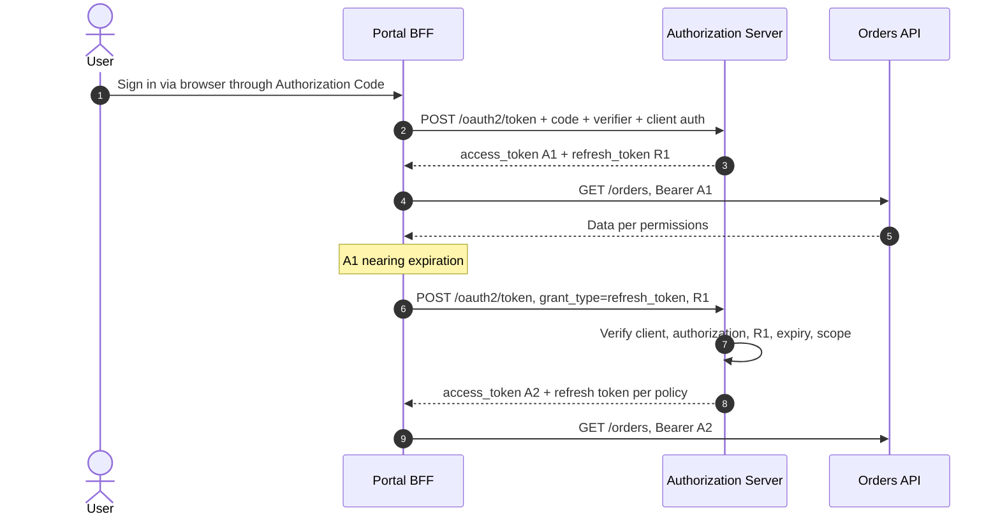
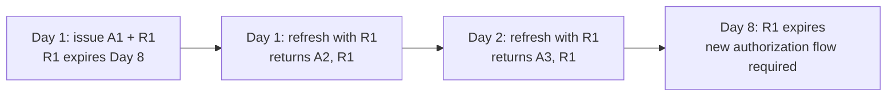
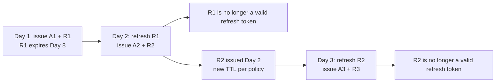
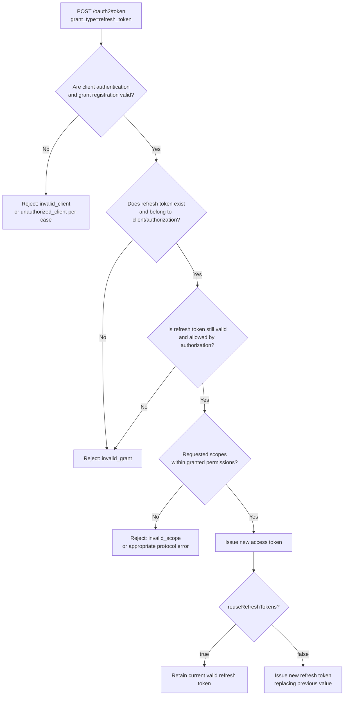
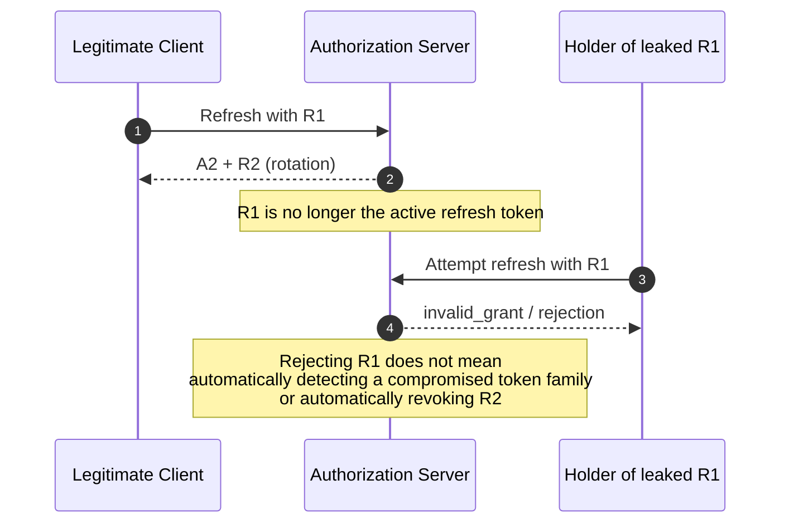
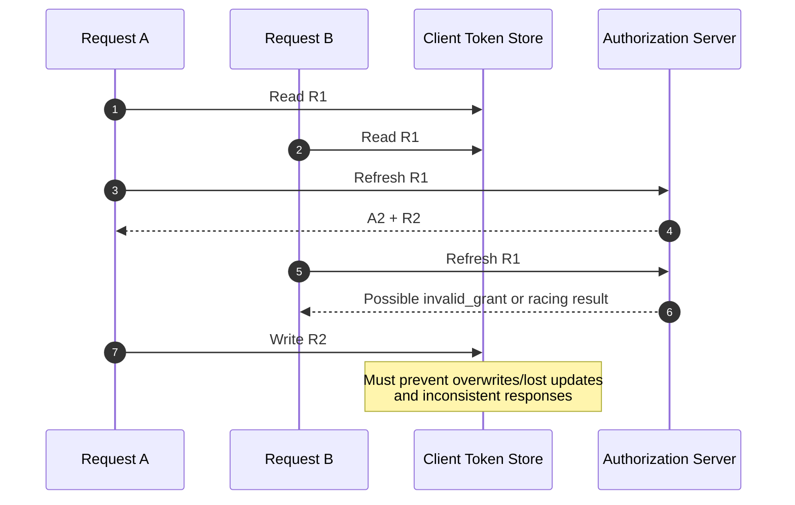

# Configuring refreshTokenTimeToLive and reuseRefreshTokens

In a Spring Boot application implementing an **OAuth 2.0/OpenID Connect Authorization Server** with Spring Security and **Spring Authorization Server**, access tokens typically have a short lifetime to limit damage if exposed. However, if users had to sign in and grant consent from scratch every time an access token expires, the user experience would be poor. A **refresh token** allows an OAuth client to request a new access token from the Token Endpoint without repeating the entire Authorization Code Flow, provided the refresh token and its corresponding authorization remain valid.

Spring Authorization Server provides two important settings in `TokenSettings` for each `RegisteredClient`:

- **`refreshTokenTimeToLive(Duration)`:** governs the validity period of **each refresh token when issued**.
- **`reuseRefreshTokens(boolean)`:** determines whether a successful refresh **reuses the current refresh token** or **issues a new refresh token** (rotation).

These two seemingly simple parameters directly affect session continuity, cross-node concurrency handling, token reuse detection, and incident response procedures. Choosing a configuration solely by asking "how long until we want the user to sign in again?" often leads to an insecure policy.

This lesson belongs to the **Refresh Token** chapter of the **SPRING_SECURITY_OAUTH2_OIDC_AUTHORIZATION_SERVER** module; the goal is to learn how to design, configure, secure, test, and operate an OAuth 2.0/OIDC Authorization Server using Spring Security and Spring Authorization Server on Spring Boot. Examples focus on the Spring Authorization Server 1.x/Spring Security 6.x API family; cross-check APIs and behavior against your specific version when applying them.

> **Key takeaway:** `refreshTokenTimeToLive` is the **lifetime of a refresh token**, not an overall user login session timeout; `reuseRefreshTokens(false)` enables **rotation**, but **does not automatically mean full replay detection and whole-token-family revocation are in place**.

## 1. Placing the Refresh Token Properly in OAuth2/OIDC

### 1.1. Three Frequently Confused Token Types

| Component | What is it used for? | Who uses it? | Notes |
|---|---|---|---|
| **Access token** | Calling a Resource Server/API according to scope and audience | OAuth client sent to API | Can be JWT or opaque; TTL is usually short |
| **Refresh token** | Requesting a new access token from the **Token Endpoint** | OAuth client sent to Authorization Server | Must be protected like a credential; never sent to APIs |
| **ID token** | Proving an authentication event and conveying OIDC claims to the Relying Party | OIDC client validates | Not an access token or refresh token |

A refresh token is **not** a user password, nor is it used to log in again via `/login`. It represents permission to continue an already-granted authorization, subject to policy and client constraints. In typical Spring Authorization Server configurations, a refresh token is a high-entropy opaque string; **do not assume a refresh token has a JWT structure** or can be decoded like an ID token.

### 1.2. When Does a Client Receive a Refresh Token?

Not every flow issues a refresh token:

- A **confidential web/BFF client** using `authorization_code` can be issued a refresh token if `RegisteredClient` allows `AuthorizationGrantType.REFRESH_TOKEN` and the corresponding policy is met.
- A **public SPA** using `ClientAuthenticationMethod.NONE` should not be designed assuming Spring Authorization Server 1.x will issue it a refresh token. Spring Authorization Server's SPA/PKCE guide states **not to issue refresh tokens to public clients**; verify against your version and consider a BFF if longer sessions are needed.
- A **service-to-service client** using `client_credentials` normally only needs to request a new access token via client authentication itself; there is no need for a refresh token for a nonexistent user session.
- Having the `openid` scope or requesting `offline_access` does not automatically guarantee the server issues a refresh token; it also depends on the OIDC profile, grant, client type, and deployment policy.

**Distinction:** Registering `refresh_token` on a client only unlocks the ability to use the **refresh token grant**. It does not force the Authorization Server to issue a refresh token in every token response.

## 2. Basic Refresh Token Lifecycle

Suppose Portal BFF is a confidential client and has just completed Authorization Code + PKCE. The Authorization Server issues access token `A1` along with refresh token `R1`.



Upon receiving a refresh request, the Authorization Server must check at least the following:

1. Does the **OAuth client** exist, is it authenticated using its registered method when applicable, and is it permitted to use the refresh grant?
2. Does the **refresh token** exist in the authorization store, belong to the right client, remain unexpired, and not be invalidated?
3. Does the **original authorization** still comply with policy, and is the client not requesting scopes exceeding what was previously granted?
4. If permitted, a **new access token** is generated with TTL, scopes, and claims per current policy.
5. The **returned refresh token** stays the same or is replaced depending on `reuseRefreshTokens`.

Issuing a new access token does not create a new user login. The SSO session, browser cookie, ID token lifetime, and refresh token lifecycle are distinct states.

## 3. refreshTokenTimeToLive: Lifetime of Each Refresh Token

### 3.1. Configuration with Duration

In `TokenSettings`:

```java
TokenSettings tokenSettings = TokenSettings.builder()
        .accessTokenTimeToLive(Duration.ofMinutes(10))
        .refreshTokenTimeToLive(Duration.ofDays(7))
        .build();
```

Meaning of the example:

- Issued access tokens have a policy TTL of **10 minutes**.
- Each newly issued refresh token has a TTL of **7 days** from the time of issuance.
- Nothing in the configuration above says that the **user session** or **original authorization** lives at most 7 days. An absolute session limit or access termination policy must be designed separately if required.

Do not treat `Duration.ofDays(7)` as a default recommendation for every application. Systems handling financial data, health records, or administrative privileges may require shorter TTLs or stronger controls; practical values depend on client protection strength, permission revocation, and UX balance.

### 3.2. Issuance Time and Expiration Time

At time `t0` when refresh token `R1` is created, the basic concept is:

```text
R1.issuedAt  = t0
R1.expiresAt = t0 + refreshTokenTimeToLive
```

For example, if `t0 = 08:00 on Dec 01` and TTL is 7 days, `R1` expires around `08:00 on Dec 08` per server clock rules, not "end of day Dec 08". In implementation, timestamps use `Instant` and require a sound server clock; the timestamps below are hypothetical for illustration.

A refresh request **before** `expiresAt` can still be rejected if the token was revoked, does not belong to the client, the authorization is invalid, or another policy applies. A refresh request **after** `expiresAt` must not be granted a token merely because the client still knows `R1`.

### 3.3. Refresh Token TTL Is Not Access Token TTL

If the access token expires after 10 minutes while the refresh token remains valid for 7 days, the client can request new access tokens repeatedly as long as the refresh token/authorization stays valid. This **does not mean** access token `A1` is extended: the server issues a new token `A2` per policy.

If the access token is a self-contained JWT, the Resource Server may still accept `A1` until it expires (unless additional state-checking/revocation exists). A refresh request does not automatically revoke the previous access token.

### 3.4. Changing TTL After Tokens Have Already Been Issued

Suppose the refresh TTL was originally 30 days and today the organization changes it to 7 days in `RegisteredClient`. You should not assume all previously issued refresh tokens immediately have their `expiresAt` shortened to 7 days. Stored token lifetimes and states depend on their original issuance and the validation/revocation mechanism.

If the goal is **immediate expiration** due to a security incident, proactively revoke the affected authorizations/tokens or apply an additional blocking policy; modifying `refreshTokenTimeToLive` only governs newly issued tokens depending on implementation.

## 4. reuseRefreshTokens: Reuse or Rotate Refresh Tokens?

### 4.1. Two Core Values

```java
// On successful refresh, continue returning/keeping the existing refresh token:
TokenSettings reuse = TokenSettings.builder()
        .reuseRefreshTokens(true)
        .build();

// On successful refresh, issue a new refresh token replacing the old one:
TokenSettings rotate = TokenSettings.builder()
        .reuseRefreshTokens(false)
        .build();
```

Under the **reuse** policy (`true`), refresh token `R1` is used to obtain multiple access tokens while `R1` remains valid. Under the **rotation** policy (`false`), a successful refresh using `R1` yields a subsequent refresh token `R2`; the client application must store `R2` in place of `R1` for the next refresh.

### 4.2. Direct Comparison

| Aspect | `reuseRefreshTokens(true)` | `reuseRefreshTokens(false)` |
|---|---|---|
| After using `R1` successfully | Client keeps using `R1` | Client receives new token `R2` and must replace `R1` |
| Number of uses per token value | Multiple times within its valid lifetime | Old value is no longer a valid credential after successful rotation |
| Ease of client implementation | Simpler because no value replacement is needed each time | Must persist atomically and handle concurrency |
| If refresh token is stolen | One value can be abused until expiry/revocation | Shrinks reuse window of old value, though race/theft risks remain |
| Need for lost-update/race handling | Still needed, though less sensitive to token replacement | Critical when multiple requests refresh concurrently |
| Good fit to consider | Systems with suitable risk assessment and other controls | Many confidential clients wanting rotation, with secure token storage |
| Full replay detection | Not provided by the setting alone | **Not automatically provided** just by enabling rotation |

**Warning:** `reuseRefreshTokens(false)` describes **issuing a new refresh token**; it does not promise that Spring Authorization Server by default tracks the **entire token family** or automatically revokes descendant tokens when an old refresh token is reused. To satisfy a strict **reuse detection** policy, you must design token-family state, replay event handling, and revocation responses, or an appropriately supported sender-constrained token mechanism.

### 4.3. Timeline When Reusing Tokens

Assume `refreshTokenTimeToLive = 7 days` and access token TTL is 10 minutes:



With reuse, **the value of R1 and R1's original expiry do not automatically extend** merely from being reused. It is a fixed lifetime on the existing token.

### 4.4. Timeline with Rotation

Still assuming refresh TTL is 7 days:



In the rotation model, each new refresh token has its own lifetime. If the client continuously refreshes before expiration, the usable lifecycle **can exceed any individual token's TTL**. Therefore, if the requirement is "a session must not last longer than 30 days from initial login," merely setting `refreshTokenTimeToLive(Duration.ofDays(7))` and `reuseRefreshTokens(false)` is **not enough**. You need an **absolute session/authorization lifetime** or a policy requiring interactive re-authentication.

## 5. Selection Matrix by Client Architecture

| Client type | Is a refresh token appropriate? | Configuration direction to consider |
|---|---|---|
| Backend for Frontend (BFF) storing tokens server-side | Usually appropriate if sessions outlive access tokens | `authorization_code` + `refresh_token`, client authentication, suitable TTL, consider rotation |
| Server-side web application | May be appropriate | Keep secret and refresh tokens on backend, check logout/revocation |
| Public JavaScript SPA | Do not assume SAS issues refresh tokens | Public + PKCE; consider BFF or another verified policy |
| Public native/mobile | Depends on server features, profile, and secure storage policy | Do not embed client secrets; use OS token protection when issued |
| Worker using `client_credentials` | Usually unnecessary | Request new access tokens via client authentication |
| High-sensitivity privileged client | Must perform thorough risk assessment | Shorter TTL, suitable sender-constraining/revocation/audit, possibly require re-auth |

**There is no single optimal TTL/rotation pair for every client.** Settings live in `RegisteredClient.tokenSettings` precisely because clients differ in token protection capability and risk level.

## 6. Spring Authorization Server Example: Per-Client TokenSettings

### 6.1. RegisteredClientRepository Bean for Portal BFF

The following example illustrates **one confidential client** with Authorization Code + PKCE and Refresh Token Grant. This is a configuration **for learning and experimentation** with an in-memory repository; other Authorization Server beans must still be provided for a runnable system.

```java
package example.authorizationserver.config;

import java.time.Duration;

import org.springframework.context.annotation.Bean;
import org.springframework.context.annotation.Configuration;
import org.springframework.core.env.Environment;
import org.springframework.security.crypto.factory.PasswordEncoderFactories;
import org.springframework.security.crypto.password.PasswordEncoder;
import org.springframework.security.oauth2.core.AuthorizationGrantType;
import org.springframework.security.oauth2.core.ClientAuthenticationMethod;
import org.springframework.security.oauth2.core.oidc.OidcScopes;
import org.springframework.security.oauth2.server.authorization.client.RegisteredClient;
import org.springframework.security.oauth2.server.authorization.client.RegisteredClientRepository;
import org.springframework.security.oauth2.server.authorization.client.InMemoryRegisteredClientRepository;
import org.springframework.security.oauth2.server.authorization.settings.ClientSettings;
import org.springframework.security.oauth2.server.authorization.settings.TokenSettings;

@Configuration(proxyBeanMethods = false)
public class PortalRegisteredClientConfig {

    @Bean
    PasswordEncoder passwordEncoder() {
        return PasswordEncoderFactories.createDelegatingPasswordEncoder();
    }

    @Bean
    RegisteredClientRepository registeredClientRepository(
            PasswordEncoder encoder,
            Environment environment) {

        String secret = environment.getRequiredProperty(
                "PORTAL_BFF_CLIENT_SECRET");

        TokenSettings tokenSettings = TokenSettings.builder()
                .accessTokenTimeToLive(Duration.ofMinutes(10))
                .refreshTokenTimeToLive(Duration.ofDays(7))
                .reuseRefreshTokens(false)
                .build();

        RegisteredClient portal = RegisteredClient
                .withId("portal-bff-registration")
                .clientId("portal-bff")
                .clientSecret(encoder.encode(secret))
                .clientAuthenticationMethod(
                        ClientAuthenticationMethod.CLIENT_SECRET_BASIC)
                .authorizationGrantType(
                        AuthorizationGrantType.AUTHORIZATION_CODE)
                .authorizationGrantType(
                        AuthorizationGrantType.REFRESH_TOKEN)
                .redirectUri(
                        "https://portal.example.com/login/oauth2/code/central")
                .scope(OidcScopes.OPENID)
                .scope(OidcScopes.PROFILE)
                .scope("orders.read")
                .clientSettings(ClientSettings.builder()
                        .requireProofKey(true)
                        .requireAuthorizationConsent(true)
                        .build())
                .tokenSettings(tokenSettings)
                .build();

        return new InMemoryRegisteredClientRepository(portal);
    }
}
```

Here:

1. `accessTokenTimeToLive` limits the lifetime of newly issued access tokens.
2. `refreshTokenTimeToLive` sets the expiration period for each new refresh token.
3. `reuseRefreshTokens(false)` selects rotation: the client must update its token after a successful refresh.
4. `AuthorizationGrantType.REFRESH_TOKEN` is a required registration condition for the refresh grant.
5. `ClientAuthenticationMethod.CLIENT_SECRET_BASIC` requires authenticating the confidential client at the Token Endpoint; a refresh token does not replace the client secret.
6. `requireProofKey(true)` protects the Authorization Code Flow; PKCE applies at code issuance/exchange, **not as a code verifier in refresh requests**.
7. `requireAuthorizationConsent(true)` is the consent policy in user-facing flows; it does not mean every refresh request must display a consent page.

**Note:** Retrieve client secrets from a secure environment, never commit them to Git. `RegisteredClient.id` must be stable; do not generate a new UUID on every production startup when stored authorizations link via this ID. `InMemoryRegisteredClientRepository` and in-memory authorization stores are not suitable as durable storage for production clusters.

### 6.2. A Client Configured with Reuse Under Its Own Policy

If a backend client is assessed as able to use a fixed refresh token within a bounded lifetime:

```java
TokenSettings reusePolicy = TokenSettings.builder()
        .accessTokenTimeToLive(Duration.ofMinutes(5))
        .refreshTokenTimeToLive(Duration.ofHours(12))
        .reuseRefreshTokens(true)
        .build();
```

This snippet **only constructs the policy**; it does not automatically attach to a client. You must pass `reusePolicy` to `RegisteredClient.Builder.tokenSettings(...)` for the intended client and persist the registration through the repository. The 5-minute / 12-hour values are comparative examples, not mandatory standards.

Do not enable reuse merely because a client does not yet know how to handle rotation; evaluate stolen-token detection/revocation time, token store protection capability, and actual session requirements.

### 6.3. Do Not Confuse with Default TokenSettings

Spring Authorization Server has default values for many `TokenSettings` fields, which can vary across versions. This lesson uses **explicit** configuration rather than relying on hard-to-spot defaults. In production, record the effective values alongside the library version, audit changes, and test actual expiration times.

## 7. How Does the Token Endpoint Process Refresh Tokens?

### 7.1. Standard Refresh Request

After receiving `R1`, Portal BFF can call:

```http
POST /oauth2/token HTTP/1.1
Host: login.example.com
Authorization: Basic <base64(client_id:client_secret)>
Content-Type: application/x-www-form-urlencoded

grant_type=refresh_token&refresh_token=R1
```

`Authorization: Basic` is **OAuth client authentication**, not the user's username/password. The token endpoint must use HTTPS, restrict methods/content types per protocol, and process client credentials through Spring Authorization Server configuration.

If the client is permitted to request narrowed scopes on refresh, the request may include `scope`, but the re-issued scope set **must not expand beyond the scopes authorized originally**. Never use a refresh request to ask for `orders.admin` when the original authorization only held `orders.read`.

### 7.2. Response When reuseRefreshTokens(true)

Illustrative response example:

```json
{
  "access_token": "A2",
  "token_type": "Bearer",
  "expires_in": 600,
  "refresh_token": "R1",
  "scope": "orders.read"
}
```

What matters is not the placeholder token string, but that the client can continue using **the same refresh token value R1** while the authorization and R1 remain valid. Do not assume each use of R1 pushes its `expiresAt` forward.

### 7.3. Response When reuseRefreshTokens(false)

```json
{
  "access_token": "A2",
  "token_type": "Bearer",
  "expires_in": 600,
  "refresh_token": "R2",
  "scope": "orders.read"
}
```

The client must treat `R2` as the active refresh token and **replace R1** in its secure token store. Do not keep both R1 and R2 to try sequentially on failure: doing so easily causes replay, races, or session data corruption.

### 7.4. Validation Checks Independent of Rotation



The diagram depicts **functional checks**, not the exact invocation order of every filter/provider in Spring. Specific OAuth errors depend on the step and version. Spring Authorization Server implements the refresh token grant via framework-configured endpoint filters and authentication providers; do not replace them with a hand-rolled `@PostMapping("/oauth2/token")` that bypasses safety rules.

### 7.5. Configuring an Appropriate SecurityFilterChain

Spring Authorization Server typically requires a prioritized `SecurityFilterChain` for protocol endpoints and another chain for form login:

```java
@Bean
@Order(1)
SecurityFilterChain authorizationServerSecurityFilterChain(
        HttpSecurity http) throws Exception {
    OAuth2AuthorizationServerConfigurer as =
            OAuth2AuthorizationServerConfigurer.authorizationServer();

    http
        .securityMatcher(as.getEndpointsMatcher())
        .with(as, configurer ->
                configurer.oidc(Customizer.withDefaults()))
        .authorizeHttpRequests(authorize -> authorize
                .anyRequest().authenticated())
        .exceptionHandling(exceptions -> exceptions
                .defaultAuthenticationEntryPointFor(
                    new LoginUrlAuthenticationEntryPoint("/login"),
                    new MediaTypeRequestMatcher(MediaType.TEXT_HTML)))
        .oauth2ResourceServer(oauth2 -> oauth2
                .jwt(Customizer.withDefaults()));
    return http.build();
}
```

Imports and supporting beans are omitted from this snippet; it illustrates protocol boundaries. A refresh request from a machine client must not be redirected to an HTML login page. Client/refresh token errors must return proper HTTP/OAuth error responses.

## 8. Rotation vs. Replay Detection: Security Boundaries

### 8.1. A Stolen Token Scenario

Suppose `R1` is exposed. The legitimate client sends a refresh with `R1` and receives `R2` while rotation is enabled. An attacker later attempts to reuse `R1`.

- An implementation that replaced the current token will **reject R1** if lookup only recognizes active tokens.
- However, to conclude "R1 was **replayed after rotation**" and **also revoke R2, R3...**, the server needs additional data linking the **token family**, old token states, or appropriate signals.
- If the attacker uses `R1` **before** the legitimate client, they can obtain `R2`; the legitimate client then encounters an error using R1. Rotation does not by itself prevent every race over a stolen token.



Therefore, operational documentation must distinguish:

- **Rotation:** issuing a new refresh token value to replace the old value.
- **Replay/reuse detection:** recognizing the anomalous reappearance of an already-rotated value.
- **Family revocation:** revoking the entire chain of related refresh tokens/authorization upon suspected compromise.
- **Sender-constrained refresh tokens:** binding token usability to a client key/certificate or an appropriately supported mechanism.

Merely declaring `reuseRefreshTokens(false)` **does not guarantee the latter three controls are fully implemented**. If organizational security requirements or applicable standards mandate replay detection, evaluate, implement, and test that policy in the real system.

### 8.2. Reuse Is Not "Insecure" in Every Context Either

When `reuseRefreshTokens(true)`, token R1 can be used multiple times during its TTL. This reduces token-overwrite complexity for the client while increasing the value of a leaked R1. A design permitting reuse requires:

- client authentication/sender constraints appropriate to client type;
- server-side token storage with a bounded TTL;
- effective revocation and audit mechanisms;
- least-privilege API policies and anomaly detection.

Do not use reuse with long-lived tokens simply because it was a default in some library version; base it on your threat model.

## 9. Concurrency, Race Conditions, and Secure Refresh Token Storage

### 9.1. Two Requests Using R1 Simultaneously

Portal BFF may receive multiple concurrent HTTP requests when the access token expires. If both read R1 and send refresh requests:



With rotation, the client **must coordinate refreshes per session/client authorization**. A common backend pattern is *single-flight*: only one request refreshes the token at a time for the same authorization, while other requests await the result and use the new token. Multiple server instances may need a distributed lock or equivalent concurrency control.

On the Authorization Server side, validating and updating the active refresh token must be consistent under concurrent requests; choices of transactions, database isolation, and optimistic locking depend on the `OAuth2AuthorizationService` implementation. Never assume the JDBC repository in use automatically eliminates every race at the business level.

### 9.2. Do Not Store Tokens in Uncontrolled Places

For a BFF, store refresh tokens **server-side** in an authorized-client/token store with restricted access, encrypted when appropriate, and never placed in HTML, unprotected cookies, or URLs. If an application manages tokens itself, updating on rotation must ensure:

1. Identifying the exact authorization/user/session/client;
2. Sending the refresh request with the active token;
3. On success, persisting the new refresh token atomically or under concurrency control;
4. Preventing older responses from overwriting newer credentials;
5. Never reusing an old refresh token simply because it remains cached;
6. Handling `invalid_grant` by clearing credentials and re-initiating a valid flow.

Never print refresh tokens or token endpoint request bodies into logs to "debug races." That data is a credential.

### 9.3. Do Not Automatically Retry Refresh with an Old Token

If a refresh request times out, the client cannot know whether the server processed it and rotated the token. Retrying with R1 may fail even if the server already issued R2 before the connection dropped. The system needs an explicit strategy for **unknown outcomes**, without brute-forcing or relaxing constraints.

Re-authenticating the user may be necessary when a new token cannot be recovered safely. Token store design and retry behavior should be tested against production network failures.

## 10. Absolute Session Lifetime and Logout

### 10.1. Per-Token TTL Does Not Equal Absolute Session Lifetime

A client can remain active longer than 7 days if rotation keeps generating new refresh tokens with a 7-day TTL. If the goal is "regardless of user activity, require re-login after at most 30 days," you must track the **session/authorization start timestamp** and enforce an absolute limit on refresh, rather than relying solely on `refreshTokenTimeToLive`.

Policies to separate:

| Policy | Subject | Example |
|---|---|---|
| Access token TTL | Each issued access token | 10 minutes |
| Refresh token TTL | Each issued refresh token | 7 days |
| Absolute authorization lifetime | Permission to continue an authorization from its origin | Max 30 days per product policy |
| Idle timeout | Inactivity over a period | 12 hours without interaction |
| SSO session timeout | Login cookie/session at Authorization Server | Separate Login/IdP policy |
| Consent lifetime | Permissions approved by user | May span multiple sessions, per policy |

The absolute/idle/consent bounds above **are not implemented automatically by the two `TokenSettings` setters alone**. When required, build an appropriate state model and enforcement mechanism.

### 10.2. Logout Does Not Automatically Invalidate Every Token

When a user logs out of Portal or the Authorization Server, the session cookie is terminated per its flow. However, unexpired access tokens and already-issued refresh tokens may still work without explicit token/authorization revocation.

To support "log out from all devices" or "revoke access immediately," account for:

- revoking/removing the refresh token and related authorization;
- access token invalidation strategy (short TTL, introspection, denylist, or suitable alternative);
- local sessions across multiple OAuth clients/OIDC Relying Parties;
- any stores/caches holding token state.

Do not use `reuseRefreshTokens(false)` as a substitute for logout/revocation.

## 11. OAuth2 Errors on Refresh and How to Diagnose Them

### 11.1. Typical Error Responses

| Scenario | Common error type | How to handle |
|---|---|---|
| Wrong client secret or mismatched client auth method | `invalid_client` | Check credentials/registration; do not retry refresh in a loop |
| Client not registered for `refresh_token` grant | `unauthorized_client` | Fix registration intentionally; do not enable grants indiscriminately |
| Refresh token missing, expired, replaced, or belongs to another client | `invalid_grant` | Clear invalid token state, restart flow per policy |
| Requested scope exceeds authorization permissions | `invalid_scope` | Do not request expanded scope via refresh grant |
| Missing `refresh_token` or malformed request | `invalid_request` or appropriate error | Check encoding, body, and protocol |
| Token endpoint returns `302 /login` | Wrong `SecurityFilterChain`/entry point or proxy rewrite | Check matchers and response handling |
| `invalid_grant` rate spikes after enabling rotation | Client keeps old R1, race, or lost R2 on timeout | Check token storage, single-flight, retries |
| New token is valid yet Orders API returns 403 | Missing scope/role/tenant policy | Check resource authorization; do not widen TTL |
| Refresh succeeds on node A but fails on node B | Unshared authorization store or differing client/key config | Check persistence, version, and cluster consistency |

HTTP status codes and response details depend on stage, version, client authentication method, and context. Avoid depending on exact `error_description` text since messages can change, and never expose token data in responses to help clients debug.

### 11.2. Example invalid_grant

```http
HTTP/1.1 400 Bad Request
Content-Type: application/json
Cache-Control: no-store
Pragma: no-cache

{
  "error": "invalid_grant"
}
```

When a refresh token has expired or been replaced, the client has no right to proceed with that credential. The UI may prompt the user to sign in again; the backend should clear the associated authorized-client state and avoid looping token endpoint calls with the same R1.

## 12. Testing Both Settings with Spring Security/Spring Authorization Server

### 12.1. Unit Test Verifying Policy Configuration

A simple test can confirm the `RegisteredClient` bean holds the expected values:

```java
import static org.assertj.core.api.Assertions.assertThat;

import java.time.Duration;
import org.junit.jupiter.api.Test;
import org.springframework.security.oauth2.server.authorization.settings.TokenSettings;

class RefreshTokenSettingsTest {

    @Test
    void rotationPolicyHasExplicitDurations() {
        TokenSettings settings = TokenSettings.builder()
                .accessTokenTimeToLive(Duration.ofMinutes(10))
                .refreshTokenTimeToLive(Duration.ofDays(7))
                .reuseRefreshTokens(false)
                .build();

        assertThat(settings.getAccessTokenTimeToLive())
                .isEqualTo(Duration.ofMinutes(10));
        assertThat(settings.getRefreshTokenTimeToLive())
                .isEqualTo(Duration.ofDays(7));
        assertThat(settings.isReuseRefreshTokens()).isFalse();
    }
}
```

This test only verifies the **settings object configuration**. It does not prove the real Token Endpoint rotates properly, that access/refresh tokens are issued correctly, or that client storage is safe. Integration tests through the endpoints and authorization store are needed.

### 12.2. Minimum Integration Test Matrix

| Test case | Setup / action | Expected assertion |
|---|---|---|
| Receive valid refresh token | Confidential client registered with `authorization_code` + `refresh_token` | Token response contains refresh token per policy |
| Valid refresh token | Send token and valid client auth | Receive new access token |
| Reuse = true | Use R1 twice while valid | Client not required to replace R1; verify actual behavior |
| Rotation = false | Use R1 then receive R2 | R2 differs from R1; client must store R2 |
| Reuse R1 after rotation | Refresh using old token | Do not issue tokens based on old R1 |
| Valid R2 | Send R2 per policy | Receive tokens per policy |
| Expired refresh token | Adjust clock/test fixture or suitable TTL | Reject refresh with expired token |
| Wrong client secret | Valid refresh token with wrong client auth | No tokens issued |
| Another client uses R1 | Client B presents Client A's R1 | No tokens issued |
| Unregistered grant | Client lacks `refresh_token` grant | Rejected |
| Expanded scope | Request `orders.admin` from authorization having only `orders.read` | Do not issue expanded permissions |
| Access token TTL | Compare `expiresAt - issuedAt` of new token | Matches policy within clock tolerance |
| Refresh token TTL | Compare `expiresAt - issuedAt` when R2 is issued | Matches policy |
| Reuse and expiry | R1 used near expiry when reuse = true | Original expiry of R1 is not reset |
| Rotation and expiry | New R2 issued | R2's TTL calculated from R2 issuance time |
| Two concurrent refreshes | Two requests using same token R1 | No off-policy issuance/overwrite; client recovers cleanly |
| Stolen token | Attempt reuse of rotated token | Measure actual behavior: rejected; family revocation only if implemented |
| Logout/revocation | Revoke related authorization/token | Refresh with revoked token is rejected |
| Restart | JDBC/shared authorization store | Token state remains valid per policy |
| Multiple nodes | Issued on node A, refreshed on B | Store, registration, and clocks consistent |

### 12.3. Integration Tests Are More Meaningful Than Mocked Tokens

An end-to-end test should:

1. Start Spring Authorization Server with a test `RegisteredClient` and stateful `OAuth2AuthorizationService`.
2. Execute Authorization Code + PKCE and login/consent if needed to obtain `R1`.
3. Send a refresh request with valid client authentication, verifying response and scopes.
4. With rotation false, compare `R2` and `R1`; attempt refreshing with old R1 in an independent request, then use R2.
5. With reuse true, compare the returned token on refresh and R1's lifetime; never share the same fixture across cases that mutate state unintentionally.
6. Test connection drops/parallel refreshes and token store behavior.
7. Verify the new access token at the Resource Server with real issuer, audience, and scopes.

A test that only asserts `TokenSettings.isReuseRefreshTokens()` is insufficient. Tests with pre-mocked `Authentication` can also bypass the Token Endpoint, client authentication, and persistence, failing to prove the refresh grant actually works.

### 12.4. Curl Example for a Confidential Client

Suppose the system is fully configured and a valid Authorization Code Flow has issued a refresh token:

```bash
curl --request POST "https://login.example.com/oauth2/token" \
  --user "$PORTAL_CLIENT_ID:$PORTAL_CLIENT_SECRET" \
  --header "Content-Type: application/x-www-form-urlencoded" \
  --data-urlencode "grant_type=refresh_token" \
  --data-urlencode "refresh_token=$PORTAL_REFRESH_TOKEN"
```

This command only illustrates the protocol; environment variables must be managed securely. Avoid accidentally placing tokens/secrets in shell history, CI logs, or APM. Never run examples with real tokens in documentation or shared production environments.

When testing rotation, save the new `refresh_token` **only in the test environment** and use it for the next refresh; never print raw tokens in test reports.

## 13. Multi-Node Deployment, Storage, and Policy Changes

### 13.1. OAuth2AuthorizationService Holds Critical State

Spring Authorization Server uses `OAuth2AuthorizationService` to save/read authorizations and related tokens, including refresh tokens. If each node maintains only its own in-memory authorization store, a refresh request hitting another node may fail to find the token.

Production requires a durable shared store, version-matched schema/migrations, concurrency controls, and monitoring. `JdbcOAuth2AuthorizationService` is one option when using JDBC, though transactions/isolation/locking must be evaluated to satisfy single-use rotation policy under real load—do not assume the library eliminates every race condition automatically.

### 13.2. Synchronizing RegisteredClient Across Nodes

`TokenSettings` is attached to `RegisteredClient`. If nodes read differing registrations (node A enables reuse, node B enables rotation), refresh behavior can become inconsistent. During rollout:

- Update policy via versioned changes;
- Confirm all nodes have loaded the new registration;
- Run integration tests before/after rollout;
- Consider impact on clients holding refresh tokens from the old policy;
- Monitor `invalid_grant` and authentication errors by client ID.

### 13.3. Migrating from Reuse to Rotation

A controlled rollout strategy:

1. **Verify client side**: does it support receiving and persisting the new refresh token?
2. **Add single-flight/locking**: avoid multiple parallel refresh requests for the same authorization.
3. **Prepare token store**: replace refresh tokens atomically, avoiding caches/stale writes.
4. **Test in staging**: consecutive refreshes, network errors, restarts, rolling deploys, and multi-node behavior.
5. **Enable rotation per client** if possible, rather than switching all at once.
6. **Monitor and respond to incidents**: spikes in `invalid_grant` may indicate clients failing to replace tokens, timeouts, or races.
7. **Define rollback**: do not assume toggling back to `reuse=true` revives refresh tokens that were already replaced/revoked.

When shortening TTL abruptly, check access impact on already-issued tokens and communicate appropriately with users/clients. Avoid editing policies directly in production without verifying compatibility.

## 14. Policy Selection Scenarios

### 14.1. Portal BFF for Employees

Portal stores tokens on its backend, uses a protected session cookie, 10-minute access token TTL, 7-day refresh token TTL, and rotation enabled. The server-side token store locks per session/authorization. When refresh fails due to an invalid token, Portal clears the authorized-client state and sends the user through a new Authorization Code Flow. If the organization requires a 30-day maximum session, an absolute lifetime is enforced separately.

### 14.2. Pure Browser Dashboard SPA

The SPA uses `ClientAuthenticationMethod.NONE` and PKCE. Do not build flows assuming a public SPA will receive refresh tokens from Spring Authorization Server 1.x. If long sessions are required and sensitive data/tokens need stronger protection, consider a BFF with server-side token storage and session cookies using appropriate CSRF/SameSite protections. When using a direct SPA, still control XSS, CORS, callback state, and access token management.

### 14.3. Userless Invoice Worker

The worker uses `client_credentials` with protected client authentication. When its access token expires, the worker requests a new access token via that grant instead of holding a user-session refresh token. The design is simpler and avoids managing unnecessary refresh token rotation.

### 14.4. Client Accessing Sensitive Data

If a client handles sensitive data with high credential-theft risk, do not merely speed up rotation or shorten TTL mechanically. Evaluate sender-constrained tokens (when supported by profile/infrastructure), revocation capabilities, auditing, device/workload management, tenant permission changes, and re-authentication policies. Configuring the two `TokenSettings` fields is one piece of the threat model, not the entire defense.

## 15. Operational Checklist and Self-Assessment Questions

### 15.1. Checklist

1. **Valid grant:** `RegisteredClient` genuinely permits `AuthorizationGrantType.REFRESH_TOKEN` for allowed client types/flows.
2. **Client authentication:** confidential clients protect secrets/private keys and use the exact method at the Token Endpoint.
3. **Access TTL:** choose `accessTokenTimeToLive` based on API risk; never use refresh tokens as API credentials.
4. **Refresh TTL:** choose `refreshTokenTimeToLive` based on client type, sensitivity, UX, and revocation capability.
5. **Reuse or rotate:** record an explicit decision via `reuseRefreshTokens(true/false)`; ensure clients update tokens when false.
6. **Data protection:** refresh tokens stored server-side/encrypted when appropriate, never in URLs/logs/analytics; auth data persists across restarts.
7. **Concurrency:** single-flight or equivalent when refreshing with the same authorization; check races on the Authorization Server.
8. **Session bounds:** if absolute/idle timeouts are needed, implement additional policy rather than relying solely on per-token TTL.
9. **Revocation:** test logout, authorization revocation, and response to stolen tokens.
10. **Replay:** distinguish rotation, replay detection, and family revocation; do not advertise unimplemented capabilities.
11. **Migration:** roll out per client, monitor `invalid_grant`, do not assume already-issued tokens change expiry automatically.
12. **Testing:** maintain integration tests for reuse, rotation, expiry, scope, wrong client, concurrency, cluster, and endpoint errors.

### 15.2. Questions

1. Which token type does `refreshTokenTimeToLive` bound? Why is it not an absolute session timeout?
2. With `reuseRefreshTokens(true)`, does reusing R1 automatically push R1's `expiresAt` forward?
3. With `reuseRefreshTokens(false)`, how must the client update its token store after a successful refresh?
4. Why does rotation allow a session to outlast the TTL of each individual refresh token if no separate absolute lifetime exists?
5. Why does rotation not automatically mean replay detection and full token-family revocation are implemented?
6. What issues can two concurrent refresh requests using R1 cause, and how should a BFF handle them?
7. Why does a worker using `client_credentials` usually not need a refresh token?
8. Why should you not assume a public SPA will receive refresh tokens in Spring Authorization Server 1.x?
9. If TTL is changed from 30 days down to 7 days, what happens to already-issued refresh tokens whose expiry lies in the future?
10. Why can an old access token still be accepted by a Resource Server after a refresh token has been rotated?
11. When the Token Endpoint returns `invalid_grant` after a new deployment, which causes should be investigated before loosening policy?
12. Which types of integration tests are needed to prove reuse/rotation policies behave properly in a cluster?

## 16. Foundational References

- [Spring Authorization Server — Core Model / Components](https://docs.spring.io/spring-authorization-server/reference/core-model-components.html): `RegisteredClient`, `TokenSettings`, `OAuth2AuthorizationService`, reuse and TTL characteristics.
- [Spring Authorization Server — OAuth2 Token Endpoint](https://docs.spring.io/spring-authorization-server/reference/protocol-endpoints.html): token/refresh flows and configuration of protocol-handling components.
- [Spring Authorization Server — SPA using PKCE](https://docs.spring.io/spring-authorization-server/reference/guides/how-to-pkce.html): public clients, PKCE, and refresh token issuance policy.
- [RFC 6749 — OAuth 2.0](https://www.rfc-editor.org/rfc/rfc6749): Refresh Token Grant, client authentication, scopes, and `invalid_grant`.
- [RFC 9700 — OAuth 2.0 Security Best Current Practice](https://www.rfc-editor.org/rfc/rfc9700): recommendations on refresh tokens, rotation, replay, and sender-constraining by threat model.

**Takeaway:** `refreshTokenTimeToLive` defines the lifetime of **each issued refresh token**, while `reuseRefreshTokens` chooses between **keeping the old token** and **issuing a new token on refresh**. With rotation, clients must store the replacement token and handle races; replacing the token does not automatically imply full token-family detection/revocation. Operating Spring Authorization Server securely requires properly combining `RegisteredClient`, client authentication, authorization persistence, access/refresh token TTLs, revocation policies, integration testing, and monitoring real-world behavior.
