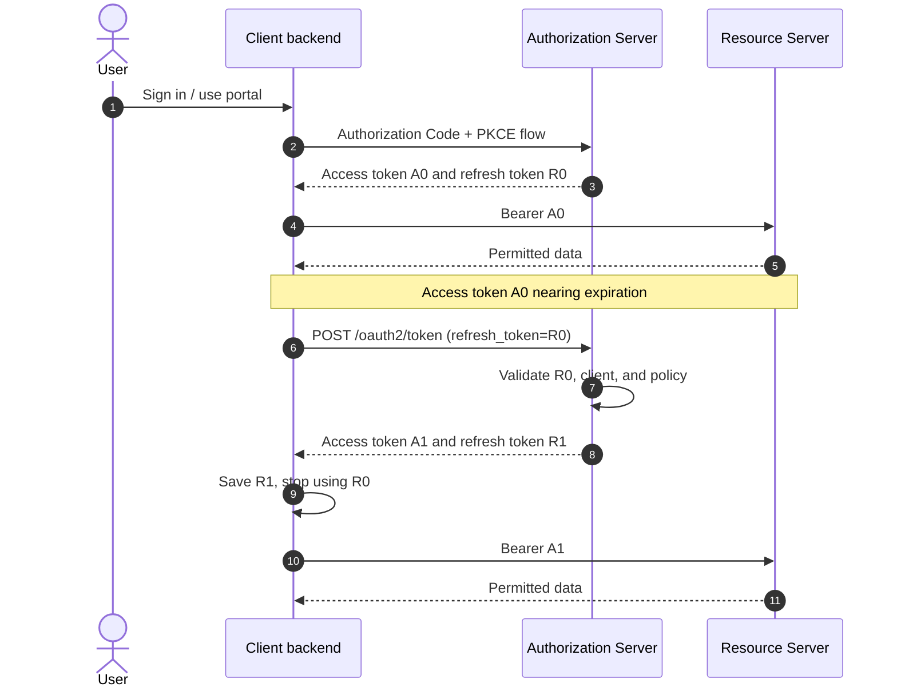
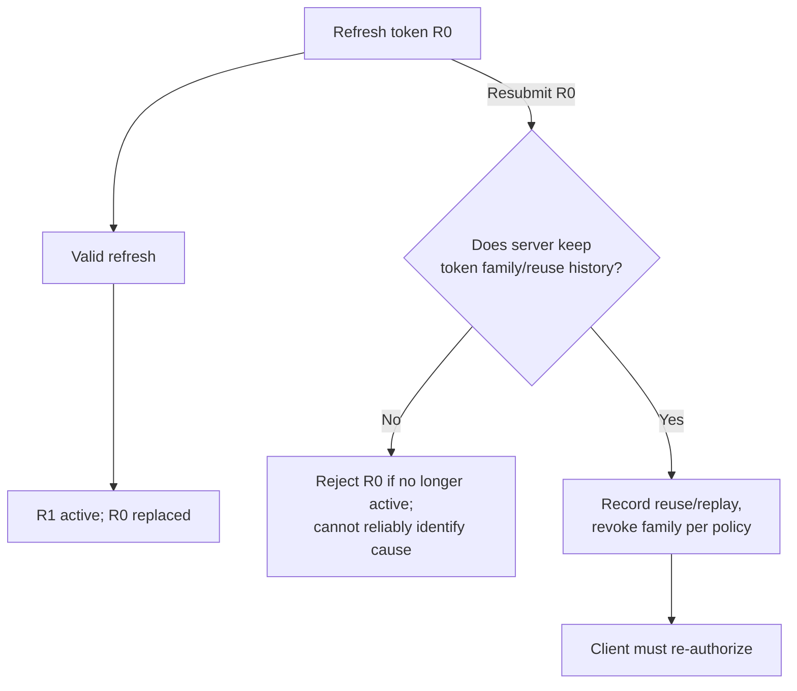
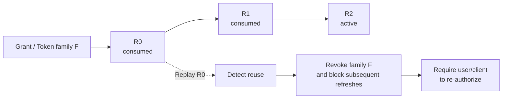
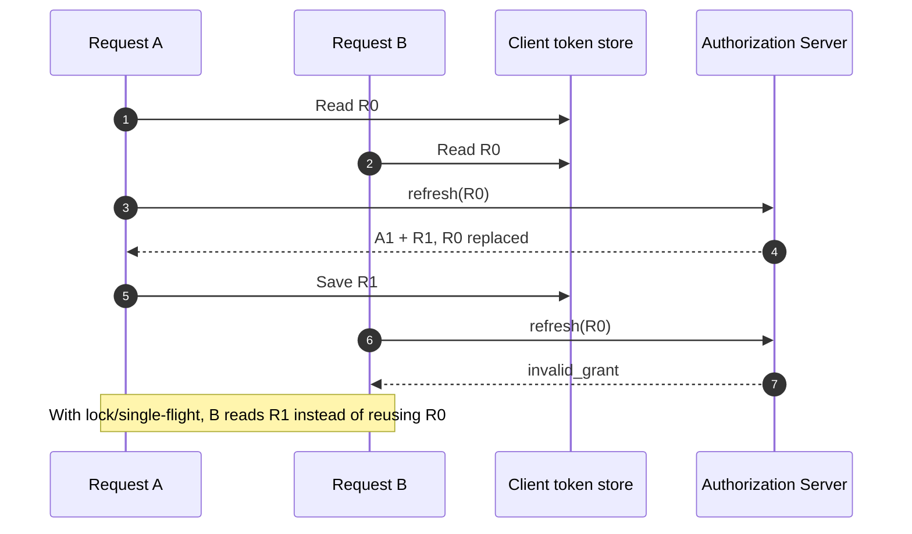

# Refresh Token Rotation and Validity of Replaced Tokens

In OAuth 2.0/OpenID Connect, a **refresh token** allows a client to obtain a new access token without requiring the user to repeat the entire Authorization Code Flow. Consequently, a refresh token is a high-value secret: if stolen and used successfully, an attacker can continue requesting new access tokens for as long as the refresh token remains accepted.

**Refresh token rotation** is a policy of issuing a **new refresh token** when a client exchanges a valid refresh token. The old value must be handled under a replacement/revocation policy instead of remaining usable arbitrarily. However, **rotation**, **rejecting old tokens**, and **detecting reuse to invalidate an entire token chain** are not always the same feature.

This lesson belongs to the **Refresh Token** chapter of the **SPRING_SECURITY_OAUTH2_OIDC_AUTHORIZATION_SERVER** module. The goal is to learn how to design, configure, secure, test, and operate an OAuth 2.0/OIDC Authorization Server with Spring Security and Spring Authorization Server in a Spring Boot application.

After this lesson, you will be able to:

1. Describe the refresh token lifecycle, refresh token rotation, and the behavior of replaced tokens.
2. Configure `TokenSettings.reuseRefreshTokens(false)` per `RegisteredClient` and explain how it differs from `true`.
3. Distinguish `invalid_grant` due to an old/expired/wrong-client token from **replay detection** with elevated security responses.
4. Explain why already-issued access tokens, old refresh tokens, and login sessions have distinct lifecycles.
5. Design secure token storage on the OAuth client, handling concurrent refreshes and dropped-response failures.
6. Test behavior in Spring Authorization Server and identify parts requiring customization before production deployment.

## 1. Where Does the Refresh Token Live in the OAuth Flow?

Consider a **confidential web client/BFF** named `orders-portal` using Authorization Code + PKCE to access an orders API:



With the `refresh_token` grant, the client typically sends requests to the **token endpoint**. Refresh tokens must never be sent to a Resource Server, never used as access tokens, and never placed in URLs or logs.

Three concepts to separate clearly:

| Component | What is it used for? | When does it lose validity? |
| --- | --- | --- |
| **Authorization code** | Exchanged for initial tokens in the Authorization Code Flow. | TTL expires or exchanged successfully; single-use only. |
| **Access token** | Proves resource access permission at an API. | Expires, rejected by validator/policy, or revoked via corresponding mechanism. |
| **Refresh token** | Requests new tokens at the Authorization Server. | Expires, revoked/replaced, wrong client, or authorization conditions no longer satisfied. |

**Key takeaway:** access token A0 may still be unexpired **after** R0 is replaced with R1. Replacing a refresh token does not mean every API immediately rejects A0. With offline-verified JWT access tokens, APIs may continue accepting A0 until `exp` unless an additional state-checking mechanism is present.

## 2. How Do Rotation, Reuse, and Replay Detection Differ?

### 2.1. Rotation

Rotation is the process:

1. AS receives valid R0 from an appropriately authenticated client.
2. AS validates the authorization and refresh grant conditions.
3. AS issues a new access token A1.
4. AS issues a **new refresh token R1**, updating state so R1 replaces R0.
5. AS returns the token response; the client records R1 in place of R0.

An ideal token chain:

```text
Initial authorization:
    R0 (active)

Refresh using R0:
    R0 (replaced / no longer usable)
    R1 (active)

Refresh using R1:
    R0 (replaced)
    R1 (replaced / no longer usable)
    R2 (active)

Refresh using R2:
    R3 (active), prior versions no longer usable
```

Rotation is **not** extending the lifetime of the same token string, nor is it exchanging for a new access token while keeping the same refresh token.

### 2.2. Refresh Token Reuse

Some AS configurations allow **reuse**: R0 continues to be sent across multiple refreshes until it expires or is revoked. In Spring Authorization Server, `TokenSettings.reuseRefreshTokens(true)` expresses the reuse policy as supported by the library.

| Policy | On successful refresh | Security consequence |
| --- | --- | --- |
| `reuseRefreshTokens(true)` | Continues using the existing refresh token per AS handling. | Simpler client, yet if R0 leaks while still valid, an attacker has more time to reuse it. |
| `reuseRefreshTokens(false)` | AS creates a new refresh token and replaces the previous one in authorization state. | Shrinks window to reuse R0; client must persist safely and handle race conditions. |

Do not confuse `reuseRefreshTokens(false)` with **never** issuing a refresh token to a client. Whether a refresh token is issued at all depends on the grant, client type, registration configuration, and AS policy.

### 2.3. Replay Detection and Token-Family Revocation

**Replay** occurs when a previously used or replaced refresh token reappears at the token endpoint. That may indicate:

- A buggy client failed to save R1 and keeps sending R0.
- Two legitimate requests read the same R0 and both initiated refreshes.
- Token R0 was copied and an attacker attempts to use it after the client.
- A stolen token was used **before** the legitimate client, causing the client to later send the replaced token.

An advanced design may store **relationships among refresh tokens sharing a grant/token family**. Upon detecting R0 reuse, the AS rejects the request and **revokes the entire related token family/authorization**, forcing the client to re-authorize.



**Warning about Spring Authorization Server:** `reuseRefreshTokens(false)` governs **rotation** of issued tokens. Never claim that enabling this flag alone provides complete **reuse detection, token-family tracking, invalidation of all descendants, and breach alerting**. Verify behavior on your exact version/data store and add custom design if strict replay-detection policies are required.

RFC 9700 (OAuth 2.0 Security Best Current Practice) requires protecting refresh tokens for **public clients** via **sender-constraining** or **refresh token rotation** capable of detecting reuse per the standard model. When using Spring Authorization Server, evaluate the **entire** implementation rather than equating a single configuration setter with fulfilling every standard requirement.

## 3. Lifecycle of R0, R1, and Issued Access Tokens

Suppose an illustrative policy:

- Access token TTL: 10 minutes.
- Refresh token TTL: 8 hours.
- `reuseRefreshTokens(false)`.
- Confidential client permitted to use `authorization_code` and `refresh_token`.

At `10:00`, the AS issues A0 (expiring at `10:10`) and R0. At `10:05`, the client refreshes successfully, and the AS issues A1 and R1.

| Timestamp | R0 | R1 | A0 | A1 |
| --- | --- | --- | --- | --- |
| Before refresh at `10:05` | Valid if unexpired/unrevoked. | Does not exist yet. | Unexpired. | Does not exist yet. |
| Immediately after successful refresh | **Replaced**, no longer a valid refresh token in standard authorization state. | Active token. | May still be accepted by APIs if unexpired and validator lacks extra revocation checks. | Usable at APIs if valid. |
| After `10:10` | Invalid. | Valid if unexpired/unrevoked. | Past `exp`; API must reject outside clock skew. | Unexpired depending on issuance time. |
| When R1 is revoked | Invalid. | Invalid. | Cannot assume offline JWT state automatically changes. | Depends on format/revocation and API checks. |

This table illustrates normal token mechanics; exact behavior depends on Spring Authorization Server version, `OAuth2Authorization` storage, access token type, and Resource Server configuration.

### 3.1. Replaced R0 Does Not Mean "Still Usable Because TTL Hasn't Elapsed"

TTL only specifies **the maximum expiration timestamp of a token**, not a guarantee the token will always be accepted until that timestamp. A refresh token can be **invalidated early** because:

- It was replaced by a new refresh token.
- It was revoked or its associated authorization was canceled.
- It is absent from the state store after a restart or hitting the wrong instance.
- It does not belong to the authenticating client.
- It was rejected by a security policy.

Therefore, saying "R0 hasn't reached 8 hours yet so the AS must allow refresh" is **false** if R0 has already been replaced.

### 3.2. Reusing R0 After Rotation Typically Yields invalid_grant

In the refresh grant flow, when the AS no longer finds a valid refresh token or the token is inactive, the response is typically an `invalid_grant` error:

```http
HTTP/1.1 400 Bad Request
Content-Type: application/json
Cache-Control: no-store

{
  "error": "invalid_grant"
}
```

This is a **typical example response**, not a promise that every SAS version returns the exact same status/headers in every scenario. Invalid client authentication can produce `invalid_client` before checking the refresh token. Do not rely on HTTP status alone to determine whether a token is under attack.

### 3.3. What Happens to Access Token A0?

Distinguish at least two modes:

1. **Self-contained JWT:** the Resource Server typically validates signature, `iss`, `exp`, `aud`, and scopes locally. It **does not automatically know** R0 was replaced or access token A0 was removed from the AS's authorization state. JWT A0 may remain accepted until expiration unless a denylist, introspection, or another state mechanism exists.
2. **Opaque/reference access token:** the Resource Server typically calls introspection or queries AS state. When A0 stops being accepted depends on how the AS updates authorizations, lookup mechanics, and introspection caching.

Therefore, document separate policies for **refresh token rotation** and **access token revocation**. Never cite R0 rotation as proof that A0 immediately loses API access.

## 4. Configuring Rotation with TokenSettings in Spring Authorization Server

In Spring Authorization Server 1.x, `TokenSettings` is configured **per `RegisteredClient`**. Key methods:

| Method | Meaning |
| --- | --- |
| `reuseRefreshTokens(false)` | Issues a new refresh token when processing the refresh grant per library policy. |
| `refreshTokenTimeToLive(Duration)` | TTL applied when creating a new refresh token. |
| `accessTokenTimeToLive(Duration)` | TTL of new access tokens. |
| `authorizationCodeTimeToLive(Duration)` | Authorization code TTL; does not govern rotation. |
| `accessTokenFormat(...)` | Access token format, relevant to validation and revocability. |

### 4.1. Confidential Client Registration Example

Example using **Java 17+, Spring Boot 3.x compatible with Spring Authorization Server 1.x**. This is a **client registration** configuration assuming the application already provides `PasswordEncoder`, `SecurityFilterChain`, signing keys/JWKS, issuer, and other infrastructure beans.

```java
package com.example.authserver.config;

import java.time.Duration;
import java.util.UUID;

import org.springframework.beans.factory.annotation.Value;
import org.springframework.context.annotation.Bean;
import org.springframework.context.annotation.Configuration;
import org.springframework.security.crypto.password.PasswordEncoder;
import org.springframework.security.oauth2.core.AuthorizationGrantType;
import org.springframework.security.oauth2.core.ClientAuthenticationMethod;
import org.springframework.security.oauth2.core.oidc.OidcScopes;
import org.springframework.security.oauth2.server.authorization.client.InMemoryRegisteredClientRepository;
import org.springframework.security.oauth2.server.authorization.client.RegisteredClient;
import org.springframework.security.oauth2.server.authorization.client.RegisteredClientRepository;
import org.springframework.security.oauth2.server.authorization.settings.ClientSettings;
import org.springframework.security.oauth2.server.authorization.settings.TokenSettings;

@Configuration(proxyBeanMethods = false)
public class PortalClientRegistrationConfig {

    @Bean
    RegisteredClientRepository registeredClientRepository(
            PasswordEncoder passwordEncoder,
            @Value("${demo.portal-client-secret}") String clientSecret) {

        TokenSettings rotationPolicy = TokenSettings.builder()
            .authorizationCodeTimeToLive(Duration.ofMinutes(2))
            .accessTokenTimeToLive(Duration.ofMinutes(10))
            .refreshTokenTimeToLive(Duration.ofHours(8))
            .reuseRefreshTokens(false)
            .build();

        RegisteredClient portal = RegisteredClient
            .withId(UUID.randomUUID().toString())
            .clientId("orders-portal")
            .clientSecret(passwordEncoder.encode(clientSecret))
            .clientAuthenticationMethod(
                ClientAuthenticationMethod.CLIENT_SECRET_BASIC)
            .authorizationGrantType(
                AuthorizationGrantType.AUTHORIZATION_CODE)
            .authorizationGrantType(
                AuthorizationGrantType.REFRESH_TOKEN)
            .redirectUri(
                "https://portal.example.com/login/oauth2/code/sas")
            .scope(OidcScopes.OPENID)
            .scope("orders.read")
            .clientSettings(ClientSettings.builder()
                .requireProofKey(true)
                .requireAuthorizationConsent(true)
                .build())
            .tokenSettings(rotationPolicy)
            .build();

        return new InMemoryRegisteredClientRepository(portal);
    }
}
```

In `application.yml`:

```yaml
demo:
  portal-client-secret: ${PORTAL_CLIENT_SECRET}
```

Supply the `PORTAL_CLIENT_SECRET` environment variable at runtime. **Never commit real secrets to source code**, never place secrets in logs, and never place secrets in SPA/public client apps.

**Analysis:**

- The client registers `authorization_code` and `refresh_token` grants; the `reuseRefreshTokens(false)` flag **does not automatically grant** refresh capability if the client is unregistered or ineligible.
- `CLIENT_SECRET_BASIC` is for confidential backend clients capable of safeguarding a client secret server-side. Public SPAs/native apps cannot protect a client secret similarly.
- `requireProofKey(true)` requires PKCE for authorization codes. PKCE verifies **code exchange**; it does not replace client authentication and does not replace refresh token rotation.
- `refreshTokenTimeToLive(Duration.ofHours(8))` is the TTL of **each issued refresh token** per policy. When rotation issues a new token, the new token's lifetime is typically measured from its issuance time; it does not automatically impose an **absolute lifetime for the whole session/authorization**.
- `InMemoryRegisteredClientRepository` is only suitable for learning and tests. Never generate random internal IDs when operating a durable repository holding consent/authorization state; use stable IDs and controlled registration updates.

### 4.2. Policy Does Not Apply to All Grants

`client_credentials` typically does not issue refresh tokens: a service can request new access tokens using its client credentials directly. With Authorization Code Flow, a refresh token can be issued when client and configuration permit. Do not attach `REFRESH_TOKEN` to an SPA assuming the library issues refresh tokens in every version.

For **public clients**, RFC 9700 requires mitigating refresh token risks via sender-constraining or rotation with reuse detection. If an SPA architecture cannot protect tokens adequately, consider a **Backend-for-Frontend (BFF)** so refresh tokens never live in JavaScript.

### 4.3. Comparing a Reuse Client and a Rotate Client

```java
TokenSettings legacyReuse = TokenSettings.builder()
    .refreshTokenTimeToLive(Duration.ofHours(8))
    .reuseRefreshTokens(true)
    .build();

TokenSettings rotatingRefresh = TokenSettings.builder()
    .refreshTokenTimeToLive(Duration.ofHours(8))
    .reuseRefreshTokens(false)
    .build();
```

Both policies can be attached to **two different `RegisteredClient` instances**. When changing a running client's policy, account for already-issued tokens and client applications holding old tokens; never change it just for "cleaner config" when clients cannot yet handle new refresh tokens.

## 5. Request/Response When Refreshing with Rotation

Suppose the client received R0 via Authorization Code Flow and stores it securely server-side.

Request:

```http
POST /oauth2/token HTTP/1.1
Host: login.example.com
Authorization: Basic <BASE64_OF_CLIENT_ID_COLON_CLIENT_SECRET>
Content-Type: application/x-www-form-urlencoded

grant_type=refresh_token&refresh_token=<R0>&scope=orders.read
```

This example shows a **confidential client** using Basic client authentication over HTTPS. In real applications, `client_id` and secret must be properly encoded when constructing HTTP Basic credentials; tokens must never appear in URLs/logs.

Abbreviated response on success:

```json
{
  "access_token": "<NEW_ACCESS_TOKEN_A1>",
  "token_type": "Bearer",
  "expires_in": 600,
  "refresh_token": "<NEW_REFRESH_TOKEN_R1>",
  "scope": "orders.read"
}
```

After receiving the response, the client must use **R1 instead of R0** for subsequent refreshes. If SAS persisted the successful rotation state while the client still holds R0, the next attempt may be rejected with `invalid_grant`.

### 5.1. Scopes on Refresh

The refresh grant is not an opportunity to request arbitrary scopes. Under OAuth rules:

- Scopes in a refresh request **must not expand** beyond the permissions granted to the original authorization.
- If the `scope` parameter is omitted, the AS applies the scope rules of the corresponding authorization/refresh token.
- A client sending `orders.write` when it was only granted `orders.read` must be rejected or constrained per protocol/policy, never escalated automatically.
- Even when a token holds valid scopes, the Resource Server still verifies audience, tenant, and object-level permissions.

Never treat the client's `scope` parameter as a **trusted permission source**, and never write custom refresh logic that bypasses authorization state.

### 5.2. How Does the Newly Issued Refresh Token Differ?

R1 must be an unpredictable fresh value stored safely as a credential. The AS must link R1 to the appropriate client/authorization, issuance time, expiration, and binding constraints. **R1 should never be derivable from R0**; token generation must use a secure random source per the library.

In Spring Authorization Server, `OAuth2TokenGenerator` and provider components handle token generation. Never hand-code `R1 = R0 + "1"` or issue predictable UUID structures.

## 6. How Does Spring Authorization Server Manage State?

Components to distinguish:

| Component | Responsibility |
| --- | --- |
| `RegisteredClientRepository` | Stores client metadata, grant types, authentication methods, and `TokenSettings`. |
| `OAuth2RefreshTokenAuthenticationConverter` | Converts HTTP refresh requests into authentication request objects. |
| `OAuth2RefreshTokenAuthenticationProvider` | Validates the refresh grant, authorization/token, and issues tokens per configuration. |
| `OAuth2AuthorizationService` | Persists and retrieves authorization state, including issued tokens. |
| `OAuth2TokenGenerator` | Generates access/refresh tokens matching policy and grant. |
| `OAuth2AuthorizationConsentService` | Stores user consent, not the refresh token store. |
| Resource Server | Validates access tokens; does not validate refresh tokens over APIs. |

In the standard authorization state model, an authorization holds an active refresh token. When rotation succeeds and state is persisted, the new token replaces the old token in that state. Subsequent lookups for R0 fail or return an inactive status **depending on the actual storage/lookup mechanism**. How Spring handles errors must be verified via integration tests for your specific version and repository.

### 6.1. Why Do Repositories and Transactions Matter?

A production deployment with multiple AS replicas must not let each JVM keep a separate in-memory authorization store. If the first R0 request hits instance A and the next request hits instance B without seeing updated state, the result can be intermittent failures—or in poorly designed custom code, issuing multiple token branches.

Common choices:

- `InMemoryOAuth2AuthorizationService`: suitable for demos/tests, non-durable across restarts and not shared across instances.
- `JdbcOAuth2AuthorizationService`: persists state to a database; requires proper migrations, indexes, and concurrency design.
- Custom `OAuth2AuthorizationService`: can add optimistic locking, compare-and-swap, token-family tracking, auditing, and atomic refresh validation.

**Shared storage alone does not guarantee race safety.** If two concurrent refresh requests both read R0 as active before either transaction writes R1, both may pass initial checks unless the state store and refresh logic guarantee atomic updates. Verify this with concurrent integration tests, not merely sequential single-request tests.

### 6.2. Do Not Confuse Token Storage State with Replay Detection Capability

If a repository retains only **the current token**, after R0 is replaced by R1, a stale R0 request may simply find no authorization:

```text
findByToken(R0, REFRESH_TOKEN) -> null
=> invalid_grant
```

This outcome **rejects R0** yet does not necessarily determine that R0 was once valid and was just reused. Without history, the server cannot easily distinguish:

- R0 was just replaced by a successful refresh.
- R0 is a nonexistent token guessed by an attacker.
- R0 belonged to an authorization already purged from the store.
- R0 expired long ago and was cleaned up.

A system requiring **actionable replay detection** needs historical evidence and policy: token family, token identifier/hash, "consumed/replaced" status, timestamps, client binding, and atomic revocation actions.

## 7. Designing a Token Family to Detect Refresh Token Reuse

This is an **additional architectural pattern**, not a built-in bean enabled automatically simply by calling `reuseRefreshTokens(false)`.



A token-family record may contain:

| Attribute | Purpose |
| --- | --- |
| `family_id` / `authorization_id` | Links the token chain originating from the same grant. |
| `client_id` / internal registered client ID | Binds tokens to the right client. |
| `current_token_hash` | Matches the active token without storing raw tokens in custom audit tables. |
| `used_token_hashes` or consumed records | Identifies previously rotated tokens when resubmitted. |
| `version` or sequence | Supports optimistic locking/CAS to prevent two concurrent refreshes from both succeeding. |
| `expires_at` and `absolute_expires_at` | Current token TTL and absolute grant/family ceiling if required by policy. |
| `revoked_at` / `revoked_reason` | Ensures the entire family stays blocked once reuse is confirmed. |
| `last_refresh_at` / audit event ID | Anomaly observability without logging raw refresh tokens. |

**Conceptual transaction model:**

```text
BEGIN TRANSACTION
  1. Look up family from the identifier/hash of the presented token.
  2. Validate client binding, grant, expiry, revoked flag.
  3. If token is the ACTIVE token:
       - Transition ACTIVE -> CONSUMED via conditional update/CAS.
       - Generate and store R_new in ACTIVE state.
       - Record token/authorization metadata and commit consistently.
  4. If token is already CONSUMED/REPLACED:
       - Record security event without raw tokens.
       - Revoke family per policy and commit.
       - Return invalid_grant.
  5. If token does not exist:
       - Return invalid_grant; do not guess identities.
COMMIT
```

If two requests run concurrently, **only one transaction** may win the transition from ACTIVE to CONSUMED. The losing request must be handled by the designed anti-replay mechanism. Never leave "read then update" logic without locks or version checks that allow both R1 and R1' to become valid.

### 7.1. Why Not Revoke the Entire Family on Every `invalid_grant` by Default?

`invalid_grant` can result from an expired token, revoked token, wrong redirect/code, or other invalid states. Not every `invalid_grant` proves reuse of a refresh token from a specific family.

An extreme reaction—"every `invalid_grant` deletes all user sessions"—can cause **denial of service**. In particular, an attacker could submit random strings alongside a known client ID to intentionally trigger revocations. Apply family revocation only when the server **has evidence the old token belonged to a specific family and was already consumed**, under a carefully designed policy.

### 7.2. Handling Grace Periods and Replay

Some systems desire a brief grace window to tolerate network glitches. However, allowing R0 to remain usable after R1 is issued also gives an attacker holding R0 a window to reuse it; this weakens or alters rotation semantics.

If a retry/idempotency mechanism is required, design it around your threat model, bound to the exact client/transaction and server-side state, rather than opening a generic grace window. A feature that lets **a replaced token keep minting unlimited new tokens** cannot be considered secure refresh token rotation.

## 8. How Must the Client Store the New Refresh Token?

Rotation cannot work if the client keeps R0 after the AS has issued R1. Therefore, **OAuth client** responsibility is a critical part of the design.

### 8.1. Backend/BFF

In a backend with a database token store:

1. Read the nearly expired access token and current refresh token.
2. Allow only **one refresh operation per session/authorization** at a time (single-flight or distributed lock).
3. Send the refresh token over HTTPS, authenticating the client as registered.
4. On a successful response, write **new access token + new refresh token + expiry** as a single consistent update.
5. Only after committing the new state, allow other requests to use the new token.
6. Never store raw refresh tokens in logs, metrics, browser localStorage, or unprotected messages.

In multi-instance applications, a `synchronized` lock inside one JVM is **insufficient** because two servers can receive requests for the same user. Use distributed synchronization or transactions/CAS at the client's token store.

### 8.2. Pseudocode to Prevent Two Requests from Using the Same R0

```text
getAccessToken(sessionId):
    state = tokenStore.read(sessionId)

    if accessToken still has sufficient safe lifetime:
        return accessToken

    acquire per-session distributed lock

    try:
        state = tokenStore.read(sessionId)  // re-read after lock

        if state.accessToken was already updated by another instance:
            return state.accessToken

        response = tokenEndpoint.refresh(
            clientAuthentication,
            state.refreshToken
        )

        if response success:
            newState = {
                accessToken: response.accessToken,
                refreshToken: response.refreshToken
                    ?? state.refreshToken, // fallback only when protocol/policy permits
                expiresAt: response.expiresAt,
                version: state.version + 1
            }

            tokenStore.compareAndSwap(sessionId, state.version, newState)
            return newState.accessToken

        if response invalid_grant:
            invalidate local refresh credential
            require reauthorization
    finally:
        release lock
```

This is **design pseudocode**, not runnable Java library code. For clients **requiring rotation**, if a token response lacks a new refresh token, do not silently keep R0 and keep refreshing as before; handle it per the verified contract. The token store must also handle CAS failures cleanly if the AS already issued new tokens.

### 8.3. Race Condition Between Two Requests



If the AS enforces family revocation when an old token is reused, **a legitimate client-side race condition** can cause the whole family to be revoked and force the user to sign in again. Therefore, concurrency must be handled on both the client and the Authorization Server.

### 8.4. Dropped Response After the AS Commits Rotation

A difficult failure mode:

1. Client sends R0.
2. AS persists R1 and invalidates R0.
3. Network drops or client times out **before receiving R1**.
4. Client only has R0 left in its token store.
5. Retrying with R0 returns `invalid_grant`, or is flagged as replay in detection-enabled systems.

This cannot be solved completely by increasing TTL. Choose behavior based on security policy: end the authorization and restart the Authorization Code Flow, or build a dedicated, security-reviewed server-side retry/idempotency mechanism. **Never assume retrying the same R0 always succeeds.**

## 9. TTL During Rotation: Sliding Expiration vs. Absolute Limits

Suppose `refreshTokenTimeToLive(Duration.ofHours(8))`. If each rotation issues a new token with an 8-hour TTL from **issuance time**, an active client refreshing regularly can extend tokens continuously. This is per-token **sliding expiration**, not an 8-hour absolute limit for the entire authorization.

```text
10:00  R0 issued, expires 18:00
12:00  refresh(R0) -> R1 issued, expires 20:00
15:00  refresh(R1) -> R2 issued, expires 23:00
...
```

Timestamps above are illustrative. Exact expiration behavior depends on the token generator and deployment version policy. If product policy requires sessions to end at most 24 hours after initial authorization, **setting refreshTokenTimeToLive(...) alone is insufficient**. You also need:

- Persisted `authorization/session started_at` and `absolute_expires_at`.
- Validation before every refresh to reject requests past the absolute limit.
- Re-authentication policies, such as max authentication age/MFA where appropriate.
- Administrative revocation and authorization state cleanup processes.

Never use refresh token TTL as the sole definition of SSO login or web session lifetime.

## 10. Refresh Token Rotation and Client Types

| Client type | Should a refresh token be issued? | Policy and risks |
| --- | --- | --- |
| Confidential backend/BFF | Possible, if using eligible grant and sessions require it. | Keep refresh tokens on backend with encryption and access control; evaluate rotation, revocation, and concurrency. |
| Public SPA | Only when architecture/AS supports safe mechanisms. | JavaScript cannot keep secrets completely safe from XSS; RFC 9700 requires rotation with reuse detection or sender-constrained refresh tokens if issued to public clients. |
| Native/mobile app | Possible, depending on app type and policy. | Protect tokens in device keystore, PKCE, handle lost/reinstalled devices, rotation/sender constraints. |
| Machine client using `client_credentials` | Usually unnecessary and not issued in standard flows. | Service uses client authentication to obtain new access tokens, not user-session refreshes. |
| High-privilege sensitive client | Requires strict assessment. | Short access tokens, rotation/sender constraints, absolute limits, risk signals, and effective revocation. |

**Important:** mTLS, DPoP, or another form of sender-constraining can bind token usage to a client key, but must be deployed across the right endpoints, token formats, and verifiers. Never assume enabling `requireProofKey(true)` (PKCE) sender-constrains refresh tokens.

## 11. Revocation, Logout, and Impact on Access Tokens

There are at least four distinct actions:

1. **Rotation:** AS issues R1 replacing R0 after a successful refresh.
2. **Revoke refresh token:** AS marks or removes usability of current R, per RFC 7009/policy.
3. **Web/OIDC logout:** terminates login session at client/AS or sends logout notification; does not automatically revoke every access token.
4. **Revoke access token:** causes APIs to stop accepting the token before `exp`, depending on token verification mode.

For example, a user logs out of the portal at `10:06` while JWT A1 still has 9 minutes left. If APIs validate JWTs locally, A1 **may still be accepted** until expiration. If immediate cutoff is required, use introspection, denylists, token binding, real-time permission checks, or another token model.

Conversely, if R1 is revoked, the client may be forced to restart the authorization flow when A1 expires, though revoking R1 does not necessarily stop A1 immediately.

**Access token revocation policies must be tested at the Resource Server**, not solely by calling the AS revoke endpoint.

## 12. Common Failure Scenarios

### 12.1. Client Receives `invalid_grant` After One Successful Refresh

Common causes:

- Client still stores R0 instead of R1.
- Two requests refreshed concurrently using R0.
- Token store failed to write the new token or updated non-atomically.
- AS committed rotation yet the response was dropped.
- Authorization state was lost on restart or failed distribution across instances.
- R1 expired or was revoked.

Never automatically increase refresh TTL or re-enable reuse without diagnosing the root cause. Inspect transaction/audit traces **without raw tokens**, checking timestamps and token store versions.

### 12.2. Reuse False Yet R0 Is Still Accepted in a Concurrency Test

If two concurrent requests both read R0 before state updates, the repository/transaction may lack atomicity guarantees. Tests must confirm **only one refresh succeeds** and only one descendant becomes valid per policy. Otherwise, add optimistic locking/compare-and-swap or session-level serialization/storage.

### 12.3. Old R0 Is Rejected Yet the System Emits No Replay Alert

That may be expected behavior for a repository storing only the active token. You cannot distinguish a consumed token from a token that never existed without keeping history. Detecting reuse requires a token-family/history design paired with security event logic.

### 12.4. Users Get Randomly Logged Out When Using Multiple Tabs

The client may be refreshing concurrently from multiple tabs/instances where one request uses an already-replaced R0; or the app fails to persist R1 promptly. Use single-flight/deduplicated refreshes, conditional state updates, and ensure every request reads the newest token after refresh.

### 12.5. Valid R1 Exists Yet JWT A0 Still Calls APIs

Refresh token rotation does not automatically invalidate already-issued JWT A0 in offline verifiers. If business rules require this, design separate revocation/denylist/introspection or use appropriately short-lived access tokens.

### 12.6. R1 Fails After Restart Despite Remaining TTL

In-memory `OAuth2AuthorizationService` or repositories do not survive restarts. Use a durable/shared state store for production; verify key rotation, caches, issuer, and client registration consistency.

### 12.7. Client Credentials Does Not Receive a Refresh Token

This is typically the intended behavior of the `client_credentials` grant. The client obtains access tokens and requests new ones via client authentication when needed. Do not add refresh tokens to a flow merely to reduce token endpoint calls.

## 13. Storage and Operational Strategies

### 13.1. Controlled Token Storage and Auditing

- Never log raw refresh tokens, access tokens, client secrets, or private keys in logs, URLs, exceptions, metric labels, or exchanged messages.
- Client and AS token stores must restrict access, encrypt sensitive data at rest, and have secure backup/restore procedures. Custom systems can use strong token hashes for lookup without storing raw tokens in audit tables.
- Avoid using `client_id` or user ID as the sole key of a refresh transaction: one client/user can hold multiple concurrent authorizations/sessions/devices.
- When storing consumed-token history for replay detection, set sensible TTL/retention: long enough to catch reuse per policy without retaining unnecessary data forever.
- Ensure backup/restore cannot resurrect old tokens via data rollback; plan post-restore state and version handling.

### 13.2. Monitoring

Measure/record **aggregate metrics**:

| Metric / event | Meaning |
| --- | --- |
| `refresh_success_total` | Tracks successful refresh volume. |
| `refresh_invalid_grant_total` | Identifies spikes from expiry, races, lost state, or replay. |
| `refresh_reuse_detected_total` | Emitted only when consumed/replaced token detection has evidence. |
| `refresh_family_revoked_total` | Counts families revoked by security policy, without raw tokens. |
| `refresh_latency` | Tracks token endpoint and database/lock latency. |
| `refresh_concurrency_conflict_total` | Detects contention while updating token/authorization state. |
| `authorization_store_error_total` | Alerts on persistence failures causing lost sessions or token skew. |

Do not label every `invalid_grant` an attack. During investigation, use event IDs, sanitized client IDs, pseudonymous family IDs, and timestamps; never put unbounded user/tenant IDs or tokens into metric labels.

### 13.3. High Availability Across Multiple Instances

An AS running multiple replicas requires:

- Identical issuer and tokens signed by a shared managed keyset.
- Shared `RegisteredClientRepository`, `OAuth2AuthorizationService`, and token policies.
- Strong concurrency control for **consuming R0 and issuing R1**.
- Appropriate retry/backoff and idempotency strategies that never accidentally reuse consumed tokens.
- Clock/TTL synchronization, DB indexes, timeouts, and cleanup of expired tokens/families.
- Testing rolling deployments when instances run two different code/policy versions.

A shared data store that still permits lost updates can make rotation unsafe. Conversely, a sound atomic algorithm running on two unshared stores fails HA as well.

## 14. Test Matrix for Rotation and Old Token Validity

To guarantee behavior, test **sequential requests**, **concurrent requests**, **network errors**, and **API verification mechanisms**.

| Scenario | Expected outcome |
| --- | --- |
| Valid R0, right client, `reuseRefreshTokens(false)` | AS issues A1 and R1; R1 differs from R0. |
| Resubmit R0 after successful refresh | R0 cannot mint further tokens; appropriate error (typically `invalid_grant`). |
| Submit R1 first time after rotation | AS issues new tokens (A2/R2) if R1 is unexpired and policy allows. |
| Client sends wrong secret | Client authentication rejected; neither R0 nor R1 works. |
| Client B presents Client A's R1 | Refresh rejected because token is bound to the issued client. |
| Refresh token exceeds TTL | No new access token issued. |
| R1 revoked | No new access token issued. |
| Client lacks `refresh_token` grant | Refresh rejected even with a valid-looking refresh token value. |
| Refresh with scopes exceeding original grant | Does not issue scopes beyond the granted authorization. |
| `reuseRefreshTokens(true)` | Verify actual reuse behavior in your SAS version; do not assume a new R is returned. |
| Two concurrent requests with R0 | Under strict rotation policy, only one consumption of R0 may succeed. |
| Server commits rotation then client loses response | Client must not assume R0 remains active; provide safe re-authorization path. |
| Client fails to persist R1 | Do not loop sending R0 indefinitely; detect and handle lost state. |
| Replay R0 in token-family design | Identify old token belonging to family; revoke per policy and record event. |
| Request with random nonexistent token | Reject without arbitrarily revoking someone else's family. |
| Unexpired JWT access token A0 after R0→R1 | Test clarifies whether APIs still accept A0; never assume rotation revokes A0. |
| Opaque access token A0 after R0→R1 | Test introspection/caching and effective timing policy. |
| Change TTL or `reuseRefreshTokens` with existing tokens | New policy applies per issuance/registration-read mechanics; test pre-existing data. |
| AS restart or replica switch between refreshes | Consistent authorization state/registration and keys; active R is preserved. |
| Consecutive rotations | R0/R1 replaced; only active refresh token remains usable per policy. |

### 14.1. Step-by-Step Manual Test Procedure

**Step 1:** run the Authorization Server and a confidential client registered with `authorization_code`, `refresh_token`, PKCE, and `reuseRefreshTokens(false)`. Ensure callback and issuer match.

**Step 2:** complete the Authorization Code Flow to obtain access token A0 and refresh token R0. Keep tokens in a secure test environment; **never paste raw tokens into public logs or online tools**.

**Step 3:** send a refresh token request using R0:

```bash
curl --silent --show-error --fail-with-body \
  -u "orders-portal:$PORTAL_CLIENT_SECRET" \
  -H 'Content-Type: application/x-www-form-urlencoded' \
  --data-urlencode 'grant_type=refresh_token' \
  --data-urlencode "refresh_token=$R0" \
  'https://login.example.com/oauth2/token'
```

This is a Bash example; in PowerShell, environment variables and `curl` syntax differ. Use proper TLS, keep tokens out of shell history/logs, and avoid verbose flags when using real credentials.

**Step 4:** inspect the response for A1 and R1; assert `R1 != R0` (without printing both to logs). Use R1 for the next refresh to obtain A2/R2.

**Step 5:** resubmit R0. Expect the token endpoint to reject it and issue no new tokens. If the system has replay-family detection, verify events and revocation state per design.

**Step 6:** while access token A0 still has valid `exp`, call the Resource Server. Record what offline JWT validation or introspection returns; verify this boundary **independently** of rotation.

### 14.2. Suggestions for AS-Side Integration Tests

A framework-level test can:

1. Create a `RegisteredClient` with `reuseRefreshTokens(false)` and a valid `OAuth2Authorization` holding an unexpired refresh token R0.
2. Send a refresh request with valid client authentication.
3. Assert a new access token and a new refresh token differing from R0.
4. Query authorization state via `OAuth2AuthorizationService`; confirm the active token is R1.
5. Resubmit R0 and assert rejection.
6. Use R1 successfully and confirm R2 replaces R1.
7. Run concurrent request tests to uncover lost updates and verify real repository behavior.
8. Use a mock clock/clock injection when testing TTLs; avoid long `Thread.sleep` calls or CI clock fragility.
9. Write dedicated tests for family revocation if custom-implemented; never expect that capability from `TokenSettings` setters alone.

One reminder: **inspecting private fields directly or parsing raw tokens as JWTs** does not replace calling the real endpoint and verifying state. Refresh tokens are usually opaque; never treat them as ID tokens or access tokens.

## 15. Design Exercise: Reused Refresh Token

A company deploys an Authorization Server for `employee-portal` (confidential BFF), 10-minute access token TTL, 8-hour refresh token TTL, `reuseRefreshTokens(false)`.

Scenario:

- `09:00`: client receives R0/A0.
- `09:04`: a refresh request using R0 succeeds, returning R1/A1.
- `09:04:01`: another request still uses R0.
- `09:05`: the security team discovers the user's refresh token may have leaked.
- `09:07`: APIs still accept unexpired JWT A0.
- `09:08`: the user logs out of the portal.

Answer:

1. Is R0 allowed to continue requesting access tokens after R1 is issued? Why isn't the 8-hour TTL proof that R0 is still active?
2. Can we conclude the second request is definitely an attacker? Which legitimate causes produce this scenario?
3. Is `reuseRefreshTokens(false)` sufficient to **revoke the entire family** and emit security events? What extra data must be stored?
4. Why does an API still accept JWT A0 after rotation? When do you need introspection/denylists or another rejection mechanism?
5. If two requests read R0 before either persists R1, what mechanism should the system rely on so only one request wins?
6. If the token endpoint committed R1 but the HTTP response was lost, what policy should the client follow?
7. If each new refresh token has an 8-hour TTL from issuance, and the client refreshes every 2 hours continuously, will the session end automatically 8 hours after initial login?
8. Does user logout revoke all previously issued JWTs? What must be tested at the Resource Server?

**Solution direction:** Once replaced, R0 can no longer be used even before its TTL expires; a repeated R0 request may be a race or replay, requiring state and security policy to decide. Pure rotation differs from family detection/revocation. Access tokens, refresh tokens, and SSO sessions are separate lifecycles requiring appropriate revocation mechanisms.

## 16. Pre-Production Deployment Checklist

- [ ] Clients are registered with exact grants and authentication methods; never issue refresh tokens to ineligible grants/client types.
- [ ] `TokenSettings.reuseRefreshTokens` is chosen explicitly; access/refresh token lifetimes match risk.
- [ ] With rotation, clients persist the new refresh token after every successful refresh and stop using old tokens.
- [ ] Single-flight/locking/CAS handles concurrent client refreshes, including across multiple instances or browser tabs.
- [ ] Authorization state is persisted durably/shared, and consuming the old token plus storing the new token is appropriately atomic.
- [ ] If replay detection/token-family revocation is required, history tracking and response policies are explicitly designed; do not assume SAS setters provide it all.
- [ ] Plans exist for dropped responses, client timeouts, and token-store write failures without weakening policy.
- [ ] Absolute authorization/session limits exist when required by policy; never confuse per-refresh-token TTL with maximum session lifetime.
- [ ] Refresh tokens are never saved in logs, URLs, analytics, exception traces, or insecure browser storage.
- [ ] Public clients use rotation with reuse detection or sender-constraining per RFC 9700 if issued refresh tokens.
- [ ] Refresh scopes never exceed the granted authorization; client binding and revocation are verified.
- [ ] Impact of rotation/revocation on JWT vs. opaque access tokens at Resource Servers is understood.
- [ ] Tests cover old tokens, new tokens, expiration, wrong clients, concurrency, replay, restarts, multi-instance, and rollouts.
- [ ] Metrics/audits distinguish routine `invalid_grant` from evidenced reuse without exposing credentials.
- [ ] Key/secret rotation, database recovery, issuer/key consistency, and post-token-loss re-login flows have been rehearsed.

**Takeaway:** In Spring Authorization Server, `TokenSettings.reuseRefreshTokens(false)` **issues a new refresh token on refresh**, requiring the client to use the new token instead of the old one. **A replaced old token cannot continue refreshing simply because its TTL has not expired.** However, **reuse detection, token-family revocation, race-condition handling, and invalidating circulating access tokens** are broader requirements needing dedicated storage architecture, client behavior, Resource Server validation, and testing.

**References:**

- [Spring Authorization Server — Core Model and Components](https://docs.spring.io/spring-authorization-server/reference/core-model-components.html): `RegisteredClient`, `TokenSettings`, `OAuth2AuthorizationService`.
- [Spring Authorization Server — Protocol Endpoints](https://docs.spring.io/spring-authorization-server/reference/protocol-endpoints.html): token endpoint, refresh token grant, and authentication providers.
- [RFC 6749 — OAuth 2.0 Authorization Framework](https://www.rfc-editor.org/rfc/rfc6749.html): Section 6 on Refreshing an Access Token.
- [RFC 9700 — Best Current Practice for OAuth 2.0 Security](https://www.rfc-editor.org/rfc/rfc9700.html): refresh token protection, replay detection, and sender-constraining/rotation.
- [RFC 7009 — OAuth 2.0 Token Revocation](https://www.rfc-editor.org/rfc/rfc7009.html): token revocation.
- [RFC 7662 — OAuth 2.0 Token Introspection](https://www.rfc-editor.org/rfc/rfc7662.html): querying token state.
- [OpenID Connect Core 1.0](https://openid.net/specs/openid-connect-core-1_0.html): OIDC flows and relationships among authorizations, tokens, and user sessions.
