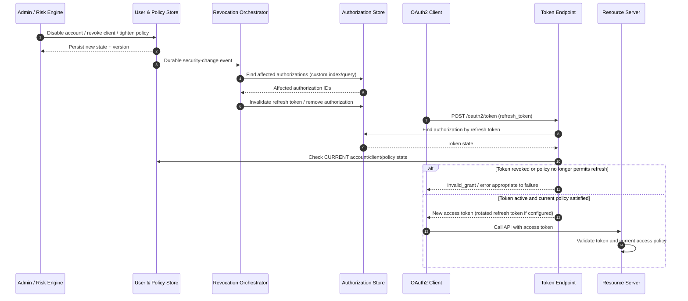

# Revoking Refresh Tokens When Accounts, Clients, or Policies Change

In a Spring Boot application using **Spring Security and Spring Authorization Server** to implement OAuth 2.0/OpenID Connect (OIDC), a **refresh token** lets an OAuth2 Client obtain new access tokens without requiring the user to repeat the entire Authorization Code flow. This feature preserves login UX, yet creates a crucial security requirement: **what happens to already-issued refresh tokens if a user account is locked, a client is disabled, access permissions are narrowed, or authentication policies change?**

A refresh token that was valid at issuance **must not automatically retain permission to mint new access tokens** once the original authorization conditions no longer hold. To manage token lifecycles safely, a system must combine **state-change events**, **revocation rules**, **token-endpoint validation**, **persistence mechanisms**, and **real concurrency/revocation testing**.

This lesson belongs to the **Refresh Token** chapter of the **SPRING_SECURITY_OAUTH2_OIDC_AUTHORIZATION_SERVER** module and covers designing, configuring, securing, testing, and operating this workflow in Spring Authorization Server. The focus is on **account-, client-, and policy-driven refresh token revocation**, not solely sending a single HTTP request to the revocation endpoint.

> **Core principle:** Revoking a refresh token aims to prevent **using that token to continue requesting new tokens**. Revocation **does not automatically make previously issued JWT access tokens invalid immediately**, does not automatically clear all browser sessions, and does not automatically discard all stored consent records.

## 1. Recap of the Refresh Token's Role

In a typical Authorization Code flow, the user signs in at the Authorization Server (AS), completes consent if required, and the application receives an **authorization code** and exchanges it at the token endpoint. Depending on grant, client type, scopes, and policy, the AS may also issue a refresh token:

```http
HTTP/1.1 200 OK
Content-Type: application/json;charset=UTF-8
Cache-Control: no-store
Pragma: no-cache

{
  "access_token": "REDACTED_ACCESS_TOKEN",
  "token_type": "Bearer",
  "expires_in": 600,
  "refresh_token": "REDACTED_REFRESH_TOKEN",
  "scope": "openid profile documents.read"
}
```

`REDACTED_...` values are placeholders only. In a valid **OIDC Authorization Code flow**, the initial token response also includes `id_token` per OIDC specifications; the example above focuses purely on illustrating the access/refresh token pair.

When the access token is about to expire, the client can send:

```http
POST /oauth2/token HTTP/1.1
Host: identity.example.com
Authorization: Basic <REDACTED_CLIENT_AUTH>
Content-Type: application/x-www-form-urlencoded

grant_type=refresh_token&refresh_token=REDACTED_REFRESH_TOKEN&scope=documents.read
```

The AS must validate the refresh token, client binding, and permitted rights before issuing new tokens. For **confidential clients**, client authentication must still be verified using the registered method. A client **must never use another client's refresh token**, nor can it use the refresh grant to expand permissions beyond what was granted. Under RFC 6749, scopes requested on refresh **must not include any scope not originally granted by the resource owner**; omitting this parameter typically means requesting the original scope per the protocol contract, yet the AS must still enforce current policy.

### 1.1. A Refresh Token Is Not a Login Session

| Data | Used for | Does revoking/deleting it automatically revoke other data? |
|---|---|---|
| **Refresh token** | Requesting new access tokens under the refresh grant | Does not automatically invalidate already-issued JWT access tokens |
| **Access token** | Accessing a Resource Server | Does not automatically delete the refresh token of the same authorization |
| **Session cookie at AS** | Maintaining browser login session | Logging out the session does not automatically ensure refresh tokens are revoked |
| **OIDC ID Token** | Authentication event details for the Relying Party | Not a credential for refreshing or calling APIs |
| **Authorization consent** | Remembering permissions the user approved for a client | Deleting consent does not implicitly revoke refresh tokens |
| **RegisteredClient** | OAuth2 Client metadata and policies | Deleting/modifying a client does not automatically invalidate external JWTs |

An **authorization code** is a single-use credential for the authorization step; a **refresh token** is a credential usable to mint subsequent tokens within an AS-permitted lifecycle. Because a refresh token can outlive an access token, losing a refresh token can be more severe than losing a short-lived access token.

### 1.2. When Is There No Refresh Token?

- **Client Credentials grant:** RFC 6749 states a refresh token **SHOULD NOT** be issued; confidential clients normally obtain new access tokens using their own credentials.
- **Public clients:** refresh token issuance eligibility and protection/rotation mechanisms depend on AS policy and implementation capability; never assume every SPA/mobile app receives a refresh token.
- **Authorization Code without offline/refresh permission:** the AS may issue only an access token and ID Token if OIDC.
- **Refresh token rejected by policy:** lifetimes, user/client status, scopes, grants, or risk signals may cause the AS to withhold or stop accepting refresh tokens.

Requesting the `offline_access` scope in OIDC **does not force the AS to issue a refresh token unconditionally**; it must obey policy and consent/client-type conditions per supported specification.

## 2. Three Event Categories Requiring Revocation Review

Not every change requires revoking all tokens. You must identify **which events invalidate prior authorization decisions**, the user/client scope, urgency, and service impact.

| Category | Example events | Actions typically needing evaluation |
|---|---|---|
| **User account** | Disabled, locked due to compromise, deleted account, password reset on suspected credential leak | Block new refreshes for user; revoke related refresh tokens/sessions; assess still-valid access tokens |
| **Client** | Client permissions revoked, lost credentials, untrusted client, grant removed | Block client authentication/token grants; revoke client's authorizations/refresh tokens; manage issued access tokens |
| **Policy** | Scope removed from registration, role revoked, consent withdrawn, new MFA requirement, TTL/risk policy changes | Reject refreshes no longer meeting policy; revoke or narrow tokens per decision; require interactive authorization when needed |

**Distinguishing example:** Renaming a client's display name may not require revoking any refresh tokens. Conversely, changing a redirect URI due to suspected compromise or revoking access to sensitive data generally demands decisive action. Policies should be **risk- and impact-driven**, avoiding unnecessary mass revocations that cause outages.

### 2.1. Initial Decision Table

| Event | Block further refreshes? | Revoke issued refresh tokens? | Need to handle access tokens? |
|---|---|---|---|
| User disabled | **Yes** | Usually **yes**, all related tokens | **Yes**, per system invalidation SLA |
| Suspected user account compromise | **Yes** or temporary lock | Usually **all related sessions/authorizations** | Prioritize immediate validity cutoff if threat model demands |
| Voluntary user password change | **Per policy** | May revoke other sessions or all | Evaluate risk, current session, and TTL |
| Client disabled | **Yes** | **Yes**, refresh tokens bound to client | Yes, especially broad-scope tokens |
| Routine client secret rotation | Must block old credential after cutover | **Not necessarily all** if client identity remains trusted; per policy | Does not automatically revoke prior JWTs |
| Scope removed from client | **Disallow issuing removed scope** | Revoke out-of-policy tokens or require re-authorization | Must handle access tokens carrying the removed scope |
| User withdraws consent | Re-evaluate/stop issuing corresponding permissions | Per policy usually must process related refresh tokens | Need revocation mechanism or clear lifetime bounds |
| MFA policy raises assurance level | No refresh when assurance is insufficient | May revoke or require interactive step-up | Sensitive APIs must also check assurance/freshness |

This is a **reference decision framework**, not a mandatory rule for every product. What matters is enforcing the policy **on every path that issues new tokens**, including the refresh grant.

## 3. Proactive Revocation Flow and Blocking New Issuance

A complete workflow has **two lines of defense**:

1. **Event-driven revocation:** when user/client/policy state changes, locate affected authorizations and invalidate issued refresh tokens.
2. **Refresh-time policy validation:** right at the token endpoint, verify current user/client/policy state before issuing a new access token.

Doing only the first leaves a **race condition**: a concurrent refresh request runs before the revocation job updates the DB. Doing only the second leaves stale refresh token records lingering too long and complicates auditing/operations. Combining both shrinks the risk window.



Critical security events must be recorded **durably** (e.g., transaction/outbox or equivalent), processed with retries/idempotency, and reconcilable when jobs fail. Never rely on fire-and-forget notifications without recovery.

### 3.1. Safe Ordering for Emergency User/Client Lockout

1. **Persist the disallowed-token-issuance state** first, or bump a security version/policy epoch causing new requests to fail.
2. Ensure the **refresh grant** path reads the fresh state and **issues no new access tokens**.
3. Locate and revoke matching issued refresh tokens in storage.
4. Trigger handling for **unexpired access tokens** based on urgency.
5. Verify outcomes, record audits, synchronize caches, and detect failed revocation jobs.

In multi-node systems, establish a sufficiently strong consistency boundary: updating user/client state and issuing tokens must not allow **concurrent requests using stale policies** beyond an acceptable risk window. When strict prevention is needed, design locks/version checks/transactions or an equivalent gate rather than relying solely on asynchronous events.

## 4. Where Does Spring Authorization Server Store Refresh Tokens?

Spring Authorization Server uses **`OAuth2Authorization`** for an authorization's state (tokens, metadata, principal, and related details) and **`OAuth2AuthorizationService`** to save and look them up. For refresh tokens, relevant data typically resides in:

| Component | Role |
|---|---|
| `OAuth2Authorization.getId()` | Internal authorization identifier |
| `OAuth2Authorization.getRegisteredClientId()` | Links to **`RegisteredClient.id`**, not the protocol client ID |
| `OAuth2Authorization.getPrincipalName()` | Principal bound to the authorization |
| `OAuth2Authorization.getAuthorizedScopes()` | Scopes granted to the authorization |
| `OAuth2Authorization.getRefreshToken()` | Token wrapper holding the refresh token and status metadata |
| `OAuth2Authorization.Token.isActive()` | Indicates whether the token is active per metadata/expiration |
| `OAuth2AuthorizationService` | `save`, `remove`, `findById`, and `findByToken` |

**Do not conflate `OAuth2AuthorizationService` with `RegisteredClientRepository`.** The client repository stores client metadata/policies; the authorization service stores tokens/authorizations. **`OAuth2AuthorizationConsentService`** stores a principal's consent decisions for a client, not refresh tokens.

### 4.1. Service Contract and Lookup Limits

Core operations of `OAuth2AuthorizationService`:

```java
public interface OAuth2AuthorizationService {
    void save(OAuth2Authorization authorization);
    void remove(OAuth2Authorization authorization);
    OAuth2Authorization findById(String id);
    OAuth2Authorization findByToken(
        String token, OAuth2TokenType tokenType);
}
```

**There are no standard methods** `findAllByPrincipalName`, `findAllByClientId`, `revokeAllByUser`, or `revokeAllByTenant` on this interface. `findByToken(...)` finds a single authorization by a **specific token value**, not to list all tokens for a user.

Therefore, revoking by **account, client, or policy** at production scale requires:

- An **additional index/query** over authorization storage by `principalName`, `registeredClientId`, security version, or policy scope;
- Or a dedicated management service tracking authorization IDs/refresh-token families;
- Or a sufficiently reliable token/session version check to reject refreshes under current state, paired with asynchronous cleanup/revocation.

Never write code like `authorizationService.findByPrincipalName(userId)` assuming it is a built-in Spring Authorization Server API.

### 4.2. InMemory or JDBC?

| Service | Suitable for | Limitations for revocation |
|---|---|---|
| `InMemoryOAuth2AuthorizationService` | Learning, testing, intentional single-node apps | State lost on restart; multiple AS nodes cannot share revocation state |
| `JdbcOAuth2AuthorizationService` | Durable authorization/token persistence with matching schema | Requires migrations, transactions, indexing, backups, and multi-node revocation workflows |
| Custom authorization store | Systems with dedicated auth infrastructure or complex policies | Must preserve token metadata, atomicity, lookups, and Spring compatibility |

For multi-instance production AS deployments, **sharing authorization data** is vital so all nodes agree a refresh token was invalidated. However, a shared DB **does not automatically resolve** concurrent refresh requests or stale policy caches.

## 5. Revoking a Specific Refresh Token on the Authorization Server Side

If the exact refresh token value is known (e.g., from a revocation endpoint or authorized admin flow), you can look up the matching authorization:

```java
OAuth2Authorization authorization = authorizationService.findByToken(
    refreshTokenValue,
    OAuth2TokenType.REFRESH_TOKEN
);

if (authorization == null) {
    // No authorization found for this refresh token.
}
```

This is only an **internal service-layer illustration**; `refreshTokenValue` must come from a valid, protected source. In administrative flows, verify the requester is authorized to act on that exact client/principal/token before mutating state. **Never build an unauthenticated public endpoint that "takes any token and revokes it."**

### 5.1. Invalidating Tokens via Metadata

Spring Authorization Server supports marking tokens invalidated inside `OAuth2Authorization`. A typical snippet when the builder API supports `invalidate(...)`:

```java
OAuth2Authorization authorization = authorizationService.findByToken(
    refreshTokenValue, OAuth2TokenType.REFRESH_TOKEN);

if (authorization != null && authorization.getRefreshToken() != null) {
    OAuth2Authorization updated = OAuth2Authorization.from(authorization)
        .invalidate(authorization.getRefreshToken().getToken())
        .build();

    authorizationService.save(updated);
}
```

This code illustrates **invalidating the stored refresh token**, not a complete secure endpoint. Verify the API of your **exact Spring Authorization Server version** and protect with admin/client-binding authorization, transactions, concurrency controls, and auditing. When the provider checks a refresh token, any token where `isActive()` is false must be rejected.

**Important:** Operating on the **refresh token** does not automatically invalidate prior JWT access tokens. The same authorization may still hold issued access tokens. Ending the **entire authorization** requires a different decision (see next section).

### 5.2. Removing the Entire OAuth2Authorization

When an event requires terminating all stored authorization state, you can use:

```java
OAuth2Authorization existing = authorizationService.findById(
    authorizationId);

if (existing != null) {
    authorizationService.remove(existing);
}
```

`remove(...)` deletes the authorization record along with its token metadata stored in the service. Once persistence removes it and the token endpoint uses the same store, the refresh token can no longer be found to mint new tokens.

**However**, if the access token is a JWT verified offline by a Resource Server, deleting the DB authorization **cannot by itself make the Resource Server reject the old JWT** while signature/expiration/audience remain valid. Design separate TTLs, revocation/denylists, token introspection, or current-permission checks at the RS when immediate blocking is needed.

### 5.3. Choosing Invalidate vs. Remove

| Option | Benefit | Risk / limitation |
|---|---|---|
| **Invalidate refresh token** in authorization | Retains partial metadata/other tokens for investigation and lifecycle management | Must distinguish token states; access tokens may remain active |
| **Remove entire authorization** | Simple way to block refreshes from that authorization; cleans up related data | Loses some metadata unless separately audited; issued JWTs may still work offline |
| **Security/version gate + async revocation** | Blocks new issuance when many tokens share an account/policy | Must design consistency, event handling, and refresh-time validation accurately |

Do not pick one tactic for every event type. For a compromised account, block new issuance and handle all authorizations and access tokens according to severity. For less sensitive policy changes, you may reject certain scopes or require interactive re-authorization.

## 6. Revoking via the OAuth 2.0 Token Revocation Endpoint

**RFC 7009** standardizes an endpoint for **clients to request AS revocation of a token**. With Spring Authorization Server's typical `/oauth2/revoke` path, for example:

```http
POST /oauth2/revoke HTTP/1.1
Host: identity.example.com
Authorization: Basic <REDACTED_CLIENT_AUTH>
Content-Type: application/x-www-form-urlencoded

token=REDACTED_REFRESH_TOKEN&token_type_hint=refresh_token
```

`token` is the required parameter; `token_type_hint` helps the AS identify token type, yet **hints must not be treated as security proof** and do not replace client authentication. Confidential clients must authenticate via their registered method per the endpoint contract. The AS must verify the requesting client is allowed to revoke that token without leaking data belonging to other clients.

### 6.1. What Does an RFC 7009 Response Mean?

When the revocation request is processed successfully:

```http
HTTP/1.1 200 OK
Cache-Control: no-store
```

Per RFC 7009, servers normally return **200** even when the token was already invalid or nonexistent, preventing callers from easily probing token existence. **200 is not a promise that all issued access tokens/JWTs at Resource Servers immediately become invalid.** Cascading revocation rules for related tokens also depend on policy and implementation.

If client authentication fails, the AS may return `invalid_client` or a matching error rather than falsely reporting success. Simply having permission to send HTTP requests does not let an administrator list or revoke arbitrary users' tokens.

### 6.2. The Endpoint Differs from Bulk Admin Revocation

RFC 7009 is useful when **the client knows a specific token** and wants to revoke it, such as upon logging out of an app or detecting a leaked refresh token. It **does not provide a standard API to "revoke all refresh tokens for User X."**

Events like "lock Alice's account," "disable Client B," or "revoke all tokens linked to Permission C" require internal **subject/client/policy authorization queries** or token-version/event-driven mechanisms. Never require users or apps to supply every raw refresh token just to manage lifecycles.

## 7. When a User Account Changes

Account changes can come from user self-service, administrators, external IdPs, or risk engines. The AS must know the principal's **current** state; the refresh grant cannot rely solely on a past login event.

### 7.1. Locking or Disabling an Account

When a user is disabled:

1. Record `user.disabled=true` and a security version/timestamp if used by your design.
2. Immediately block issuing new access tokens via the refresh grant for this principal.
3. Locate and invalidate/remove related refresh tokens or authorizations with transaction/idempotency controls.
4. Invalidate login sessions, remembering that **deleting a session does not automatically revoke refresh tokens**.
5. Handle active access tokens to the required degree (JWT TTL, denylist, introspection, or RS current-state authorization).

**Never assume Spring Authorization Server by default always calls `UserDetailsService.loadUserByUsername(...)` and checks `enabled/locked` on every refresh token request.** Verify your version/system execution path and add current-user-state validation in the refresh grant if required.

### 7.2. Password Changes, Compromise Resets, or MFA Changes

Not all events carry equal risk:

- **Routine user password change:** products may keep the current session active while revoking other devices' sessions, or apply a policy revoking all refresh tokens.
- **User password reset after account takeover:** generally requires broader revocation and re-authenticating clients/sessions.
- **Changing or removing an MFA factor:** if old authentication evidence no longer suffices, force re-authentication/step-up; never keep issuing tokens carrying unbacked `acr/amr` claims.
- **Deleted account/revoked permissions:** handle in-app permissions, token storage, sessions, audits, and data retention.

Especially in OIDC, a refresh request **is not a new MFA event**. Never update `auth_time` or elevate `acr` simply because a new access token was issued. If policy requires fresh MFA, the client must guide the user through an interactive flow before receiving sensitive permissions.

### 7.3. Security Version / Token Epoch

A common pattern in large systems stores an **account security-state version** or **global revocation timestamp**:

```text
User state:
  principalName = user-42
  enabled = false
  securityVersion = 12

Authorization metadata at issuance:
  principalName = user-42
  issuedSecurityVersion = 11
```

At the refresh grant, if the user is disabled or the current version differs from the version recorded at authorization issuance, the AS rejects (or forces re-authorization per policy). **Security version is a custom design**, not a built-in field automatically present on every `OAuth2Authorization`. You must build and test metadata storage, atomic updates, cache invalidation, migrations, and token-endpoint checks.

Merely emitting an async event to bump the version without checking it during refresh **does not actually block** refreshes while the event is still in flight.

## 8. When RegisteredClient or Client Identity Changes

A client is an independent OAuth principal. The following changes commonly affect the refresh grant:

| Change | Action to evaluate |
|---|---|
| **Client disabled or access removed** | Reject new token requests; revoke refresh tokens bound to the client |
| **Client secret compromised** | Rotate/revoke credentials; investigate authorizations issued via the compromised client |
| **Routine client secret rotation** | Synchronize AS/client; do not automatically revoke all refresh tokens unless policy requires |
| **Removed `AuthorizationGrantType.REFRESH_TOKEN`** | Reject new refresh grants; consider revoking existing refresh tokens |
| **Narrowed `RegisteredClient.scopes`** | Stop re-issuing removed scopes; revoke/narrow authorizations no longer compliant |
| **Changed client authentication method** | Accept only the registered method; synchronize client before cutover |
| **Client moved across tenants or owners** | Re-verify permitted subjects; revoke/re-provision per policy |

### 8.1. `clientId` Differs from `registeredClientId`

In Spring Authorization Server:

```text
RegisteredClient.id       = "reg-portal-123"
RegisteredClient.clientId = "portal-web"

OAuth2Authorization.registeredClientId = "reg-portal-123"
```

Because authorizations store the **internal registered client ID**, a client-level revocation job must look up `RegisteredClient.getId()` rather than using `clientId` as a DB key assuming they match. Keep IDs stable across updates; if an ID changes, run authorization/consent migrations or policy-driven revocation.

### 8.2. Is Rotating the Secret Alone Enough?

**Not necessarily.** Rotating a client secret prevents using the old secret to authenticate at the token endpoint post-cutover, yet:

- A client holding the new secret can still use old refresh tokens if the AS still accepts those authorizations and policy permits.
- Prior JWT access tokens may still be accepted by RSs until expiration.
- If credentials leaked, investigate token requests and authorizations issued during the suspected window rather than only changing the secret.
- If `RegisteredClient` is cached, nodes may temporarily accept different secrets while out of sync.

Under high risk, combine rotation, authentication-method enforcement, authorization revocation, and limiting issued tokens. For routine scheduled rotation, avoid blanket revocation if it causes unnecessary outages.

### 8.3. Deleting RegisteredClient Does Not Substitute for Revocation

Deleting a registration may cause client/token grant lookups to fail; however, that is **not** a complete revocation workflow. Issued tokens/authorizations still linger in storage or Resource Servers; offline JWT verifiers do not query client registrations on every call. Handle tokens before/after registration changes via a designed runbook with auditing and rollback where appropriate.

## 9. When Permission, Scope, or Consent Policies Change

A refresh token may originate from an authorization granted when a principal/client was allowed multiple scopes. Later the organization may modify RBAC/ABAC, tenant policies, consent, or MFA requirements.

### 9.1. Narrowing Scopes

Example:

```text
Initial authorization:
  principal = user-42
  client = portal-web
  authorized scopes = documents.read, documents.write

New policy:
  documents.read: still allowed
  documents.write: revoked
```

When the client sends a refresh request:

```http
POST /oauth2/token HTTP/1.1
Content-Type: application/x-www-form-urlencoded
Authorization: Basic <REDACTED_CLIENT_AUTH>

grant_type=refresh_token&refresh_token=REDACTED_REFRESH_TOKEN&scope=documents.read%20documents.write
```

The AS must not issue a new access token containing `documents.write` once current policy has revoked that permission. Depending on product design, there are two paths:

1. **Reject the refresh grant** and require the client to restart the authorization flow with valid scopes.
2. **Allow the smaller scope** if protocol, client, and policy support it; design new access tokens and new refresh tokens to consistently reflect **currently authorized scopes**.

Never arbitrarily "trim scopes in the new access token" while leaving the refresh authorization carrying the old permissions without enforcement on future refreshes. Equally, never assume editing `RegisteredClient.scopes` automatically updates every stored `OAuth2Authorization.getAuthorizedScopes()`. **Current-policy enforcement must be tested end-to-end.**

### 9.2. User Withdraws Consent

`OAuth2AuthorizationConsentService.remove(consent)` deletes a principal's consent record for a registered client. **It is not a call to `OAuth2AuthorizationService.remove(authorization)`.** Therefore, if "revoke app access" must also stop already-issued refresh tokens, you must:

1. Delete/narrow consent for the exact principal/client after verifying authorization to act.
2. Locate related authorizations/refresh tokens.
3. Revoke them or update policy/version to block further refreshes.
4. Handle still-valid access tokens per your product's documented assurance level.
5. Re-test the authorization flow to verify withdrawn scopes are not silently auto-approved again.

Merely having a consent management UI on the AS **does not prove** refresh tokens automatically stop working when a user clicks "Revoke access."

### 9.3. Changing MFA Policies and Authentication Sessions

Suppose `documents.write` previously required only password login, and now requires MFA verified within 5 minutes. A refresh token issued before the policy change **does not prove** the user satisfies the new condition. During refresh handling:

- Identify which scopes/tokens demand higher assurance.
- Verify whether stored evidence genuinely meets current policy and remains fresh enough.
- If insufficient, **do not issue the new permission**; typically the client must return to an interactive authorization flow for user step-up.
- Populate OIDC `acr`, `amr`, and `auth_time` claims based strictly on actual authentication, never the refresh token's timestamp.

Never turn the refresh endpoint into an HTML redirect login form; token requests must return an appropriate **OAuth2 error**, letting the client application initiate re-interaction.

### 9.4. Policy Version for Broad Changes

For global policies, store `policyVersion` or `grantsVersion` at authorization time and compare against the latest version. When the version changes, the refresh provider can reject, require re-evaluation, or downscope per published policy. Avoid bumping a global version that **invalidates every client/user** for an unrelated scope unless the organization intentionally wants that impact.

Version design should consider:

- Partitioning by principal, client, resource, or relevant policy group.
- Atomicity of updates and issuance.
- Cache TTL/invalidation across multiple nodes.
- Testing rollbacks and late-arriving events.
- Ability to explain "why the token was rejected" in internal logs without exposing credentials.

## 10. Refresh Token Rotation and Replay Detection

**Refresh token rotation** is a mechanism where, when a client uses a valid refresh token, the AS issues a new refresh token and renders the old token unusable per implementation rules. It reduces the risk that a long-lived refresh token remains usable after a leak.

In Spring Authorization Server, client configuration can use `TokenSettings.reuseRefreshTokens(false)`:

```java
RegisteredClient portal = RegisteredClient.withId(
        "portal-web-internal-id")
    .clientId("portal-web")
    .clientSecret(passwordEncoder.encode(
        clientSecretFromSecureStore))
    .clientAuthenticationMethod(
        ClientAuthenticationMethod.CLIENT_SECRET_BASIC)
    .authorizationGrantType(
        AuthorizationGrantType.AUTHORIZATION_CODE)
    .authorizationGrantType(
        AuthorizationGrantType.REFRESH_TOKEN)
    .redirectUri(
        "https://portal.example.com/login/oauth2/code/company")
    .scope("documents.read")
    .tokenSettings(TokenSettings.builder()
        .accessTokenTimeToLive(Duration.ofMinutes(10))
        .refreshTokenTimeToLive(Duration.ofDays(7))
        .reuseRefreshTokens(false)
        .build())
    .build();
```

This snippet is **part of creating a RegisteredClient**, requiring full imports/beans, secret encoding, repository, and AS configuration. Calling `reuseRefreshTokens(false)` does not automatically create a **"detect reuse and revoke the device's entire token family"** mechanism across every threat model. Distinguish:

| Capability | Meaning |
|---|---|
| **Rotate** | On successful refresh, replace old refresh token with a new token per policy |
| **Reject old token** | Old refresh token is no longer eligible to exchange for tokens |
| **Detect reuse/replay** | Recognize an old token **being reused** after rotation and distinguish from routine errors via retained state |
| **Revoke token family** | Proactively invalidate **all descendants/branches** of a potentially compromised refresh token chain |

Do not assume Spring Authorization Server provides complete **replay detection and family-wide revocation** from the single `reuseRefreshTokens(false)` flag alone. If your product needs stolen refresh token detection, design custom token-family metadata, atomic rotation, reuse handling, and alerts, and test under concurrent requests.

### 10.1. Race Condition When Two Requests Refresh the Same Token

```mermaid
sequenceDiagram
    autonumber
    participant C1 as Client request A
    participant C2 as Client request B
    participant AS as Authorization Server
    participant DB as Authorization Store

    C1->>AS: refresh_token=RT1
    C2->>AS: refresh_token=RT1
    AS->>DB: Read active RT1
    DB-->>AS: active
    AS->>DB: Second request also reads RT1
    DB-->>AS: active or updated state depending on timing
    AS->>DB: Rotate RT1 -> RT2; commit
    AS-->>C1: Return access token and RT2
    AS-->>C2: Must handle contention safely
```

A secure system must never let two concurrent requests both spend RT1 and receive two independent refresh token chains off-policy. Use **optimistic locking, compare-and-swap, transaction serialization, or equivalent** when building custom storage/rotation, especially in multi-node clusters.

Avoid assuming every reuse event is an attack: mobile timeouts, retries, or multiple browser tabs can also generate duplicate requests. Policies must balance anti-replay, reliability, idempotency, and forcing re-login when anomalies appear.

### 10.2. When a Client Is Compromised

If refresh token theft is suspected:

1. Invalidate refresh tokens and token families across the identified scope.
2. Block issuance via updated security state, rather than relying solely on a cleanup job.
3. Consider revoking active access tokens and notifying clients/users.
4. Investigate client credentials, devices/sessions, access timestamps, and IP/context per privacy policies.
5. Allow re-authorization only after re-authentication and remediating the weakness.

Refresh tokens are normally **bearer credentials**, making secure storage and anti-replay controls top security priorities.

## 11. Designing a Bulk Revocation Service by Account/Client

In default Spring Authorization Server, `OAuth2AuthorizationService` lacks APIs to list tokens by user or client. Thus you need a separate index service; for example:

```text
interface AuthorizationRevocationIndex (application-defined)
  findAuthorizationIdsByPrincipal(principalName, tenantId)
  findAuthorizationIdsByRegisteredClientId(registeredClientId)
  findAuthorizationIdsAffectedByPolicy(policyChange)

RevocationOrchestrator
  onUserDisabled(principal, tenant)
  onClientDisabled(registeredClientId)
  onConsentRevoked(principal, registeredClientId)
  onPolicyChanged(policyVersion, affectedScopeSet)
```

These are **illustrative architectural interfaces**, not built-in Spring APIs. The index may use a side table pointing to authorization IDs, safe JDBC queries, or a separate store; avoid coupling directly to internal JSON/LOB token column layouts in hand-written SQL without verifying the exact version's schema and mappers.

### 11.1. Pseudocode for Revoking by Authorization ID List

```java
// PSEUDOCODE: index, securityPolicy, and audit are custom components.
void revokeForDisabledUser(String principalName, String tenantId) {
    securityPolicy.blockRefreshForPrincipal(principalName, tenantId);

    for (String id : index.findAuthorizationIdsByPrincipal(
            principalName, tenantId)) {
        OAuth2Authorization authorization =
            authorizationService.findById(id);

        if (authorization == null) {
            continue; // Idempotent: record already removed by another worker.
        }
        if (!authorization.getPrincipalName().equals(principalName)) {
            continue; // Defense in depth: never revoke wrong principal.
        }
        // Check tenant binding per application data model.
        OAuth2Authorization.Token<OAuth2RefreshToken> refresh =
            authorization.getRefreshToken();

        if (refresh != null && refresh.isActive()) {
            OAuth2Authorization updated =
                OAuth2Authorization.from(authorization)
                    .invalidate(refresh.getToken())
                    .build();
            authorizationService.save(updated);
        }
    }
    audit.recordRevocationCompleted(principalName, tenantId);
}
```

This snippet illustrates the flow; **it does not run standalone** and **a loop cannot be treated as absolute protection against concurrent refresh requests**. You must:

- Verify the **actor is authorized** to issue account block/revocation commands.
- Block new token issuance **before** or alongside cleanup via an active policy gate.
- Verify tenant/principal/client bindings from trusted storage, never trusting HTTP client inputs.
- Use appropriate transactions, batching, and retries; never hold one massive transaction across millions of authorizations.
- Persist checkpoints/progress so jobs resume safely; handle late events and retries.
- Never log raw tokens; audits record only necessary IDs/details, counts, and outcomes.

### 11.2. Revoking by Client

To revoke client `portal-web`, first look up its corresponding `RegisteredClient.id`, query authorizations for that internal ID, and invalidate per policy. **Never filter by `client_id` from an HTTP query string** while bypassing admin authentication/authorization.

When a client is genuinely disabled, enforce a policy gate rejecting **client token requests**. In systems with secret rotation and multiple nodes, synchronize client state before assuming deleting a few old tokens suffices.

### 11.3. Revoking by Scope or Policy

Not every authorization of a user is affected by a policy change. The index should support filtering by registered client, subject, tenant, authorized scopes, or policy version, then re-verify policy per record before revoking.

For example, when removing `documents.write`, identify authorizations carrying that scope and affected clients/resources; avoid wiping all refresh tokens of unrelated clients unnecessarily. Conversely, on suspected key compromise or total account takeover, broaden the blast-radius response.

## 12. Blocking the Refresh Grant When Current State Becomes Invalid

Merely invalidating tokens in a database **is insufficient** if blocking only happens after a delayed event. A cryptographically valid refresh request must still pass **current-policy checks**.

### 12.1. What Must Be Verified on Refresh

| State | Check |
|---|---|
| Refresh token | Exists, unexpired, active/un-invalidated, exact token type |
| Registered client | Enabled; client authenticated with exact method; `refresh_token` grant still permitted |
| Client binding | Token was issued to the exact authenticating registered client |
| User/principal | Account still active, not locked/deleted per policy |
| Security version | Authorization not revoked by a newer account/session/policy epoch |
| Current scopes | No privilege escalation and no re-issuance of revoked scopes |
| Consent | If product requires checking latest consent, do not issue withdrawn scopes |
| MFA/assurance | If policy demands, old evidence remains sufficient in level and freshness or interactive re-auth is required |
| Token rotation | Single-use/rotation/reuse detection per policy, race-safe |

**Never assume Spring Authorization Server's default provider automatically runs all custom account-state, consent, tenant policy, or MFA freshness checks.** Inspect/test your running version's behavior and add enforcement at the token-issuance layer as needed.

### 12.2. Where to Extend in Spring Authorization Server

In Spring Authorization Server, refresh requests typically flow through `OAuth2TokenEndpointFilter` and grant authentication providers, including `OAuth2RefreshTokenAuthenticationProvider`. Extension points may include:

- **Decorator/custom authentication provider** validating user/client/policy state before allowing a refresh to succeed.
- **Token endpoint configuration hooks** to register appropriate converters/providers per API version.
- **Custom authorization service** or event listener handling token metadata/revocation.
- **Token customizer** solely for populating accurate claims; **never use a token customizer as a complete substitute for a policy gate**, because claim generation usually happens after part of the authorization decision has already proceeded.

Do not hack framework internals arbitrarily or just swap an error handler assuming the grant was blocked. Ensure the gate runs **before any token is generated/persisted**, and requests cannot bypass it.

Pseudocode illustrating the decision:

```java
// PSEUDOCODE inside the refresh grant authentication flow.
OAuth2Authorization existing = lookupAndValidateRefreshToken(request);
RegisteredClient registeredClient = resolveAndAuthenticateClient(request);

CurrentPolicy policy = policyService.loadCurrentPolicy(
    existing.getPrincipalName(),
    existing.getRegisteredClientId(),
    existing.getAuthorizedScopes());

if (!policy.allowsRefresh()
        || policy.securityVersionChanged(existing)
        || !policy.allowsGrantedScopes(existing.getAuthorizedScopes())) {
    // Synchronize/mark token invalid per policy and audit if needed.
    throw new OAuth2AuthenticationException(
        new OAuth2Error(OAuth2ErrorCodes.INVALID_GRANT,
            "Refresh grant is no longer valid", null));
}

// If still valid, proceed to standard provider/token generator
// with rotation, TTL, token binding, and replay controls.
```

`CurrentPolicy`, `lookupAndValidateRefreshToken`, and `resolveAndAuthenticateClient` are **application-designed types/methods**; this code does not compile verbatim. Real error codes must distinguish causes accurately: client auth failures typically return `invalid_client`; invalid refresh tokens return `invalid_grant`; disallowed grants may return `unauthorized_client` depending on check placement. Do not lump every error into `invalid_grant` just because it happened during refresh.

### 12.3. Why Timeouts or DB Errors Must Never Become "User Is Still Valid"

When current policy cannot be reached (database outage, stale/invalid cache, policy service timeout), security systems require **fail-closed** behavior for sensitive permissions: never issue new tokens based on an "unverifiable" check. At the same time, distinguish system errors from credential errors in logs/metrics for operations, applying bounded retry/backoff to avoid infinite loops.

## 13. Resource Servers and Access Tokens After Refresh Revocation

Once a refresh token is invalidated:

- The OAuth2 Client can no longer use that refresh token to obtain new access tokens.
- **Opaque** access tokens can have their status checked by AS/Resource Servers via introspection, depending on deployment.
- **Self-contained JWT** access tokens may still be accepted by APIs until expiration if signature, issuer/audience/scopes are valid and the RS **does not check revocation state**.

### 13.1. Options to Weigh

| Option | Benefit | Cost / limitation |
|---|---|---|
| Short access token TTL | Limits window during which a leaked token works | Increases token issuance frequency and AS dependency |
| Opaque token + introspection | RS queries live status per deployment mechanics | Latency, AS availability dependency, and introspection caching |
| JWT denylist/token epoch check at RS | Can block JWTs before expiry if designed cleanly | Requires state storage, cache invalidation, and checks on sensitive calls |
| Stronger RBAC/ABAC checks in API | Business permission changes affect current requests | RS must query live policies/data, adding latency |
| Sender-constrained tokens (mTLS/DPoP when supported) | Reduces usability of stolen tokens from another host | Requires more complex infrastructure and configuration |

Never claim "deleting the refresh token completely logged the user out" when prior access tokens can still hit APIs. Revocation SLAs must explicitly state the **maximum duration** tokens remain valid and the enforcement mechanisms.

### 13.2. Issuer, Audience, and Scope Checks Remain Mandatory

A Resource Server does not just check whether a refresh token was revoked—it **normally never receives refresh tokens**. It receives access tokens and must verify signature/introspection, issuer, expiration, audience, and scopes/permissions. For financial transactions or sensitive data APIs, it may also need live user/tenant status or assurance checks per contract.

## 14. Securing Revocation Operations and Admin Privileges

Revocation is a sensitive operation: mistaken revocation disrupts service, while missed revocation preserves unauthorized access.

### 14.1. Controlling Who May Revoke

- **Users:** may revoke their own tokens/authorizations through authenticated flows with confirmation when appropriate.
- **OAuth2 Clients:** may request revocation of tokens within their authorized scope via the standard endpoint with proper client authentication.
- **Admins/Risk Engines:** may apply broad revocation policies, protected by admin authorization, auditing, and tenant verification.
- **Internal apps:** must never pass arbitrary user IDs/client IDs to an unauthenticated endpoint to revoke anyone's data.

Never expose a public admin "revokeByUsername" API callable by merely knowing a username. Never let Client A revoke or probe Client B's tokens outside contract.

### 14.2. Never Log Raw Refresh Tokens

Refresh tokens are credentials; if stored in a DB or sent to token/revoke endpoints, enforce:

- HTTPS/TLS across all transport paths.
- Redact `refresh_token`, `access_token`, `Authorization`, client secrets, and cookies from logs/traces/error responses.
- Restrict read access, backups, dumps, and retention on authorization storage; encrypt at rest when appropriate.
- Keep tokens out of query strings, analytics, support links, or tickets.
- For audits, log authorization ID, permitted principal/client ID, reason code, timestamp, and correlation ID—**never raw token values**.

Do not assume Spring Authorization Server always stores only **hashes** of refresh tokens in every persistence implementation. Inspect schemas/mappers and protect the DB and backups as a **sensitive credential store**.

### 14.3. Auditing and Idempotency

A revocation command may be redelivered due to retries, event delivery, or admin actions. Systems should handle it **idempotently**: revoking an already-invalidated token keeps it invalid, never reactivating it. Store unique event IDs, actor, reason, scope, timestamp, processed authorization count, and failure count. When a batch job partially fails, resume from checkpoints without re-granting revoked rights.

## 15. Integration Testing in Spring Boot

Testing a single `invalidate(...)` method in isolation is **insufficient**. The goal is to prove that **real refresh requests passing through filters/providers are rejected** when tokens or policy states become invalid, and that Resource Servers enforce promised access token behavior.

### 15.1. Test Matrix

| Scenario | Assertion required |
|---|---|
| Valid refresh token, valid user/client/policy | Issues new access token with right grant and scopes |
| Refresh token invalidated | `invalid_grant` or contract-matched error; no token issued |
| `OAuth2AuthorizationService.remove(...)` deletes authorization | Old refresh token cannot mint new tokens |
| User disabled after prior issuance | Issues no new access tokens, even if token is unexpired |
| User password reset on suspected compromise | Revoked-scope authorizations can no longer refresh |
| MFA policy changes to require step-up | Does not silently attach fresh MFA on refresh; forces interactive flow if needed |
| Client disabled | Issues no new tokens for disabled client |
| Client secret rotated, old secret reused | Client authentication fails post-cutover |
| Valid client auth yet refresh token belongs to another client | No token issued |
| Refresh grant removed from registration | Refresh request rejected per policy |
| Single scope revoked | Old refresh token cannot re-issue the revoked scope |
| Consent deleted | Blocked/revoked per published policy; never assume framework does it automatically |
| Token rotation enabled | Old token cannot be reused; new token issued per policy |
| Two concurrent refresh requests with same token | Does not create two off-policy token families or revive old token |
| Delayed revocation event | Refresh-time gate still rejects once state changes |
| DB/cache unavailable | Does not fail-open and issue tokens for unverifiable state |
| Revoke nonexistent token via RFC 7009 | Response follows contract without leaking token existence |
| Client attempts revoking another client's token | Unauthorized operation blocked |
| Old JWT access token after refresh revocation | RS behavior matches designed TTL/denylist/introspection |
| Multiple AS nodes / rolling restart | Revocation state stays consistent; refresh tokens never resurrect |
| Logs/tracing | Zero refresh tokens/access tokens/client secrets appear |

### 15.2. Sketch of a MockMvc Test for an Invalidated Token

Suppose the test environment registers confidential client `portal-web` with the `refresh_token` grant and has a fixture creating an authorization with a valid refresh token. You can test:

```java
@SpringBootTest
@AutoConfigureMockMvc
class RefreshTokenRevocationTests {
    @Autowired MockMvc mvc;
    @Autowired OAuth2AuthorizationService authorizationService;

    @Test
    void invalidatedRefreshTokenCannotIssueNewAccessToken()
            throws Exception {
        OAuth2Authorization issued =
            createAuthorizationFixtureWithRefreshToken();
        authorizationService.save(issued);

        OAuth2RefreshToken refresh = issued.getRefreshToken().getToken();
        OAuth2Authorization revoked = OAuth2Authorization.from(issued)
            .invalidate(refresh)
            .build();
        authorizationService.save(revoked);

        mvc.perform(post("/oauth2/token")
                .with(httpBasic("portal-web", "test-client-secret"))
                .contentType(MediaType.APPLICATION_FORM_URLENCODED)
                .param("grant_type", "refresh_token")
                .param("refresh_token", refresh.getTokenValue()))
            .andExpect(status().isBadRequest())
            .andExpect(content().contentTypeCompatibleWith(
                MediaType.APPLICATION_JSON))
            .andExpect(jsonPath("$.error").value("invalid_grant"));
    }
}
```

This snippet is an **illustrative skeleton**, not a directly compilable class: it needs imports, a `createAuthorizationFixtureWithRefreshToken()` helper constructing accurate authorization/token metadata/client bindings, decoders/token generators, and appropriate AS configuration. `test-client-secret` is for test fixtures only. If client authentication is invalid, the test may receive `invalid_client` **before** reaching refresh token validation. Fixtures must ensure all other conditions hold when specifically testing `invalid_grant`.

### 15.3. Testing RFC 7009

With a properly authenticated client owning the refresh token, send `POST /oauth2/revoke` and then retry refreshing:

```text
Given:
  - Client holds active refresh token RT1.
When:
  - Client POSTs /oauth2/revoke with token=RT1.
Then:
  - Response follows RFC 7009 without disclosing token existence.
  - Authorization metadata no longer permits RT1 to refresh.

When:
  - Client POSTs /oauth2/token with grant_type=refresh_token and RT1.
Then:
  - No new access token is issued.

When:
  - Client revokes RT1 again.
Then:
  - Outcome remains safe/idempotent, never reviving the token.
```

### 15.4. Testing Live State Instead of Only Editing DB Tokens

To prove a locked account **genuinely blocks refreshes**, test:

1. Issue a valid refresh token to User A.
2. Change User A's state to disabled **without running the token-revocation cleanup job yet**.
3. Send a refresh request immediately.
4. Verify the AS rejects it and issues no new access token.
5. Run the revocation event to invalidate tokens in the DB.
6. Retry and verify still rejected; re-enabling the account (if permitted) **does not resurrect** invalidated refresh tokens.

Repeat corresponding scenarios for disabled clients, narrowed scopes, and policy version changes. These high-value tests catch weaknesses in **asynchronous revocation jobs**.

### 15.5. Concurrency and Multi-Node Testing

Run two refresh requests using the same active token concurrently with a disable/revoke event. Verify:

- Zero new access tokens are issued **past the SLA-defined revocation boundary**.
- No lost metadata updates from non-atomic transactions/read-modify-writes.
- No node uses stale caches to issue tokens for locked users/clients.
- Token families never split into two unintended branches under rotation.
- Retrying revocation events never flips tokens back to active.

These require dedicated integration/concurrency tests and cannot be replaced by single-threaded MockMvc tests.

## 16. Observability and Operating Revocation

When an incident prevents users from refreshing, you need to know **why** without turning logs into a credential dump.

| Event/metric | Purpose | Never log |
|---|---|---|
| `refresh_attempt_success` / `failure` | Refresh success and failure rates by client/policy | Raw refresh tokens |
| `revocation_requested` | Revocation requests from users/admins/risk engines | Token values, passwords |
| `revocation_applied` | Count of authorizations invalidated/removed | Raw tokens, full HTTP bodies |
| `policy_epoch_changed` | Tracks security changes and effective timestamps | Unnecessary user data |
| `refresh_blocked_account_disabled` | Confirms user-state gate enforcement | Secrets or OTPs |
| `refresh_blocked_client_disabled` | Confirms client-state gate enforcement | Client secrets, private keys |
| `refresh_reuse_detected` | Detects replay when system supports it | Token family secrets |
| `revocation_job_retry/dead_letter` | Surfaces failed jobs or delayed event processing | Credentials/sensitive payloads |

Measure **latency from lockout event to blocked refresh**, failed event rates, queue depth, and tokens surviving past policy revocation. For suspected token leaks, audit affected principals/clients/scopes, issuance times, and blast radius of active access tokens.

### 16.1. Multi-Node Infrastructure

In a multi-node AS cluster:

- All nodes must read sufficiently consistent client, user, policy, and authorization state.
- Use migrations/schemas matching your exact Spring Authorization Server version, lookup indexes, and transactions.
- If caching policy/client data, invalidate promptly on sensitive changes.
- Event-driven pipelines must support retries, outbox/acknowledgments, idempotency, and reconciliation on queue disconnects.
- Signing keys and issuers must stay consistent by design; however, **JWT key rotation is not by default a substitute for refresh token revocation**.
- Test before/during rolling upgrades that newer versions can read invalidation metadata written by older versions.

### 16.2. Privacy and Data Lifecycle

Authorization DBs can hold tokens and user/client metadata. Establish valid backup, retention, access-control, and data-deletion policies. When removing authorizations while still needing audits, store **data-minimized separate audit events** rather than retaining raw tokens indefinitely for investigations.

## 17. Dangerous Misconceptions

| Misconception | Accurate understanding |
|---|---|
| "Logging out at the OP means refresh tokens become invalid." | Session logout and refresh token revocation are two workflows that must be coordinated |
| "Deleting `OAuth2AuthorizationConsent` revokes tokens." | Consent and authorizations/tokens live in separate stores |
| "Changing a password guarantees Spring rejects old refresh tokens." | Current-state policy checks must be verified/implemented in the refresh grant |
| "Changing a client secret automatically revokes all refresh tokens." | Old secret stops authenticating, yet old tokens may still work with the new credential if allowed |
| "Deleting `RegisteredClient` revokes JWTs at every API." | Offline JWT-verifying RSs may keep accepting old tokens |
| "RFC 7009 lets you revoke all of a user's tokens by userId." | Standard endpoint takes **one token**, not a bulk-by-user API |
| "`OAuth2AuthorizationService` has a built-in `findAllByPrincipalName`." | Core interface lacks it; build custom indexes/queries/stores |
| "`reuseRefreshTokens(false)` handles all replay detection." | Rotation differs from reuse detection and token-family revocation |
| "Revoking a refresh token immediately invalidates old JWT access tokens." | Requires TTL/denylist/introspection/RS policies per design |
| "A newly issued refresh token means the user just completed MFA." | Refreshing is not a new user authentication event |
| "Having old consent means all new scopes are granted." | New scopes and policies must be checked, never auto-expanded |
| "Just running a cleanup job is enough without token-endpoint policy checks." | Races/event delays can allow token issuance after account lockout |
| "On DB errors, allow refreshes so users aren't disrupted." | For sensitive permissions, never fail-open when policy cannot be verified |

## 18. Pre-Production Design Checklist

1. **Is there a catalog of revocation events?** Account disabled, compromised password, MFA reset, client disabled, compromised secret, and scope/consent/policy changes classified by risk?
2. **Are enforcement boundaries clear?** Do requirements to "stop issuing new tokens" have SLAs and a refresh-grant gate rather than relying solely on cleanup?
3. **Can affected authorizations be queried?** Are indexes/queries available by principal, registered client ID, tenant, and scope/version without assuming nonexistent methods?
4. **Is token storage durable?** Shared DB/migrations, token invalidation metadata, transactions, and concurrency tested?
5. **Is client authentication strong enough?** Clients cannot use another client's refresh tokens; secrets/keys/registered methods accurate?
6. **Is current policy enforced?** Account state, client state, scopes, consent, MFA freshness, and versions evaluated before issuance?
7. **How are living access tokens handled?** Do JWT TTLs, denylists, introspection, or dynamic authorization checks meet immediate revocation needs?
8. **Is rotation/replay complete?** Tested old-token rejection, concurrent refreshes, and—if required—token-family detection/revocation?
9. **Does the RFC 7009 endpoint match contract?** Client auth, token ownership, error/no-enumeration, and idempotency tested?
10. **Is data protected?** Zero token logging, controlled DB/backups, auditing, and appropriate retention?
11. **Is multi-node/event reliability covered?** Cache invalidation, outbox/retry/reconciliation, late-event handling, and rolling upgrades?
12. **Are the worst-case scenarios tested?** User/client disabled right before refresh, scope revoked, delayed revocation event, still-active JWT, and DB outage?

## 19. Summary

**Refresh token revocation** is part of **managing access permissions over time**, not merely calling `/oauth2/revoke`. When accounts, clients, or policies change, the system must identify affected authorizations, invalidate issued refresh tokens, and **check live state right when a client attempts to refresh**.

In **Spring Authorization Server**, `OAuth2Authorization` and `OAuth2AuthorizationService` save, query, invalidate, and remove tokens; `RegisteredClientRepository` stores client policies, while `OAuth2AuthorizationConsentService` manages consent. The authorization service interface **does not include bulk queries by principal/client**, so production solutions typically need custom indexes/persistence and a revocation orchestrator service.

A secure system must distinguish **refresh token revocation, access token validation, session logout, consent withdrawal, and client credential rotation**. Combining **a refresh-time policy gate, durable event-driven revocation, token rotation, concurrency controls, admin authorization, auditing, and integration tests** prevents old tokens from continuing to mint access once authorization conditions are no longer valid.

## 20. References

- [RFC 6749 — The OAuth 2.0 Authorization Framework](https://www.rfc-editor.org/rfc/rfc6749): refresh grant §6, token response §5, and client-binding requirements.
- [RFC 7009 — OAuth 2.0 Token Revocation](https://www.rfc-editor.org/rfc/rfc7009): revocation endpoint, `token_type_hint`, and response semantics.
- [RFC 9700 — Best Current Practice for OAuth 2.0 Security](https://www.rfc-editor.org/rfc/rfc9700): refresh token protection, rotation, and OAuth risks.
- [RFC 7662 — OAuth 2.0 Token Introspection](https://www.rfc-editor.org/rfc/rfc7662): checking access token state via introspection.
- [RFC 6750 — OAuth 2.0 Bearer Token Usage](https://www.rfc-editor.org/rfc/rfc6750): bearer token risks and Resource Server errors.
- [OpenID Connect Core 1.0](https://openid.net/specs/openid-connect-core-1_0.html): `offline_access`, refresh, and OIDC authentication requirements.
- [Spring Authorization Server Reference](https://docs.spring.io/spring-authorization-server/reference/): `OAuth2Authorization`, `OAuth2AuthorizationService`, token endpoint, revocation endpoint, and `TokenSettings`.
- [Spring Security Reference](https://docs.spring.io/spring-security/reference/): Resource Server validation, client authentication, authentication/session security.
