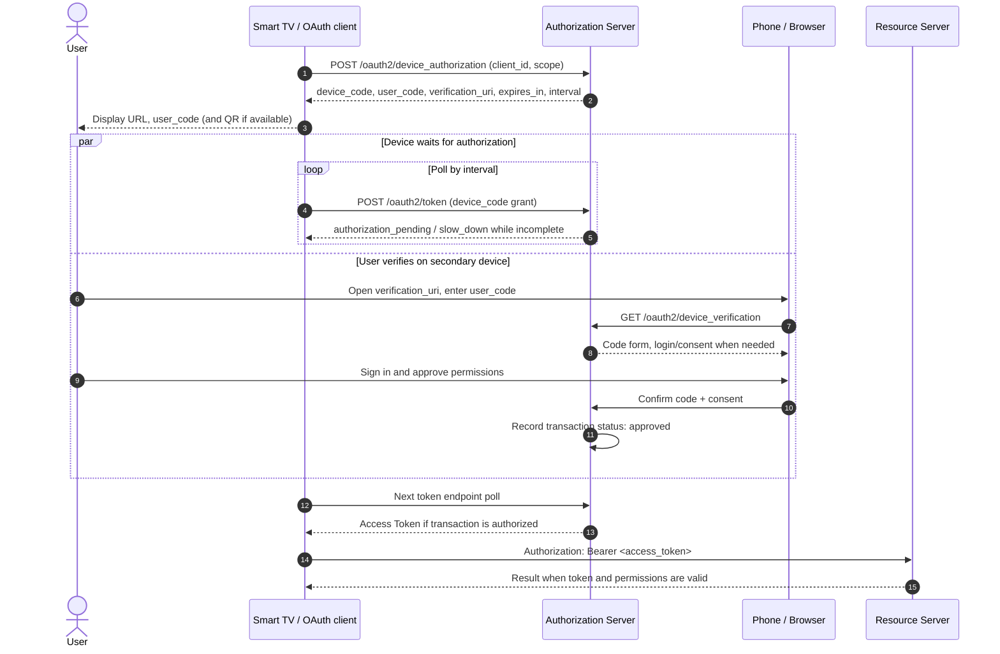
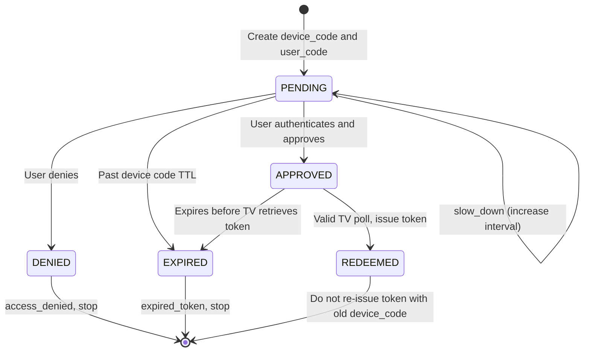

# Input-Constrained Device Scenario and Secondary-Device Authentication Flow

## 1. Context: Signing In on a Device Without a Suitable Keyboard

In the **Device Authorization** chapter of the **SPRING_SECURITY_OAUTH2_OIDC_AUTHORIZATION_SERVER** module, we learn how to design, configure, secure, test, and operate an OAuth 2.0/OpenID Connect Authorization Server using Spring Security and Spring Authorization Server in a Spring Boot application.

Imagine an application running on a **smart TV**: the user wants to connect their account to view their saved movie list, but the TV only has a remote control. Forcing the user to type a username, password, and multi-factor authentication code on a TV screen creates a painful experience. The TV also lacks a reliable, convenient browser to complete all standard OAuth steps.

The **OAuth 2.0 Device Authorization Grant** (RFC 8628) solves this problem by separating two tasks:

1. **The input-constrained device** (smart TV, printer, IoT device, CLI application) asks the Authorization Server to create a device login transaction, then displays a short code and a verification address.
2. **The secondary device** (phone, laptop, tablet) opens the verification page, signs in through a convenient interface, and approves permissions for the application on the primary device.

While the user performs step 2, the primary device **polls** the Token Endpoint at the interval instructed by the server. Only after the user approves does the server allow the device to obtain an Access Token under the grant conditions.

**Key takeaway:** the primary device **never receives the user's password**, does not need a browser redirect back to the TV, and does not ask the user to copy an Access Token from the phone. The parties only exchange short-lived coordination codes controlled by the Authorization Server.

### Learning Outcomes

After this lesson, you will be able to:

- Explain why Device Authorization Grant is used instead of Authorization Code + PKCE or Client Credentials in input-constrained device scenarios.
- Distinguish `device_code`, `user_code`, `verification_uri`, `verification_uri_complete`, `expires_in`, and `interval`.
- Trace the full sequence from the device authorization request, code entry screen on the secondary device, login/consent, and polling, to the token response.
- Understand the `authorization_pending`, `slow_down`, `access_denied`, and `expired_token` states, as well as the rules for stopping polling.
- Register an OAuth client supporting Device Code Grant in Spring Authorization Server; know where the verification UI must be built and how user sessions operate.
- Design security tests for device codes, user codes, rate limits, timeouts, scopes, tokens, and multi-instance environments.

Examples in this lesson use `localhost` URLs, mock codes, and development accounts. All passwords, tokens, and key configurations in real environments must be protected according to production policies.

## 2. Distinguishing Three Models Before Choosing the Device Flow

| Characteristic | Authorization Code + PKCE | Client Credentials | Device Authorization Grant |
| --- | --- | --- | --- |
| Party being authorized | User authorizes the client | Client acts on its own behalf | User authorizes a client running on a constrained device |
| User login interface | Interactive browser in the client flow | No user login step | **Browser on a secondary device** |
| Redirect-based Authorization Endpoint | Yes, `/oauth2/authorize` | Not used | Replaced by device authorization + verification interaction |
| `redirect_uri` callback to the primary device | Usually yes | None | **Not required / not used as a code exchange step** |
| PKCE `code_verifier` | Present in Authorization Code Flow | Not applicable | **Not a parameter of Device Grant** |
| Poll Token Endpoint | Not the default mechanism | Not needed; client actively requests token | **Yes**, following `interval` and guidance errors |
| User authentication and consent | On the Authorization Server via browser | No end user | On the Authorization Server via the secondary device |
| Token types on success | Access Token, possibly ID/Refresh Token depending on conditions | Access Token, typically no Refresh Token | Access Token; Refresh Token/ID Token depending on capability and policy |

RFC 8628 allows either confidential clients capable of keeping secrets or public clients depending on the model. Many TVs/CLIs are treated as **public clients** because credentials distributed with the application cannot be guaranteed to stay secret. Do not embed a static client secret into firmware or a binary and claim it is a confidential client.

Device Grant is **not** a way for a TV to obtain an Access Token using `client_credentials`: a real user must authenticate and decide to grant permissions on another device.

## 3. Four Roles in a Smart TV Scenario

| Role | Example | Responsibility |
| --- | --- | --- |
| **Constrained device / OAuth client** | `living-room-tv` | Initiates device authorization, displays instructions, keeps `device_code` on the device side, polls the Token Endpoint. |
| **Secondary device / User Agent** | Phone or laptop | Visits `verification_uri`, enters or confirms `user_code`, signs in and grants consent through a secure interface. |
| **Resource Owner / End User** | Account owner | Authenticates with the Authorization Server and decides to allow or deny access. |
| **Authorization Server / OpenID Provider** | Spring Authorization Server | Issues device/user codes, links the two halves of the transaction, handles verification, coordinates state, and issues tokens. |
| **Resource Server** | Movie list API | Verifies the Access Token, audience, scope, and permissions before serving data. |

**The phone does not issue tokens directly to the TV.** The phone interacts with the Authorization Server and confirms a pending transaction; the TV retrieves the token itself from the Authorization Server using the `device_code` it received earlier. This is the core security boundary of the Device Flow.

### 3.1. End-to-End Diagram



The actual order of polling and user code entry is **asynchronous**: the TV may poll several times before or after the phone is signing in. The two devices do not need to connect directly to each other; both only need secure communication with the Authorization Server.

## 4. Step 1 — The Device Initiates a Device Authorization Request

### 4.1. Endpoint and Request

RFC 8628 defines the **Device Authorization Endpoint** published by the Authorization Server via metadata or trusted configuration. With the common default Spring Authorization Server configuration, the path is:

```text
POST /oauth2/device_authorization
```

Example with public client `living-room-tv`, scope `movies.read`:

```http
POST /oauth2/device_authorization HTTP/1.1
Host: localhost:9000
Content-Type: application/x-www-form-urlencoded

client_id=living-room-tv&scope=movies.read
```

For a public client, `client_id` identifies the registered client rather than **proving the confidentiality of the application**. If the client is registered as confidential, the appropriate client authentication method must be applied as configured.

`scope` only requests a registered set of permissions; the Authorization Server must still validate the client, scopes, and each resource's policy. Do not add `grant_type=client_credentials` or `code_challenge` to this request; those parameters belong to other OAuth flows.

### 4.2. Response Data

An illustrative successful response:

```http
HTTP/1.1 200 OK
Content-Type: application/json
Cache-Control: no-store
Pragma: no-cache

{
  "device_code": "<long-unpredictable-secret-code>",
  "user_code": "KJHT-WDVB",
  "verification_uri": "http://localhost:9000/oauth2/device_verification",
  "verification_uri_complete": "http://localhost:9000/oauth2/device_verification?user_code=KJHT-WDVB",
  "expires_in": 600,
  "interval": 5
}
```

The values are illustrative only. `user_code` does not have to use the 8-character format above, `verification_uri_complete` is **optional**, and whether the server returns `interval` depends on configuration/implementation capabilities. `expires_in` is the **lifetime of the device authorization transaction in seconds**, not the Access Token TTL.

| Field | Who uses it? | Meaning and protection |
| --- | --- | --- |
| **`device_code`** | Only the primary device and token endpoint | Unpredictable code used to poll and obtain tokens; **never display on the TV screen to the user, include in QR codes, or log**. |
| **`user_code`** | User reads on TV, enters on secondary device | Short, human-friendly code used to match with the created transaction. |
| **`verification_uri`** | User on the secondary device | Public, trusted URL of the device verification page. |
| `verification_uri_complete` | Link/QR to take the user to the verification page faster | Optional URL pre-filled with the user code; still needs session confusion/phishing protection. |
| **`expires_in`** | Primary device | Maximum duration the transaction remains valid from creation. |
| **`interval`** | Primary device | Minimum delay between polls, in seconds. |

**Do not use `device_code` as `user_code`.** The device code is a high-entropy credential that the TV must keep secret, whereas the user code is designed to be seen and typed by a human. They have different threat models.

### 4.3. Verifying URLs from a Trusted Source

The TV should use trusted Authorization Server metadata/configuration to learn endpoints. Do not accept an arbitrary verification URL supplied by someone else as a "device authorization response" without TLS/source verification; otherwise, the TV could direct the user to a phishing page.

In production, endpoints must use HTTPS, proper certificates, and a stable hostname and issuer. `http://localhost:9000` is strictly for local practice.

## 5. Step 2 — The TV Guides the User to Use a Secondary Device

### 5.1. Designing an Input-Constrained Screen

A typical TV UI might display:

```text
CONNECT YOUR ACCOUNT

1. On your phone or computer, open:
   https://auth.example.com/activate

2. Enter code:
   KJHT-WDVB

3. Sign in and approve access.

This code expires in 10 minutes.
Waiting for you to finish on your second device...
```

This is an illustrative UI; the actual URL must match the `verification_uri` issued by the server and align with the trusted brand/hostname. Do not display passwords, client secrets, `device_code`, or tokens on screen.

### 5.2. verification_uri and verification_uri_complete

Two ways to open the verification page:

1. **Manual:** the user types `verification_uri` into the phone's browser and enters `user_code`.
2. **Faster:** the TV displays a QR code generated from `verification_uri_complete` if provided by the server; the phone opens the form with `user_code` pre-filled.

Even when using QR, let the user **see and match the code on the TV against the code being confirmed on the phone**. Opening a pre-filled link should not become a silent approval action, especially in environments vulnerable to device code phishing.

The code on the TV must be clear, with readable spacing or character grouping, display expiration status, and allow the user to cancel or request a new code. Do not ask the user to type a password directly on the TV once Device Flow has been chosen.

### 5.3. Why Can a Short user_code Still Be Used?

Because `user_code` must be easy to type, it typically has lower entropy than `device_code`. The Authorization Server must compensate by:

- limiting attempts and rate-limiting the code entry page;
- keeping lifetimes short and removing/revoking codes when the transaction ends;
- validating codes strictly and avoiding leaking detailed state to attackers;
- protecting login and consent with sessions and CSRF;
- defending against phishing and confirming the exact device/application being authorized.

**A user code is not a password and does not by itself grant an Access Token.** It only links the user's verification session to a pending request; the user must still authenticate and consent according to policy.

## 6. Step 3 — Login and Consent on the Phone

### 6.1. Opening the Device Verification Endpoint

With Spring Authorization Server, the device verification endpoint typically uses the default path:

```text
GET /oauth2/device_verification
```

The verification page may need to be configured or customized by the application. Depending on the Spring Authorization Server version, extension points for device verification and success/error handling differ. **Do not assume that simply adding a RegisteredClient automatically provides a user-friendly code entry page and complete consent UI** in every implementation.

The browser on the phone must reach the Authorization Server directly, without passing through any callback endpoint on the TV. If the user is not signed in yet, the Authorization Server redirects to the login form or configured authentication mechanism.

### 6.2. Login Authenticates the User

The user enters credentials on the secondary device over HTTPS:

```text
Phone → Authorization Server
    GET verification_uri
    GET /login if no session exists
    POST /login + CSRF / MFA if required
    Continue verifying user_code
```

Spring Security may use `SecurityFilterChain`, `AuthenticationProvider`, `SecurityContextRepository`, session cookies, and `CsrfTokenRepository`. The login session here is **the phone's session with the Authorization Server**; the TV never receives this session cookie.

If the user is already signed in on the phone, re-entering the password may be skipped per policy, but the server must still validate the user code and appropriate consent.

### 6.3. Matching user_code to the Pending Transaction

When the user enters or confirms `user_code`, the Authorization Server looks up the corresponding device authorization state:

```text
user_code: KJHT-WDVB
device_code: <secret-stored-with-transaction>
client_id: living-room-tv
requested_scopes: [movies.read]
created_at: ...
expires_at: ...
status: PENDING
```

This is a **logical data model** for explanation, not a mandatory Spring Authorization Server schema. The server needs to verify:

1. The user code exists, has not expired, and is still in an incomplete state.
2. The request belongs to a valid, non-revoked registered client.
3. The user is authenticated in the phone session and eligible to grant permissions.
4. Displayed scopes do not exceed the scopes registered/requested by the client.
5. When the user chooses to approve, update the authorization/consent state properly.

### 6.4. Consent: What Is the User Actually Approving?

On the phone, the UI should clearly state the client and requested permissions:

```text
Application: Living Room TV
Device waiting to connect: Living room TV
Requested permissions:
  - Read saved movie list (movies.read)

Code being confirmed: KJHT-WDVB

[Allow]    [Deny]
```

Only display a device/living-room label if the server has trusted data or clearly present it as a client-declared name; do not claim verified hardware identity without a corresponding verification mechanism.

**Login is not consent:** a user signing in successfully does not mean all scopes are automatically granted. If policy requires consent, the user must be able to review client details, scopes, and choose to deny.

### 6.5. How Is Approval or Denial Stored?

Logically, the transaction state transitions from `PENDING` to:

- `APPROVED`: the user has authenticated and approved valid permissions; the token endpoint can issue tokens to the device holding the matching `device_code`.
- `DENIED`: the user denied access; the token endpoint returns `access_denied`.
- `EXPIRED`: past the deadline; no token is issued even if the user enters the right code after expiration.

Spring Authorization Server models related objects and state with `OAuth2Authorization`, `OAuth2AuthorizationService`, `OAuth2AuthorizationConsent`, and `OAuth2AuthorizationConsentService`. When customizing the verification screen or consent storage, use the extension points supported by your framework version rather than adding an arbitrary public endpoint that updates state using only `user_code`.

## 7. Step 4 — The TV Polls the Token Endpoint While Waiting

### 7.1. Device Code Grant on the Token Endpoint

The TV sends `device_code` (not `user_code`) to the Token Endpoint:

```http
POST /oauth2/token HTTP/1.1
Host: localhost:9000
Content-Type: application/x-www-form-urlencoded

grant_type=urn%3Aietf%3Aparams%3Aoauth%3Agrant-type%3Adevice_code&
device_code=<secret-device-code>&
client_id=living-room-tv
```

The grant value after URL decoding:

```text
urn:ietf:params:oauth:grant-type:device_code
```

A public client typically sends `client_id` for identification. A confidential client must use its registered client authentication method. The TV does not send the user's `username`/`password`, `user_code`, `authorization_code`, or PKCE verifier to this token endpoint.

### 7.2. The authorization_pending State

When the user has not finished verification on the phone, the server returns a protocol error response:

```http
HTTP/1.1 400 Bad Request
Content-Type: application/json
Cache-Control: no-store

{
  "error": "authorization_pending"
}
```

This is **not an unexpected system failure**: it means the transaction is still waiting for the user. The TV should continue showing the waiting state and polling according to `interval`; do not re-trigger a login flow on the TV and do not automatically create a new transaction every time this error arrives.

### 7.3. Interval and slow_down

The `interval` field in the device authorization response indicates the **minimum number of seconds between polling requests**. If the server omits `interval`, RFC 8628 specifies that the client defaults to **5 seconds**.

Example:

```text
Initial response: interval = 5
1st poll after at least 5 seconds → authorization_pending
2nd poll after at least 5 seconds → authorization_pending
If slow_down received             → increase interval by 5 seconds
Next poll                         → wait at least 10 seconds, and keep waiting 10 seconds
```

Under RFC 8628, `slow_down` requires **increasing the polling interval by 5 seconds for this request and all subsequent requests** in the same transaction; do not sleep an extra 5 seconds once and revert to the old interval.

Illustrative response:

```json
{
  "error": "slow_down"
}
```

If a network timeout or connection failure occurs, the client should **reduce request frequency** using an appropriate backoff strategy, such as exponential backoff per RFC recommendations, rather than retrying immediately in a tight loop.

### 7.4. When the User Denies or device_code Expires

Terminal errors:

```json
{
  "error": "access_denied"
}
```

or:

```json
{
  "error": "expired_token"
}
```

For `access_denied`, the TV must stop polling and notify the user that access was denied. For `expired_token`, the transaction has expired; the TV must stop and only start a **new** device authorization request when the user explicitly retries. Do not keep sending the old `device_code` indefinitely.

Other client authentication/authorization errors such as `invalid_client` or `invalid_grant` are likewise not reasons to keep polling like `authorization_pending`.

### 7.5. Proper Response Handling Table

| Token endpoint response | Meaning | Device action |
| --- | --- | --- |
| HTTP 200 with `access_token` | User verified/approved and grant is accepted. | **Stop polling**, store token securely, proceed to call APIs. |
| `authorization_pending` | User has not finished yet. | Wait at least `interval`, then poll again. |
| `slow_down` | Device is polling too fast or server requests throttling. | Increase wait interval by **5 seconds** for this and future polls. |
| `access_denied` | User denied access. | **Stop**, display denied status. |
| `expired_token` | Device code expired. | **Stop**, discard old transaction, allow re-initiating when needed. |
| `invalid_client` or client authentication error | Invalid Client ID/credential/method. | Stop, do not retry endlessly; check configuration and credentials. |
| Timeout/network loss | No reliable response. | Backoff, honor overall deadline, and retry cautiously. |

Do not rely solely on HTTP 400 status to decide behavior: the client must parse `error` per the OAuth protocol and still enforce overall timeouts/limits.

## 8. Step 5 — The Server Issues a Token Once the Transaction Completes

Once the user on the phone has authenticated and granted valid consent, the next poll with the right `device_code` and valid client can receive:

```http
HTTP/1.1 200 OK
Content-Type: application/json
Cache-Control: no-store
Pragma: no-cache

{
  "access_token": "<issued-access-token>",
  "token_type": "Bearer",
  "expires_in": 600,
  "scope": "movies.read"
}
```

Depending on the grant, configuration, and client, the response may include `refresh_token`; if the system supports relevant OIDC conditions (for example requesting `openid` with OIDC integration), an `id_token` may be present by policy, but **RFC 8628 itself does not guarantee that an ID Token is always present**. Do not assume Device Flow produces the exact same token response as Authorization Code/OIDC.

### 8.1. Two Lifetimes Must Remain Separate

| Lifetime | Applies to | Example |
| --- | --- | --- |
| **`deviceCodeTimeToLive`** | Transaction waiting for user verification; reflected in `expires_in` of the device authorization response. | 10 minutes. |
| **`accessTokenTimeToLive`** | Access Token issued after successful verification; reflected in the token response. | 10 minutes, independent of device code TTL. |
| `refreshTokenTimeToLive` (if issued) | Refresh Token after authorization. | According to client policy and token generator capability. |

If the device code expires at 10:10, but the user finishes verifying and the TV obtains an Access Token at 10:08, the new Access Token has its own lifetime and can expire at 10:18 (with a 10-minute TTL). **Do not use the device code's expiration time to validate the Access Token**.

### 8.2. The TV Calls the Resource Server

```http
GET /api/movies/saved HTTP/1.1
Host: api.example.com
Authorization: Bearer <access-token>
```

The Resource Server verifies the signature/JWKS if the Access Token is a JWT, or uses token introspection if opaque; it also validates issuer, expiration, audience, scopes, and business rules. `scope=movies.read` does not grant arbitrary permissions, such as editing movie lists or administering accounts.

Do not use `device_code` or `user_code` as a Bearer Access Token. Also never put the Access Token on the TV screen or into a QR code.

### 8.3. Device Grant Does Not Use Authorization Codes or PKCE

In Device Grant, the code used for polling is `device_code`, while `user_code` is for the user to enter on the secondary device. **There is no redirect carrying `code` back to the TV**, and there is no `code_challenge`/`code_verifier` pair from Authorization Code Flow. The device code must be protected through randomness, proper client binding, TTL, polling rules, and Authorization Server validation.

## 9. Spring Authorization Server: Model and Client Configuration

### 9.1. Participating Components

In Spring Authorization Server versions supporting Device Grant, protocol components typically include:

| Component | Role |
| --- | --- |
| `OAuth2DeviceAuthorizationEndpointFilter` | Accepts requests to issue `device_code`, `user_code`, and the verification URL. |
| `OAuth2DeviceVerificationEndpointFilter` | Handles user code verification, associating user state and the device transaction. |
| `OAuth2TokenEndpointFilter` | Receives polls using the `device_code` grant and returns errors or tokens. |
| `RegisteredClientRepository` | Looks up registered clients, client authentication methods, grant types, and scopes. |
| `OAuth2AuthorizationService` | Stores device authorization state, codes, expirations, and grant outcomes. |
| `OAuth2AuthorizationConsentService` | Stores consent when required by policy. |
| `TokenSettings` | Defines `deviceCodeTimeToLive` and issued token TTL/format. |
| `SecurityFilterChain` and user authentication | Supports login/verification/consent pages on the secondary device. |

API names, handlers, default pages, and endpoint paths may vary across Spring Authorization Server versions. Always check the documentation for your actual version when customizing the verification UI or endpoint locations.

### 9.2. Registering a Public Client for Device Grant

The Java example below **only registers a client** using `device_code` and scope `movies.read`. It does not by itself create a complete Authorization Server:

```java
import java.time.Duration;
import java.util.UUID;

import org.springframework.context.annotation.Bean;
import org.springframework.security.oauth2.core.AuthorizationGrantType;
import org.springframework.security.oauth2.core.ClientAuthenticationMethod;
import org.springframework.security.oauth2.core.OAuth2TokenFormat;
import org.springframework.security.oauth2.server.authorization.client.InMemoryRegisteredClientRepository;
import org.springframework.security.oauth2.server.authorization.client.RegisteredClient;
import org.springframework.security.oauth2.server.authorization.client.RegisteredClientRepository;
import org.springframework.security.oauth2.server.authorization.settings.ClientSettings;
import org.springframework.security.oauth2.server.authorization.settings.TokenSettings;

@Bean
RegisteredClientRepository registeredClientRepository() {
    RegisteredClient smartTv = RegisteredClient.withId(UUID.randomUUID().toString())
            .clientId("living-room-tv")
            .clientAuthenticationMethod(ClientAuthenticationMethod.NONE)
            .authorizationGrantType(AuthorizationGrantType.DEVICE_CODE)
            .scope("movies.read")
            .clientSettings(ClientSettings.builder()
                    .requireAuthorizationConsent(true)
                    .build())
            .tokenSettings(TokenSettings.builder()
                    .deviceCodeTimeToLive(Duration.ofMinutes(10))
                    .accessTokenTimeToLive(Duration.ofMinutes(10))
                    .accessTokenFormat(OAuth2TokenFormat.SELF_CONTAINED)
                    .build())
            .build();

    return new InMemoryRegisteredClientRepository(smartTv);
}
```

Place the bean in a `@Configuration` class. If the project already has a `RegisteredClientRepository`, integrate the client into the existing repository to avoid duplicate beans. `ClientAuthenticationMethod.NONE` represents the TV as a **public client** in this example; the server must still identify the client via `client_id` and validate that `device_code` is bound to that client.

`AuthorizationGrantType.DEVICE_CODE` is the grant type for Device Authorization; depending on the API version, if a built-in constant is absent, you can pass the standard value `urn:ietf:params:oauth:grant-type:device_code` through the appropriate constructor. Do not add `AUTHORIZATION_CODE` or `CLIENT_CREDENTIALS` if the TV is not authorized to use those grants.

No `redirectUri(...)` is needed for Device Grant because results do not redirect back to the TV. Likewise, `requireProofKey(true)` cannot substitute for Device Flow protections, since PKCE applies to Authorization Code Grant.

### 9.3. Configuring the Authorization Server and User Login

The Spring Boot application still requires:

- compatible Spring Authorization Server, Spring Security, and Servlet/Web stack dependencies;
- a `SecurityFilterChain` for the OAuth 2.0/Device Grant endpoints;
- a chain handling form login or another trusted user authentication mechanism on the secondary device;
- `AuthorizationServerSettings` with the appropriate issuer, endpoint URLs, and HTTPS in production;
- `OAuth2AuthorizationService`, `OAuth2AuthorizationConsentService`, and `RegisteredClientRepository`;
- an appropriate JWK/`OAuth2TokenGenerator` to issue Access Tokens in the configured format;
- a `user_code` verification and consent UI aligned with your framework version's extension points.

Example filter chain configuration for Spring Authorization Server versions supporting `OAuth2AuthorizationServerConfigurer.authorizationServer()`:

```java
import org.springframework.context.annotation.Bean;
import org.springframework.core.annotation.Order;
import org.springframework.http.MediaType;
import org.springframework.security.config.Customizer;
import org.springframework.security.config.annotation.web.builders.HttpSecurity;
import org.springframework.security.oauth2.server.authorization.config.annotation.web.configurers.OAuth2AuthorizationServerConfigurer;
import org.springframework.security.web.SecurityFilterChain;
import org.springframework.security.web.authentication.LoginUrlAuthenticationEntryPoint;
import org.springframework.security.web.util.matcher.MediaTypeRequestMatcher;

@Bean
@Order(1)
SecurityFilterChain authorizationServerChain(HttpSecurity http) throws Exception {
    OAuth2AuthorizationServerConfigurer configurer =
            OAuth2AuthorizationServerConfigurer.authorizationServer();

    http.securityMatcher(configurer.getEndpointsMatcher())
            .with(configurer, Customizer.withDefaults())
            .authorizeHttpRequests(auth -> auth.anyRequest().authenticated())
            .exceptionHandling(ex -> ex.defaultAuthenticationEntryPointFor(
                    new LoginUrlAuthenticationEntryPoint("/login"),
                    new MediaTypeRequestMatcher(MediaType.TEXT_HTML)));
    return http.build();
}

@Bean
@Order(2)
SecurityFilterChain applicationChain(HttpSecurity http) throws Exception {
    http.authorizeHttpRequests(auth -> auth.anyRequest().authenticated())
            .formLogin(Customizer.withDefaults());
    return http.build();
}
```

This snippet illustrates wiring protocol endpoints alongside a login page. It does **not** yet define users, signing keys, issuer, a verification UI, or a complete consent page. If you want a custom verification page, verify how Spring Authorization Server handles verification GET/POST and response/error handlers in your exact version; never replace protocol validation with an ad-hoc controller that only accepts `user_code`.

### 9.4. Configuring Device Code Lifetime

`TokenSettings.deviceCodeTimeToLive(Duration)` defines how long the transaction waits for user verification. If set to 10 minutes, the TV should display remaining time from `expires_in` and stop polling after expiration instead of treating `device_code` as a permanent credential.

When an Access Token is successfully issued, its lifetime is governed by `accessTokenTimeToLive` and the corresponding token generation policies. There is no rule requiring the `device_code` TTL to equal the Access Token TTL.

## 10. End-to-End HTTP Lab with PowerShell

### 10.1. Lab Setup

Assume the Authorization Server is running at `http://localhost:9000` and has:

- registered `living-room-tv` per section 9;
- enabled device authorization/device verification endpoints at their corresponding paths;
- configured user authentication and a user code/consent page;
- configured `OAuth2AuthorizationService` along with a signing key to issue Access Tokens.

If the verification UI is missing or the endpoints are not properly enabled, the commands below may not complete the flow. Do not assume a standalone `RegisteredClient` is enough to stand up the entire secondary-device experience.

### 10.2. Requesting device_code and user_code

From PowerShell:

```powershell
$deviceResponse = curl.exe -sS -X POST 'http://localhost:9000/oauth2/device_authorization' -H 'Content-Type: application/x-www-form-urlencoded' --data-urlencode 'client_id=living-room-tv' --data-urlencode 'scope=movies.read' | ConvertFrom-Json

$deviceResponse.user_code
$deviceResponse.verification_uri
$deviceResponse.expires_in
$deviceResponse.interval
```

Do not print or write `deviceResponse.device_code` to public logs. It must stay in memory or protected temporary storage on the TV/CLI client itself for polling the token endpoint.

If `interval` is absent, default to **5 seconds**. Compute the deadline from the time the response is received plus `expires_in`; do not extend the deadline on each poll.

### 10.3. Verifying on the Secondary Device

On a phone or another browser:

1. Open `$deviceResponse.verification_uri`. If using QR/`verification_uri_complete`, confirm the URL belongs to the trusted Authorization Server.
2. Sign in to the Authorization Server using a test account on the phone.
3. Enter `$deviceResponse.user_code` or verify the pre-filled code.
4. Review the client name and scopes, then choose **Allow** or **Deny**.
5. Return to the TV/terminal and observe the polling status.

There is no need to copy an authorization code from a callback URL, and no need to transfer passwords or tokens from the phone to the TV.

### 10.4. First Manual Poll

```powershell
curl.exe -i -X POST 'http://localhost:9000/oauth2/token' -H 'Content-Type: application/x-www-form-urlencoded' --data-urlencode 'grant_type=urn:ietf:params:oauth:grant-type:device_code' --data-urlencode 'client_id=living-room-tv' --data-urlencode "device_code=$($deviceResponse.device_code)"
```

Before the user approves, an `authorization_pending` response is normal. After the user approves while the code is still valid, the server can return `access_token`. If the user denies, it returns `access_denied` and the TV stops polling.

The command above performs **a single poll**, not an automatic tight loop. When testing manually, wait at least `interval` between attempts and respect `slow_down`. Do not send rapid back-to-back requests just to "check quickly."

### 10.5. Device Polling Algorithm

Library-independent pseudocode:

```text
deadline = monotonicNow + expires_in
pollInterval = interval if present, otherwise 5 seconds

while monotonicNow < deadline:
    wait(pollInterval)
    response = POST token endpoint with device_code + client identification

    if response is a valid token:
        store token securely; finish
    else if response.error == authorization_pending:
        continue polling loop
    else if response.error == slow_down:
        pollInterval = pollInterval + 5 seconds
        continue polling loop
    else if response.error == access_denied:
        display denied state; finish
    else if response.error == expired_token:
        display code expired; finish
    else if network timeout / connection error:
        increase backoff appropriately; check deadline; continue cautiously
    else:
        stop and handle error per policy; do not retry indefinitely

if past deadline:
    clear device_code and notify user that a new request is needed
```

**Do not poll immediately upon receiving the initial response if the server requires a minimum wait interval**; the pseudocode above waits before each call. Do not rely purely on `Thread.sleep` or a user-modifiable wall clock; maintain a monotonic deadline and handle app backgrounding, network loss, or sleep mode.

### 10.6. Java Illustration of a Device-Side State Machine

The example below only shows response-handling logic; HTTP transport, token protection, and wait scheduling are handled by the application layer:

```java
enum DevicePollOutcome {
    AUTHORIZED,
    AUTHORIZATION_PENDING,
    SLOW_DOWN,
    ACCESS_DENIED,
    EXPIRED_TOKEN,
    FATAL_ERROR
}

record PollingState(long intervalSeconds, boolean active) {
    PollingState on(DevicePollOutcome outcome) {
        return switch (outcome) {
            case AUTHORIZATION_PENDING -> this;
            case SLOW_DOWN -> new PollingState(intervalSeconds + 5, true);
            case AUTHORIZED, ACCESS_DENIED, EXPIRED_TOKEN, FATAL_ERROR ->
                    new PollingState(intervalSeconds, false);
        };
    }
}
```

The example uses Java 17 `enum` and `record`. It does not sleep or make HTTP calls itself; it demonstrates how to **keep the interval increased after `slow_down`** rather than dropping back to 5 seconds on the next attempt. The HTTP layer must stop when `active=false` and check the deadline before every request.

## 11. Transaction States and Transitions



The system must define when a transaction is marked **redeemed/consumed** to prevent a device code from being reused unintentionally. This is a matter of server-side state and atomic updates under concurrent requests, not the phone user's responsibility.

An approved authorization should not be reused indefinitely to mint multiple Access Tokens simply because the device re-sends the same `device_code`. The token endpoint must enforce grant state and the corresponding token issuance/authorization service rules.

## 12. Security: Device Code, User Code, and Phishing

### 12.1. Distinct Threats

| Threat | Why is it dangerous? | Mitigation |
| --- | --- | --- |
| `device_code` exposure | Anyone with the code can attempt to poll and obtain a token once the user approves if no other constraints block them. | Unpredictable code, client/transaction binding, TLS, never display or log, short TTL. |
| `user_code` guessing | Attackers can try matching against a legitimate pending transaction. | Rate limits, sufficient code entropy, non-leaky error messages, fast expiration. |
| Device Flow phishing | Attacker starts their own transaction and tricks the user into entering/approving the code on the real page. | Clearly show client/scopes, instruct users to verify only self-initiated logins, match code and device context. |
| Spoofed `verification_uri` | User is led to a fake login page to steal credentials. | Trusted hostname, HTTPS, domain-check guidance, QR/links only from verified metadata. |
| Polling too fast | Causes heavy load and resource exhaustion on the token endpoint. | `interval`, `slow_down`, rate limiting, backoff, and deadline. |
| Approving expired transactions | Bypasses time bounds. | Check TTL during code entry, consent, and token exchange. |
| Approval without consent/CSRF | Device is authorized without genuine user agreement. | Sessions, CSRF, clear consent UX, and user authorization checks. |
| Token exposure on TV/CLI | Access Token can be used to call APIs. | Secure storage, never print to screen/logs, clear on logout, rotate/revoke when needed. |
| Impersonated client | A public client ID is not a secret; another app can claim the same ID. | Assess public client risk, bind transactions, user verification, rate limits, and extra policies as needed. |

### 12.2. Device Flow Phishing Is a Characteristic Risk

A common attack pattern:

1. The attacker initiates Device Flow for an application (possibly spoofing a legitimate context).
2. The attacker sends the victim a verification link and the `user_code` from the **attacker-created** transaction.
3. The victim signs in on the real Authorization Server page, sees the consent prompt, and accidentally approves.
4. The attacker's device/client, which holds `device_code`, can receive an Access Token when polling.

Using HTTPS and the genuine login page alone is **not enough** to stop this attack, because the user may be interacting with the real page while approving **the attacker's transaction**.

To reduce risk, the phone UI should emphasize: **only enter a code if you just initiated a connection on your own device; verify that the displayed code, application name, and requested scopes match**. If trusted device instance metadata is available, display it for user comparison; do not assert verified hardware identity based solely on a client-supplied name.

### 12.3. Never Treat user_code as the Sole Authentication Factor

`user_code` is a correlation mechanism for a verification request, not proof of user identity. Before approving, the Authorization Server needs user authentication and policy-compliant consent/authorization. Never build a REST endpoint like `approve?user_code=...` that anyone knowing the code can call to authorize token issuance.

CSRF protects interactive forms on the secondary device, whereas Device Code polling is an HTTP protocol exchange between the OAuth client and the Authorization Server. **Do not disable CSRF application-wide** simply because the token endpoint does not use browser sessions.

### 12.4. Code Format and Attempt Limits

RFC 8628 provides recommendations on balancing human enterability with resistance to guessing. Codes can omit easily confused characters like `O`/`0` or `I`/`1` and use hyphens to group characters for readability.

Do not treat the `KJHT-WDVB` format as a fixed standard. Length, alphabet, entropy, attempt rate, and TTL must be chosen and tested together. When returning invalid-code errors, avoid revealing account details or transaction states in ways that help attackers guess codes.

## 13. Resource Server, ID Token, and Refresh Token

### 13.1. Access Tokens Are for APIs, Not the Verification Page

Once the TV obtains a token, the Resource Server must:

- verify signature, issuer, expiration, and audience for JWT Access Tokens, or introspect opaque tokens;
- validate granted scopes (such as `movies.read`) and business permissions;
- distinguish `401 Unauthorized` (unauthenticated/invalid token) from `403 Forbidden` (valid token but insufficient permissions) according to applicable configuration and semantics.

Do not call APIs with `user_code` or `device_code`. They are not Access Tokens.

### 13.2. Is There an ID Token?

RFC 8628 defines an **OAuth 2.0 grant**, not full OIDC user authentication by default. If the server implements OIDC for Device Grant and the client requests `openid` in a supported context, the response may contain an ID Token; however, **you must not assume every Spring Authorization Server deployment issues `id_token` via Device Flow**.

If an ID Token is present, the OIDC client must validate signature, `iss`, `aud`, `exp`, and other required claims. Never send an ID Token to an API in place of an Access Token.

### 13.3. Is There a Refresh Token?

Depending on Authorization Server policy and capabilities, the client may be issued a Refresh Token to obtain new Access Tokens without forcing the user to repeat Device Flow whenever an Access Token expires. This is especially useful on TVs, but increases the need to protect long-lived credentials.

Consider:

- whether the device has secure storage capabilities;
- how rotation, revocation, and refresh token expiration are implemented;
- whether the user can sign out or revoke a lost TV connection;
- policies requiring re-authentication after a fixed period.

Do not grant indefinite refresh privileges just to spare users from entering a code again. When a device is sold or lent out, there must be mechanisms to clear tokens and revoke access appropriately.

## 14. Testing Each Stage of the Device Flow

| Step | Test scenario | Expected result |
| --- | --- | --- |
| Device authorization | Registered client, matching grant, valid scope. | Returns `device_code`, `user_code`, `verification_uri`, `expires_in`, and `interval` when applicable. |
| Device authorization | Non-existent Client ID. | Rejected; no code pair issued to an invalid client. |
| Device authorization | Disallowed scope. | Rejected according to scope policy. |
| Device authorization | Client not registered for Device Grant. | Rejected according to grant policy. |
| User verification | User enters valid `user_code`, not logged in. | Redirects to login, then returns safely to verification. |
| User verification | Wrong or non-existent code. | Not linked/approved; rate-limited. |
| User verification | Expired code. | Not approved; requires initiating a new transaction. |
| User verification | User denies. | Records DENIED state; poll receives `access_denied`. |
| User verification | User approves valid scopes. | Records APPROVED; valid poll can receive token. |
| Polling | Poll before user confirms. | `authorization_pending`. |
| Polling | Client polls too fast. | `slow_down`/rate limit per policy; client increases interval. |
| Polling | Server omits `interval`. | Client defaults to 5 seconds. |
| Polling | Receives `slow_down` once. | Client increases wait interval by **at least 5 more seconds** for subsequent polls. |
| Polling | `device_code` expires. | `expired_token`; stops and cleans up state. |
| Polling | Client A's device code sent under Client B. | No token issued; prevents cross-client use. |
| Polling | Two concurrent requests with same device code after APPROVED. | Issuance handled strictly per framework's single-use/atomic state semantics. |
| Polling | Persistent network errors. | Backoff, respects deadline, does not loop forever. |
| Security | Attacker guesses `user_code` repeatedly. | Rate-limited and attempt-controlled; no sensitive data leaked. |
| Security | QR points to spoofed hostname. | Client/UI rejects or warns per trusted configuration. |
| Resource Server | Access Token has valid issuer, audience, scope. | Allowed per API policy. |
| Resource Server | Expired token or wrong scope. | Rejected with 401/403 depending on condition. |
| Multi-node | Poll hits node B after user approves on node A. | Both nodes observe the same authorization/consent state. |

### 14.1. Happy Path Test

A complete integration test should verify:

1. Client requests device authorization and receives codes with appropriate TTL and endpoints.
2. Polling before user verification returns `authorization_pending`.
3. User in browser logs in, enters the correct `user_code`, and approves `movies.read`.
4. Polling after approval returns an Access Token matching the client and scope.
5. Resource Server validates the Access Token and allows `GET` requests to the saved movies API.
6. No user password, Refresh Token, or `device_code` is leaked in TV logs.

### 14.2. Negative and Timing Tests

To avoid test flakiness, use a `Clock`/fake clock or short configured lifetimes in test environments when supported by the framework. Test these boundaries:

- before the user approves;
- immediately after the user approves;
- right as the device code expires;
- when calling the token endpoint too quickly;
- when two polls arrive concurrently;
- after denial and after the code has already been redeemed.

Do not check only for HTTP 200 on the login page; verify **exact state transitions** and token endpoint outcomes.

### 14.3. Observability Without Leaking Codes

Log using a protected internal transaction/correlation ID, client ID, normalized status, and processing duration. Avoid logging `device_code`, `user_code`, Access Tokens, Refresh Tokens, session cookies, or passwords.

Useful metrics include approval/denial/expiration rates, `slow_down` counts, verification wait latency, user abandonment rate, and token polling load. Restrict metric labels so user codes or personal identifiers are never exposed.

## 15. Operations and Multi-Instance Architecture

### 15.1. Shared State Store Is Required

Device Authorization Grant has a relatively long wait window, from tens of seconds to several minutes. During this window:

- node A may issue `device_code`;
- the user's browser may be served by node B;
- token endpoint polling may hit node C.

All three nodes must share access to valid transaction state, expiration time, client, user, consent, and redeemed status. An independent `InMemoryOAuth2AuthorizationService` on each node generally cannot satisfy this requirement. Production systems require shared persistence/services, atomic state updates, and cleanup of expired records.

### 15.2. Signing Keys and Issuer

If Access Tokens are JWTs, nodes must share a consistent signing key management/rotation strategy and publish the corresponding public keys via JWKS. The issuer must be stable over HTTPS and match metadata/resource server configuration.

Changing hostnames or using an internal HTTP URL as the public issuer can cause clients/Resource Servers to reject tokens due to issuer mismatch. Configure forwarded headers to trust only legitimate reverse proxies and never derive the issuer from an untrusted client-supplied `Host` header.

### 15.3. Token Polling and Load Capacity

For example, 10,000 devices waiting concurrently, each polling every 5 seconds, generates an average of roughly **2,000 requests/second** before accounting for timing skew or throttling; real systems need rate limits, appropriate intervals, efficient cache/state lookups, and capacity planning.

Never turn polling into a sleep-free loop or infinite retry. Safe jitter/backoff may be applied when needed, provided it never violates the **minimum polling interval** required by the server.

### 15.4. Logout and Device Revocation

Users need a way to view and revoke connected devices. When a user signs out of a TV or sells/lends the device, the application must delete stored credentials and, where supported, invoke revocation for sessions or Refresh Tokens. Also remember that self-contained JWT Access Tokens already issued can remain valid until `exp` if the Resource Server only validates offline without additional state checks.

## 16. Common Misconceptions to Avoid

1. **"The phone sends the Access Token to the TV."** False: the phone only verifies/consents; the TV polls and obtains the token from the Authorization Server itself.
2. **"`user_code` is used to call `/oauth2/token`."** False: the token request uses `device_code`.
3. **"`device_code` is displayed alongside the QR code."** Never: it is an unpredictable credential kept strictly by the device.
4. **"Device Flow uses a PKCE verifier and redirect URI."** False: those two concepts belong to Authorization Code Flow.
5. **"Client Credentials is enough for a TV with a user."** False if the goal is for the user to authorize access to their own data.
6. **"Receiving `authorization_pending` means the system failed."** False: it is the normal state before the user completes verification.
7. **"`slow_down` only requires waiting 5 extra seconds once."** False: the increased interval applies to all subsequent polls.
8. **"Without `interval`, poll continuously."** False: RFC 8628 defaults to 5 seconds.
9. **"Once the user logs in on the phone, the TV is automatically authorized."** False: user code, consent/policy, and non-expired transaction checks still apply.
10. **"HTTPS alone prevents Device Flow phishing."** False: an attacker can trick a user into approving an attacker-created transaction on the genuine verification page.
11. **"When the device code expires, the Access Token expires too."** False: the two have separate TTLs.
12. **"Just registering a client gives you a complete device verification UI."** Do not assume this: check your framework version, UI, login/consent setup, and extension points.

## 17. Self-Check Exercises

### Exercise 1 — TV and Phone

Draw a sequence diagram from the moment the TV calls the Device Authorization Endpoint until it calls the Resource Server. Mark where `device_code`/`user_code` are created, where the user enters the code, where login/consent occur, and the successful poll step.

### Exercise 2 — Designing the TV Screen

Design a screen displaying `verification_uri`, `user_code`, waiting status, and remaining time. Explain why `device_code` must not be displayed and why users should compare the code on the TV against the verification page.

### Exercise 3 — Writing the Polling State Machine

Suppose the initial response has `interval=5`. The server returns `authorization_pending`, `slow_down`, `authorization_pending`, and finally a token response. Calculate the minimum delay between polls and describe when polling must stop.

### Exercise 4 — Consent Denied

Have the user on the phone choose Deny. Describe the authorization state on the server, the polling response on the TV, and an appropriate UI message. May the TV automatically start a new request without explicit user action?

### Exercise 5 — Expired Code

Set a short `deviceCodeTimeToLive` in a test environment. Let the device code expire, then try entering the user code on the phone or polling the token endpoint. Explain how to initiate a new transaction and discard the old code.

### Exercise 6 — Multi-Node and Incident Response

Three Authorization Server nodes use separate local state and separate keys. Identify the failures that can occur when node A issues a device code, node B handles user approval, and node C receives the poll. Propose shared persistence, atomic state transitions, and key management.

### Completion Checklist

- [ ] Distinguish Device Authorization Grant from Authorization Code + PKCE and Client Credentials.
- [ ] Understand the four roles: primary device, secondary device, user, Authorization Server (and Resource Server).
- [ ] Explain `device_code`, `user_code`, `verification_uri`, `verification_uri_complete`, `expires_in`, and `interval`.
- [ ] Know that the TV sends `device_code` to the token endpoint while the user enters `user_code` on the phone.
- [ ] Know that login/consent happen only in the secondary device's browser, never requiring the TV to collect passwords.
- [ ] Handle `authorization_pending`, `slow_down`, `access_denied`, and `expired_token` properly.
- [ ] Know that `slow_down` adds 5 seconds to the interval and a missing `interval` defaults to 5 seconds.
- [ ] Register a public `RegisteredClient` for `AuthorizationGrantType.DEVICE_CODE` and configure `deviceCodeTimeToLive`.
- [ ] Understand the need to configure verification UI/login/consent matching your Spring Authorization Server version.
- [ ] Design rate limits, code-guessing defenses, anti-phishing measures, and device-side token protection.
- [ ] Know how to test multi-node setups, issuer validation, scopes, Access Token validation, and single-use code state.

## 18. References and Further Reading

- [RFC 8628 — OAuth 2.0 Device Authorization Grant](https://www.rfc-editor.org/rfc/rfc8628) — device authorization request/response, user verification, token polling, `authorization_pending`, `slow_down`, `access_denied`, and `expired_token`.
- [RFC 6749 — OAuth 2.0 Authorization Framework](https://www.rfc-editor.org/rfc/rfc6749) — client authentication, token responses, scopes, and core grants.
- [RFC 9700 — Best Current Practice for OAuth 2.0 Security](https://www.rfc-editor.org/rfc/rfc9700) — modern OAuth 2.0 security recommendations.
- [RFC 8414 — Authorization Server Metadata](https://www.rfc-editor.org/rfc/rfc8414) — metadata and discoverable endpoints for clients.
- [RFC 7009 — OAuth 2.0 Token Revocation](https://www.rfc-editor.org/rfc/rfc7009) — revoking tokens/sessions through supported mechanisms.
- [Spring Authorization Server Reference](https://docs.spring.io/spring-authorization-server/reference/) — RegisteredClient configuration, endpoints, and token issuance.
- [Spring Authorization Server Protocol Endpoints](https://docs.spring.io/spring-authorization-server/reference/protocol-endpoints.html) — extension points related to Device Authorization and Device Verification.
- [Spring Security Reference](https://docs.spring.io/spring-security/reference/) — user authentication, form login, CSRF, Resource Server, and token validation.
- [OpenID Connect Core 1.0](https://openid.net/specs/openid-connect-core-1_0.html) — if integrating OIDC and ID Tokens in a supported system.

**Conclusion:** Device Authorization Grant allows an input-constrained device to **initiate** a transaction where the user **completes login and consent on a secondary device**. The Authorization Server bridges both halves using `device_code`/`user_code`, while enforcing lifetimes, polling intervals, rate limits, user authentication, and authorization checks. The primary device only receives a token once the entire transaction is valid—never by receiving credentials from the phone.
