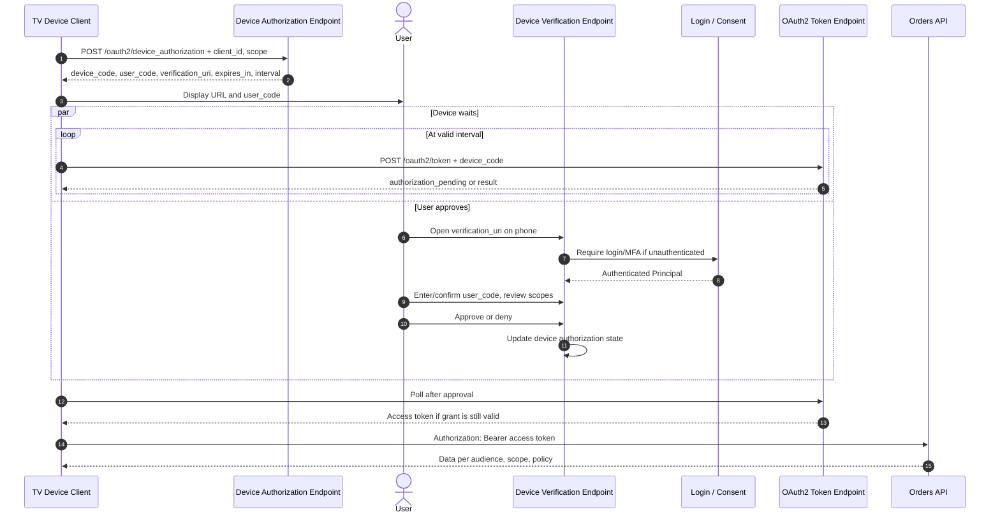
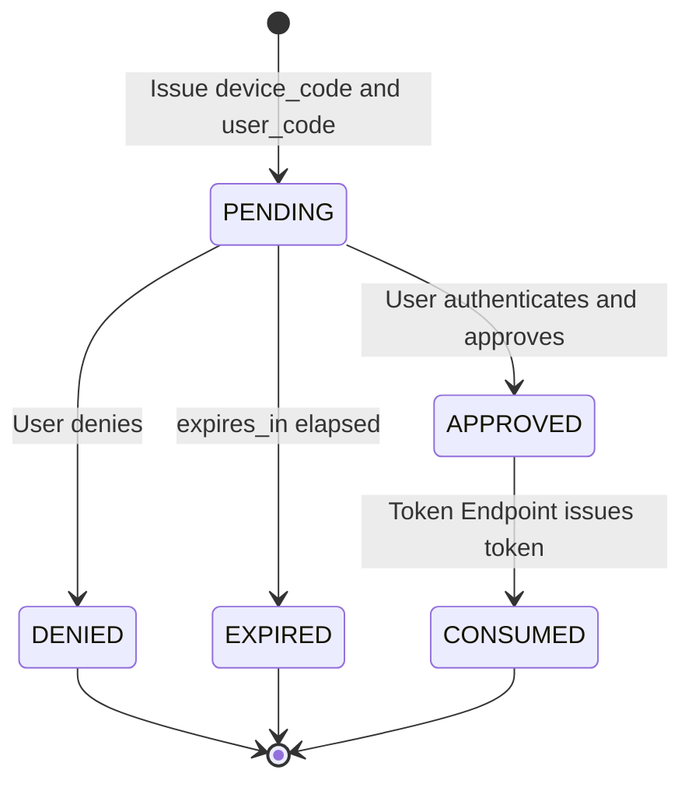

# Enabling the Device Authorization Endpoint and Device Verification Endpoint

An application running on a TV, printer, media player, or IoT device typically **lacks a convenient browser or keyboard** for users to sign in. Asking them to enter a username, password, and MFA using a remote control is both hard to use and increases the risk of exposing credentials. The **OAuth 2.0 Device Authorization Grant (RFC 8628)** solves this problem by separating the device requesting authorization from the device the user uses to sign in.

With **Spring Authorization Server** in a **Spring Boot** application, the two central endpoints of this flow are:

- **Device Authorization Endpoint** — default `POST /oauth2/device_authorization`: the device requests a `device_code`, a `user_code`, and an address for the user to open on a phone or computer.
- **Device Verification Endpoint** — default `/oauth2/device_verification`: the user visits it via a browser on another device, enters or confirms `user_code`, signs in, and decides whether to grant or deny permissions.

Then the device repeatedly checks the outcome via the **Token Endpoint** `POST /oauth2/token` with the `urn:ietf:params:oauth:grant-type:device_code` grant. **Properly enabling and wiring both endpoints** is the foundation for completing the device flow; declaring a path alone is not enough to provide a secure login experience or token issuance.

This lesson belongs to the **Device Authorization** chapter in the **SPRING_SECURITY_OAUTH2_OIDC_AUTHORIZATION_SERVER** module, supporting the learning track on designing, configuring, securing, testing, and operating an OAuth 2.0/OpenID Connect Authorization Server with Spring Security and Spring Authorization Server in Spring Boot. It focuses on protocol endpoint configuration, separation of responsibilities between device and browser, testing, and secure deployment.

> **Core takeaway:** The Device Authorization Endpoint issues **pending verification codes**, the Device Verification Endpoint handles **user interaction**, and the Token Endpoint issues an access token **only after approval** and when all protocol conditions are met.

## 1. Why Do We Need Device Authorization Grant?

Suppose an application `living-room-tv` needs to read an employee's order list through the Orders API. The TV has a large screen but only a remote control. An employee can open their phone, visit `https://login.example.com/oauth2/device_verification`, sign in with MFA, and enter the short code displayed on the TV.

| Component | Example | Responsibility |
|---|---|---|
| **Device Client** | TV application | Requests codes, displays instructions, polls the Token Endpoint, stores the access token |
| **Authorization Server** | `login.example.com` | Registers clients, issues `device_code`/`user_code`, authenticates users, and handles authorization |
| **Secondary Device** | User's phone/computer | Has a full browser for login/MFA and code confirmation |
| **Resource Owner** | Employee | Decides whether to grant permissions to the TV application |
| **Resource Server** | Orders API | Verifies the access token and checks scopes/audience/business permissions |

The TV device **never receives the employee's password**. The user signs in **directly with the Authorization Server** on the secondary device, not on a TV-hosted page that forwards the password to the server.

### 1.1. Comparison with Authorization Code + PKCE

| Question | Authorization Code + PKCE | Device Authorization Grant |
|---|---|---|
| Does the client have a convenient browser/callback? | Usually yes | Usually no |
| Where does the user sign in? | Browser following the client's redirect | Browser on a secondary device |
| What code does the client receive before the token? | Authorization code via callback | `device_code` from the Device Authorization Endpoint |
| Is there a `redirect_uri` callback to the device? | Yes, per registration | Not a central step of the Device Flow |
| Waiting for authorization step | Via redirect/login/consent | Device polls the Token Endpoint |
| Specific security constraints | `state`, PKCE, redirect URI | `device_code`, `user_code`, TTL, polling, user confirmation |

Do not use Device Flow merely to avoid implementing redirects or PKCE for an application that has a normal browser. RFC 8628 targets **devices with limited input and web-browsing capabilities**. When a web or mobile app has a browser, Authorization Code + PKCE is usually the better choice.

## 2. Three Endpoints Coordinating in One Transaction



This diagram is conceptual: multiple polling attempts may happen **before and after** the user interacts. The secondary device does not send the access token back to the TV through the browser; the Authorization Server stores the authorization state so the Token Endpoint can act on it when the TV polls.

### 2.1. Three Codes That Must Not Be Confused

| Value | Who receives or sees it | Purpose | Is it an access token? |
|---|---|---|---|
| `device_code` | **Only the device client** keeps it to poll | Key representing the pending authorization transaction | No |
| `user_code` | User sees it on TV, enters/confirms on website | Links the user to the specific transaction | No |
| `access_token` | Device client receives **after approval** | Calls the Resource Server | Yes |

`device_code` must be sufficiently random and unpredictable. `user_code` is typically shorter so it can be typed manually, so it requires protection against bulk guessing, lifetime limits, and rate limiting. The user **never needs to read or enter `device_code`**.

### 2.2. States of a Device Request

A conceptual lifecycle:



This is a **protocol-explaining state machine**, not a list of enum names you can use directly in Spring Authorization Server. Never treat `PENDING` as granted access. Every terminal state must block unauthorized token issuance or reuse of a `device_code` once consumed.

## 3. Device Authorization Endpoint: Requesting Codes for the Device

### 3.1. Path and Method

In Spring Authorization Server 1.x, the default path provided by `AuthorizationServerSettings` is:

```text
POST /oauth2/device_authorization
Content-Type: application/x-www-form-urlencoded
```

The minimal request for a **public client** can be:

```http
POST /oauth2/device_authorization HTTP/1.1
Host: login.example.com
Content-Type: application/x-www-form-urlencoded

client_id=living-room-tv&scope=orders.read
```

Here `client_id` identifies the registered device/client; `scope` indicates the requested permissions and must be in the `RegisteredClient`'s allowlist. A confidential client (if designed/registered as such) must use its corresponding client authentication method. **Never include the user's password** in the device authorization request.

### 3.2. Successful Response per RFC 8628

Illustrative response example:

```http
HTTP/1.1 200 OK
Content-Type: application/json
Cache-Control: no-store
Pragma: no-cache

{
  "device_code": "opaque-device-code-example",
  "user_code": "BDTX-RQPL",
  "verification_uri": "https://login.example.com/oauth2/device_verification",
  "verification_uri_complete": "https://login.example.com/oauth2/device_verification?user_code=BDTX-RQPL",
  "expires_in": 600,
  "interval": 5
}
```

Code and URI values are illustrative. `verification_uri_complete` is an **optional field per the RFC**; depending on configuration, a response might omit it. In real implementations, use the exact values returned by the server—do not manually append query strings if the endpoint does not support them.

| Response field | Meaning |
|---|---|
| `device_code` | High-entropy code used by the device client to call the Token Endpoint |
| `user_code` | Code the user enters or confirms when opening the verification URI |
| `verification_uri` | Short, easy-to-type address for the user's browser |
| `verification_uri_complete` | URI optimized for QR/NFC/deep links, optionally pre-populated with the code |
| `expires_in` | Seconds the transaction/codes remain valid from issuance |
| `interval` | Minimum seconds between polling requests while waiting; if absent, RFC defaults client to 5 seconds |

`interval` is a protocol directive, not a TTL setting. Once `expires_in` elapses, the device must stop polling with the old `device_code`.

### 3.3. What Should Be Displayed on the TV?

A suitable interface:

```text
Connect your account to TV

1. Open a browser on your phone or computer.
2. Visit: https://login.example.com/oauth2/device_verification
3. Enter code: BDTX-RQPL
4. Check the application name and requested permissions before approving.

This code is valid for a limited time only.
```

A QR code from `verification_uri_complete` may be used **if provided**. However, still display **`user_code` clearly** so the user can compare it with the code on the confirmation page, mitigating certain redirect attacks or tricks that attempt to authorize a different device.

### 3.4. Cases the Device Authorization Endpoint Must Reject

- `client_id` does not exist or is not registered to use Device Authorization Grant.
- Client authentication method does not match the client type.
- `scope` is unregistered or exceeds allowed permissions.
- Request has an invalid method/content type/parameters.
- Operation is blocked by policy (disabled client, expired registration, quota, or anti-abuse controls).

Error responses must follow OAuth2, never issuing a `device_code` when the request is unauthorized. Do not let a public-client-accessible endpoint become a place to generate unlimited pending codes without rate limiting and operational controls.

## 4. Device Verification Endpoint: User Confirmation on Another Device

### 4.1. Role of the Endpoint

`/oauth2/device_verification` is the address the user opens on a **secondary device with a browser**. Logical behavior usually includes:

1. The user navigates to `verification_uri` shown on the TV.
2. If not already signed in to the Authorization Server, the user authenticates on the login page (and MFA if enabled).
3. The user enters or inspects the `user_code` shown on the TV.
4. The Authorization Server locates the corresponding pending device authorization transaction and verifies it has not expired or already been approved/denied.
5. The confirmation page displays **which client** is requesting access and **which scopes** require consent.
6. The user chooses **approve** or **deny**.
7. The server records the decision in the authorization state; it never puts the token on this browser page to pass to the TV.

**Enabling the endpoint filter** does not by itself prove you have a production-ready code entry page, consent page, and success notice. In real configurations, inspect the default UX of your Spring Authorization Server version and supply custom pages/handlers as needed.

### 4.2. Distinct Request Types

- **Device Authorization Endpoint:** request from the **TV** to `/oauth2/device_authorization`.
- **Device Verification Endpoint:** request from the **user's browser** to `/oauth2/device_verification`, which may include code entry, confirmation, and submission screens depending on configuration.
- **Token Endpoint:** request from the **TV** to `/oauth2/token` for polling.

Never let the TV submit consent on the user's behalf. Even if the user code is present in the complete URL, the verification UI must still show enough information for the user to inspect and decide explicitly.

### 4.3. Consent Is Permission, Not User Authentication

Being signed in to the Authorization Server does not mean the TV is automatically allowed to read the Orders API. There is still an authorization decision for the **client** and requested **scopes**. With `ClientSettings.requireAuthorizationConsent(true)`, the server can display a consent page during device verification.

Conversely, if the user denies access, the device must not receive an access token. The Token Endpoint must return `access_denied` or the protocol-equivalent error when the device polls.

### 4.4. Mitigating Device Flow Phishing Risks

An attacker can start a device authorization session for **their own device**, then send the user code or QR code to trick a victim into approving it. Therefore, the verification page should:

- Display the trusted application/client name from **`RegisteredClient`**, not from client-supplied request parameters;
- Let the user compare **`user_code`** on the page against the code shown on the TV;
- Display scopes in plain language along with the account/principal granting approval;
- Require an explicit confirmation action, never auto-approving simply because `user_code` came in the URI;
- Limit failed attempts, block brute force, and record safe audit logs;
- Avoid disclosing detailed user/device status to unauthorized parties.

## 5. Where Does Spring Authorization Server Support Both Endpoints?

Starting in Spring Authorization Server **1.1**, two configurers support Device Authorization Grant:

- `OAuth2DeviceAuthorizationEndpointConfigurer` configures `OAuth2DeviceAuthorizationEndpointFilter`.
- `OAuth2DeviceVerificationEndpointConfigurer` configures `OAuth2DeviceVerificationEndpointFilter`.

In the default Authorization Server configuration of the 1.5.x line, **both endpoints are included in the configured protocol endpoints**. Thus, "enabling" in this lesson means ensuring the Authorization Server configurer is applied, endpoint URLs are right, a client is registered with `DEVICE_CODE`, and user authentication/verification flows and backing services are in place. Calling `deviceAuthorizationEndpoint(...)` and `deviceVerificationEndpoint(...)` is mainly for **customization**; they are not mandatory switches you must call if keeping defaults.

### 5.1. Illustrative SecurityFilterChain Beans

Example based on common Spring Boot 3.x, Spring Security 6.x, and Spring Authorization Server 1.x APIs supporting `HttpSecurity.with(...)`:

```java
package example.authserver.config;

import org.springframework.context.annotation.Bean;
import org.springframework.context.annotation.Configuration;
import org.springframework.core.annotation.Order;
import org.springframework.http.MediaType;
import org.springframework.security.config.Customizer;
import org.springframework.security.config.annotation.web.builders.HttpSecurity;
import org.springframework.security.oauth2.server.authorization.config.annotation.web.configurers.OAuth2AuthorizationServerConfigurer;
import org.springframework.security.web.SecurityFilterChain;
import org.springframework.security.web.authentication.LoginUrlAuthenticationEntryPoint;
import org.springframework.security.web.util.matcher.MediaTypeRequestMatcher;

@Configuration(proxyBeanMethods = false)
public class AuthorizationServerChains {

    @Bean
    @Order(1)
    SecurityFilterChain protocolSecurityFilterChain(HttpSecurity http)
            throws Exception {

        OAuth2AuthorizationServerConfigurer as =
                OAuth2AuthorizationServerConfigurer.authorizationServer();

        http
            .securityMatcher(as.getEndpointsMatcher())
            .with(as, server -> server
                // Explicit configuration to highlight both endpoints;
                // without customization, defaults already support them.
                .deviceAuthorizationEndpoint(Customizer.withDefaults())
                .deviceVerificationEndpoint(Customizer.withDefaults()))
            .authorizeHttpRequests(authorize -> authorize
                .anyRequest().authenticated())
            .exceptionHandling(exceptions -> exceptions
                .defaultAuthenticationEntryPointFor(
                    new LoginUrlAuthenticationEntryPoint("/login"),
                    new MediaTypeRequestMatcher(MediaType.TEXT_HTML)));

        return http.build();
    }

    @Bean
    @Order(2)
    SecurityFilterChain loginSecurityFilterChain(HttpSecurity http)
            throws Exception {
        http
            .authorizeHttpRequests(authorize -> authorize
                .anyRequest().authenticated())
            .formLogin(Customizer.withDefaults());

        return http.build();
    }
}
```

This is a **skeleton configuration**, not a standalone runnable Authorization Server application. You must add `RegisteredClientRepository`, `OAuth2AuthorizationService`, `OAuth2AuthorizationConsentService`, user authentication, `AuthorizationServerSettings`, key sources/token generators when issuing JWT or OIDC tokens, and other application settings.

### 5.2. Why Must the Protocol Chain and Login Chain Be Separate?

`FilterChainProxy` evaluates `SecurityFilterChain` beans by `@Order`, picking **the first chain whose matcher matches**. Protocol endpoints belong to the Authorization Server matcher; `/login` typically belongs to the application chain. When a user opens `/oauth2/device_verification` while unauthenticated, the server can redirect to `/login`, then resume verification via a new HTTP request.

Do not use `securityMatcher("/oauth2/**")` instead of `as.getEndpointsMatcher()` for the whole protocol, because OIDC/metadata endpoints may lie outside that pattern. Never blindly apply HTML login redirects to the device authorization or token endpoints serving machine clients. Protocol handlers must return OAuth2 JSON/errors where appropriate.

### 5.3. Selected Customization APIs of the Two Configurers

Spring Authorization Server provides extension points to add or replace:

| Configurer | Customization capability | When needed |
|---|---|---|
| `deviceAuthorizationEndpoint(...)` | Request converter, authentication provider, success/error response handler | Custom request policies, auditing, extra protection |
| `deviceAuthorizationEndpoint(...verificationUri(...))` | `verification_uri` advertised to the device | Custom verification page with a specific URL |
| `deviceVerificationEndpoint(...)` | Request converter, authentication provider, success/error response handler | Custom verification UI/validation/flow |
| `deviceVerificationEndpoint(...consentPage(...))` | Custom consent page path | Branded UI and scope explanations |

Customizing converters/providers is a powerful extension point; improper replacements can bypass user code checks, client binding, expiry, consent, or CSRF. Only replace what is necessary, retain default validation mechanisms wherever possible, and add integration tests for every custom path.

## 6. AuthorizationServerSettings: Protocol URLs and User-Facing URLs

### 6.1. Keeping Default Paths

You can declare the issuer and explicitly state endpoint settings:

```java
import org.springframework.context.annotation.Bean;
import org.springframework.security.oauth2.server.authorization.settings.AuthorizationServerSettings;

@Bean
AuthorizationServerSettings authorizationServerSettings() {
    return AuthorizationServerSettings.builder()
        .issuer("https://login.example.com")
        .deviceAuthorizationEndpoint("/oauth2/device_authorization")
        .deviceVerificationEndpoint("/oauth2/device_verification")
        .tokenEndpoint("/oauth2/token")
        .build();
}
```

The paths above are the **default values** in Spring Authorization Server 1.x. Declaring them explicitly aids clarity but is not the sole requirement for the endpoints to exist. The issuer must reflect the real public HTTPS address; configure forwarded headers from trusted proxies if the app runs behind an ingress or load balancer.

### 6.2. If You Change Endpoint Paths

Suppose an organization wants to use the `/oauth2/v1` prefix:

```java
@Bean
AuthorizationServerSettings authorizationServerSettings() {
    return AuthorizationServerSettings.builder()
        .issuer("https://login.example.com")
        .deviceAuthorizationEndpoint("/oauth2/v1/device_authorization")
        .deviceVerificationEndpoint("/oauth2/v1/device_verification")
        .tokenEndpoint("/oauth2/v1/token")
        .build();
}
```

This is an **alternative** to the bean in the previous section—do not register both beans in the same context. Also verify the URI returned to devices by the Device Authorization Endpoint in `verification_uri`, especially if you called `verificationUri(...)` to customize it. Protocol paths, verification UI, and metadata/discovery (if used) must stay consistent.

Do not "fix URL issues" by permitting arbitrary hosts/paths or trusting `X-Forwarded-*` headers sent directly from the Internet. Only accept forwarded headers from trusted reverse proxies.

### 6.3. Configuring verificationUri for a Custom Page

When you actually have a dedicated verification page, you can customize it in the protocol chain:

```java
.with(as, server -> server
    .deviceAuthorizationEndpoint(device -> device
        .verificationUri(
            "https://login.example.com/oauth2/v1/device_verification"))
    .deviceVerificationEndpoint(Customizer.withDefaults()))
```

This snippet only illustrates the `.with(...)` portion to **replace** in the section 5 chain, not a new chain declaration. For the path `/oauth2/v1/device_verification` to work, configure `AuthorizationServerSettings.deviceVerificationEndpoint(...)` or matching UI routing consistently, and verify that the endpoint is actually reachable from a secondary device.

**Note:** `verification_uri` in the response is opened by the user in a browser, so never point it to the token endpoint, an internal API, or an address reachable only by pods inside the cluster.

## 7. RegisteredClient Must Allow DEVICE_CODE

Even with both endpoints on the right paths, a client cannot obtain tokens unless its `RegisteredClient` permits Device Authorization Grant.

Example of a **public device client** named `living-room-tv`:

```java
package example.authserver.config;

import java.time.Duration;

import org.springframework.context.annotation.Bean;
import org.springframework.context.annotation.Configuration;
import org.springframework.security.oauth2.core.AuthorizationGrantType;
import org.springframework.security.oauth2.core.ClientAuthenticationMethod;
import org.springframework.security.oauth2.server.authorization.client.InMemoryRegisteredClientRepository;
import org.springframework.security.oauth2.server.authorization.client.RegisteredClient;
import org.springframework.security.oauth2.server.authorization.client.RegisteredClientRepository;
import org.springframework.security.oauth2.server.authorization.settings.ClientSettings;
import org.springframework.security.oauth2.server.authorization.settings.TokenSettings;

@Configuration(proxyBeanMethods = false)
public class DeviceClientRegistration {

    @Bean
    RegisteredClientRepository registeredClientRepository() {
        RegisteredClient tv = RegisteredClient
            .withId("living-room-tv-registration")
            .clientId("living-room-tv")
            .clientName("Living Room TV")
            .clientAuthenticationMethod(ClientAuthenticationMethod.NONE)
            .authorizationGrantType(AuthorizationGrantType.DEVICE_CODE)
            .scope("orders.read")
            .clientSettings(ClientSettings.builder()
                .requireAuthorizationConsent(true)
                .build())
            .tokenSettings(TokenSettings.builder()
                .deviceCodeTimeToLive(Duration.ofMinutes(10))
                .accessTokenTimeToLive(Duration.ofMinutes(5))
                .build())
            .build();

        return new InMemoryRegisteredClientRepository(tv);
    }
}
```

**Configuration explanation:**

1. `ClientAuthenticationMethod.NONE`: a TV app distributed to user devices generally cannot reliably protect a client secret; per the RFC, a public device client identifies itself with `client_id`.
2. `AuthorizationGrantType.DEVICE_CODE`: enables the `urn:ietf:params:oauth:grant-type:device_code` grant, distinct from `AUTHORIZATION_CODE` and `CLIENT_CREDENTIALS`.
3. `scope("orders.read")`: restricts which scopes the device may request; APIs must still enforce user/tenant permissions.
4. `requireAuthorizationConsent(true)`: requires consent matching policy and user-facing flows.
5. `deviceCodeTimeToLive(Duration.ofMinutes(10))`: sets the TTL for the **device code**, not the access token or user session.
6. `accessTokenTimeToLive(Duration.ofMinutes(5))`: illustrates the TTL of the access token issued **after approval**.

The 10/5-minute TTLs are illustrative and should be tuned for code-entry UX, risk, and polling load. `InMemoryRegisteredClientRepository` suits tests; production needs a stable, persistent client registration source. Do not generate a new registered client ID on every restart when consent/authorization stores hold references to it.

### 7.1. Can a Device Client Be Confidential?

RFC 8628 supports confidential clients as well if the device/infrastructure can **genuinely** keep credentials secure. In that case, the client must authenticate with its registered authentication method at the appropriate endpoints. However, software broadly distributed to TVs or devices not controlled by the operator must usually be treated as **public**, even if developers embed a secret in firmware.

Do not share one `client_id`/credential across application types with different secret-keeping capabilities. For appliances managed via hardware certificates, evaluate the registration model, key lifecycle, and sender-constrained authentication separately.

### 7.2. Device Code Is Not a Refresh Token

`deviceCodeTimeToLive` governs the window waiting for **user approval**. Once the device code is exchanged for an access token, the new token has its own `accessTokenTimeToLive`. A refresh token (if issued by the server per client type, flow, and policy) has separate configuration and lifecycle.

Do not assume that a device issued a 10-minute device code also receives a 10-minute access token, or that a device code can be reused like a refresh token.

## 8. Device Verification UI: Authentication, Code Entry, and Consent

### 8.1. Separating the Protocol Handler from the UI

`OAuth2DeviceVerificationEndpointFilter` processes code verification and consent requests. However, to complete the experience, you must ensure users actually see a code entry page and an authorization confirmation page. If using a custom page, the application must provide a controller/template/handler for the specified route—simply calling `.consentPage("/device/consent")` **does not generate HTML automatically**.

Suggested UI journey:

```text
Page 1: Enter or confirm code
  "Enter the code from your device"
  [ BDTX-RQPL ] [ Continue ]

If not logged in:
  Redirect to the Authorization Server login page

Page 2: Confirm authorization
  Application: Living Room TV
  Requested access: View permitted orders
  Code on device: BDTX-RQPL
  [ Allow ] [ Deny ]

Page 3: Complete
  "You may now return to your TV."
```

This is a **UX suggestion**, not a guarantee that the framework pre-builds these exact three pages with these exact labels.

### 8.2. Custom Consent Pages Have a Contract to Follow

In the `OAuth2DeviceVerificationEndpointConfigurer` API, when a custom consent page is configured, Spring Authorization Server passes context such as `client_id`, `scope`, `state`, and `user_code` to that page. The consent form must submit data according to **the framework version's contract** back to the Device Verification Endpoint, typically an HTTP POST with `client_id`, `state`, the approved `scope` list, and `user_code`.

An illustrative fragment of **conceptual** fields (not a copy-paste production template):

```html
<form method="post" action="/oauth2/device_verification">
  <!-- client_id, state, user_code come from the verified authorization context -->
  <input type="hidden" name="client_id" value="living-room-tv">
  <input type="hidden" name="state" value="OPAQUE_STATE_FROM_SERVER">
  <input type="hidden" name="user_code" value="BDTX-RQPL">

  <label>
    <input type="checkbox" name="scope" value="orders.read">
    Allow viewing orders
  </label>

  <!-- If CSRF protection applies, include the token per current configuration. -->
  <button type="submit">Allow</button>
</form>
```

**Do not use these static values as a direct implementation template.** A real page must read from the verified authorization context, escape all rendered values, include proper CSRF/correlation protection, handle denial explicitly, and match the exact field names/methods of your Spring Authorization Server version. Never build a custom endpoint that calls `OAuth2AuthorizationConsentService.save(...)` solely from form input while skipping checks on client, user code, requested scopes, or session.

### 8.3. Distinguish Login State from Approval State

Having an active session on `login.example.com` does not mean a device code request is approved. The Verification Endpoint must identify **which user**, **which device/client**, **which code**, and **which scopes**, and then require approval per policy. Never auto-approve any code merely because the browser is already logged in.

### 8.4. Handling Invalid Code Entry

When a user enters a non-existent, wrong, or expired `user_code`:

- Never confirm/approve a different transaction.
- Display a clear error without leaking details that help attackers enumerate valid codes.
- Apply rate limiting, attempt caps, and temporary lockouts/blocks per policy.
- Guide the user to request a new code on the device once a transaction has expired.
- Never extend the old TTL just because the user retried multiple times.

## 9. Token Endpoint and Polling: An Essential Part of Enabling Device Flow

### 9.1. Token Request with device_code

The TV calls the Token Endpoint according to `interval` from the Device Authorization Response:

```http
POST /oauth2/token HTTP/1.1
Host: login.example.com
Content-Type: application/x-www-form-urlencoded

grant_type=urn%3Aietf%3Aparams%3Aoauth%3Agrant-type%3Adevice_code&device_code=opaque-device-code-example&client_id=living-room-tv
```

For a public client using `none`, `client_id` identifies the client to the server. For a confidential client, the proper client authentication method must be used; never pass a user password in the token request.

### 9.2. Errors Returned While Waiting

| Error code | Meaning | What should the device do? |
|---|---|---|
| `authorization_pending` | User has not completed interaction/approval yet | Wait the full polling interval, then try again |
| `slow_down` | Polling too fast / needs load reduction | **Increase interval by at least 5 seconds** for future polls per RFC |
| `access_denied` | User denied authorization | **Stop polling**, report the result |
| `expired_token` | Device code expired | **Stop polling**; start a new transaction only upon user action |
| `invalid_client` or `invalid_grant` (when applicable) | Invalid client authentication or device code/grant | Stop and handle configuration/authorization; do not retry forever |

Per RFC 8628, if the initial response omits `interval`, the client defaults to **5 seconds**. Upon receiving `slow_down`, it must add **5 seconds** to the interval for all subsequent polls. On connection timeouts, the client must slow down and should use backoff; never loop immediately without delay.

### 9.3. Properly Paced Polling Pseudocode

```javascript
// Pseudocode: deviceClientPoll() is an actual HTTP function you must implement.
// response.expires_in and response.interval come from device authorization.
async function pollDeviceGrant(response, deviceClientPoll) {
  const endAt = Date.now() + response.expires_in * 1000;
  let intervalSeconds = response.interval ?? 5;

  while (Date.now() < endAt) {
    await sleep(intervalSeconds * 1000); // sleep function supplied by the application.

    try {
      const result = await deviceClientPoll(response.device_code);

      if (result.access_token) {
        return result;
      }

      if (result.error === "authorization_pending") {
        continue;
      }

      if (result.error === "slow_down") {
        intervalSeconds += 5;
        continue;
      }

      // access_denied, expired_token, or non-recoverable error:
      throw new Error("Device authorization failed: " + result.error);
    } catch (error) {
      // Real code must DISTINGUISH OAuth errors handled above
      // from network timeouts, HTTP errors, and cancellations; timeouts must back off.
      throw error;
    }
  }

  throw new Error("Device code expired");
}
```

This snippet is **pseudocode illustrating interval and state logic**, not a complete polling library. A production client must handle timeout backoff, cancellation, clock skew, HTTP error parsing, and stopping polls when the user exits the pairing screen. Do not automatically regenerate batches of device authorization requests when a code expires.

### 9.4. Success After User Approval

The Token Endpoint may return data similar to:

```json
{
  "access_token": "<example-access-token>",
  "token_type": "Bearer",
  "expires_in": 300,
  "scope": "orders.read"
}
```

Refresh tokens and ID tokens **must not be assumed to always appear**: they depend on client type, grant, and server version policy. Once the TV receives an access token, it must store it safely and call the proper Resource Server; the Orders API verifies issuer, signature/status, audience, TTL, scope, and user permissions per resource.

## 10. Security Specifics of the Device Authorization Flow

### 10.1. User Code Must Resist Brute Force

`user_code` is usually easy to type, giving it lower entropy than `device_code`. The Authorization Server must limit code attempts, enforce short expiry, and detect abnormal failure counts. Never reuse a static `user_code` for the same device or generate sequential, predictable codes. Once expired, issue a fresh transaction rather than reviving the old code.

### 10.2. Phishing and "Sign In for Me" Attacks

An attacker can initiate a Device Flow for their own client and ask a victim to enter the code. The user may believe they are pairing their own TV while actually authorizing a different device.

Mitigations:

- The user must **read the code directly on the device they intend to connect** and compare it with the code shown on the verification page.
- The confirmation page clearly states the client and scopes, not just a "Continue" button.
- Do not auto-approve upon opening a QR code or `verification_uri_complete`.
- Apply MFA, warnings, and risk signals per policy.
- User guidance emphasizes never entering a code sent by someone else.

### 10.3. Public Client IDs and Scope Permissions

`ClientAuthenticationMethod.NONE` fits clients that cannot keep a secret. However, a public `client_id` cannot prove that every request genuinely originates from an organization-owned TV. Control scopes, token lifetimes, user/device policies, and additional safeguards matching your threat model.

Consent for `orders.read` does not mean the TV can read every order; the Resource Server must enforce object-level/tenant authorization.

### 10.4. CSRF, Cookies, and UI Protection

The Device Authorization Endpoint and Token Endpoint are machine-to-machine protocol endpoints; the Device Verification Endpoint involves browser interaction and typically relies on a login session. When customizing verification/consent forms, configure the exact CSRF and session policies for the active filter chain. Never disable CSRF application-wide to "fix" a user code form error.

Protect against XSS and encode/escape client names, scopes, and user codes when rendering. Never reflect unvalidated query parameters into HTML, and never place access tokens on the verification page.

### 10.5. Limiting Polling to Protect the System

If 50,000 TVs are waiting and each polls every second, the Token Endpoint receives 50,000 requests/sec before accounting for other traffic. `interval`, `slow_down`, backoff, per-client/device rate limits, and load observability are critical operational controls.

Never let the server issue tokens after a device code has expired or been consumed, regardless of how persistently a client polls. Multi-node polling requires consistent authorization state to avoid divergent responses.

## 11. State Storage and Multi-Instance Operation

`OAuth2AuthorizationService` stores authorization state, including issued device codes and verification outcomes. If a device code is created on node A while the user opens the verification page via node B or the TV polls the token endpoint via node C, all nodes must access **the same consistent authorization state**.

| Component | What to ensure |
|---|---|
| `RegisteredClientRepository` | All nodes resolve clients and grants/scopes consistently |
| `OAuth2AuthorizationService` | Device codes, user codes, expirations, and approval states are not fragmented across nodes |
| `OAuth2AuthorizationConsentService` | Granted consents can be read and written consistently |
| User authentication/session | Secondary-device browser login works across proxies/load balancers |
| Token signing/JWK source | Tokens issued by any node use valid issuers, signing keys, and consistent JWKS |
| `AuthorizationServerSettings` | Public issuer and endpoint URLs are accurate and identical across nodes |

Learning environments can use `InMemoryOAuth2AuthorizationService`; multi-node production needs shared persistence and race-condition testing. Under concurrent verification/polling requests, ensure a device grant transitions only to valid states and cannot mint multiple tokens against policy.

### 11.1. Never Log Sensitive Codes

Do not log raw `device_code` values, access/refresh tokens, session cookies, client secrets, or personal data. `user_code` also needs protection because it can be used to link and approve a transaction. Instead, log correlation IDs, client IDs, endpoint types, error categories, high-level states, and latencies per audit policy.

### 11.2. Independent Device Code and Access Token Lifecycles

`deviceCodeTimeToLive` bounds the window waiting for the user. Once expired, the corresponding `user_code` can no longer be approved. A new access token, if issued before expiration, has its own TTL and policy. Revoking or logging out the user session does not automatically invalidate every already-issued access token immediately; design a dedicated strategy if your organization requires instant revocation.

## 12. Testing Endpoint Enablement and Full Transactions

### 12.1. Testing Endpoint Configuration

| Test case | Request or scenario | Expected result |
|---|---|---|
| Device Authorization exists | `POST /oauth2/device_authorization` with valid client | JSON containing `device_code`, `user_code`, `verification_uri`, `expires_in` |
| Correct method | `GET /oauth2/device_authorization` | Must not succeed as a code-issuing endpoint |
| Client missing grant | Client only has `client_credentials` | Device code is not issued |
| Valid public client | `client_id` registered with `none` + `device_code` | Handled according to policy |
| Wrong secret on confidential client | Invalid client authentication | Rejected; no code issued |
| Scope outside allowlist | Unregistered `scope=orders.admin` | Request rejected |
| Custom path | Settings updated to `/oauth2/v1/...` | Request handled on new path; response uses matching verification URI |
| User Verification | Browser opens `verification_uri` | Leads to appropriate user code entry/check and login flow |
| No session | Unauthenticated user | Requires login at AS, never skips authentication |
| Invalid user code | Non-existent code entered | No permission/token granted |
| Expired user code | Waited past `expires_in` | Old code cannot be approved |
| Valid user code | User authenticates and approves right client/scope | Grant transitions to approved state |
| User denies | Chooses "Deny" | No token issued; polling receives `access_denied` per flow |
| Poll before approval | POST token with pending device code | `authorization_pending` |
| Poll too fast | Violates interval | `slow_down` or matching throttle policy |
| Poll after approval | Valid token request | Appropriate access token |
| Poll after expiry | Device code expired | `expired_token` per protocol |
| Reuse consumed device code | Repeated token request | Does not issue tokens beyond policy |
| Multi-node | Code issued at A, verified at B, polled at C | Consistent state |
| Phishing defense | Open URI containing code without manual confirmation | Does not auto-approve without user intent |

**Do not assert only HTTP 200 on the Device Authorization Endpoint.** Tests must prove the two endpoints share connected state and that the Token Endpoint issues tokens only after approval.

### 12.2. Three-Actor End-to-End Test

An integration test should simulate the **TV**, **user's browser**, and **Authorization Server**:

1. Create a test `RegisteredClient` with `DEVICE_CODE`, appropriate scopes, and consent policy.
2. TV sends `POST /oauth2/device_authorization` to obtain both codes and the URL.
3. TV polls initially: receives `authorization_pending`.
4. Browser opens the verification URI, logs in, and enters/checks the user code.
5. Browser submits approval (or denial in another test case), preserving session and CSRF properly.
6. TV polls after the decision: succeeds only if the user granted access; if denied, receives no access token.
7. Validate the access token at the API for issuer, audience, TTL, scope, and tenant/object authorization.
8. Repeat with expired codes, wrong codes, different users, and concurrent requests.

`MockMvc` and `spring-security-test` help test filter chains and forms, but when testing Device Flow you should include at least one real HTTP integration test covering cookies, sessions, routing, JSON, polling intervals, and state persistence. Pre-mocking `Authentication` can mask real bugs in login and consent.

### 12.3. Observing the Device Authorization Endpoint with Curl

Example public TV client:

```bash
curl --request POST "https://login.example.com/oauth2/device_authorization" \
  --header "Content-Type: application/x-www-form-urlencoded" \
  --data-urlencode "client_id=living-room-tv" \
  --data-urlencode "scope=orders.read"
```

If the client and endpoint are properly registered, the server returns JSON containing the device code and user code. This demo snippet does not handle login/consent itself.

### 12.4. Polling the Token Endpoint with Curl

Using `DEVICE_CODE` from the test response above:

```bash
curl --request POST "https://login.example.com/oauth2/token" \
  --header "Content-Type: application/x-www-form-urlencoded" \
  --data-urlencode "grant_type=urn:ietf:params:oauth:grant-type:device_code" \
  --data-urlencode "device_code=$DEVICE_CODE" \
  --data-urlencode "client_id=living-room-tv"
```

Before user approval, you will typically receive `authorization_pending`. **Do not run this command repeatedly—manually or via script—faster than `interval`**. Only after the user confirms in the browser and before the code expires can a token be returned. Never paste real codes or tokens into logs or tickets.

### 12.5. Testing Denial and Expiry Independently

Create a **new device authorization request** for each test case:

- One case where the user chooses deny, verifying polling receives `access_denied`.
- One case waiting past expiration, verifying `expired_token` or equivalent rejection per implementation.
- One case trying an invalid user code, verifying no other client is mistakenly approved.
- One case opening `verification_uri_complete`, verifying the page still requires explicit review/consent.

Never reuse a device code from a previously succeeded or expired test case to demonstrate a subsequent happy path.

## 13. Common Configuration Errors and Troubleshooting

| Symptom | Likely cause | Resolution |
|---|---|---|
| `POST /oauth2/device_authorization` returns 404 | Protocol chain not applied, path changed, or missing feature in version | Check `OAuth2AuthorizationServerConfigurer`, settings, and routes |
| Returns `invalid_client` | Wrong Client ID, mismatched method, or unregistered client | Check `RegisteredClientRepository` and authentication method |
| Client cannot generate codes | Missing `AuthorizationGrantType.DEVICE_CODE` or wrong scope | Check grant/scope allowlist |
| Device Authorization returns internal verification URI | Wrong issuer/proxy/`verificationUri` | Use public HTTPS URLs and consistent settings |
| Browser gets 404 on verification URL | Missing custom UI/route or wrong endpoint path | Check verification configurer, controller, and template |
| Browser hits a login redirect loop | Misconfigured `SecurityFilterChain`, session, or saved request | Check matcher/order, cookies, and login success handling |
| Right code entered but cannot approve | User code expired, separate node store, or invalid consent | Check TTL, shared storage, and principal/scopes |
| TV always polls `authorization_pending` | Consent/approval incomplete or state out of sync | Check verification UI and authorization store |
| TV keeps receiving `slow_down` | Polling too fast or failing to increase interval | Fix polling logic and add rate limiting |
| TV receives `expired_token` | Device code lifetime elapsed | Initiate a new flow when requested by the user |
| User approves but TV gets no token | Misconfigured client/token grant, state persistence, or network error | Check token endpoint and state persistence |
| Wrong TV authorized | Swapped user code or missing confirmation UI | Match displayed code, client name/scopes, and phishing warnings |
| All pending requests disappear after restart | Using an in-memory authorization store | Use persistent storage if required by the product |
| Device client has access token but API returns 403 | API scope/audience/tenant policy | Check Resource Server validation and business permissions |

### 13.1. Do Not Confuse Verification Errors with Token Polling Errors

**A user entering the wrong code** is handled during the browser verification flow; **the TV receiving `authorization_pending` or `slow_down`** comes from the Token Endpoint while the TV waits. They are not the same error. When supporting users, always identify the HTTP status/endpoint and which actor made the call to diagnose accurately.

### 13.2. Never Widen Permissions Just to Make a Test Pass

If Device Authorization returns `invalid_scope`, do not blindly add `orders.admin` to every client. Determine which scopes the device feature genuinely needs, register least privilege, and test consent. Likewise, disabling CSRF globally because of a 403 error on a form can open vulnerabilities on user-facing pages.

## 14. Operating Multi-Device Products

### 14.1. Tracking Meaningful Metrics

Track:

- Number of device authorization sessions created per client/environment;
- Rates of users completing verification, denying, and letting codes expire;
- Latency from device code issuance to approval;
- Polling rates, `authorization_pending`, and `slow_down` counts;
- Rates of reused device codes or invalid user code attempts;
- DB/authorization store errors and behavioral differences across nodes;
- Token response success rates and downstream Resource Server errors after pairing.

Log only safe metadata such as correlation ID, client ID, endpoint, error category, and latency. Never log raw device codes, user codes, tokens, cookies, or client secrets.

### 14.2. Managing Authorized Devices

Once a TV receives an access token, the product should define:

- Where is the token stored on the device, and how is it protected from extraction?
- When the user sells or transfers the TV, is there a "unlink device" mechanism that revokes tokens/authorizations?
- If a TV is lost, can the user view and revoke access per device?
- Does the access token carry minimal audience and scopes?
- If periodic re-authentication is required, where is it enforced (token TTL, authorization lifetime, revocation, device management)?

The two Device Flow endpoints solve **login/authorization on input-constrained devices**. They do not by themselves provide a full device management platform, remote wipe, or instant global invalidation of all tokens upon loss.

### 14.3. Multi-Region / Multi-Node Deployment Architecture

Ensure the issuer, authorization store, registered client configuration, signing keys, and verification URLs are consistent. If nodes advertise different URLs or use isolated local stores, a `user_code` might be confirmed on one node while the device code cannot be exchanged for a token on another.

Choose TTLs and polling intervals based on real user latency, server load, and security limits. When changing endpoint paths or issuers, plan backward compatibility for older TV firmware and use telemetry to detect un-updated devices.

## 15. Self-Assessment Questions and Exercises

### 15.1. Questions

1. Why is Device Authorization Grant a better fit for TVs than Authorization Code + PKCE in certain architectures?
2. How do the Device Authorization Endpoint and Device Verification Endpoint differ in caller actor and function?
3. How does `device_code` differ from `user_code`? Which one must never be shown to the user?
4. Is `verification_uri_complete` required in every response? Why should you still show the user code when using a QR code?
5. Why does a user being logged in not automatically mean the TV is approved?
6. Where must `AuthorizationGrantType.DEVICE_CODE` be registered?
7. How does `deviceCodeTimeToLive` differ from `accessTokenTimeToLive`?
8. When the Token Endpoint returns `authorization_pending`, what should the device do? Upon `slow_down`, how must the polling interval adjust?
9. If a custom verification page returns 404, is simply adding `deviceVerificationEndpoint(Customizer.withDefaults())` enough to fix every case?
10. What specific phishing and brute-force risks apply to `user_code`?
11. Why does multi-node production require a consistently shared authorization store?
12. If the user denies or the code expires, what should the TV display and how should it stop polling?
13. What must be tested beyond asserting that the Device Authorization Endpoint returns 200?
14. Why does `ClientAuthenticationMethod.NONE` not permit skipping scope checks, user verification, or API authorization?

### 15.2. Exercise: Enabling TV Pairing in Spring Boot

**Requirement:** Design Central Login for a public TV application `living-room-tv` requesting only `orders.read`. Users enter the code on a phone, review the TV app name, and either deny or approve.

**Completion criteria:**

1. Authorization Server uses a configurer with Device Authorization and Device Verification Endpoints, and a public HTTPS issuer.
2. `RegisteredClient` enables `DEVICE_CODE`, `NONE`, and scope `orders.read`, with an intentional device code TTL.
3. `POST /oauth2/device_authorization` returns RFC 8628 JSON without requiring the user's password.
4. The TV displays the verification URI and user code, never the device code.
5. The phone browser signs in, enters/verifies the code, sees scopes, and makes an explicit choice.
6. Before approval, the token endpoint returns `authorization_pending`; after approval, it returns a token; on denial/expiry, no token is issued.
7. The TV respects `interval` and `slow_down`, stopping polling upon terminal outcomes.
8. Orders API validates the access token's issuer, audience, TTL, scope, and object permissions.
9. Invalid/expired user codes and multi-node behavior are tested.
10. No real credentials, codes, or tokens appear in logs or unnecessary UI elements.

## 16. References

- [RFC 8628 — OAuth 2.0 Device Authorization Grant](https://www.rfc-editor.org/rfc/rfc8628): defines endpoints, `device_code`, `user_code`, polling, error codes, and phishing mitigations.
- [Spring Authorization Server — Configuration Model](https://docs.spring.io/spring-authorization-server/reference/configuration-model.html): default protocol endpoints, `AuthorizationServerSettings`, and `OAuth2AuthorizationServerConfigurer`.
- [Spring Authorization Server — Protocol Endpoints](https://docs.spring.io/spring-authorization-server/reference/protocol-endpoints.html): extension points for `OAuth2DeviceAuthorizationEndpointConfigurer` and `OAuth2DeviceVerificationEndpointConfigurer`.
- [Spring Authorization Server — Core Model / Components](https://docs.spring.io/spring-authorization-server/reference/core-model-components.html): `RegisteredClient`, `OAuth2AuthorizationService`, `TokenSettings`, and storage components.
- [Spring Authorization Server — TokenSettings.Builder API](https://docs.spring.io/spring-authorization-server/reference/api/java/org/springframework/security/oauth2/server/authorization/settings/TokenSettings.Builder.html): `deviceCodeTimeToLive` and token TTL settings.

**Key takeaway:** Spring Authorization Server provides the **Device Authorization Endpoint** for devices to obtain `device_code`/`user_code`, the **Device Verification Endpoint** for users to log in and approve on another browser, and the **Token Endpoint** for devices to poll the outcome. Properly enabling the flow requires a protocol `SecurityFilterChain`, appropriate `AuthorizationServerSettings`, a `RegisteredClient` allowing `DEVICE_CODE`, user authentication, verification/consent UIs, and a consistent authorization store. When deploying, protect user codes from brute force and phishing, honor `interval`/`slow_down`, enforce TTLs, and thoroughly test both approval and denial paths.
