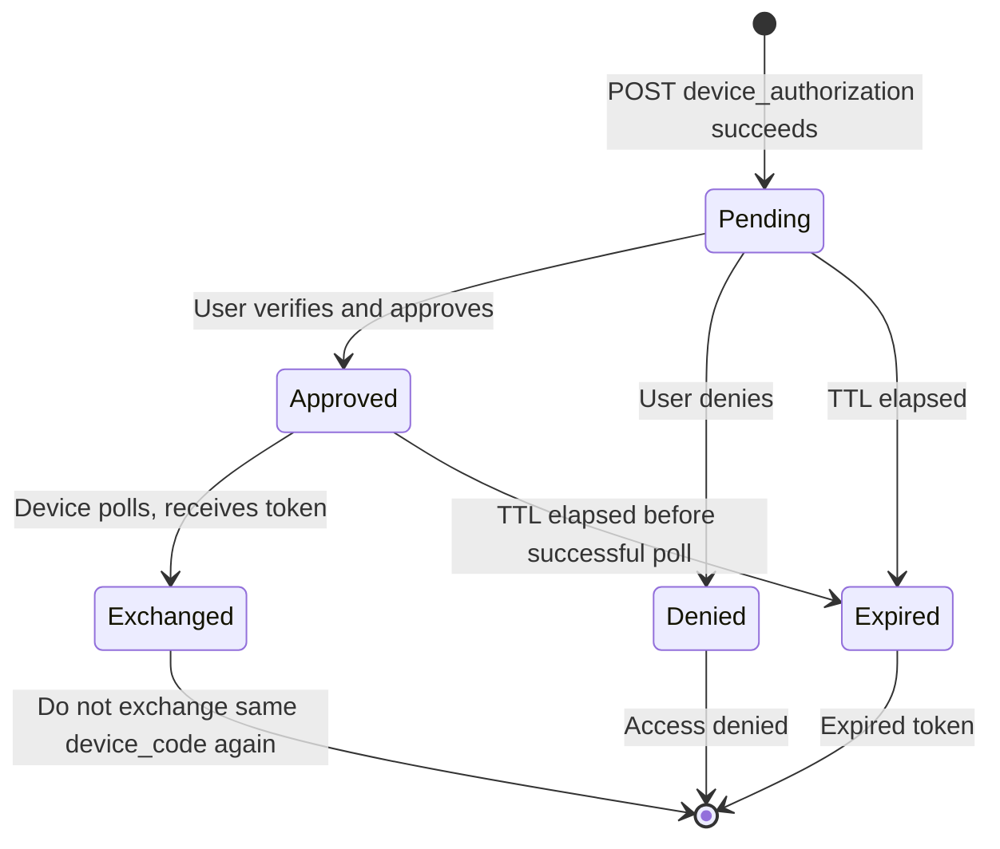

# Issuing device_code, user_code, verification_uri, and Expiration

## 1. Purpose and Context

In the **Device Authorization** chapter of the `SPRING_SECURITY_OAUTH2_OIDC_AUTHORIZATION_SERVER` module, we examine how an **OAuth 2.0 Authorization Server issues Device Authorization Grant initialization data** for devices with limited input or browser capabilities. This content supports learning how to **design, configure, secure, test, and operate an OAuth 2.0/OpenID Connect Authorization Server with Spring Security and Spring Authorization Server in a Spring Boot application**.

Imagine an application running on a TV, gaming console, or terminal where direct login is inconvenient. The device displays a verification address along with a short code; the user opens that address on a phone, signs in, and confirms access. Meanwhile, the device polls the Token Endpoint until the user finishes, denies, or the request expires.

The Device Authorization Grant is standardized in **RFC 8628 — OAuth 2.0 Device Authorization Grant**. Unlike Authorization Code Flow, the device **does not need to receive a redirect containing an Authorization Code** in its own browser. Instead, the process begins with a response containing specific values:

- `device_code`: a secret value for **the device** to send when polling the Token Endpoint.
- `user_code`: a short code for **the user** to enter at the verification page on a secondary device.
- `verification_uri`: a public address that **the user** opens to verify and approve.
- `expires_in`: the number of seconds both `device_code` and `user_code` remain valid from issuance.
- `interval` (if present): the minimum number of seconds the device should wait between Token Endpoint polls.
- `verification_uri_complete` (if present): a URI pre-filled with `user_code`, convenient for QR codes or links; **does not replace user verification and consent**.

After this lesson, you will be able to explain each field's exact role, configure issuance lifetimes in Spring Authorization Server, test the Device Authorization Endpoint, and identify risks such as code guessing, authorization phishing, aggressive polling, or cross-node state loss.

## 2. Distinguishing Device Authorization Grant from Other OAuth2 Flows

| Flow | User interaction model | Intermediate artifact | How Access Token is obtained |
| --- | --- | --- | --- |
| **Authorization Code + PKCE** | Browser redirects to the Authorization Endpoint and returns to the client's callback | `authorization_code` and PKCE | Client exchanges Authorization Code at Token Endpoint |
| **Device Authorization Grant** | User verifies on a **secondary device**; primary device shows code/instructions | `device_code` and `user_code` | Device polls Token Endpoint with `device_code` |
| **Client Credentials** | No end user in the token issuance transaction | No authorization code/user code | Client authenticates directly with Token Endpoint |
| **Refresh Token Grant** | Does not repeat user approval while Refresh Token remains valid | Previously issued Refresh Token | Client sends Refresh Token to Token Endpoint |

Device flow fits when a device **can communicate over HTTPS with the Authorization Server** and display instructions, yet struggles with password entry or lacks a full browser. It is **not** a way to skip user authentication, not an arbitrary device-pairing protocol, and does not mean any device is automatically authorized once a `user_code` exists.

## 3. Diagram of Issuing and Using the Values

```mermaid
sequenceDiagram
    autonumber
    participant D as TV / Device Client
    participant AS as Authorization Server
    actor U as User
    participant B as Phone Browser
    D->>AS: POST /oauth2/device_authorization (client_id, scope)
    AS->>AS: Validate client, grant, scope; create codes and expiry
    AS-->>D: device_code, user_code, verification_uri, expires_in, interval
    D-->>U: Display user_code + verification_uri / QR
    par Device awaits result
        loop No faster than interval
            D->>AS: POST /oauth2/token (device_code grant)
            AS-->>D: authorization_pending / slow_down
        end
    and User verifies
        U->>B: Open verification_uri on phone
        B->>AS: GET verification page; enter/compare user_code
        AS->>U: Prompt for login and permission approval
        U->>AS: Approve or deny
        AS->>AS: Update device authorization state
    end
    D->>AS: Poll after approval
    AS->>AS: Validate device_code, client, expiry, and consent
    AS-->>D: Access Token if permitted, or OAuth2 error
```

The diagram shows the logical path; real polling loops **must not run forever**. The device stops once it gets a token, the user denies, `device_code` expires, or an unrecoverable error occurs. Users are typically asked to confirm the exact device or application requesting access before granting permissions.

**Separate the two channels cleanly:**

1. **Device channel:** the device talks to `/oauth2/device_authorization` and `/oauth2/token`, holding `device_code`.
2. **User verification channel:** the user's browser visits `verification_uri`, enters/compares `user_code`, authenticates the user, and confirms the decision.

`user_code` does not replace `device_code` in token requests. Likewise, `device_code` must never be used as the code the user types into the verification page.

## 4. Fields of the Device Authorization Response

Per RFC 8628, a successful response contains the required fields `device_code`, `user_code`, `verification_uri`, and `expires_in`; `verification_uri_complete` and `interval` are optional fields.

| Field | Required? | Used by | Meaning |
| --- | --- | --- | --- |
| `device_code` | Yes | Device Client and Authorization Server | Unpredictable value used to correlate token polling with the pending transaction |
| `user_code` | Yes | User and Authorization Server | Readable/typeable value used to select the right transaction to verify |
| `verification_uri` | Yes | User on another browser | URI to the Authorization Server's verification page |
| `verification_uri_complete` | No | User, QR/links | Pre-filled URI reducing typing, but still requiring safe verification |
| `expires_in` | Yes | Device Client | Seconds `device_code` and `user_code` remain valid |
| `interval` | No | Device Client | Minimum wait period between polls, in seconds |

**Illustrative** response example, not a live valid code:

```http
HTTP/1.1 200 OK
Content-Type: application/json
Cache-Control: no-store

{
  "device_code": "sample-device-code-high-entropy-value",
  "user_code": "ABCD-EFGH",
  "verification_uri": "https://auth.example.com/oauth2/device_verification",
  "verification_uri_complete": "https://auth.example.com/oauth2/device_verification?user_code=ABCD-EFGH",
  "expires_in": 600,
  "interval": 5
}
```

**The values above are examples.** Do not hardcode static `device_code`/`user_code` values in production, do not assume Spring Authorization Server always generates codes in the exact `ABCD-EFGH` format, and do not treat `600` or `5` as immutable defaults across every version.

### 4.1. `device_code`: Secret on the Device Channel

`device_code` must be sufficiently random, unpredictable, and bound to the right issuance session. The Device Client keeps it in memory/transaction state until a token is received or the request terminates. This value is sent to the Token Endpoint with the specific grant type:

```text
urn:ietf:params:oauth:grant-type:device_code
```

`device_code` is not an Access Token, grants no access to the Resource Server, and must not be placed into a QR code or public URL shown to the user. It is a sensitive intermediate credential; avoid saving it in access logs, analytics, crash reports, or error messages.

### 4.2. `user_code`: For the User, Not a Replacement for Authentication

`user_code` is designed to be easy for humans to read and type, often using character sets and grouping to avoid ambiguity. Because it is shorter than `device_code`, it must be protected with **attempt limits, rate limiting, short lifetimes, and bulk-guessing defenses**.

Entering a `user_code` **does not prove account ownership**. The user must sign in at the Authorization Server and perform an intentional approval step; the code only helps the system locate the right device request to process.

### 4.3. `verification_uri`: Address for the User

`verification_uri` must be a valid public URL for the Authorization Server, typically over HTTPS, such as:

```text
https://auth.example.com/oauth2/device_verification
```

The Device Client clearly displays the trusted domain and code. Never construct the URL from an unchecked request hostname or an untrusted `X-Forwarded-Host` header. When deployed behind a reverse proxy, verify that `issuer`, host, scheme, and endpoint paths are published consistently.

`verification_uri_complete` merely pre-fills the code, often for QR generation. Per RFC 8628, even when a browser opens the complete URI, **the Authorization Server must still ensure the user confirms the code/device and approves**, preventing unintended grants via a phishing link.

### 4.4. `expires_in`: Lifetime of Both Codes

`expires_in` is measured in **seconds**, starting from the successful Device Authorization response. It is **not** the Access Token TTL, nor the expiration time of the user's login session.

Example of a response at 10:00:00 with `expires_in=600`:

| Time | State |
| --- | --- |
| 10:00:00 | AS issues `device_code` and `user_code`; TTL starts |
| 10:02:00 | User has not entered the code yet; device keeps polling per `interval` |
| 10:05:00 | User enters the code and approves; device will get the result on the next valid poll |
| 10:09:59 | Request may still be valid if other conditions hold |
| From ~10:10:00 onward | Request expired; old code must be rejected, even if the user has not acted yet |

Clocks across nodes must remain consistent. The client should stop polling at the deadline using an appropriate monotonic clock rather than guessing that the server will extend the window just because the user still has the login page open.

## 5. Device Authorization Endpoint: HTTP Request and Response

In Spring Authorization Server 1.x, the default Device Authorization Endpoint is typically:

```text
POST /oauth2/device_authorization
```

The path can be customized via `AuthorizationServerSettings`. The Device Client sends an `application/x-www-form-urlencoded` request with `client_id` (especially for public clients) and scopes when needed. Client authentication depends on the registered method: a public client using `none` has no trustworthy secret, whereas a confidential client uses its appropriate method.

Example with public device client `tv-app`:

```http
POST /oauth2/device_authorization HTTP/1.1
Host: auth.example.com
Content-Type: application/x-www-form-urlencoded

client_id=tv-app&scope=media.read
```

Or testing in a test environment:

```bash
curl -i -X POST 'https://auth-test.example.com/oauth2/device_authorization' \
  -H 'Content-Type: application/x-www-form-urlencoded' \
  --data-urlencode 'client_id=tv-app' \
  --data-urlencode 'scope=media.read'
```

A valid request without user consent yet **still receives HTTP 200 with the initialization codes**. **It is not yet an Access Token response.** The Authorization Server stores the request state, issuance/expiration timestamps, and link to the Registered Client.

Errors at this step can stem from an unknown client, invalid client authentication, disallowed Device Code Grant, invalid scopes, rate limits, or server policy. Never "fix" errors by disabling client validation or accepting arbitrary scopes.

## 6. Configuring Spring Authorization Server to Issue Codes

Spring Authorization Server includes these representative components (verify API names against your exact version):

| Component | Responsibility |
| --- | --- |
| `OAuth2DeviceAuthorizationEndpointFilter` | Receives device authorization initiation requests and builds the HTTP response |
| `OAuth2DeviceAuthorizationRequestAuthenticationConverter` | Converts form parameters into a Device Authorization authentication request |
| `OAuth2DeviceAuthorizationRequestAuthenticationProvider` | Validates client/grant/scope, generates device/user code data, and saves authorization |
| `OAuth2DeviceVerificationEndpointFilter` | Handles the browser flow for user code verification and approval/denial |
| `OAuth2TokenEndpointFilter` and Device Code provider | Handles `grant_type=urn:ietf:params:oauth:grant-type:device_code` polling |
| `RegisteredClientRepository` | Looks up clients and registered grants/scopes |
| `OAuth2AuthorizationService` | Stores request state, codes, approvals, and issued tokens |
| `TokenSettings` | Configures TTLs for the Device Code and issued token types |
| `AuthorizationServerSettings` | Defines the issuer and endpoint paths |

**You do not need to generate `device_code` or `user_code` manually in an MVC Controller** when using Spring Authorization Server's standard pipeline. Configure the client, lifetimes, and UI; write custom extensions only for concrete requirements and while upholding RFC 8628 security guarantees.

### 6.1. Registering a Public Device Client

Java example creating a `RegisteredClient` for a TV; this is a **Spring Authorization Server 1.x** example and must be paired with the rest of the application's foundational configuration:

```java
import java.time.Duration;
import java.util.UUID;

import org.springframework.context.annotation.Bean;
import org.springframework.context.annotation.Configuration;
import org.springframework.security.oauth2.core.AuthorizationGrantType;
import org.springframework.security.oauth2.core.ClientAuthenticationMethod;
import org.springframework.security.oauth2.server.authorization.client.InMemoryRegisteredClientRepository;
import org.springframework.security.oauth2.server.authorization.client.RegisteredClient;
import org.springframework.security.oauth2.server.authorization.client.RegisteredClientRepository;
import org.springframework.security.oauth2.server.authorization.settings.ClientSettings;
import org.springframework.security.oauth2.server.authorization.settings.TokenSettings;

@Configuration(proxyBeanMethods = false)
class DeviceClientConfiguration {

    @Bean
    RegisteredClientRepository deviceClients() {
        RegisteredClient tv = RegisteredClient.withId(UUID.randomUUID().toString())
                .clientId("tv-app")
                .clientName("TV Demo Client")
                .clientAuthenticationMethod(ClientAuthenticationMethod.NONE)
                .authorizationGrantType(AuthorizationGrantType.DEVICE_CODE)
                .scope("media.read")
                .clientSettings(ClientSettings.builder()
                        .requireAuthorizationConsent(true)
                        .build())
                .tokenSettings(TokenSettings.builder()
                        .deviceCodeTimeToLive(Duration.ofMinutes(10))
                        .accessTokenTimeToLive(Duration.ofMinutes(10))
                        .build())
                .build();

        return new InMemoryRegisteredClientRepository(tv);
    }
}
```

Key points to note:

1. `AuthorizationGrantType.DEVICE_CODE` is the grant registered for the device; its protocol value is `urn:ietf:params:oauth:grant-type:device_code`.
2. `ClientAuthenticationMethod.NONE` identifies a public client **that holds no client secret**. `client_id` identifies the app, but is not proof that the request genuinely came from official hardware.
3. No `redirectUri` is declared in this example because the device flow does not redirect a browser back to a callback with an Authorization Code.
4. `deviceCodeTimeToLive(Duration.ofMinutes(10))` is the TTL policy used when generating device codes; **it differs** from `accessTokenTimeToLive(...)` for the Access Token after user approval.
5. `requireAuthorizationConsent(true)` enforces user consent; verification pages and consent forms must be configured so the user can complete the flow.
6. `UUID.randomUUID()` is used for initial registration in this example. With a persistent repository, the RegisteredClient ID must remain stable across restarts rather than changing on every boot.
7. `InMemoryRegisteredClientRepository` only stores the client list; pending device authorization request state lives in `OAuth2AuthorizationService` and needs its own strategy for multi-node deployments.

**Note:** the snippet above is not a complete Authorization Server. A real system also needs `SecurityFilterChain`, user authentication, `AuthorizationServerSettings`, token generators, signing keys/JWKs depending on token format, and authorization/consent services.

### 6.2. Configuring Endpoint URIs and Issuer

To set the paths explicitly, declare this bean:

```java
import org.springframework.context.annotation.Bean;
import org.springframework.context.annotation.Configuration;
import org.springframework.security.oauth2.server.authorization.settings.AuthorizationServerSettings;

@Configuration(proxyBeanMethods = false)
class DeviceEndpointSettingsConfiguration {

    @Bean
    AuthorizationServerSettings authorizationServerSettings() {
        return AuthorizationServerSettings.builder()
                .issuer("https://auth.example.com")
                .deviceAuthorizationEndpoint("/oauth2/device_authorization")
                .deviceVerificationEndpoint("/oauth2/device_verification")
                .build();
    }
}
```

`issuer` must match the public address users and clients actually reach. For local environments, use the matching local issuer; do not leave fake production hostnames in test apps. If changing default URIs, update documentation, device display UIs, proxy routing, and integration tests.

### 6.3. Two SecurityFilterChains and User Login

A Servlet-based Spring Boot application can configure a high-priority Authorization Server chain and a form-login chain:

```java
import org.springframework.context.annotation.Bean;
import org.springframework.context.annotation.Configuration;
import org.springframework.core.annotation.Order;
import org.springframework.http.MediaType;
import org.springframework.security.config.Customizer;
import org.springframework.security.config.annotation.web.builders.HttpSecurity;
import org.springframework.security.oauth2.server.authorization.config.annotation.web.configurers.OAuth2AuthorizationServerConfigurer;
import org.springframework.security.web.SecurityFilterChain;
import org.springframework.security.web.authentication.LoginUrlAuthenticationEntryPoint;
import org.springframework.security.web.util.matcher.MediaTypeRequestMatcher;

@Configuration(proxyBeanMethods = false)
class DeviceSecurityConfiguration {

    @Bean
    @Order(1)
    SecurityFilterChain authorizationServerChain(HttpSecurity http) throws Exception {
        OAuth2AuthorizationServerConfigurer configurer =
                OAuth2AuthorizationServerConfigurer.authorizationServer();

        http.securityMatcher(configurer.getEndpointsMatcher())
            .with(configurer, server -> server.oidc(Customizer.withDefaults()))
            .authorizeHttpRequests(authorize -> authorize.anyRequest().authenticated())
            .exceptionHandling(exceptions -> exceptions
                .defaultAuthenticationEntryPointFor(
                    new LoginUrlAuthenticationEntryPoint("/login"),
                    new MediaTypeRequestMatcher(MediaType.TEXT_HTML)));
        return http.build();
    }

    @Bean
    @Order(2)
    SecurityFilterChain applicationChain(HttpSecurity http) throws Exception {
        http.authorizeHttpRequests(authorize -> authorize.anyRequest().authenticated())
            .formLogin(Customizer.withDefaults());
        return http.build();
    }
}
```

The chains above are a **configuration skeleton**; to run a real device flow, the application still needs authorization/consent/user/key beans and the Device Verification UI (`user_code` entry or confirmation, consent selection). OIDC is not required for a pure OAuth2 Device Authorization Grant; omit `.oidc(...)` if the project does not implement OpenID Connect.

Do not assume every endpoint shares the same authentication requirements: a public client's Device Authorization Request may be identified via `client_id` and `NONE`, whereas a browser hitting the Device Verification Endpoint requires **user authentication** and an **explicit approval decision** before the device receives a token. Filters and providers handle each step according to the protocol.

## 7. Lifetimes of device_code and user_code

### 7.1. TTL Starts When the Authorization Server Issues the Codes

The starting timestamp for both codes is the **successful Device Authorization POST**, not when the user opens `verification_uri`. The authorization state records issuance/expiration times; the device reads `expires_in` to stop polling on time.



The model above shows **logical states**: an implementation may store `OAuth2Authorization` and token metadata in its own way; it does not need an enum with exact `Pending/Approved/Denied` names. Once a device authorization expires, the AS must reject any further processing of the old code even if the user opens the verification tab late.

### 7.2. `TokenSettings.deviceCodeTimeToLive` and `expires_in`

In Spring Authorization Server 1.x, `TokenSettings.deviceCodeTimeToLive(Duration)` configures the device code issuance TTL per `RegisteredClient`. For example:

```java
TokenSettings.builder()
    .deviceCodeTimeToLive(Duration.ofMinutes(7))
    .accessTokenTimeToLive(Duration.ofMinutes(12))
    .build();
```

This configuration gives the **Device Code a 7-minute lifetime** and the later-issued Access Token a 12-minute lifetime. `expires_in` in the Device Authorization Response must represent the device/user code lifetime, **not** the Access Token lifetime. Check your exact version to confirm how the paired `user_code` is generated and expired.

Choose a TTL based on realistic time for users to unlock a phone, reach the page, and enter the code, accounting for MFA/consent; however, longer TTLs widen the window for code guessing and phishing. Avoid setting multi-hour TTLs merely because a device has a slow connection. Upon expiration, the device initiates a **new Device Authorization transaction** and displays a new code.

### 7.3. Do Not Extend Code Lifetime via Polling

`authorization_pending` means the request has not been acted upon by the user yet. It **does not** extend `expires_in`. `slow_down` asks the client to slow down polling, and likewise **does not extend** the code. A device should never be allowed to "keep a code alive" indefinitely through repeated requests.

A Device Client should track at least:

```text
issuedAt      = timestamp when device received the code response
deadline      = issuedAt + expires_in (optionally stop slightly early as a buffer)
pollInterval  = interval value, or 5 seconds if absent from response
stopCondition = token obtained / denied / expired / unrecoverable error
```

RFC 8628 expresses `interval` in **seconds**, not milliseconds. Clients should handle network latency and timeouts carefully without queuing concurrent requests to "make up" for slow ones.

## 8. Polling the Token Endpoint After Code Issuance

After the Device Authorization Response, the device sends a Token Endpoint request with the specific grant:

```http
POST /oauth2/token HTTP/1.1
Host: auth.example.com
Content-Type: application/x-www-form-urlencoded

grant_type=urn%3Aietf%3Aparams%3Aoauth%3Agrant-type%3Adevice_code&
device_code=<device-code-from-response>&
client_id=tv-app
```

In shell form:

```bash
curl -i -X POST 'https://auth-test.example.com/oauth2/token' \
  -H 'Content-Type: application/x-www-form-urlencoded' \
  --data-urlencode 'grant_type=urn:ietf:params:oauth:grant-type:device_code' \
  --data-urlencode 'device_code=<device-code-from-response>' \
  --data-urlencode 'client_id=tv-app'
```

Public clients pass `client_id` as supported by the framework and registration; confidential clients must use their registered client authentication method. `device_code` **does not replace** client authentication when the client type requires authentication.

### 8.1. Device Authorization Error Codes

| Error code | Meaning | Device Client action |
| --- | --- | --- |
| `authorization_pending` | User has not completed verification/approval | Wait at least `interval`, then poll again if not expired |
| `slow_down` | Polling too fast or server requests throttling | Increase wait time by **at least 5 seconds** over the current cadence and keep it for future polls |
| `access_denied` | User denied or AS denied authorization | Stop polling; display appropriate result |
| `expired_token` | Device Code expired | Stop polling; request a new Device Authorization |
| `invalid_client`, `invalid_request`, `unauthorized_client`... | Invalid request/client/grant details | Do not poll endlessly; fix request/registration before retrying |

Per RFC 8628, when the initial response **omits `interval`**, the client defaults to **5 seconds**. `slow_down` increases the wait period by **5 seconds** over the current value, and all subsequent polls must honor the new interval. On network timeouts or connection errors, the client should apply **backoff** to avoid adding load rather than retrying immediately in a loop.

Example when `interval=5`:

| Time (illustrative) | Result | Next wait cadence |
| --- | --- | --- |
| After 5 seconds | `authorization_pending` | Minimum 5 seconds |
| After 10 seconds | `slow_down` | Minimum 10 seconds |
| After 20 seconds | `authorization_pending` | Minimum 10 seconds |
| After 30 seconds | User approves, server returns token | **Stop polling** |

The `slow_down` occurrence above is an **example**, not a guarantee that every server triggers it after a fixed number of requests.

### 8.2. Response Before User Approval

```http
HTTP/1.1 400 Bad Request
Content-Type: application/json
Cache-Control: no-store

{
  "error": "authorization_pending"
}
```

This response is **not a server error**: it is the normal state of the device flow before the user finishes verification. Do not treat HTTP 400 `authorization_pending` as a reason to immediately start a new Device Authorization request.

### 8.3. Response on Success

After the user verifies and the grant is authorized, a valid poll can receive:

```json
{
  "access_token": "<new-access-token>",
  "token_type": "Bearer",
  "expires_in": 900,
  "scope": "media.read"
}
```

This is an **illustrative example**, not output from a live run. The response may include additional fields per grant/policy and version, but **never assume** Device Authorization Grant always issues a Refresh Token or ID Token. If OIDC or offline access is needed, design and test those issuance conditions explicitly.

## 9. Verification Page: user_code Is Not Proof of Approval

When a browser visits `verification_uri`, the Authorization Server must ensure:

1. `user_code` was issued, has not expired, and is tied to a valid device request.
2. The user has authenticated via an accepted mechanism; if not, redirect to login and preserve the verification flow.
3. The UI clearly shows the **application/device name, permissions (scopes), and account** being used for approval.
4. The user has an opportunity to **intentionally approve or deny**; never issue tokens merely for opening `verification_uri_complete`.
5. Approval status is stored so the next poll with the matching `device_code` receives the outcome.
6. Old, already-used, expired, or closed-transaction user codes are properly rejected.

Simple conceptual screen example:

```text
Device sign-in

Application: TV Demo Client
Verification code: ABCD-EFGH
Requested permissions: Read media library (media.read)

[Approve]   [Deny]

Approve only if you just started signing in on the device you are using.
```

This is a **UI description**, not a page automatically rendered verbatim by the framework. If building a custom Device Verification form, protect it with CSRF, validate the code server-side, protect sessions, escape rendered values, and never trust an application name/identity passed by the browser.

### 9.1. "Device Code Phishing" Risk

An attacker can start a device flow on a device they control, then persuade a victim to sign in at the legitimate `verification_uri` and enter the attacker's `user_code`. If the victim gets confused and approves, tokens can be issued to the attacker's device.

Appropriate layers of defense:

- Display client/device/scopes clearly; never present verification as a generic login prompt.
- Require explicit confirmation, especially when using `verification_uri_complete` or QR codes.
- Instruct users: "only proceed if you yourself just requested sign-in on that device."
- Bind codes to the client and transaction, use short TTLs, cap code attempts, and enforce rate limits.
- Detect anomalous events and maintain a token revocation workflow when users report accidental approvals.

Never treat possession of `user_code` as multi-factor authentication or proof of device ownership; it is strictly a transaction lookup code.

## 10. Storage, Expiry, and Multi-Instance Environments

In Spring Authorization Server, `OAuth2AuthorizationService` stores authorization state and token metadata needed to link `device_code`, `user_code`, client, user decision, expiration, and issued tokens.

| Storage option | Best suited for | Key considerations |
| --- | --- | --- |
| `InMemoryOAuth2AuthorizationService` | Learning or single-node tests | State lost on restart; not shared across instances |
| `JdbcOAuth2AuthorizationService` | SQL environments needing persistent state | Requires version-matched schema, transaction management, and concurrency testing |
| Custom repository | Specialized infrastructure | Must preserve expiry semantics, user-code lookup, approval, and single-use device-code redemption |

If the TV obtains codes from node A while the browser verifies on node B or polling hits node C, **all nodes must observe the exact same authorization state**. Sticky sessions only partially help browser interaction state; they do not replace a shared authorization store.

Once a device code has been exchanged for a token, subsequent reuse attempts must be rejected. Under concurrent requests, the store and handler must prevent two nodes from both reading "approved and unused" and issuing duplicate tokens. **Using JDBC alone does not automatically guarantee correct atomicity in every scenario**; test race conditions against your actual framework and database versions.

### 10.1. Never Write Codes to Logs

Never log raw `device_code`, `user_code`, Access Tokens, client secrets, assertions, or session data. You may log **correlation IDs, endpoint names, grant types, client IDs if policy allows, pending/approved/denied/expired status, and error codes** for debugging. Avoid leaking `user_code` into URLs captured by analytics or third-party systems.

### 10.2. Handling Expiration and State Cleanup

An expired device authorization does not mean the record must vanish from the database in the same millisecond. What is mandatory is **rejecting expired codes**. Storage cleanup can run asynchronously under controlled retention and audit policies.

When a user enters an expired code, safely inform them to restart on their device. Never re-issue the old `device_code`, never silently extend it, and never attach an expired `user_code` to a new transaction.

## 11. Testing the Device Authorization Endpoint

Tests should verify both **response shape** and **temporal/transactional behavior**, rather than merely asserting HTTP 200.

### 11.1. Verifying Code-Issuance Response with MockMvc

Assume an integration test sets up a `RegisteredClient` with `client_id=tv-app`, `DEVICE_CODE` grant, `media.read` scope, and full Spring Authorization Server configuration for the Device Authorization Endpoint.

```java
import org.junit.jupiter.api.Test;
import org.springframework.beans.factory.annotation.Autowired;
import org.springframework.boot.test.autoconfigure.web.servlet.AutoConfigureMockMvc;
import org.springframework.boot.test.context.SpringBootTest;
import org.springframework.http.MediaType;
import org.springframework.test.web.servlet.MockMvc;

import static org.hamcrest.Matchers.greaterThan;
import static org.springframework.test.web.servlet.request.MockMvcRequestBuilders.post;
import static org.springframework.test.web.servlet.result.MockMvcResultMatchers.jsonPath;
import static org.springframework.test.web.servlet.result.MockMvcResultMatchers.status;

@SpringBootTest
@AutoConfigureMockMvc
class DeviceAuthorizationResponseTest {

    @Autowired
    MockMvc mockMvc;

    @Test
    void registeredDeviceClientReceivesCodeAndVerificationUri() throws Exception {
        mockMvc.perform(post("/oauth2/device_authorization")
                        .contentType(MediaType.APPLICATION_FORM_URLENCODED)
                        .param("client_id", "tv-app")
                        .param("scope", "media.read"))
                .andExpect(status().isOk())
                .andExpect(jsonPath("$.device_code").isNotEmpty())
                .andExpect(jsonPath("$.user_code").isNotEmpty())
                .andExpect(jsonPath("$.verification_uri").isNotEmpty())
                .andExpect(jsonPath("$.expires_in", greaterThan(0)));
    }
}
```

This is an **integration test template** requiring Spring Boot test dependencies, the Authorization Server filter chain, and test fixture beans. It checks the four required fields; because `interval` and `verification_uri_complete` are optional per RFC, **do not write tests asserting they appear in every response** unless your internal contract guarantees them.

### 11.2. Test Matrix from Code Issuance to Token Receipt

| Test case | Expected result |
| --- | --- |
| Valid client, `DEVICE_CODE` grant permitted, registered scope | HTTP 200 with `device_code`, `user_code`, `verification_uri`, `expires_in > 0` |
| Non-existent `client_id` | Rejected; no codes issued |
| Client not permitted to use Device Code Grant | Rejected per policy/permissions |
| Unregistered scope | Appropriate OAuth2 error; no codes issued |
| Two separate initialization requests | Unpredictable codes, no static reuse; independent state |
| Poll before user verifies | `authorization_pending` |
| Poll too fast | Throttling/`slow_down` policy enforced as needed; client increases wait by at least 5 seconds if received |
| User enters valid `user_code` and approves | Subsequent valid poll can receive Access Token |
| User denies | Poll returns `access_denied`; no Access Token issued |
| Code exceeds `expires_in` | User code and device code no longer accepted; polling returns appropriate expiration error |
| User enters non-existent code | Does not leak transaction/account info; resists guessing |
| Same `device_code` reused after success | No additional token issued from consumed code |
| Two concurrent polls across nodes | Verify no policy-violating double redemption |
| Opening `verification_uri_complete` | Must not issue tokens solely from opening the link |
| Gateway/proxy rewrites hostname | Returned URI remains the trusted public HTTPS address matching issuer |

Expiry testing should use a controllable clock or appropriate fixture whenever possible; avoid long `Thread.sleep` calls in the main test suite. If your framework version does not allow clock injection, use dedicated short-TTL configuration tests and carefully designed end-to-end tests that avoid timing flakiness.

### 11.3. Testing Security Invariants

Beyond response shapes, verify that:

1. A Device Authorization Request never immediately issues an Access Token.
2. An unverified `user_code` cannot be exchanged for a token merely by hitting the verification URL.
3. Another user logging in, denying consent, or hitting expiration can never transition to "authorized."
4. A client cannot poll with another client's device code.
5. The service does not permit unlimited incorrect `user_code` attempts.
6. State is not lost or corrupted when multiple nodes handle steps interchangeably or after a node restart.
7. Logs and traces contain no raw codes, tokens, or secrets.

## 12. Troubleshooting Common Errors

| Symptom | Likely areas to inspect | Resolution |
| --- | --- | --- |
| `POST /oauth2/device_authorization` returns 404 | Filter chain/endpoint disabled, wrong path, proxy rewrite | Check `OAuth2AuthorizationServerConfigurer`, `AuthorizationServerSettings`, chain order, and routing |
| Returns `invalid_client` | Client missing or wrong authentication method | Check `RegisteredClient`, `client_id`, and public/confidential setting |
| Returns `unauthorized_client` | Client not registered for Device Code Grant | Add grant if approved; never disable validation |
| Missing `verification_uri_complete` | Optional per RFC or not emitted by version | Display `verification_uri` and `user_code` separately |
| `verification_uri` uses internal host | Inconsistent issuer/proxy/forwarded headers | Fix issuer configuration and proxy trust boundaries |
| Code expires too quickly | Small TTL, clock drift, slow user flow | Review `deviceCodeTimeToLive`, latency, and time sync |
| Device calls token endpoint continuously | Client ignores `interval` or `slow_down` | Fix scheduler/backoff and block excessive polling |
| User approved but device stays pending | State not shared across nodes; failed authorization/consent save | Check `OAuth2AuthorizationService`, storage, and user decision |
| User opens QR and token issues without confirmation | Verification flow over-trusts pre-filled URL | Add explicit verification confirmation and consent |
| Two requests get tokens from the same device code | Race condition / broken single-use enforcement | Test concurrency, fix atomicity and consumption handling |
| User code guessable or brute-forced | Weak RNG, missing rate limit, or overly long lifetime | Fix generator/entropy policy, cap attempts, tighten TTL reasonably |

A `/oauth2/token` request returning HTTP 400 `authorization_pending` **does not prove a configuration error**. Conversely, the Device Authorization Endpoint returning 200 does not yet prove that user verification, consent, and token polling work properly.

## 13. Security and Operations

### 13.1. Distinguishing the Attack Surfaces of Both Codes

- `device_code` is long and high-entropy, hidden from the user; never accepted at the Resource Server.
- `user_code` is short and easy to type, making it easier to guess; must be rate-limited and protected against brute force.
- `verification_uri` is public and requires HTTPS and a trusted host; phishing and malicious QR sources must be accounted for.
- `verification_uri_complete` can leak codes through browser history or URL logging; prevent codes from reaching third parties via referrers or analytics.

### 13.2. Consent and Device Display

Users must see **the application/device receiving access, the permission scopes, and the account granting permission**. The verification step should make denial straightforward. Never replace consent with a page containing only a "Continue" button that obscures the authorization grant.

### 13.3. Rate Limiting and Polling

Apply rate limits to the **Device Authorization Endpoint**, **`user_code` entry**, and **Token Endpoint polling**. Design limits around client, request session, network address, or suitable risk signals so one client cannot exhaust system capacity. `slow_down` is a protocol hint for clients, not a substitute for gateway and server rate limits.

### 13.4. Revocation and Issued Tokens

When a user denies or a request expires, issue no token. Once an Access Token has been issued, govern `exp`, scopes/audience, revocation, and monitoring under global policy. Expiration of `device_code` **does not automatically expire an already-issued Access Token**: they have separate lifecycles.

### 13.5. Monitoring Without Leaking Credentials

Monitor initialization request counts, approval/denial/expiration ratios, time from code issuance to user confirmation, `authorization_pending`/`slow_down` rates, failed `user_code` attempts, and successful token issuance rates. Never use `device_code` or `user_code` as metric labels; use non-secret correlation IDs.

## 14. Device Authorization Implementation Checklist

1. **Right client role:** `AuthorizationGrantType.DEVICE_CODE`, scopes, and client authentication method registered appropriately.
2. **Device Authorization Endpoint:** handles form-encoded POST, returns all four required fields and any contracted optional fields.
3. **Unpredictable codes:** high-entropy `device_code`; easy-to-enter `user_code` hardened against guessing.
4. **Valid URIs:** `verification_uri` uses HTTPS on a trusted public domain; `verification_uri_complete` never bypasses user verification.
5. **Clear lifetimes:** `deviceCodeTimeToLive` and `expires_in` align consistently; user code expires with the transaction.
6. **Compliant polling:** honors at least `interval` (default 5 seconds if omitted); handles `slow_down`, `authorization_pending`, `access_denied`, and `expired_token`.
7. **User authentication/consent:** entering a code does not auto-issue tokens; users see app, account, and scopes.
8. **Durable state:** `OAuth2AuthorizationService`, sessions, and consent support HA, failover, and multiple nodes.
9. **Replay prevention:** consumed or expired codes cannot be redeemed again; concurrent polls tested.
10. **Security and logging:** HTTPS, CSRF on verification forms, rate limiting, anti-phishing, no raw codes/tokens/secrets in logs.
11. **Operations:** monitor pending/denied/expired rates, rotate/revoke Access Tokens per policy, and re-verify configuration after Spring upgrades.

## 15. Exercises and Self-Assessment Questions

**Exercise A — Reading the response.** A device receives `expires_in=420`, `interval=5` at 09:00:00. The user enters the code at 09:04:30 and approves. When must the device stop polling due to expiration? Is remaining time automatically extended when the browser opens?

**Exercise B — Configuring TTLs.** Register a `RegisteredClient` for a TV using `DEVICE_CODE` and `ClientAuthenticationMethod.NONE`. Set the device code TTL to 8 minutes and Access Token TTL to 15 minutes; explain why these two values must not be swapped.

**Exercise C — Handling slow_down.** The code issuance response omits `interval`; the first poll returns `authorization_pending`, and the second returns `slow_down`. Write a table of subsequent valid wait intervals per RFC 8628.

**Exercise D — Testing user verification.** Open `verification_uri_complete` with a valid code in an unauthenticated browser session. Explain the steps that must occur before the device receives a token and prove why opening the URI alone is insufficient.

**Exercise E — Multi-node.** Node A issues codes, node B handles the user code, and node C handles token polling. Design the state store and a test ensuring approval is visible on every node while the same device code cannot be redeemed twice.

**Review Questions:**

1. How do `device_code` and `user_code` differ in audience, entropy, and purpose?
2. Which four fields are required in a Device Authorization Response per RFC 8628?
3. Is `verification_uri_complete` required? Why should you not auto-approve just because a user opens this URI?
4. Which code's TTL does `expires_in` represent, and when does it start counting?
5. What happens if a user approves after the device code expires?
6. What is the default `interval` in seconds if the server omits it?
7. How does a client adjust its polling schedule when the server returns `slow_down`?
8. Which grant type does the Token Endpoint expect for `device_code`?
9. Why should you never fix `user_code` to a static value or log `device_code`?
10. How does `TokenSettings.deviceCodeTimeToLive` differ from `accessTokenTimeToLive`?
11. Why does Device Authorization Grant still require user authentication and consent?
12. In a multi-node deployment, why is a shared `RegisteredClientRepository` insufficient if `OAuth2AuthorizationService` remains in-memory?

## 16. References

- [RFC 8628 — OAuth 2.0 Device Authorization Grant](https://www.rfc-editor.org/rfc/rfc8628)
- [RFC 8628, Section 3.2 — Device Authorization Response](https://www.rfc-editor.org/rfc/rfc8628#section-3.2)
- [RFC 8628, Section 3.5 — Device Access Token Request](https://www.rfc-editor.org/rfc/rfc8628#section-3.5)
- [RFC 8628, Section 5 — Security Considerations](https://www.rfc-editor.org/rfc/rfc8628#section-5)
- [RFC 6749 — The OAuth 2.0 Authorization Framework](https://www.rfc-editor.org/rfc/rfc6749)
- [RFC 9700 — OAuth 2.0 Security Best Current Practice](https://www.rfc-editor.org/rfc/rfc9700)
- [Spring Authorization Server — Protocol Endpoints](https://docs.spring.io/spring-authorization-server/reference/protocol-endpoints.html)
- [Spring Authorization Server — Core Model Components](https://docs.spring.io/spring-authorization-server/reference/core-model-components.html)
- [Spring Authorization Server — Configuration Model](https://docs.spring.io/spring-authorization-server/reference/configuration-model.html)

**Key takeaway:** The Device Authorization Endpoint **issues `device_code`, `user_code`, `verification_uri`, and `expires_in`**, rather than issuing an Access Token immediately. `device_code` is used by the device to poll the Token Endpoint; `user_code` and `verification_uri` let the user verify a request on another device. **Short lifetimes, disciplined polling, explicit authentication/consent, anti-guessing defenses, and consistent state storage** are essential for safely deploying Device Authorization Grant in Spring Authorization Server.
