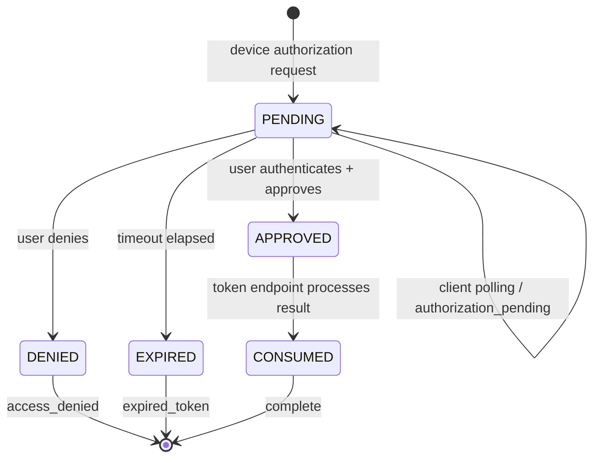

# User Code Entry and Device Confirmation Page

## 1. The Problem: A Device Needs Access Without a Suitable Keyboard

An application running on a **smart TV**, streaming device, or network printer needs to call a user's API, but entering passwords on a remote control is both awkward and prone to credential exposure. **OAuth 2.0 Device Authorization Grant** (RFC 8628) allows the device to display a **short verification code** along with a URL; the user visits that URL on a phone or laptop, signs in to the Authorization Server, and decides whether to grant permissions to the device.

In Spring Boot, **Spring Authorization Server** handles the protocol at the **Device Authorization Endpoint**, **Device Verification Endpoint**, and **Token Endpoint**. **Spring Security** supports login sessions, access checks, CSRF, and filter chains. The **`user_code` entry and device confirmation UI** is where user experience meets the security requirements of RFC 8628.

This lesson belongs to the **Device Authorization** chapter of the `SPRING_SECURITY_OAUTH2_OIDC_AUTHORIZATION_SERVER` module, supporting the goal of **designing, configuring, securing, testing, and operating an OAuth 2.0/OpenID Connect Authorization Server with Spring Security and Spring Authorization Server in a Spring Boot application**.

### After This Lesson, You Will Be Able To

1. Distinguish `user_code`, `device_code`, `verification_uri`, and `verification_uri_complete`.
2. Design a code entry and device confirmation screen that never automatically issues tokens as soon as the code is entered.
3. Explain the flow: **code entry → user authentication → transaction check → consent → state update → device polling**.
4. Integrate the code entry page with `OAuth2AuthorizationServerConfigurer` and `deviceVerificationEndpoint(...)` appropriately for your framework version.
5. Analyze risks including **user-code guessing, phishing, spoofed devices, clickjacking, CSRF, and polling abuse**, and build a test matrix.

> **Version note:** DSL examples follow the **Spring Authorization Server 1.x / Spring Security 6.x** API direction. Endpoint URIs, HTTP methods accepted by filters, customization hooks, and default enabled states may differ across Spring Authorization Server versions and Spring Security 7.x. Check the reference guide and implementation for your exact artifact when building a real UI; never replace default endpoints with a custom MVC controller that issues tokens itself.

## 2. How Does Device Authorization Differ from Standard Authorization Code?

With **Authorization Code + PKCE**, a browser is navigated directly to the Authorization Endpoint and redirected back to the client's callback. With **Device Authorization**, the device typically lacks a full interactive browser and **does not receive an authorization code via a redirect URI**.

Instead:

- The device requests a **device authorization transaction**.
- The Authorization Server returns a high-entropy `device_code` to the device and a human-readable/typeable `user_code`.
- The user enters the code at the verification page on a **secondary device** with a browser.
- The user **signs in and confirms** the permission request.
- The device keeps polling the Token Endpoint with `device_code`; only when the transaction is validly approved does the server issue tokens per policy.

| Criterion | Authorization Code + PKCE | Device Authorization Grant |
| --- | --- | --- |
| Device calling the API | Browser/mobile app capable of navigation | TV, CLI, IoT, or input-constrained device |
| How the user interacts | Browser inside client's authorization flow | Browser on another device at the verification URI |
| Value client uses for tokens | Authorization code + PKCE verifier | Device code |
| Value user enters | Usually no manual code entry | Human-readable user code |
| How result is received | Callback at redirect URI | Polling the Token Endpoint |
| Abuse defenses needed | Redirect URI, state, PKCE, login CSRF | User-code guessing, phishing, polling, wrong-device confirmation |

**Never use Device Flow instead of Authorization Code just to bypass login or MFA.** Users must still authenticate at the verification page according to policy.

## 3. Four Core Protocol Values

Per RFC 8628, the Device Authorization Response includes these primary fields:

| Field | Who receives/uses it? | Security meaning |
| --- | --- | --- |
| `device_code` | **Device/client** stores and sends to the Token Endpoint | Credential for polling the transaction; typically long, random, never displayed to the user |
| `user_code` | User reads and enters at the verification page | Manually entered code, short and readable; lower entropy requires guessing protections |
| `verification_uri` | User opens in browser | Verification page **owned by the Authorization Server** |
| `verification_uri_complete` | Optional URL already carrying user code | Reduces typing for QR/deep links; **must never bypass explicit confirmation** |
| `expires_in` | Client and server | Lifetime of device/user codes |
| `interval` | Client | Minimum polling interval requested by the server; if omitted, RFC 8628 defaults to 5 seconds |

Illustrative response example:

```http
HTTP/1.1 200 OK
Content-Type: application/json
Cache-Control: no-store
Pragma: no-cache

{
  "device_code": "DEVICE_CODE_HIGH_ENTROPY_EXAMPLE",
  "user_code": "HD73-K9FP",
  "verification_uri": "https://auth.example.com/activate",
  "verification_uri_complete": "https://auth.example.com/activate?user_code=HD73-K9FP",
  "expires_in": 600,
  "interval": 5
}
```

**Note:** Domain names, codes, TTLs, and intervals above are for study only. Do not assume Spring Authorization Server always returns `verification_uri_complete` or always uses this exact format/TTL; inspect actual responses.

### 3.1. Never Confuse User Code with Device Code

`user_code` is for **humans** and must be protected with rate limits, expiration, and confirmation context. `device_code` is for **client polling**, carries high entropy, and must stay confidential on the device. **Never ask users to paste `device_code` into a form**, never embed the device code in a public QR code, and never put it in browser logs.

### 3.2. A Manually Typed Code Is Not a User Password

Entering the right `user_code` only proves someone knows a **transaction code**; it does not prove they own the account, and even less that the device is trustworthy. Therefore, the Authorization Server must proceed through **user authentication, transaction state validation, and consent decision**.

## 4. Complete Diagram: Two Devices and One Authorization Server

```mermaid
sequenceDiagram
    autonumber
    participant TV as Smart TV / Device Client
    participant AS as Authorization Server
    actor U as User
    participant B as Phone Browser
    TV->>AS: POST /oauth2/device_authorization<br/>client_id, scope and client auth if needed
    AS-->>TV: device_code, user_code,<br/>verification_uri, expires_in, interval
    TV-->>U: Display URL + user_code
    loop Poll while valid
        TV->>AS: POST /oauth2/token<br/>device_code grant
        AS-->>TV: authorization_pending or other result
    end
    U->>B: Open verification_uri
    B->>AS: GET /activate
    AS-->>B: user_code entry page
    U->>B: Enter code shown on TV
    B->>AS: Submit user_code to Device Verification Endpoint
    alt Not logged in
        AS-->>B: Redirect to login form
        U->>AS: Authenticate user
    end
    AS->>AS: Look up transaction and verify code/expiry
    AS-->>B: Show client, scopes, and confirmation prompt
    U->>B: Approve or deny
    B->>AS: Submit decision via secure confirmation flow
    AS->>AS: Record authorization state
    AS-->>B: Completion notice; do not return token to browser
    TV->>AS: Poll token endpoint by interval
    alt Approved
        AS-->>TV: Access token (and other tokens if policy allows)
    else Denied/expired
        AS-->>TV: access_denied or expired_token
    end
```

The browser **never receives the device access token** as a direct outcome of the confirmation form. The browser only helps the user complete authentication and authorization. The **device** receives tokens via the Token Endpoint and must obey `interval`, `expires_in`, and pending/slow-down responses.

## 5. Step 1 — The user_code Entry Page Must Guide Users to the Right Place

Suppose the TV displays:

```text
CONNECT DEVICE
On your phone or computer, visit:
https://auth.example.com/activate

Enter code: HD73-K9FP

This code is valid for the displayed duration.
Confirm only if you started connecting on this device yourself.
```

The `/activate` page should be simple, easy to type on a phone, and clear about its purpose. At minimum, it should include:

1. A clear **Authorization Server** page title and hostname; enforce HTTPS.
2. A **user code** input field supporting keyboards and accessibility tools.
3. Guidance on finding the code on the device screen and not sharing codes over chat or with strangers.
4. A generic error message if the code is wrong, expired, or already used; never reveal account details when someone guesses codes.
5. A description of the next steps: sign in if needed, then verify the device/client name and requested permissions.

Avoid ever asking users to enter **a client secret, device code, access token, or password on the TV device**. Passwords should only be collected on the **official Authorization Server login page** over HTTPS under organization-managed authentication policies.

### 5.1. verification_uri and verification_uri_complete

`verification_uri` typically points to a screen where the user **manually enters** `user_code`. `verification_uri_complete` may include the code in the URL or QR code for pre-filling.

**Pre-filling is not consent.** If a user scans a QR code leading to the confirmation screen, they must still **check the code displayed on the TV** and actively approve. Requiring the user to cross-check helps prevent attackers from tricking users into pairing the attacker's device.

If using URLs containing user codes, consider browser history, HTTP access logs, referrers, and analytics. Restrict third-party resources on the verification page, configure appropriate Referrer-Policy/CSP headers, and never write raw user codes into metric labels.

## 6. Step 2 — Authenticate the User Before Confirming the Device

Someone might open `/activate` without an active Authorization Server login session. Depending on UI design, they might enter the code first and then log in, or log in first and then enter the code; **at the moment of approval/denial, a valid user principal must exist**.

Typical flow:

```text
GET /activate
  -> render user_code entry form
  -> submit user_code to Device Verification Endpoint
  -> if user is not logged in: redirect /login
  -> POST /login (with CSRF) and authenticate
  -> return to pending verification transaction
  -> display client info and consent step
```

Spring Security handles login/session management via `AuthenticationManager`, `SecurityContext`, `SecurityFilterChain`, and entry points/success handlers. Never build a custom controller that accepts `username/password` alongside `user_code` and directly issues tokens based on a database query.

**Mind RequestCache:** If the browser leaves the verification flow to log in, restore the context for **the exact user code/transaction**. Never trust an arbitrary `return_url` parameter. With multiple tabs or expired sessions, handle lost context safely instead of binding a code to the wrong user.

### 6.1. Login Is Not Consent

A user signing in successfully only proves they own an account. They must still see **which device/client is requesting access** and decide whether to **allow or deny**. Never automatically mark a transaction `APPROVED` as soon as the user code is looked up or the password succeeds.

## 7. Step 3 — What Must the Device Confirmation Page Display?

Once the code is valid and the user is authenticated, the confirmation page should display **server-verified** data, such as:

| Displayed item | Trusted source | Reason |
| --- | --- | --- |
| Requesting application name | `RegisteredClient` and vetted metadata | Helps recognize the real client; never trust names from arbitrary input |
| Verification code | Pending device authorization transaction | User compares it against the code on their device |
| Scopes / permissions | Validated scopes and consent policy | User understands what will be granted |
| Verified device details (if any) | System-managed/verified metadata | Avoids showing spoofed device labels from untrusted user agents |
| Account granting access | Current authenticated principal | Prevents authorizing the wrong account when multiple sessions exist |
| Remaining validity | Server-side transaction expiration | Prevents presenting an expired code as still approvable |
| **Allow** and **Deny** buttons | Server-managed decision form | Ensures genuine user choice |

An illustrative layout:

```text
CONFIRM DEVICE

You are signed in as: alice@example.com
Application: Living Room TV
Code on device: HD73-K9FP

The application is requesting:
  • View media library (media.read)
  • View basic profile (profile)

Select "Allow" only if you are pairing your own TV
and the displayed code matches.

[Deny]         [Allow device]
```

Names, emails, and scopes in this example are illustrative only. **Avoid showing a generic "Device verified" message before the user clicks Allow.**

### 7.1. Never Take Device Names from Unverified Requests

A device might send a label like `friendly_name=My TV`, but that input is untrusted. An attacker could set it to "Microsoft Security" or "Admin Console" to mislead users. The confirmation page must use the registered/vetted client name and clearly distinguish self-declared metadata from verified facts.

### 7.2. Avoid Over-Broad "Blanket Consent" Screens

Never automatically grant `media.write` when the user only intended to grant `media.read`. If policy lets users pick scopes, validate the submitted scope list server-side; never allow a client or browser to escalate permissions by injecting form inputs.

Saved consent from a prior session **does not mean a new device pairing skips confirmation**. Device Authorization carries wrong-device-pairing risks, so designs should evaluate requiring explicit confirmation even if the user previously consented to those scopes for the same client.

## 8. Step 4 — Recording the Decision and Showing the Outcome

After the user clicks **Allow**:

1. The confirmation endpoint must verify **the user is currently logged in**.
2. Verify the matching `user_code`/device authorization transaction is **still valid and not already denied or completed**.
3. Verify the client and scopes are validated and do not exceed registration.
4. Validate CSRF/session binding on the POST action using proper protections.
5. Persist authorization and consent state via Authorization Server services.
6. Return a confirmation page stating **"Confirmed. You may now return to your device."**

If the user clicks **Deny**, the polling device must receive the protocol denial outcome. If the code expired or was already consumed, the server must never transition an invalid/expired state to approved merely because the UI remained open.

**Important:** The confirmation page never returns an access token in HTML, query strings, or browser cookies. The Authorization Server issues the token to **the device holding `device_code`** when it calls the Token Endpoint with the right grant, client binding, and policy.

### 8.1. Transaction States



This is a **conceptual state model** for the lesson, not mandatory enum or table column names in Spring Authorization Server. Exact state reads and writes depend on `OAuth2AuthorizationService`, the implementation, and the version.

In particular, only one final valid decision may win for a transaction. Under near-simultaneous requests, ensure state checks and updates are synchronized/transactional in the underlying store.

## 9. Connecting to Spring Authorization Server Configuration

### 9.1. Related Endpoints

| Common default URI | Role | Caller |
| --- | --- | --- |
| `/oauth2/device_authorization` | Start Device Authorization | Device/client |
| `/oauth2/device_verification` | Accept user code and verification flow | User browser |
| `/oauth2/token` | Poll device code and retrieve token when allowed | Device/client |
| `/activate` (custom example) | Instruction/code entry page | User browser |
| `/login` (if using form login) | Authenticate user | User browser |

Spring Authorization Server exposes extension points such as `deviceAuthorizationEndpoint(...)` and `deviceVerificationEndpoint(...)`. **Distinguish `verificationUri(...)`** — the URL advertised to users in the Device Authorization Endpoint response — from **the filter handling user code verification** at `/oauth2/device_verification`.

### 9.2. SecurityFilterChain Example

Example following the Spring Authorization Server 1.x API structure:

```java
@Configuration
@EnableWebSecurity
class SecurityConfig {

    @Bean
    @Order(1)
    SecurityFilterChain authorizationServerSecurityFilterChain(
            HttpSecurity http) throws Exception {

        OAuth2AuthorizationServerConfigurer authorizationServer =
                OAuth2AuthorizationServerConfigurer.authorizationServer();

        http
            .securityMatcher(authorizationServer.getEndpointsMatcher())
            .with(authorizationServer, server ->
                server
                    .deviceAuthorizationEndpoint(device ->
                        device.verificationUri("/activate"))
                    .deviceVerificationEndpoint(Customizer.withDefaults())
            )
            .authorizeHttpRequests(authorize ->
                authorize.anyRequest().authenticated())
            .exceptionHandling(exceptions -> exceptions
                .defaultAuthenticationEntryPointFor(
                    new LoginUrlAuthenticationEntryPoint("/login"),
                    new MediaTypeRequestMatcher(MediaType.TEXT_HTML)
                )
            );

        return http.build();
    }

    @Bean
    @Order(2)
    SecurityFilterChain applicationSecurityFilterChain(HttpSecurity http)
            throws Exception {
        http
            .authorizeHttpRequests(authorize -> authorize
                .requestMatchers("/activate", "/assets/**").permitAll()
                .anyRequest().authenticated()
            )
            .formLogin(Customizer.withDefaults());

        return http.build();
    }
}
```

Imports are omitted for readability. This is a **configuration skeleton**, not a standalone runnable app: you still need `RegisteredClientRepository`, `OAuth2AuthorizationService`, `OAuth2AuthorizationConsentService` when using consent, `AuthorizationServerSettings`, an appropriate token generator/key, and a user authentication source.

**Chain boundary:** `/activate` is a custom MVC page that may sit outside the Authorization Server matcher and needs to be permitted; `/oauth2/device_verification` is a protocol endpoint that must be handled by the protocol filter. Never declare an MVC controller on the same path as the filter and assume your controller will execute.

**Note:** Whether Device Authorization Grant is enabled by default varies across Spring releases/lines. This example only illustrates configuration hooks and does not guarantee every binary auto-enables every endpoint; verify docs for your exact dependencies and run real HTTP tests.

### 9.3. RegisteredClient for Public Devices

TVs distributed to consumers are typically **public clients** without a safe place to store a client secret. Configuration example:

```java
RegisteredClient tvClient = RegisteredClient.withId(
                UUID.randomUUID().toString())
        .clientId("living-room-tv")
        .clientAuthenticationMethod(ClientAuthenticationMethod.NONE)
        .authorizationGrantType(AuthorizationGrantType.DEVICE_CODE)
        .scope("media.read")
        .scope("profile")
        .clientSettings(ClientSettings.builder()
                .requireAuthorizationConsent(true)
                .build())
        .build();
```

Check `AuthorizationGrantType.DEVICE_CODE` and `ClientAuthenticationMethod.NONE` against your actual API/version. Never configure `client_secret_basic` for a TV and embed the secret in firmware while treating it as confidential: device owners can extract it.

Device Flow can support confidential clients when the environment genuinely protects credentials. **Client authentication at the Device Authorization/Token Endpoints still follows the client type's policy**; never skip validation simply because the transaction asks the user to enter a code.

### 9.4. Configuring Distinct Code-Entry and Consent Pages

A system can use `deviceAuthorizationEndpoint(...verificationUri("/activate"))` to advertise the code-entry URL. Depending on the version, `deviceVerificationEndpoint(...)` also provides extension points for the **consent page** and custom converters/providers/handlers.

**The code-entry page** answers *"which request is being verified?"* **The consent page** answers *"does the user allow this client/device to receive the requested permissions?"* Never conflate the two pages or record consent solely because the first form validated.

When customizing consent, preserve mandatory validations and follow the paths/callbacks expected by your running version's endpoint filter; never guess consent filter parameter names from HTML.

## 10. Spring MVC/Thymeleaf user_code Entry Page Example

### 10.1. UI-Only Controller

```java
@Controller
class DeviceActivationPageController {

    @GetMapping("/activate")
    String showEntryPage(Model model) {
        model.addAttribute("pageTitle", "Device verification");
        return "device-activate";  // Thymeleaf view
    }
}
```

This controller **does not** look up or approve device authorizations and needs no knowledge of `device_code`. It only serves the code-entry page; the framework's device verification endpoint still handles receiving `user_code` and verifying the transaction.

### 10.2. Thymeleaf Form Example

```html
<!doctype html>
<html lang="en" xmlns:th="http://www.thymeleaf.org">
<head>
  <meta charset="utf-8">
  <meta name="viewport" content="width=device-width, initial-scale=1">
  <title>Device verification</title>
</head>
<body>
  <main>
    <h1>Connect your device</h1>
    <p>Find the code on your device screen and enter it below.</p>
    <p>Confirm only if you just requested to connect that device.</p>

    <!-- For filters/versions accepting GET with user_code,
         this request routes the user into the verification flow,
         and NEVER directly grants permissions or tokens. -->
    <form th:action="@{/oauth2/device_verification}" method="get">
      <label for="user_code">Verification code</label>
      <input id="user_code" name="user_code" required
             autocomplete="one-time-code" autocapitalize="characters"
             spellcheck="false" aria-describedby="codeHelp">
      <p id="codeHelp">Example: HD73-K9FP</p>
      <button type="submit">Continue</button>
    </form>
  </main>
</body>
</html>
```

**Important:** This illustrates a **GET code-lookup step** when `OAuth2DeviceVerificationEndpointFilter` in your version supports that method/parameter; verify the exact request contract for the Spring version you deploy. If your system supports/designs POST for code lookup, using POST with a CSRF token per policy helps keep the code out of URLs/logs. Never arbitrarily change the HTTP method if the filter does not accept it.

**Do not put "approve" behavior behind the Continue button.** Once the code is checked and the user is signed in, there must be an **explicit step to review client/scope details and confirm** per policy. The approval/denial decision form follows the Device Verification Endpoint/consent handler's own contract, typically a POST with proper CSRF protection; never copy the code-entry form and simply relabel the button "Allow."

### 10.3. Prefixed URLs and HTTPS

If the app is publicly served at `https://login.example.com/auth` with a servlet context path `/auth`, Thymeleaf `th:action="@{/oauth2/device_verification}"` can emit the properly prefixed path when proxy/forwarded headers are configured correctly.

Never hardcode `http://localhost:9000/oauth2/device_verification` in HTML. Issuer, public `verification_uri`, reverse proxy rewrites, TLS termination, and `Secure`/`Path` cookie attributes must all align. Specifically, users enter the code from a **phone on an external network** that cannot reach the TV's internal hostname.

## 11. Step 5 — Device Polls the Token Endpoint

After receiving `device_code`, the device sends requests to the Token Endpoint per RFC 8628:

```http
POST /oauth2/token HTTP/1.1
Host: auth.example.com
Content-Type: application/x-www-form-urlencoded

grant_type=urn%3Aietf%3Aparams%3Aoauth%3Agrant-type%3Adevice_code&
device_code=DEVICE_CODE_HIGH_ENTROPY_EXAMPLE&
client_id=living-room-tv
```

If the client is confidential, add client authentication matching its registration and the protocol. This example uses a public client, so no client secret is sent.

### 11.1. Key Polling Responses

| OAuth error at Token Endpoint | Meaning | What the client must do |
| --- | --- | --- |
| `authorization_pending` | User has not finished verification/decision | Keep polling after `interval` |
| `slow_down` | Client is polling faster than allowed or server requests throttling | Increase `interval` by at least 5 seconds for all subsequent requests |
| `access_denied` | User denied or authorization was rejected | Stop polling, notify appropriately |
| `expired_token` | Device code expired | Stop polling; if user wants to retry, start a new transaction |
| `invalid_grant` or other errors | Code/request invalid in deployment context | Stop or handle per error type; never retry forever |

Per RFC 8628, if the Device Authorization Response omits `interval`, the client uses **5 seconds**. On `slow_down`, it must **increase the wait interval by at least 5 seconds**, and on network errors it should apply appropriate backoff. Never fire a POST every few hundred milliseconds to "get the token faster."

### 11.2. Once the User Approves

The Token Endpoint may return:

```json
{
  "access_token": "ACCESS_TOKEN_EXAMPLE",
  "token_type": "Bearer",
  "expires_in": 3600,
  "scope": "media.read"
}
```

Other fields, including a refresh token or OIDC ID token **if actually supported and issued**, depend on configuration, policy, and protocol context. **Never promise that every Device Authorization Grant issues an ID Token or Refresh Token.** Devices should only consume fields actually present in a valid token response.

## 12. Securing user_code: Low Entropy Requires Tight Controls

`user_code` is usually short for easy typing, so it lacks the high entropy of `device_code`. Attackers may try guessing codes on the verification page to trick a user's account into pairing with a different device's transaction.

**Defenses per RFC 8628 and threat modeling:**

1. **Sufficient randomness/entropy** generated by the Authorization Server; codes must not be sequential or predictable. Never replace the generator with `000001`, `000002`, or database IDs.
2. **Rate limit code attempts** by IP, session, device/client, account, and risk signals. Never rely solely on IP due to NAT and mobile networks.
3. **Limit failed attempts** and validity duration; prevent a user code from being guessed indefinitely.
4. **Never leak sensitive state** on invalid code lookups: avoid clues that help enumerate accounts or reveal which clients are waiting.
5. **Single-transaction codes**, invalidated once the transaction completes, expires, or cancels per implementation.
6. **Safe logging**: never write raw codes into analytics, query logs, crash reports, or third-party messages.

### 12.1. Normalizing Codes Before Validation

Some UIs allow users to enter codes with or without hyphens, lowercase or uppercase. **Normalize strictly according to the exact format defined by the Authorization Server**; never blindly transform every character, strip too many characters, or accept aliases that cause code collisions. If using codes with checksums to catch typos, design the generator and validator together.

Error messages should say "Invalid or expired code. Please check the code on your device." rather than returning detailed client metadata for each wrong guess.

## 13. Phishing and Device-Code Authorization Attacks

Device Flow carries a notable class of risk: an attacker can **initiate a Device Authorization transaction on their own device** and then trick a victim into entering the attacker's `user_code` on the genuine verification page. Once the victim approves, **the attacker's device** receives the token.

Example scenario:

1. The attacker initiates a Device Authorization Grant for a client or device they control.
2. The attacker sends an email/chat message "Please sign in for security verification" containing the pending code.
3. The victim opens the **official verification page**, enters the code, and signs in.
4. If the page only shows a confusing "Continue" button or auto-approves, tokens can be issued to the attacker's device.

The danger: **HTTPS and the real login page are not enough.** Users must check **whether they initiated that device connection**, **whether the code matches their own device**, and **which permissions the application is requesting**.

### 13.1. UI Protections

- Always show a reminder: **"Allow only if you just requested to connect on a device you hold/own."**
- Display the vetted client/app name, user code, and scopes; require the user to match the code against their device.
- Clearly distinguish **Deny** and **Allow**; never auto-approve upon QR scan or login completion.
- For high-risk scopes, enforce MFA/step-up or disallow Device Flow per policy.
- Avoid vague labels like "Verify your account" when actually granting API access to a device.
- Provide a cancel button and explain "if you did not request this connection, deny it."

### 13.2. Clickjacking, XSS, CSRF

Login and consent pages are sensitive screens; configure `Content-Security-Policy` with `frame-ancestors` or supported anti-framing controls. Escape all client/user-supplied strings to prevent XSS. Protect approval/denial POST requests with CSRF tokens/session binding and never let a GET accidentally transition a transaction to approved.

Do not embed third-party analytics JavaScript on pages displaying user codes or account identifiers without a strictly vetted justification.

## 14. Public Clients, Consent, and Granted Permissions

In Device Flow, devices are commonly **public clients** because their software or firmware can be inspected. A Client ID only locates the registration; **it does not prove the device is trustworthy**. This makes **user confirmation and device-code binding** even more critical.

### 14.1. Distinguishing Requested Scopes from Granted Scopes

`Requested scopes` come from the client, but only **registered, policy-approved** scopes are valid. The consent page should show plain-language descriptions, for example:

| Scope | Displayed description |
| --- | --- |
| `media.read` | View your account's media list |
| `profile` | View basic profile information |
| `media.write` | Modify content; requires separate warning/risk review |

Never render free-form scope descriptions sent by the client; the server must map **validated scopes** to trusted text. When the user denies or approves only a subset of scopes per implementation, the resulting token must reflect that decision.

### 14.2. Refresh Tokens and Lifetimes

Device Authorization Grant may come with dedicated server token policies. Because devices may be long-lived and awkward to re-authenticate, clarify:

- Access token TTL and whether refresh is supported for the client type.
- How refresh tokens (if issued) are protected, rotated, and revoked on the device.
- Procedures for lost devices, resold TVs, account switches, logout, and permission revocation.
- Whether the device writes sensitive data to filesystem or flash, and whether secure hardware can protect it.

**Never assume a user confirming a user code guarantees a refresh token will be issued.** Test the Token Endpoint and version-specific policy.

## 15. State Storage, Multiple Instances, and Operations

A Device Authorization transaction typically spans **multiple HTTP requests and two devices**. If the Authorization Server runs multiple nodes, authorization/device-code data and consent must be accessed consistently via shared storage.

### 15.1. Storage Components

| Component | What does it store? | Notes |
| --- | --- | --- |
| `RegisteredClientRepository` | Client ID, grants, auth method, scopes, policy | Persistent and consistent across nodes |
| `OAuth2AuthorizationService` | Authorization/device-code state and related tokens | Must stay consistent across polling and approval |
| `OAuth2AuthorizationConsentService` | Per-client/user consent decisions when applicable | Does not replace per-device transaction state |
| HTTP session store | Browser principal and verification request context | Never conflate session with device code |
| Key/token service | Token keys, TTLs, and signing policy | Aligned with issuer and Resource Server |

Use an in-memory service only for demos/tests that do not require surviving restarts or spanning nodes. One node issuing `device_code` while another handles `user_code` or polling will fail if state is not shared.

### 15.2. Timeouts and Cleanup

Incomplete transactions must automatically expire per `expires_in`. Clean up expired records/tokens according to storage policy; never let verification codes live forever. If a user opens the browser after expiration, the UI should tell them to **restart from the device** rather than silently reusing the old code.

### 15.3. Safe Observability

Monitor:

- Count of pending device authorization transactions and approved/denied/expired ratios.
- Wrong user-code entry rate, rate-limit hits, and code-scanning indicators.
- `authorization_pending`/`slow_down` rates and Token Endpoint polling load.
- Session/login/consent errors behind reverse proxies and time-to-confirmation.
- Failures during storage/node handoffs or after deploying new releases.

Log correlation ID, endpoint, policy-permitted client ID, outcome category, and timestamp. **Never log raw `device_code`, `user_code`, access tokens, refresh tokens, session cookies, or passwords.**

## 16. Test Matrix for the user_code Entry and Device Confirmation Page

| Scenario | Test step | Expected result |
| --- | --- | --- |
| Valid device client | Send device authorization request with valid scope/grant | Returns `device_code`, `user_code`, `verification_uri`, `expires_in`, and `interval` if applicable |
| Public client without secret | `ClientAuthenticationMethod.NONE` per registration | Flow succeeds per policy without requiring an embedded secret |
| Public `verification_uri` | Open URL on phone | Loads over HTTPS with right hostname/path; no internal URL exposed |
| Code entry page | GET `/activate` | Clear form with labels; contains no `device_code` |
| Valid user code | Submit code per filter contract | Proceeds to login or confirmation for the right transaction; no token yet |
| Wrong user code | Submit non-existent code | Generic message; reveals no client/username |
| Expired user code | Wait/simulate past `expires_in` | Cannot be confirmed; asks to start a new transaction |
| Reused user code | Enter code after approval/consumption | Does not authorize a second time against policy |
| Guessing/rate limit | Submit many wrong codes consecutively | Throttled/challenged per policy; alert raised |
| Not logged in | Browser submits code without session | Redirects to login while preserving transaction context |
| Wrong password | Failed login POST | Verification does not complete |
| Missing CSRF on approve/deny | Decision POST lacks required token | Authorization is not updated |
| Logged in but no consent yet | User still on confirmation page | Device continues receiving `authorization_pending` |
| User clicks **Allow** | Authenticated + valid transaction | Authorization recorded; device gets token on valid poll |
| User clicks **Deny** | Confirm denial | Device gets `access_denied`; no token |
| Poll before approval | Poll at valid interval | `authorization_pending` |
| Poll too fast | Exceed interval | `slow_down`; client increases interval |
| Wrong/expired device code | Poll with invalid code | Returns appropriate error; no token issued |
| Device code used by another client | Client B sends Client A's code | Rejects mismatched binding; no token issued |
| `verification_uri_complete` | Scan QR/prefilled URL | Code may be pre-filled, but explicit confirmation is still required |
| Two tabs/codes concurrently | Two codes for different clients | Never crosses users/codes/clients or consents |
| XSS/spoofed client name | Metadata contains HTML or fake name | UI escapes output and uses vetted name |
| Reverse proxy prefix | AS under `/auth` with TLS termination | Login, activation, device verification, and form actions use right URLs |
| Multiple instances | Device auth on node A, verify on node B, poll on node C | Consistent state; no lost transaction |
| Token response after approval | Successful device poll | Correct scope/audience/issuer; token never sent to browser |

### 16.1. Layered Testing

**Unit/UI tests:** Controller `GET /activate`, keyboard accessibility, generic error rendering, no leaked credentials, valid form actions. Verify HTML escaping, CSP, and proper login redirect when unauthenticated.

**Integration tests:** Configure a `RegisteredClient` with Device Grant, call the Device Authorization Endpoint, retrieve test codes, confirm via a real browser/session with an authenticated user, then poll the Token Endpoint. Test approval, denial, expiration, and code mismatch. Do not test only the MVC controller or `GET /activate` returning HTTP 200.

**Performance/security tests:** User code rate limits, polling interval/`slow_down`, concurrent requests, post-login session restoration, multi-node shared state, URL/phishing/clickjacking protections, and log scrubbing.

## 17. Common Errors and Diagnostic Guidance

| Symptom | Primary cause | Resolution |
| --- | --- | --- |
| TV gets 404 at `/oauth2/device_authorization` | Device endpoint not enabled, wrong URI, or wrong filter chain | Check configurer, matcher, version, and proxy |
| TV sees wrong `verification_uri` | `verificationUri`/issuer/public base URL misconfigured | Set canonical URL and external proxy routing |
| `/activate` returns 404 | Missing MVC controller/view or blocked by filter chain | Register GET route and permit properly |
| Code entered but no confirmation step appears | Form action/method/parameters mismatch `DeviceVerificationEndpoint` | Check version-specific filter contract and handler |
| Loop back to `/login` after code entry | Session cookie, RequestCache, login chain, or forwarded headers | Inspect `Set-Cookie`/`Location` and state |
| Login succeeds but code is expired | Transaction TTL elapsed while user was typing | Prompt restart from device; never extend indefinitely |
| TV always gets `authorization_pending` | UI did not complete consent, out-of-sync state, or polling wrong transaction | Verify decision saved on the right authorization |
| TV keeps getting `slow_down` | Polling interval too short | Increase interval per RFC; back off on network errors |
| TV gets `access_denied` after user denies | Expected protocol outcome | Stop polling; allow starting a new transaction |
| Valid user code shows wrong client | Code→client binding bug, concurrent sessions, or UI trusting input name | Use server-side metadata and verify transaction |
| API rejects token after activation | Issuer/audience/scope/expiry/JWKS mismatch | Inspect Resource Server validation; don't just edit the form |

### 17.1. Never Diagnose by Logging Raw Codes or Tokens

To troubleshoot, use a **correlation ID** or non-sensitive internal transaction ID along with status and timestamps. Restrict log access, strip query strings if user codes travel in GET URLs, and mask sensitive headers/fields.

## 18. Synthesis Scenario: Pairing an Employee's TV with an Account

An organization deploys a dashboard display app on conference-room TVs:

1. The TV has client ID `meeting-room-tv`, restricted to scope `dashboard.read`. Administrators do not embed a client secret in the TV app.
2. The TV calls the Device Authorization Endpoint, receiving `device_code`, `user_code`, and a public URL; it displays only the user code/URL or appropriate QR code.
3. Alice opens `https://auth.example.com/activate` on her phone and enters the code shown on the TV.
4. The Authorization Server prompts Alice to log in (and MFA if policy requires), then displays the **verified client name**, code, and scopes.
5. Alice matches the code and selects **Allow**. If she did not initiate pairing the TV, she must select **Deny**.
6. The Authorization Server records the decision against the valid transaction and returns no access token to the phone page.
7. The TV polls at the interval, receives a token only once the transaction is approved, stores the token safely, and calls the Dashboard API.
8. When the TV is replaced or exposure is suspected, operations revokes the token/authorization per policy and requires re-pairing the new device.

If an attacker sends Alice a code for an attacker-controlled device, the verification page must provide enough context for Alice to recognize **the code does not match her TV** and deny it. That is why active confirmation is an essential security control, not a decorative dialog.

## 19. Pre-Production Deployment Checklist

- [ ] `verification_uri` points to an Authorization Server public HTTPS URL, not an internal IP/hostname.
- [ ] Code-entry page asks only for **`user_code`**, never the device's `device_code` or client secret.
- [ ] User codes are randomly generated with bounded lifetime, attempt caps, and rate limiting against guessing.
- [ ] Browser must sign in to the right account before approving/denying; login does not auto-grant scopes.
- [ ] Confirmation page displays **server-verified** client/scopes/code, plus a prompt to match against the device.
- [ ] Explicit **Deny** option exists; opening `verification_uri_complete`/QR never auto-approves.
- [ ] Decision POST is protected by proper session/CSRF; GET cannot approve access.
- [ ] Expired/consumed transactions cannot be re-approved or used to issue tokens against policy.
- [ ] Device client handles `authorization_pending`, `slow_down`, `access_denied`, and `expired_token` per RFC 8628.
- [ ] `OAuth2AuthorizationService` and session/consent storage stay consistent across instances with cleanup.
- [ ] Tokens are returned only to the device via the Token Endpoint; Resource Server checks issuer/audience/scopes.
- [ ] CORS/proxy/forwarded headers/cookies and login/activation are tested end-to-end from the public URL.
- [ ] No logging of `user_code`, `device_code`, client secrets, tokens, or cookies; monitor abuse and polling.
- [ ] Integration tests cover Device Authorization through approval/denial and token/error responses.

## 20. Summary

**The `user_code` entry page is the gateway to device verification, not a token dispenser.** A secure Device Authorization transaction requires all of these layers:

1. **The device requests a transaction** and displays `verification_uri` + a readable `user_code`.
2. **The browser submits the code**, and the Authorization Server verifies the code/transaction is still valid.
3. **The user signs in** and then **actively confirms or denies** the exact device, client, and scopes.
4. **The Authorization Server updates state**, without exposing tokens in the browser.
5. **The device polls the Token Endpoint** by interval and receives a token only if authorized.

Proper design is more than a clean HTML page: it requires controlling **client identity, code binding, lifetimes, consent, phishing, rate limiting, CSRF/sessions, and multi-node storage**. That is the difference between a working demo and a production-ready Device Authorization Grant.

### References

- [RFC 8628 — OAuth 2.0 Device Authorization Grant](https://www.rfc-editor.org/rfc/rfc8628)
- [RFC 8628 — User Interaction and Security Considerations](https://www.rfc-editor.org/rfc/rfc8628#section-3.3)
- [RFC 6749 — OAuth 2.0 Authorization Framework](https://www.rfc-editor.org/rfc/rfc6749)
- [RFC 9700 — OAuth 2.0 Security Best Current Practice](https://www.rfc-editor.org/rfc/rfc9700)
- [Spring Authorization Server — Configuration Model](https://docs.spring.io/spring-authorization-server/reference/configuration-model.html)
- [Spring Authorization Server — Protocol Endpoints](https://docs.spring.io/spring-authorization-server/reference/protocol-endpoints.html)
- [Spring Authorization Server — Core Model Components](https://docs.spring.io/spring-authorization-server/reference/core-model-components.html)
- [Spring Security — Form Login](https://docs.spring.io/spring-security/reference/servlet/authentication/passwords/form.html)
- [Spring Security — CSRF Protection](https://docs.spring.io/spring-security/reference/servlet/exploits/csrf.html)
