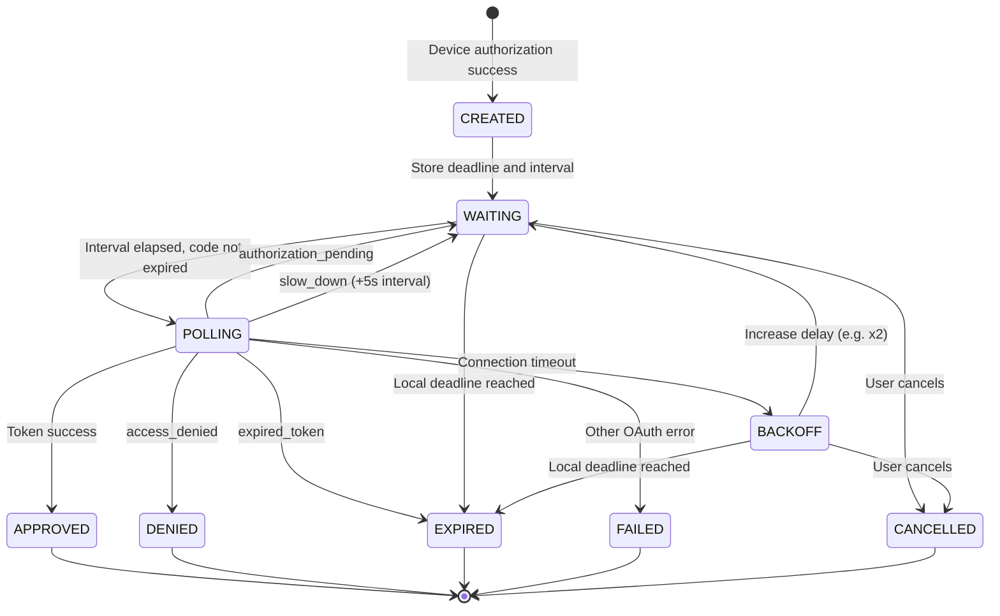
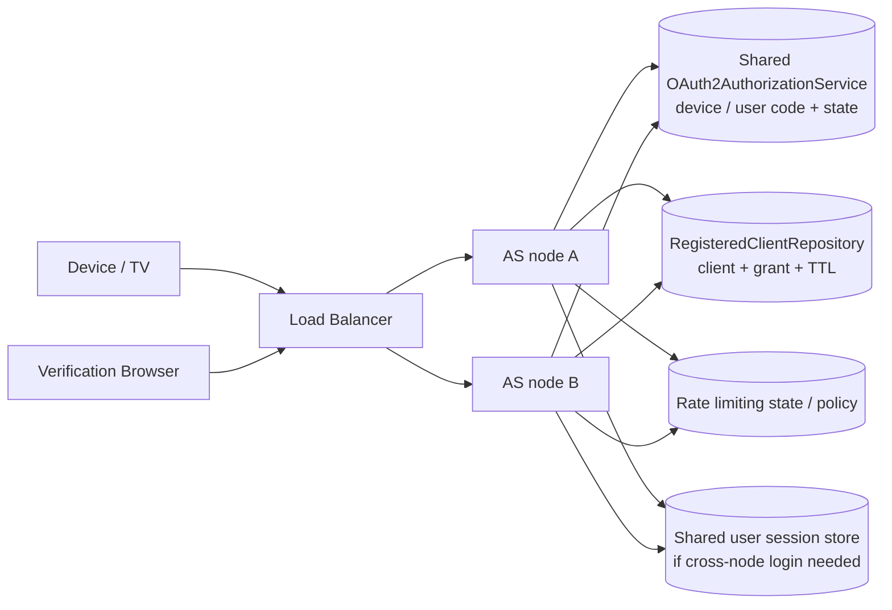

# Handling authorization_pending, slow_down, access_denied, and expired_token

## 1. Context: A Browserless Device Still Needs Authorization

A Smart TV, printer, media streamer, or IoT device has a very limited screen and keyboard. Instead of forcing the user to type passwords on the device, **OAuth 2.0 Device Authorization Grant (RFC 8628)** lets:

1. The device (OAuth client) request a `device_code` and `user_code` from the **Device Authorization Endpoint**.
2. The device display a verification address and code for the user to open on a phone or computer.
3. The user sign in, review the application name/scopes, and approve or deny at the **Device Verification Endpoint**.
4. Meanwhile, the device **polls the Token Endpoint** using `device_code`, receiving one of the status errors or an access token once approved.

In the **SPRING_SECURITY_OAUTH2_OIDC_AUTHORIZATION_SERVER** module, we learn how to design, configure, secure, test, and operate an OAuth2/OIDC Authorization Server using **Spring Security and Spring Authorization Server on Spring Boot**. This lesson in the **Device Authorization** chapter focuses specifically on **the four polling outcomes**: `authorization_pending`, `slow_down`, `access_denied`, and `expired_token`.

These are **protocol error codes**, not just UI messages. The first two allow the device to keep polling at the right cadence; the last two force termination of the current transaction. Misinterpreting them can cause infinite loops, Token Endpoint overload, token leakage, or a UI stuck indefinitely in a "waiting" state.

### Objectives

- Distinguish the **Device Authorization Response** from the **Device Access Token Response** and where the four error codes appear.
- Build a **client-side state machine** with deadlines, intervals, backoff, cancellation, and terminal states.
- Apply **RFC 8628 §3.5** rules accurately: default 5-second interval, cumulative +5 seconds on `slow_down`, and stopping polling on any error other than the two pending codes.
- Connect Spring Authorization Server components, client registration, and device code lifetime settings.
- Design tests for success/pending/denied/expired/over-polling while addressing security, multi-node, and operational concerns.

**Version scope:** Java/Spring examples target **Spring Authorization Server 1.5.x, Spring Security 6.x, and Spring Boot 3.x**. In Spring Security 7.x, Authorization Server functionality moves into Spring Security and configuration details may differ. Always consult the Javadoc for your exact project version when implementing.

## 2. Three Endpoints and Two Different Codes

| Component | Default Spring Authorization Server path | Caller | Function |
| --- | --- | --- | --- |
| **Device Authorization Endpoint** | `POST /oauth2/device_authorization` | Device/client | Initiates an authorization session and returns `device_code`, `user_code`, `verification_uri`, `expires_in`, and `interval` if present |
| **Device Verification Endpoint** | `/oauth2/device_verification` | User via browser on a secondary device | Enters/confirms `user_code`, authenticates, and approves/denies permissions |
| **Token Endpoint** | `POST /oauth2/token` | Device/client | Polls with `device_code`; receives tokens or status error codes |

Paths can be customized in `AuthorizationServerSettings`. Each endpoint has its own access controls, inputs, and responses; **never send polling requests to the Device Authorization Endpoint**.

### 2.1. `device_code` Differs from `user_code`

| Data | Recipient/user | Security requirements |
| --- | --- | --- |
| `device_code` | Kept by device and sent to Token Endpoint | Sensitive, high-entropy, short-lived; never show on screen, in public QR codes, or in logs |
| `user_code` | Entered by human at Device Verification Endpoint | Easy to read/type, yet must resist guessing and limit attempts |
| `verification_uri` | User's browser | Valid HTTPS URL owned by the Authorization Server/OP; never pull from untrusted sources |
| `verification_uri_complete` (if present) | May be encoded in QR to reduce typing | UX optimization only; still requires confirming app and permissions before approving |
| `expires_in` | Client | Maximum seconds the device code remains valid; sets polling **deadline** |
| `interval` (if present) | Client | Minimum seconds between polling requests; **defaults to 5 seconds if absent** |

**Never use `user_code` to poll the Token Endpoint**; token requests must carry `device_code`. The user code is neither an OAuth access token nor an Authorization Code, and confers no API permissions on its own.

### 2.2. Device Authorization Initialization Example

Example public device client `living-room-tv` registered with the Device Code grant type:

```http
POST /oauth2/device_authorization HTTP/1.1
Host: auth.example.com
Content-Type: application/x-www-form-urlencoded

client_id=living-room-tv&scope=library.read
```

Hypothetical success response:

```http
HTTP/1.1 200 OK
Content-Type: application/json
Cache-Control: no-store
Pragma: no-cache

{
  "device_code": "DEVICE_CODE_EXAMPLE_NOT_REAL",
  "user_code": "WDJB-MJHT",
  "verification_uri": "https://auth.example.com/oauth2/device_verification",
  "verification_uri_complete": "https://auth.example.com/oauth2/device_verification?user_code=WDJB-MJHT",
  "expires_in": 600,
  "interval": 5
}
```

This is **mock data**, not real codes or a guarantee that every server defaults to `expires_in=600` and `interval=5`. RFC 8628 requires `device_code`, `user_code`, `verification_uri`, and `expires_in`; `verification_uri_complete` and `interval` are optional. When `interval` is omitted, the client must apply 5 seconds.

The device should show clear instructions: "Visit this address on your phone, enter the displayed code, and confirm you are authorizing application X." Avoid asking users to type passwords on the TV.

## 3. Token Polling: Where the Four Error Codes Appear

After displaying `verification_uri` and `user_code`, the device waits at least the specified interval and sends:

```http
POST /oauth2/token HTTP/1.1
Host: auth.example.com
Content-Type: application/x-www-form-urlencoded

grant_type=urn%3Aietf%3Aparams%3Aoauth%3Agrant-type%3Adevice_code&device_code=DEVICE_CODE_EXAMPLE_NOT_REAL&client_id=living-room-tv
```

Notes:

- The exact grant type value is `urn:ietf:params:oauth:grant-type:device_code`, URL-encoded in `application/x-www-form-urlencoded`.
- `device_code` is the secret code issued by the Device Authorization Endpoint; **not** `user_code`.
- A public client without a shared secret must send `client_id`; a confidential client issued credentials must authenticate using its registered mechanism.
- The request runs **server-to-server / device-to-AS** over TLS without relying on the user's browser cookies.
- **Never poll continuously** just because the user has not clicked approve yet.

While the user has not completed verification, the Token Endpoint typically returns:

```http
HTTP/1.1 400 Bad Request
Content-Type: application/json
Cache-Control: no-store
Pragma: no-cache

{ "error": "authorization_pending" }
```

This response is an **expected protocol outcome**, not a broken system. Under RFC 8628 §3.5, `authorization_pending` and `slow_down` are the **two special error codes that permit continued polling**. All other errors from the Token Endpoint **terminate polling for the current transaction**.

### 3.1. Standard Decision Table

| `error` value | Meaning | What does the client do? | Continue polling same `device_code`? |
| --- | --- | --- | --- |
| **`authorization_pending`** | User has not finished authentication/authorization yet | Keep waiting screen; wait **at least current interval** before next request | **Yes** |
| **`slow_down`** | Still pending, but polling rate must decrease | Increase interval **by 5 seconds**, applied **immediately for next poll and all subsequent polls** | **Yes, at the new cadence** |
| **`access_denied`** | User denied the request | Stop polling; report denied; do not auto-restart | **No** |
| **`expired_token`** | Device code expired; device authorization session ended | Stop polling; discard old code; guide starting a new session on user action | **No** |
| Other OAuth error, e.g. `invalid_client`, `invalid_grant`, `invalid_request` | Invalid request/credentials/grant or other failure | Stop polling, handle error by type; never loop blindly | **No** |
| Successful token response | User approved and AS issued tokens | Stop polling, store token securely, and access APIs | **No** |

**Normative strength:** `authorization_pending`/`slow_down` are the continuation codes; for any other error code, **RFC 8628 states the client MUST stop polling**. On `expired_token`, the client **may** initiate a new device authorization, yet **should wait for user interaction** rather than auto-looping to avoid wasteful polling.

## 4. `authorization_pending` — Waiting at the Right Pace

### 4.1. Scenario

The device obtains codes at 10:00:00 with `interval=5` seconds; the user is opening the verification URL or still signing in. A valid poll receives:

```json
{
  "error": "authorization_pending"
}
```

The client must not treat this error as a login failure and does not need to request new codes. It retains `device_code`, keeps showing instructions to the user, and schedules the next poll using the **current interval**.

### 4.2. Timing Rules

- If the device authorization response sent `interval=N`, wait **at least N seconds** before each subsequent poll, accounting for any `slow_down` increases.
- If `interval` is absent, **default to 5 seconds**.
- Never override to 0, 1, or 2 seconds just for a "responsive UI."
- When the server is busy, the client may choose to **wait longer** than `interval`; the RFC specifies a minimum delay, not a requirement to poll exactly every N seconds.
- If connectivity is unstable, reduce polling frequency on network timeouts (section 5.4).

Example:

```text
Device Authorization Response: interval = 5s

10:00:05  Poll #1 -> authorization_pending
10:00:10  Poll #2 -> authorization_pending
10:00:15  Poll #3 -> authorization_pending
10:00:20  Poll #4 -> may receive access token once user approves
```

This timeline is illustrative; real requests must factor in **previous response completion time and wait duration** to avoid accidentally sending too fast. A conservative design counts the interval from **when the previous response arrived**, guaranteeing gaps between requests never fall below the minimum.

### 4.3. Distinguishing "Waiting" from Product Errors

Appropriate UI: "Waiting for your confirmation on your phone. Please check code X and the application name." You may show a countdown to the deadline. Never display `authorization_pending` as a 500 error, and never spawn dozens of new sessions/codes simply because a poll has not succeeded yet.

## 5. `slow_down` — Increase Wait Time and Keep the Increased Level

### 5.1. Meaning

`slow_down` is a variant of `authorization_pending`: **authorization is still incomplete**, yet the Authorization Server asks the client to poll slower. RFC 8628 §3.5 states the client **MUST increase the interval by 5 seconds** upon this response and **for all subsequent requests**.

Example response:

```http
HTTP/1.1 400 Bad Request
Content-Type: application/json
Cache-Control: no-store
Pragma: no-cache

{ "error": "slow_down" }
```

### 5.2. Cumulative, Never Reset

Suppose the initial device authorization response specified `interval=5` seconds:

| Event after poll | Interval to keep for next time | What to avoid |
| --- | --- | --- |
| First `authorization_pending` | 5 seconds | Never drop to 1 second |
| 1st `slow_down` | **10 seconds** | Do not wait only 5 seconds total; must increase from 5 to 10 |
| Subsequent `authorization_pending` | **10 seconds** | Never reset to 5 |
| 2nd `slow_down` | **15 seconds** | Never reset to 10 |
| Another `authorization_pending` | **15 seconds** | Never discard prior increases |

If the server initially specified `interval=8`, the first `slow_down` raises the interval to **13 seconds**, and the second to **18 seconds**. The value is not hardcoded at 10 seconds.

A common bug:

```java
// WRONG: loses slow_down history on all subsequent pending responses.
int delaySeconds = "slow_down".equals(error) ? 10 : 5;
```

Instead, store the active interval **in each device authorization transaction's state**. Every transaction has its own `device_code`/deadline/interval rather than a global variable causing devices to interfere with one another.

### 5.3. What If the Client Receives HTTP 429?

**HTTP 429 Too Many Requests** is an HTTP signal that gateways/rate limiters may emit, and **does not guarantee** every 429 response carries OAuth JSON `{"error":"slow_down"}`. Client design must:

1. Parse responses according to the API contract and content type.
2. For RFC 8628 `slow_down`, **always add 5 seconds**.
3. For 429 or 503 **without a valid OAuth error**, apply infrastructure backoff/retry policy safely, honoring `Retry-After` if provided, without exceeding the deadline.
4. **Never** treat 429 as success or reset the interval.

Since RFC 8628 requires stopping polling on any **OAuth error code other than** the two pending codes, never silently retry terminal errors like `invalid_client` whether the HTTP status is 400 or 429.

### 5.4. Connection Timeouts: Slow Down per RFC

A separate branch is a **connection timeout** (no response received). RFC 8628 states the client **MUST reduce polling frequency** before retrying; the standard recommends **exponential backoff**, such as doubling the interval on each timeout.

```text
base interval 5s
timeout #1 -> wait interval 10s
timeout #2 -> wait interval 20s
timeout #3 -> wait interval 40s
...
```

Set bounds fitting TTL, UX, and device resources, and retry only before expiration. Never burst-retry immediately after a timeout; the original request may have reached the server, so duplicating requests concurrently makes things worse.

## 6. `access_denied` — Denial Is a Terminal State

### 6.1. Scenario

The user opens `verification_uri` on their phone, checks the name `living-room-tv`, and decides not to grant access. The next poll may receive:

```json
{
  "error": "access_denied"
}
```

This is completely different from `authorization_pending`: the user made an explicit **denial** decision rather than still being in progress.

### 6.2. How to Handle It

- **Stop polling that device code immediately**; per RFC 8628, only `authorization_pending` and `slow_down` allow continuing.
- Update the UI to "Connection request was denied," offering a **user-initiated** "Try again" button if the product allows.
- Clear the held `device_code` from unnecessary state, cancel timers, and ensure no stale polling worker keeps running.
- Never quietly generate a new code to "wait until the user changes their mind," avoiding relentless consent prompts.
- Record audits/metrics by error code and correlation ID; **never** log raw `device_code`, `user_code`, or tokens.

### 6.3. Denial Is a User Decision, Not a Client Auth Error

`access_denied` does not mean the client secret was wrong, `device_code` expired, or the Token Endpoint broke. It reflects that the permission request was refused. Show just enough error detail; never auto-navigate a browser or disclose the user's identity on the device side.

## 7. `expired_token` — The Device Authorization Session Has Expired

### 7.1. Scenario

The server returned `expires_in=600` seconds when the client initiated the request. The user did not finish verification before the device code expired. The next poll may receive:

```json
{
  "error": "expired_token"
}
```

**This means `device_code` expired**, not necessarily any access token or refresh token issued in a prior session. Upon this error, the current device authorization session has ended.

### 7.2. How to Handle It

1. **Stop polling** and invalidate the old code's state and timers.
2. Display "Verification code expired" and stop asking the user to enter the old `user_code`.
3. Allow starting a **new Device Authorization Request** via a user-triggered button/flow to get a fresh pair of codes.
4. Enforce code creation caps and anti-abuse controls; avoid auto-restart loops that amplify load.

RFC 8628 allows restarting the flow after expiration, yet **SHOULD wait for user interaction before restarting**, because generating codes and polling endlessly with nobody present serves no purpose.

### 7.3. Client-Side Deadline Checks

As soon as `expires_in` arrives, the client should compute a transaction deadline, preferring a **monotonic clock** to avoid skew if the device's system time changes. Before sending the next request, check:

```text
if remaining_lifetime <= 0:
    stop polling
    show "Verification expired"
else:
    wait at least current_interval
    if deadline passed while waiting: stop without a new HTTP request
    else: poll /oauth2/token
```

Client clocks can differ from the server and networks have latency, so still **honor `expired_token` returned by the server**. Never treat the local deadline as proof the AS immediately deleted every record; it is a boundary **so the client stops sending pointless requests**.

## 8. Proper State Machine for the Four Error Codes



**Safety invariants:**

- Only **one polling worker / one in-flight request** per device transaction, unless a special design guarantees equivalence.
- Never send before `nextAllowedPollAt` and never send after the deadline.
- Every `slow_down` response **adds 5 seconds** to the existing interval.
- `authorization_pending` **never resets** an increased interval.
- `access_denied`, `expired_token`, other OAuth errors, and success all transition to **terminal** states.
- UI cancellation, shutdown, session loss, or logout must stop timers and discard secret state.
- Never continue polling an old code after starting a new device authorization; prevent races where stale results overwrite the new flow.

### 8.1. Illustrative Timeline with `slow_down`

```text
T0       Device response: interval=5, expires_in=600
T0+5s    Poll #1 -> authorization_pending        => stays 5s
T0+10s   Poll #2 -> slow_down                    => 10s
T0+20s   Poll #3 -> authorization_pending        => stays 10s
T0+30s   Poll #4 -> slow_down                    => 15s
T0+45s   Poll #5 -> authorization_pending        => stays 15s
T0+60s   Poll #6 -> access_denied                => STOP
```

Timestamps assume negligible network latency; real code must time waits via a safe scheduler. If the final step returns a token instead of `access_denied`, the client **still stops polling** and stores the token per policy.

## 9. Java: Stateful Polling Policy with Deadline and Backoff

To show clearly how all four errors are handled, let's write a **pure Java 17 state policy**. This object **does not send HTTP requests itself**; the application's HTTP adapter calls the Token Endpoint, parses responses, and uses the `RETRY/COMPLETE/STOP_*` decision to schedule work.

Separating concerns this way lets you unit-test the policy before touching a real network:

```java
import java.time.Duration;
import java.time.Instant;
import java.util.Objects;

public final class DevicePollingPolicy {
    public enum Action {
        RETRY, COMPLETE, STOP_DENIED, STOP_EXPIRED, STOP_ERROR, STOP_CANCELLED
    }

    public record Decision(Action action, Duration waitBeforeNextPoll) {}

    private final Instant deadline;
    private Duration currentInterval;
    private boolean terminal;

    /**
     * @param startedAt timestamp when the device authorization response arrived
     * @param expiresInSeconds expires_in from response, must be > 0
     * @param intervalSeconds interval from response; null means 5 seconds
     */
    public DevicePollingPolicy(
            Instant startedAt, long expiresInSeconds, Long intervalSeconds) {
        Objects.requireNonNull(startedAt);
        if (expiresInSeconds <= 0) {
            throw new IllegalArgumentException("expires_in must be positive");
        }
        long pollEvery = intervalSeconds == null ? 5 : intervalSeconds;
        if (pollEvery <= 0) {
            throw new IllegalArgumentException("interval must be positive");
        }
        this.deadline = startedAt.plusSeconds(expiresInSeconds);
        this.currentInterval = Duration.ofSeconds(pollEvery);
    }

    public Duration interval() {
        return currentInterval;
    }

    public boolean mayPoll(Instant now) {
        return !terminal && now.isBefore(deadline);
    }

    /** Call when an OAuth error is received from the Token Endpoint. */
    public Decision onError(String oauthError, Instant receivedAt) {
        if (terminal) {
            throw new IllegalStateException("Device flow already completed");
        }
        Objects.requireNonNull(receivedAt);
        // Prioritize terminal states returned by the Authorization Server.
        if ("access_denied".equals(oauthError)) {
            return stop(Action.STOP_DENIED);
        }
        if ("expired_token".equals(oauthError)) {
            return stop(Action.STOP_EXPIRED);
        }
        if (!receivedAt.isBefore(deadline)) {
            return stop(Action.STOP_EXPIRED);
        }

        return switch (oauthError == null ? "" : oauthError) {
            case "authorization_pending" ->
                    new Decision(Action.RETRY, currentInterval);

            case "slow_down" -> {
                currentInterval = currentInterval.plusSeconds(5);
                yield new Decision(Action.RETRY, currentInterval);
            }

            default -> stop(Action.STOP_ERROR); // invalid_client, invalid_grant...
        };
    }

    /** Connection timeout: reduce polling frequency before retrying (RFC 8628 §3.5). */
    public Decision onConnectionTimeout(Instant receivedAt) {
        if (terminal) {
            throw new IllegalStateException("Device flow already completed");
        }
        if (!receivedAt.isBefore(deadline)) {
            return stop(Action.STOP_EXPIRED);
        }
        currentInterval = currentInterval.multipliedBy(2);
        return new Decision(Action.RETRY, currentInterval);
    }

    public Decision onSuccess() {
        if (terminal) {
            throw new IllegalStateException("Device flow already completed");
        }
        return stop(Action.COMPLETE);
    }

    public Decision cancel() {
        return stop(Action.STOP_CANCELLED);
    }

    private Decision stop(Action action) {
        terminal = true;
        return new Decision(action, Duration.ZERO);
    }
}
```

### 9.1. How the HTTP Adapter Uses the State Policy

Below is **pseudocode** illustrating the integration sequence; `httpPollTokenEndpoint`, `sleepMonotonic`, `parseOAuthError`, etc. are not built-in Spring APIs:

```text
deviceResponse = requestDeviceAuthorization()
policy = DevicePollingPolicy(now, expires_in, interval_if_present)

while not userCancelled:
    sleepMonotonic(policy.interval())      # wait on the first iteration too
    if not policy.mayPoll(now):            # block polling past deadline
        showExpired()
        break

    try:
        response = httpPollTokenEndpoint(
            grant_type = "urn:ietf:params:oauth:grant-type:device_code",
            device_code = deviceResponse.device_code,
            client_authentication = configured_method
        )

        if response is successful_token_response:
            policy.onSuccess()
            saveTokenSafely(response)
            showConnected()
            break

        decision = policy.onError(parseOAuthError(response), now)
        if decision.action == RETRY:
            # next iteration waits decision.waitBeforeNextPoll (updated interval)
            continue
        showTerminalError(decision.action)
        break

    catch ConnectionTimeout:
        decision = policy.onConnectionTimeout(now)
        if decision.action == RETRY:
            continue
        showExpired()
        break

if userCancelled:
    policy.cancel()
clearSensitiveDeviceState()
```

**When translating into real code, never call both `sleep(policy.interval())` and `sleep(decision.waitBeforeNextPoll)` for the same cycle**: that would sleep twice. Pick **one time source** to schedule the next request. The pseudocode uses current `policy.interval()`, so the returned decision simply conveys status and aids testing.

To enforce timing accurately:

- Use a `ScheduledExecutorService`/scheduler or coroutine/event loop that **never blocks the UI thread**.
- Prefer a **monotonic** clock (such as `System.nanoTime()`) for runtime waits/TTLs; the example uses `Instant` for easy logic unit testing.
- After each response, schedule **one** next request—never combine a scheduler and a concurrent `while` loop.
- On cancellation, terminal state, shutdown, or starting a new session, cancel stale timers/callbacks; use a transaction ID/generation to drop late responses.
- Never schedule a send past the deadline; stop early if the required wait exceeds remaining time.
- For retries on non-timeout network errors, bound retries by policy, never mask terminal OAuth errors, and avoid sudden traffic spikes.

### 9.2. Unit Testing All Four Errors with JUnit 5

```java
import java.time.Instant;

import org.junit.jupiter.api.Test;
import static org.junit.jupiter.api.Assertions.*;

class DevicePollingPolicyTest {
    private static final Instant T0 = Instant.parse("2026-01-01T00:00:00Z");

    @Test
    void missingIntervalDefaultsToFiveSeconds() {
        DevicePollingPolicy policy = new DevicePollingPolicy(T0, 600, null);
        assertEquals(5, policy.interval().toSeconds());
        var decision = policy.onError("authorization_pending", T0.plusSeconds(5));
        assertEquals(DevicePollingPolicy.Action.RETRY, decision.action());
        assertEquals(5, decision.waitBeforeNextPoll().toSeconds());
    }

    @Test
    void slowDownAccumulatesEvenAfterPending() {
        DevicePollingPolicy policy = new DevicePollingPolicy(T0, 600, 8L);
        policy.onError("slow_down", T0.plusSeconds(8));
        assertEquals(13, policy.interval().toSeconds());
        policy.onError("authorization_pending", T0.plusSeconds(21));
        assertEquals(13, policy.interval().toSeconds()); // no reset
        policy.onError("slow_down", T0.plusSeconds(34));
        assertEquals(18, policy.interval().toSeconds()); // adds another 5s
    }

    @Test
    void denialStopsPolling() {
        DevicePollingPolicy policy = new DevicePollingPolicy(T0, 600, 5L);
        var decision = policy.onError("access_denied", T0.plusSeconds(5));
        assertEquals(DevicePollingPolicy.Action.STOP_DENIED, decision.action());
        assertFalse(policy.mayPoll(T0.plusSeconds(10)));
    }

    @Test
    void expiredTokenStopsEvenIfLocalDeadlineNotReached() {
        DevicePollingPolicy policy = new DevicePollingPolicy(T0, 600, 5L);
        var decision = policy.onError("expired_token", T0.plusSeconds(100));
        assertEquals(DevicePollingPolicy.Action.STOP_EXPIRED, decision.action());
        assertFalse(policy.mayPoll(T0.plusSeconds(120)));
    }

    @Test
    void connectionTimeoutAppliesBackoff() {
        DevicePollingPolicy policy = new DevicePollingPolicy(T0, 600, 5L);
        policy.onConnectionTimeout(T0.plusSeconds(5));
        assertEquals(10, policy.interval().toSeconds());
        policy.onConnectionTimeout(T0.plusSeconds(15));
        assertEquals(20, policy.interval().toSeconds());
    }

    @Test
    void anyOtherOAuthErrorIsTerminal() {
        DevicePollingPolicy policy = new DevicePollingPolicy(T0, 600, 5L);
        assertEquals(DevicePollingPolicy.Action.STOP_ERROR,
                policy.onError("invalid_client", T0.plusSeconds(5)).action());
        assertFalse(policy.mayPoll(T0.plusSeconds(10)));
    }
}
```

These tests verify **device-side coordination rules**, not HTTP integration. Production policies must also cap total requests, classify transport/TLS failures, prevent overflow when multiplying delays, close sessions once tokens arrive, and keep secrets out of telemetry.

## 10. Where Does Spring Authorization Server Process Device Grant?

### 10.1. Components by Responsibility

In Spring Authorization Server 1.5.x, the **Protocol Endpoints** documentation describes:

| Layer | Component | Role |
| --- | --- | --- |
| Initialize device authorization | `OAuth2DeviceAuthorizationEndpointFilter` | Receives device request, returns device authorization response |
| Convert request | `OAuth2DeviceAuthorizationRequestAuthenticationConverter` | Reads client/scopes and creates authentication request |
| Process initialization | `OAuth2DeviceAuthorizationRequestAuthenticationProvider` | Validates client/grant and generates codes per policy |
| User verification | `OAuth2DeviceVerificationEndpointFilter` | Receives code entry and consent interactions on the browser |
| Process user code/consent | `OAuth2DeviceVerificationAuthenticationProvider`, `OAuth2DeviceAuthorizationConsentAuthenticationProvider` | Validates, authenticates, and records authorization decision |
| Token polling | `OAuth2TokenEndpointFilter` | Receives `grant_type=urn:ietf:params:oauth:grant-type:device_code` |
| Convert polling request | `OAuth2DeviceCodeAuthenticationConverter` | Parses `device_code`/grant at the Token Endpoint |
| Decide polling outcome | `OAuth2DeviceCodeAuthenticationProvider` | Checks authorization state, grant, client; returns token or OAuth error |
| Store state | `OAuth2AuthorizationService` | Persists device code, user code, authorization/consent/token state |
| Generate token | `OAuth2TokenGenerator<?>` | Creates access token (and other tokens if grant/policy allows) |

**Do not attribute the four polling errors to the Device Authorization Endpoint.** That endpoint issues codes to start the flow. `authorization_pending`, `slow_down`, `access_denied`, and `expired_token` are defined for the **Token Endpoint response** of Device Authorization Grant.

### 10.2. What Data Determines pending/denied/expired?

A device authorization session has at least these state aspects:

- Which `RegisteredClient` initiated it, and whether client authentication/grant/scopes are valid.
- Issued `device_code` and `user_code`, plus issuance and expiration timestamps.
- Whether the user has verified `user_code`, denied, or approved.
- Whether the authorization was updated and any token issued; whether the device code was consumed or invalidated.
- Anti-fast-polling or anti-abuse tracking rules if implemented by the application.

Spring Authorization Server uses `OAuth2AuthorizationService` to persist and look up authorization state. Across multiple instances, use shared persistence so a Token Endpoint on another node sees what the user just verified.

### 10.3. What Needs Customizing to Emit `slow_down`?

Spring Authorization Server provides **extension points** in `OAuth2TokenEndpointConfigurer` to customize authentication converters/providers or error handlers. However, **do not assume the library provides full built-in rate limiting that automatically emits `slow_down` in every version/configuration**. Verify actual behavior with tests:

- If a client polls faster than the advertised interval, does the Authorization Server return `slow_down` as required by the product?
- If an ingress/API gateway rate limiter returns HTTP 429 independently, does the client understand how it differs from OAuth `slow_down`?
- Can you identify the **exact device transaction and client** rather than a shared NAT IP?
- Do you avoid returning `slow_down` erroneously for invalid requests (wrong device code, wrong client, expired)?
- Is rate-limit state updated durably and consistently across nodes?

When adding custom logic, implement rate limiting/polling policies at the Token Endpoint layer **without bypassing client authentication, authorization lookup, or default validators**. Never mint tokens or return `authorization_pending` from a standalone `@RestController` outside Spring Security without fully mastering the protocol.

## 11. Configuring a Device Client in Spring Boot

The example below creates a **public device client** for learning/testing, registering the exact grant type from RFC 8628. It is not a full Authorization Server setup:

```java
import java.time.Duration;

import org.springframework.context.annotation.Bean;
import org.springframework.context.annotation.Configuration;
import org.springframework.security.oauth2.core.AuthorizationGrantType;
import org.springframework.security.oauth2.core.ClientAuthenticationMethod;
import org.springframework.security.oauth2.server.authorization.client.InMemoryRegisteredClientRepository;
import org.springframework.security.oauth2.server.authorization.client.RegisteredClient;
import org.springframework.security.oauth2.server.authorization.client.RegisteredClientRepository;
import org.springframework.security.oauth2.server.authorization.settings.ClientSettings;
import org.springframework.security.oauth2.server.authorization.settings.TokenSettings;

@Configuration(proxyBeanMethods = false)
public class DeviceClientConfiguration {

    private static final AuthorizationGrantType DEVICE_CODE =
            new AuthorizationGrantType(
                    "urn:ietf:params:oauth:grant-type:device_code");

    @Bean
    RegisteredClientRepository registeredClientRepository() {
        RegisteredClient tv = RegisteredClient.withId("tv-stable-internal-id")
                .clientId("living-room-tv")
                .clientName("Living Room TV")
                .clientAuthenticationMethod(ClientAuthenticationMethod.NONE)
                .authorizationGrantType(DEVICE_CODE)
                .scope("library.read")
                .clientSettings(ClientSettings.builder()
                        .requireAuthorizationConsent(true)
                        .build())
                .tokenSettings(TokenSettings.builder()
                        .deviceCodeTimeToLive(Duration.ofMinutes(10))
                        .accessTokenTimeToLive(Duration.ofMinutes(15))
                        .build())
                .build();

        return new InMemoryRegisteredClientRepository(tv);
    }
}
```

Explanation:

- `ClientAuthenticationMethod.NONE` represents a **public client** that cannot safely hold a shared secret; it still must be registered and obey grant/scope policies.
- Device Grant uses the exact URI `urn:ietf:params:oauth:grant-type:device_code`; never invent `grant_type=device_code`.
- `TokenSettings.deviceCodeTimeToLive(...)` controls the **device code** lifetime, independent of the access token TTL. In Spring Authorization Server 1.5.x, Javadoc notes the default device code TTL is **5 minutes**; the example sets **10 minutes** as a chosen assumption.
- `requireAuthorizationConsent(true)` sets consent policy where applicable; the verification UI must display enough client/scope info for the user to recognize the request.
- `InMemoryRegisteredClientRepository` suits demos/tests only. Production requires persistent `RegisteredClientRepository` and `OAuth2AuthorizationService`; browser verification user sessions must also be designed for multi-node setups.

**Never embed a fixed secret credential into firmware/app bundles and treat the device as confidential.** If a client can genuinely protect credentials, use an appropriate client authentication method; otherwise protect it through registration policy, user verification, random codes, TTLs/rate limits, and compensating controls.

### 11.1. Defining Exact Endpoints

An application can configure custom `AuthorizationServerSettings`:

```java
import org.springframework.context.annotation.Bean;
import org.springframework.security.oauth2.server.authorization.settings.AuthorizationServerSettings;

@Bean
AuthorizationServerSettings authorizationServerSettings() {
    return AuthorizationServerSettings.builder()
            .issuer("https://auth.example.com")
            .deviceAuthorizationEndpoint("/oauth2/device_authorization")
            .deviceVerificationEndpoint("/oauth2/device_verification")
            .tokenEndpoint("/oauth2/token")
            .build();
}
```

These paths are the **defaults** in Spring Authorization Server 1.5.x and are listed for clarity. You still need the Authorization Server `SecurityFilterChain`, user authentication/consent, signing keys, repositories, and services to run; this bean alone does not create the endpoints.

In `OAuth2AuthorizationServerConfigurer`, you can customize:

- `deviceAuthorizationEndpoint(...)`: converters/providers, success/error response handlers, `verificationUri(...)`.
- `deviceVerificationEndpoint(...)`: converters/providers, verification response/error handlers, consent page.
- `tokenEndpoint(...)`: converters/providers and error handling for `device_code` and other grants.

**Do not confuse `verificationUri(...)` with the Token Endpoint**: the verification URI is for **the user's browser**, not the polling URL.

### 11.2. Distinguishing the Two Configuration Sides

```text
Authorization Server:
    spring.security.oauth2.authorizationserver.client.*
    RegisteredClientRepository / AuthorizationServerSettings

OAuth Client Device:
    Device Authorization Endpoint + Token Endpoint + Device Polling Policy
    (may be written in Java or another SDK)
```

Registering a client on the server **does not write polling logic in device firmware**. Conversely, RFC-compliant client polling **does not replace** server-side validation, rate limiting, and state transitions.

## 12. Handling Verification and Denial UIs in Context

### 12.1. Two Devices, Two Experiences

**On the TV/device:**

- Display app name, readable `verification_uri`, `user_code` in large font, and QR if available.
- Show remaining time and "Waiting for confirmation" during `authorization_pending`, **never** exposing raw error codes to end users.
- On `slow_down`: keep waiting, updating polling cadence **in the background** without flickering the UI.
- On `access_denied`: show "Connection request denied" and a user-initiated "Try again" button.
- On `expired_token`: show "Code expired" and a "Get new code" button.

**On the browser/phone:**

- Authenticate the user with the Authorization Server; never enter passwords on the TV.
- Display **client name, appropriate device/session context, and scopes** before approval.
- Clarify which request is pending, especially for public or shared devices.
- Denial must record an explicit decision so subsequent polls return `access_denied` or the implementation equivalent.

### 12.2. Preventing Phishing and Wrong-Device Pairing

RFC 8628 describes **remote phishing**: an attacker can trick a user into entering a code on the real page to authorize *the attacker's device*. Therefore:

1. In the browser, display the requesting app/device with plain descriptions.
2. Remind the user to approve only if **they just initiated the request on their own device**.
3. Even when using `verification_uri_complete`/QR, still verify **app name and permissions**; never auto-approve on URL open.
4. Limit `user_code` guesses, ensure adequate entropy, and use bounded lifetimes.
5. Protect the Device Verification Endpoint from CSRF, session fixation, and open redirects, and enforce HTTPS.

**Note:** showing `user_code` to humans is a legitimate part of the protocol; **`device_code` must never be placed on the UI for users to copy**.

## 13. Integration Testing the Four Error Codes

### 13.1. Test Fixture Setup

Set up a Spring Boot integration test environment with:

- A `living-room-tv` client registered for device grant with defined scopes and `deviceCodeTimeToLive`.
- Device Authorization Endpoint issuing real `device_code`/`user_code` pairs.
- A test browser with a user session and consent flow via the Device Verification Endpoint.
- `OAuth2AuthorizationService` observable via test utilities; do not rely on tokens in production logs.
- A **test polling client** with a controllable clock/scheduler so tests never wait 10 real minutes.

Do not mutate `OAuth2AuthorizationService` or provider inputs to "force" error codes by disabling other security checks; tests should drive state through the protocol or use dedicated test-only fixtures/services.

### 13.2. Mandatory Case Matrix

| Case | State / behavior | Expected outcome |
| --- | --- | --- |
| P01 | Valid device authorization created; nobody verified yet | Poll returns `authorization_pending`; client schedules by interval |
| P02 | Device Authorization response **omits** `interval` | Client waits at least **5 seconds** |
| P03 | Response has `interval=7` | Client waits at least **7 seconds**, not hardcoded 5 |
| P04 | Poll ahead of cadence when server enforces rate limit | Receives `slow_down` or configured rate-limit mechanism; verify real behavior |
| P05 | First `slow_down` after 7-second interval | Client increases to **12 seconds** |
| P06 | `authorization_pending` right after `slow_down` | Client **keeps 12 seconds**, does not reset to 7 |
| P07 | Second `slow_down` | Client increases to **17 seconds** |
| P08 | Connection timeout | Client reduces polling frequency; exponential backoff or suitable strategy |
| P09 | User denies on verification page | Poll gets `access_denied`; **stops**, no token |
| P10 | Receives `access_denied` with no further user action | Client does not auto-request new code or keep polling |
| P11 | `device_code` expires before user approves | Token Endpoint returns `expired_token` under matching state; client stops |
| P12 | Client deadline expires before next poll | Client stops itself, **does not** send another request |
| P13 | User selects "Try again" after `expired_token` | Starts new session with new codes; never reuses old code |
| P14 | User approves while code is active | Successful token response; client stops polling and stores token |
| P15 | Reuse already-redeemed device code | No additional token issued; returns appropriate OAuth error |
| P16 | Valid `device_code` with wrong `client_id`/client auth | Rejected; no token issued; leaks no user state |
| P17 | Non-existent/malformed device code | OAuth error per contract; no busy retry |
| P18 | Other OAuth error: `invalid_client`, `invalid_grant` | Client **stops** and shows appropriate error |
| P19 | User cancels or powers off device mid-poll | Cancels timers/HTTP requests; no background worker remains |
| P20 | Two concurrent device authorization sessions on two devices | Independent intervals, codes, and deadlines; no cross-talk |
| P21 | Multi-node AS: code requested on node A, verified on B, polled on C | All observe consistent state via shared storage |
| P22 | Gateway returns 429/503 without OAuth JSON error | Client handles transport/rate limit safely; never treats as token success |
| P23 | Consent approves narrower scopes than requested | Access token contains only granted scopes, no escalation |
| P24 | Browser submits wrong `user_code` repeatedly | Rate-limited, leaks no codes/identities, blocks unlimited guessing |

Tests asserting "server returns `slow_down`" require **real rate-limiting configuration or a test fixture**; if your Spring Authorization Server/ingress version does not emit it automatically, do not blindly assert the framework includes that behavior out of the box. Conversely, **clients are still required to handle `slow_down` whenever received** from an RFC-compliant Authorization Server.

### 13.3. Illustrative Curl in a Test Environment

Initiate device authorization:

```bash
curl --silent --show-error --request POST \
  'https://auth.test.example/oauth2/device_authorization' \
  --header 'Content-Type: application/x-www-form-urlencoded' \
  --data-urlencode 'client_id=living-room-tv' \
  --data-urlencode 'scope=library.read'
```

Poll the Token Endpoint **only after the required wait interval**:

```bash
curl --silent --show-error --request POST \
  'https://auth.test.example/oauth2/token' \
  --header 'Content-Type: application/x-www-form-urlencoded' \
  --data-urlencode 'grant_type=urn:ietf:params:oauth:grant-type:device_code' \
  --data-urlencode 'client_id=living-room-tv' \
  --data-urlencode 'device_code=TEST_DEVICE_CODE_FROM_PREVIOUS_RESPONSE'
```

Example values are placeholders; substitute fixtures from your test environment. **Never run shell commands in a 0-second loop**, and never share raw output containing `device_code` or access tokens in shared logs. To reproduce `access_denied`, deny on the verification UI; to reproduce `expired_token`, use a short test TTL; to reproduce `slow_down`, configure an explicit rate-limit policy or test double.

## 14. Production Operations: State, Security, and Load Limits

### 14.1. Multiple Authorization Server Instances



If node A issues a device code but node B cannot find its state (due to per-node `InMemoryOAuth2AuthorizationService`), B may report the code as invalid/expired even while the user is verifying on A. Never fix this by disabling validation or forcing users to regenerate codes repeatedly; use shared state storage and consistent browser sessions.

### 14.2. Choosing Appropriate TTLs and Intervals

Factors to weigh:

- **Device code TTL:** long enough for a user to unlock a phone, sign in, and type the code, yet short enough to limit the abuse window.
- **Polling interval:** caps per-device cost; never set 0 or 1 second to feel "faster."
- **Server rate limits:** scoped by client/device transaction and other suitable criteria; avoid blocking whole NATed fleets via overly coarse IP-only rate limits.
- **Jitter/backoff:** may add random delay *longer* than `interval` to avoid thundering herds; never let jitter shorten the delay below the minimum requirement.
- **Cleanup:** purge expired authorizations under retention/audit policy; never delete active pending state before TTL.
- **Observability:** measure initiated sessions, pending/slow_down/denied/expired/success rates, completion times, requests per session, and Token Endpoint load.

Rough intuition: with **10,000 devices** polling every **5 seconds**, average load is roughly **2,000 requests/second** from waiting flows alone. Slowing down on `slow_down` and enforcing rate limiting are essential designs for large-scale Authorization Servers. This is an illustrative average calculation, not a prediction of real-world bursts.

### 14.3. HTTP/Cache Policies and Sensitive Data

- Return OAuth errors from the Token Endpoint as standard JSON with `Cache-Control: no-store` and `Pragma: no-cache` as appropriate for OAuth responses.
- Enforce HTTPS only; govern TLS/proxies/issuers and keep credentials out of URLs or referrers.
- Never log raw `device_code`, `user_code`, access tokens, refresh tokens, or client secrets in logs, traces, or metric labels.
- Protect `verification_uri_complete` when it carries a verification code; avoid broad QR sharing outside its intended purpose.
- Enforce **single-use** device codes bound to client/authorization state to prevent concurrent redemption races.
- For public clients, never embed a fixed shared secret in firmware and claim it as trustworthy client authentication.

## 15. Common Misconceptions and Anti-Patterns

| Misconception / anti-pattern | Correct understanding |
| --- | --- |
| "`authorization_pending` is a system error; request a new device code." | It is the normal state; keep polling at the current interval. |
| "`slow_down` means stop completely." | Keep waiting, but increase the interval **by 5 seconds** and keep it for all future polls. |
| "After `slow_down`, seeing `authorization_pending` resets to the initial interval." | No; increases must accumulate. |
| "Always wait a fixed 5 seconds for every device grant." | Default to 5 seconds only when the response omits `interval`; honor server values and increases. |
| "Retry any HTTP 400; polling returns 400 anyway." | Only `authorization_pending` and `slow_down` allow continuing; other OAuth errors must stop. |
| "On `access_denied`, keep polling in case the user changes their mind." | The user denied; stop and require explicit user action to retry. |
| "`expired_token` means the access token just expired." | It means the **device code** expired; the current authorization session has ended. |
| "On `expired_token`, auto-request new codes forever." | You may start a new flow, but should wait for user interaction. |
| "You can send `user_code` to the Token Endpoint instead of `device_code`." | Token polling requires `device_code`; `user_code` is for browser verification. |
| "If `interval` is missing, poll immediately." | Default wait is 5 seconds. |
| "On connection timeout, retry immediately." | RFC requires reducing frequency; exponential backoff is recommended. |
| "HTTP 429 from a rate limiter is automatically OAuth `slow_down`." | Two distinct mechanisms; parse payload and handle transport separately. |
| "Multiple tabs/threads on the device can poll the same code in parallel to be faster." | Avoid concurrent polling; risks violating interval, races, and abuse blocks. |
| "Spring starter automatically includes complete anti-spam polling policies." | Verify your server/version behavior and design proper rate limits. |
| "Using `JdbcRegisteredClientRepository` puts device sessions in JDBC." | Client registration and `OAuth2AuthorizationService` are separate stores. |
| "Opening the QR code means the user approved." | Approval happens only after authentication and confirming client name and scopes. |

## 16. Pre-Production Implementation Checklist

**Protocol**

- [ ] Device Authorization Response returns `device_code`, `user_code`, `verification_uri`, `expires_in`, and `interval` when configured.
- [ ] Client uses exact grant `urn:ietf:params:oauth:grant-type:device_code` and sends `device_code`, never `user_code`.
- [ ] Fallback `interval=5s` applies when response omits interval.
- [ ] `authorization_pending` → continue polling at current interval.
- [ ] `slow_down` → add **5 seconds** each time, never resetting on pending.
- [ ] `access_denied`, `expired_token`, and any other OAuth error → **stop polling**.
- [ ] Token success → stop polling, store token safely, and update UI.
- [ ] Network timeout → reduce frequency before retrying; always honor deadline.

**Security and Data**

- [ ] Device code has high entropy, is used strictly at the Token Endpoint, and is bound to the right client.
- [ ] User code resists brute force; browser verification enforces auth/consent and shows app info.
- [ ] Device code lifetimes and authorization state storage stay consistent across nodes.
- [ ] Device code is single-use, avoiding races when user approves right near expiration.
- [ ] Server has real rate-limiting/polling policies; `slow_down` and gateway errors are tested.
- [ ] No codes/tokens/secrets exposed in URLs, logs, analytics, or inappropriate screens.

**UX and Operations**

- [ ] UI covers waiting, denied, expired, success states, and user-initiated retry.
- [ ] User can cancel; timers, workers, and HTTP requests are cleaned up.
- [ ] Metrics track error codes, completion time, and requests per session; no tokens in metric labels.
- [ ] Tested across multiple devices, multiple nodes, browser sessions, backoff, timeouts, and concurrency.
- [ ] Audited Spring version, grant registration, issuer/endpoint config, and any custom extension points.

## 17. References

- [RFC 8628 §3.1–3.2 — Device Authorization Request/Response](https://www.rfc-editor.org/rfc/rfc8628#section-3.2): structure of `device_code`, `user_code`, `verification_uri`, `expires_in`, and `interval`.
- [RFC 8628 §3.4–3.5 — Device Access Token Request/Response](https://www.rfc-editor.org/rfc/rfc8628#section-3.5): the four errors, 5-second interval rule, `slow_down` +5s rule, stopping polling, and network backoff.
- [RFC 8628 §5 — Security Considerations](https://www.rfc-editor.org/rfc/rfc8628#section-5): brute-forcing user/device codes, remote phishing, protecting public devices.
- [RFC 6749 §5.2 — OAuth Token Error Response](https://www.rfc-editor.org/rfc/rfc6749#section-5.2): JSON error response and error code semantics.
- [Spring Authorization Server 1.5.x — Protocol Endpoints](https://docs.spring.io/spring-authorization-server/reference/protocol-endpoints.html): Device Authorization/Verification Endpoint configurers, `OAuth2DeviceCodeAuthenticationProvider`, and Token Endpoint.
- [Spring Authorization Server 1.5.x — Configuration Model](https://docs.spring.io/spring-authorization-server/reference/configuration-model.html): `AuthorizationServerSettings` and endpoint URIs.
- [Spring Authorization Server 1.5.x — Core Model / Components](https://docs.spring.io/spring-authorization-server/reference/core-model-components.html): `RegisteredClient`, `OAuth2AuthorizationService`, and `OAuth2TokenGenerator`.
- [Spring Authorization Server 1.5.x — TokenSettings API](https://docs.spring.io/spring-authorization-server/reference/api/java/org/springframework/security/oauth2/server/authorization/settings/TokenSettings.html): `getDeviceCodeTimeToLive()` and token TTLs.
- [RFC 9700 — OAuth 2.0 Security Best Current Practice](https://www.rfc-editor.org/rfc/rfc9700): OAuth2 security and principles for protecting tokens and public clients.

**Conclusion:** In Device Authorization Grant, **`authorization_pending` keeps the device waiting**, **`slow_down` keeps waiting while adding 5 seconds to the polling interval each time**, and **`access_denied` and `expired_token` terminate the transaction**. The client must stop on all other OAuth errors, respect the deadline, back off on timeouts, and never regenerate codes in an endless loop. Spring Authorization Server manages state and authorizations across specialized endpoints and providers, while the device must still implement an **RFC 8628-compliant polling state machine** for reliable, secure connectivity.
