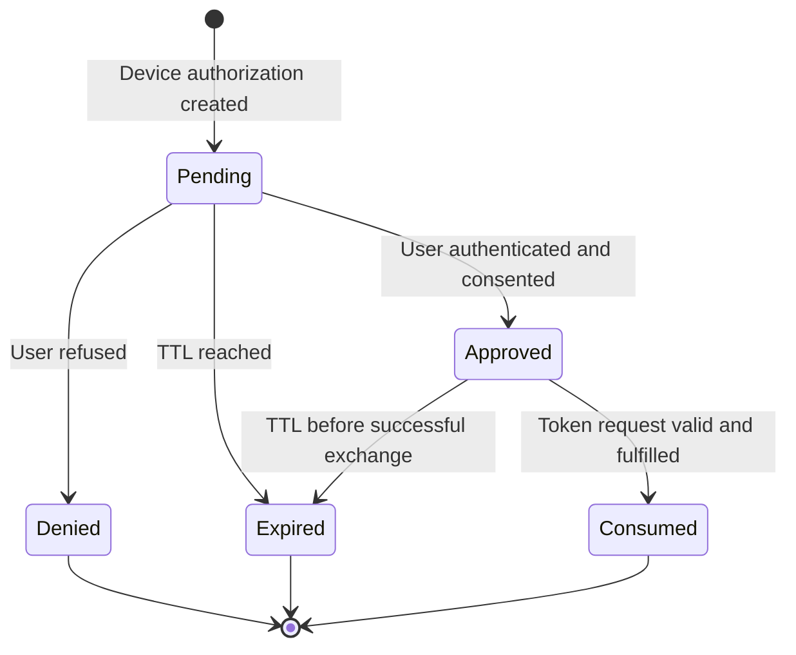
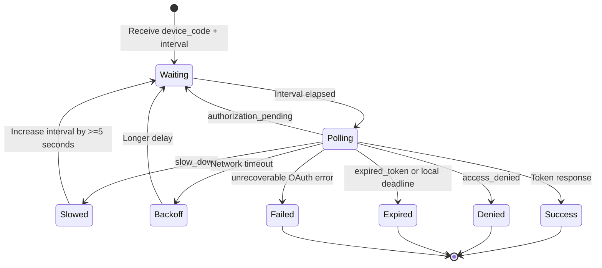
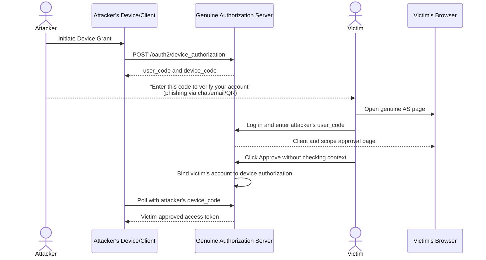
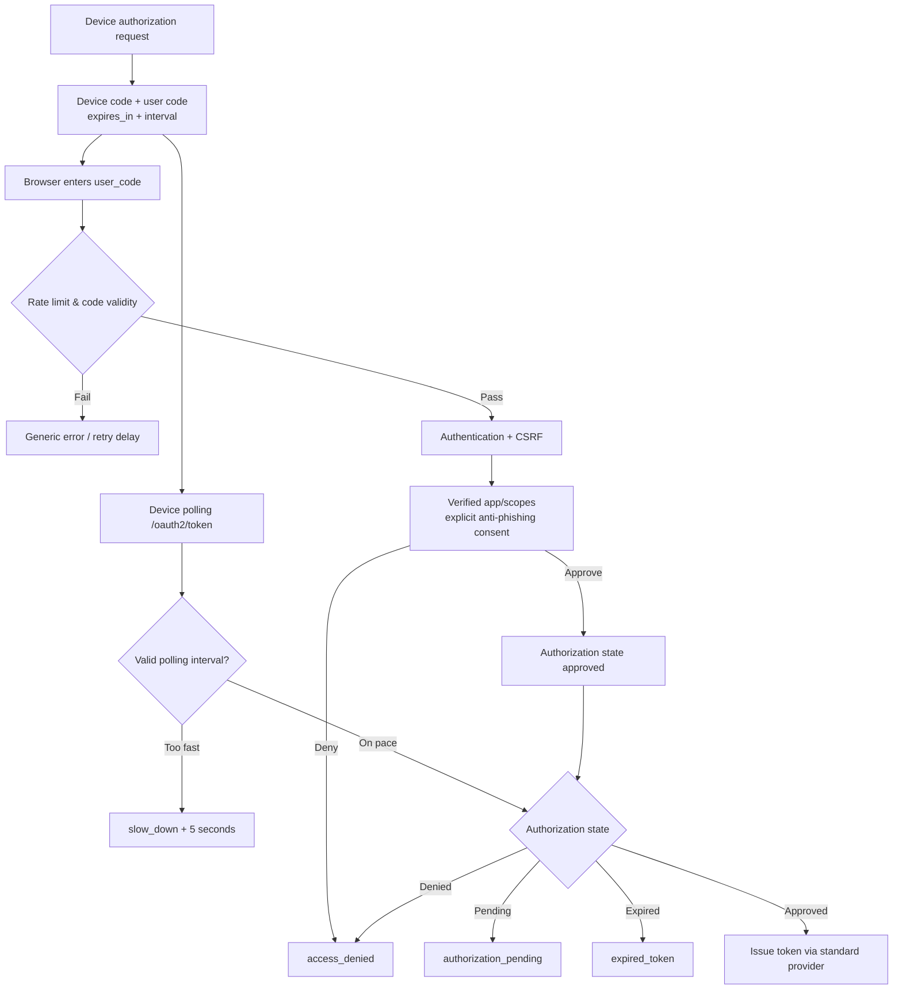

# Rate Limiting user_code Attempts, Polling Speed, and Anti-Phishing

## 1. Context and Lesson Objectives

In the **Device Authorization** chapter of the **SPRING_SECURITY_OAUTH2_OIDC_AUTHORIZATION_SERVER** module, OAuth 2.0 Device Authorization Grant (RFC 8628) solves scenarios where a device lacks a keyboard, browser, or convenient login capability: smart TVs, game consoles, kiosk terminals, or CLI tools. The device displays a **short code**; the user uses another phone or computer to sign in at the Authorization Server (AS) and approve the request.

This flow supports our goal of **designing, configuring, securing, testing, and operating an OAuth 2.0/OpenID Connect Authorization Server with Spring Security and Spring Authorization Server (SAS) in Spring Boot**, yet introduces three distinct attack vectors:

1. **Short, easy-to-type `user_code` values** can be guessed online if the verification page does not limit attempts.
2. **Devices polling `/oauth2/token` continuously** can generate heavy load or deliberately ignore `interval`/`slow_down` directives.
3. **Device-flow phishing:** an attacker starts a flow on their own device and tricks a victim into entering the code and approving on the real AS, causing the attacker to receive tokens tied to the victim's account.

After this lesson, you will be able to configure multi-dimensional code-guessing limits, enforce RFC 8628-compliant polling throttling, design anti-phishing verification UIs, integrate controls into SAS, and test replay, expiration, denial, and phishing scenarios.

**Version scope:** Java examples use components common in **Spring Authorization Server 1.x**, **Spring Security 6.x**, and **Spring Boot 3.x**. Always check your exact running version, as extension point names, Device Authorization/Verification Endpoint configurability, and auto-configuration may vary. Numeric rate-limit parameters in this lesson are **examples for design and testing**, not mandatory RFC figures.

> **Important:** `user_code` and `device_code` are two distinct credentials. `user_code` is optimized for humans and needs special protection against brute force; `device_code` is a high-entropy value retained by the device for polling. Never mix the two, and never treat verifying a code alone as proof the user truly intends to grant access.

## 2. Device Authorization Flow and Attack Surfaces

```mermaid
sequenceDiagram
    autonumber
    actor U as User
    participant D as Device / CLI
    participant AS as Authorization Server
    participant S as OAuth2AuthorizationService
    participant B as Trusted Browser
    D->>AS: POST /oauth2/device_authorization (client_id, scope)
    AS->>S: Create device authorization state
    AS-->>D: device_code, user_code, verification_uri,<br/>expires_in, interval
    D-->>U: Display official URL + user_code
    loop Within lifetime, honoring interval
        D->>AS: POST /oauth2/token (device_code)
        AS-->>D: authorization_pending or slow_down
    end
    U->>B: Open verification_uri on phone
    B->>AS: GET /oauth2/device_verification
    AS-->>B: Login if unauthenticated
    U->>AS: Enter user_code + submit (CSRF)
    AS->>S: Look up device authorization, check validity
    AS-->>B: Display app, device, scopes, and warning
    U->>AS: Approve or deny
    AS->>S: Save decision state
    D->>AS: Valid token endpoint poll
    AS-->>D: Token if approved; error if denied/expired
```

This diagram shows the conceptual flow; as the user confirms, the client may already be polling on its own schedule. Every token issuance must flow through AS protocol processing, never relying solely on a UI displaying "Connected."

### 2.1. Three Places Requiring Different Controls

| Location | Caller | Value used | Primary threats | Controls |
| --- | --- | --- | --- | --- |
| `/oauth2/device_authorization` | Device requesting codes | `client_id`, scopes, client authentication if applicable | Creating endless flows, resource exhaustion, client enumeration | Client registration, flow-creation limits, TTL, quotas |
| `/oauth2/device_verification` | User browser entering code and approving | **`user_code`** | Short-code guessing, phishing, CSRF, wrong-device confirmation | Rate limits, login/session, CSRF, device verification UI, consent |
| `/oauth2/token` with device grant | Polling device | **`device_code`** | Flooding, rapid polling, replay, polling after expiry | `interval`, `slow_down`, TTL, client/code checks, per-device limiter |

One global rate limiter across all requests **cannot replace** these three control sets: the reasonable typing rate of a human entering a code differs completely from an automated device polling over several minutes.

## 3. Understanding Device Grant Responses and States Accurately

### 3.1. Starting with a Device Authorization Request

A public client identified as `living-room-tv` may send:

```http
POST /oauth2/device_authorization HTTP/1.1
Host: auth.example.com
Content-Type: application/x-www-form-urlencoded

client_id=living-room-tv&scope=profile.read
```

After checking the registered client/grant/scopes, the endpoint returns an illustrative response:

```json
{
  "device_code": "HIGH_ENTROPY_OPAQUE_DEVICE_CODE",
  "user_code": "WDJB-MJHT",
  "verification_uri": "https://auth.example.com/activate",
  "verification_uri_complete": "https://auth.example.com/activate?user_code=WDJB-MJHT",
  "expires_in": 600,
  "interval": 5
}
```

URLs and codes are **illustrative**; Spring Authorization Server's common default endpoint is `/oauth2/device_verification`, though `verification_uri` returned by the AS can differ if customized. Never construct the verification URI by concatenating a hardcoded path on the client; use the URI published by the AS and **verify the official domain** in the UI.

| Field | Role | Key rules |
| --- | --- | --- |
| `device_code` | High-entropy secret sent by device when polling | Never display on TV for users to type; never log or share. |
| `user_code` | Short code typed by user on another device | Must have TTL and online guessing limits; never use for polling. |
| `verification_uri` | Page user opens to enter code | Must be a trusted, recognizable HTTPS domain. |
| `verification_uri_complete` | Optional URI optionally pre-filled with user code | Reduces typing, yet must **never** auto-approve. |
| `expires_in` | Seconds the device code remains valid | Both client and AS must halt flow upon expiration. |
| `interval` | Minimum seconds between token endpoint polls | If omitted, client defaults to **5 seconds** per RFC 8628. |

This response illustrates the protocol and does not guarantee every SAS version emits `verification_uri_complete` or `interval` in every setup.

### 3.2. States of a Verification Request



The states above are a **mental model**, not mandatory SAS API enums. `OAuth2AuthorizationService` holds authorization and token metadata; the app should not make browser session state the sole source of truth for issued codes.

**Security invariants:**

- After `Denied`, never issue tokens.
- After `Expired`, never resurrect codes by altering the client clock.
- One device authorization must never mint multiple token sets against policy or transfer to another client.
- A user code cannot be approved without a valid authorization request and authenticated principal.
- A device code cannot be redeemed by a different client lacking ownership of the authorization.

## 4. Why Is `user_code` Especially Vulnerable to Guessing?

`user_code` is short and usually omits ambiguous characters so humans can type it manually. Unlike the long, random `device_code`, the user code's search space is much smaller; if the AS lets someone submit codes endlessly without restriction, an attacker can discover active pending verification sessions.

**Primary risks:**

- **Online guessing:** automating guesses of many user codes through the verification form or API.
- **Enumeration:** using distinct errors like "code does not exist" vs. "code pending approval" to filter active codes.
- **Code credential stuffing:** reusing codes scraped from photos, logs, or messaging channels.
- **Denial of service:** intentionally submitting wrong attempts to lock out legitimate codes or accounts.
- **Phishing:** sending an attacker's device code to a legitimate user and tricking them into entering it on the real AS.

### 4.1. Designing Format and Entropy

Choose:

1. **CSPRNG-generated random codes** sufficiently unpredictable within their validity window.
2. Readable character sets (avoiding `O/0`, `I/1` if UX benefits), optionally grouped with hyphens.
3. **Short, explicit TTLs**, consistent between responses and authorization state.
4. Error messages that do not leak whether a code exists, which client owns it, or which user it belongs to.
5. Online attempt limits to compensate for short user code length.

Never choose predictable patterns like `TV-000001`, sequential device counters, derivable timestamps, or direct hashes of client IDs. **Easy-to-type codes must never mean predictable codes.**

### 4.2. Consistent Input Normalization

If the UI accepts `WDJBMJHT` as equivalent to `WDJB-MJHT`, stripping hyphens, case folding, and whitespace trimming must be defined **once** and applied consistently across generation, lookup, and validation. Never perform ad-hoc Unicode normalization or prefix matching.

Example pseudocode:

```text
normalizeUserCode(input):
    reject if input too long
    trim outer whitespace
    remove only separators allowed by format
    uppercase using locale-independent rules
    reject characters outside allowed alphabet
    return canonicalCode

verify:
    enforce pre-auth rate limit
    normalize
    atomically evaluate eligibility and state
    record failure or success
    show generic error when invalid
```

Never place canonical user codes into URL logs, metric labels, or audit events. Given the short code space, an **unkeyed hash** of a user code will not stop offline brute-force if the database leaks; protect the data store and use keyed HMAC only for anonymous correlation when genuinely needed.

## 5. Multi-Dimensional Rate Limiting for `user_code` Attempts

A rule counting only "5 wrong attempts per IP" is insufficient: many legitimate users behind NAT share an IP, while attackers can rotate addresses. Conversely, permanently locking a code after a few wrong tries can be abused to **lock out a victim's pairing flow**. Design a multi-layered rate limiter with distinct priorities.

### 5.1. Dimensions to Enforce

| Limit dimension | Purpose | Security / operational notes |
| --- | --- | --- |
| Per IP / subnet / ASN | Curb bulk guessing from one source | NAT, proxies, and mobile carriers cause false positives; never treat IP as sole identity. |
| Per browser session | Curb rapid retries from one browser | Cookies are easily cleared; combine with other dimensions. |
| Per authenticated user | Limit suspicious post-login behavior | Do not lock an account over a couple of accidental typos. |
| Per client / application | Detect abnormal code creation or verification volume | Never trust self-declared client IDs without matching registered clients. |
| Per code / challenge | Protect a specific flow from spam | Hard per-code locks risk DoS if an attacker knows the code; weigh retry delays and lock criteria. |
| System-wide | Defend against distributed brute force | Requires metrics and emergency controls that avoid breaking valid logins. |

**Illustrative starting budget for testing, not a mandatory rule:** A browser session failing roughly 5 times within a few minutes might face a brief cooldown; an IP with dozens of failures/hour may face stricter throttling; an authenticated account exhibiting abnormal verification sequences should trigger re-authentication or risk evaluation. Tune thresholds from real traffic, your threat model, and false-positive rates.

### 5.2. Defining Behavior When Thresholds Are Exceeded

Do not simply "return 429" and stop thinking. Depending on context:

- Increase wait delays/rate limits at the gateway, security filter, or verification handler layer.
- Require user authentication before sensitive actions when UX permits.
- Return a **neutral message** without revealing whether the user code exists.
- Emit sanitized events for brute-force detection systems.
- Consider CAPTCHA or step-up challenges under high risk, never relying on CAPTCHA as the sole defense.
- When distributed sources attack together, engage global defenses rather than per-IP limits alone.

**Do not leak excessive state:** Instead of distinguishing "this code exists for another account" vs. "code does not exist," return an error like "Invalid or expired code" before the caller is authorized to see details. Only after authentication and when preparing consent should the user see AS-verified app/device info.

### 5.3. Avoiding Lockouts as a DoS Vector

An attacker knowing a victim's code could intentionally send invalid attempts to block device pairing. Thus, avoid **permanently locking a user code after 3 failed attempts** by default. Combine per-source quotas, short sliding windows, backoff, controlled retries, and natural TTL expiration.

If a code is suspected compromised or abused, cancel the flow and have the device generate a **new code** rather than extending the old code's lifetime. The UI should clearly state when to restart on the device.

## 6. Atomic Rate-Limit Storage and State Checks

### 6.1. Why an In-JVM Counter Is Not Enough

With multiple AS instances:

- A browser may send attempt #1 to node A and attempt #2 to node B.
- Per-node in-memory counters do not sum together, letting limits be bypassed.
- Two simultaneous requests can both read a counter below the threshold.
- Updating a verified code can also race against TTL expiration or denial submissions.

Use Redis with atomic increments/scripts, database transactions, or a distributed rate-limit service. Pick the approach based on load, topology, and availability requirements.

### 6.2. Reference Algorithm Contract

This is **design pseudocode**, not a built-in SAS API:

```text
submitUserCode(source, authenticatedPrincipal, suppliedCode):
    sourceKey = derivePrivacySafeSourceKey(source)

    if distributedLimiter.isBlocked("verify:source:" + sourceKey):
        return genericRetryLater()

    if authenticatedPrincipal != null and
       distributedLimiter.isBlocked("verify:user:" + authenticatedPrincipal.id):
        return genericRetryLater()

    normalized = normalizeUserCode(suppliedCode)
    if normalized is invalid:
        distributedLimiter.recordFailure(sourceKey, principal)
        return genericInvalidCode()

    // Handle state via appropriate synchronized/transactional operation:
    challenge = deviceAuthorizationStore.findByUserCode(normalized)

    if challenge is null or challenge.expired or challenge.consumed:
        distributedLimiter.recordFailure(sourceKey, principal)
        return genericInvalidCode()

    if challenge.client is not eligible:
        return genericInvalidCode()

    // Never auto-approve just because the code is right.
    showVerifiedClientAndScopes(challenge)
    waitForExplicitConsentAfterAuthentication()
```

Storage must **prevent replay** once the user approves and the device retrieves a token. When customizing SAS providers or authorization stores, use transactions, locking, or conditional updates wherever multiple requests can mutate state concurrently.

**Functional boundary:** This pseudocode does not replace `OAuth2DeviceVerificationEndpointFilter` or standard providers. Integrate rate-limit/abuse checks at the right filter/extension point before code lookup so SAS continues governing authentication, consent, token grants, and error semantics.

### 6.3. Never Use Raw User Codes as Metric Keys

A cache key like `rate:user_code:WDJB-MJHT` can leak the code into Redis monitoring, dashboards, or snapshots. Use an internal challenge ID or an HMAC computed from the canonical code with a server-managed secret when correlation is needed. Only use anonymous values that cannot be reversed offline to recover the short code; govern keys and retention per policy.

IP-based rate limiting also involves personal data in many jurisdictions; restrict access, retention, and usage scope.

## 7. Polling the Token Endpoint per RFC 8628

After receiving the device authorization response, the device **must not hammer the token endpoint endlessly**. It must wait according to `interval` and AS responses.

### 7.1. Token Request for Device Grant

A public device client sends:

```http
POST /oauth2/token HTTP/1.1
Host: auth.example.com
Content-Type: application/x-www-form-urlencoded

grant_type=urn:ietf:params:oauth:grant-type:device_code&device_code=HIGH_ENTROPY_OPAQUE_DEVICE_CODE&client_id=living-room-tv
```

Confidential clients must authenticate with their registered method; public clients never send fake secrets. `device_code` is the credential to advance the flow; `user_code` is **never** sent in token requests.

### 7.2. Responses Requiring Specific Handling

| `error` or outcome | Meaning | What must the device do? |
| --- | --- | --- |
| `authorization_pending` | User has not finished verification/approval | Continue polling at the received `interval`. |
| `slow_down` | Client polling too fast; AS requests slowdown | **Increase wait time by at least 5 seconds** for this and all subsequent polls. |
| `access_denied` | User denied | **Stop** polling, show denied state, allow starting a new flow if needed. |
| `expired_token` | Device code expired | **Stop** polling; device must request new codes. |
| Successful token response | AS verified and issued token per policy | Stop polling, store token safely, transition to paired state. |
| `invalid_client` / unrecoverable error | Bad client registration/authentication | Stop and report error; never loop endlessly or skip auth. |
| Network timeout / transient error | No valid protocol response | Apply reasonable **exponential backoff**; never increase polling rate. |

Per RFC 8628, if the device authorization response **omits `interval`**, the client waits **5 seconds** between polls. On `slow_down`, increase the interval by **5 seconds** as required by the spec; clients may also wait even longer to protect infrastructure. All retries must stay within `expires_in` and client timeout policies.

**Do not mistake `slow_down` for a permanent failure.** It is a pacing signal, unlike `access_denied` and `expired_token` which terminate the flow.

### 7.3. Example HTTP Responses

Before the user enters the code:

```http
HTTP/1.1 400 Bad Request
Content-Type: application/json
Cache-Control: no-store

{"error":"authorization_pending"}
```

When polling too fast:

```http
HTTP/1.1 400 Bad Request
Content-Type: application/json
Cache-Control: no-store

{"error":"slow_down"}
```

Once approved:

```http
HTTP/1.1 200 OK
Content-Type: application/json
Cache-Control: no-store

{
  "access_token": "<ACCESS_TOKEN>",
  "token_type": "Bearer",
  "expires_in": 300,
  "scope": "profile.read"
}
```

These are protocol examples, not real tokens. If the request included `scope=openid` and the AS enables matching OIDC support, the token response may contain an ID token per profile/version and policy; never assume every device flow emits an OIDC ID token or refresh token.

## 8. Building a Proper Device-Side Polling Scheduler

### 8.1. Client State Model



The device should maintain **at most one active polling loop per active device authorization**. If the user clicks "Retry" multiple times, never accidentally spawn N workers polling the same `device_code`. When closing the app, switching accounts, or requesting a new code, cancel the old polling loop.

### 8.2. Java Example for Polling Cadence Calculation

The class below illustrates **pacing policy**, without making HTTP calls or sleeping. Callers must manage clocks, deadlines, cancellation tokens, and prevent parallel workers.

```java
import java.time.Duration;

public final class DevicePollSchedule {
    private Duration interval;

    public DevicePollSchedule(Long intervalFromServer) {
        long seconds = intervalFromServer == null
                || intervalFromServer <= 0 ? 5 : intervalFromServer;
        this.interval = Duration.ofSeconds(seconds);
    }

    public Duration nextDelayAfterPending() {
        return interval;
    }

    public Duration nextDelayAfterSlowDown() {
        interval = interval.plusSeconds(5);
        return interval;
    }

    public Duration nextDelayAfterNetworkTimeout() {
        interval = interval.multipliedBy(2);
        return interval;
    }
}
```

Callers derive a deadline from `expires_in` and **stop when the deadline hits**, rather than waiting for the AS to return `expired_token`. Positive jitter can be added so devices do not synchronize bursts, but never apply negative jitter that shrinks the interval below the server's required minimum.

If a maintained OAuth client library already provides full RFC 8628 Device Authorization support, prefer it over hand-rolling production polling loops.

### 8.3. Common Polling Bugs

- Device calls token endpoint every 100–500 ms despite `interval=5`.
- After `slow_down`, client **waits longer only once** and reverts to 5 seconds; the spec requires preserving the increased interval for all subsequent polls.
- On network timeout, client retries immediately multiple times.
- Client polls in parallel from multiple threads with the same device code.
- Client continues polling after `access_denied` or `expired_token`.
- After flow expiration, device keeps displaying the old user code while resetting its local timer.
- Client misparses an error JSON payload as a token response and saves invalid data.
- Client accepts responses from an unverified Token Endpoint URL or over insecure HTTP.

## 9. Server-Side Polling Limiters Must Protect Both the AS and UX

Even when clients are implemented properly, the AS **must never trust** every device to obey `interval`. Attackers can send crafted HTTP requests, spoof client IDs, replay device codes, or spin up many concurrent flows.

### 9.1. Limits to Combine

| Limit | Purpose | Notes |
| --- | --- | --- |
| Per `device_code` | Prevent a single flow from being polled faster than policy | Track last poll timestamp and `slow_down` level in shared storage across nodes. |
| Per verified `client_id` | Stop one client from creating excessive flows or polling floods | Never trust self-reported client IDs without verification. |
| Per IP / network source | Block bulk floods | Account for NAT, proxies, changing addresses, and false positives. |
| Total pending device authorizations | Bound memory, DB, and token store growth | Enforce quotas/TTLs and clean up expired state. |
| Total token endpoint traffic | Protect availability for other grants | Separate metrics and quotas between device polling and regular grants. |

When a flow polls early, the AS should return `slow_down` per Device Grant semantics where appropriate; infrastructure protections like gateway rate limiting still apply for severe abuse. Do not treat generic HTTP `429` as a **complete replacement** for the `slow_down` response standard clients expect.

### 9.2. Designing Atomic Per-Device Timestamps

Illustrative policy:

```text
poll(deviceCode, client):
    authenticateOrValidateClient(client)
    auth = findAuthorizationByDeviceCode(deviceCode)
    reject if auth is missing, expired or belongs to another client

    now = trustedServerClock()
    policy = loadPollPolicy(auth.id)

    atomically:
        if now < policy.nextAllowedAt:
            policy.interval += 5 seconds
            policy.nextAllowedAt = now + policy.interval
            save(policy)
            return slow_down

        policy.nextAllowedAt = now + policy.interval
        save(policy)

    continue standard device grant provider:
        pending -> authorization_pending
        denied -> access_denied
        expired -> expired_token
        approved -> issue token under grant rules
```

This is **illustrative pseudocode**, not a built-in Spring Authorization Server API. Verify how your SAS version implements `slow_down` and poll tracking via integration tests. If adding a custom limiter, never bypass standard providers or turn `authorization_pending` into token success before user approval.

Across multiple nodes, updating `nextAllowedAt` must be atomic so two concurrent requests never read the old timestamp and both pass. Use Redis scripts/transactions or repository locking/compare-and-set. Internal keys should use the authorization ID or a protected identifier, **never raw device codes in metrics or logs**.

### 9.3. Never Let the Rate Limiter Open New Vulnerabilities

A homegrown limiter can introduce bugs:

- Resetting `interval` back to 5 seconds on every request, rendering `slow_down` useless.
- Using client clocks instead of the server clock, inviting time-skew exploits.
- Missing TTLs on counters or pending state, causing memory leaks.
- Non-atomic Redis counters allowing limits to be exceeded under high concurrency.
- Returning "device code exists" to unauthorized callers, leaking state.
- Blocking the token endpoint for all other grants because one device client flooded.
- Writing raw `device_code` into Redis keys/logs accessible to many operators.

If the shared rate-limit store becomes unreachable, follow an agreed fail-safe resilience policy rather than silently disabling all limits in production just to preserve throughput.

## 10. Device-Flow Phishing: The Most Dangerous UX Attack

### 10.1. Common Attack Scenario



**Crucial point:** This phishing attack happens **on the real AS domain**, without needing a lookalike website. The attacker simply needs the victim to approve **the attacker's device code**. Telling users "just check for the HTTPS padlock" is not enough.

### 10.2. Why Entering a Valid Code Is Not Safe Enough

The attacker-created code is a **genuinely valid code**. When the victim enters it and consents, the AS follows the protocol faithfully yet grants access to the wrong party relative to the user's intent. Thus, verifying "this code exists" **never proves** the user is standing in front of the device they mean to pair.

At minimum, check:

- Did the user **actively initiate** pairing on a device they own or are using?
- Does the code appear **directly on that device's screen**, rather than arriving via chat or email from someone else?
- Do the displayed application/client name and publisher match a trusted brand?
- Are the requested scopes reasonable for the task?
- Where supported, do device details, session context, or extra risk signals match reality?

The goal is confirming **intent to authorize**, not just confirming that the user typed a valid string.

## 11. Designing Anti-Phishing Verification and Consent Pages

### 11.1. A Clear Verification Screen

After the user signs in and enters a valid code, the verification page can display:

```text
CONFIRM DEVICE CONNECTION

Application: Living Room TV
Publisher: Example Media
Requested permissions: Read basic profile
Code shown on device: WDJB-MJHT
Time remaining: 04:32

Select "Allow" only if you are pairing a device yourself
and this code is displayed directly on that device.

If this code came from an email, phone call, message, or stranger:
select "Deny".

[ Deny ]   [ Allow connection ]
```

This is a **UX content template**, not SAS's default built-in UI. Application name, publisher, and device labels must come from **governed/verified client registration** or trusted-policy metadata—never blindly trusting a `device_name` label sent by the client. Self-declared device names can be spoofed; without hardware attestation or managed device inventory, explicitly note when a label is merely app-supplied.

### 11.2. Useful Guardrails

| Control | Effect | Limitation |
| --- | --- | --- |
| Display verified client name/publisher | Helps identify who is requesting access | If a client spoofs branding at registration, registration vetting is required. |
| Require device/context confirmation | Reduces approving codes sent by strangers | Cannot prove physical proximity without a trusted binding channel. |
| Plain-language scopes | Helps users understand granted access | Overly technical or broad scopes get ignored. |
| Never auto-approve from `verification_uri_complete` | Blocks silent approval via QR scans | Users can still be socially engineered into clicking Approve. |
| Re-authentication / MFA for sensitive scopes | Raises account protection | MFA alone won't stop phishing if the user actively approves an attacker's code. |
| Safe default, prominent Deny button | Encourages cautious choice | UX must avoid dark patterns. |
| Warning "only enter codes from your own device" | Counters chat/email phishing scripts | Users still must recognize context accurately. |
| Short TTL + rate limits | Shrinks attack and guessing windows | Does not replace consent intent checks. |

### 11.3. `verification_uri_complete`, QR Codes, and Deep Links

`verification_uri_complete` reduces typing by pre-filling the user code when scanning a QR code. However:

- Permit only URLs on the **official AS domain** over HTTPS.
- Never auto-approve simply because a link carries a valid user code.
- After opening the link, still display client details, scopes, and require explicit intent confirmation.
- Avoid logging full query strings; user codes may be inside the URL.
- Enforce proper CSRF protection and session authentication on the page.
- Untrusted QR codes/deep links can also point to spoofed sites; educate users to verify domain and intent.

Anti-phishing controls for device flow **must pair with** open-redirect defenses and client registration governance, not just a static warning banner.

### 11.4. When to Restrict or Avoid Device Grant

If an application can safely use the system browser and Authorization Code + PKCE, prefer that flow over defaulting to Device Grant. In environments with severe phishing threat models, pick flows less vulnerable to cross-device code transfer, or add trusted **device-to-session binding** where available.

Never promise that enabling MFA or displaying "Your code" alone eliminates device-flow phishing.

## 12. Integrating Controls into Spring Authorization Server

### 12.1. Registering a Device Grant Client

Example public client `living-room-tv`:

```java
@Bean
RegisteredClientRepository registeredClientRepository() {
    RegisteredClient tvClient = RegisteredClient
            .withId("living-room-tv-local-001")
            .clientId("living-room-tv")
            .clientAuthenticationMethod(
                    ClientAuthenticationMethod.NONE)
            .authorizationGrantType(
                    AuthorizationGrantType.DEVICE_CODE)
            .scope("profile.read")
            .clientSettings(ClientSettings.builder()
                    .requireAuthorizationConsent(true)
                    .build())
            .build();

    return new InMemoryRegisteredClientRepository(tvClient);
}
```

This is a lab client configuration. A public device cannot keep a client secret confidential; never embed a static secret in firmware/app code and treat it as strong authentication. For confidential clients genuinely capable of holding credentials, enforce the registered client authentication policy at device authorization and token requests per your framework version.

### 12.2. Enabling Device Authorization/Verification Endpoints by Version

Example SAS 1.x DSL configuration:

```java
@Bean
@Order(1)
SecurityFilterChain authorizationServerChain(HttpSecurity http)
        throws Exception {

    OAuth2AuthorizationServerConfigurer as =
            OAuth2AuthorizationServerConfigurer.authorizationServer();

    http
        .securityMatcher(as.getEndpointsMatcher())
        .with(as, configurer -> {
            configurer.deviceAuthorizationEndpoint(
                    Customizer.withDefaults());
            configurer.deviceVerificationEndpoint(
                    Customizer.withDefaults());
        })
        .authorizeHttpRequests(authorize ->
                authorize.anyRequest().authenticated())
        .exceptionHandling(exceptions ->
                exceptions.defaultAuthenticationEntryPointFor(
                        new LoginUrlAuthenticationEntryPoint("/login"),
                        new MediaTypeRequestMatcher(MediaType.TEXT_HTML)));

    return http.build();
}
```

You still need a separate application filter chain for `/login`/form authentication, plus `OAuth2AuthorizationService`, token generator, signing key/JWK, and backing services. **Do not treat this snippet as a complete standalone Authorization Server.** How Device Grant endpoints are enabled or configured varies by SAS version; verify live routes/metadata and behavior after startup.

Common paths:

| Endpoint | Role | Protection level |
| --- | --- | --- |
| `/oauth2/device_authorization` | Issues device/user codes | Client registration, quotas, allowed scopes |
| `/oauth2/device_verification` | User enters code and consents | Login, CSRF, `user_code` rate limits, anti-phishing |
| `/oauth2/token` | Device polls to exchange device code | Client binding, `interval`/`slow_down`, expiry, grant checks |

If using custom verification pages/filters, integrate rate limiting at the request/state-transition layer **before code lookup**, without bypassing SAS protocol providers. Consent pages must display verified client and authorization data.

### 12.3. Extension Points to Verify Before Customizing

- `RegisteredClientRepository`: client ID, grants, scopes, and client authentication method.
- `OAuth2AuthorizationService`: pending authorization, token/device code metadata, and approval state.
- `OAuth2AuthorizationConsentService`: consent per policy.
- Device Authorization/Verification endpoint configurers and framework-provided filters/providers.
- Gateway/security filters for request rate limiting, plus shared rate-limit stores when scaling out.
- Token endpoint extensions/handlers preserving `authorization_pending`/`slow_down` error semantics.
- Login/session/CSRF and custom verification UI as needed.

**Never build a custom controller issuing tokens from `user_code`.** User codes are strictly for user verification; devices obtain tokens by polling `/oauth2/token` with `device_code` after the AS authenticates the client and validates state.

## 13. Security and Performance Testing

### 13.1. Mandatory Test Matrix

| Scenario | Expected outcome |
| --- | --- |
| Device starts valid flow | Receives device/user codes, URI, TTL, and interval per protocol. |
| Valid user code, user logs in and approves | Flow transitions state; valid poll receives token. |
| Invalid user code | Neutral error; reveals no existing flow or account. |
| Expired user code | Cannot be approved; device must start a new flow. |
| Repeated wrong entries from one session/IP | Limiter slows down or blocks per policy; emits sanitized event. |
| Code guessing across multiple IPs/nodes | Distributed limit and global signals still detect the attack. |
| Attempting to lock valid flow via spam | Avoids reckless permanent lock; DoS resilience holds. |
| Parallel entry and approval of same user code | No duplicate unauthorized grant; consistent state transition. |
| Submitting user code while unauthenticated | Prompts login; never binds unauthenticated user to flow. |
| Submitting consent without CSRF | Blocked; does not approve. |
| QR has user code without user consent | No token automatically issued. |
| Attacker-supplied code sent to victim | UI shows warning, clear client/scopes; user can deny. |
| Poll before user approves | `authorization_pending`; no token issued yet. |
| Poll faster than interval | `slow_down` or standard rate guard; client adds 5 seconds to interval. |
| Client ignores `slow_down` | AS continues throttling; load stays bounded. |
| Network timeout | Client backs off rather than increasing polling rate. |
| User denies | Token polling gets `access_denied` and stops. |
| Device code expires | Polling gets `expired_token` or stops at local deadline. |
| Another client polls with flow's device code | Rejected; no token leaked. |
| Two workers poll same device code | No policy-violating duplicate tokens, no race. |
| Rate-limit store failure | Deterministic safe behavior, never silently bypassed. |
| Multi-instance AS scaling | Consistent counters and authorization state. |

### 13.2. Testing `slow_down` Over Time

Suppose the authorization response specifies `interval=5`. Test client polling logic:

```text
t=00s  Device authorization response (interval=5)
t=05s  Poll #1 -> authorization_pending
t=10s  Poll #2 -> slow_down
t=20s  Poll #3 -> authorization_pending  (interval now 10s)
t=30s  Poll #4 -> ...
```

This timeline assumes **no network delay or other retries**. After `slow_down`, the new interval is at least 10 seconds for all subsequent polls. Another `slow_down` adds 5 more seconds. Once `expires_in` elapses, stop; never poll continuously to "wait until the user approves."

Also test responses omitting `interval` (default 5s), server intervals larger than 5s, multiple `slow_down`s, consecutive timeouts, and mid-flow cancellation.

### 13.3. Load Testing in Production-Like Environments

Key metrics to measure:

- P50/P95/P99 latencies of `device_authorization`, `device_verification`, and device-grant `token` calls.
- Pending device authorization count and approved/denied/expired ratios.
- Rates of `authorization_pending`, `slow_down`, `access_denied`, and `expired_token`.
- Invalid `user_code` counts by anonymized source and system-wide.
- `client_id` values with anomalous creation or polling frequencies.
- Rate at which users deny after inspecting client/scopes.
- Time from code creation to approval; flow abandonment rate.
- Redis/database/shared-store load and atomic update error rates.

**Never log:** raw `device_code`, `user_code`, authorization headers, session cookies, access/refresh/ID tokens, passwords, or query strings carrying `verification_uri_complete`. Use dedicated correlation IDs—never raw codes—in logs.

## 14. Troubleshooting Common Issues

| Symptom | Possible causes | Diagnostic steps |
| --- | --- | --- |
| Device gets `authorization_pending` forever | User hasn't approved, wrong browser session, consent not saved | Check flow TTL, consent state, session, and UI. |
| Device repeatedly gets `slow_down` | Client polls faster than interval or runs multiple workers | Measure request gaps, thread count, and server policy. |
| Polling speeds up during network errors | Client lacks backoff | Add exponential backoff and deadline bounds. |
| Valid user code rejected by UI | Inconsistent normalization, code expired, different node store | Check format, TTL, and shared authorization store. |
| Bulk code guessing observed | Missing limiter or IP-only limiter | Add multi-dimensional limits and anomaly monitoring. |
| Legitimate users/flows blocked by rate limit | Overly tight thresholds, NAT, or hard per-code locks | Tune policy and prevent lockout DoS. |
| Suspicious app still gets approved | Spoofable client metadata, UI lacks context | Govern registration; show verified publisher/scopes and warnings. |
| Token issued after user denied | Broken custom state transition/provider | Inspect authorization state, transactions, and denial tests. |
| Token issued after expiration | Wrong TTL, clock skew, or caching | Use server clock; check `expires_in` and invalidation. |
| Another client redeems device code | Missing client binding check | Restore standard provider and test client mismatch. |
| Wait limits differ across AS instances | Counters stored in per-node memory | Switch to shared limiter and atomic updates. |
| Browser visits phishing site instead of AS | QR/URL phishing, unverified domain | Enforce official HTTPS domain and educate users to open known URLs. |
| QR auto-approves without consent screen | Broken `verification_uri_complete` design | Require user authentication and explicit confirmation. |
| Token Endpoint returns HTML login page | Misconfigured filter chain/matcher | Check AS chain, client auth, and endpoint handlers. |

## 15. Pre-Operations Acceptance Checklist

- [ ] Device Grant client is registered with right grant, scopes, and auth method.
- [ ] Device/user codes are securely randomized with TTLs and bound to the right client and state.
- [ ] `user_code` is normalized consistently and cannot be guessed from timestamps/counters.
- [ ] Verification Endpoint rate-limits attempts across multiple dimensions using a distributed store for multi-node setups.
- [ ] Wrong/expired code messages do not aid enumeration of active flows or accounts.
- [ ] Rate limits do not permanently lock flows solely from attacker-sent wrong guesses.
- [ ] Verification UI enforces login, CSRF, and explicit consent; never auto-approves from QR/deep links.
- [ ] App/publisher/scopes come from verified sources, with warnings against codes sent by strangers.
- [ ] Users can clearly deny and know how to request a new code if a flow expires.
- [ ] Device client honors `interval` (default 5s if absent) and adds at least 5s after `slow_down`.
- [ ] Client backs off on network errors and stops on `access_denied`/`expired_token`/success.
- [ ] Server enforces per-device-code/client/source polling limiters instead of trusting client compliance.
- [ ] Pending authorizations and counters have cleanup with no memory leaks.
- [ ] Tokens are issued only after valid approval—never for invalid, expired, or mismatched-client codes.
- [ ] Multi-instance AS nodes share consistent authorization state, rate-limit state, and policies.
- [ ] No raw codes, tokens, cookies, or full verification URIs containing codes are logged.
- [ ] Integration tests cover brute force, phishing UX, CSRF, polling races, retries, expiry, and denial.
- [ ] Metrics/alerts and incident runbooks exist for device-flow phishing campaigns.

## 16. Architectural Summary



**Securing Device Authorization must cover the user-entered code, the polling device, and the UI authorization decision.** Limiting `user_code` attempts curtails online guessing; `interval`/`slow_down` control Token Endpoint load and abuse; and user authentication, trusted client/scope display, and explicit intent confirmation mitigate device-flow phishing. Applied consistently in Spring Security and Spring Authorization Server, input-constrained devices can use OAuth2/OIDC safely without breaking protocol rules.
