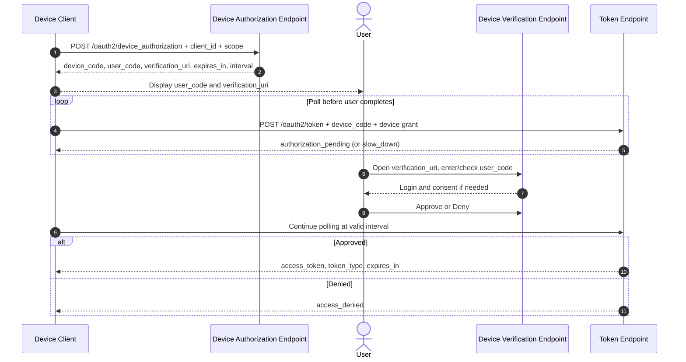
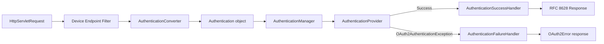

# Customizing Converters, Providers, and Response Handlers for Device Flow

## Lesson Objectives

In the **Device Authorization** chapter of the **SPRING_SECURITY_OAUTH2_OIDC_AUTHORIZATION_SERVER** module, we examine the extension points of **Spring Authorization Server** when implementing **OAuth 2.0 Device Authorization Grant (RFC 8628)**. This is part of learning how to design, configure, secure, test, and operate an OAuth 2.0/OpenID Connect (OIDC) Authorization Server with **Spring Security** and **Spring Boot**.

Device Flow fits TVs, IoT devices, CLIs, or devices with limited input capabilities. The device requests a `device_code` and `user_code`, the user signs in and approves on **a secondary device**, and the original device **polls** the Token Endpoint to obtain an access token. Customization must never break these core rules.

After this lesson, you will be able to:

- Precisely identify the responsibilities of the **Device Authorization Endpoint**, **Device Verification Endpoint**, and **Token Endpoint**.
- Distinguish the three extension phases: **`AuthenticationConverter`** (parsing/validating requests), **`AuthenticationProvider`** (authenticating and enforcing policy), and **success/failure handlers** (responding).
- Use the methods of `OAuth2DeviceAuthorizationEndpointConfigurer` and `OAuth2DeviceVerificationEndpointConfigurer` in the right places.
- Preserve default converters and providers when adding validation, policies, code generation, auditing, or custom verification UIs.
- Produce RFC 8628-compliant responses/errors and handle `authorization_pending`, `slow_down`, `access_denied`, and `expired_token` without breaking polling.
- Test end-to-end with public/confidential clients, consent, TTLs, rate limits, user-code enumeration, multiple replicas, and reverse proxies.
- Spot dangerous customizations: issuing tokens before user verification, logging raw device codes, replacing default providers carelessly, or returning HTTP 200 for all errors.

> **Principle:** Customize only the layer responsible. Never use a response handler to "bypass" grant checks, never use an MVC controller to mint access tokens instead of the framework, and never turn polling into a high-load tight loop.

## 1. Device Flow and Three Endpoints to Distinguish

Under RFC 8628, the client typically runs on a device where typing passwords is inconvenient. The flow uses **two channels**: the device requests authorization and polls; the user operates a browser on a secondary device.



Each endpoint has **its own request types, filters, and security boundaries**:

| Endpoint | Common default URL (SAS 1.x) | Role | Main customizations |
|---|---|---|---|
| Device Authorization | `POST /oauth2/device_authorization` | Client requests `device_code`, `user_code`, and verification info. | Converter, provider, device-authorization response/error handlers, verification URI. |
| Device Verification | `/oauth2/device_verification` | Secondary browser enters/confirms `user_code`, logs in, consents. | Verification converter, provider, success/error handlers, consent page. |
| Token | `POST /oauth2/token` | Device polls with `device_code`; receives access token after approval. | **Token Endpoint** converter/provider and token response/error handlers. |

**Critical mistake:** Customizing `OAuth2DeviceAuthorizationEndpointConfigurer.errorResponseHandler(...)` does **not** alter `authorization_pending` or `slow_down` responses during Token Endpoint polling. Those errors come from the **Device Code Grant at the Token Endpoint**, so adjusting them requires looking at `OAuth2TokenEndpointConfigurer` and the device-code provider while preserving RFC 8628 semantics.

### 1.1. Codes and URIs in Device Flow

| Value | Recipient | Sensitivity | Proper usage |
|---|---|---|---|
| `device_code` | Device client and Authorization Server | **Secret, high-entropy** | Used by device to poll; never show on TV/CLI for users to type. |
| `user_code` | User | Easier to type, typically lower entropy than device code | User enters/compares on verification page; protect against brute force. |
| `verification_uri` | User | Public HTTPS URL | Code verification page, short and clear domain. |
| `verification_uri_complete` | User/QR code if available | Contains user code or equivalent data | UX shortcut only; still display/match user code. |
| `expires_in` | Device | Remaining lifetime in seconds | Device stops polling after expiration rather than keeping codes forever. |
| `interval` | Device | Minimum polling interval | If omitted, client uses 5 seconds per RFC; handle `slow_down` properly. |

**Never place device codes or client secrets in logs, telemetry tags, public QR codes, or error descriptions.** User codes also require enumeration/rate-limit protection and should not be stored raw in unrestricted logs.

## 2. Foundational Configuration Before Customizing

Extension points only work when the server already has its foundational components:

1. `RegisteredClientRepository` with a client registered for `AuthorizationGrantType.DEVICE_CODE` and appropriate scopes.
2. Matching client authentication setup: confidential clients must authenticate; public clients use `ClientAuthenticationMethod.NONE` in supported flows.
3. `OAuth2AuthorizationService` storing `device_code` and `user_code` state consistently across Device Authorization, Verification, and Token Endpoints; production needs persistence supporting multiple replicas.
4. `OAuth2AuthorizationConsentService` when storing user consent.
5. Appropriate `SecurityFilterChain` beans for protocol endpoints and user authentication UI.
6. `AuthorizationServerSettings` with issuer and endpoint URLs matching the public hostname/TLS.
7. `OAuth2TokenGenerator`/JWK source when issuing JWTs, plus Resource Server token validation.

Example registering a **public device client**:

```java
RegisteredClient smartTv = RegisteredClient.withId("smart-tv-v1")
        .clientId("smart-tv")
        .clientName("Smart TV")
        .clientAuthenticationMethod(ClientAuthenticationMethod.NONE)
        .authorizationGrantType(AuthorizationGrantType.DEVICE_CODE)
        .scope("media.read")
        .clientSettings(ClientSettings.builder()
                .requireAuthorizationConsent(true)
                .build())
        .build();
```

This is an **illustrative `RegisteredClient` builder snippet**, not a complete source file. In production, internal client IDs must stay stable; do not use `InMemoryRegisteredClientRepository` or `InMemoryOAuth2AuthorizationService` across multiple replicas.

For confidential device clients capable of safeguarding secrets, register methods like `CLIENT_SECRET_BASIC` and proper credentials. Never set `NONE` for an app that can protect credentials just to avoid client authentication.

### 2.1. Paths and Public Issuer

```java
@Bean
AuthorizationServerSettings authorizationServerSettings() {
    return AuthorizationServerSettings.builder()
            .issuer("https://auth.example.com")
            .deviceAuthorizationEndpoint("/oauth2/device_authorization")
            .deviceVerificationEndpoint("/oauth2/device_verification")
            .tokenEndpoint("/oauth2/token")
            .build();
}
```

The builder paths are application paths; behind an ingress/reverse proxy, verify that the **public URI** returned in the Device Authorization Response is genuinely reachable from user browsers. Never emit internal hostnames like `http://auth-service:9000` in `verification_uri`.

**Distinction:** `AuthorizationServerSettings.deviceVerificationEndpoint(...)` sets the protocol URL, whereas `OAuth2DeviceAuthorizationEndpointConfigurer.verificationUri(...)` is the URI the server instructs users to open. If your chosen URI points to a custom UI page, ensure a valid route leads into the verification flow rather than a dead path.

## 3. Extension Architecture: converter → provider → handler

Spring Authorization Server splits request processing into three phases:



| Phase | Interface / structure | Use for | Do not use for |
|---|---|---|---|
| **Pre-processing** | `AuthenticationConverter` | Parsing requests, normalizing types, detecting duplicate/malformed parameters. | Minting tokens or deciding user approval. |
| **Core processing** | `AuthenticationProvider` | Validating client/grant/scopes, tenant policy, authorization state, generating codes via official generators. | Writing arbitrary HTTP responses or bypassing protocol providers. |
| **Post-processing** | `AuthenticationSuccessHandler` / `AuthenticationFailureHandler` | Writing proper JSON, UI redirects, safe audits, response headers. | Skipping validation, issuing access tokens outside providers, or turning every error into 200. |

Defaults on the Device Authorization Endpoint (SAS 1.x line):

- Converter: `OAuth2DeviceAuthorizationRequestAuthenticationConverter`.
- Provider: `OAuth2DeviceAuthorizationRequestAuthenticationProvider`.
- Success handler: internal implementation producing `OAuth2DeviceAuthorizationResponse`.
- Failure handler: `OAuth2ErrorAuthenticationFailureHandler`.

Defaults on the Device Verification Endpoint:

- Converter: `DelegatingAuthenticationConverter` containing `OAuth2DeviceVerificationAuthenticationConverter` and `OAuth2DeviceAuthorizationConsentAuthenticationConverter`.
- Provider: providers handling user code verification and device consent.
- Success handler: directs the user to the verification success page, typically `/?success` by default.
- Failure handler: returns protocol/verification-flow errors.

**Prefer extending the default list**, especially on verification since it handles two request types: **code verification** and **permission consent**. Dropping consent converters/providers can break Approve/Deny while GET verification still appears to work.

## 4. Extension Points on the Device Authorization Endpoint

`OAuth2DeviceAuthorizationEndpointConfigurer` provides these methods:

| API | Role | Example need |
|---|---|---|
| `deviceAuthorizationRequestConverter(converter)` | Adds a converter to read requests. | Supporting a vetted custom input structure. |
| `deviceAuthorizationRequestConverters(consumer)` | Accesses and modifies the default converter list. | Pre-checking duplicate parameters while keeping standard converters. |
| `authenticationProvider(provider)` | Adds a provider to participate in authentication. | Enforcing guarded policies or approved extensions. |
| `authenticationProviders(consumer)` | Inspects/customizes the default provider list. | Adjusting `deviceCodeGenerator`/`userCodeGenerator` for clear technical requirements. |
| `deviceAuthorizationResponseHandler(handler)` | Handles success, returning `OAuth2DeviceAuthorizationResponse`. | Custom RFC-compliant response serialization or headers. |
| `errorResponseHandler(handler)` | Handles `OAuth2AuthenticationException`. | Preserving standard OAuth2 errors while adding audit/redaction. |
| `verificationUri(uri)` | URI guiding users to verification on another device. | User-friendly activation page address. |

### 4.1. Baseline Configuration Example

```java
package com.example.authserver.config;

import org.springframework.context.annotation.Bean;
import org.springframework.context.annotation.Configuration;
import org.springframework.core.annotation.Order;
import org.springframework.security.config.annotation.web.builders.HttpSecurity;
import org.springframework.security.oauth2.server.authorization.config.annotation.web.configurers.OAuth2AuthorizationServerConfigurer;
import org.springframework.security.web.SecurityFilterChain;

@Configuration(proxyBeanMethods = false)
class DeviceFlowSecurityConfig {

    @Bean
    @Order(1)
    SecurityFilterChain authorizationServerChain(HttpSecurity http)
            throws Exception {

        var authorizationServer =
                OAuth2AuthorizationServerConfigurer.authorizationServer();

        http.securityMatcher(authorizationServer.getEndpointsMatcher())
            .with(authorizationServer, server -> server
                .deviceAuthorizationEndpoint(device -> device
                    .verificationUri("/oauth2/device_verification"))
                .deviceVerificationEndpoint(device -> device
                    .consentPage("/device/consent")))
            .authorizeHttpRequests(authorize ->
                authorize.anyRequest().authenticated());

        return http.build();
    }
}
```

This is an **illustrative configuration skeleton** for Spring Authorization Server 1.x / Spring Security 6.2+; you still need a `SecurityFilterChain` for login/UI, `RegisteredClientRepository`, OAuth2 authorization/consent services, token generator/JWK, issuer, and other required beans to run. Package/API names in Spring Security 7.x may differ: **never mix imports from both framework lines**.

`/device/consent` in the example is an application-supplied page; it must enforce login, preserve `state`, and submit decisions to the right device consent endpoint per framework contract. Never treat `consentPage(...)` as auto-generating an MVC template.

### 4.2. Example Converter Checking Duplicate `scope` Parameters

Suppose a system wants to reject requests sending multiple `scope` fields instead of silently picking the first one. You can add a converter that **only checks and returns `null` when valid**, letting the default converter parse per RFC.

```java
import org.springframework.security.core.Authentication;
import org.springframework.security.oauth2.core.OAuth2AuthenticationException;
import org.springframework.security.oauth2.core.OAuth2Error;
import org.springframework.security.oauth2.core.OAuth2ErrorCodes;
import org.springframework.security.oauth2.core.endpoint.OAuth2ParameterNames;
import org.springframework.security.web.authentication.AuthenticationConverter;

import jakarta.servlet.http.HttpServletRequest;

final class DuplicateScopeGuard implements AuthenticationConverter {

    @Override
    public Authentication convert(HttpServletRequest request) {
        String[] scopeValues =
                request.getParameterValues(OAuth2ParameterNames.SCOPE);

        if (scopeValues != null && scopeValues.length > 1) {
            throw new OAuth2AuthenticationException(
                    new OAuth2Error(OAuth2ErrorCodes.INVALID_REQUEST));
        }

        // Do not consume request. Standard SAS converter handles the rest.
        return null;
    }
}
```

Register ahead of the default converter:

```java
.deviceAuthorizationEndpoint(device -> device
    .deviceAuthorizationRequestConverters(converters ->
        converters.add(0, new DuplicateScopeGuard())))
```

This snippet **inserts into the `OAuth2AuthorizationServerConfigurer` lambda**, not as a standalone call. In practice, the framework may already validate duplicate parameters; treat this as a technical example of the extension point rather than a mandatory guard for every server.

**Safe converter rules:**

- Return `null` when not handling/consuming the request so `DelegatingAuthenticationConverter` invokes subsequent converters.
- When building a new authentication object, preserve client authentication, original parameters, and protocol constraints.
- Never silently promote `scope=admin` to valid, drop client IDs, or turn malformed bodies into token-issuing requests.
- Never log `device_code`, `user_code`, or secrets from a converter.
- Enforce method/path, content type, and request size at the appropriate layer; avoid unbounded input parsing.
- Test valid requests after adding a converter, as overly broad guards can break backward compatibility.

### 4.3. Customizing Providers Without Dropping Default Providers

`authenticationProvider(customProvider)` adds a provider; `authenticationProviders(consumer)` gives access to the default list. Never simply remove `OAuth2DeviceAuthorizationRequestAuthenticationProvider` and reimplement it yourself, because the default provider enforces critical RFC 8628 checks and state handling.

An illustrative **pre-policy provider** technique:

```java
final class DeviceEnrollmentGate implements AuthenticationProvider {
    private final DeviceEnrollmentPolicy policy;

    DeviceEnrollmentGate(DeviceEnrollmentPolicy policy) {
        this.policy = policy;
    }

    @Override
    public Authentication authenticate(Authentication authentication) {
        // Check approved global condition.
        if (!policy.deviceFlowEnabled()) {
            throw new OAuth2AuthenticationException(
                    new OAuth2Error(OAuth2ErrorCodes.INVALID_REQUEST));
        }

        // Return null so the standard provider can still process authentication.
        return null;
    }

    @Override
    public boolean supports(Class<?> type) {
        return OAuth2DeviceAuthorizationRequestAuthenticationToken.class
                .isAssignableFrom(type);
    }
}
```

`DeviceEnrollmentPolicy` is an **application-defined hypothetical interface**, not a built-in Spring API. This is a simple policy gate without per-tenant/client rules; production checks must rely on authenticated evidence and rate limiting. Place this provider before the default provider via `authenticationProviders(list -> list.add(0, ...))` and test pass-through when returning `null`:

```java
.deviceAuthorizationEndpoint(device -> device
    .authenticationProviders(providers ->
        providers.add(0, new DeviceEnrollmentGate(devicePolicy))))
```

If restricting by `client_id`/tenant, avoid trusting an unauthenticated request parameter for privileged decisions. Read identity only from verified `Authentication` or evaluate policy post-authentication while preventing enumeration. **Never make a custom provider return an "authenticated" token just because a client ID exists.**

### 4.4. Changing How `device_code` or `user_code` Is Generated

In versions exposing these APIs, the default provider accepts `OAuth2TokenGenerator<OAuth2DeviceCode>` and `OAuth2TokenGenerator<OAuth2UserCode>` via setters. Replace them only when you genuinely need a custom user code length/format or randomness/storage behavior:

```java
.deviceAuthorizationEndpoint(device -> device
    .authenticationProviders(providers -> providers.forEach(provider -> {
        if (provider instanceof
                OAuth2DeviceAuthorizationRequestAuthenticationProvider standard) {
            standard.setUserCodeGenerator(customUserCodeGenerator);
        }
    })))
```

`customUserCodeGenerator` above is an **application-implemented bean matching `OAuth2TokenGenerator<OAuth2UserCode>`**; calling the setter does not create one automatically. To stay safe, the generator must:

- Use a **CSPRNG** with user-code entropy and formatting sized against brute force.
- Keep user codes readable yet not too short; optionally use an alphabet avoiding `O/0` and `I/1` for UX.
- Detect/resolve collisions using durable, atomic storage during issuance.
- Enforce TTLs and attempt limits; never use sequential codes or timestamps.
- Ensure uniqueness across instances and restarts; never assign the same user code to two active device authorizations.
- Never write raw device codes to logs or analytics.

**Changing code generation must never alter authentication semantics**: user codes for humans and device codes for clients must never swap roles.

## 5. Customizing Post-Processing Handlers for Device Authorization

### 5.1. Success Handler Must Preserve the RFC 8628 Response

After the provider accepts the request and creates authorization state, the success handler writes the Device Authorization Response. Example:

```http
HTTP/1.1 200 OK
Content-Type: application/json
Cache-Control: no-store
Pragma: no-cache

{
  "device_code": "DEVICE_CODE_SAMPLE_NOT_REAL",
  "user_code": "ABCD-EFGH",
  "verification_uri": "https://auth.example.com/oauth2/device_verification",
  "verification_uri_complete": "https://auth.example.com/oauth2/device_verification?user_code=ABCD-EFGH",
  "expires_in": 600,
  "interval": 5
}
```

RFC 8628 requires `device_code`, `user_code`, `verification_uri`, and `expires_in`; `verification_uri_complete` and `interval` are optional. If `interval` is absent, the client must wait at least **5 seconds** when polling.

`deviceAuthorizationResponseHandler(AuthenticationSuccessHandler)` lets you replace response handling, though SAS's default handler already emits protocol-compliant JSON. **Unless you need custom serialization or response contracts, keep the default handler**; registering a custom handler shifts responsibility for all required fields, headers, status codes, and data protection onto you.

If adding non-standard response metadata, prove client SDKs handle it safely without affecting `device_code`, `user_code`, `expires_in`, or `interval`. The snippet below shows **the hook location**, not a built-in response mutator:

```java
.deviceAuthorizationEndpoint(device -> device
    .deviceAuthorizationResponseHandler(customDeviceAuthorizationResponseHandler))
```

`customDeviceAuthorizationResponseHandler` must be a separately written and tested `AuthenticationSuccessHandler` implementation; nothing is generated automatically. Before replacing the handler, understand how to extract `OAuth2DeviceAuthorizationResponse` from the Authentication token, framework serializers, and expiration behavior; test end-to-end over HTTP rather than mocking the handler alone.

### 5.2. Failure Handler: Preserve Standard Error Codes

The default `OAuth2ErrorAuthenticationFailureHandler` writes OAuth2 error responses. Some Device Authorization Endpoint errors stem from malformed requests, invalid scopes, or clients disallowed from the grant; client authentication itself can also fail at an earlier filter layer before reaching the endpoint handler.

If you only need **auditing** without changing the response, wrap the standard failure handler:

```java
import org.springframework.security.web.authentication.AuthenticationFailureHandler;
import org.springframework.security.oauth2.server.authorization.web.authentication.OAuth2ErrorAuthenticationFailureHandler;

AuthenticationFailureHandler standard =
        new OAuth2ErrorAuthenticationFailureHandler();

AuthenticationFailureHandler audited = (request, response, exception) -> {
    // Log request ID, endpoint, normalized error code (never raw body).
    auditSink.record("device_authorization_failure");
    standard.onAuthenticationFailure(request, response, exception);
};
```

Here `auditSink` is a hypothetical application component. Register it with:

```java
.deviceAuthorizationEndpoint(device -> device
    .errorResponseHandler(audited))
```

Never copy `exception.getMessage()`, raw `client_secret`, `user_code`, or `device_code` into JSON responses or logs. The handler must **preserve proper error codes, status codes, and challenges**; never turn all errors into HTTP 200, redirect machine requests to a login page, or confirm whether a client ID exists.

### 5.3. Handlers Never Replace Validation

A common mistake is using a success handler to generate `device_code`/`user_code` on its own without persisting state in `OAuth2AuthorizationService`; when the device polls, the Token Endpoint cannot find the grant and fails. To change code generation, use the proper generator/provider so state persistence stays consistent rather than patching data after the provider finishes.

## 6. Customizing the Device Verification Endpoint

Device Verification is **where the user interacts on the secondary device**. It involves login, entering/matching `user_code`, displaying client/scopes, consent, and approval/denial outcomes.

`OAuth2DeviceVerificationEndpointConfigurer` provides a matching set of APIs:

| API | Effect |
|---|---|
| `deviceVerificationRequestConverter(...)` / `deviceVerificationRequestConverters(...)` | Parses user code submissions or consent form decisions. |
| `authenticationProvider(...)` / `authenticationProviders(...)` | Validates user code and/or consent; updates grant state. |
| `deviceVerificationResponseHandler(...)` | Success handler directing the user after verification succeeds. |
| `errorResponseHandler(...)` | Handles verification or consent errors in the UI flow. |
| `consentPage(...)` | Custom Device Flow permission approval page. |

### 6.1. Keep Both the Verification Converter and Consent Converter

In SAS 1.x, the default configuration uses a `DelegatingAuthenticationConverter` composed of:

- `OAuth2DeviceVerificationAuthenticationConverter`: reads user code verification requests.
- `OAuth2DeviceAuthorizationConsentAuthenticationConverter`: reads consent decision requests.

Corresponding providers validate codes and permission decisions. When adding a custom converter, mutate the converter list so both defaults remain intact:

```java
.deviceVerificationEndpoint(verify -> verify
    .deviceVerificationRequestConverters(converters ->
        converters.add(0, customVerificationGuard)))
```

`customVerificationGuard` in this example is your custom `AuthenticationConverter`. It must return `null` when the request is valid so the standard converters continue running. If the guard rejects malformed user codes, return only a generic error without confirming which codes exist or which client is waiting.

**Never remove the consent converter**, or code entry may work while users become unable to approve or deny. Likewise, never skip the user code verification provider to save consent from an unverified form.

### 6.2. Success Handler for Post-Verification UX

The default verification success handler typically redirects the user to a completion page. To show a custom "You may return to your TV" page, supply a UI `AuthenticationSuccessHandler`:

```java
import org.springframework.security.web.authentication.AuthenticationSuccessHandler;
import org.springframework.security.web.authentication.SimpleUrlAuthenticationSuccessHandler;

AuthenticationSuccessHandler deviceVerificationSuccess =
        new SimpleUrlAuthenticationSuccessHandler("/device/success");
```

Register it with:

```java
.deviceVerificationEndpoint(verify -> verify
    .deviceVerificationResponseHandler(deviceVerificationSuccess))
```

A real `/device/success` route/template must exist with proper session protection. This handler runs only after the framework verifies the user code and updates authorization state; it **never sends an access token to the browser** or claims the device already received the token (the device still has to poll).

Minimize sensitive exposure on user-code UIs; for `verification_uri_complete` QR links, require the user to **confirm the user code matches the code on their device** to reduce phishing/code-swapping risks.

### 6.3. Verification Failure Handlers Differ from Token Errors

Verification handles browser requests, so its failure handler can render an error view or phase-appropriate response—**without introducing open redirects** or leaking "user code X belongs to account Y." Never drop the JSON Token Endpoint handler directly onto all browser errors if it breaks UX or protocol semantics.

Even when UI responses vary, the server must uphold invariants: expired user codes cannot be approved, approval requires an authenticated principal, consent covers only valid scopes, state cannot be illegally reused, and denial must block token issuance.

## 7. Token Endpoint Polling Handling: A Mandatory Boundary

After receiving the Device Authorization Response, the device polls:

```http
POST /oauth2/token HTTP/1.1
Host: auth.example.com
Content-Type: application/x-www-form-urlencoded

grant_type=urn%3Aietf%3Aparams%3Aoauth%3Agrant-type%3Adevice_code&device_code=DEVICE_CODE_SAMPLE_NOT_REAL&client_id=smart-tv
```

This illustrates a **public client**; confidential clients must authenticate per registration. The full grant type is `urn:ietf:params:oauth:grant-type:device_code`. Never send `user_code` to the Token Endpoint instead of `device_code`. The device code is the device's polling credential and must remain confidential.

In Spring Authorization Server, Device Code Grant is normally handled inside `OAuth2TokenEndpointConfigurer` via `OAuth2DeviceCodeAuthenticationConverter` and `OAuth2DeviceCodeAuthenticationProvider` (using names/packages matching your version). Configuration on the **Device Authorization Endpoint** does not control the **Token Endpoint**.

### 7.1. Polling-Specific Errors per RFC 8628

| `error` from Token Endpoint | Meaning | What must the client do? |
|---|---|---|
| `authorization_pending` | User has not completed verification/approval yet. | Continue polling after the minimum wait interval. |
| `slow_down` | Client is polling too fast or server requests slowing down. | **Increase minimum interval by 5 seconds** for this and all future polls. |
| `access_denied` | User denied. | **Stop polling**, display denied status. |
| `expired_token` | Device code expired or session ended per policy. | **Stop polling**; start a new request only if the user explicitly requests it. |
| `invalid_client` | Client authentication failed when required. | Stop and fix credentials/auth method; never retry forever. |
| `invalid_request` | Malformed request or missing `device_code`. | Fix the request; never repeat the identical broken call. |

Example poll while waiting:

```http
HTTP/1.1 400 Bad Request
Content-Type: application/json
Cache-Control: no-store

{"error":"authorization_pending"}
```

Responses may include safe optional fields; never put `device_code`, principal, or user code into `error_description`.

### 7.2. Calculating Intervals and Backoff

Suppose the Device Authorization Response includes `interval=5`:

1. The device waits at least 5 seconds before the first poll and between polls.
2. On `authorization_pending`: continue after the current interval.
3. On `slow_down`: **add 5 seconds**, raising 5 to at least 10 seconds, and keep that for future polls; add another 5 seconds on any subsequent `slow_down`.
4. On connection timeouts, RFC 8628 requires the client to reduce polling frequency; exponential backoff is recommended.
5. On `access_denied` or `expired_token`: stop completely.
6. If `interval` is absent, use **5 seconds** per RFC 8628.

```text
Polling example:
  00:00  Receive device_code, interval=5
  00:05  Poll -> authorization_pending
  00:10  Poll -> slow_down
  00:20  Poll -> authorization_pending  (interval now >= 10)
  00:30  Poll -> access_denied          (stop)
```

Never use `Thread.sleep(0)`, never run multiple parallel polling workers for the same device code, and never shorten the interval when expecting the user to finish soon. Device Authorization Grant can generate heavy Token Endpoint load when many TVs/CLIs poll concurrently; apply proper rate limiting and capacity planning.

### 7.3. Customizing the Token Endpoint Must Preserve Other Grants

If you need polling instrumentation or device-grant provider adjustments, use `tokenEndpoint(...).accessTokenRequestConverters(...)`, `authenticationProviders(...)`, and version-appropriate handlers. **Never remove converters/providers for `authorization_code`, `refresh_token`, or `client_credentials`** when targeting device grant.

A safer approach is adding redacted metrics via filters/observers while **keeping Token Endpoint handlers intact**. Any custom device-code/poll-interval provider must be tested for `authorization_pending`, `slow_down`, `access_denied`, and `expired_token`, as well as client authentication and token issuance.

## 8. Designing Responses and Policies in the Right Layer

Pick the customization point by requirement:

| Requirement | Recommended extension point | Reason |
|---|---|---|
| Extra input validation on scopes or request format | Device Authorization converter/validator, keeping defaults. | Pre-processing for code requests. |
| Per-tenant/client Device Flow issuance policy | Provider/policy after identifying a valid client. | Never let unauthenticated inputs drive privileged decisions. |
| Custom user code format with guaranteed entropy | `OAuth2DeviceAuthorizationRequestAuthenticationProvider` with a user code generator. | Codes are generated during core processing and saved in authorization state. |
| Custom user code entry page | Verification URI/UI alongside Device Verification Endpoint. | Interaction occurs on the secondary device. |
| Custom "Done, return to TV" page | Verification success handler. | Affects only post-verification UI. |
| Custom Device Flow consent screen | Verification `consentPage(...)` and consent service. | Separate from standard Authorization Code consent endpoint. |
| Audit device code request failures/events | Wrap failure handler or emit code-free events; consider safe telemetry. | Does not alter JSON response semantics. |
| Customize `slow_down` during polling | Token Endpoint device-code provider/policy. | This error originates at the Token Endpoint. |
| Add audiences/claims to access tokens | Token generator/customizer and Resource Server validation. | Not the responsibility of Device Authorization response handlers. |
| Change device code timeout/TTL | Token settings/generator/persistence per version, tested for expiration. | Never alter `expires_in` JSON without changing real TTL. |

Especially important: **`expires_in` in JSON must accurately reflect the stored device/user code expiration**, and `interval` must align with server polling enforcement. Never edit response JSON fields in a handler while leaving a different expiration or rate limit in the provider.

## 9. Securing Device Flow During Customization

### 9.1. User Code Has Lower Entropy Than Device Code

Because humans must type it, `user_code` is usually shorter than `device_code`, making it easier to guess. RFC 8628 calls for reducing online brute-force and remote phishing risks:

- Apply **rate limiting** by IP/context and reasonable request thresholds without accidentally blocking valid users.
- Limit wrong code attempts, lifetimes, and total lookup tries.
- Avoid overly distinct errors like "code does not exist," "code expired," or "code belongs to device X."
- The UI must display client identity and user code so users can verify the right device.
- Use public HTTPS URIs and durable signing keys/authorization state without sequential codes.

### 9.2. Preventing Remote Phishing

An attacker can request a user code themselves and lure a victim onto the verification page to enter the code, authorizing **the attacker's device**. To reduce risk:

- Require users to initiate pairing themselves on their own device.
- Display the code and client/device name clearly on the verification page so users match it against the real device.
- When using QR codes, never auto-approve simply because `verification_uri_complete` was scanned.
- The secondary browser must still authenticate the user and show consent per policy.
- Never skip confirmation steps just because it is an "internal device."

### 9.3. Preventing Code and Credential Leaks

Audit gateway, APM, and server logs. Specifically:

- `device_code` is sensitive enough to mask; never log raw request bodies or token requests.
- `user_code` may be shown to the user, yet never belongs in public audits, telemetry tags, or unprotected support tickets.
- Client secrets, JWT client assertions, and certificates must be managed separately.
- Never echo `user_code` or `device_code` inside error bodies unnecessarily.
- With `verification_uri_complete`, prevent leaks via `Referer` headers to third-party assets using strict referrer policies, asset hosting, and CSP.

### 9.4. Storage, Concurrency, and Multiple Replicas

`OAuth2AuthorizationService` must synchronize state across:

1. Device Authorization request creating codes.
2. Browser GET/POST Device Verification updating approval/denial.
3. Device Token Endpoint polling reading state and exchanging for tokens.
4. Subsequent poll requests being blocked from issuing extra unauthorized tokens.

In a multi-instance cluster, if authorization state stays in per-node `InMemoryOAuth2AuthorizationService`, a device may request codes on A, the user verify on B, and polling hit C and fail constantly. Production needs persistent/shared storage and consistent update/consumption semantics; test concurrency including simultaneous polls.

## 10. Testing Converters, Providers, and Response Handlers

### 10.1. Unit Tests for Converters

| Test | Expected result |
|---|---|
| Valid Device Authorization request, single scope field | Guard returns `null`; default converter continues working. |
| Request with two `scope` fields | Throws `OAuth2AuthenticationException` with `invalid_request`. |
| Malformed form or weird encoding | Never converts into valid authorization; leaks no data. |
| Converter does not support request | Returns `null` so other converters handle it as appropriate. |
| Very large input | Bounded at HTTP/validation layer; no memory exhaustion. |

When creating a real converter, test behavior with `MockHttpServletRequest` and write integration tests to ensure the filter chain runs converters in the right order. **Standalone converter unit tests do not prove end-to-end Device Flow works.**

### 10.2. Tests for Providers

| Test | Expected result |
|---|---|
| `RegisteredClient` with valid grant, scopes, auth method | Standard provider creates device authorization. |
| Client not allowed `device_code` grant | Rejected with proper OAuth2 error. |
| Scope outside registration | No device authorization created with excessive permissions. |
| Custom policy gate denies | Rejected; no device/user code generated. |
| Custom policy gate allows | Returns `null` and default provider continues processing. |
| Custom generator hits user code collision | Collision handling strategy works without binding wrong device. |
| Expired code | Cannot be approved or exchanged for access token. |
| Two concurrent polls | Never issues multiple unauthorized tokens from one grant. |

### 10.3. Tests for Handlers

| Scenario | Expected result |
|---|---|
| Device Authorization succeeds | HTTP 200 JSON with `device_code`, `user_code`, `verification_uri`, `expires_in`, and appropriate `interval`. |
| Custom handler alters response | No missing required fields, no tokens/secrets logged, proper cache headers. |
| Device Authorization fails | OAuth2 JSON error, never invalid 200/HTML. |
| Verification succeeds | User sees completion message; browser receives no access token. |
| Verification fails or code guessed | Leaks no client/user state and issues no token. |
| Deny | Token Endpoint poll returns `access_denied` per flow; client stops. |
| Pending / Slow down | Token Endpoint poll returns `authorization_pending`/`slow_down`; device honors interval. |
| Expiry / replay | `expired_token`; no token issued from expired or consumed codes. |

### 10.4. Minimum Recommended Integration Tests

1. Register a public device client `smart-tv` with `DEVICE_CODE` grant and scope `media.read`.
2. Send `POST /oauth2/device_authorization`, verifying codes and URIs are complete and absent from logs.
3. Poll `/oauth2/token` before user verification; expect `authorization_pending`.
4. Simulate polling too fast per policy; verify `slow_down` and RFC-compliant interval increase.
5. Use a test browser/session to log in, enter/match `user_code`, and choose Approve or Deny.
6. Poll after approval and verify the access token; Resource Server validates `iss`, `aud`, TTL, and scopes.
7. Repeat the flow with Deny and verify `access_denied`.
8. Expire the code and verify `expired_token`; test replay and concurrent polls.
9. Test wrong client auth, invalid scopes, converter guards, and custom providers; confirm standard responses.
10. Run through an HTTPS proxy, multiple replicas, restarts, and DB failover to catch fragmented state.

### 10.5. Common Errors and Diagnostics

| Symptom | Possible cause | Resolution |
|---|---|---|
| 404 on `/oauth2/device_authorization` | Wrong endpoint path, filter chain, or gateway. | Check `AuthorizationServerSettings`, endpoint matcher, and ingress. |
| `invalid_client` | Wrong client auth method or secret. | Compare `RegisteredClient` with request; never log secrets. |
| `unauthorized_client` | Client not registered for `DEVICE_CODE`. | Add grant under controlled policy. |
| Device Authorization Response missing `user_code` | Custom success handler outputs wrong JSON. | Keep default handler or implement RFC 8628 fully. |
| QR points to internal domain | Misconfigured `issuer`/verification URI or proxy headers. | Fix public HTTPS URI; trust only valid proxy headers. |
| Verify page always says code not found | Replica state mismatch or code expired. | Inspect persistent authorization service and clocks. |
| Approved, yet poll remains pending | Approval state not saved, wrong client/code, or incomplete consent. | Inspect provider, consent service, state, and DB. |
| Poll keeps returning `slow_down` | Device not raising interval or multiple parallel poll workers. | Fix client poll scheduler and rate policy. |
| Token issued even after Deny | Custom provider ignored denial or misbound state. | Remove bypass, restore standard provider, and test full flow. |
| Code stays valid past expiration | Inconsistent token TTL vs. response `expires_in`. | Align generator, persistence, and response. |

## 11. Decision Workflow for Choosing Customizations

Before modifying a converter, provider, or handler, ask:

1. **Where does the requirement originate?** Request input, business validation, token generation, UI, or JSON response?
2. **Does a built-in configuration already solve it?** Paths, consent, client settings, and token TTLs often need no logic overrides.
3. **Are you replacing standard behavior?** If so, make sure you thoroughly understand RFC 8628, client auth layers, state/persistence, and client SDK testing.
4. **Can you keep default converters and providers?** Prefer adding guards/validators and targeted hooks over wholesale replacement.
5. **Does it affect other grants?** Especially when editing the Token Endpoint, never break `authorization_code`, `refresh_token`, or `client_credentials`.
6. **Are denial, expiry, and polling tested?** Happy-path tests alone never prove safety.
7. **Is auditing/metrics better than altering responses?** Redacted observability usually beats mutating error JSON.
8. **Is there a rollback plan?** Changing code formats or public URIs can break waiting devices mid-session.

**Sample architectural choices:**

| Need | Low-risk choice |
|---|---|
| Change the URI users see | Configure verification URI and routing/public issuer; test QR/browser. |
| Add custom parameter checks | Add a converter guard without removing standard converters. |
| Restrict Device Flow by policy | Policy inside provider using authenticated client and trusted data. |
| Adjust user code entropy/format | Customize default generator with collision/TTL/rate-limit controls. |
| Improve success page UI | Verification success handler, without minting tokens in the browser. |
| Audit failures | Wrap standard failure handler without altering OAuth2 errors. |
| Optimize polling | RFC-compliant client scheduler and Token Endpoint capacity/rate policy. |

## 12. Hands-On Exercise

**Context:** A streaming platform has a TV app `living-room-tv`. Users open the TV app, which displays a code and verification URL. Users enter the code on a phone and approve scope `media.read`. The product team wants: request normalization, readable user codes, a custom success page, failure auditing, and throttling of rapid polling.

Requirements:

1. Register `RegisteredClient` `living-room-tv` with `DEVICE_CODE` and scope `media.read`; decide public vs. confidential based on credential protection capability.
2. Configure consistent public issuer, Device Authorization, Device Verification, and Token Endpoints.
3. Keep default converters and add a guard rejecting duplicate `scope` fields.
4. Keep default providers; add a pre-policy provider that denies only when the device flow feature is disabled, returning `null` otherwise so standard providers run.
5. Design a secure custom user code generator using CSPRNG, collision handling, and TTL; justify entropy and rate limiting.
6. Preserve standard Device Authorization Response JSON and verify `verification_uri`, `expires_in`, and `interval`; never mismatch `expires_in` against real TTL.
7. Build proper verification and consent pages, plus a success handler to `/device/success` telling the user to return to their TV.
8. Wrap the failure handler to log request ID and error category (no codes or secrets).
9. Test polling across `authorization_pending`, `slow_down`, `access_denied`, and `expired_token`; confirm the client adjusts intervals or stops.
10. Run the same test suite across two replicas with shared persistence; test restarts, expiration, and concurrent submissions.

**Completion criteria:** device receives valid responses, user codes resist guessing, verification binds to the right user/device, only approved grants issue tokens, client obeys polling rules, errors/metrics leak no codes, and handlers preserve protocol behavior.

## 13. Pre-Handoff Checklist

- [ ] Distinguished Device Authorization, Device Verification, and Token Endpoint polling.
- [ ] `RegisteredClient` configured with `DEVICE_CODE`, auth method, scopes, and appropriate policy.
- [ ] Clearly identified which converters, providers, or handlers genuinely need customization.
- [ ] Adding converters does not accidentally drop default converters.
- [ ] Adding providers does not bypass client/grant/scope validation or issue codes prematurely.
- [ ] User codes and device codes use CSPRNG, TTLs, collision handling, and brute-force defenses.
- [ ] Response JSON includes required RFC 8628 fields and accurate `expires_in`/`interval`.
- [ ] User verification URI and QR links use a public HTTPS host with no open redirects.
- [ ] Verification and consent are protected by login/session/CSRF per configuration.
- [ ] Verification success handler never returns an access token to the browser.
- [ ] Error handlers never replace OAuth2 errors with inappropriate HTML/200 on machine endpoints.
- [ ] Token Endpoint preserves all other grants and properly handles `authorization_pending`, `slow_down`, `access_denied`, and `expired_token`.
- [ ] Device polling honors `interval`, uses backoff/timeouts, and prevents token storms.
- [ ] Authorization state, consent, and client registry stay durable across multiple replicas.
- [ ] Tested happy path, denial, expiry, replay, wrong scope, wrong auth, and race conditions.
- [ ] Gateways, logs, tracing, and telemetry mask raw device codes/user codes and client credentials.
- [ ] Alerts, rate limits, rollback policies, and user support guides are in place.

## Summary

In Spring Authorization Server's Device Flow, **converters** recognize and parse requests, **providers** validate protocol rules and enforce policy, and **response/error handlers** return results to machines or user interfaces. The Device Authorization Endpoint issues and publishes codes/URIs; the Device Verification Endpoint verifies the user code and user decision; and the **Token Endpoint** handles polling and issues access tokens after valid consent.

Good customization **preserves RFC 8628's built-in guarantees**, extends the right hooks, protects codes and state, honors intervals and errors, and tests across two devices and multiple replicas. Any custom JSON, code generator, or provider must be backed by tests proving it never weakens client authentication, consent, TTLs, or token issuance.

## References

1. [RFC 8628 — OAuth 2.0 Device Authorization Grant](https://www.rfc-editor.org/rfc/rfc8628): complete Device Flow, response fields, polling/`slow_down`, user code security, and remote phishing.
2. [Spring Authorization Server 1.x — Protocol Endpoints](https://docs.spring.io/spring-authorization-server/reference/protocol-endpoints.html): `OAuth2DeviceAuthorizationEndpointConfigurer`, `OAuth2DeviceVerificationEndpointConfigurer`, `OAuth2TokenEndpointConfigurer`, and extension points.
3. [Spring Authorization Server — Configuration Model](https://docs.spring.io/spring-authorization-server/reference/configuration-model.html): `OAuth2AuthorizationServerConfigurer`, `AuthorizationServerSettings`, and filter chains.
4. [Spring Authorization Server 1.5 — Device Authorization Configurer API](https://docs.spring.io/spring-authorization-server/reference/api/java/org/springframework/security/oauth2/server/authorization/config/annotation/web/configurers/OAuth2DeviceAuthorizationEndpointConfigurer.html): converters/providers/handlers/verification URI.
5. [Spring Authorization Server 1.5 — Device Verification Configurer API](https://docs.spring.io/spring-authorization-server/reference/api/java/org/springframework/security/oauth2/server/authorization/config/annotation/web/configurers/OAuth2DeviceVerificationEndpointConfigurer.html): verification/consent converters/providers/handlers.
6. [Spring Authorization Server — Core Model / Components](https://docs.spring.io/spring-authorization-server/reference/core-model-components.html): client repository, authorization service, consent service, and token model.
7. [Spring Security — OAuth 2.0 Authorization Server (newer versions)](https://docs.spring.io/spring-security/reference/servlet/oauth2/authorization-server/protocol-endpoints.html): compare API and package names when using integrated Spring Security releases.
8. [RFC 6749 — The OAuth 2.0 Authorization Framework](https://www.rfc-editor.org/rfc/rfc6749): client authentication, token errors, and access-token responses.
