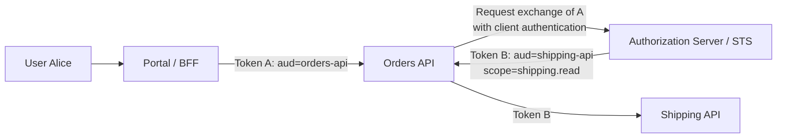
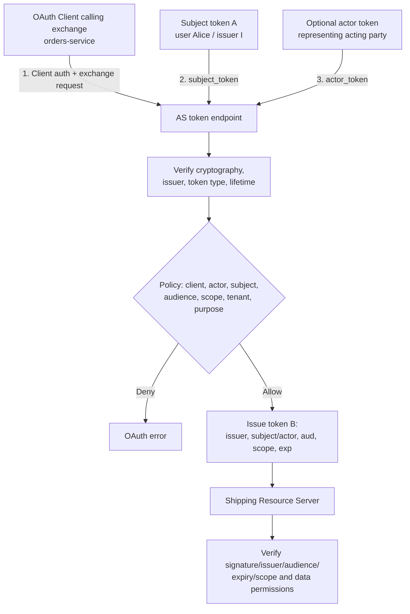
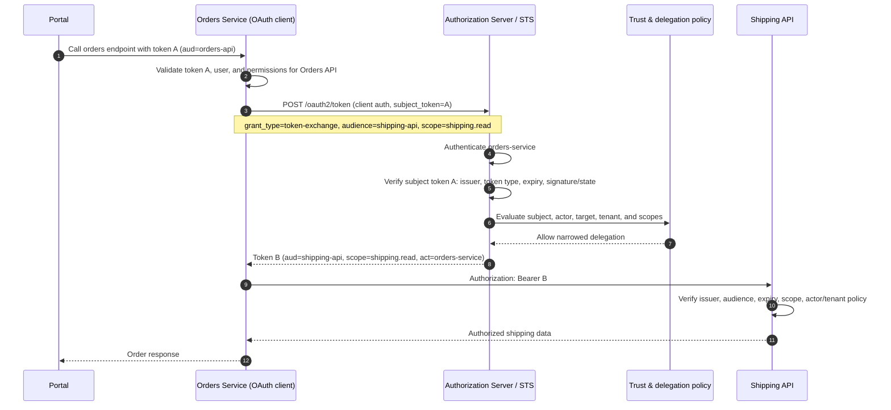
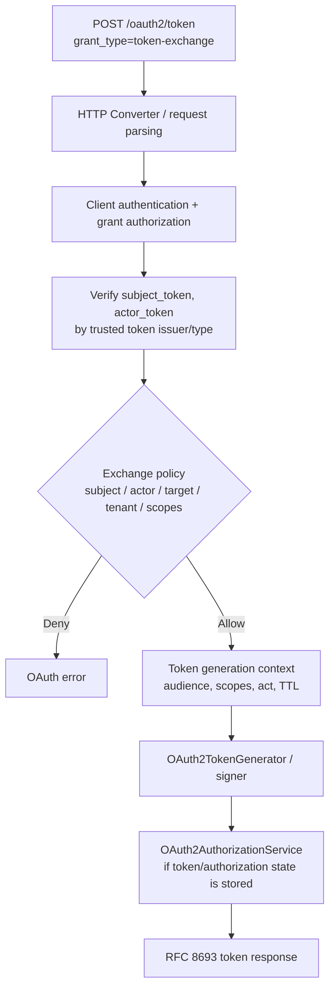

# Purpose of OAuth 2.0 Token Exchange and Trust Boundaries

In microservices architectures, API Gateways, or Backends-for-Frontends (BFF), a service may need to call another service **on behalf of a user** or **under the identity of an authorized service**. Simply forwarding the original access token across every service is often unsafe: the token may have been issued for a different audience, carry overly broad permissions, or fail to make clear which service is actually performing the action.

**OAuth 2.0 Token Exchange** (RFC 8693) is a standard mechanism for a client to present an **input security token** to an Authorization Server or Security Token Service (STS), requesting the issuance of a **new security token** tailored to the target recipient and authorization context. It enables controlled trust context transformation, but **does not automatically guarantee** delegation, impersonation, or least privilege: everything depends on the server's token verification and token issuance policies.

This lesson belongs to the **Token Exchange** chapter of the **SPRING_SECURITY_OAUTH2_OIDC_AUTHORIZATION_SERVER** module, focusing on designing, configuring, securing, testing, and operating an OAuth 2.0/OpenID Connect Authorization Server using Spring Security and Spring Authorization Server in Spring Boot.

**Learning objectives:**

- Explain why Token Exchange is needed when calling APIs across multiple tiers, and distinguish it from bearer token forwarding, `client_credentials`, refresh tokens, and introspection.
- Read and interpret RFC 8693 parameters: `subject_token`, `subject_token_type`, `actor_token`, `actor_token_type`, `requested_token_type`, `audience`, `resource`, and `scope`.
- Distinguish **subject**, **actor**, **delegation**, and **impersonation**; understand the meaning of the `act` claim and the limitations of looking only at `sub`.
- Identify trust boundaries at the client calling the exchange, the token endpoint, the policy store, and the target Resource Server.
- Design policies for narrowing permissions, checking audience/issuer, preventing confused deputy, token substitution, and cross-tenant access.
- Build an integration/token policy plan in Spring Authorization Server and a test suite covering denied cases.

## 1. The Problem: One Access Token Should Not Traverse Every Service

Consider a sales system with the following components:

| Component | Illustrative identity/address | Role |
| --- | --- | --- |
| User | `alice` | Views and creates orders. |
| Frontend/portal | `https://portal.example.com` | Initiates login via OIDC and holds the application session. |
| Authorization Server | `https://login.example.com` | Issues tokens and enforces authorization policies. |
| Orders API | audience `orders-api` | Processes orders. |
| Shipping API | audience `shipping-api` | Reads shipping details and creates delivery requests. |
| Orders backend client | `orders-service` | Component making HTTP requests from Orders to Shipping. |

Alice logs in, and the portal holds access token A intended for `orders-api`. Orders API needs to fetch shipping status from Shipping API. There are two design options:

**Approach 1 — Forward token A unchanged:**

```text
Alice -> Portal -> Orders API (A: aud=orders-api)
                        |
                        +----> Shipping API (still uses A)
```

If Shipping API **validates the audience properly**, token A issued for Orders API must be rejected. If Shipping API ignores `aud` for convenience when services call each other, the system introduces **audience confusion**: a bearer token stolen from one service can be used at another service outside its intended issuance scope.

**Approach 2 — Policy-enforced Token Exchange:**



The AS issues token B only after validating token A, authenticating the client requesting the exchange, verifying that **Orders is authorized to call Shipping on behalf of Alice**, and constraining scope/audience. Shipping accepts B only if token B passes its own validator.

**Core benefit:** token B has its **own target and permissions**, can have a short TTL, and carries actor information for audit. Token A does not need to be accepted by Shipping. This establishes proper trust boundary separation, rather than being a trick to turn every token into an all-purpose token.

### 1.1. What Token Exchange Solves and What It Does Not Solve

| Problem | How Token Exchange can help | What is still required |
| --- | --- | --- |
| Original token is not intended for the target API | Issues a token with `aud`/`resource` intended for the target API. | Target API validates audience; AS determines allowed targets. |
| Original permissions are too broad | Issues only scopes matching the request and policy. | Non-escalation rules and business/tenant checks at the API. |
| Need to know which service acts on behalf of the user | Issues a token expressing both subject and actor. | Actor is genuinely authenticated, delegation is explicitly declared, and audited. |
| Connecting multiple identity domains | Can exchange a token from a trusted issuer/format to a target token. | Trust federation, key/issuer checks, token purpose, and policy. |
| Reducing the number of services holding the original token | Confines the original token to the entry service and issues a dedicated token for the downstream hop. | Protecting token stores, TLS transport, and limiting logs. |
| Preventing token reuse after theft | Can issue short-lived or sender-constrained tokens if implemented. | Authentication/authorization at every hop; revocation, PoP, rotation by design. |

Token Exchange **does not by default** verify final resource access rights, conjure up mTLS/DPoP, revoke all prior tokens, replace PKCE, replace user login, or establish cross-issuer trust simply by accepting a JWT.

## 2. Roles and Trust Boundaries

In RFC 8693, the **client** calls the token endpoint to request an exchange, the **subject token** represents the identity/context being exchanged, and the **actor token** (if present) represents a party acting on its behalf. The Authorization Server/STS is the party evaluating whether a new token may be issued.



Several **trust boundaries** must be clearly established:

1. **Browser → frontend/BFF:** the user being logged in does not mean every browser request is authorized for a business action. The client must still manage sessions, CSRF protection, and scopes.
2. **OAuth client → token endpoint:** `client_id` is a public identifier, not proof of identity. The AS must authenticate confidential clients or apply methods/limits appropriate to the client type.
3. **Subject token → AS/STS:** a token submitted by a client is **untrusted external input** until the AS verifies its issuer, signature or introspection, purpose, expiration, and whether the token is allowed as exchange evidence.
4. **Actor token → AS/STS:** an actor token must also be verified according to policy; never accept a self-asserted `actor_token` crafted by a client to grant a service a trusted identity.
5. **AS → Target Resource Server:** the new token must be validated by the target API for `iss`, `aud`, `exp`, scope, and actor/tenant constraints when required by policy.
6. **Across tenants/issuers:** the same `sub=alice` or `client_id=orders-service` string under two issuers does not automatically refer to the same entity; identities must always be qualified with their issuer source.

**Design rule:** only a **new token issued by an authoritative AS and accepted by the target API** should cross the boundary to the target API; do not turn `subject_token` into a universal pass trusted everywhere.

## 3. How RFC 8693 Defines Token Exchange

Token Exchange is requested at the **OAuth token endpoint** using a dedicated `grant_type`:

```text
urn:ietf:params:oauth:grant-type:token-exchange
```

The client sends parameters as `application/x-www-form-urlencoded` via `POST` over HTTPS.

### 3.1. Key Parameters

| Parameter | Required? | Meaning |
| --- | --- | --- |
| `grant_type` | **Yes** | Set to the exact RFC 8693 token-exchange URN. |
| `subject_token` | **Yes** | Input security token representing the party/authorization context to be exchanged. |
| `subject_token_type` | **Yes** | Input token type, e.g., access token, JWT, or ID token using its corresponding URN. |
| `actor_token` | Optional | Security token representing the actor performing the action on behalf of the subject. |
| `actor_token_type` | Required **if `actor_token` is sent** | Type of the actor token. |
| `requested_token_type` | Optional | Desired type of token to receive; the outcome still depends on AS policy. |
| `audience` | Optional | Intended logical recipient of the issued token. |
| `resource` | Optional | Target resource URI; may be used to specify the resource where the token will be accepted. |
| `scope` | Optional | Desired permissions for the new token; cannot arbitrarily escalate privileges. |

Common token type identifiers:

```text
urn:ietf:params:oauth:token-type:access_token
urn:ietf:params:oauth:token-type:refresh_token
urn:ietf:params:oauth:token-type:id_token
urn:ietf:params:oauth:token-type:jwt
urn:ietf:params:oauth:token-type:saml1
urn:ietf:params:oauth:token-type:saml2
```

The AS **does not need** to support every token type in the table. Each accepted type must have a validator, issuer/audience constraints, and an appropriate transformation policy. `subject_token_type` is a **client declaration**, not factual proof; the AS must independently verify that the token is of the declared type and eligible for use.

**OIDC Note:** An ID token is issued to authenticate a user to an **OIDC client**, not as an access token for calling APIs. Do not allow an ID token by default to become a `subject_token` exchanged for API permissions; doing so requires a dedicated trust policy to avoid token-type confusion.

### 3.2. Illustrative Standard HTTP Request

For example, Orders service wants to obtain an access token for Shipping API on behalf of Alice:

```http
POST /oauth2/token HTTP/1.1
Host: login.example.com
Authorization: Basic <BASE64_OF_CLIENT_ID_AND_SECRET>
Content-Type: application/x-www-form-urlencoded

grant_type=urn%3Aietf%3Aparams%3Aoauth%3Agrant-type%3Atoken-exchange
&subject_token=<SUBJECT_ACCESS_TOKEN_A>
&subject_token_type=urn%3Aietf%3Aparams%3Aoauth%3Atoken-type%3Aaccess_token
&requested_token_type=urn%3Aietf%3Aparams%3Aoauth%3Atoken-type%3Aaccess_token
&audience=shipping-api
&scope=shipping.read
```

The body is wrapped across lines for readability. **When actually sent**, form pairs are properly encoded on a single request body; never send raw tokens in the query string. Basic authentication is an **example for a confidential client**; a client may also authenticate using `private_key_jwt`, mTLS, or another server-permitted method.

### 3.3. Illustrative Standard Response

If the AS accepts the request, it may return:

```http
HTTP/1.1 200 OK
Content-Type: application/json
Cache-Control: no-store
Pragma: no-cache

{
  "access_token": "<NEW_TOKEN_FOR_SHIPPING_API>",
  "issued_token_type": "urn:ietf:params:oauth:token-type:access_token",
  "token_type": "Bearer",
  "expires_in": 300,
  "scope": "shipping.read"
}
```

Fields to distinguish:

- `access_token`: the response field containing the issued token per RFC 8693. Even when the requested token type is not a conventional access token, its representation must follow the specification and corresponding implementation.
- `issued_token_type`: the **actual security token type** issued, an essential part of a Token Exchange response.
- `token_type`: how the token is presented to the recipient, such as `Bearer` when it is an OAuth bearer access token.
- `expires_in`: the advertised validity lifetime in seconds for the issued token.
- `scope`: the scopes actually granted, which may differ from the requested scope depending on policy.

**Do not conflate** `issued_token_type` with `token_type`. A value like `urn:ietf:params:oauth:token-type:access_token` describes the security token type, whereas `Bearer` describes how the token is used in OAuth. A client should inspect the actual token type before using it, rather than assuming every exchange response is a JWT access token.

### 3.4. How `resource` and `audience` Are Applied

`audience` and `resource` can be used to describe the **target** of the new token; they are not parameters that allow freely expanding token reach.

- `audience=shipping-api`: requests a token whose logical recipient is Shipping API.
- `resource=https://api.example.com/shipping`: requests a token to be used for a resource URI recognized by the AS.
- `scope=shipping.read`: requests a specific permission on that target.

The AS must determine which targets are permitted and interpret them consistently according to registrations and policies. When a client requests multiple audiences/resources or overly broad scopes, the AS can reject with `invalid_target` or an appropriate protocol error. **Do not force** the AS to issue a token for every resource a client lists.

## 4. Subject, Actor, Delegation, and Impersonation

### 4.1. Who Is the Subject?

In a typical JWT token, the `sub` claim represents the token's subject as defined by the issuer. In the example above, the subject may be user `alice`. However, a subject can also be a service principal in a machine-to-machine use case. Do not assume every `sub` is a human user.

In Token Exchange, `subject_token` carries the subject context or delegated authority to be transformed. The AS must verify the **issuing authority** and meaning of the subject token, not merely base64-decode it and copy `sub`.

### 4.2. Who Is the Actor?

The **Actor** is the entity acting **on behalf of** the subject, such as `orders-service`. In a delegation model, the AS can include the actor in the new token using the `act` claim per RFC 8693.

**Illustrative payload only**, not a signed JWT:

```json
{
  "iss": "https://login.example.com",
  "sub": "alice",
  "aud": ["shipping-api"],
  "scope": "shipping.read",
  "act": {
    "sub": "orders-service"
  },
  "iat": 1980000000,
  "exp": 1980000300
}
```

There are two identities: **Alice** is the subject (`sub`), and **Orders service** is the actor (`act.sub`). Shipping API can use both in its policy and audit logs, depending on business definitions.

**Actor token is not the same as client authentication:** `actor_token` is an RFC 8693 exchange parameter; whereas `Authorization: Basic ...`, mTLS, or `private_key_jwt` is how the client calling the token endpoint proves its identity. The two identities may coincide in an implementation, but the AS must bind them by policy rather than trusting a self-asserted actor token.

### 4.3. How Delegation and Impersonation Differ

| Concept | Meaning | Context to preserve |
| --- | --- | --- |
| **Delegation** | The actor is permitted to perform certain actions **on behalf of the subject**; an actor trail must be preserved. | Subject, actor, authorization source, scopes, audience, tenant, and lifetime. |
| **Impersonation** | The recipient sees a token with the represented subject identity; the actor may not be explicitly shown in the token. | Requires explicit impersonation authorization policy and out-of-band audit if needed. |
| **Client credentials** | A service receives a token for **its own service identity**; no user subject is necessarily involved. | Service principal, scopes, audience, client authentication. |
| **Bearer token forwarding** | Forwarding the exact same token across multiple hops. | Does not create a new token, nor narrow audience/scope or represent the actor. |

RFC 8693 describes delegation/impersonation semantics and the option to use `act`. Passing an `actor_token`, or having a client call the token endpoint with a secret, **does not automatically** make the new token accurately reflect delegation. The AS must know when to include the actor claim, and the Resource Server must understand and verify the claim according to its policy.

**Critical risk:** if Orders service can exchange any input token into a token with `sub=admin` without verifying the authorization relationship, Token Exchange becomes a **token-based privilege escalation** mechanism. A policy that "allows exchange" must never mean "allows impersonating any subject".

### 4.4. The `may_act` Claim and Actor Chains

RFC 8693 also describes `may_act` to express information about a party **that may be permitted** to act on behalf of the subject in a given context. An input token containing `may_act` is not an unconditional permit: the AS must still verify issuer, lifetime, client, actor, audience, and policy.

Illustrative claim example:

```json
{
  "sub": "alice",
  "may_act": {
    "sub": "orders-service"
  }
}
```

In multi-hop systems, `act` can represent an actor chain in the manner supported by the specification. However, a nested JSON chain supplied by a client must never be trusted on its own. An actor chain is valid only when verified issuers/ASes have validated and generated the token according to policy.

## 5. Trust Policy: Conditions Before Issuing a New Token

**The real value of Token Exchange lies in the STS authorization policy**, not in rewriting a JWT header/payload. A syntactically valid exchange request can still be denied if it fails policy.

A minimal policy for the Orders → Shipping example:

| Check | Question to answer | Expected outcome |
| --- | --- | --- |
| **Client authentication** | Is the caller truly the registered `orders-service`? | Authenticate using an appropriate method; never trust `client_id` alone. |
| **Registered grant** | Is `orders-service` allowed to request Token Exchange? | Grant permitted by both registration and policy. |
| **Subject token** | Was token A issued by a trusted issuer? Is signature/introspection valid? Is it unexpired and unrevoked? | Reject unverified JWT data. |
| **Input token purpose** | Is the AS/STS allowed to use this token type as exchange evidence? | Block ID tokens or tokens meant for other apps unless explicitly allowed by policy. |
| **Subject/actor binding** | Is Orders genuinely authorized to act for Alice? | Prevent clients from swapping subjects or asserting fake actors. |
| **Tenant binding** | Do Alice/Orders belong to a tenant compatible with the Shipping data? | Prevent cross-tenant access caused by matching IDs. |
| **Target allowlist** | Is `shipping-api` an allowed exchange target for Orders? | Reject audiences/resources outside policy. |
| **Scope downscoping** | Can `shipping.read` be derived from the source permissions and delegation policy? | Do not grant `shipping.admin` or broader permissions than allowed. |
| **TTL and token type** | Does the new token have an appropriate lifetime, format, and binding? | New tokens are typically short-lived and scoped to the target API. |
| **Audit and state** | Is there sufficient trail of issuer, subject, actor, client, target, and decision? | Record necessary metadata without logging raw tokens. |

### 5.1. Downscoping Is Not Simply the Intersection of Two Scope Strings

Two APIs may use different scope vocabularies:

```text
Token A for Orders API:
  aud = orders-api
  scope = orders.read orders.manage

Token B needed for Shipping API:
  aud = shipping-api
  scope = shipping.read
```

Because `shipping.read` is not in the `orders.*` list, **string intersection of scopes** cannot express this authorization relationship. Policy may define that a user permitted to manage orders and the Orders service are allowed to read shipping status **within the same tenant and for related orders**. This mapping must be **controlled at the STS and enforced on the object at the target API**, never decided by the client.

An illustrative policy:

```text
ALLOW exchange if
  authenticated_client == "orders-service"
  AND input.issuer == "https://login.example.com"
  AND input.subject != null
  AND input.audience == "orders-api"
  AND input.scopes contains "orders.read"
  AND requested_audience == "shipping-api"
  AND requested_scopes subset_of {"shipping.read"}
  AND input.tenant == authenticated_client.allowed_tenant

ISSUE
  subject = verified input.subject
  actor = authenticated_client identity
  audience = "shipping-api"
  scope = "shipping.read"
  ttl <= configured maximum and bounded by accepted source context

DENY otherwise
```

This is a **policy model**, not a built-in rule automatically enforced by Spring Authorization Server. If tenant or order ownership cannot be conclusively verified at the STS, Shipping API must still enforce them on each specific resource request.

### 5.2. The New Token Must Never Self-Escalate Privileges

Dangerous mistake:

```text
request.scope=admin
=> STS signs a JWT with scope=admin because the client is authenticated
```

Client authentication only proves **who the client is**, not that the client may be issued arbitrary permissions. The STS must combine the original subject's permissions, the actor's delegation authority, the allowed target/scope list, and business policy.

If a requested scope is not permitted, the server can reject the request or issue a narrowed scope set if the protocol and client contract allow it. The client must inspect `scope` in the response instead of assuming every requested scope was granted.

### 5.3. Which STS or API Was the Input Token Issued For?

A JWT access token issued for `orders-api` is **not automatically** trusted for exchanging into any other token. When allowing `orders-service` to present it at the token endpoint, the system must clearly define:

- Which issuers the STS trusts to verify input tokens.
- Which token types are allowed as `subject_token`.
- Whether the input token's audience/purpose qualifies for exchange.
- What evidence shows the caller is actually authorized to represent the token's subject.
- Whether the token may be reused across multiple exchanges and under what limits.

When exchanging tokens from an **external issuer**, do not share validators or JWKS unconditionally. Require explicit trust mappings per issuer and token type to avoid accepting a staging JWT as a production token.

## 6. End-to-End Token Exchange Flow

### 6.1. Complete Data Flow



Each boundary has its own **trust target**:

- Orders should not accept token A merely because it parses as a JWT; it must verify that the token is intended for Orders.
- The STS must not trust `subject_token` or `actor_token` merely because they were sent by an authenticated client.
- Shipping must not accept token A if it was only intended for Orders.
- Token B may remain valid even if token A is later revoked, depending on state checks and lifecycle design. There is no automatic rule that child tokens immediately expire or become revoked when the parent token expires or is revoked.

### 6.2. Choosing a Lifetime for Token B

Suppose access token A has 15 minutes remaining, and the exchange policy caps B at 5 minutes. A conservative choice is to bound B so it does not extend delegation beyond A's remaining lifetime and authority, while staying shorter than the limit allowed for Shipping.

However, **RFC 8693 does not mandate a universal TTL formula** for every scenario. In federated systems, subject token characteristics and policies may differ. You must establish explicit rules: maximum TTL, absolute delegation deadline, revocation conditions, state-checking capability, or sender-constrained token requirements.

Never simply copy `exp` from the source token and assume it is safe. Token B needs an expiration governed by the STS's own policy, and the target Resource Server must enforce it.

### 6.3. Should Token A Be Forwarded Alongside Token B?

Normally, the client only needs to send token B to Shipping API if the contract specifies B. Forwarding both A and B across multiple hops increases leakage exposure, creates ambiguity over which token is verified, and makes it easier for APIs to bypass policy.

If additional claims or trace context must be propagated, use a controlled audit/trace mechanism; never log raw subject tokens or blindly embed the entire token A inside a claim of B.

## 7. How Token Exchange Differs from Other OAuth Grants and Mechanisms

| Mechanism | Primary input | Output | How it differs from Token Exchange |
| --- | --- | --- | --- |
| **Authorization Code** | Authorization code after browser redirect; PKCE when applicable. | Access token and possibly ID/refresh token. | Transitions from user interaction to a token, rather than exchanging an input security token for a new target token. |
| **Refresh Token** | Previously issued refresh token. | New access token under the existing authorization. | Preserves prior authorization; does not natively transform audience/subject/actor under exchange semantics. |
| **Client Credentials** | Client authentication of the service. | Token for the service principal. | Does not require a subject token and does not inherently represent acting on behalf of a user. |
| **Token Introspection** | Token to query state for. | Token metadata/state. | Does not request issuance of a new security token. |
| **Token Revocation** | Token to revoke. | Protocol revocation acknowledgement. | Does not create a new token. |
| **Token forwarding** | Unchanged token A. | No new token. | Does not narrow audience or record actor identity at the token level. |
| **Token Exchange** | Subject token, optional actor token, plus client authentication/policy. | New security token for an approved context. | Performs controlled transformation of the trusted context. |

**An OIDC ID Token differs from an OAuth Access Token.** An ID token is intended for an OIDC Relying Party to verify a login event; it should not be sent to a Resource Server as a bearer access token, nor used as an exchange input without a very specific policy.

## 8. Implementing with Spring Authorization Server

Spring Authorization Server provides `RegisteredClient`, `RegisteredClientRepository`, `OAuth2AuthorizationService`, `OAuth2TokenGenerator`, `TokenSettings`, and token endpoint configuration mechanisms. **Built-in Token Exchange support or specific extension points depend on the exact Spring Authorization Server version in use.** Verify your library version before deciding whether to configure built-in components or implement a custom grant extension. Do not assume every Spring Boot 3.x / SAS 1.x release supports full RFC 8693 out of the box simply because the token endpoint works.

Here we present the **integration model and security contracts**, without claiming that a single example bean produces a complete Token Exchange server.

### 8.1. Registering a Client Allowed to Request Token Exchange

Versions with corresponding API constants may provide the grant type out of the box; to represent the RFC 8693 value in a version-independent way, it can be constructed as an `AuthorizationGrantType` holding the URN:

```java
package com.example.authserver.config;

import java.time.Duration;
import java.util.UUID;

import org.springframework.beans.factory.annotation.Value;
import org.springframework.context.annotation.Bean;
import org.springframework.context.annotation.Configuration;
import org.springframework.security.crypto.password.PasswordEncoder;
import org.springframework.security.oauth2.core.AuthorizationGrantType;
import org.springframework.security.oauth2.core.ClientAuthenticationMethod;
import org.springframework.security.oauth2.server.authorization.client.InMemoryRegisteredClientRepository;
import org.springframework.security.oauth2.server.authorization.client.RegisteredClient;
import org.springframework.security.oauth2.server.authorization.client.RegisteredClientRepository;
import org.springframework.security.oauth2.server.authorization.settings.TokenSettings;

@Configuration(proxyBeanMethods = false)
public class ExchangeClientRegistrationConfig {

    private static final AuthorizationGrantType TOKEN_EXCHANGE =
        new AuthorizationGrantType(
            "urn:ietf:params:oauth:grant-type:token-exchange");

    @Bean
    RegisteredClientRepository registeredClientRepository(
            PasswordEncoder encoder,
            @Value("${demo.orders-service-secret}") String secret) {

        RegisteredClient ordersService = RegisteredClient
            .withId(UUID.randomUUID().toString())
            .clientId("orders-service")
            .clientSecret(encoder.encode(secret))
            .clientAuthenticationMethod(
                ClientAuthenticationMethod.CLIENT_SECRET_BASIC)
            .authorizationGrantType(TOKEN_EXCHANGE)
            .scope("shipping.read")
            .tokenSettings(TokenSettings.builder()
                .accessTokenTimeToLive(Duration.ofMinutes(5))
                .build())
            .build();

        return new InMemoryRegisteredClientRepository(ordersService);
    }
}
```

Demo `application.yml`:

```yaml
demo:
  orders-service-secret: ${ORDERS_SERVICE_SECRET}
```

**Important:**

- `authorizationGrantType(TOKEN_EXCHANGE)` only records **permission for the client to use the grant** in the registration. It **does not** automatically provide an HTTP request converter, `subject_token` validation, authorization policy, or RFC 8693 token issuance.
- `CLIENT_SECRET_BASIC` is an illustrative choice for a confidential backend client; it can be replaced with `private_key_jwt` or mTLS depending on your threat model. Always use HTTPS.
- `scope("shipping.read")` defines the scope boundary the client may be considered for, and **does not** replace checking the subject token and Alice's delegation permissions.
- `TokenSettings` configures TTL; it does not automatically inject `audience=shipping-api`. Setting `aud`, `act`, or custom claims requires support from the corresponding token issuance/customizer logic.
- `InMemoryRegisteredClientRepository` is for demo purposes only; production requires a persistent client store and audited registration changes.
- Do not define a duplicate repository bean if the application already has one. This sample illustrates *one* example registration only.

### 8.2. Required Responsibilities at the Token Endpoint

Depending on the version, the token endpoint may support the grant via framework-provided converters/providers or require an extension. Either way, a proper Token Exchange implementation must:

1. **Receive the request:** parse `grant_type`, `subject_token`, `subject_token_type`, and optional RFC 8693 parameters while bounding payload size and parameter count.
2. **Authenticate the client:** obtain the authenticated client from the Spring Security context / AS mechanism; verify the client is registered for the Exchange grant.
3. **Verify the input token:** select a validator based on **allowed issuers and token types**; check signature/introspection, expiration, audience/purpose, status, token type, and keys.
4. **Verify the actor:** if `actor_token` is present, validate it separately; bind the actor to the authenticated client and the subject it is allowed to represent.
5. **Make the authorization decision:** evaluate client, subject, actor, requested audience/resource, scopes, tenant, TTL, and business conditions.
6. **Generate the token:** issue a token containing `iss`, `sub`, `aud`, `scope`, `exp`, and `act` when genuinely representing delegation; sign/persist state according to the chosen format.
7. **Return the response:** include `issued_token_type`, `token_type`, `expires_in`, and `scope` as applicable; never return raw input tokens or secrets.
8. **Audit and mitigate risks:** rate-limit, monitor errors, avoid logging tokens, and manage token replay and revocation mechanisms.



**Never bypass Spring's default validators when customizing the endpoint.** If using an extension, register converters/providers strictly via the version's supported API, preserving ordering and compatibility with existing active grants. Never build a separate `POST /oauth2/token` controller that signs JWTs outside Spring's validation chain.

### 8.3. Keep the Policy Engine as a Dedicated Component

Avoid writing the policy as a single statement like "if the client is authenticated, issue the token." Extract a dedicated decision class/service with explicit inputs and outputs.

Pseudocode:

```text
exchange(request, authenticatedClient):
    require registeredGrant(authenticatedClient, TOKEN_EXCHANGE)

    subject = verifyToken(
        request.subjectToken,
        request.subjectTokenType,
        acceptedIssuersAndTypesFor(authenticatedClient)
    )

    actor = request.actorToken != null
        ? verifyActorToken(request.actorToken, request.actorTokenType)
        : authenticatedClient.identity

    require policy.canActFor(actor, subject)
    target = policy.resolveTarget(request.audience, request.resource)
    require policy.clientCanCall(authenticatedClient, target)
    require policy.subjectCanDelegateTo(subject, actor, target)

    grantedScopes = policy.downscope(
        subject, authenticatedClient, target, request.scope
    )
    require grantedScopes is permitted and non-ambiguous

    claims = {
        iss: configuredIssuer,
        sub: verifiedSubjectId,
        aud: target,
        scope: grantedScopes,
        act: verifiedActorIfDelegation,
        exp: boundedExpiry
    }
    return signIssueAndPersist(claims)
```

This is **pseudocode**, not a built-in Spring API named `policy.canActFor`. The checks express the **business contract** your implementation must provide. When multiple issuers or tenants participate, subject/actor identifiers need sufficient context to prevent collisions, typically pairing issuer and subject identifier.

### 8.4. Issuing a JWT for the Target API and Validating Audience

An illustrative JWT token B:

```json
{
  "iss": "https://login.example.com",
  "sub": "alice",
  "aud": ["shipping-api"],
  "scope": "shipping.read",
  "act": {
    "sub": "orders-service"
  },
  "tenant_id": "tenant-a",
  "iat": 1980000000,
  "exp": 1980000300
}
```

The `tenant_id` claim is an **illustrative custom claim**, not a required RFC 8693 claim. The AS must derive it from a trusted source and include it only when truly needed; the RS must never trust arbitrary tenant IDs sent in a client request.

Spring Resource Server can configure trust based on the issuer, for example:

```yaml
spring:
  security:
    oauth2:
      resourceserver:
        jwt:
          issuer-uri: https://login.example.com
```

This configuration enables validating tokens from a trusted issuer under the JWT Resource Server mechanism, but **does not mean audience/actor/tenant are fully checked**. Shipping API must still require audience `shipping-api`, scope `shipping.read`, and—if the design relies on delegation—verify the actor and per-order tenant permissions.

An illustrative method-level rule showing scope only:

```java
@PreAuthorize("hasAuthority('SCOPE_shipping.read')")
public ShipmentDetails getShipment(String shipmentId) {
    // Must still verify that the shipment belongs to the authorized tenant/user.
    return shipmentService.findAuthorizedShipment(shipmentId);
}
```

The snippet above does not include an audience validator or the implementation of `findAuthorizedShipment(...)`. Both must be properly configured and implemented in a real application.

## 9. Attack Patterns When Token Exchange Is Poorly Designed

### 9.1. Confused Deputy — Client Requests Permissions on Behalf of an Unauthorized User

A trusted service holds strong credentials yet accepts external requests. An attacker tries to trick that service into using its own authority to request a token with higher privileges than the user holds.

**Defense:** the STS validates both subject and actor, not just client authentication; scopes and targets must be permitted by policy, and the target API still enforces object/tenant ownership.

### 9.2. Token Laundering — Turning a Low-Trust Token into a Broadly Trusted Token

A JWT issued by an external issuer or staging environment is submitted as `subject_token`. If the STS simply decodes `sub` and signs a production token with the same `sub`, it has "laundered" untrusted input into a token signed by the internal issuer.

**Defense:** per-token-type and per-client issuer allowlists, signature verification or introspection, `exp`/`nbf`, purpose/audience checks, and explicit identity mapping. Never configure wildcard trust for arbitrary OIDC issuers just because they publish a public JWKS.

### 9.3. Audience Substitution — Token Intended for A Is Used at B

The AS receives token A with `aud=orders-api` and issues B with `aud=billing-admin` merely because the request asked for it.

**Defense:** audience/resource target allowlists; policies binding client, subject, actor, and scopes; return `invalid_target` when the target is not allowed.

### 9.4. Scope Escalation — Requesting Broader Privileges

A client holding `orders.read` tries to exchange it for `shipping.admin` or `system.manage` without any delegation basis.

**Defense:** controlled downscoping/mapping, appropriate consent/authorization context; never treat the `scope` parameter as a self-service privilege grant.

### 9.5. Subject/Actor Swap

An attacker sends a `subject_token` for user A along with a forged `actor_token` for service B, or tries to inject an arbitrary `act.sub`.

**Defense:** validate each piece of evidence independently and verify the relationship between subject, actor, and the authenticated client. Never copy claims from an unverified token.

### 9.6. Cross-Tenant Identity Collision

Two issuers both have `sub=alice`, or a client authorized for tenant A requests a token for tenant B.

**Defense:** qualify identities with issuer/tenant context and policy; never use a bare `sub` as a global identity in federated setups. The target API must enforce resource ownership.

### 9.7. Token Type Confusion

A client submits an ID token or a non-access JWT as `subject_token`, and the AS treats it as a valid access token simply because the signature verifies.

**Defense:** `subject_token_type` allowlists, validators checking token purpose, issuer, audience, token claims, and application-specific trust policies. Never use a single generic JWT parser that ignores context.

### 9.8. Token Replay or Token Leakage in Logs

A stolen bearer subject token or token B can be replayed while still valid if tokens are not sender-constrained and abuse goes undetected.

**Defense:** TLS, bounded TTLs, token store management, never logging raw tokens, and considering mTLS/DPoP or introspection/revocation where appropriate. Token Exchange **does not automatically** consume or invalidate the subject token after a single exchange.

### 9.9. Unrestricted Exchange Chains

Service A exchanges a token for B, B exchanges for C, and so on until permissions or provenance become obscured or chained exchanges are abused.

**Defense:** limit hops/targets, preserve explicit actor chains when needed, enforce overall TTL, exchange depth limits, and anti-escalation policy at every hop. Do not assume by default that a child token of any token is allowed to request further exchanges.

## 10. Protocol Errors and Handling

Token Exchange is an OAuth grant at the token endpoint. In addition to standard OAuth errors, RFC 8693 defines `invalid_target` when a requested target is unacceptable.

| Scenario | Suggested error/handling | Notes |
| --- | --- | --- |
| Missing `subject_token` or `subject_token_type` | `invalid_request` | Request is missing required parameters. |
| `actor_token` present without `actor_token_type` | `invalid_request` | Parameters must be consistent. |
| Invalid client authentication | `invalid_client` | Reject before evaluating exchange policy. |
| Client not permitted to use the exchange grant | `unauthorized_client` | Grant registration and policy are distinct conditions. |
| Subject token expired, wrong type, or untrusted | Appropriate grant/token error (typically `invalid_grant`). | Do not leak sensitive token details in the response. |
| Requested audience/resource is forbidden or target set cannot be satisfied | `invalid_target` per RFC 8693 | Do not substitute a broader target. |
| Scope exceeds permitted rights | `invalid_scope` or appropriate policy error | Do not escalate privileges just because the request asks for them. |
| Token/JWKS/issuer verification dependency temporarily unavailable | Fail closed with an appropriate error | Never fail-open or skip signature verification. |

Exact error codes also depend on context and implementation. What matters most is **never issuing a new token** when the client, input token, actor, or target has not been verified. Do not return user claims, raw tokens, internal exceptions, or the list of trusted issuers in error messages.

## 11. Operations and Storage Design

### 11.1. Managing Trust Sources

If the STS accepts tokens from multiple issuers, maintain a governed **trust registry**:

- Canonical issuer identifiers, never inferred from the request `Host` header.
- Signature verification methods (JWKS/keys) or trusted introspection endpoints.
- Accepted token types; allowed subject/client/tenant mappings.
- Rules for audience/purpose, scope conversion, and actor proof.
- Trust update/revocation procedures, JWKS cache bounds, and key rotation.
- Strict separation of dev/staging/production; prevent staging issuers from being accidentally trusted in production.

Server-configured JWKS or introspection URL fetches must be protected against SSRF and redirects to untrusted destinations. Never use a URL supplied by the exchange request as the key source for verifying tokens.

### 11.2. State Storage and Revocation Capability

With self-contained JWTs, token B can be verified offline by the target API. If subject token A is later revoked, JWT B does not disappear on its own. If policy requires propagating revocation from the original authorization, you may need:

- Short TTLs for B.
- Token introspection / reference tokens for sensitive resources.
- Queryable denylists or authorization/delegation state.
- A revocation event handled safely by the Resource Server.
- Sender-constraining mechanisms suited to the threat model.

Do not equate "token issued via exchange" with "automatic parent-child revocation." Parent/child relationships must be explicitly designed, stored, and checked if required.

### 11.3. Rate Limiting, Audit, and Observability

The exchange endpoint can be probed with many targets, scopes, or input tokens. Monitor:

| Metric / event | Meaning |
| --- | --- |
| `token_exchange_requests_total` by client and outcome | Detect high-volume callers or unusual denial rates. |
| `token_exchange_invalid_target_total` | Detect invalid targets or target probing attempts. |
| `token_exchange_input_validation_failure_total` | Measure input token failures by controlled type/issuer. |
| `token_exchange_latency` | Track latency of key lookup/introspection/policy and token signing. |
| `token_exchange_delegation_denied_total` | Record policy denials for subject-actor-target combinations. |
| `token_exchange_issued_total` | Track issued tokens by constrained audience/scope. |

Audit logs should include request ID, authenticated client ID, validated issuer/subject/actor identifiers, target, granted scopes, policy decision, and timestamp; **never log raw subject tokens, actor tokens, token B, client secrets, or private keys**.

### 11.4. Multi-Instance Deployments and Policy Updates

When running multiple AS/STS instances, keep consistent across all nodes:

- AS issuer, signing keys, and JWKS.
- Registered clients and grant/target permissions.
- Trust registry and accepted issuer key sets.
- Exchange policy and policy version (optionally recorded in audit logs).
- Authorization/delegation state if immediate revocation or parent–child tracking is required.
- Caches and TTLs for metadata, token validation, and JWKs.
- System clocks, token lifetimes, and rolling rollouts.

Two instances enforcing different policies can allow an input token on one instance while denying it on another. Avoid un-invalidated caches when updating sensitive trust or target policies.

## 12. Test Matrix for Token Exchange and Trust Boundaries

A test that only checks whether the token endpoint returns HTTP `200` does not prove Token Exchange is secure. You must test issued cases, denied cases, and enforcement on the target API.

| Case | Expected outcome |
| --- | --- |
| Valid client, valid input token, allowed target and scope | Issues B with proper `iss`, `sub`, `aud`, `scope`, TTL, and `act` for delegation. |
| Missing `subject_token` | Denied; no token issued. |
| Missing `subject_token_type` | Denied. |
| `actor_token` provided without `actor_token_type` | Denied. |
| Unauthenticated client or invalid secret/JWT assertion | `invalid_client` or appropriate authentication error. |
| Valid client not registered for the exchange grant | Token issuance denied. |
| Input token with tampered signature | Denied; never decode and trust claims anyway. |
| Expired or not-yet-valid input token | Denied per lifetime policy. |
| Input token from untrusted issuer | Denied. |
| ID token declared as an access token | Denied for wrong token type/purpose. |
| Staging input token sent to production | Denied if issuer is not permitted. |
| Subject token for user A, self-asserted actor token for user/service B | Denied if actor proof or delegation authorization is missing. |
| Orders client requests target `billing-admin` | `invalid_target` or policy error; no token issued. |
| Client requests scope `shipping.admin` | No privilege escalation; denied or handled by explicit policy. |
| Subject and actor belong to unlinked tenants | Denied. |
| B issued for `shipping-api` sent to `orders-api` | Orders API rejects due to audience mismatch. |
| B has valid `iss` but insufficient scope | Target API rejects unauthorized operation. |
| B has valid scope but requests an order from another tenant | API rejects based on resource authorization. |
| Key/issuer trust changes while input token is alive | Validation uses updated trusted config/keys; never fails open. |
| Token A revoked after B was issued | Test clarifies whether B remains accepted per actual policy. |
| Client sends multiple audiences or invalid resource | Denied/narrowed per contract; never issues an overly broad token. |
| Multi-hop actor chain or exceeding hop limit | Preserves actor trail and never expands privileges beyond policy. |
| Repeated exchange requests with bearer token A | Behavior matches replay/rate-limit policy; do not assume A is auto-consumed. |
| Oversized malformed subject token or duplicate parameters | Safely rejected within bounded parse/verify resources. |
| One AS instance configured with a different policy | Tests catch inconsistent behavior before deployment. |

### 12.1. Testing the Request with `curl`

Example for a confidential client in a test environment where `SUBJECT_TOKEN_A` holds a valid value:

```bash
curl --silent --show-error --fail-with-body \
  --user "orders-service:$ORDERS_SERVICE_SECRET" \
  --header "Content-Type: application/x-www-form-urlencoded" \
  --data-urlencode \
    "grant_type=urn:ietf:params:oauth:grant-type:token-exchange" \
  --data-urlencode "subject_token=$SUBJECT_TOKEN_A" \
  --data-urlencode \
    "subject_token_type=urn:ietf:params:oauth:token-type:access_token" \
  --data-urlencode \
    "requested_token_type=urn:ietf:params:oauth:token-type:access_token" \
  --data-urlencode "audience=shipping-api" \
  --data-urlencode "scope=shipping.read" \
  "https://login.example.com/oauth2/token"
```

This command only works when the AS **already supports and has configured Token Exchange** and the client, subject token, and policy are prepared. It cannot conjure up a grant extension on its own. Never enable verbose flags with real credentials or paste tokens into logs/chat; test scripts should mask sensitive values.

### 12.2. Verifying Token B at the Resource Server

Tests should cover:

1. The AS returns `issued_token_type` and token B carries the Shipping audience per policy.
2. Shipping API accepts B **only when** issuer, signature/introspection, expiry, audience, scope, and data permissions are valid.
3. Orders API rejects B when B is not intended for Orders.
4. Shipping API rejects A when A is only intended for Orders.
5. When delegation semantics are used, Shipping's audit and access policy correctly identify Alice (subject) and Orders service (actor), without treating the actor as the user.
6. If immediate revocation is required, measure the time from revoking the input/authorization until Shipping stops accepting B.

**Do not merely decode a JWT to conclude it is valid.** Decoding the payload helps inspect claims in tests; the Resource Server must enforce cryptographic verification and all authorization conditions.

## 13. Common Implementation Pitfalls

### 13.1. `unsupported_grant_type` When Sending `token-exchange`

The running Spring Authorization Server version may not enable or implement the Token Exchange grant yet, or the client/endpoint may be misconfigured. Check **version support** and how to configure the corresponding converter/provider/token endpoint. Adding `AuthorizationGrantType` to a client registration is **not enough** if the server lacks a handler for that grant.

### 13.2. `invalid_client` Even Though Alice's Subject Token Is Valid

A valid input token does not replace client authentication. Check the authentication method of the client calling exchange: secret, JWT assertion, mTLS certificate, or another server-permitted mechanism; a client ID is not a password.

### 13.3. `invalid_target` When Requesting a Token for Shipping

Check the `audience/resource` target mapping, whether `orders-service` is allowed to use that target, subject/actor policy, and the number of requested targets. Never "fix" this by issuing a wildcard `*` audience.

### 13.4. Token B Has `sub=alice`, But the API Does Not Know Which Service Called It

You may have issued an **impersonation** token or omitted `act` from the token. If business requirements demand delegation auditing, configure the policy and claim explicitly; never infer the actor solely from the client IP or an unverified header on the API request.

### 13.5. Token B Has a Valid Signature, But the API Returns 401/403

Check the issuer, `shipping-api` audience, `exp`, scope permissions, and the API's JWT/introspection configuration. `401` typically indicates invalid authentication/token, while `403` typically indicates insufficient permissions; diagnose based on your actual configuration and response. Never disable audience validation just to make token B pass.

### 13.6. Token B Is Issued for the Wrong Tenant

The STS may have copied `tenant_id` from the client's request or mapped the user solely by `sub` without the issuer. Establish trusted claim sources, tenant mappings, and object-level authorization checks at Shipping.

### 13.7. The Input Token Was Revoked, Yet Token B Still Works

Exchange issues a new token with its own lifecycle; a JWT B validated offline by an API does not automatically know the source token was revoked. If this is a security requirement, explicitly design token lifetimes, revocation propagation, or shared token state.

## 14. Practice Exercise: Designing Three-Tier On-Behalf-Of Access

A system has three tiers:

| Component | Role | Relevant permissions |
| --- | --- | --- |
| `staff-portal` | Web BFF logging Alice in via OIDC | Calls Orders API. |
| `orders-service` | Order-processing backend, confidential OAuth client | Checks Alice's permissions; calls Shipping on behalf of Alice. |
| `shipping-service` | Resource Server receiving the exchanged token | May only read shipping status for orders belonging to the matching tenant. |

Business requirements: Alice views orders belonging to `tenant-a`; Orders must call Shipping to read shipping status. `shipping.write` must never be granted, Billing API must never be called, and the actor must be traceable.

Answer the following:

1. Which audience is token A issued for? Why must Shipping reject A unchanged if `aud=orders-api`?
2. Who is the **subject** and who is the **actor** in token B? What sources can authenticate them?
3. How does client authentication at the token endpoint differ from `actor_token`?
4. Is `scope=shipping.read` in the request alone enough to prove permission should be granted? What policies must the AS evaluate?
5. If Orders requests `audience=billing-admin`, what RFC 8693 error is appropriate to return?
6. Why must token B carry an audience targeting Shipping? What else must Shipping verify beyond the JWT signature?
7. If token A has 2 minutes left and the new token's configured TTL is 10 minutes, how should you bound B's lifetime so delegation is not extended unintentionally?
8. If Alice and Orders belong to different tenants, where should the token exchange be rejected?
9. Can a JWT from a staging issuer with `sub=alice` be used as production evidence?
10. After B is issued, does revoking A immediately cause Shipping to reject B? What solutions are needed if an SLA requires immediate revocation?
11. In Spring Authorization Server, is adding the grant type to `RegisteredClient` sufficient to have a working RFC 8693 handler?
12. What test cases are needed to prove client A cannot obtain a token claiming client B as its actor?

**Hint:** The AS verifies token A and Orders' delegation authority, then decides whether to issue B with `sub=alice`, `act.sub=orders-service`, `aud=shipping-api`, and `scope=shipping.read` within policy limits. Shipping must verify B and actual object-level permissions. Never trust a claim or parameter supplied by a client before verifying its origin.

## 15. Secure Token Exchange Design Checklist

- [ ] Identified a valid token-exchange use case rather than working around broken audience validation by disabling validators.
- [ ] Clearly separated subject, actor, authenticated OAuth client, and target Resource Server.
- [ ] Validated `subject_token` and `actor_token` (if present) by issuer, token type, purpose, expiration, and cryptography/introspection.
- [ ] Registered/authorized the client for the token-exchange grant with strong authentication and TLS.
- [ ] Enforced explicit AS policy for subject–actor delegation/impersonation so clients cannot arbitrarily choose who to represent.
- [ ] Restricted target audience/resource; rejected wildcard `*` targets or tokens valid for all APIs.
- [ ] Downscoped/mapped scopes on the server instead of blindly copying requested scopes; enforced tenant and business data checks.
- [ ] Issued new tokens with appropriate TTL and token type, clear issuer/audience, and `act` claim when delegation is required.
- [ ] Configured the Resource Server to validate signature or introspection, issuer, audience, expiration, scopes, actor/tenant policy, and per-resource authorization.
- [ ] Defined the revocation relationship between the subject token and new token; never assumed a revoked parent automatically revokes child tokens.
- [ ] Protected against token-type confusion, confused deputy, token laundering, SSRF/JWKS trust issues, and cross-tenant escalation.
- [ ] Excluded raw subject/actor/issued tokens from logs while capturing sufficient audit records to investigate exchange decisions.
- [ ] Tested happy paths and all denial paths, including wrong issuer/type input tokens, forged actors, unknown targets, and excessive scopes.
- [ ] Verified Token Exchange support in the exact Spring Authorization Server version in use rather than only registering the grant on the client.
- [ ] Synchronized issuer, signing keys, trust policy, client registrations, and authorization state across multiple AS instances where needed.
- [ ] Established procedures for policy changes, rate limiting, monitoring `invalid_target`/`invalid_grant`, and revocation drills.

**Takeaway:** OAuth 2.0 Token Exchange under RFC 8693 is a mechanism to **request a new token from an input security token**, typically to change target, permissions, or delegation context. It does **not** mean the input token is inherently trustworthy, that a client may impersonate anyone, or that the new token is automatically safe just because it carries an Authorization Server signature. Security value comes from **evidence verification, subject–actor–target–scope policies, and Resource Server enforcement**, combined with proper token lifecycle management and operational discipline.

**References:**

- [RFC 8693 — OAuth 2.0 Token Exchange](https://www.rfc-editor.org/rfc/rfc8693.html): defines the grant, parameters, response, subject/actor, and delegation/impersonation semantics.
- [RFC 6749 — OAuth 2.0 Authorization Framework](https://www.rfc-editor.org/rfc/rfc6749.html): token endpoint, client authentication, access tokens, and scopes.
- [RFC 8707 — Resource Indicators for OAuth 2.0](https://www.rfc-editor.org/rfc/rfc8707.html): resource indicators and bounding tokens to target resources.
- [RFC 9700 — Best Current Practice for OAuth 2.0 Security](https://www.rfc-editor.org/rfc/rfc9700.html): token protection, client authentication, and trust boundaries.
- [RFC 7662 — OAuth 2.0 Token Introspection](https://www.rfc-editor.org/rfc/rfc7662.html): verifying token state using the introspection model.
- [RFC 7009 — OAuth 2.0 Token Revocation](https://www.rfc-editor.org/rfc/rfc7009.html): token revocation and its relationship to resource verification.
- [Spring Authorization Server — Core Model and Components](https://docs.spring.io/spring-authorization-server/reference/core-model-components.html): `RegisteredClient`, `OAuth2AuthorizationService`, `TokenSettings`, and token generators.
- [Spring Authorization Server — Protocol Endpoints](https://docs.spring.io/spring-authorization-server/reference/protocol-endpoints.html): token endpoint and version-specific grant support/extension points.
- [Spring Security — OAuth2 Resource Server](https://docs.spring.io/spring-security/reference/servlet/oauth2/resource-server/index.html): JWT/opaque token validation and resource authorization.
