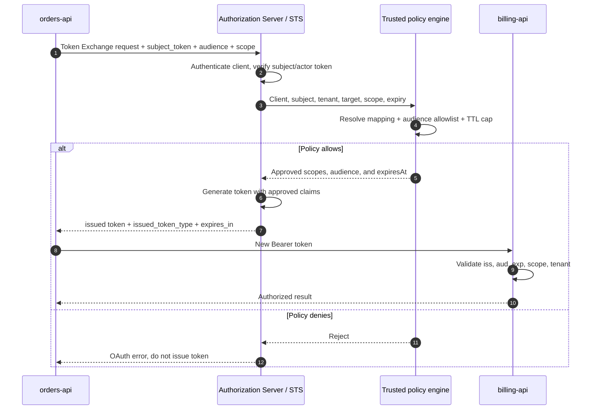
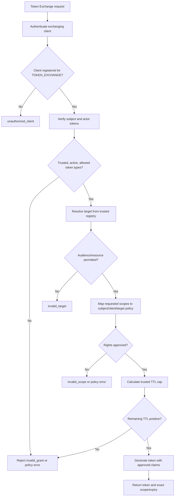

# Limiting Scope, Audience, and TTL of Exchanged Tokens

## 1. Why Must Token Exchange Restrict Privileges?

In the **Token Exchange** chapter of the **SPRING_SECURITY_OAUTH2_OIDC_AUTHORIZATION_SERVER** module, we learn how to design, configure, secure, test, and operate an OAuth 2.0/OpenID Connect Authorization Server using Spring Security and Spring Authorization Server in a Spring Boot application.

Suppose `orders-api` holds a user's Access Token to read orders. To call `billing-api` to fetch invoice status, the service should not forward the incoming token unchanged to another API and expect that service to honor all permissions. A token issued for `orders-api` can have an audience, scopes, and lifetime unsuitable for `billing-api`.

**OAuth 2.0 Token Exchange** under RFC 8693 allows a controlled client to submit a **subject token** to the Authorization Server (acting as a Security Token Service, STS) to request a **new** token whose permissions and intended recipient are determined by policy.

Example:

```text
subject_token:
    iss   = https://auth.example.com
    sub   = user-123
    aud   = orders-api
    scope = orders.read orders.write
    exp   = 10:20

Token Exchange at 10:15:
    exchanging client = orders-api
    requested audience = billing-api
    requested scope = invoice.read

Token issued if policy allows:
    iss   = https://auth.example.com
    sub   = user-123
    aud   = billing-api
    scope = invoice.read
    exp   = 10:18
```

**Never infer** that `orders.read` automatically permits `invoice.read`: the scope names belong to two different APIs, and only an **approved permission mapping rule** legitimizes that transition. Conversely, if the source token or client is not authorized, the request must be rejected.

Three axes of this lesson:

1. **Scope:** the new token carries only requested, permitted, and genuinely necessary permissions.
2. **Audience/resource:** the new token is targeted strictly at a Resource Server/target approved by the Authorization Server.
3. **TTL:** the new token's lifetime must be bounded by client, target, source authority, and session policies.

### Learning Objectives

After this lesson, you will be able to:

- Analyze RFC 8693 and the parameters `subject_token`, `audience`, `resource`, `scope`, and `requested_token_type`.
- Design downscoping and cross-API permission mapping policies without granting privileges merely because the client requested them.
- Constrain audiences via a trusted registry/allowlist and configure Resource Servers to validate `aud`.
- Compute output lifetimes from subject/actor token expirations, target/client policies, and absolute session caps.
- Register a Token Exchange client with Spring Authorization Server and distinguish grant validation from JWT claim customization.
- Write a test matrix verifying that privilege escalation, forbidden targets, expired source tokens, and recursive exchange chains are handled properly.

## 2. RFC 8693: Request, Response, and Protocol Boundaries

### 2.1. Request at the Token Endpoint

```http
POST /oauth2/token HTTP/1.1
Host: auth.example.com
Authorization: Basic <base64-client-credentials>
Content-Type: application/x-www-form-urlencoded

grant_type=urn%3Aietf%3Aparams%3Aoauth%3Agrant-type%3Atoken-exchange&
subject_token=<source-access-token>&
subject_token_type=urn%3Aietf%3Aparams%3Aoauth%3Atoken-type%3Aaccess_token&
requested_token_type=urn%3Aietf%3Aparams%3Aoauth%3Atoken-type%3Aaccess_token&
audience=billing-api&
scope=invoice.read
```

Form body lines are wrapped for readability; actual requests must be properly form-encoded. Production requires HTTPS and client authentication per registration/policy.

| Parameter | RFC 8693 | Meaning |
| --- | --- | --- |
| `grant_type` | Required | URN `urn:ietf:params:oauth:grant-type:token-exchange`. |
| `subject_token` | Required | Token representing the subject on whose behalf the client is exchanging. |
| `subject_token_type` | Required | Input token type, typically `urn:ietf:params:oauth:token-type:access_token`. |
| `requested_token_type` | Optional | Desired token type; when omitted, the server decides based on capability/policy. |
| `audience` | Optional | Logical identifier of the target service; may appear multiple times. |
| `resource` | Optional | URI of the target resource/service; may appear multiple times. |
| `scope` | Optional | Space-delimited scopes requested by the client for the target. |
| `actor_token` and `actor_token_type` | Optional | Evidence of the actor when delegation applies. |
| Client authentication | Per AS policy | Identifies the exchanging client; systems may require a confidential client. |

**Optional in the RFC does not mean the server must accept requests missing those parameters.** For example, a system may require exactly one `audience` and at least one scope to bound privileges, even though RFC 8693 does not mandate those two parameters in every request.

### 2.2. Token Response

```json
{
  "access_token": "<new-exchanged-access-token>",
  "issued_token_type": "urn:ietf:params:oauth:token-type:access_token",
  "token_type": "Bearer",
  "expires_in": 180,
  "scope": "invoice.read"
}
```

- `issued_token_type` specifies the security token type issued under RFC 8693.
- `token_type` specifies how the Access Token is used in OAuth; `Bearer` is an example.
- `expires_in` reflects the remaining validity of the output token in seconds.
- `scope` reflects the permissions actually granted; if different from the client's requested scope, RFC 8693 requires returning this field.

Never confuse `issued_token_type` with `token_type`, or assume the output token is a Refresh Token when the request did not ask for one or policy forbids it.

### 2.3. The Subject Token Is Not Consumed by Default

RFC 8693 **does not require** an exchange to invalidate the subject token or actor token (unless the token type has single-use semantics or a custom policy specifies it). Input and output tokens also have no automatic tight revocation link.

Therefore, any system requiring "revoking the original token immediately rejects all exchanged tokens" must explicitly add provenance tracking, revocation propagation, live state checks, or short TTLs. **Do not rely on RFC 8693 to provide this automatically.**

## 3. Subject, Client, Actor, and Target Must Be Distinguished

| Role | Example | Mandatory architectural check |
| --- | --- | --- |
| **Subject** | `user-123` | Identity and permissions of the subject token confirmed by a trusted issuer. |
| **Exchanging client** | `orders-api` | Authenticated client registered for `token-exchange` with permitted targets and scopes. |
| **Actor** (if present) | Service acting on behalf of the user | Valid actor evidence, delegation policy, and relationship to the subject. |
| **Target** | `billing-api` | Target service in the allowlist, permitted for the client/subject/tenant. |
| **Authorization Server/STS** | `https://auth.example.com` | Authority issuing the new token after evaluating input and policy. |
| **Resource Server** | Billing API | Validates the real token and permissions at the business endpoint. |

Successful client authentication proves **which client is calling the token endpoint**, not that the user consented to transfer tokens to any target. If an actor token is used, never let the client inject an unverified `act` claim as delegation proof.



The order matters: **authenticate → verify input → authorize target/rights → calculate expiry → issue token → validate at resource**. Never assemble output tokens merely by copying request parameters into claims.

### 3.1. Three Invariants to Preserve

```text
I1: Rights(output) must not exceed trusted policy for subject + client + actor + target.
I2: Audiences(output) must be in approvedTargets(client, subject, tenant).
I3: ExpiresAt(output) must not exceed all applicable trusted expiry caps.
```

Note that permissions across two APIs may use different scope names, so "do not exceed permissions" must be defined by **policy mapping**, not necessarily by intersecting raw string sets.

## 4. Downscoping: Limiting Output Token Permissions

### 4.1. Scope in the Request Is Only a Proposal

`scope=invoice.read` sent by the client is never sufficient on its own for the server to grant `invoice.read`. A sound policy checks:

1. Is the `RegisteredClient` permitted to use Token Exchange and this target?
2. Does `subject_token` have a valid signature/issuer/status/lifetime, and is it permitted as an exchange input in this trust context?
3. Does the user/subject hold corresponding rights in the tenant/resource?
4. Does `billing-api` define this scope and permit the client to request it?
5. If an actor is present, is the actor permitted to act on behalf of the subject?
6. Are additional restrictions satisfied, such as tenant isolation, service role, elevated authorization, or approvals?

One way to model this:

```text
S_requested      = scopes the client wants at the target
S_target_allowed = scopes permitted by the target
S_client_allowed = scopes the exchanging client may request at the target
S_subject_mapped = subject rights validly mapped to the target
S_actor_allowed  = actor rights when delegation applies

S_output ⊆ S_requested ∩ S_target_allowed
                       ∩ S_client_allowed
                       ∩ S_subject_mapped
                       ∩ S_actor_allowed (if applicable)
```

Never grant everything in `RegisteredClient.getScopes()` while ignoring source scopes: registered scopes are only the **client's upper bound**, not proof that the subject holds those rights.

### 4.2. Same-Namespace Scopes: Set Intersection Can Work

```text
subject scope: reports.read reports.write
client allow:  reports.read
target allow:  reports.read
request:       reports.read reports.write

permitted output: reports.read
```

If the server allows returning a subset instead of rejecting the whole request, the response must state the scope actually granted; the client must never assume every requested scope was accepted.

### 4.3. Cross-Namespace Scopes: Require an Approved Mapping

`orders-api` uses `orders.read`, while `billing-api` defines `invoice.read`. String intersection yields an empty set, which is not always the right policy outcome.

| Trusted source permission | Exchanging client | Target | Max output permission if policy permits |
| --- | --- | --- | --- |
| `orders.read` | `orders-api` | `billing-api` | `invoice.read`, same tenant only. |
| `orders.write` | `orders-api` | `billing-api` | **Does not automatically imply** `invoice.write`. |
| `employee.read` | `orders-api` | `billing-api` | No mapping. |
| `orders.read` | `unknown-client` | `billing-api` | No mapping. |

You must verify whether reading invoices is genuinely authorized from order-reading privileges. **Sharing a `.read` suffix is not proof** that two permissions are equivalent.

### 4.4. Scope Does Not Replace Per-Resource Authorization

A token with `scope=invoice.read` may still only be allowed to read invoices belonging to `tenant-a` or a specific set of orders. The Resource Server must check resource ownership, subject, actor, tenant, and business rules—not just a scope string.

### 4.5. Preventing Escalation Across Exchange Chains

```text
orders.read → invoice.read → payments.write → admin.all
```

If each exchange inspects only the most recent token, an uncontrolled mapping chain can cause privilege escalation. Policy must govern provenance, accepted subject token types, allowed targets, chain depth, and original permission bounds; never allow every exchanged token to be exchanged again automatically.

## 5. Audience/Resource: Tokens Must Target the Right Service

### 5.1. Distinguishing the Identifiers

| Value | Example | Meaning |
| --- | --- | --- |
| `audience` in request | `billing-api` | Logical name of the target service. |
| `resource` in request | `https://api.example.com/billing` | URI of the target resource/service. |
| `aud` in JWT | `["billing-api"]` | Intended recipient of the token **issued by the server**. |
| `iss` in JWT | `https://auth.example.com` | Identifier of the Authorization Server. |
| `scope` in JWT | `invoice.read` | Specific permission at the approved target. |

`audience` and `resource` are **untrusted inputs**. A target registry can map `https://api.example.com/billing` to `billing-api`; the server then writes `aud=["billing-api"]`. Never copy request `resource` straight into JWT `aud` without consulting the registry.

### 5.2. Per-Client Allowlist

| Client | Allowed target | Allowed scope | Forbidden targets |
| --- | --- | --- | --- |
| `orders-api` | `billing-api` | `invoice.read` | `payments-admin`, `security-admin`. |
| `orders-api` | `analytics-api` | `metrics.read` | `security-admin`. |
| `reporting-worker` | `analytics-api` | `metrics.read` | `billing-api` unless newly approved by policy. |
| Unregistered client | None | None | All. |

If `orders-api` sends `audience=payments-admin`, the server must reject it even if the client secret is valid and the subject token is unexpired. RFC 8693 defines **`invalid_target`** when the requested target cannot be satisfied.

### 5.3. Beware Multiple Audiences and Multiple Scopes

RFC 8693 allows multiple `resource` or `audience` parameters; when requesting a set of scopes across multiple targets, the request can imply the **Cartesian product of scopes and targets**, granting broader authority than intended.

```text
audience = billing-api
audience = analytics-api
scope = invoice.read metrics.read
```

Unless specifically needed, a safe policy enforces **a single audience** per exchange, rejecting multi-audience requests, targets missing from the registry, or `resource`/`audience` conflicts. When multiple audiences are required, evaluate each `(target, scope)` pair per policy and ensure Resource Servers validate properly.

### 5.4. Resource Servers Must Validate `aud`

A validly signed JWT with `aud=["orders-api"]` **must not** be accepted by `billing-api`. If an API checks only `iss` and `exp` while skipping `aud`, target restriction at the Authorization Server becomes ineffective in practice.

`aud=billing-api` also does not replace tenant isolation. A token for a tenant-B user must never read tenant-A data just because the audience matches. The API must verify tenant, subject, ownership, or actor policy.

## 6. Output TTL: Avoiding Unintended Session Extension

### 6.1. One Token Can Be Subject to Multiple Bounds

Suppose an exchange request arrives at 10:15:

| Constraint | Remaining lifetime |
| --- | --- |
| Verified Subject Token | 5 minutes, expires at 10:20. |
| Actor Token (if present) | 90 seconds, expires at 10:16:30. |
| Exchanging client's `TokenSettings` | 10 minutes. |
| Policy of `billing-api` | 3 minutes. |
| Absolute session/delegation deadline | 8 minutes. |

Under a policy where **output cannot exceed any active limiting source**, the result may live **at most 90 seconds**. Without an actor token and with all else unchanged, the cap is 3 minutes.

### 6.2. Illustrative Policy Formula

```text
issuedAt = now
expiresAtOutput = min(
    now + clientConfiguredTtl,
    now + targetMaxTtl,
    verifiedSubjectExpiresAt,
    verifiedActorExpiresAt (if present),
    absoluteDelegationDeadline (if present)
)
ttlOutput = expiresAtOutput - now
```

If `ttlOutput <= 0`, **do not issue a token**. You may also reject when the TTL is shorter than an approved operational minimum rather than minting an unusable token.

**Distinguishing the spec from policy:** RFC 8693 does not force the new token's `exp` to be at or before the source token's `exp`. It leaves lifecycle decisions to implementations. The formula above is a **recommended security policy** to avoid unintentionally extending privileges.

### 6.3. Preventing "Refreshing via Token Exchange"

```text
10:00 source exp 10:10
10:09 exchange A exp 10:39 if a fresh 30-minute TTL is granted
10:38 exchange B exp 11:08 if A is accepted as a source
...
```

If repeated exchanges keep resetting the TTL, a 10-minute session or permission could be extended indefinitely. When a product requires an absolute session lifetime, tie outputs to the verified **original deadline** and restrict chain depth and eligible targets.

### 6.4. Java Helper Computing Expiry from Verified Bounds

```java
import java.time.Clock;
import java.time.Duration;
import java.time.Instant;
import java.util.Objects;

public final class ExchangeExpiry {
    private ExchangeExpiry() {}

    public static Instant calculate(
            Clock clock,
            Duration clientTtl,
            Duration targetTtl,
            Instant verifiedSubjectExpiry,
            Instant verifiedActorExpiry,
            Instant absoluteSessionExpiry) {

        Objects.requireNonNull(clock);
        Objects.requireNonNull(clientTtl);
        Objects.requireNonNull(targetTtl);
        Objects.requireNonNull(verifiedSubjectExpiry);

        if (clientTtl.isZero() || clientTtl.isNegative()
                || targetTtl.isZero() || targetTtl.isNegative()) {
            throw new IllegalArgumentException("TTL must be positive");
        }

        Instant now = clock.instant();
        Instant expiry = min(now.plus(clientTtl), now.plus(targetTtl));
        expiry = min(expiry, verifiedSubjectExpiry);

        if (verifiedActorExpiry != null) {
            expiry = min(expiry, verifiedActorExpiry);
        }
        if (absoluteSessionExpiry != null) {
            expiry = min(expiry, absoluteSessionExpiry);
        }
        if (!expiry.isAfter(now)) {
            throw new IllegalArgumentException("Source/session has expired");
        }
        return expiry;
    }

    private static Instant min(Instant a, Instant b) {
        return a.isBefore(b) ? a : b;
    }
}
```

This function takes **trusted expiration times**; it does not perform signature verification or introspection. `verifiedSubjectExpiry` must never come from an unverified JWT payload or a client-supplied `exp` parameter. Source tokens lacking an expiration may be rejected when the security profile requires bounded lifetimes.

### 6.5. Consistency Across JWT, Response, and Introspection

For JWTs, `exp` must equal or not exceed `approvedExpiresAt` per policy, and `expires_in` in the response must reflect the actual remaining validity (allowing small rounding/latency deltas). For opaque tokens, stored state and introspection responses must report the same expiration—never customize `exp` on a non-existent JWT alone.

Clock skew gives Resource Servers a small tolerance when checking timestamps, **not a budget for the Authorization Server to pad `exp`** on output tokens.

## 7. Combining All Three Constraints in One Policy Decision

### 7.1. Why Not Evaluate Independently?

In Token Exchange, `scope=invoice.read` only makes sense relative to target `billing-api`. A 3-minute TTL might suit billing yet be too long for a more sensitive target; an actor's authorization may likewise hold only within one tenant.

Therefore, the decision policy should take a **complete input bundle** and return a unified decision:

```text
AUTHENTICATED INPUT:
    registeredClient            = orders-api
    subjectIssuer               = https://auth.example.com
    subjectId                   = user-123
    subjectAudience             = orders-api
    subjectScopes               = [orders.read]
    subjectExpiresAt            = 10:20
    subjectTenant               = tenant-a
    actorId / actorExpiresAt     = optional

INPUT FROM REQUEST (UNTRUSTED):
    requestedAudiences          = [billing-api]
    requestedResources          = []
    requestedScopes             = [invoice.read]
    requestedTokenType          = access_token

POLICY OUTPUT:
    approvedAudience            = billing-api
    grantedScopes               = [invoice.read]
    approvedExpiresAt           = 10:18
    approvedSubject/Actor/Tenant claims
    decision                    = ACCEPT
```

If the exact required rights and target cannot be issued, policy can **deny** instead of arbitrarily "downgrading" to a token the client does not understand. If policy supports issuing a subset of scopes, the response must clearly state the granted set.

### 7.2. Decision Matrix

| Verified source | Client | Audience | Requested scope | Policy outcome | Example TTL |
| --- | --- | --- | --- | --- | --- |
| `orders.read`, 5 min left | `orders-api` | `billing-api` | `invoice.read` | Allowed if mapping/tenant valid. | 3 minutes. |
| `orders.read`, 30 sec left | `orders-api` | `billing-api` | `invoice.read` | Allowed if all other checks pass. | Max 30 seconds. |
| `orders.read` | `orders-api` | `billing-api` | `invoice.write` | No mapped write privilege. | Denied. |
| `orders.read` | `orders-api` | `payments-admin` | `admin.all` | Disallowed target. | Denied. |
| `orders.read` | `unknown-client` | `billing-api` | `invoice.read` | Unauthorized client. | Denied. |
| Subject expired | `orders-api` | `billing-api` | `invoice.read` | Source no longer valid. | Denied. |
| Tenant-B subject | `orders-api` tenant A | `billing-api` tenant A | `invoice.read` | Cross-tenant policy violation. | Denied. |

### 7.3. Policy for Optional Parameters

`scope`, `resource`, and `audience` may be optional in the RFC, yet an Authorization Server serving multiple APIs should adopt defaults that **never over-grant**. For example:

- Require exactly **one `audience`**; reject if missing or more than one.
- If `scope` is omitted, grant only a minimal configured default for the client/target or reject; **never grant all source scopes**.
- Accept `resource` only when it maps to a trusted registry entry; never turn arbitrary client-provided URLs into valid audiences.
- Support only OAuth Access Tokens as `requested_token_type` unless other security token types have an explicit design.

These are **internal policies**, not claims that RFC 8693 forces every server to behave this way.

## 8. Configuring Token Exchange in Spring Authorization Server

### 8.1. Classes in the Pipeline

Spring Authorization Server 1.3+ includes components for Token Exchange. In the 1.5.x line, the API documentation covers:

| Component | Role |
| --- | --- |
| `OAuth2TokenEndpointFilter` | Receives POST requests at the Token Endpoint. |
| `OAuth2TokenExchangeAuthenticationConverter` | Converts the form request into a token authentication object. |
| `OAuth2TokenExchangeAuthenticationToken` | Holds subject/actor tokens, resources, audiences, scopes, and the client principal. |
| `OAuth2TokenExchangeAuthenticationProvider` | Processes the Token Exchange grant with the authorization service and token generator. |
| `RegisteredClientRepository` | Verifies the client's registered grant, auth method, scopes, and settings. |
| `OAuth2AuthorizationService` | Retrieves/persists authorization/token state per deployment capability. |
| `OAuth2TokenGenerator` | Creates tokens from `OAuth2TokenContext`. |
| `OAuth2TokenCustomizer` | Customizes claims during token generation (JWT or other formats per context). |

**Having a default provider does not automatically provide complete policies for audience-scoped permission mapping, blocking recursive exchanges, or capping TTL by input.** Inspect the actual execution path of the Spring Authorization Server version in your project and enforce policies at the appropriate extension points.

### 8.2. Registering a Confidential Exchanging Client

Java example for client `orders-api`:

```java
import java.time.Duration;
import java.util.UUID;
import org.springframework.security.crypto.password.PasswordEncoder;
import org.springframework.security.oauth2.core.AuthorizationGrantType;
import org.springframework.security.oauth2.core.ClientAuthenticationMethod;
import org.springframework.security.oauth2.core.OAuth2TokenFormat;
import org.springframework.security.oauth2.server.authorization.client.RegisteredClient;
import org.springframework.security.oauth2.server.authorization.settings.TokenSettings;

public final class ExchangeClientRegistration {

    private ExchangeClientRegistration() {}

    public static RegisteredClient ordersApi(
            PasswordEncoder encoder,
            String secretFromSecretManager) {

        return RegisteredClient.withId(UUID.randomUUID().toString())
                .clientId("orders-api")
                .clientSecret(encoder.encode(secretFromSecretManager))
                .clientAuthenticationMethod(
                        ClientAuthenticationMethod.CLIENT_SECRET_BASIC)
                .authorizationGrantType(AuthorizationGrantType.TOKEN_EXCHANGE)
                .scope("invoice.read")
                .tokenSettings(TokenSettings.builder()
                        .accessTokenTimeToLive(Duration.ofMinutes(10))
                        .accessTokenFormat(OAuth2TokenFormat.SELF_CONTAINED)
                        .build())
                .build();
    }
}
```

Notes:

- `AuthorizationGrantType.TOKEN_EXCHANGE` exists in supported Spring Security versions (6.3+). Do not copy this code into older versions expecting the same constant.
- This is only **client registration**, insufficient to run a complete Authorization Server; you still need issuer settings, endpoint security filter chain, `RegisteredClientRepository`, `OAuth2AuthorizationService`, JWK/JWT generator, and related beans.
- `scope("invoice.read")` expresses what the client is registered to **request**, not proof that the subject holds this right.
- A 10-minute baseline TTL in `TokenSettings` **does not automatically ensure** output TTL ≤ remaining subject lifetime or the 3-minute target cap.
- Secrets must be provisioned and stored securely. Never embed client secrets in SPAs, mobile apps, or public repositories.
- Do not add `AUTHORIZATION_CODE` or `REFRESH_TOKEN` to an exchanging client unless genuinely needed and permitted by policy.

### 8.3. Reading the Request in the Authentication Layer

`OAuth2TokenExchangeAuthenticationToken` provides getters:

```java
// ILLUSTRATIVE: request is the authentication token parsed by the framework.
OAuth2TokenExchangeAuthenticationToken request = ...;

String source = request.getSubjectToken();
String sourceType = request.getSubjectTokenType();
String requestedType = request.getRequestedTokenType();
Set<String> scopes = request.getScopes();
Set<String> audiences = request.getAudiences();
Set<String> resources = request.getResources();
```

`getSubjectToken()` returning a token string **does not mean it is verified**. Never parse a JWT payload here and make issuance decisions without checking signatures, issuer, expiry, input/output token types, and other trust conditions.

### 8.4. Integrating Policy Before Token Generation

Per Token Endpoint configuration docs, `OAuth2TokenEndpointConfigurer` offers extension points such as `authenticationProviders(...)`, `authenticationProvider(...)`, and `accessTokenRequestConverters(...)`. An architecture with strict policy must place target/scope/expiry checks **inside the grant processing flow before invoking the token generator**.

Execution flow should include:

1. **Client authentication:** identify `RegisteredClient` and verify `TOKEN_EXCHANGE`.
2. **Subject/actor verification:** accept only trusted source token types and issuers; verify signature/introspection, audience, expiry, and revocation per policy.
3. **Exchange policy:** verify source → target mapping, scopes, and tenant; compute `approvedExpiresAt`.
4. **Token generation:** use the trusted policy result to mint an Access Token with bounded `aud`, scopes, and `exp`.
5. **Persistence/response:** ensure stored token state, response `scope`/`expires_in`, and introspection stay consistent.

**Never casually replace the default `OAuth2TokenExchangeAuthenticationProvider` with a custom provider that only checks `scope`**: doing so easily drops built-in source token and client checks. If a custom provider or decorator is required, check exact constructors/APIs, supported token types, and built-in checks in your running version before implementing and testing.

## 9. Java: Checking Scope and Target Before Issuing a Token

### 9.1. Fail-Closed Helper

The example below checks permissions **assuming rights have already been mapped from a trusted source token to the target**. It does not verify signatures, handle HTTP requests directly, or constitute a complete implementation:

```java
import java.util.Set;

public final class BillingExchangePolicy {

    private static final Set<String> ALLOWED_SCOPES =
            Set.of("invoice.read");

    private BillingExchangePolicy() {}

    public static Set<String> authorize(
            String authenticatedClient,
            Set<String> requestedAudiences,
            Set<String> requestedScopes,
            Set<String> trustedMappedSubjectScopes) {

        if (!"orders-api".equals(authenticatedClient)) {
            throw new IllegalArgumentException("Client not allowed");
        }
        if (!Set.of("billing-api").equals(requestedAudiences)) {
            throw new IllegalArgumentException("Target not allowed");
        }
        if (requestedScopes.isEmpty()
                || !ALLOWED_SCOPES.containsAll(requestedScopes)
                || !trustedMappedSubjectScopes.containsAll(requestedScopes)) {
            throw new IllegalArgumentException("Scopes not allowed");
        }
        return Set.copyOf(requestedScopes);
    }
}
```

In production, `trustedMappedSubjectScopes` must originate from verified source policy, never simply assigned from `requestedScopes`. If the client requests `invoice.write` or adds a second audience, the helper rejects the request instead of issuing broader permissions.

`IllegalArgumentException` is used for a pure-Java example. When integrating with the Token Endpoint, translate failures into `OAuth2AuthenticationException`/`OAuth2Error` and return a controlled OAuth response; never leak raw tokens or internal trust policy details in error responses.

### 9.2. Check Ordering



`invalid_target` is the error code defined by RFC 8693. Other errors depend on the violation type and provider/framework behavior, so clients should not rely on a single status code to infer root causes.

## 10. `JwtEncodingContext`: Customizing Claims Does Not Replace Policy

### 10.1. Data Provided by the Framework

`JwtEncodingContext` gives access to:

```java
context.getRegisteredClient();
context.getAuthorizationGrant();
context.getAuthorizationGrantType();
context.getAuthorizedScopes();
context.getTokenType();
context.getClaims();
```

`context.getAuthorizationGrant()` may be an `OAuth2TokenExchangeAuthenticationToken`, where `getAudiences()` and `getScopes()` still reflect **client-requested parameters**. Only `context.getAuthorizedScopes()` and prior trusted policy results should drive output permission claims.

### 10.2. Defensive Customizer Pattern for a Specific Target

The following snippet **assumes the grant-processing layer has already verified the subject, mapped permissions, tenant, and expiry**. It adds fail-closed guards for one client/target and sets the audience, yet **does not perform the full policy on its own**:

```java
import java.util.List;
import java.util.Set;

import org.springframework.context.annotation.Bean;
import org.springframework.security.oauth2.core.AuthorizationGrantType;
import org.springframework.security.oauth2.core.OAuth2AuthenticationException;
import org.springframework.security.oauth2.core.OAuth2Error;
import org.springframework.security.oauth2.core.OAuth2TokenType;
import org.springframework.security.oauth2.server.authorization.authentication.OAuth2TokenExchangeAuthenticationToken;
import org.springframework.security.oauth2.server.authorization.token.JwtEncodingContext;
import org.springframework.security.oauth2.server.authorization.token.OAuth2TokenCustomizer;

@Bean
OAuth2TokenCustomizer<JwtEncodingContext> billingExchangeCustomizer() {
    return context -> {
        if (!OAuth2TokenType.ACCESS_TOKEN.equals(context.getTokenType())
                || !AuthorizationGrantType.TOKEN_EXCHANGE
                        .equals(context.getAuthorizationGrantType())) {
            return;
        }

        if (!(context.getAuthorizationGrant()
                instanceof OAuth2TokenExchangeAuthenticationToken request)
                || !"orders-api".equals(
                        context.getRegisteredClient().getClientId())
                || !request.getAudiences().equals(Set.of("billing-api"))) {
            throw new OAuth2AuthenticationException(
                    new OAuth2Error("invalid_target"));
        }

        if (!context.getAuthorizedScopes().equals(Set.of("invoice.read"))) {
            throw new OAuth2AuthenticationException(
                    new OAuth2Error("invalid_scope"));
        }

        context.getClaims().audience(List.of("billing-api"));
    };
}
```

**Never ship this bean to production and claim the system is secure on its account alone.** It does not validate the source token, subject/actor/tenant, enforce subject-based TTL caps, or perform real permission mapping. Those must run **before invoking the token generator**.

If the project already has an `OAuth2TokenCustomizer<JwtEncodingContext>`, integrate this logic into the existing customizer to avoid conflicting beans. For opaque Access Tokens, attach metadata/expiry along the opaque token issuance path, **not only by modifying JWT claims**.

### 10.3. Applying Approved TTL During Token Generation

Once policy returns a trusted `approvedExpiresAt`, the generator can set:

```java
// PSEUDOCODE inside token generation once a trusted policy result exists.
context.getClaims().expiresAt(approvedExpiresAt);
```

Ensure that **JWT `exp`, `OAuth2Authorization` state, introspection, and `expires_in` in the response** all reflect the same expiration. Modifying only a claim late in the pipeline may not keep stored metadata and responses consistent; if your framework version lacks a suitable expiry hook, customize the provider/token generator at the right stage.

## 11. Resource Server Must Validate Issuer, Audience, and Scope

### 11.1. Configuring the Issuer

The `billing-api` application uses Spring Security Resource Server. Configure `issuer-uri`:

```yaml
spring:
  security:
    oauth2:
      resourceserver:
        jwt:
          issuer-uri: https://auth.example.com
```

`issuer-uri` identifies the trusted issuer and configures Spring Security JWT validation, but **does not replace** checking the billing API's specific audience.

### 11.2. Adding an Audience Validator

```java
import java.util.List;

import org.springframework.context.annotation.Bean;
import org.springframework.security.oauth2.core.DelegatingOAuth2TokenValidator;
import org.springframework.security.oauth2.core.OAuth2Error;
import org.springframework.security.oauth2.core.OAuth2TokenValidator;
import org.springframework.security.oauth2.core.OAuth2TokenValidatorResult;
import org.springframework.security.oauth2.jwt.Jwt;
import org.springframework.security.oauth2.jwt.JwtDecoder;
import org.springframework.security.oauth2.jwt.JwtDecoders;
import org.springframework.security.oauth2.jwt.JwtValidators;
import org.springframework.security.oauth2.jwt.NimbusJwtDecoder;

@Bean
JwtDecoder billingJwtDecoder() {
    String trustedIssuer = "https://auth.example.com";
    NimbusJwtDecoder decoder =
            (NimbusJwtDecoder) JwtDecoders.fromIssuerLocation(trustedIssuer);

    OAuth2TokenValidator<Jwt> audienceValidator = jwt -> {
        List<String> audiences = jwt.getAudience();
        if (audiences.contains("billing-api")) {
            return OAuth2TokenValidatorResult.success();
        }
        return OAuth2TokenValidatorResult.failure(
                new OAuth2Error("invalid_token", "Wrong audience", null));
    };

    decoder.setJwtValidator(new DelegatingOAuth2TokenValidator<>(
            JwtValidators.createDefaultWithIssuer(trustedIssuer),
            audienceValidator));
    return decoder;
}
```

In compatible versions, `JwtDecoders.fromIssuerLocation(...)` returns a JWT decoder implementation ready for adding validators. If the application already defines a `JwtDecoder` bean, extend it rather than creating a duplicate. Production requires an HTTPS issuer and a public JWKS reachable from the Resource Server.

### 11.3. Restricting Endpoint Permissions

```java
import org.springframework.context.annotation.Bean;
import org.springframework.http.HttpMethod;
import org.springframework.security.config.Customizer;
import org.springframework.security.config.annotation.web.builders.HttpSecurity;
import org.springframework.security.web.SecurityFilterChain;

@Bean
SecurityFilterChain billingApiChain(HttpSecurity http) throws Exception {
    http.authorizeHttpRequests(authorize -> authorize
            .requestMatchers(HttpMethod.GET, "/api/invoices/**")
            .hasAuthority("SCOPE_invoice.read")
            .anyRequest().denyAll())
        .oauth2ResourceServer(oauth -> oauth.jwt(Customizer.withDefaults()));
    return http.build();
}
```

The API must still verify that the invoice belongs to `sub`, the tenant, and business permissions. Never grant access merely because a JWT has a valid signature or a scope string. ID Tokens from OIDC clients must never be accepted in place of Access Tokens at billing.

## 12. Hands-On: Sending a Token Exchange Request

### 12.1. Preparing the Environment

Assume a test environment with:

```text
Authorization Server: https://auth.example.com
Exchanging client:   orders-api (client_secret_basic)
Target:              billing-api
Requested scope:     invoice.read
Trusted subject:     Active Access Token, exchange permitted by policy
```

The source token must genuinely be issued by a trusted issuer and pass validation; never self-sign a dummy JWT with an arbitrary `sub` expecting the Authorization Server to accept it.

### 12.2. Sending the POST Request with PowerShell

```powershell
$subjectToken = '<trusted-subject-access-token>'
$clientSecret = $env:DEMO_ORDERS_CLIENT_SECRET

curl.exe -sS -X POST 'https://auth.example.com/oauth2/token' `
  -u "orders-api:$clientSecret" `
  -H 'Content-Type: application/x-www-form-urlencoded' `
  --data-urlencode 'grant_type=urn:ietf:params:oauth:grant-type:token-exchange' `
  --data-urlencode "subject_token=$subjectToken" `
  --data-urlencode 'subject_token_type=urn:ietf:params:oauth:token-type:access_token' `
  --data-urlencode 'requested_token_type=urn:ietf:params:oauth:token-type:access_token' `
  --data-urlencode 'audience=billing-api' `
  --data-urlencode 'scope=invoice.read'
```

In PowerShell, the trailing backtick continues commands across lines; the block above uses that syntax. Never run with production secrets or log tokens. `curl.exe -u` can expose credentials in process arguments, so production systems should use an OAuth client library and proper secret injection.

### 12.3. Checking the Result

If policy permits and the source token is valid, verify:

```text
issued_token_type = urn:ietf:params:oauth:token-type:access_token
token_type        = Bearer
scope             = invoice.read
expires_in        ≤ approved TTL policy
JWT iss           = https://auth.example.com
JWT aud           = billing-api
JWT scope         = invoice.read
JWT exp           ≤ min of trusted expiry caps
```

**Not every server with Token Exchange enabled automatically enforces the mapping/target/TTL policy shown here.** If a request is rejected, inspect client registration, source token support, and policy instead of disabling validation.

### 12.4. Privilege Escalation Requests

Try changing `scope` to `invoice.write`, or `audience` to `payments-admin`, or adding a second audience. Expected result: no elevated Access Token is issued; unsatisfiable targets should receive `invalid_target`.

If you already hold a validly signed JWT with `aud=orders-api`, send it to `billing-api` to confirm the Resource Server rejects it. This is a vital test: it proves audience validation actually works on the receiving side.

## 13. Test Matrix for Scope, Audience, and TTL Limits

| Category | Test data | Expected |
| --- | --- | --- |
| Happy path | Valid subject, client `orders-api`, `audience=billing-api`, `scope=invoice.read`. | Token matches target/scope, TTL within policy. |
| Unauthenticated client | Wrong secret or missing policy-approved client auth. | No token issued; typically `invalid_client`. |
| Client lacks grant | `RegisteredClient` lacks `TOKEN_EXCHANGE`. | No token issued; typically `unauthorized_client`. |
| Wrong subject token type | `subject_token_type` not in supported token types. | Rejected; never assume every JWT is an Access Token. |
| Wrong subject issuer | Token issued by an issuer outside the trust registry. | Rejected. |
| Invalid subject signature | Tampered JWT payload/signature or untrusted key. | Rejected. |
| Expired subject | `exp ≤ now` under appropriate validation. | No output issued. |
| Subject missing expiry | Policy requires finite lifetimes. | Rejected; never mint eternal tokens. |
| Subject audience ineligible as input | Source token belongs to another API outside exchange trust context. | Rejected. |
| Revoked subject | Token revoked; state check confirms inactive. | Rejected per policy. |
| Scope exceeds policy | Requests `invoice.write` when only `invoice.read` is mapped. | Rejected or capped; response reflects actual scope. |
| Unknown scope | Requests `reports.root` at `billing-api`. | Rejected; scope does not belong to target. |
| Empty scope | Omits `scope` when policy requires explicit scope. | Rejected per policy; never grants all scopes. |
| Unmapped cross-API scope | Source has `orders.read` with no approved mapping to invoice. | Never grants `invoice.read`. |
| Disallowed target | `audience=payments-admin`. | Rejected, typically `invalid_target`. |
| Two audiences | Requests both billing and analytics under single-target policy. | Rejected `invalid_target`. |
| `resource` conflicts with `audience` | `resource` maps to billing while `audience` is admin. | Rejected. |
| JWT wrong audience | Validly signed output token with `aud=["orders-api"]`. | `billing-api` rejects it. |
| Right audience, wrong tenant | `aud=billing-api`, `tenant_id=tenant-b`, data belongs to tenant A. | Rejected by tenant policy. |
| Tighter target TTL | Subject has 10 min left, target max is 3 min. | Output TTL ≤ 3 min. |
| Subject near expiry | Subject has 40 sec left, target max is 3 min. | Output TTL ≤ 40 sec or rejected if too short. |
| Actor near expiry | Subject has 10 min left, actor has 30 sec left. | Output TTL ≤ 30 sec per delegation policy. |
| Session deadline | Absolute session expires before target TTL. | Never mints a token past session expiry. |
| Unsupported token type | `requested_token_type` unsupported by provider/policy. | Rejected; never issues a different token type violating security expectations. |
| Expiry mismatch | JWT `exp` has 90 sec left, response `expires_in=600`. | Test catches configuration/response inconsistency. |
| Recursive exchange | Exchanged token used to request another token outside chain policy. | Rejected or preserves trusted rights and absolute expiry. |
| Revocation propagation | Revoke subject after output was issued. | Tests actual propagation mechanism; never assume RFC auto-revokes output. |
| Opaque output | Issues `REFERENCE` Access Token if supported. | Introspection reports accurate `active`, scope, audience, expiry. |
| Multi-instance | Client exchanges on node A; API validates via JWKS on node B. | Issuer, keys, policy, and persistence remain consistent. |

### 13.1. Layered Testing Strategy

- **Pure-policy unit tests:** use `Clock.fixed` and trusted policy inputs to verify every scope/target/expiry boundary.
- **Token Endpoint integration tests:** test client authentication, valid/invalid source tokens, RFC 8693 parameters, and real error responses.
- **Token Generator integration tests:** assert `aud`, `scope`, `exp`, `issued_token_type`, and `expires_in` consistency.
- **Resource Server tests:** confirm validly signed JWTs with wrong audience, scope, issuer, tenant, or expired timestamps are rejected.
- **Security regression tests:** after changing providers or customizers, verify prior guardrails still hold—not just HTTP 200 happy paths.

When testing a validly signed token with the wrong audience, **mint the test token through your test Authorization Server's real signing flow** with intentionally mismatched claims; modifying a JWT payload after signing invalidates the signature and fails to prove audience validation.

### 13.2. Avoiding Flaky TTL Tests

`Clock.fixed` or simulated time lets you verify:

1. Source expires at 10:20, now is 10:15, target cap 3 min → output no later than 10:18.
2. Subject has 30 sec left → output no later than 10:15:30.
3. Actor expires at 10:15:10 → output no later than 10:15:10.
4. Expired source → helper rejects.
5. Absolute session deadline precedes source expiry → output does not exceed session.

Never "sleep for 3 minutes" in unit tests when deterministic time logic can be tested. Integration tests should inspect both token `exp` and `expires_in`, as well as introspection state where applicable.

## 14. Security Threats in Token Exchange

### 14.1. Token Laundering and Lateral Movement

An attacker who steals an Access Token meant solely for `orders-api` may try to exchange it for a token accepted by another sensitive API. If the Authorization Server accepts any bearer token as `subject_token` and allows free choice of `audience`, Token Exchange turns into a **lateral movement** tool across services.

Mitigations:

- Explicitly authenticate and authorize exchanging clients.
- Verify that the source token is eligible as an exchange input, beyond just having a valid signature.
- Restrict targets and token types using allowlists, tenant constraints, and user/actor policies.
- Grant only mapped, proven permissions.
- Consider DPoP/mTLS sender-constrained tokens when required by design rather than relying solely on replayable bearer tokens.

### 14.2. Confused Deputy

`orders-api` may be allowed to read invoices on a user's behalf, yet forbidden from creating payments. If an attacker tricks that service into sending `audience=payments-admin` and `scope=payments.write` while the STS blindly trusts the client, the Authorization Server is abused to mint credentials for unintended actions.

Block this at **target policy + permission mapping**, not just by matching identically named scopes. The target API must also enforce business authorization.

### 14.3. Impersonation and Delegation

In Token Exchange, the **subject** can be a user or another principal; the **actor** is the party acting on behalf of the subject in delegation scenarios. RFC 8693 defines the `act` claim, though not every implementation constructs delegation chains automatically.

If actor tokens are used, the server must verify token type, issuer, signature/introspection, subject–actor relationship, expiration, and actor policy. Never copy an actor ID from the request body into JWT `act` and treat that service/person as authorized.

### 14.4. Replay and Exchange Chains

`subject_token` may be a bearer token reusable until expiration; exchange does not automatically give source tokens single-use semantics. Enforce rate limits, short TTLs, sender constraints, and risk-based auditing.

Exchanged output tokens should not automatically be permitted to exchange further. Design provenance, absolute deadlines, chain depth, audience transitions, and maximum privileges to prevent privilege accumulation or extending sessions beyond initial policy.

### 14.5. Revocation and Observability

RFC 8693 does not tightly bind source and output revocation states by default. If rapid logout/revocation cutoff is needed:

- Persist provenance links or required security events.
- Use revocation/introspection/denylists or live status checks at APIs.
- Keep output TTLs short per security requirements.
- Measure event propagation latency and Resource Server caches.
- Never write raw tokens into logs, metrics, traces, or error messages.

Useful audit fields: correlation ID, authenticated exchanging client, protected subject/actor references, issuer/tenant, approved target, actual granted scopes, TTL bucket, error code, and processing duration.

## 15. Operating Policies Across Environments

### 15.1. Governing Allowlists and Mappings as Security Data

A registry should capture at least:

```text
exchanging_client_id
trusted_subject_issuers
allowed_subject_token_types
allowed_subject_audiences_for_exchange
approved_target_audiences_and_resources
allowed_scope_mappings
tenant / actor constraints
client_max_ttl
target_max_ttl
absolute_delegation_limit
allow_chained_exchange
```

Never hardcode overly permissive mappings inside a `JwtEncodingContext` customizer without review. Changes to targets, scopes, and TTLs change **token issuance authority** and require versioning, testing, and auditing.

### 15.2. Synchronizing Issuers, Keys, and Policies

In multi-instance systems:

- All Authorization Server nodes must serve a consistent public issuer.
- Public JWKS, signing key rotation, and supported token types must be properly managed.
- Target/scope policy registries must stay consistent across nodes so node A does not permit a target that node B rejects.
- If policy relies on session/provenance/revocation state, the repository must support appropriate shared persistence.
- Resource Servers must configure issuer, audience, and validation consistently for tokens issued by every node.

Changing the output token's hostname/issuer can cause APIs to reject tokens even when scopes and TTLs are valid.

### 15.3. Caching and Rate Limiting

Token Exchange can increase Token Endpoint traffic when microservices call one another. Clients should cache tokens **keyed by the exact combination of subject, actor, tenant, audience, scope, and policy context**; never reuse one cached exchanged token for another user or tenant.

Caches must never outlive the real `exp` and should include a safety margin for refresh. Apply rate limiting, backoff, and circuit breakers where appropriate to avoid retry storms. Never retry indefinitely on `invalid_client`, `invalid_scope`, or `invalid_target`.

### 15.4. Migrations and Changing TTLs

Reducing `TokenSettings.accessTokenTimeToLive` or a target cap generally affects only **newly issued tokens**. Existing exchanged tokens with longer `exp` values may continue to be accepted by Resource Servers until expiration unless additional revocation is triggered. When lowering TTLs:

1. Update policies and client/token generators through controlled rollout.
2. Verify `expires_in` / JWT `exp` on newly issued tokens.
3. Assess impact on caching, exchange frequency, and API latency.
4. Evaluate already-issued live tokens and whether risk warrants revocation.
5. Monitor rates of `invalid_grant`, `invalid_target`, `invalid_scope`, and token issuance latency.

## 16. Common Misconceptions to Avoid

1. **"Token Exchange is the same as the Refresh Token Grant."** False: Token Exchange can change target, scope, token type, and delegation roles per policy.
2. **"If the client sends `scope=admin`, the server will grant it."** False: request scope is only a proposal.
3. **"Output scopes are always the intersection of two string sets."** Not always true: cross-namespace mapping may be needed.
4. **"Passing `audience=billing-api` means the JWT automatically gets `aud=billing-api`."** Never assume; verify the issuance pipeline and actual token.
5. **"Any JWT with a valid signature works at any API."** False: Resource Servers must validate audience, issuer, expiry, and permissions.
6. **"Token Exchange automatically caps TTL to the input token."** Not guaranteed by RFC 8693; explicit policy is required.
7. **"An exchanged token can always be exchanged again."** False when chain policy forbids it or exceeds the absolute lifetime.
8. **"Revoking the subject automatically revokes all output tokens."** Not a default RFC behavior.
9. **"The exchanging client and the subject are the same entity."** False; and an actor may be a third entity as well.
10. **"`JwtEncodingContext` alone handles both validation and authorization."** False: input verification and policy must execute before issuance.
11. **"Audience is enough for tenant isolation."** False: dedicated tenant and resource-ownership checks are required.
12. **"Configuring `issuer-uri` makes the Resource Server check the desired audience automatically."** Cannot be assumed; configure an explicit validator.
13. **"Changing `TokenSettings` makes old tokens expire sooner."** False: previously issued tokens keep their own `exp`/lifecycle.

## 17. Practice Exercises

### Exercise 1 — Permission Mapping Between Two APIs

Given `orders-api` holding a subject token with `orders.read` and requesting `invoice.read` at `billing-api`, specify the requirements for client, subject, actor, target registry, scope mapping, and tenant. Explain why matching the `.read` suffix alone is insufficient.

### Exercise 2 — Disallowed Target

Configure a policy accepting only the single target `billing-api`. Test `audience=payments-admin`, missing `audience`, and two audiences in the same request. Identify when `invalid_target` should be returned and verify no token is issued.

### Exercise 3 — TTL Cap with `Clock.fixed`

Use the `ExchangeExpiry.calculate` helper. Set subject remaining to 5 minutes, actor remaining to 90 seconds, client TTL to 10 minutes, and billing cap to 3 minutes. Verify output ≤ 90 seconds. Then test subject with 30 seconds left, an expired subject, and a session deadline earlier than all other limits.

### Exercise 4 — Resource Server Audience Validation

Create a test token validly signed by the test Authorization Server with `aud=orders-api`; send it to `billing-api` and verify it is rejected. Then use a token with `aud=billing-api` lacking `invoice.read` to verify scope authorization remains independent.

### Exercise 5 — Comparing JWT vs. Opaque Access Tokens

If both `SELF_CONTAINED` and `REFERENCE` formats are supported, verify that output tokens enforce the same permission, target, and TTL constraints across both JWT and introspection paths. Explain why writing only a `JwtEncodingContext` customizer does not enforce policies for opaque tokens.

### Exercise 6 — Session-Extending Token Exchange Chain

A source token expires at 10:10, yet service A exchanges it at 10:09 for a 30-minute token, and service B exchanges that at 10:38. Analyze why this causes unintended session extension. Design absolute expiry, source/provenance rules, and chain policies to block it.

### Completion Checklist

- [ ] Distinguish RFC 8693 parameters and response `issued_token_type`/`token_type`.
- [ ] Distinguish subject, exchanging client, actor, target, and token issuer.
- [ ] Recognize that request scope is a proposal and output scopes must be approved per target.
- [ ] Distinguish same-namespace scope intersection from cross-API permission mapping.
- [ ] Restrict audience/resource via a trusted registry and account for multi-audience risks.
- [ ] Verify Resource Servers reject tokens with the wrong `aud` despite a valid signature.
- [ ] Compute output TTL bounded by all policy-trusted expiry caps.
- [ ] Understand RFC 8693 does not automatically provide TTL caps or revocation propagation.
- [ ] Register `RegisteredClient` with `TOKEN_EXCHANGE` and an appropriate client authentication method.
- [ ] Understand `JwtEncodingContext` customizes claims rather than replacing pre-issuance policy.
- [ ] Write tests rejecting elevated scopes, wrong targets, expired sources, and recursive exchanges.

## 18. Standards and Reference Documentation

- [RFC 8693 — OAuth 2.0 Token Exchange](https://www.rfc-editor.org/rfc/rfc8693) — request/response, scope, audience/resource, subject/actor tokens, `issued_token_type`, and `invalid_target`.
- [RFC 6749 — OAuth 2.0 Authorization Framework](https://www.rfc-editor.org/rfc/rfc6749) — token endpoint, client authentication, and extension grants.
- [RFC 8707 — Resource Indicators for OAuth 2.0](https://www.rfc-editor.org/rfc/rfc8707) — requesting tokens by target resource.
- [RFC 9068 — JWT Profile for OAuth 2.0 Access Tokens](https://www.rfc-editor.org/rfc/rfc9068) — JWT Access Token representation and validation.
- [RFC 9700 — OAuth 2.0 Security Best Current Practice](https://www.rfc-editor.org/rfc/rfc9700) — modern OAuth security hardening.
- [RFC 7662 — OAuth 2.0 Token Introspection](https://www.rfc-editor.org/rfc/rfc7662) — validating reference/opaque tokens.
- [RFC 7009 — OAuth 2.0 Token Revocation](https://www.rfc-editor.org/rfc/rfc7009) — revocation where supported.
- [Spring Authorization Server — Protocol Endpoints](https://docs.spring.io/spring-authorization-server/reference/protocol-endpoints.html) — Token Endpoint, converters, providers, and extension points.
- [Spring Authorization Server — Core Model Components](https://docs.spring.io/spring-authorization-server/reference/core-model-components.html) — `RegisteredClient`, `TokenSettings`, `OAuth2TokenContext`, and token generators.
- [Spring Authorization Server API — `OAuth2TokenExchangeAuthenticationToken`](https://docs.spring.io/spring-authorization-server/reference/api/java/org/springframework/security/oauth2/server/authorization/authentication/OAuth2TokenExchangeAuthenticationToken.html) — subject/actor/audience/resources/scopes getters.
- [Spring Security — JWT Resource Server](https://docs.spring.io/spring-security/reference/servlet/oauth2/resource-server/jwt.html) — verifying signature, issuer, audience, and claims.
- [Spring Security — OAuth2 Client Grant Support](https://docs.spring.io/spring-security/reference/servlet/oauth2/client/authorization-grants.html) — client-side Token Exchange support in corresponding versions.

**Conclusion:** tokens issued after Token Exchange should carry only **mapped and approved scopes**, **valid audiences/resources matching the exact target**, and a **TTL within the trusted authority budget** per policy. Spring Authorization Server provides the protocol and token generation components; the application is responsible for integrating validation, policy, and ensuring Resource Servers actually enforce those boundaries. Never equate "token exchange succeeded" with "permissions were safely bounded" without testing all three axes: scope, audience, and lifetime.
