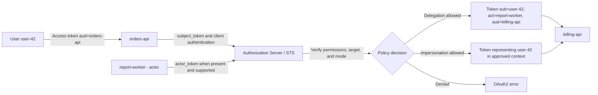
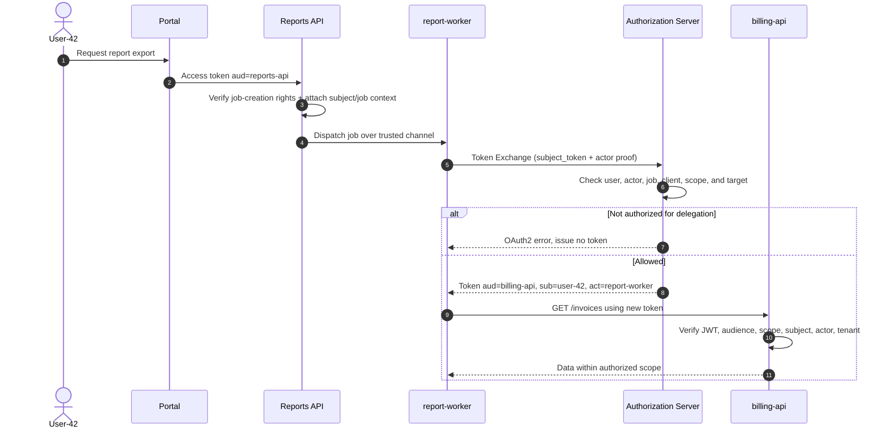

# Distinguishing Delegation, Impersonation, and Policies for Each Case

In microservices architectures, a user may call an API Gateway, the Gateway calls a backend, and that backend calls another service. At every hop, the system must answer: **"Who holds the original authority, who is executing the request, and which permissions may be propagated?"** Simply forwarding the original access token between services risks audience mismatches, excessive privileges, or preventing the Resource Server from knowing which service actually acted. Using only a service's own token loses the user context. **OAuth 2.0 Token Exchange (RFC 8693)** defines a protocol for exchanging an input token for another token suited to the recipient and security policy.

Two core semantics are **delegation** (acting **on behalf of** a subject while retaining the acting party's identity) and **impersonation** (being authorized to **act as** another subject within a defined permission scope). Both can use the same HTTP token-exchange grant, yet they are **not synonymous**, cannot be inferred solely from a `200 OK` token exchange response, and must never be authorized identically by default.

This lesson belongs to the **Token Exchange** chapter of the **SPRING_SECURITY_OAUTH2_OIDC_AUTHORIZATION_SERVER** module. Its goal is to teach how to design, configure, secure, test, and operate an Authorization Server with **Spring Security**, **Spring Authorization Server**, and **Spring Boot**, while building **distinct policies for delegation and impersonation**, properly verifying subject and actor identities, and preventing confused deputy or privilege escalation vulnerabilities.

> **Principle:** Token Exchange is a **request for a new token that must be approved by the Authorization Server per policy**. Possessing `subject_token` does not automatically grant permission to impersonate the subject; having an `actor_token` does not automatically grant delegation rights; and a validly signed input token does not mean the AS may grant any `audience`/`scope` the client asks for.

## 1. Context: Why Exchange Tokens Instead of Forwarding Directly?

Suppose:

- **`portal-web`**: OAuth2 Client / OIDC Relying Party where user `user-42` logs in;
- **`orders-api`**: Resource Server receiving requests to read the user's orders;
- **`report-worker`**: service generating reports on behalf of the user or for an authorized task;
- **`billing-api`**: target Resource Server accepting only tokens with `aud=billing-api` and permission `invoices.read`;
- **`identity.example.com`**: Authorization Server acting as Security Token Service (STS) for token exchange.

The user sends a token to `orders-api`. That token may carry `aud=orders-api` and `scope=orders.read`; it **should not be forwarded unchanged** to `billing-api` because `billing-api` is a different audience. A service with a legitimate need can ask the AS to exchange the token for one **dedicated to `billing-api`**, with narrowed scopes, short lifetime, and clear user/actor representation.



The diagram illustrates **possible policy outcomes**, not that a single request yields all three results at once. An actor may be a service performing an action; the actor must be verified under your trust model. Never pass sensitive tokens in URLs or expose raw token values in traces.

### 1.1. What Token Exchange Is Not

| Mechanism | How does it differ from Token Exchange? |
|---|---|
| **Authorization Code + PKCE** | Issues tokens after a user-interactive authorization flow; token exchange transforms an existing credential per policy |
| **Refresh Token grant** | Uses a valid refresh token to obtain subsequent tokens; does not natively transform actor/audience/subject |
| **Client Credentials grant** | Client obtains tokens for the **client's own identity/permissions**, typically without a user |
| **Forwarding Bearer token** | Sends the exact same token to another service; risks audience mismatch, over-privilege, and blurred trust boundaries |
| **Token introspection** | Checks whether a token is active and retrieves metadata; does not issue a new token |
| **OIDC ID Token** | Attests user login event details to an RP; **not** a default access token for exchanging or calling APIs |
| **Setting an `X-User-Id` header** | Caller-supplied data, not proof that a user authorized the action |

Not every call between two backends needs token exchange. If a job genuinely operates under service authority alone, **Client Credentials** with the right audience and scopes is usually simpler and cleaner.

## 2. Two Core Semantics of RFC 8693

### 2.1. Delegation — "A Acts on Behalf of B"

**Delegation** means subject B authorizes A to perform a **bounded subset of actions**; **A retains its own identity**, and the token recipient can tell A is the party acting on B's behalf.

Example: `user-42` lets `report-worker` read invoices to generate a report, without allowing it to transfer funds or modify billing details. A token issued for delegation might carry:

```json
{
  "iss": "https://identity.example.com",
  "sub": "user-42",
  "aud": ["billing-api"],
  "scope": "invoices.read",
  "act": {
    "sub": "report-worker"
  },
  "exp": 1794850600
}
```

This is an **illustrative JWT payload**, not a signed JWT. `sub` is the party holding the original authority; `act.sub` is the party actually executing the action. **The Authorization Server must verify** the authorization relationship and scope/audience rather than copying a self-asserted `act` value from the caller.

The Resource Server can record an audit entry: **"report-worker read invoices on behalf of user-42."** When policy requires both that the user has invoice-read rights **and** that the worker is authorized for that action, both checks must be enforced. Delegation does not turn every user permission into the worker's permission.

### 2.2. Impersonation — "A Is Permitted to Act as B"

**Impersonation** means A is granted permission **to represent itself as B within an authorized permission scope**; to the Resource Server receiving the token, A may be **indistinguishable** from B in that context. Example token:

```json
{
  "iss": "https://identity.example.com",
  "sub": "user-42",
  "aud": ["billing-api"],
  "scope": "invoices.read",
  "exp": 1794850600
}
```

Here, there is no `act` claim, so looking at this token alone, `billing-api` **cannot tell** whether a support engineer, a service, or the user directly is using it. This property requires strict governance: **never use impersonation for operations where auditing or authorization requires distinguishing the actor**.

Impersonation can be useful in narrow cases, such as an approved internal support tool reproducing a customer's read-only view, or integrating a legacy system that only understands a single identity. However, **impersonation authority must be granted explicitly—typically with approval, time bounds, scope limits, and AS-side auditing**. Never allow "log in as any user" simply because a service holds a valid client secret.

### 2.3. Direct Comparison Table

| Criterion | **Delegation** | **Impersonation** |
|---|---|---|
| Semantics | A acts on behalf of B | A acts as B within an approved context |
| Actor's identity | **Preserved/explicitly represented**, e.g., `act` | May be **invisible** to the Resource Server |
| Original rights holder | B, typically in `sub` | B, typically in `sub` |
| Effective permissions | Rights B holds **and** rights B may delegate to A, further bounded by AS/RS | Rights of B within the **impersonation scope** granted by the AS; not all rights by default |
| Auditing at the API | Can record both B and A when the token carries actor info | API may see only B; requires compensating audits at the AS / trusted path |
| Key risks | Confused deputy, escalation across actor chains, forgetting to check actor | Concealing the true executor, abusing authority as another user |
| Typical valid use cases | On-behalf-of service-to-service calls needing actor traceability | Special support/admin troubleshooting, approved legacy compatibility |
| Recommended controls | Actor authorization, narrowed scope/audience, chain bounds, short TTL | Strict allowlists, approvals, narrow targets, very short TTL, enhanced audit |

### 2.4. The Two Modes Are Not Distinguished by `grant_type` Alone

Both can request the exact same grant:

```text
grant_type = urn:ietf:params:oauth:grant-type:token-exchange
```

**There is no separate `grant_type` named "delegation" or "impersonation" in RFC 8693.** The outcome depends on input tokens, actor evidence, policy, issued token type, and how claims are emitted. A token carrying only `sub=user-42` does not prove it is safe for delegation, because it lacks the actor identity the Resource Server expects.

## 3. Four Roles That Must Be Verified Independently

In token exchange, distinguish the **requesting client**, **subject**, **actor**, and **target resource**:

| Role | Example | Where does proof come from? |
|---|---|---|
| Requesting OAuth2 Client | `orders-api` or `report-worker` calling the token endpoint | Client authentication and `RegisteredClient` |
| Subject | `user-42` | `subject_token` verified by the AS |
| Actor | `report-worker` | `actor_token` verified by the AS, or a trusted policy-bound actor identity source |
| Target service | `billing-api` | Requested `audience`/`resource` **and** AS-controlled resource mapping |

**Client authentication does not automatically equal actor authorization.** For example, the HTTP client might be a gateway while the requested actor is a separate worker; the AS must verify why the gateway is allowed to request a token with that actor. Conversely, a valid `actor_token` does not let any arbitrary client use that actor token to impersonate others.

### 3.1. What Is `subject_token`?

Under RFC 8693, `subject_token` is a **token representing the party on whose behalf the request is being made**. It is required, alongside `subject_token_type`. It may be an access token or another security token type per AS/STS policy; **never assume merely parsing a JWT is enough**.

The AS must verify validity per token type: trusted issuer, signature/introspection, expiration, revocation status, token type, eligibility as an exchange input, issuer trust boundary, and principal binding.

### 3.2. What Is `actor_token`?

`actor_token` describes the party **acting on behalf of the subject**; `actor_token_type` is required when `actor_token` is present, and forbidden when `actor_token` is absent. Both tokens require independent validation and policy checks. In RFC 8693, `actor_token` is **syntactically optional**; however, **verifiable delegation requires a trusted actor identity accurately represented in the output token**. Never infer the actor merely from an `actor_id` string in the request.

If a deployment derives the actor from client authentication instead of `actor_token`, that must be an **explicitly constrained and tested policy design**, not an assumed RFC default.

### 3.3. Proving "Authorized to Act" Differs from "Did Act"

An actor with a valid identity **is not necessarily permitted** to act on behalf of a subject. The AS still needs authorization evidence: valid consent, administrative entitlement, delegation allowlist, per-tenant policy, or verified issued claims. The `may_act` claim can serve as a signal supporting this decision, but does not replace verifying the remaining conditions.

## 4. RFC 8693 Token Exchange HTTP Contract

Token Exchange is an **OAuth 2.0 extension grant** sent via `POST` to the token endpoint with an `application/x-www-form-urlencoded` body. Client authentication follows the OAuth 2.0 mechanisms accepted by the AS.

### 4.1. Parameters

| Parameter | Under RFC 8693 | Meaning |
|---|---|---|
| `grant_type` | **Required** | `urn:ietf:params:oauth:grant-type:token-exchange` |
| `subject_token` | **Required** | Token of the original authority subject |
| `subject_token_type` | **Required** | Input token type, e.g., access token URN |
| `actor_token` | Optional | Token of the acting party |
| `actor_token_type` | Required **when `actor_token` is present**, forbidden if absent | Actor token type |
| `audience` | Optional | Logical name of the target service; repeatable per RFC, though policy should constrain it |
| `resource` | Optional | Absolute URI of the target resource, no fragment; repeatable per RFC |
| `scope` | Optional | Desired scope in the target resource context |
| `requested_token_type` | Optional | Desired token type for AS to issue; if omitted, AS selects per policy |

Common URNs:

```text
Token Exchange grant:
  urn:ietf:params:oauth:grant-type:token-exchange

Access token type:
  urn:ietf:params:oauth:token-type:access_token

JWT type:
  urn:ietf:params:oauth:token-type:jwt
```

`requested_token_type=...:access_token` states that the client wants **a token type used as an OAuth access token**. It **does not** dictate JWT vs. opaque at the implementation level unless a specific format is requested/supported. Likewise, never feed an OIDC ID Token as an input access token just because an ID Token is a JWT.

### 4.2. Delegation Request Example

Example where `report-worker` exchanges `user-42`'s subject token and an actor token representing the worker itself to get a token for `billing-api`:

```http
POST /oauth2/token HTTP/1.1
Host: identity.example.com
Authorization: Basic <REDACTED_CLIENT_AUTH>
Content-Type: application/x-www-form-urlencoded
Accept: application/json

grant_type=urn%3Aietf%3Aparams%3Aoauth%3Agrant-type%3Atoken-exchange
&subject_token=REDACTED_USER_ACCESS_TOKEN
&subject_token_type=urn%3Aietf%3Aparams%3Aoauth%3Atoken-type%3Aaccess_token
&actor_token=REDACTED_WORKER_ACCESS_TOKEN
&actor_token_type=urn%3Aietf%3Aparams%3Aoauth%3Atoken-type%3Aaccess_token
&requested_token_type=urn%3Aietf%3Aparams%3Aoauth%3Atoken-type%3Aaccess_token
&audience=billing-api
&scope=invoices.read
```

This is an **HTTP example line-wrapped for readability**, not a raw body to paste verbatim: a real client must UTF-8 form-encode all values into a valid body. `REDACTED_...` are placeholders; never put real tokens into guides or logs. Whether actor/token types are supported and how delegation is represented depend on AS **policy and implementation**.

### 4.3. Successful Response

```http
HTTP/1.1 200 OK
Content-Type: application/json
Cache-Control: no-store
Pragma: no-cache

{
  "access_token": "REDACTED_EXCHANGED_ACCESS_TOKEN",
  "issued_token_type": "urn:ietf:params:oauth:token-type:access_token",
  "token_type": "Bearer",
  "expires_in": 300,
  "scope": "invoices.read"
}
```

Per RFC 8693, `access_token` (the field carrying the issued token, even when the returned token is another security token type), `issued_token_type`, and `token_type` are required response fields. `expires_in` is recommended; `scope` must be returned when the granted scope differs from the requested scope. `issued_token_type` describes the **issued token type**; `token_type=Bearer` describes **how to use** the token over HTTP. They do not substitute for one another.

**A successful exchange does not issue a refresh token by default.** RFC 8693 permits it under implementation conditions, yet exchanging a short-lived credential for a downstream backend token rarely needs a refresh token; if issued, its lifecycle and revocation must be explicitly defined.

### 4.4. Token Exchange Does Not Mutate Input Tokens

An exchange normally **does not destroy `subject_token` or `actor_token`** and does not automatically link revocation between input and output. If revoking a source token must invalidate exchanged tokens, you must **design propagation, short TTLs, introspection/denylists, or dedicated policy checks**. Never assume all tokens issued along a chain are revoked together.

## 5. `act` and `may_act` Claims: Differing in Timing and Meaning

### 5.1. `act` — The Currently Acting Actor in Delegation

In RFC 8693, the **`act`** claim represents the current actor:

```json
{
  "sub": "user-42",
  "aud": "billing-api",
  "scope": "invoices.read",
  "act": {
    "sub": "report-worker"
  }
}
```

This is a token **issued by AS decision** with delegation semantics; the actor has already been verified. With JWTs, the RS can inspect `sub` and the **current actor** at `act.sub` to enforce authorization rules and audit logging.

### 5.2. `may_act` — Who May Become an Actor

The **`may_act`** claim describes a party **that may be permitted** to act on behalf of the subject:

```json
{
  "iss": "https://identity.example.com",
  "sub": "user-42",
  "aud": ["token-exchange-service"],
  "may_act": {
    "sub": "report-worker"
  }
}
```

This is an **example signal for the AS** when evaluating a token exchange; it is not a token already granting the worker access to `billing-api`. The AS must verify issuer/audience/token integrity and additional conditions such as current actor, authorized client, policy, scope, and target resource. **A client cannot simply insert `may_act` into JSON to grant itself delegation**; the claim is trustworthy only inside a verified credential from an appropriate issuer.

| | `act` | `may_act` |
|---|---|---|
| Answers | "Who **is currently** acting on behalf of the subject?" | "Who **may be permitted** to become an actor?" |
| Typical usage | In an **issued token**/introspection for RS rules and audit | In a **subject token**/introspection for AS delegation/impersonation evaluation |
| Grants access on its own? | **No**: RS still checks target, scope, and policy | **No**: AS must still verify all conditions |
| Source of trust | Claim issued by a trusted AS/issuer | Claim issued by a trusted issuer |

Inside `may_act`, identifying fields such as `iss` and `sub` may be needed to distinguish actors across issuers; attributes like `exp`/`aud`/`nbf` **nested inside `may_act`** do not function as standard top-level JWT validation claims. Never invent a custom `may_act.exp` assuming the framework automatically enforces delegation expiry from it.

### 5.3. Multi-Step Delegation and Nested `act`

If `service-A` receives delegation from a user and then delegates further to `service-B` per policy, the JWT can capture history:

```json
{
  "sub": "user-42",
  "aud": ["billing-api"],
  "scope": "invoices.read",
  "act": {
    "sub": "service-B",
    "act": {
      "sub": "service-A"
    }
  }
}
```

**The outermost actor `service-B` is the current actor.** `service-A` inside the nested `act` is a prior actor retained for **history/observability**, and must never be treated as the current actor in authorization decisions. RFC 8693 specifies that token consumers **only** use top-level claims and the outermost current actor in `act` for access control; nested prior actors are purely informational.

Consequently, a rule like "since `service-A` in the `act` chain holds admin rights, `service-B` gets admin" is **wrong and dangerous**. Evaluate `service-B` itself, the target/resource, and active delegation authority; cap hop count, scopes, and TTL.

## 6. Token Issuance Policy: Avoiding Unintended Privilege Multiplication

**Token Exchange is not the union of all permissions** in the subject token, actor token, and client registration. A safe decision model **constrains across the entire chain of conditions**:

```text
Requested rights
    ∩ Subject's eligible rights
    ∩ Actor's delegated/impersonation rights
    ∩ Requesting client's token-exchange policy
    ∩ Target resource's allowed rights
    ∩ Current account/tenant/risk/consent/assurance policy
    = Upper bound of rights that AS may issue
```

This is a **mental model**, not a mechanical set-intersection formula for every system: scope names can differ between resources and policies may depend on data attributes. Yet it underscores the rule: **never escalate permissions simply because one party holds a broad scope**.

### 6.1. Policy Matrix by Exchange Type

| Case | Actor / subject | Mandatory conditions | Recommendation |
|---|---|---|---|
| **User → service delegation** | User B, service A | Authorized to act for B, reduced audience/scope, verified actor, current user policy | **Preferred for on-behalf-of** when audit is required |
| **Service → service delegation** | Workload B, workload A | Approved service-to-service relation, no tenant/permission expansion | Short-lived tokens, distinct ID per workload |
| **Multi-hop delegation** | User/workload B, multiple actors | Every hop permitted, clear current actor, anti-expansion controls | Bound hops, TTL, actor chain, and cross-domain transitions |
| **Administrative/support impersonation** | Operator A acting as user B | Dedicated approval/RBAC, purpose, target, TTL, detailed audit | Keep scope **very narrow**, read-only whenever possible |
| **Legacy-compatibility impersonation** | Trusted service A acting as B | Legacy system lacks actor support; compensating controls and monitoring | Plan migration to actor-aware delegation when feasible |
| **Client acting for itself** | Only A, no B | Client Credentials and workload policy | **Do not force** into delegation/impersonation |

### 6.2. Constraining `audience`, `resource`, and `scope`

A token with `aud=orders-api` should not become a token with `aud=billing-api` unless the AS has an explicit trust relationship and authorization policy for that transition. When a client proposes multiple audiences at once, requested permissions apply across **all targets**, causing reach to expand rapidly. Under least privilege, prefer issuing a token **for a single primary target service** unless multi-target is clearly justified.

Recommended rules:

1. `audience/resource → backend/API` mappings must come from **trusted AS-side configuration**.
2. Clients must never arbitrarily request targets belonging to another tenant.
3. Never accept wildcard scopes or targets as blanket authority across APIs.
4. The new token gets only scopes/resources simultaneously approved by **subject, actor, requesting client, and target policy**.
5. Output token lifetimes should be short, never extending access beyond the granted window/context.
6. Resource Servers check the **actual audience inside the token**, not merely that the request arrived at the right URL.

### 6.3. Policy Goes Beyond Scopes

Beyond scopes, a service may require: same tenant, enabled user account, order belonging to an allowed department, amount within limits, low-risk device, recent MFA, or an unexpired task. A token holding `scope=payments.approve` does not automatically authorize paying from someone else's account.

## 7. Concrete Delegation: User Triggers a Job, Worker Reads Invoices

**Requirement:** User `user-42` clicks "Export report." `portal-web` calls `reports-api`; `report-worker` executes the job and needs to read invoices from `billing-api`. The worker must not receive the user's full login privileges.

### 7.1. Flow Design



In multi-tier architectures, **the subject token must be delivered to the worker through a securely designed flow**. Never stuff raw tokens into unencrypted message queues or logs. If the worker runs long after the user's click, verify whether the source token is still valid, delegation authority remains intact, and offline execution is permitted; never take an expired token and force the AS to mint a fresh one anyway.

### 7.2. Illustrative Delegation Policy

```yaml
# PSEUDOCODE application-defined policy,
# NOT default Spring Authorization Server properties.
tokenExchangePolicies:
  report-export:
    mode: delegation
    requestingClient: report-worker
    subjectType: end-user
    actor: report-worker
    allowedAudience: billing-api
    allowedScopes:
      - invoices.read
    requireDelegationEvidence: true
    requireSameTenant: true
    maxLifetimeSeconds: 300
    maxDelegationDepth: 2
    permitImpersonation: false
```

YAML merely expresses the policy. To use it in practice, you must build a schema, validator, approved config storage, and tests. `maxDelegationDepth` and `requireDelegationEvidence` are **custom fields**; Spring Authorization Server does not understand them out of the box.

### 7.3. Resource Server Checks Both Identities

`billing-api` can require:

```text
issuer == trusted AS
audience contains billing-api
scope contains invoices.read
sub corresponds to an enabled, eligible user
act.sub == report-worker
report-worker authorized to act for sub on this tenant/job
requested invoices belong to allowed tenant
token lifetime/other restrictions satisfied
```

If `sub` has invoice-read rights yet the actor is not delegated for `billing-api`, the request **must still be rejected**. Conversely, an actor with broad scopes must never leverage a token belonging to a user without data access to bypass policy.

## 8. Concrete Impersonation: Support Tool Viewing as a User

**Requirement:** An MFA-authenticated support engineer needs a read-only view of a customer's UI to debug a display bug, without being able to initiate payments, change passwords, or export sensitive data.

### 8.1. Why Is Impersonation Riskier?

If the issued token contains only `sub=user-42`, a legacy backend may treat the request as coming directly from the user. Therefore, impersonation policies must harden the **token issuance path** and maintain separate audit logs identifying the support engineer. Default to delegation with `act` whenever APIs support actors; use impersonation only when clearly justified.

### 8.2. Recommended Authorization Workflow

1. **Support engineer authenticates strongly** with appropriate MFA and a dedicated `support-impersonation` role.
2. **Select the exact customer/tenant** and enter a valid purpose, ticket, or case ID; verify the engineer has access rights to that tenant.
3. Require **additional approval** when mandated by organizational policy (four-eyes / break-glass), locking down non-read-only operations.
4. AS verifies subject token, operator identity, requesting client, policy, and target user status.
5. Issue only a token with **specific audience, minimal scope, very short TTL**, and no default refresh token.
6. Record a **separate secure audit log at the AS**: actual actor, impersonated subject, ticket, timestamp, target, scope, and approval result.
7. Resource Server or gateway restricts endpoints to read-only and evaluates policy; if the RS cannot distinguish the actor, add compensating controls outside the token.
8. Closing the session/ticket or revoking support access must block new tokens; existing live tokens are handled per revocation SLA.

### 8.3. Illustrative Policy

```yaml
# PSEUDOCODE - NOT default Spring configuration.
tokenExchangePolicies:
  support-view:
    mode: impersonation
    requestingClient: support-console-backend
    requiredOperatorRole: SUPPORT_IMPERSONATE_READONLY
    requireOperatorMfa: true
    requireTicketApproval: true
    targetSubjectType: end-user
    allowedAudience: customer-profile-api
    allowedScopes:
      - profile.read
    maxLifetimeSeconds: 120
    allowRefreshToken: false
    allowCrossTenant: false
    requireIndependentAudit: true
```

**Invariant:** Authenticating the operator/client is not enough; **the operator must be authorized to impersonate that exact subject, target, and action**. Never expose an API like `POST /impersonate?userId=...` letting a general admin client pick any user ID without specific authorization checks.

### 8.4. Observability Warning

In impersonation, the Resource Server may not know the real actor. An audit record reading only "user-42 updated data" is **misleading** if an operator triggered the request. If your system needs non-repudiation, fraud detection, or exact accountability, impersonation is unsuitable without compensating trusted audits. Whenever possible, switch to **delegation with an explicit actor**.

## 9. Policies for Delegation Chains and Cross-Domain Flows

Delegation can span multiple services:

```text
user-42 -> service-A -> service-B -> service-C -> billing-api
```

Never allow "once `act` exists, delegate arbitrarily many times." Every hop increases the risk of **lost context, weakened auditability, and audience/scope bloat**. A safe design requires:

- **Each hop approved by the AS** for the current actor, next target, and corresponding scopes.
- **Bounded hop depth** and token age, ensuring permissions never expand past the source policy.
- **Verified actor chains** issued by trusted issuers—never accepting client-assembled JSON.
- **No privilege escalation via nested prior actors**: access control relies on subject/top-level claims and the **current actor**.
- **Tenant and issuer partitioning**: a tenant-A token must never exchange into a tenant-B token merely because subject strings match.
- **Target substitution controls**: prevent callers from swapping `audience` from a read API to a write API without authorization.
- **Cross-organization federation controls**: exchanging tokens across issuers requires explicit trust models for issuers, keys, claim mappings, and revocation—never trusting new issuers by default.

### 9.1. When Should Delegation Stop?

If the new actor lacks proof of further delegation authority, the initial token is no longer active, the user revoked consent, the tenant is no longer permitted, or the target scope lacks an explicit mapping, **the AS must deny**. Never "just issue the token and let the RS figure it out" if issuance itself violates delegation policy.

### 9.2. Identity Mapping Across Multiple Issuers

Two issuers can issue `sub=user-42` for **two different people**. Identity cannot be uniquely identified by `sub` alone; inspect the **`issuer + subject`** pair, tenant, or an identifier produced by a trusted federation mapping. Never convert an opaque token/JWT from an untrusted issuer into internal AS authority based solely on email or display name.

## 10. Spring Authorization Server Integration: Capabilities and Boundaries

In Spring Authorization Server versions supporting OAuth 2.0 Token Exchange, **`OAuth2TokenEndpointFilter`** and the token endpoint configuration can include **`OAuth2TokenExchangeAuthenticationConverter`** and **`OAuth2TokenExchangeAuthenticationProvider`** in the default setup. The **Spring Authorization Server Reference – Protocol Endpoints** documentation lists the `urn:ietf:params:oauth:grant-type:token-exchange` grant alongside these two components.

**That does not mean Spring enforces your organization's custom delegation/impersonation policies**, approval workflows, nested `act` rules, actor entitlements, or cross-tenant mappings out of the box. Inspect the features and limits of your **exact running version**, add policy at the right extension points, and test the entire flow. Never emit a JWT with `act` simply by letting the client supply an arbitrary actor parameter.

### 10.1. `RegisteredClient` Must Permit Token Exchange

Example declaring the grant using the standard URI:

```java
AuthorizationGrantType tokenExchange = new AuthorizationGrantType(
    "urn:ietf:params:oauth:grant-type:token-exchange");

RegisteredClient worker = RegisteredClient.withId(
        "report-worker-internal-id")
    .clientId("report-worker")
    .clientSecret(passwordEncoder.encode(secretFromSecureStore))
    .clientAuthenticationMethod(
        ClientAuthenticationMethod.CLIENT_SECRET_BASIC)
    .authorizationGrantType(tokenExchange)
    .scope("invoices.read")
    .build();
```

This is an illustrative **registration snippet**: `secretFromSecureStore` must be provisioned securely, and full imports and beans must be added. If your library version provides `AuthorizationGrantType.TOKEN_EXCHANGE`, you may use that constant; constructing directly from the URN highlights the standard identifier. **Declaring the grant and scope is not enough** to authorize specific delegation/impersonation requests. The AS must still validate the subject token, actor, audience, and policy.

### 10.2. Token Endpoint Extension Points

Spring Authorization Server configuration skeleton using `HttpSecurity.with(...)` DSL:

```java
@Bean
@Order(1)
SecurityFilterChain authorizationServerChain(HttpSecurity http)
        throws Exception {
    OAuth2AuthorizationServerConfigurer authorizationServer =
        OAuth2AuthorizationServerConfigurer.authorizationServer();

    http.securityMatcher(authorizationServer.getEndpointsMatcher())
        .with(authorizationServer, server -> server
            .tokenEndpoint(endpoint -> {
                // You can use:
                // endpoint.authenticationProviders(providers -> { ... });
                // to customize validators/providers per your running version.
            }))
        .authorizeHttpRequests(auth ->
            auth.anyRequest().authenticated());

    return http.build();
}
```

This is **not a runnable standalone project**: you still need `RegisteredClientRepository`, issuer/settings, `OAuth2AuthorizationService`, token signing/JWKs if issuing JWTs, security chains, identity sources, and policies. When using `authenticationProviders(...)`, inspect which default providers are registered so you **preserve standard validation** and never accidentally let token exchange skip client authentication or subject validation.

### 10.3. Where Should Policy Enforcement Live?

| Need | Architectural placement | Avoid |
|---|---|---|
| Parsing RFC 8693 requests | Token exchange `AuthenticationConverter` | Writing a custom controller bypassing the token filter chain |
| Authenticating requesting client | Client authentication filter/providers | Trusting `client_id`/client secret from the request without verification |
| Verifying `subject_token`/`actor_token` | Provider/validator using issuer keys/introspection/trust | Simply Base64-decoding tokens and trusting claims |
| Deciding delegation vs. impersonation | **Policy engine** evaluating client, subject, actor, target, and approvals | Letting every request with a user token impersonate by default |
| Computing audience, scope, TTL, actor claim | Issuance policy prior to token generation | Letting a token customizer decide all permissions at the last step |
| Adding verified standard claims | Token generator/customizer for the appropriate token type | Copying untrusted input `act`/`may_act` verbatim |
| API authorization | Spring Security Resource Server + business policy | Checking only token signature while ignoring audience/actor |

### 10.4. Pseudocode for Token Issuance Decisions

```java
// PSEUDOCODE: types and variables below are application-defined.
ExchangeRequest request = parseTokenExchange(httpRequest);
RegisteredClient client = authenticatedRequestingClient();

VerifiedSubject subject = subjectTokenVerifier.verify(
    request.subjectToken(), request.subjectTokenType());
VerifiedActor actor = request.hasActorToken()
    ? actorTokenVerifier.verify(
        request.actorToken(), request.actorTokenType())
    : actorPolicy.resolveFromTrustedContext(client);

ExchangePolicyDecision decision = exchangePolicy.evaluate(
    client, subject, actor, request.audience(),
    request.resource(), request.scope());

if (!decision.allowed()) {
    throw oauthError(decision.protocolErrorCode());
}

// Issue the new token ONLY from the verified decision:
// subject, actor, audience, scope, TTL, mode, and tenant.
return tokenIssuer.issue(decision);
```

Classes like `ExchangeRequest`, `VerifiedSubject`, `VerifiedActor`, and `ExchangePolicyDecision` are **not built-in** to this example; the code expresses the **security ordering**, not a copy-paste implementation. If actor tokens are unsupported, never silently fall back to broad impersonation for a delegation request.

## 11. Spring Security OAuth2 Client and Resource Server

### 11.1. Client Requesting Token Exchange

Spring Security OAuth2 Client supports the Token Exchange grant in compatible versions, including response handlers like **`RestClientTokenExchangeTokenResponseClient`** and corresponding grant requests. However, configuring a token exchange client **does not automatically register exchange rights** on the Authorization Server. You must specify the `subject_token` source, optional actor token, and target resource/audience.

The **HTTP-level** client flow is clear:

```text
1. Caller already holds a valid subject token for the transaction needing exchange.
2. Backend obtains the subject token from a trusted context, never from a query string.
3. Backend authenticates itself to the AS at /oauth2/token.
4. Backend sends Token Exchange grant + subject token (+ actor proof).
5. AS validates policy and returns a new token for the target audience.
6. Backend calls the Resource Server with the NEW token, not the wrong-audience source token.
```

The client must handle token exchange failures as OAuth2 errors, bound retries, avoid storing raw subject/actor tokens in audits/traces, and never cache new tokens without **`subject/actor/audience/scope`** in the cache key.

### 11.2. Resource Server Validating the JWT

For self-contained JWTs, Spring Security Resource Server can verify signatures, issuers, timestamps, and scope mappings, yet **delegation/impersonation policies do not materialize just by setting `issuer-uri`**.

Example check on a verified token:

```java
// PSEUDOCODE placed inside the Resource Server's authorization policy.
Jwt jwt = (Jwt) authentication.getPrincipal();

String user = jwt.getSubject();                 // token's sub
Map<String, Object> act = jwt.getClaim("act"); // may be null

if (policy.requiresDelegation()) {
    if (act == null || !policy.currentActorAllowed(act, user)) {
        deny();
    }
}

requireAudience(jwt, "billing-api");
requireScope(authentication, "invoices.read");
requireTenantAndObjectAuthorization(user, act, requestedInvoice);
```

`deny`, `requireAudience`, `requireScope`, and `requireTenantAndObjectAuthorization` are **hypothetical functions** that must be implemented and tested. Never assume `authentication.getPrincipal()` is always a `Jwt`: if your project uses opaque tokens/introspection or a custom converter, the principal type will differ. **The API must check the current actor**, never using nested prior actors for authorization decisions.

### 11.3. Should a Token Without an Actor Be Treated as a Direct User?

**Not by default.** For an API that permits impersonation, a token with `sub=user-42` and no `act` could originate from impersonation or from a direct user call; from that token alone, they may be **indistinguishable**. If policy requires separating direct users from support impersonation, require **explicit AS-issued and verified signals/lanes**, or switch to delegation with an explicit actor. Never infer "no `act` definitely means the user acted directly."

## 12. Specific Threats

### 12.1. Confused Deputy

A broadly privileged service is tricked into exercising its own authority for an under-privileged caller. For example, `report-worker` can read invoices company-wide, receives a request from a tenant-A user, and exchanges a token to read tenant-B invoices. If the AS checks only that the worker holds `invoices.read`, a user can **abuse the service as a deputy** to bypass tenant isolation.

**Mitigation:** verify subject, actor, requesting client, tenant, and target together; the new token must constrain scopes/audience strictly to delegated permissions. The RS still enforces business authorization on every invoice.

### 12.2. Unapproved Impersonation

If the AS issues tokens with `sub=admin` to any client holding any subject token, that is a **severe privilege escalation**. Client authentication only says "this is app X," not that app X may impersonate an admin or arbitrary user. Use explicit allowlists/approvals, verify the actor and target user's permissions, and deny by default.

### 12.3. Token Substitution and Issuer Confusion

Attackers may submit an ID Token instead of an access token, a token from another issuer, a JWT signed by a key outside the trust store, a token with the wrong `aud`, an expired token, or another client's token. The AS must verify **token type, issuer, key, audience/binding, active/revocation state, and eligibility for exchange**. Never trust parsed but unverified claims.

### 12.4. Target and Scope Abuse

An attacker holding a subject token meant only for a read API requests `audience=payments-api` and `scope=payments.approve`. The system must **reject** it even though the original token was validly signed by the AS. Never issue broad multi-audience tokens when policy only permits a single service.

### 12.5. Replay, Token Leakage, and Token Chaining

Subject/actor tokens and newly issued tokens are all credentials. Enforce HTTPS, never log raw tokens, never put tokens in URLs or insecure queues, keep lifetimes short, control reuse, and apply mTLS/DPoP where appropriate and supported. Token exchange does not automatically make input tokens **single-use**; if your application needs that, design it explicitly.

### 12.6. User or Actor Revocation

A user may be locked after the source token was issued; an actor may lose delegation rights. The AS must check current policy during exchange and govern live/issued access tokens per SLA. **RFC 8693 does not automatically link revocation between input and output tokens**; build propagation, short TTLs, introspection, or current-state authorization checks.

## 13. Error Codes and Denial Responses

A token exchange failure at the token endpoint is an **OAuth2 JSON error** per RFC 6749/RFC 8693, not a redirect to a login page.

| Condition | Common error code | Notes |
|---|---|---|
| Request missing `subject_token`/token type, malformed syntax | `invalid_request` | Required by RFC 8693 for invalid token exchange requests |
| Subject/actor token invalid or unacceptable by policy | `invalid_request` | RFC 8693 §2.2.2 specifies this code for such failures |
| Requested `audience`/`resource` cannot be satisfied | `invalid_target` | Dedicated RFC 8693 code, recommended |
| Invalid client authentication | `invalid_client` | Handled by client authentication mechanism |
| Requesting client not allowed to use grant | `unauthorized_client` | Check `RegisteredClient.authorizationGrantTypes` |
| Unsupported grant type | `unsupported_grant_type` | Depends on version/configuration |
| Invalid or ungranted scope | `invalid_scope` or appropriate code | Validate request, target, and policy |
| Resource Server receives exchanged token with wrong audience | `invalid_token` (Bearer error) | RS-side error, not a token-exchange grant error |

RFC 8693 defines specific error rules; **do not force every error into `invalid_grant` merely because you are using an OAuth2 extension grant**. Also never reflect subject/actor token values, secrets, PII, or internal policy details in `error_description`.

Example:

```http
HTTP/1.1 400 Bad Request
Content-Type: application/json
Cache-Control: no-store

{
  "error": "invalid_target",
  "error_description": "Requested target is not permitted"
}
```

This response illustrates the AS rejecting a target. Exact codes/statuses must reflect the cause and deployment configuration, and **a client must never fall back to impersonation to evade delegation checks**.

## 14. Lifecycle and Revocation of Exchanged Tokens

A token exchange **does not extend forever** or automatically revive a user session. Your design must distinguish:

| Artifact | When expired/revoked | Default impact |
|---|---|---|
| Subject token | Expired, revoked, or user loses access | New exchange requests must re-evaluate; prior output tokens do not auto-expire |
| Actor token | Expired, actor locked/revoked | Further delegation must be denied; prior output tokens need explicit policy |
| Exchanged access token | Expired/revoked per supported model | RS rejects when checking lifetime/status properly |
| Requesting client credential | Rotated/locked | Blocks new exchange requests; already-issued JWTs may remain valid until `exp` |
| User login session/consent | Expired/revoked | May require reauthorization; does not automatically revoke all output JWTs |

Recommendations:

- Choose **short TTLs**, especially for sensitive APIs, multi-hop services, or impersonation.
- **Do not issue refresh tokens by default** for exchanges; if enabled, enforce explicit policy and revoke when source rights end.
- Establish a **revocation propagation** policy for critical events and measure maximum residual window for output tokens.
- If immediate cutoff is required, consider having the RS check a denylist, security version, current policy, or introspection per design.
- Never treat `issued_token_type` or `act` as proof that a session or MFA was just verified.

## 15. Integration Testing Delegation and Impersonation

Proper tests must pass through the **Spring Security filter chain**, the token exchange grant at `/oauth2/token`, and **Resource Server JWT/introspection validation**. Unit-testing only a helper that builds `act` does not prove the AS verifies actors or policies.

### 15.1. Key Test Matrix

| Scenario | Mandatory outcome |
|---|---|
| Registered token-exchange client, valid subject, valid actor, delegation policy allows | Issues token with right `aud`, narrow scope, accurate `sub` and `act` |
| Client lacks token-exchange grant | No token issued; appropriate client/grant error |
| Subject token has bad signature or issuer | Denied, no token issued |
| Subject token expired or revoked | Denied per policy/token validity |
| Actor token has bad signature/issuer or wrong type | Denied; never trust self-asserted actors |
| Valid actor **not delegated** for the subject | Denied |
| Valid HTTP client, but actor token points to another disallowed service | Denied |
| User has read scope, actor has write rights | Never issues write scope exceeding user/delegation authority |
| Subject in tenant A, target resource in tenant B | Cross-tenant access denied |
| Source token `aud=orders-api`, client asks for disallowed `aud=billing-api` | Rejected with appropriate target error |
| Client requests multiple resources/audiences exceeding policy | Never issues broad token; e.g., `invalid_target` |
| Valid 2-hop delegation | Current actor and nested history accurate |
| Delegation hop exceeds limit | Denied, no token issued |
| RS receives delegation token missing `act` | Denied if endpoint requires actor |
| RS grants access using prior actor instead of current actor | **Must fail**; never rely on nested `act` |
| Impersonation disabled for client | Denied; never falls back to bare `sub=user` token |
| Right impersonation client, missing approval/MFA/ticket | Denied |
| Impersonation approved within read-only bounds | Issues only short-TTL, read-only, approved-target token |
| Impersonation token used to call write API | RS rejects |
| User/actor locked after issuance | New exchanges denied; existing outputs follow revocation SLA |
| Token data in logs/errors | Contains no raw tokens or secrets |

### 15.2. MockMvc Positive Path Illustration

With a test environment configured for token exchange, confidential client `report-worker`, valid subject/actor tokens, and approved delegation policy:

```java
@SpringBootTest
@AutoConfigureMockMvc
class TokenExchangePolicyTests {
    @Autowired
    MockMvc mvc;

    @Test
    void validDelegationReturnsAudienceScopedToken() throws Exception {
        String subjectToken = fixtureSubjectAccessToken();
        String actorToken = fixtureActorAccessToken();

        mvc.perform(post("/oauth2/token")
                .with(httpBasic("report-worker", "test-client-secret"))
                .contentType(MediaType.APPLICATION_FORM_URLENCODED)
                .param("grant_type",
                    "urn:ietf:params:oauth:grant-type:token-exchange")
                .param("subject_token", subjectToken)
                .param("subject_token_type",
                    "urn:ietf:params:oauth:token-type:access_token")
                .param("actor_token", actorToken)
                .param("actor_token_type",
                    "urn:ietf:params:oauth:token-type:access_token")
                .param("audience", "billing-api")
                .param("scope", "invoices.read"))
            .andExpect(status().isOk())
            .andExpect(jsonPath("$.access_token").isNotEmpty())
            .andExpect(jsonPath("$.issued_token_type").value(
                "urn:ietf:params:oauth:token-type:access_token"));
    }
}
```

This is a **skeleton test** requiring JUnit/Spring Test imports, properly signed and trusted token fixtures, policy engine / AS configuration, and token-issuing beans. `fixtureSubjectAccessToken()` and `fixtureActorAccessToken()` are custom test helpers; if your version/deployment does not support actor tokens or uses a different policy, configure accordingly instead of skipping checks. The test verifies only basic response fields; **you must also decode/introspect the issued token and assert exact `sub`, `act`, `aud`, scope, and TTL**.

### 15.3. Negative Tests Must Isolate the Cause

To test actor policy, keep client authentication, subject token, and audience **all valid**, changing only the actor to an unauthorized one. If the client secret is also wrong, the AS will reject early with `invalid_client` and the test **fails to prove** actor policy works.

Similarly, when testing disallowed targets, keep subject and actor valid and change only `audience`. For impersonation, tests must prove **proper subject/target approval is required** to get a token, not just assert HTTP 200.

### 15.4. Testing Real Authorization at the Resource Server

Use real signed JWTs in integration tests or an equivalent setup with configured issuer, audience, decoder, and actor rules. Two tokens with the same valid signature—one with `aud=billing-api` and one with `aud=orders-api`—must produce opposite results at `billing-api`. A delegation token with `act.sub=report-worker` and subject `user-42` must pass tenant and permission checks; a token with only `sub=user-42` must be rejected by an endpoint requiring an actor.

**Never mock pre-populated authorities and conclude `act`/audience validation works**; mocks can bypass the JWT decoder completely.

## 16. Auditing, Monitoring, and Privacy

A service-to-service flow may lack a browser, yet still needs audit trails answering **who, on behalf of whom, for what purpose, to which resource, and during what window**.

| Event | Log | Never log |
|---|---|---|
| `token_exchange_requested` | Request ID, client ID, target, requested mode, timestamp | Raw `subject_token`/`actor_token` |
| `delegation_approved` | Pseudonymized subject/actor as needed, policy ID, actual granted scope/aud | Access token, secret, full JWT payload |
| `impersonation_approved` | Operator, subject, ticket, approval, duration, and action limits | Passwords, OTPs, secrets |
| `token_exchange_denied` | Error code, internal rule/policy ID, client ID | Internal stack traces, token contents in `error_description` |
| `delegation_chain_depth_exceeded` | Current actor, depth, and minimal policy context | Raw nested token chain |
| `rs_action_performed` | Verified subject and current actor, resource ID, decision | Unredacted PII beyond audit need |

For impersonation, audits at the AS and related gateways must correlate token usage back to the **actual operator**, since the Resource Server may only see the subject identity. For multi-hop delegation, log hop history per policy, but **never grant access based on prior actors**.

### 16.1. Monitoring Suspicious Behavior

- Sudden spikes in token exchanges or rejected exchange attempts.
- Clients requesting audiences/scopes outside allowlists or trying to switch from delegation to impersonation mode.
- One actor trying to act for unusually many subjects or tenants in a short window.
- Subject/actor tokens from unknown issuers or suspicious replay counts.
- Impersonation lacking valid tickets/approvals or exceeding TTL.
- Discrepancies between the actor claim inside a token and issuance audit records.

Monitoring must distinguish misconfiguration, policy denials, and infrastructure failures; never remediate by **opening allowlists to every client**.

## 17. Pre-Production Decision Checklist

1. **Choose the right semantics:** do you need to know the actual actor? If yes, prefer **delegation**.
2. **Define subject/actor/client:** where is each identity verified from? Do you check issuer + subject + tenant rather than display names?
3. **Verify delegation evidence:** consent, trusted `may_act`, entitlement, or policy for the exact actor–subject–client tuple?
4. **Constrain impersonation:** approval/MFA/ticket, read-only target/scope where possible, short TTL, audit, and revocation SLA?
5. **Grant registration:** requesting client authorized for token exchange with an appropriate client authentication method?
6. **Token validity:** AS verifies type, issuer, signature/introspection, audience, expiry, and token state for both subject and actor?
7. **Target policy:** do `resource`/`audience` map to registered targets? Are multi-target requests restricted?
8. **Least privilege:** new tokens never escalate user/actor privileges and grant only necessary scopes and resources?
9. **Claim accuracy:** `sub`, `act`, `may_act`, and nested actors reflect verified evidence? Nested prior actors never used for authorization?
10. **Resource Server enforcement:** verifies signature/issuer/time/audience/scope alongside subject–current actor–tenant?
11. **Token lifecycle:** short TTLs, no default refresh tokens, source revocation paired with propagation or bounded TTLs?
12. **Multi-hop/federation:** depth limits, cross-issuer trust, identity mapping, and replay defenses tested?
13. **Audit and privacy:** captures correlation ID, operator/subject/actor, purpose, and policy without storing raw tokens?
14. **Version-accurate Spring support:** verified token exchange converter/provider/client response support and custom APIs?
15. **Full-branch integration tests:** delegation, impersonation, wrong actor, cross-tenant, `invalid_target`, nested history, stale tokens, and concurrency?

## 18. Scenario Exercises and Self-Check Questions

**Scenario A — Report Export Service:** `report-worker` wants to read invoices on behalf of a user, and the system needs to know which actor read them. Choose the semantics, required claims, policy blocking when the user lacks `invoices.read`, and handling when `audience=billing-api` is disallowed.

**Scenario B — Support Engineer:** An engineer needs to view the UI as a customer to debug an issue, and a legacy API does not read `act`. Design conditions permitting short-lived impersonation, preventing data modification, and auditing to distinguish the operator from the customer.

**Scenario C — Service Chain:** User delegates to A, A delegates to B, and B calls an API with a nested `act` token. **Which actor** should the API use for authorization decisions? Why must deep historical actors never be used?

**Scenario D — Revoked Token:** The subject token is revoked after the exchanged token is issued. The Resource Server validates the unexpired new token offline. Must it automatically reject the request? What architectural adjustments are needed if immediate blocking is required?

**Hints:** A uses delegation, issuing a token with `sub=user` and `act=report-worker` with verified scope/aud. B uses impersonation only when genuinely required, pairing approval, MFA, TTL, read-only limits, and extra auditing. C uses only the outermost current actor and top-level claims for access control. D is not automatic; it requires revocation propagation/denylist/introspection, dynamic permissions, or SLA-aligned TTLs.

## 19. Summary

- **Delegation** means A acts **on behalf of** B while **still identified as A**. In JWTs, `sub` represents the original rights holder and `act` represents the current actor.
- **Impersonation** means A is allowed to act **as** B within a defined permission scope, which may prevent the Resource Server from distinguishing the actor; it therefore demands strict restrictions and dedicated auditing.
- **RFC 8693 Token Exchange** uses the same `grant_type=urn:ietf:params:oauth:grant-type:token-exchange` for both semantics, with required `subject_token`, syntactically optional `actor_token`, and target/scope/token-type parameters. **The grant type does not determine the mode.**
- **`act`** states who is acting; **`may_act`** signals who may be allowed to act; both must be issued by a trusted issuer and verified by policy. **Nested prior actors must never be used to grant permissions.**
- **Spring Authorization Server** supports token exchange in compatible versions, yet **actor/subject rules, delegation approval, impersonation, tenant checks, audience checks, and least privilege** must still be designed, enforced, and tested explicitly.
- Never expand scope/targets via token exchange, never trust unverified tokens, never assume input-token revocation automatically revokes output tokens, and never use impersonation to hide the true executor when APIs require auditing.

Mastering the distinction between **delegation and impersonation** enables you to build explainable, auditable OAuth2/OIDC service-to-service token exchange flows that resist privilege escalation while keeping clean boundaries between client authentication, user rights, actors, and target APIs.

## 20. References

- [RFC 8693 — OAuth 2.0 Token Exchange](https://www.rfc-editor.org/rfc/rfc8693.html): §1.1 delegation/impersonation; §2.1/2.2 request/response; §4 `act`, `may_act`, `scope`, and `client_id`; §5 Security Considerations.
- [RFC 6749 — The OAuth 2.0 Authorization Framework](https://www.rfc-editor.org/rfc/rfc6749): client authentication, token endpoint, extension grants, and OAuth2 errors.
- [RFC 6750 — OAuth 2.0 Bearer Token Usage](https://www.rfc-editor.org/rfc/rfc6750): access token usage at Resource Servers and error semantics.
- [RFC 9700 — OAuth 2.0 Security Best Current Practice](https://www.rfc-editor.org/rfc/rfc9700): token scoping, redirect/resource checks, and security recommendations.
- [RFC 7662 — OAuth 2.0 Token Introspection](https://www.rfc-editor.org/rfc/rfc7662): inspecting opaque tokens and subject/actor metadata where supported.
- [RFC 9068 — JWT Profile for OAuth 2.0 Access Tokens](https://www.rfc-editor.org/rfc/rfc9068): JWT access token profile, audience, and claim validation.
- [Spring Authorization Server — Protocol Endpoints](https://docs.spring.io/spring-authorization-server/reference/protocol-endpoints.html): token endpoint, `OAuth2TokenExchangeAuthenticationConverter`/`Provider`, and extension configuration points.
- [Spring Security — OAuth2 Client Authorization Grant Support](https://docs.spring.io/spring-security/reference/servlet/oauth2/client/authorization-grants.html): Token Exchange client support and `RestClientTokenExchangeTokenResponseClient`.
- [Spring Security — OAuth2 Resource Server](https://docs.spring.io/spring-security/reference/servlet/oauth2/resource-server/index.html): JWT/introspection validation and API access control.
