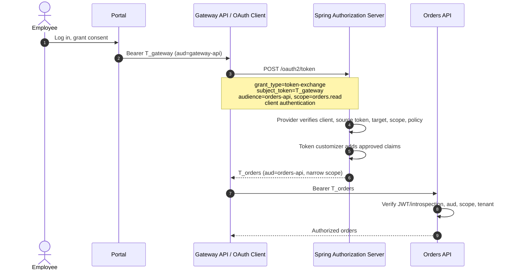
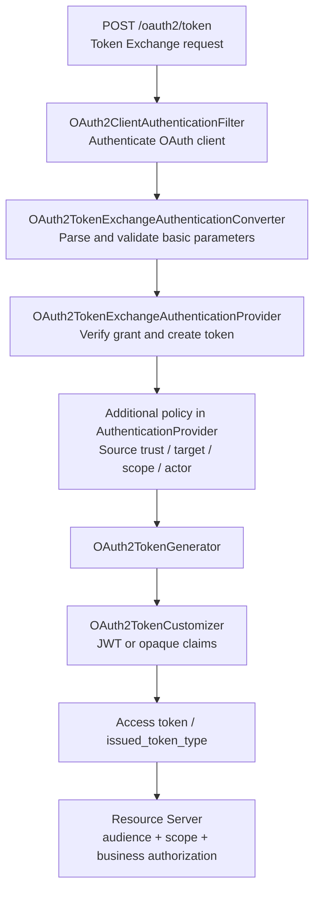
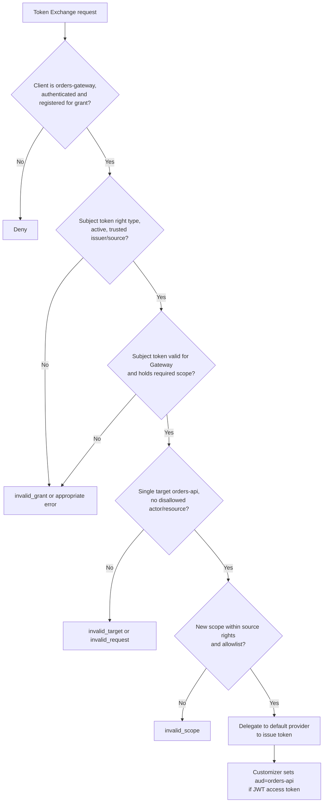

# Customizing the Provider and Token Customizer for Token Exchange Requests

**OAuth 2.0 Token Exchange (RFC 8693)** lets an OAuth client present an existing security token to request a new token with a more appropriate **intended recipient, permissions, and execution context**. A common scenario is an API Gateway receiving an access token from a user and needing to call a downstream Orders service: instead of forwarding the Gateway's own token to Orders API, the Gateway asks the Authorization Server to issue a token **dedicated to Orders API**, with a narrower scope and a shorter lifetime.

In Spring Boot using **Spring Security** and **Spring Authorization Server**, this flow goes through `/oauth2/token` with grant type `urn:ietf:params:oauth:grant-type:token-exchange`. Starting in Spring Authorization Server 1.3, the framework provides `OAuth2TokenExchangeAuthenticationConverter` and `OAuth2TokenExchangeAuthenticationProvider` for this grant. However, **protocol support does not mean every cross-service delegation is safe by default**. Decisions such as which clients may exchange tokens, which source tokens are trusted, which target audiences are allowed, which scopes may be retained, and whether an actor may represent a subject still require explicit design and testing.

This lesson belongs to the **Token Exchange** chapter of the **SPRING_SECURITY_OAUTH2_OIDC_AUTHORIZATION_SERVER** module, focused on designing, configuring, securing, testing, and operating an OAuth 2.0/OpenID Connect Authorization Server with Spring Security and Spring Authorization Server in Spring Boot. Its direct focus is **customizing `AuthenticationProvider` and `OAuth2TokenCustomizer` for a Token Exchange request**—two extension points with distinct responsibilities that must not be conflated.

> **Architectural boundary:** The provider decides **whether to permit the exchange and under what context**; the token customizer decides **how to represent the permitted claims/headers on the new token**. Never use a customizer to turn an unverified request into a token with broader permissions.

## 1. Scenario: Gateway Exchanges a Token to Call Orders API

An employee logged into the Portal app using Authorization Code + PKCE. Portal sends access token `T_gateway` to **Gateway API**. Gateway needs to call **Orders API** to read authorized orders, yet `T_gateway` has audience `gateway-api`, **not Orders API**.

Gateway can act as an **OAuth confidential client** and request a Token Exchange:

1. Gateway authenticates itself as a client at the Token Endpoint.
2. Gateway sends `subject_token=T_gateway`, declares the token type, and requests a token for `orders-api`.
3. The Authorization Server verifies the source token, client, scope, purpose, and forwarding policy.
4. If permitted, the Authorization Server issues `T_orders` with `aud=orders-api`, scope limited to `orders.read`, and a short TTL.
5. Gateway uses `T_orders` when calling Orders API. Orders API verifies issuer, audience, scope, and record-level permissions.



**Never forward `T_gateway` unchanged to Orders API** when the audience does not match. If Orders accepts a token not meant for it merely because the signature verifies, the system becomes vulnerable to *confused deputy* issues or unauthorized token forwarding.

### 1.1. Exchange Differs from Refresh or Client Credentials

| Grant / mechanism | Input | Output | Meaning |
|---|---|---|---|
| Authorization Code | Authorization code + PKCE / client auth | Access token, possibly ID/refresh token | Grants initial permissions after user interaction |
| Refresh Token | Refresh token of an existing authorization | New access token | Extends ongoing permissions per policy |
| Client Credentials | Client authentication | Workload access token | No end-user subject by default |
| **Token Exchange** | `subject_token`, optional `actor_token` + client authentication | New token matching target/policy | Transforms/narrows token usage context |
| Token relay | Forwards original access token unchanged | No new token created | Appropriate only when the target Resource Server is permitted to accept the source token |

**Token Exchange is not a refresh token with an added `audience`.** RFC 8693 defines an independent token transformation protocol; it does not automatically invalidate the input token, does not automatically tie the new token's lifecycle to the source token, and does not create user-delegated permissions out of thin air.

## 2. Key RFC 8693 Parameters When Customizing

A Token Exchange request uses `application/x-www-form-urlencoded` at the Token Endpoint:

```http
POST /oauth2/token HTTP/1.1
Host: login.example.com
Authorization: Basic <base64(gateway-client-id:client-secret)>
Content-Type: application/x-www-form-urlencoded

grant_type=urn%3Aietf%3Aparams%3Aoauth%3Agrant-type%3Atoken-exchange&
subject_token=<urlencoded-source-access-token>&
subject_token_type=urn%3Aietf%3Aparams%3Aoauth%3Atoken-type%3Aaccess_token&
requested_token_type=urn%3Aietf%3Aparams%3Aoauth%3Atoken-type%3Aaccess_token&
audience=orders-api&
scope=orders.read
```

The body is wrapped across lines for readability; when executed, it must be properly form-encoded. Placeholders are not usable credentials. For a confidential client, `Authorization: Basic` authenticates the **OAuth client performing the exchange**, which is distinct from the identity inside the subject token.

| Parameter | Required by RFC? | Role | What must be verified |
|---|---|---|---|
| `grant_type` | Yes | Selects the Token Exchange Grant | Exact URN and client registered for the grant |
| `subject_token` | Yes | Source token representing the subject | Authenticity, issuer, audience, expiry, state, permissions |
| `subject_token_type` | Yes | Source token type | Is that type and its validator supported? |
| `requested_token_type` | No | Desired output token type | If requested, is it among allowed output types? |
| `audience` | No | Intended recipient of the new token | Allow only valid targets; never trust blindly |
| `resource` | No | Target resource URI | Prevent exchanging into APIs outside allowlist |
| `scope` | No | Scopes needed on the new token | No escalation past source token or policy |
| `actor_token` | No | Token identifying the entity acting on behalf of the subject | Verify actor and delegation relationship |
| `actor_token_type` | Yes when `actor_token` is present | Actor token type | Not missing and not sent spuriously |

Multiple `audience` or `resource` values are allowed by the RFC. In a product that permits only **one** target API, reject ambiguous or multi-target requests instead of silently picking one.

### 2.1. Two Easily Confused URNs

```text
urn:ietf:params:oauth:token-type:access_token
urn:ietf:params:oauth:token-type:jwt
```

`access_token` means **an OAuth access token**, which may be a JWT or opaque to the client. `jwt` specifies the **JWT representation format**; it does not mean the JWT is usable as an internal issuer's access token. An access token from the Authorization Server itself and a JWT assertion from an external issuer require **different trust and validation paths**.

Never infer the token type merely because a string has three dot-separated segments. Inspect the declared `subject_token_type` and apply the matching verification mechanism.

### 2.2. The RFC Does Not Automatically Dictate Impersonation/Delegation Behavior

- **Impersonation:** the new token carries the subject context; the recipient may not know an intermediary was involved if policy omits an actor.
- **Delegation:** an intermediary is permitted to act **on behalf of** the subject within clear boundaries. RFC 8693 describes the `act` claim to represent the actor in suitable tokens.
- **Downscoping:** the new token has a narrower audience/scope; it does not prove delegation authority unless the client–subject relationship is verified.

**Never copy `sub` and attach `act` from an unverified `actor_token` string.** The actor must be authenticated and authorized to represent the subject, and the Resource Server must understand and enforce that context.

## 3. Separating Responsibilities Between Converter, Provider, and Customizer



This diagram shows **responsibilities**, not an assertion that the customizer is an independent permission check running after the provider. The provider constructs the token context and calls the generator; the customizer is invoked **by the generator** while minting the token. Policy must be enforced **before** the generator creates the token, rather than merely "attaching nice claims."

| Class | Should do here | Should NOT do |
|---|---|---|
| `AuthenticationConverter` | Read `grant_type`, `subject_token`, types, `resource`/`audience`/`scope` into a token request | Make final authorization decisions or trust raw tokens |
| `AuthenticationProvider` | Verify grant, source token, client, actor, target, and policy; succeed only when permitted | Skip validation because the client is authenticated |
| `OAuth2TokenGenerator` | Generate the access token from token context and token settings | Grant new scopes from raw query params outside policy |
| `OAuth2TokenCustomizer<JwtEncodingContext>` | Add/adjust JWT claims/headers from **already-approved context** | Treat unverified tokens in `getAuthorizationGrant()` as proof to escalate privileges |
| `OAuth2TokenCustomizer<OAuth2TokenClaimsContext>` | Enrich opaque access token claims | Issue JWTs manually or replace the provider |
| Resource Server | Verify the new token matches target API and object-level authorization | Trust every token from the issuer regardless of audience |

### 3.1. Spring's Default Components

Since Spring Authorization Server 1.3, `OAuth2TokenEndpointFilter` configures by default:

- `OAuth2TokenExchangeAuthenticationConverter` to parse Token Exchange requests;
- `OAuth2TokenExchangeAuthenticationProvider` to process the grant;
- `OAuth2AccessTokenResponseAuthenticationSuccessHandler` and `OAuth2ErrorAuthenticationFailureHandler` to emit HTTP/OAuth responses.

The default provider **does not need to be rewritten** if your system's policy fits its capabilities. Start by testing the default behavior of your pinned version before adding custom logic.

**Important API detail:** `OAuth2TokenExchangeAuthenticationProvider` is `final` in the Spring Authorization Server 1.5.x line; its public API exposes its constructor and `authenticate()`/`supports()`, **and does not have a `setAuthenticationValidator(...)` method like the Client Credentials provider**. To enforce extra pre-processing policies, either **wrap the provider** or replace it with a thoroughly tested custom implementation. Never write examples calling a non-existent setter.

## 4. Designing the Token Exchange Policy Before Writing Code

Suppose the product policy is very narrow:

- Only confidential client `orders-gateway` may call Token Exchange.
- `subject_token` must be an **active access token known to the current Authorization Server**, not a self-asserted JWT from an external issuer.
- The source token must be **intended for Gateway API** (`aud=gateway-api`) and carry scope `orders.read`.
- Only target `audience=orders-api` may be requested; no other `resource` or multiple audiences are allowed.
- Only `requested_token_type=access_token` is issued; actor tokens are not accepted at this stage.
- Requested scope must be `orders.read` (or a policy-approved subset); never grant `orders.write`.
- The new token has `aud=orders-api`, a short TTL, and is used only by Orders API.



This design is an **example policy**, not a universal rule for every deployment. If your business later supports actors, external issuers, or multiple resources, expand both validation and the claims model—never just widen the request allowlist.

### 4.1. Least-Privilege Rule

An exchange should not self-escalate privileges:

```text
scope_issued ⊆ scope_subject_token ∩ scope_client_registered ∩ scope_target_policy
```

This is a **recommended policy for downscoping scenarios**, not a mandatory formula for every Token Exchange profile. When a use case translates permissions across business vocabularies, any transformation or elevation must rest on auditable, trusted policy decisions rather than caller-supplied requests alone.

**Input audience** and **output audience** must also be verified separately. A source token meant for `billing-api` must never become an Orders token merely because the caller sent `audience=orders-api`.

## 5. Registering a Client Permitted to Perform Token Exchange

`RegisteredClient` must declare the new grant. Example using a confidential client with a client secret loaded from a secure store:

```java
package example.authorizationserver.config;

import java.time.Duration;

import org.springframework.security.oauth2.core.AuthorizationGrantType;
import org.springframework.security.oauth2.core.ClientAuthenticationMethod;
import org.springframework.security.oauth2.server.authorization.client.RegisteredClient;
import org.springframework.security.oauth2.server.authorization.settings.TokenSettings;

RegisteredClient gateway = RegisteredClient.withId("orders-gateway-registration")
        .clientId("orders-gateway")
        .clientSecret(passwordEncoder.encode(gatewaySecret))
        .clientAuthenticationMethod(
                ClientAuthenticationMethod.CLIENT_SECRET_BASIC)
        .authorizationGrantType(AuthorizationGrantType.TOKEN_EXCHANGE)
        .scope("orders.read")
        .tokenSettings(TokenSettings.builder()
                .accessTokenTimeToLive(Duration.ofMinutes(3))
                .build())
        .build();
```

This snippet illustrates the builder and assumes `passwordEncoder` and `gatewaySecret` come from your security configuration. It is not a standalone runnable Java class: the declaration must sit inside a method and be registered with a `RegisteredClientRepository`. `AuthorizationGrantType.TOKEN_EXCHANGE` exists in Spring Security 6.3+ (aligned with Spring Authorization Server 1.3+); check your actual dependency API if using a different version.

No `redirect_uri` is needed for purely back-channel Token Exchange because no browser redirect flow runs. Never use `ClientAuthenticationMethod.NONE` for a backend capable of protecting credentials when workload control is required. Keep `orders-gateway` separate from other OAuth clients to isolate permissions, rotation, and auditing.

### 5.1. Three Distinct Identities

- **Client exchanging the token**: `orders-gateway`, authenticated at the Token Endpoint with the Gateway's credentials.
- **Subject of the source token**: may be user `user-123` or an authenticated workload from the original authorization.
- **Actor** (if any): the entity representing the subject under delegation policy.

Never grab `client.getClientId()` and assign it as `sub` of the new token simply because the client performed the exchange. Doing so loses the user subject; conversely, never assume every exchange has a human user subject when the source token belongs to a workload.

## 6. Customizing the Provider at the Right Extension Point

Spring Authorization Server exposes the list of configured `AuthenticationProvider` instances via `OAuth2TokenEndpointConfigurer.authenticationProviders(...)`. This is the place to **find and replace** the Token Exchange provider with a policy-enforcing wrapper.

### 6.1. Why Not Just `.authenticationProvider(newProvider)`?

Calling:

```java
tokenEndpoint.authenticationProvider(customProvider);
```

**appends** a provider. When a default provider **also supports `OAuth2TokenExchangeAuthenticationToken`** and is tried earlier, requests can succeed **without ever hitting your new policy**. Never rely on ambiguous provider ordering when enforcing security boundaries.

Instead, inspect the default list and **replace the matching provider in place**:

```java
@Bean
@Order(1)
SecurityFilterChain authorizationServerSecurityFilterChain(
        HttpSecurity http,
        OAuth2AuthorizationService authorizations) throws Exception {

    OAuth2AuthorizationServerConfigurer as =
            OAuth2AuthorizationServerConfigurer.authorizationServer();

    http
        .securityMatcher(as.getEndpointsMatcher())
        .with(as, server -> server
            .tokenEndpoint(tokenEndpoint -> tokenEndpoint
                .authenticationProviders(providers -> {
                    boolean replaced = false;

                    for (int i = 0; i < providers.size(); i++) {
                        AuthenticationProvider current = providers.get(i);

                        if (current instanceof OAuth2TokenExchangeAuthenticationProvider) {
                            providers.set(i, new GuardedTokenExchangeProvider(
                                    current, authorizations));
                            replaced = true;
                        }
                    }

                    if (!replaced) {
                        throw new IllegalStateException(
                            "Default Token Exchange provider not found");
                    }
                })))
        .authorizeHttpRequests(authorize -> authorize
            .anyRequest().authenticated());

    return http.build();
}
```

Spring Security / Spring Authorization Server imports and foundational beans are omitted; this example illustrates **configuring the provider list**. `GuardedTokenExchangeProvider` is defined in the next section.

**Key characteristic:** `OAuth2TokenExchangeAuthenticationProvider` is `final`, so it cannot be subclassed to override `authenticate`. Wrapping it in a separate `AuthenticationProvider` preserves default grant-handling behavior once the extra policy approves.

Never register another provider of the same kind without ensuring the default provider is removed or replaced. Write unit and integration tests confirming invalid requests **actually** hit the guard and get rejected.

### 6.2. Wrapper Restricting Client, Source Token, and Target

The example below implements the **very narrow policy from Section 4**: only `orders-gateway`, subject tokens stored in the internal authorization store, and the exact audience and scope. External JWTs or actor tokens are rejected rather than guessing how to validate them.

```java
package example.authorizationserver.security;

import java.util.Collection;
import java.util.Map;
import java.util.Set;

import org.springframework.security.authentication.AuthenticationProvider;
import org.springframework.security.core.Authentication;
import org.springframework.security.oauth2.core.AuthorizationGrantType;
import org.springframework.security.oauth2.core.OAuth2ErrorCodes;
import org.springframework.security.oauth2.core.OAuth2TokenType;
import org.springframework.security.oauth2.core.OAuth2AuthenticationException;
import org.springframework.security.oauth2.server.authorization.OAuth2Authorization;
import org.springframework.security.oauth2.server.authorization.OAuth2AuthorizationService;
import org.springframework.security.oauth2.server.authorization.authentication.OAuth2ClientAuthenticationToken;
import org.springframework.security.oauth2.server.authorization.authentication.OAuth2TokenExchangeAuthenticationToken;
import org.springframework.security.oauth2.server.authorization.client.RegisteredClient;

public final class GuardedTokenExchangeProvider implements AuthenticationProvider {

    private static final String ACCESS_TOKEN_TYPE =
            "urn:ietf:params:oauth:token-type:access_token";

    private final AuthenticationProvider delegate;
    private final OAuth2AuthorizationService authorizations;

    public GuardedTokenExchangeProvider(
            AuthenticationProvider delegate,
            OAuth2AuthorizationService authorizations) {
        this.delegate = delegate;
        this.authorizations = authorizations;
    }

    @Override
    public boolean supports(Class<?> authentication) {
        return delegate.supports(authentication);
    }

    @Override
    public Authentication authenticate(Authentication authentication) {
        if (!(authentication instanceof OAuth2TokenExchangeAuthenticationToken request)) {
            return null;
        }

        if (!(request.getPrincipal() instanceof OAuth2ClientAuthenticationToken client)
                || !client.isAuthenticated()
                || client.getRegisteredClient() == null) {
            throw deny(OAuth2ErrorCodes.INVALID_CLIENT);
        }

        RegisteredClient registered = client.getRegisteredClient();

        if (!"orders-gateway".equals(registered.getClientId())
                || !registered.getAuthorizationGrantTypes().contains(
                        AuthorizationGrantType.TOKEN_EXCHANGE)) {
            throw deny(OAuth2ErrorCodes.UNAUTHORIZED_CLIENT);
        }

        // This scenario accepts only access tokens issued by this AS.
        if (!ACCESS_TOKEN_TYPE.equals(request.getSubjectTokenType())
                || (request.getRequestedTokenType() != null
                        && !ACCESS_TOKEN_TYPE.equals(request.getRequestedTokenType()))) {
            throw deny(OAuth2ErrorCodes.INVALID_REQUEST);
        }

        // Actor tokens and resource URIs are outside this demo's profile.
        if (request.getActorToken() != null
                || request.getActorTokenType() != null
                || !request.getResources().isEmpty()) {
            throw deny(OAuth2ErrorCodes.INVALID_REQUEST);
        }

        if (!request.getAudiences().equals(Set.of("orders-api"))) {
            // RFC 8693 defines invalid_target for disallowed targets.
            throw deny("invalid_target");
        }

        Set<String> requestedScopes = request.getScopes();
        if (!requestedScopes.equals(Set.of("orders.read"))
                || !registered.getScopes().containsAll(requestedScopes)) {
            throw deny(OAuth2ErrorCodes.INVALID_SCOPE);
        }

        // Trust only access tokens present and active in the internal store.
        OAuth2Authorization source = authorizations.findByToken(
                request.getSubjectToken(), OAuth2TokenType.ACCESS_TOKEN);

        if (source == null || source.getAccessToken() == null
                || !source.getAccessToken().isActive()) {
            throw deny(OAuth2ErrorCodes.INVALID_GRANT);
        }

        if (!source.getAccessToken().getToken().getScopes()
                .containsAll(requestedScopes)) {
            throw deny(OAuth2ErrorCodes.INVALID_SCOPE);
        }

        Map<String, Object> claims = source.getAccessToken().getClaims();
        Object rawAudience = claims != null ? claims.get("aud") : null;

        if (!(rawAudience instanceof Collection<?> audience)
                || !audience.contains("gateway-api")) {
            throw deny(OAuth2ErrorCodes.INVALID_GRANT);
        }

        // Preserve all Spring Authorization Server provider checks.
        return delegate.authenticate(authentication);
    }

    private static OAuth2AuthenticationException deny(String code) {
        return new OAuth2AuthenticationException(code);
    }
}
```

**This is a deliberately constrained sample for learning and testing, not a complete policy engine.** The code expects the input access token to be stored in `OAuth2AuthorizationService` by this Authorization Server and carry an `aud` claim in its metadata. If your application issues opaque tokens without storing audience claims or uses another issuer configuration, redesign how trusted metadata is obtained; **never remove the `aud` check just to make tests pass**.

**Security boundaries of the example:**

- Never parse a JWT via Base64URL and trust its claims directly.
- Never accept `actor_token` without delegation verification and authorization.
- Never accept `resource` or multiple targets not yet supported by the product.
- Never let callers escalate scopes past the source token.
- Use `OAuth2AuthorizationService` as the source of truth, checking active status and delegating to the standard provider.
- Allow only one specific client to exchange tokens for one specific API under the demo's strict policy.

In addition, production requires checking **the caller's authorization for the source token**, subject/tenant, whether the token may be forwarded by this client, token binding, TTL/absolute lifetime, and revocation policy. Simply possessing a source token and holding client credentials is not proof of permission to impersonate any subject.

### 6.3. Validation When the Source Token Is an External Issuer's JWT

The example wrapper **does not support** taking a JWT from an external issuer and exchanging it at the internal Authorization Server. If federated exchange is required, add a dedicated **source token verification step**:

1. Trust only issuers explicitly on an allowlist, verifying signatures with trusted JWKS.
2. Restrict algorithms and keys; check `iss`, `aud`, `exp`, `nbf`, and token type.
3. Check revocation/introspection if supported by the source and required by the use case.
4. Normalize subject/tenant and transferable claims.
5. Verify the client's permission to exchange from that source to that target.
6. Mint the new token from **verified facts**, never from the raw payload.
7. Design dedicated identity-provider bridging when needed, avoiding confusing JWT assertions with OAuth access tokens.

Never substitute those steps with a `JwtDecoder` configured against the internal Authorization Server's keys if the JWT **was issued by another issuer**. Having `OAuth2TokenExchangeAuthenticationToken.getSubjectTokenType()` in the framework does not make JWTs from arbitrary issuers trustworthy.

## 7. Token Customizer: Doing Claim Generation Properly

### 7.1. JWT Access Tokens: `OAuth2TokenCustomizer<JwtEncodingContext>`

When `RegisteredClient.tokenSettings.accessTokenFormat` is `SELF_CONTAINED` and `JwtGenerator` is configured, `JwtEncodingContext` allows customizing JWT claims and JWS headers **prior to signing**.

Under the narrow policy in Section 4 and the wrapper restricting to `orders-gateway` → `orders-api`, a safe customizer can emit the fixed audience on the JWT:

```java
package example.authorizationserver.config;

import java.util.List;

import org.springframework.context.annotation.Bean;
import org.springframework.context.annotation.Configuration;
import org.springframework.security.oauth2.core.AuthorizationGrantType;
import org.springframework.security.oauth2.core.OAuth2TokenType;
import org.springframework.security.oauth2.server.authorization.token.JwtEncodingContext;
import org.springframework.security.oauth2.server.authorization.token.OAuth2TokenCustomizer;

@Configuration(proxyBeanMethods = false)
public class ExchangeJwtClaimsConfiguration {

    @Bean
    OAuth2TokenCustomizer<JwtEncodingContext> tokenExchangeJwtCustomizer() {
        return context -> {
            if (!AuthorizationGrantType.TOKEN_EXCHANGE.equals(
                    context.getAuthorizationGrantType())) {
                return;
            }
            if (!OAuth2TokenType.ACCESS_TOKEN.equals(context.getTokenType())) {
                return;
            }
            if (!"orders-gateway".equals(
                    context.getRegisteredClient().getClientId())) {
                return;
            }

            // Prior provider policy only permits target orders-api.
            context.getClaims().audience(List.of("orders-api"));
            context.getClaims().claim("token_use", "exchanged_access");
        };
    }
}
```

**Important condition:** This is a **customizer tailored to a profile already approved by the provider**. It sets `aud` according to a fixed policy rather than writing `context.getClaims().audience(request.getAudiences())` from an unverified request. If a client has multiple valid targets, the provider should resolve the specific target and pass it as a **trusted policy decision** to the generator/customizer instead of reading raw parameters at the end.

Never assign `client_id` to `sub` or "copy" `act` from the request. Verify the subject/actor/target relationship in the provider and test emitted claims with integration tests.

### 7.2. Opaque Access Tokens: `OAuth2TokenCustomizer<OAuth2TokenClaimsContext>`

If `TokenSettings.getAccessTokenFormat()` is `OAuth2TokenFormat.REFERENCE`, the access token is typically opaque; `JwtEncodingContext` **does not process that token**. Use the customizer for `OAuth2AccessTokenGenerator`:

```java
@Bean
OAuth2TokenCustomizer<OAuth2TokenClaimsContext> tokenExchangeOpaqueCustomizer() {
    return context -> {
        if (!AuthorizationGrantType.TOKEN_EXCHANGE.equals(
                context.getAuthorizationGrantType())
                || !OAuth2TokenType.ACCESS_TOKEN.equals(
                        context.getTokenType())) {
            return;
        }

        if (!"orders-gateway".equals(
                context.getRegisteredClient().getClientId())) {
            return;
        }

        // Opaque tokens store claims server-side for introspection.
        context.getClaims().claim("aud", List.of("orders-api"));
        context.getClaims().claim("token_use", "exchanged_access");
    };
}
```

Place this inside a configuration class with imports for `java.util.List`, `OAuth2TokenClaimsContext`, and `OAuth2TokenCustomizer`. With opaque tokens, the Resource Server must have a way to **retrieve and validate the audience** via trusted introspection/metadata; an API cannot parse an opaque string locally to read claims.

### 7.3. When Are Customizer Beans Applied Automatically?

In the default configuration where you **do not register your own `OAuth2TokenGenerator`**:

- An `OAuth2TokenCustomizer<JwtEncodingContext>` bean is wired into `JwtGenerator` when a compatible JWT generator is present.
- An `OAuth2TokenCustomizer<OAuth2TokenClaimsContext>` bean is wired into `OAuth2AccessTokenGenerator` for opaque access tokens.

If you manually build a `DelegatingOAuth2TokenGenerator` or individual generators, you must **wire the customizers explicitly** onto the matching generator type. Registering a customizer bean and replacing the token generator while forgetting to wire it can result in missing `aud` claims.

When another JWT customizer already exists, do not declare multiple uncoordinated beans assuming they merge automatically. Build a single composite customizer or explicit composition, ensuring security claims do not overwrite one another.

### 7.4. Example Manual Wiring with `OAuth2TokenGenerator`

```java
@Bean
OAuth2TokenGenerator<?> tokenGenerator(
        JwtEncoder jwtEncoder,
        OAuth2TokenCustomizer<JwtEncodingContext> jwtCustomizer,
        OAuth2TokenCustomizer<OAuth2TokenClaimsContext> opaqueCustomizer) {

    JwtGenerator jwtGenerator = new JwtGenerator(jwtEncoder);
    jwtGenerator.setJwtCustomizer(jwtCustomizer);

    OAuth2AccessTokenGenerator accessTokenGenerator =
            new OAuth2AccessTokenGenerator();
    accessTokenGenerator.setAccessTokenCustomizer(opaqueCustomizer);

    OAuth2RefreshTokenGenerator refreshTokenGenerator =
            new OAuth2RefreshTokenGenerator();

    return new DelegatingOAuth2TokenGenerator(
            jwtGenerator, accessTokenGenerator, refreshTokenGenerator);
}
```

Use this **only when a custom token generator is genuinely needed**, not alongside autoconfiguration unnecessarily. `JwtEncoder` must be configured with appropriate signing keys, and imports from `org.springframework.security.oauth2.server.authorization.token` and `org.springframework.security.oauth2.jwt` must be added. If replacing the generator, run regression tests across all other grants (`authorization_code`, `refresh_token`, `client_credentials`, etc.) to prevent unintended side effects.

## 8. Why a Customizer Alone Cannot Secure Token Exchange

An anti-pattern:

```java
// UNSAFE without a verified policy in the provider:
return context -> {
    if (AuthorizationGrantType.TOKEN_EXCHANGE.equals(
            context.getAuthorizationGrantType())) {
        OAuth2TokenExchangeAuthenticationToken request =
                context.getAuthorizationGrant();

        context.getClaims().audience(
                List.copyOf(request.getAudiences()));
        context.getClaims().claim("scope",
                String.join(" ", request.getScopes()));
    }
};
```

Risk: the request might carry `audience=billing-admin-api` and `scope=payments.write`. If the customizer blindly copies values into the token without a trusted authorization decision from the provider, that causes **privilege escalation via token generation**. Nor does `getAuthorizationGrant()` inside a customizer prove every request field satisfied product policy.

**Correct design:**

- The provider verifies client, subject token, actor, target, scope, and authorization.
- The generator context holds only `authorizedScopes` and trusted details approved by the provider.
- The customizer emits claims from the **trusted policy decision**, never making fresh authorization decisions on its own.
- The Resource Server rejects tokens not intended for it or lacking business permissions.

### 8.1. What Should Go Into the Output Token?

Depending on token type and policy, claims may include:

| Claim | Meaning | Source of truth |
|---|---|---|
| `iss` | Authorization Server issuing the token | Configured issuer |
| `sub` | Subject represented by the token | Verified/authorized subject |
| `aud` | Intended Resource Server | Target decision approved by provider policy |
| `scope`/`scp` | Granted permissions | Evaluated scope set, never escalating privileges |
| `exp`/`iat` | New token lifetime | Token settings and additional bounds |
| `jti` | Identifier of the new token | Token generator, if used |
| `client_id`/`azp` | Client identifier per profile | Verified registration/client context |
| `act` | Actor acting on behalf of the subject | Verified actor token and delegation policy |
| `token_use` | Internal label illustrating token usage | Product policy |

Never inject `may_act` or `act` claims to "legitimize" an unverified delegation relationship. Never dump all source claims, groups, emails, tenant lists, or unnecessary PII into the new token.

### 8.2. Output TTL and Source Token Lifecycle

Token Exchange under RFC 8693 does not automatically invalidate the source token. Nor does the new token automatically die when the source is later revoked. For sensitive systems, consider:

```text
expiresAt_issued = min(
    now + target_access_token_TTL,
    expiresAt_subject_token,
    absolute_authorization_limit
)
```

This is a **recommended design policy**, not a default behavior guaranteed by `TokenSettings`. To cap the new token's expiry by the source token, implement and enforce it at the right extension point and test thoroughly. Randomly altering `exp` claims in a customizer without keeping the token model, persistence, and provider synchronized can cause inconsistencies.

When a subject token is revoked after exchange, you need a dedicated strategy for already-issued tokens: short TTLs, introspection, persisted provenance links, event-driven revocation, or an equivalent mechanism. Never claim output tokens are automatically revoked with the source simply by virtue of using RFC 8693.

## 9. Handling `actor_token` and Delegation When Expanding Use Cases

Our initial scenario did not accept actor tokens. If a new requirement is "Billing Worker acts on behalf of a user to call Orders API," design:

1. Validate the **actor token** per `actor_token_type`: issuer, signature, `aud`, expiry, revocation.
2. Verify the actor is authorized to act on behalf of the subject—e.g., policy based on trust relationships, resource/tenant, `may_act`, or a dedicated authorization system.
3. Ensure requested target and scopes are approved for both subject and actor under policy.
4. Generate an output token explicitly representing `sub` and `act`, e.g., `act.sub` as the actor ID when the profile permits.
5. Have the Resource Server enforce `act` and restrict permissions accordingly—never treat it merely as a log tag.
6. Enforce delegation chain rules if the actor may exchange tokens further downstream.

**Illustrative** claims for a policy-approved delegation token:

```json
{
  "iss": "https://login.example.com",
  "sub": "user-123",
  "aud": ["orders-api"],
  "scope": "orders.read",
  "act": {
    "sub": "billing-worker"
  },
  "token_use": "exchanged_access"
}
```

Do not treat this JSON as a complete JWT or a mandatory template. `act` can contain nested actor claims in delegation chains per RFC 8693. Never populate `act` simply by Base64-decoding `actor_token` without verifying signatures and trust.

### 9.1. External JWT Subject/Actor

When source tokens originate from an external IdP, define explicit trust boundaries: trusted issuers, audience, token type, signature algorithms, JWK rotation, subject mapping, and cross-tenant rules. Accepting a valid JWT **is not enough** to trust that a client may exchange it for an internal issuer's access token—doing so creates a **token laundering** risk if unchecked by the AS.

### 9.2. Impersonation Is Not Delegation

In impersonation, the Resource Server may see only the subject. In delegation, the Resource Server may need to know which actor acted on behalf of the subject for auditing and authorization. Either way, an explicit authorization decision must precede token generation. Never treat the `act` claim as an "automatic permission transfer."

## 10. HTTP Examples and Reading Responses

### 10.1. Valid Exchange Request per the Example Profile

```bash
curl --request POST "https://login.example.com/oauth2/token" \
  --user "$GATEWAY_CLIENT_ID:$GATEWAY_CLIENT_SECRET" \
  --header "Content-Type: application/x-www-form-urlencoded" \
  --data-urlencode "grant_type=urn:ietf:params:oauth:grant-type:token-exchange" \
  --data-urlencode "subject_token=$GATEWAY_ACCESS_TOKEN" \
  --data-urlencode "subject_token_type=urn:ietf:params:oauth:token-type:access_token" \
  --data-urlencode "requested_token_type=urn:ietf:params:oauth:token-type:access_token" \
  --data-urlencode "audience=orders-api" \
  --data-urlencode "scope=orders.read"
```

This command assumes a **confidential client registered for Token Exchange**, a policy-compliant subject token, and source audience `gateway-api`. Never log token parameters or client secrets in terminals/CI/APM; `curl --user` can also expose credentials in process listings depending on the environment.

### 10.2. Token Response per RFC 8693

Example:

```json
{
  "access_token": "<exchanged-access-token>",
  "issued_token_type": "urn:ietf:params:oauth:token-type:access_token",
  "token_type": "Bearer",
  "expires_in": 180,
  "scope": "orders.read"
}
```

`issued_token_type` states the security token type issued; `token_type` describes how to present the token when calling an API, such as `Bearer`. Never confuse `issued_token_type` with `subject_token_type`. Receiving a response does not mean the API will blindly trust the token: Orders API must still check audience, signature/introspection, expiry, and permissions.

### 10.3. Errors to Recognize

| Scenario | Common error | Required guarantee |
|---|---|---|
| Invalid client authentication | `invalid_client` | Issue no token, leak no secrets |
| Client lacks Token Exchange grant | `unauthorized_client` | Grant allowlist enforced |
| Missing `subject_token`/type | `invalid_request` | Never build an empty context to mint a token |
| Bad/expired/revoked source token | `invalid_grant` or policy-appropriate error | Issue no token |
| Disallowed `audience`/`resource` target | `invalid_target` per RFC 8693 | Never accept caller-picked targets |
| Excessive/invalid scope | `invalid_scope` | No privilege escalation |
| Unsupported actor | `invalid_request` or appropriate error | Never accept unverified actors |
| Unsupported `requested_token_type` | `invalid_request`/`unsupported_token_type` per profile | Never issue token types outside policy |
| Provider/customizer bypassed | Token still issued missing `aud`/policy | Test wiring and fail startup if guard is missing |

Exact error codes depend on where detection occurs, converters/providers, and library version. **Do not assert that all errors return identical HTTP bodies**, but do assert that **no access token is issued when a request is invalid**.

## 11. Testing: Beyond Checking Whether Claims Were Added

### 11.1. Security Matrix for the Provider

| Test case | Input/condition | Expected |
|---|---|---|
| Happy path | Permitted Gateway, active source, valid audience/scope | Issues new token for target |
| Missing client auth | Unauthenticated request | Rejected |
| Client lacks grant | Client not registered for `TOKEN_EXCHANGE` | Rejected |
| Client other than Gateway | `client_id` outside policy | Rejected |
| Non-existent subject token | Token absent from trusted authorization store | Rejected |
| Expired subject token | `OAuth2Authorization.Token.isActive()` is false | Rejected |
| Revoked subject token | Already invalidated | Rejected |
| Wrong subject audience | `aud=billing-api` instead of `gateway-api` | Rejected |
| Missing subject scopes | Lacks `orders.read` | Rejected |
| Escalated scope requested | `orders.write` / `payments.admin` | Rejected |
| Different target audience | `audience=admin-api` | `invalid_target` or appropriate error |
| Multiple audiences | `orders-api` + `payments-api` | Rejected by single-target policy |
| Unsupported `resource` | Sends `resource=...` | Rejected |
| Unsupported actor | Includes `actor_token` | Rejected |
| Unknown subject type | `subject_token_type=jwt` in an access-token-only profile | Rejected |
| Unknown requested type | Token type outside allowlist | Rejected |
| Source token from another client | Lacks valid forwarding evidence | Rejected by additional policy |
| Concurrency/replay | Same source token exchanged repeatedly under limits | Quota/permissions respected |
| Input revoked after exchange | Attempt using output token after revocation | Matches designed revocation policy |

**Testing only the wrapper** is insufficient because the delegate provider still checks grant conditions and persistence. **Testing only the customizer** is also insufficient because the customizer could add `aud` to a token the server **should never have issued**.

### 11.2. Testing Output JWT Claims

For JWT access tokens:

1. Decode with the matching public key/JWKS and verify the signature.
2. Assert `iss` is the expected Authorization Server.
3. Assert `aud` contains only `orders-api` in this profile.
4. Assert the token contains `orders.read` and not `orders.write`.
5. Assert `exp` matches the registered TTL and does not exceed any custom cap if implemented.
6. Assert `sub` represents the authorized subject rather than being arbitrarily replaced with the client name.
7. Assert `act` is absent in profiles without actor support, or holds verified actor data when enabled.
8. Assert `token_use` is only a marker; the Resource Server still enforces real checks.

For opaque tokens, do not assert a JWT payload: inspect via introspection or authorization store metadata, and confirm the Resource Server validates returned claims over a trusted channel.

### 11.3. Verifying Provider Replacement Actually Works

An essential regression test: send a Token Exchange request with a client other than `orders-gateway` holding a completely valid `subject_token`. If a token is still issued, the wrapper **was not applied** or the policy was bypassed. Add this test immediately when configuring `authenticationProviders(...)` to catch mistakes where `authenticationProvider(...)` merely appended a new provider.

Verify the count of Token Exchange providers after configuration and ensure no default provider sits ahead of your guard. Never conclude provider security passes based on a JWT customizer test.

### 11.4. Cross-Grant Regression Tests

Modifying the Token Endpoint or token generator can affect:

- Authorization Code + PKCE;
- Refresh Token;
- Client Credentials;
- Device Code (if enabled);
- OIDC ID tokens (if enabled).

Add tests issuing tokens across all grants used in production to prove the Token Exchange wrapper does not block other grants and the token customizer does not stamp `aud=orders-api` onto unrelated tokens.

## 12. Illustrative Unit Test for the Wrapper

Pseudocode/JUnit intent:

```java
@Test
void blocksExchangeToUnexpectedAudience() {
    // Fixture: authenticated client orders-gateway with grant TOKEN_EXCHANGE.
    // Subject token is active, yet request asks for target admin-api.
    OAuth2TokenExchangeAuthenticationToken request =
            new OAuth2TokenExchangeAuthenticationToken(
                "urn:ietf:params:oauth:token-type:access_token",
                "test-subject-token",
                "urn:ietf:params:oauth:token-type:access_token",
                authenticatedClient,
                null,
                null,
                Set.of(),
                Set.of("admin-api"),
                Set.of("orders.read"),
                Map.of());

    assertThatThrownBy(() -> guardedProvider.authenticate(request))
        .isInstanceOf(OAuth2AuthenticationException.class);

    // verify(delegate, never()).authenticate(...) if using a mock:
    // Policy must reject before delegating.
}
```

Variables like `authenticatedClient`, `guardedProvider`, and assertions must be constructed in a real test fixture; the snippet will not run without test setup. Use Mockito to verify the delegate is never invoked on policy denials, and HTTP integration tests to verify the provider list was replaced properly.

### 12.1. Testing the Token Customizer in an Approved Context

Construct a `JwtEncodingContext` from valid fixtures or run an end-to-end Token Exchange; verify that only `TOKEN_EXCHANGE` + `ACCESS_TOKEN` for `orders-gateway` receives audience `orders-api`. A token issued via `client_credentials` for the billing API must never accidentally gain the Orders audience due to a loose customizer condition.

When using opaque access tokens, test the corresponding opaque customizer and introspection. Never assume both customizers run for the same token.

## 13. Operating and Observing a Token Exchange Service

### 13.1. Logging Enough to Investigate Without Leaking Tokens

Log controlled fields:

- Correlation/request ID;
- Authenticated client ID and grant type;
- Policy-resolved target identifier;
- Error category: source invalid, target denied, scope denied, unsupported actor/type;
- Token issuance latency, error rate, and total exchange count;
- Low-sensitivity provenance metadata per policy.

**Never log raw** `subject_token`, `actor_token`, access/refresh tokens, client assertions, client secrets, cookies, or sensitive identifying claims. If token correlation is needed, use an internal reference ID or securely managed hash/HMAC; never allow reconstructing tokens from logs.

### 13.2. Preventing Abuse and Replay

Because an exchange can mint multiple output tokens from a single subject token, the server must define:

- How many times a caller may exchange tokens within a time window?
- How many audiences one source token may exchange into?
- Are dedicated one-time-use, rate-limit, or replay-detection controls needed?
- If the input is revoked, are outputs revoked or left to expire via TTL?
- Must recursion be blocked (e.g., an Orders token being exchanged back into a Gateway token in a loop)?
- Are sender-constrained tokens needed to limit abuse if a bearer token leaks?

RFC 8693 does not automatically invalidate the input token on exchange. Exchange limits, provenance graphs, and incident response must be designed in application/STS policy.

### 13.3. Key Management and Multi-Node Deployments

If the AS issues JWTs, nodes must sign with valid keys and publish a consistent JWKS; Resource Servers trust only configured issuers/JWKS. If `OAuth2AuthorizationService` is used to verify subject tokens and store output tokens, nodes need a shared, persistent, transactional authorization store. Evaluate consistency when a token is freshly revoked or concurrent exchanges occur.

### 13.4. Safe Rollout Roadmap

1. Finalize the profile: clients, issuers, source token types, targets, scopes, and actor support.
2. Register new clients with `TOKEN_EXCHANGE` and minimal permissions.
3. Implement a **deny-by-default** provider guard and test all denial paths.
4. Register the appropriate JWT or opaque customizer and test emitted claims.
5. Configure Resource Servers to enforce audience and scope, not signature alone.
6. Run staging end-to-end tests with real source tokens, revocations, and multiple nodes.
7. Enable rate limiting, safe logging, and alerts on `invalid_target`/`invalid_grant`.
8. Roll out per client/target; never open wildcard audiences during an incident.
9. Maintain playbooks to revoke client/authorization access and halt exchanges rapidly if abused.

## 14. Configuration Errors and Diagnostics

| Symptom | Common cause | Remediation |
|---|---|---|
| `unauthorized_client` | Client not registered for `TOKEN_EXCHANGE` | Check `RegisteredClient.authorizationGrantTypes` |
| `invalid_client` | Bad secret/client assertion | Check client authentication independently of the subject |
| Token Exchange succeeds despite wrong audience | Guard was **added** after default provider instead of replacing it | Use `authenticationProviders(list -> ...)` and test guard execution |
| New token lacks `aud` | Customizer not wired or token format is opaque | Check `TokenSettings.accessTokenFormat` and generator wiring |
| New token carries arbitrary `aud` from request | Customizer copied raw request audiences | Move target decisions into provider policy |
| External JWT exchange fails | Default provider/store accepts only internal tokens | Design dedicated external issuer trust; never disable validation |
| Token works at non-target API | Resource Server does not check audience | Add an audience validator |
| Scope escalated during exchange | Policy failed to check source/registration/target scopes | Enforce trusted scope intersection/mapping |
| New token has Gateway as subject instead of user | Misused `getPrincipal().getName()` | Check context semantics and verified subject |
| Wrong actor claim | Copied unverified actor token | Add actor validation and delegation policy |
| Custom provider throws HTML 500 | Did not throw `OAuth2AuthenticationException` or misconfigured handler | Return Token Endpoint OAuth errors |
| Auth code grant breaks after deploy | Replaced token generator without preserving required generators | Run cross-grant regression tests |
| Cluster node A succeeds while node B fails | Out-of-sync authorization store, JWKS, or client policy | Ensure consistent persistence and configuration |
| Subject revoked yet output still valid | Missing revocation propagation | Use short TTLs, provenance, or introspection as needed |
| CPU/DB spike from heavy exchanges | Unlimited exchange rate | Rate-limit per client/token/target and audit |

## 15. Hands-On Exercise and Acceptance Criteria

**Problem:** Gateway API receives a user's source token with `aud=gateway-api` and scope `orders.read`. Only client `orders-gateway` may exchange tokens to call Orders API. The output token must carry `aud=orders-api`, only `orders.read`, and a 3-minute TTL. Actors, external JWTs, and multi-target requests are unsupported in phase one.

**Tasks:**

1. Create a dedicated `RegisteredClient` for Gateway with `TOKEN_EXCHANGE`, confidential authentication, and minimal scope.
2. Write tests for active/expired/revoked source tokens, valid/invalid audiences, and valid/invalid scopes.
3. Use `tokenEndpoint.authenticationProviders(...)` to **replace** the default Token Exchange provider with a wrapper, not merely append a new provider.
4. Delegate to the default provider after policy passes; do not build a custom Token Endpoint controller.
5. Use `OAuth2TokenCustomizer<JwtEncodingContext>` to set `aud=orders-api` for the exact grant, client, and token type; switch to opaque and test the corresponding customizer.
6. Verify `sub`—and `act` if delegation is later enabled—using verified identities; never copy raw inputs.
7. Run real curl/integration exchange tests, verifying `issued_token_type` and JWT claims.
8. Call Orders API: tokens with wrong audience or missing scope must be rejected.
9. Prove other grants remain unaffected.
10. Write safe audit logs and prepare a revocation plan for tokens/registrations during incidents.

**Acceptance criteria:** Only requests with the right client + trusted source token + target + scope receive tokens; JWT/opaque outputs have accurate claims; the provider cannot be bypassed; Resource Servers reject wrong-audience tokens; and no real credentials or tokens appear in logs.

## 16. Self-Assessment Questions

1. Why is Token Exchange different from refresh tokens and client credentials?
2. Does `subject_token_type=access_token` require the `subject_token` value to be a JWT?
3. Do `requested_token_type`, `issued_token_type`, and `token_type` mean the same thing?
4. Why is successful client authentication insufficient to allow an exchange?
5. Can `OAuth2TokenExchangeAuthenticationProvider` be subclassed or configured via `setAuthenticationValidator` directly in Spring Authorization Server 1.5.x?
6. Why can calling `authenticationProvider(custom)` to append a provider cause policy bypass?
7. Which checks must execute **before** calling the delegate?
8. How do you prevent Token Exchange from escalating `orders.read` to `orders.write`?
9. Why should a JWT customizer never copy `audience` from the raw request?
10. Which access token types do `JwtEncodingContext` and `OAuth2TokenClaimsContext` apply to?
11. When building an `OAuth2TokenGenerator` manually, why must customizers be wired explicitly?
12. What is the difference between impersonation and delegation? Where must `act` be derived from?
13. Does exchanging a token automatically invalidate the input `subject_token` or auto-revoke outputs when the input is revoked?
14. Which tests prove that the provider guard actually ran and that the Resource Server enforces audience?
15. When accepting an external JWT subject token, which issuer, audience, key, and subject-mapping factors must be evaluated?

## 17. Official Reference Documentation

- [RFC 8693 — OAuth 2.0 Token Exchange](https://www.rfc-editor.org/rfc/rfc8693): grant type, `subject_token`, `actor_token`, `resource`, `audience`, `issued_token_type`, `invalid_target` errors, and impersonation/delegation semantics.
- [Spring Authorization Server — Protocol Endpoints](https://docs.spring.io/spring-authorization-server/reference/protocol-endpoints.html): Token Endpoint and configuring `authenticationProviders(...)`.
- [Spring Authorization Server — Core Model / Components](https://docs.spring.io/spring-authorization-server/reference/core-model-components.html): `RegisteredClient`, `OAuth2TokenContext`, `OAuth2TokenGenerator`, and both `OAuth2TokenCustomizer` variants.
- [Spring Authorization Server 1.5 — `OAuth2TokenExchangeAuthenticationProvider` API](https://docs.spring.io/spring-authorization-server/docs/1.5.x/api/org/springframework/security/oauth2/server/authorization/authentication/OAuth2TokenExchangeAuthenticationProvider.html): final class, constructor, and supported methods.
- [Spring Authorization Server 1.5 — `OAuth2TokenExchangeAuthenticationToken` API](https://docs.spring.io/spring-authorization-server/docs/1.5.x/api/org/springframework/security/oauth2/server/authorization/authentication/OAuth2TokenExchangeAuthenticationToken.html): request fields (subject, actor, resource, audience, scopes).
- [Spring Security — Token Exchange OAuth2 Client](https://docs.spring.io/spring-security/reference/servlet/oauth2/client/authorization-grants.html): client request flow, subject token resolver, and actor token resolver.
- [RFC 9068 — JWT Profile for OAuth 2.0 Access Tokens](https://www.rfc-editor.org/rfc/rfc9068): reference for representing and validating JWT access tokens when applying this profile.

**Takeaway:** Token Exchange is a **fresh authorization decision**, not merely swapping the `aud` claim. In Spring Authorization Server, guard requests in `OAuth2TokenExchangeAuthenticationProvider` or a wrapper **replacing the default provider in place**, validating the client, source token, actor, target, and scopes prior to issuance. `OAuth2TokenCustomizer` only adds claims/headers **from an already-approved decision** for JWT or opaque access tokens. In real deployments, test all denial paths, manage token provenance/revocation, and enforce Resource Server validation so Token Exchange never becomes a cross-service privilege-escalation mechanism.
