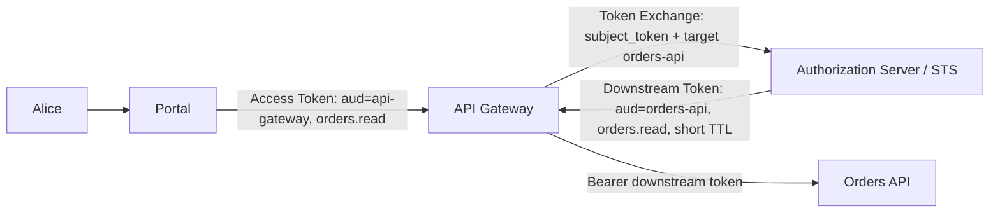
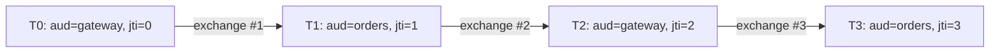
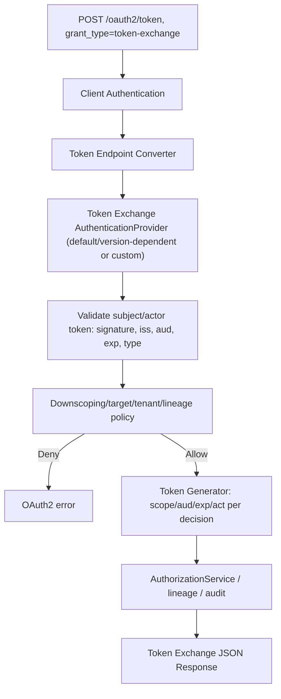

# Preventing Privilege Escalation, Intermediate Token Abuse, and Exchange Loops

## 1. Objectives and Real-World Scenario

In the **Token Exchange** chapter of the `SPRING_SECURITY_OAUTH2_OIDC_AUTHORIZATION_SERVER` module, we focus on **preventing a valid token from being exchanged for a higher-privileged token, used against unauthorized systems, or re-exchanged endlessly across services**. This is an essential skill for designing, configuring, securing, testing, and operating an **OAuth 2.0/OpenID Connect Authorization Server with Spring Security and Spring Authorization Server in Spring Boot**.

Suppose user `alice` logs into Portal; Portal calls the **API Gateway** with an Access Token carrying scope `orders.read`. The Gateway needs another Access Token to call the **Orders API** on Alice's behalf. A **Security Token Service (STS)**, which may be implemented via the Authorization Server, receives the source token, verifies it, and issues a token tailored to the right target API.



**Valid flow:** Gateway may only exchange for a token whose permissions match Alice, Gateway's policy, and Orders API. **Dangerous flow:** Gateway requests `orders.admin` even though the subject only has `orders.read`; or exchanges for an unauthorized `billing-api`; or loops `Gateway → Orders → Gateway` to keep minting tokens with endlessly "refreshed" lifetimes.

After this lesson, learners will be able to:

1. Explain key RFC 8693 fields and the trust boundaries of Token Exchange.
2. Distinguish subject, actor, STS-calling client, impersonation, and delegation.
3. Define invariants bounding permissions, audience, resource, tenant, lifetime, and output token type.
4. Block **confused deputy**, **token laundering**, intermediate token abuse, replay, and **exchange loops**.
5. Place protective logic at the right Spring Authorization Server layer; test policies and HTTP flows.
6. Monitor, investigate incidents, and revoke tokens without leaking credentials via logs or traces.

**Versioning:** Exact Spring Authorization Server / Spring Security APIs vary by release line. Java examples use the `RegisteredClient` structure familiar in Spring Boot 3.x, Spring Security 6.x, and Spring Authorization Server 1.x **when the running version supports Token Exchange**. Always check the documentation and extension points for your exact version before applying them.

## 2. Token Exchange Under RFC 8693

Token Exchange uses the Token Endpoint with grant type:

```text
urn:ietf:params:oauth:grant-type:token-exchange
```

An illustrative request from an authenticated Gateway:

```http
POST /oauth2/token HTTP/1.1
Host: auth.example.com
Authorization: Basic <gateway-client-credentials>
Content-Type: application/x-www-form-urlencoded

grant_type=urn:ietf:params:oauth:grant-type:token-exchange&
subject_token=<trusted-subject-access-token>&
subject_token_type=urn:ietf:params:oauth:token-type:access_token&
audience=orders-api&
resource=https%3A%2F%2Fapi.example.com%2Forders&
scope=orders.read&
requested_token_type=urn:ietf:params:oauth:token-type:access_token
```

| Parameter | Meaning | Risk to control |
| --- | --- | --- |
| `grant_type` | Selects the Token Exchange grant | Client is not registered for this grant |
| `subject_token` | Token representing the subject to be exchanged | Forged, stolen, expired, or wrong-trust-domain token |
| `subject_token_type` | Subject token type; required by RFC 8693 | Swapping an ID Token or other token in as an Access Token |
| `actor_token`/`actor_token_type` | Token identifying the actor in delegation, if applicable | Actor spoofing or self-asserted delegation authority |
| `audience` | Logical name of the token recipient | Expanding access to arbitrary APIs |
| `resource` | URI identifying the target resource | Dynamic targets, SSRF, or unauthorized resources |
| `scope` | Requested permissions on the output | Privilege escalation from read to write/admin |
| `requested_token_type` | Desired output token type | Requesting a stronger credential type, e.g., Refresh Token |

`subject_token` and `subject_token_type` are **required**. Many other fields are optional under the RFC or STS policy. Submitting an audience name or scope **does not prove the client is permitted to receive it**. When `actor_token` and `actor_token_type` are present, verify consistency and delegation rights.

A successful response for an Access Token request may look like:

```json
{
  "access_token": "<downstream-access-token>",
  "issued_token_type": "urn:ietf:params:oauth:token-type:access_token",
  "token_type": "Bearer",
  "expires_in": 180,
  "scope": "orders.read"
}
```

`issued_token_type` describes the **token type actually issued** per RFC 8693. `token_type` describes how to present the Access Token, such as `Bearer`. Never assume Refresh Tokens or ID Tokens appear automatically; they require explicit policy. All values above are illustrative examples, not live outputs.

### 2.1. The Standard Does Not Replace Authorization Policy

RFC 8693 defines the protocol mechanics but leaves it to the **Authorization Server/STS** to decide:

- Which clients may perform Token Exchange.
- Which token types are accepted as input or issued as output.
- Which subjects, actors, and issuers are trusted and authorized for delegation.
- Which output audiences, resources, and scopes are appropriate.
- Lifetime, revocation, lineage, and hop-count policies.

**Not every syntactically valid request should be approved.**

## 3. Principals and Responsibilities: Client, Subject, Actor, Target

An exchange transaction can involve four identities:

| Entity | Example | Trusted evidence |
| --- | --- | --- |
| **Client calling the Token Endpoint** | `api-gateway` | Client authentication and `RegisteredClient` |
| **Subject** | User `alice` | Subject token with verified signature, issuer, audience, timestamps, and permissions |
| **Actor** | Gateway acting on Alice's behalf | Actor token or policy-accepted actor proof, plus delegation rights |
| **Target Resource Server** | `orders-api` | Allowlisted audience/resource, validated at the API |

### 3.1. Impersonation vs. Delegation

**Impersonation**: the target token represents the subject; the recipient sees the subject identity per the issuance profile, while the STS must still audit who requested it. **Delegation**: the target token expresses that an actor is acting on behalf of the subject. RFC 8693 defines `act` to represent the actor and `may_act` to express that an actor may be permitted to act, within a trusted context.

Do not confuse these:

- **An authenticated client** does not mean it may impersonate every user.
- **Receiving an `actor_token`** does not mean the actor was authorized by the subject.
- **`act` or `may_act` in a JWT** is trustworthy only after verifying the token and trust relationship, never merely after decoding JSON.
- **A token with `sub=alice`** does not mean Gateway is automatically allowed to call every API with Alice's privileges.

When delegation is valid, the STS should preserve the necessary actor info in the token/profile or audit trail. The Resource Server must be able to verify **both the represented subject and the acting party** per business rules. Never substitute a caller-supplied `X-Actor` header for a verified claim.

### 3.2. Confused Deputy

Suppose Gateway holds internal permission `orders.admin`, whereas Alice only holds `orders.read`. If the STS relies solely on Gateway's identity to issue an `orders.admin` token on Alice's behalf, Gateway becomes a **confused deputy**: a highly privileged service is leveraged to perform actions the subject is not allowed to perform.

**Defense:** verify subject permissions, client/actor permissions, target Resource Server rules, and request purpose simultaneously. One valid factor **never compensates** for another denied factor.

## 4. Threat Model Table

| Threat | Example | Primary mitigation |
| --- | --- | --- |
| Privilege escalation | `orders.read` → `orders.write` | Downscoping, governed scope mapping |
| Audience widening | Exchanging a Gateway token arbitrarily for Billing/Admin | Target allowlist and `aud` checks at the Resource Server |
| Cross-tenant | Exchanging a tenant-A token into tenant B | Tenant binding from trusted sources |
| Token laundering | Exchanging an untrusted JWT into an internally signed JWT | Validate issuer, signature, token type, audience, and trust registry |
| Confused deputy | High-privilege client acting for a low-privilege user | Intersection of subject + actor/client + resource policy |
| Intermediate token theft | Downstream Access Token leaked in logs/traces | Short TTLs, never log credentials, sender-constraining where suited |
| Delegation forgery | Client asserts `actor=admin-service` | Verify actor token and `may_act`/delegation policy |
| Replay/abuse | One source token spawns thousands of target tokens | Rate limiting, quotas, and auditing |
| Exchange loop | A → B → A → B, each new token with a fresh `jti` | Hop limits, lineage, visited audiences, monotonic TTLs |
| Target injection/SSRF | `resource` points to localhost/metadata endpoint | Never fetch caller-supplied URIs; allowlists and SSRF protections |

These scenarios form a **threat model to test against**, not an implication that Spring Authorization Server lacks protections by default.

## 5. Six Security Invariants

### 5.1. Never Mint Permissions Stronger Than the Source

When source and target share scope semantics, enforce a conservative policy:

```text
Scopes(target token)
  ⊆ Scopes(granted subject token)
  ∩ Scopes(client or actor permitted to use)
  ∩ Scopes(approved by target Resource Server)
```

This is a **recommended downscoping invariant**, not a mandatory formula across every RFC 8693 model. If the source has `orders.summary.read` while the target uses `orders.read`, you cannot simply intersect strings; you need an **approved permission mapping table proving actual permissions do not exceed the source**. If you cannot prove it, deny.

Never treat an omitted scope as "all scopes" or default to the `RegisteredClient`'s broadest scopes.

### 5.2. Never Allow Arbitrary Target Selection

```text
requestedAudience in allowlist(client, trustDomain)
requestedResource in allowlist(requestedAudience)
issuedToken.aud = policy-approved target
```

A client permitted to exchange for Orders is not implicitly allowed to exchange for Billing. Output tokens must carry the right audience, and Resource Servers must reject validly signed JWTs whose `aud` does not belong to them.

### 5.3. Never Self-Extend Authorization Lifetime

A conservative hardening policy:

```text
expiresAt(target token) <= min(
  expiresAt(subject token),
  expiresAt(actor token if required by policy),
  now + targetTokenTtlLimit
)
```

This rule **is not mandated by RFC 8693 for every use case**. If a system intentionally lets target tokens outlive the source, it must explicitly design separate authorization and lifecycle controls so repeated exchanges cannot extend tokens indefinitely.

### 5.4. Never Switch Subject or Tenant Without Evidence

`sub`, `tenant_id`, actor, and permissions must come from **verified data**, never from caller-supplied `sub`/`tenant` fields. Only allow subject/tenant transitions when **explicit delegation or mapping rules** exist, are verified, and are audited. In standard models, the target token's tenant must match the subject's tenant and Resource Server policy.

### 5.5. Never Allow Uncontrolled Exchange Loops

Organizations must define a **hop limit** and an allowed trust graph. For instance, `Gateway → Orders` is permitted, while `Orders → Gateway` is forbidden; or any token that already visited a target cannot revisit that target within the same exchange chain.

### 5.6. Deny by Default

Whenever issuer, token type, source audience, signature, client/actor, scope, tenant, target, or lineage cannot be verified, **deny**. Never skip checks when introspection/JWKS/databases are unavailable. Never "try another issuer" based on untrusted token metadata.

## 6. Multi-Dimensional Decision Policy

A decision function can evaluate:

```text
allowExchange(
    authenticatedClient,
    validatedSubjectToken,
    validatedActorToken?,       // if delegation applies
    requestedAudience,
    requestedResource,
    requestedScopes,
    requestedTokenType,
    tenantContext,
    trustedExchangeLineage
)
```

Example allowing Gateway only to obtain tokens for Orders:

| Attribute | Example rule | Action on failure |
| --- | --- | --- |
| OAuth2 client | `api-gateway`, authenticated, has Token Exchange Grant | Deny |
| Subject issuer | `https://auth.example.com` | Deny |
| Subject audience | `api-gateway` per trust contract | Deny |
| Target audience | Only `orders-api` | `invalid_target` |
| Target resource | Only `https://api.example.com/orders` | `invalid_target` |
| Tenant | Tenant in trusted context must match subject | Deny |
| Target scope | Only `orders.read`; subject must also hold it | `invalid_scope` |
| Token type | Only Access Token | Deny |
| TTL | Max 3 minutes and not exceeding source expiry | Cap or deny |
| Lineage | Max 2 hops, no revisiting prior audiences | Deny |

Values like **3 minutes, 2 hops, client, and endpoint** are illustrative policy examples, not framework/RFC defaults.

### 6.1. Why Client Permissions Cannot Replace Subject Permissions

If `api-gateway` is registered with `orders.read orders.write`, yet Alice only holds `orders.read`, the STS must not grant `orders.write`. Conversely, if Alice holds `orders.write` while Gateway is limited to `orders.read`, write access must still be denied. Once the token is issued, Orders API must still verify authorization on the **specific order**, not just check the scope name.

### 6.2. Mapping Differently Named Scopes Across Two Systems

```text
Source scope: orders.summary.read
Target scope: orders.read
```

That mapping can **escalate privileges** if target `orders.read` permits reading full order details while the source only permitted reading summaries. Never map scopes automatically by string prefix. Design exact mappings (e.g., adding a `data_level=summary` claim checked by the Resource Server), reviewed by API owners and backed by negative tests.

## 7. Authenticate and Verify the Source Token Before Reading Permissions

**Decoding a JWT is not validating a JWT.** Never Base64URL-decode a payload and trust `sub`, `iss`, `aud`, `scope`, `act`, or `may_act`.

1. **Token type:** `subject_token_type` must match and be supported by the STS. Never accept an ID Token as an Access Token.
2. **Issuer:** accept only `iss` values in an approved trust registry.
3. **Signature, algorithm, key:** verify signatures and `alg` against an allowlist. Reject `alg=none`; never trust self-asserted `jku`/`x5u` headers.
4. **Timestamps:** verify `exp`, `nbf`, and reasonable clock skew; never exchange expired tokens.
5. **Source audience:** the token must carry an audience accepted by the trust contract for exchange; a valid signature alone is insufficient.
6. **Permissions, subject, tenant:** must come from trusted evidence; if missing, deny.
7. **Revocation state:** use introspection/trust contracts or appropriate state checks; understand the limits of offline JWT validation.
8. **Sender constraint:** if the token is bound via DPoP/mTLS, verify proof of possession on the exchange request.
9. **Actor token:** if present, verify independently and check delegation; client authentication does not replace actor authorization.

Helpful reference RFCs: **RFC 9068** for the JWT Access Token Profile and **RFC 8725** for JWT security best practices.

### 7.1. Never Turn Client Data Into a Key-Fetching URL

If the STS reads `iss` or `jku` from an unverified JWT and automatically fetches JWKS from that URL, it enables **SSRF** and **token laundering**: an attacker signs a JWT with their own key and tricks the internal STS into accepting it.

Configure **issuers, JWKS, introspection endpoints, algorithms, and expected audiences** in a governed trust registry. Never add a new issuer simply because a token arrives bearing a new `iss`.

## 8. Intermediate Tokens and Anti-Abuse Layers

### 8.1. Tokens Must Not Work at APIs with the Wrong Audience

Gateway receives a token with `aud=orders-api` and sends it to Billing API. Billing must reject it even if the signature is valid and the token is unexpired. Resource Servers must validate issuer, token type, signature, `aud`, `exp`, scopes, and resource policies.

### 8.2. A Token Does Not Automatically Permit Further Exchange

Orders API takes Gateway's downstream token and sends it back to the Token Endpoint requesting `aud=billing-api`. The STS must verify **whether the calling client** is permitted to exchange and whether transitioning from the source audience to the target is allowed. Two tokens signed by the same issuer do not grant a blank license to exchange anywhere.

### 8.3. Tokens Must Not Exchange Into Stronger Credentials

For instance, a request tries asking for:

```text
requested_token_type=urn:ietf:params:oauth:token-type:refresh_token
```

If the architecture only calls for short-lived Access Tokens, **reject** this request. `requested_token_type` is a client preference, not an entitlement to receive a Refresh Token. Never turn a leaked Access Token into a long-lived credential.

### 8.4. Token Exchange Is Not Single-Use by Default

**RFC 8693 does not require every `subject_token` to be exchanged only once** like an Authorization Code. A source token may be exchanged multiple times per policy. However, the STS should enforce rate limits, quotas, anomaly detection, and—where appropriate—intentional replay/single-use defenses. Do not assume Authorization Code single-use rules apply automatically to all Token Exchanges.

### 8.5. Never Log Intermediate Tokens

Avoid logging `subject_token`, `actor_token`, newly issued tokens, client secrets, raw JWTs, or sensitive URLs. Log correlation IDs, verified client/issuer/target identifiers, error categories, policy versions, TTL/hop counts, and credential-free audit trails.

## 9. Preventing `A → B → A` Loops and Bounding Hop Counts

### 9.1. Why Checking Only for Duplicate `jti` Is Insufficient

Suppose the STS mints a fresh token on each exchange, each with a new `jti`:



All `jti` values differ, so checking "have we seen this `jti` before?" **fails to detect cycles**. You must track both **visited audiences/resources** and the **hop count** across **the same exchange chain**.

Example internal metadata maintained by the STS:

```text
exchange_chain_id = "chain-opaque-id-generated-by-sts"
visited_audiences = ["api-gateway", "orders-api"]
hop_count = 1
```

A subsequent request trying to exchange back to `api-gateway` is rejected because `api-gateway` is already in `visited_audiences`. Even for new targets, policy can deny once `max_hops=2` is exceeded.

### 9.2. Integrity of Lineage Data

Viable implementation options:

- **Server-side state**: the STS stores source–target token links, chain ID, hop count, and visited audiences in an authorization/audit store; subsequent exchanges look up this metadata.
- **Issuer-signed claims**: target tokens carry lineage claims protected by the issuer and verified on the next exchange.
- **Hybrid**: claims for fast decisions, server-side store for concurrency, revocation, and auditing.

**Never let clients reset `hop_count=0` or `visited=[]` via form parameters.** If a source token comes from an external issuer without trusted lineage, enforce a dedicated trust contract or **deny unprovable re-exchanges by default**.

Under RFC 8693, the `act` claim can capture an actor chain, yet **does not automatically replace** a hop counter or an approved audience graph. One actor can traverse multiple resources, and one resource can be accessed by multiple actors; explicit policy is still required.

### 9.3. Depth and TTL Limits

| Control | Example value | Rationale |
| --- | --- | --- |
| Max hops | 2 exchanges | Prevents unbounded conversion chains |
| Cycle prevention | Target not already in `visited_audiences` | Blocks `A → B → A` |
| One-way trust edges | `Gateway → Orders` allowed; `Orders → Gateway` blocked | Disallows reverse edges with no business need |
| Monotonic TTL | Downstream token never outlives source token | Prevents extending authority across hops |
| Per-hop downscoping | Output scopes never exceed provable authority | Prevents privilege creep across chains |
| Chain auditing | Chain ID + policy version + audience sequence | Traceability without logging tokens |

These are **example policies**, not mandatory hop limits from RFC 8693. When a legitimate business flow needs to call back to a previously visited service, design a dedicated callback/token flow or reviewed conditional exception rather than disabling cycle detection entirely.

## 10. Configuring Clients Permitted for Token Exchange

In Spring Authorization Server, a foundational safeguard is **allowing only approved clients to use the Token Exchange grant**. Example creating a `RegisteredClient`:

```java
import java.time.Duration;
import java.util.UUID;

import org.springframework.security.oauth2.core.AuthorizationGrantType;
import org.springframework.security.oauth2.core.ClientAuthenticationMethod;
import org.springframework.security.oauth2.server.authorization.client.RegisteredClient;
import org.springframework.security.oauth2.server.authorization.settings.TokenSettings;

// Initial registration example; not a complete @Bean/repository.
AuthorizationGrantType exchangeGrant = new AuthorizationGrantType(
        "urn:ietf:params:oauth:grant-type:token-exchange");

RegisteredClient gateway = RegisteredClient.withId(UUID.randomUUID().toString())
        .clientId("api-gateway")
        .clientName("API Gateway")
        .clientSecret("{bcrypt}<valid-bcrypt-hash-from-secret-manager>")
        .clientAuthenticationMethod(ClientAuthenticationMethod.CLIENT_SECRET_BASIC)
        .authorizationGrantType(exchangeGrant)
        .scope("orders.read")
        .tokenSettings(TokenSettings.builder()
                .accessTokenTimeToLive(Duration.ofMinutes(3))
                .build())
        .build();
```

**Important limitations:**

1. `{bcrypt}<...>` is a placeholder, not a usable authentication hash. Production requires a properly hashed secret from a secret manager, or another strong auth method such as `private_key_jwt`.
2. Grant type and scope registration **are not enough** to enforce target audiences/resources, subject delegation, tenant isolation, source TTL bounds, `act`, `may_act`, or exchange loop prevention.
3. `accessTokenTimeToLive(Duration.ofMinutes(3))` sets the client's token TTL policy; to **avoid outliving the source token**, the provider/service must also apply the `min(...)` bound described above.
4. `UUID.randomUUID()` is only for initial registration; in persistent stores, the internal ID must remain stable across deployments.
5. A client permitted for `authorization_code` or `client_credentials` is **not automatically** permitted for Token Exchange.

### 10.1. Enforce Controls at the Token Endpoint, Not the Authorization Endpoint

Token Exchange is a grant at `POST /oauth2/token`. General pipeline:



When your running version supports Token Exchange, configure components via **`OAuth2TokenEndpointConfigurer`**. If custom grants/providers are needed, register matching converters and providers, ensuring `AuthenticationManager` executes them in the right order without bypassing validation.

Extension point outline:

```java
// Place inside the corresponding OAuth2AuthorizationServerConfigurer setup.
.tokenEndpoint(tokenEndpoint -> tokenEndpoint
    .authenticationProviders(providers -> {
        // Locate the actual Token Exchange provider of your running version.
        // Add enforcement via a supported extension point.
        // Never bypass client, subject token, or actor token validation.
    })
)
```

This is only an **illustrative configuration fragment**, not a standalone Java statement, and does not guarantee every version enforces all RFC 8693 policies automatically. Never append an extra provider with the same `supports(...)` in the wrong order, causing your policy to be skipped. If no built-in grant covers your target, implement an extension grant with thorough security testing.

**Never place authorization decisions solely inside `AuthenticationConverter`**: converters mainly parse the form request. Source validation, target policy, actor delegation, TTL, and token issuance belong in a trusted provider/service after client authentication and before token signing.

## 11. Java Example: Dedicated Downscoping Policy Class

The Java 17 class below takes **data assumed to be already verified**. It is a *policy core* example that can be unit-tested without HTTP. It does **not** verify JWTs itself, read `RegisteredClientRepository`, mint JWTs, handle actor delegation, or replace a complete Token Exchange `AuthenticationProvider`.

```java
import java.time.Duration;
import java.time.Instant;
import java.util.Set;

public final class DownscopingExchangePolicy {

    // Values must be constructed from a verified subject token.
    public record Subject(
            String issuer,
            String subjectId,
            String tenantId,
            String audience,
            Set<String> scopes,
            Instant expiresAt) {
        public Subject {
            scopes = Set.copyOf(scopes);
        }
    }

    // Result of trusted client authentication and registration.
    public record Caller(
            String clientId,
            boolean authenticated,
            boolean exchangeGrantAllowed,
            Set<String> allowedScopes) {
        public Caller {
            allowedScopes = Set.copyOf(allowedScopes);
        }
    }

    public record RequestedTarget(
            String audience,
            String resource,
            String tenantId,
            Set<String> scopes) {
        public RequestedTarget {
            scopes = Set.copyOf(scopes);
        }
    }

    // Lineage metadata managed or cryptographically verified by the STS.
    public record TrustedLineage(
            int previousHops,
            Set<String> visitedAudiences) {
        public TrustedLineage {
            visitedAudiences = Set.copyOf(visitedAudiences);
        }
    }

    public record Decision(
            String targetAudience,
            Set<String> permittedScopes,
            Instant expiresAt,
            int nextHop) {}

    public static final class PolicyDenied extends RuntimeException {
        private final String oauthError;

        PolicyDenied(String oauthError) {
            super("Token exchange rejected by policy");
            this.oauthError = oauthError;
        }

        public String oauthError() {
            return oauthError;
        }
    }

    private static void require(boolean condition, String oauthError) {
        if (!condition) {
            throw new PolicyDenied(oauthError);
        }
    }

    public Decision authorize(
            Subject subject,
            Caller caller,
            RequestedTarget target,
            TrustedLineage lineage,
            Instant now) {

        require(caller.authenticated()
                && caller.exchangeGrantAllowed()
                && "api-gateway".equals(caller.clientId()), "unauthorized_client");

        require("https://auth.example.com".equals(subject.issuer())
                && "api-gateway".equals(subject.audience()), "invalid_grant");
        require(subject.expiresAt().isAfter(now), "invalid_grant");

        require("orders-api".equals(target.audience())
                && "https://api.example.com/orders".equals(target.resource()),
                "invalid_target");
        require(subject.tenantId().equals(target.tenantId()), "invalid_target");

        require(lineage.previousHops() >= 0
                && lineage.previousHops() < 2
                && !lineage.visitedAudiences().contains(target.audience()),
                "invalid_target");

        require(!target.scopes().isEmpty()
                && Set.of("orders.read").containsAll(target.scopes())
                && subject.scopes().containsAll(target.scopes())
                && caller.allowedScopes().containsAll(target.scopes()),
                "invalid_scope");

        // Cap TTL: max 3 minutes, never outliving the subject token.
        Instant maximum = now.plus(Duration.ofMinutes(3));
        Instant expiresAt = subject.expiresAt().isBefore(maximum)
                ? subject.expiresAt() : maximum;
        require(expiresAt.isAfter(now), "invalid_grant");

        return new Decision(
                target.audience(),
                Set.copyOf(target.scopes()),
                expiresAt,
                lineage.previousHops() + 1);
    }
}
```

### 11.1. Security Assumptions of the Code

- **`Subject`**, **`Caller`**, and **`TrustedLineage`** must be populated by the server from verified JWT/introspection results, client authentication, and STS-controlled metadata. Never deserialize them directly from caller input and trust them.
- This example hardcodes issuer, client, audience, target, and scope to clearly demonstrate an **allowlist** policy. Production may use a versioned, approved policy registry, never an accept-all mode.
- `subject.audience=api-gateway` is accepted because **this example's trust contract** permits Gateway-targeted tokens as subject tokens. In another system, the STS might accept only tokens expressly audienced to the STS.
- This class **does not implement actor delegation**. If `actor_token` or `may_act` is present, the provider must verify and supply verified actor policy rather than ignoring it just because this snippet omits actors.
- `TrustedLineage` is STS-verified data, never a client-modifiable `hop_count`.
- String-matching tenant IDs is only one check; per-resource tenant authorization must still be enforced at Orders API.
- Error codes chosen here are **illustrative policy mappings**; real providers may select OAuth2 errors matching their protocol semantics and contracts.

### 11.2. Wiring the Decision Into the Provider / Token Generator

Flow:

```text
Parsed token request
  -> Authenticate client calling STS
  -> Validate subject token and actor token (if present)
  -> Build Verified Subject / Actor / Trust Lineage
  -> DownscopingExchangePolicy.authorize(...)
  -> Generate token from Decision (aud, scope, exp, sub, act if delegation)
  -> Persist authorization/lineage and audit
  -> Return OAuth2 Token Exchange response
```

The adapter/provider can map policy failures to OAuth2 errors:

```java
import org.springframework.security.oauth2.core.OAuth2AuthenticationException;
import org.springframework.security.oauth2.core.OAuth2Error;

// Part of a provider adapter; not a complete AuthenticationProvider.
try {
    var decision = policy.authorize(
            validatedSubject, authenticatedCaller,
            requestedTarget, trustedLineage, now);
    // Issue tokens strictly from decision and verified authorities.
} catch (DownscopingExchangePolicy.PolicyDenied denied) {
    throw new OAuth2AuthenticationException(new OAuth2Error(
            denied.oauthError(), "Token exchange was not permitted", null));
}
```

The variables in this snippet represent **values already constructed in the adapter layer**. Without complete issuer, signature, audience, sender-proof, and actor-binding validation, calling a policy helper alone **does not yield a secure Token Exchange**.

## 12. Unit Testing Anti-Escalation and Loop-Prevention Policies

JUnit 5 example testing the invariants of `DownscopingExchangePolicy`:

```java
import java.time.Instant;
import java.util.Set;

import org.junit.jupiter.api.Test;
import static org.junit.jupiter.api.Assertions.assertEquals;
import static org.junit.jupiter.api.Assertions.assertThrows;

class DownscopingExchangePolicyTest {

    private final DownscopingExchangePolicy policy = new DownscopingExchangePolicy();
    private final Instant now = Instant.parse("2026-11-16T00:00:00Z");

    private DownscopingExchangePolicy.Subject source() {
        return new DownscopingExchangePolicy.Subject(
                "https://auth.example.com", "alice",
                "tenant-a", "api-gateway",
                Set.of("orders.read"), now.plusSeconds(120));
    }

    private DownscopingExchangePolicy.Caller caller() {
        return new DownscopingExchangePolicy.Caller(
                "api-gateway", true, true,
                Set.of("orders.read", "orders.write"));
    }

    private DownscopingExchangePolicy.RequestedTarget request(Set<String> scopes) {
        return new DownscopingExchangePolicy.RequestedTarget(
                "orders-api", "https://api.example.com/orders",
                "tenant-a", scopes);
    }

    private DownscopingExchangePolicy.TrustedLineage initialLineage() {
        return new DownscopingExchangePolicy.TrustedLineage(
                0, Set.of("api-gateway"));
    }

    @Test
    void allowsReadWithoutExtendingSourceTtl() {
        var decision = policy.authorize(
                source(), caller(), request(Set.of("orders.read")),
                initialLineage(), now);
        assertEquals(Set.of("orders.read"), decision.permittedScopes());
        assertEquals(now.plusSeconds(120), decision.expiresAt());
        assertEquals(1, decision.nextHop());
    }

    @Test
    void rejectsScopeEscalation() {
        var denied = assertThrows(
                DownscopingExchangePolicy.PolicyDenied.class,
                () -> policy.authorize(
                        source(), caller(), request(Set.of("orders.write")),
                        initialLineage(), now));
        assertEquals("invalid_scope", denied.oauthError());
    }

    @Test
    void rejectsReturningToVisitedAudience() {
        var denied = assertThrows(
                DownscopingExchangePolicy.PolicyDenied.class,
                () -> policy.authorize(
                        source(), caller(), request(Set.of("orders.read")),
                        new DownscopingExchangePolicy.TrustedLineage(
                                1, Set.of("api-gateway", "orders-api")),
                        now));
        assertEquals("invalid_target", denied.oauthError());
    }

    @Test
    void rejectsExpiredSubject() {
        var expired = new DownscopingExchangePolicy.Subject(
                "https://auth.example.com", "alice",
                "tenant-a", "api-gateway",
                Set.of("orders.read"), now.minusSeconds(1));
        var denied = assertThrows(
                DownscopingExchangePolicy.PolicyDenied.class,
                () -> policy.authorize(
                        expired, caller(), request(Set.of("orders.read")),
                        initialLineage(), now));
        assertEquals("invalid_grant", denied.oauthError());
    }
}
```

**Limitation:** these tests verify only pure logic using **inputs assumed to be verified**. They do not prove the system validates JWTs, actor tokens, client authentication, anti-SSRF protections, target claims, or Resource Server authorization. Add full integration tests against the Token Endpoint and deployment cluster.

## 13. Integration Test and Security Verification Matrix

| # | Scenario | Expected outcome |
| --- | --- | --- |
| 1 | Valid Gateway, subject `orders.read`, target Orders, scope `orders.read` | Issues target token with policy-compliant `aud`, `scope`, `exp` |
| 2 | Subject only has read, requests write/admin | Denied; no token issued |
| 3 | Client not registered for Token Exchange Grant | Rejected with `unauthorized_client` or appropriate protocol error |
| 4 | Invalid client authentication | `invalid_client` or appropriate rejection |
| 5 | Subject token expired, bad signature, or revoked | Rejected before issuing any token |
| 6 | Submits ID Token declaring `subject_token_type=access_token` | Rejected for wrong token type |
| 7 | Issuer not in trust registry | Rejected; never fetches JWKS from a client-controlled URL |
| 8 | `audience=billing-api` or disallowed resource | `invalid_target` or corresponding policy error |
| 9 | Token belongs to tenant A, requests tenant-B token | Rejected |
| 10 | Forged/invalid actor token, or actor not permitted by subject | Delegation rejected |
| 11 | Requests Refresh Token when policy issues only Access Tokens | Rejected |
| 12 | Subject has 90 sec left, target policy is 180 sec | Target token `exp` does not exceed source per chosen invariant |
| 13 | `A → B → A`, fresh `jti` per hop | Cycle blocked via audience/lineage tracking |
| 14 | Exceeds max hops | Rejected before signing token |
| 15 | Bulk exchange flood | Rate limits, quotas, and auditing engage |
| 16 | Resource Server receives token with different `aud` | API rejects despite valid signature |
| 17 | Two concurrent exchange requests | No quota bypass; lineage and authorization state stay consistent |
| 18 | Output token carries `act` for delegation | Actor chain comes solely from trusted sources and approved policy |

### 13.1. Full HTTP Testing Sequence

1. Boot the Authorization Server in a test environment with its own issuer, keys, and `RegisteredClient` entries.
2. Mint a **real subject token** from the test issuer/trust domain; never fabricate dummy JWT strings.
3. Send the Token Exchange request with valid client authentication.
4. Verify `issued_token_type`, `token_type`, `scope`, `expires_in`, and output claims `iss`, `aud`, `sub`, `exp`, and `act` (for delegation).
5. Send the target token to Orders API to prove the **Resource Server rejects excess scope, wrong audience, and wrong tenant**.
6. Repeat requests with wrong client, issuer, target, tenant, and scope; assert zero tokens are issued.
7. Feed the output token as `subject_token` in a subsequent hop to verify cycle and hop-limit enforcement.
8. Test failure modes when JWKS/introspection/storage dependencies fail, and verify multi-node consistency.

### 13.2. Illustrative `curl`

```bash
curl -i -X POST 'https://auth-test.example.com/oauth2/token' \
  -u 'api-gateway:<test-client-secret>' \
  -H 'Content-Type: application/x-www-form-urlencoded' \
  --data-urlencode 'grant_type=urn:ietf:params:oauth:grant-type:token-exchange' \
  --data-urlencode 'subject_token=<trusted-test-access-token>' \
  --data-urlencode 'subject_token_type=urn:ietf:params:oauth:token-type:access_token' \
  --data-urlencode 'resource=https://api.example.com/orders' \
  --data-urlencode 'audience=orders-api' \
  --data-urlencode 'scope=orders.read' \
  --data-urlencode 'requested_token_type=urn:ietf:params:oauth:token-type:access_token'
```

Values in `<...>` are placeholders; never paste real secrets or tokens into chat, tickets, CI logs, screenshots, or shared shell history. This command succeeds only when the Authorization Server **supports and is configured with** the matching grant and token trust policy.

## 14. Error Codes and Diagnostics

| Error code / symptom | What to investigate | Remediation |
| --- | --- | --- |
| `invalid_client` | Wrong client secret, assertion, or auth method | Verify registration and client authentication |
| `unauthorized_client` | Client not permitted for Token Exchange | Check registered and approved grants |
| `invalid_request` | Missing `subject_token`, malformed type, duplicate/bad params | Inspect request converter; never loosen parser |
| `invalid_grant` | Subject token invalid, inactive, or untrusted | Verify issuer, signature, `exp`, audience, revocation |
| `invalid_target` | Resource/audience disallowed or unsatisfiable | Inspect target allowlist and mapping |
| `invalid_scope` | Scope exceeds subject/client/target permissions | Inspect scope intersection and mapping |
| `server_error` | Token signing, introspection, database, or policy engine failure | Investigate safely; never fail open |
| Repeated exchanges on same chain | Token laundering, loop, or bad retry logic | Check chain ID, hop count, visited audiences |
| Billing accepts Orders tokens | Resource Server not checking `aud` | Fix API-side token validation |

`invalid_target` is specified by RFC 8693 for unacceptable or unsatisfiable resources/audiences. Other error codes depend on OAuth2 rules, provider behavior, and protocol contracts. **This table is a diagnostic guide**, not a promise of fixed mappings across every version.

Never expose tokens, sensitive subject/tenant identifiers, or internal policy logic in `error_description`. Keep public messages generic and send detailed diagnostics to access-controlled logs.

## 15. Operating and Auditing Intermediate Tokens

Record signals using **credential-free data**:

| Signal | Purpose |
| --- | --- |
| Correlation ID, exchange-chain ID | Correlate hops and requests |
| Issuer, input token type, authenticated client ID / actor | Trace trust boundaries |
| Target audience/resource and approved scopes | Detect over-granted permissions |
| Hop count, policy version, decided TTL | Detect loops and lifetime inflation |
| OAuth2 errors, denial counts, latency | Diagnose issues and spot abuse |
| Revocation/rotation/incident events | Support incident investigation and revocation |

Never use raw Access/Refresh Tokens, subject/actor tokens, client assertions, `code_verifier`, or secrets as metric labels. For identity-linkable fields like `sub` or `jti`, apply appropriate retention, pseudonymization, and access controls.

### 15.1. Additional Operational Controls

- **Rate limits** per client, target, and issuer with burst alerting.
- **Short-lived downstream tokens** with a single audience or tightly bounded list.
- **Sender-constraining** (mTLS/DPoP) where supported by profile and architecture.
- **Governed issuer key management** and JWKS; never fetch keys from untrusted sources.
- **Revocation/introspection** when near-real-time invalidation is needed. Already-issued JWTs can stay valid until `exp` if APIs validate solely offline.
- **Policy versioning and approval** before adding resources, scope mappings, impersonation/delegation permissions, or raising max hops.
- **Isolated environments** for issuers, keys, client registries, and authorization stores; never exchange test tokens into production.

### 15.2. Retries After Network Errors

If a client times out after the STS already issued a token, retrying may mint another target token per policy. **RFC 8693 does not make exchanges one-time by default**; depending on your use case, add quotas, application-layer idempotency, or replay defenses. Never trigger retry storms and never weaken authorization checks to accommodate retries.

If the source is revoked, account for **already-issued downstream tokens**. Resource Servers may continue accepting them while signatures and `exp` remain valid unless extra revocation mechanisms exist.

## 16. Pre-Production Security Checklist

1. **Trust registry:** issuers, keys, algorithms, token types, source audiences, and revocation checks explicitly defined.
2. **Client authentication:** calling client strongly authenticated; Token Exchange grant registered specifically.
3. **Subject/actor:** source validity and delegation rights verified; never trust `act`/`may_act` from unverified data.
4. **Scope bounds:** output never exceeds provable permissions; cross-API scope mappings reviewed.
5. **Target allowlist:** never trust arbitrary `audience`/`resource` from requests; output tokens bound to exact APIs.
6. **Tenant isolation:** prevent unauthorized tenant/subject switching; Resource Servers enforce object-level checks.
7. **No token-type escalation:** block disallowed credential types like long-lived Refresh Tokens.
8. **TTL policy:** prevent indefinite extension via exchange, and bound lifetimes by source tokens where appropriate.
9. **Loop prevention:** trusted lineage, max hops, visited audiences, not `jti` checks alone.
10. **Monitoring:** quotas, rate limits, policy-decision audits, and zero raw tokens in logs.
11. **Integration tests:** test emitted tokens and real Resource Servers, including all denial paths.
12. **HA/concurrency:** shared storage/lineage/revocation consistent across nodes; fail closed on dependency failures.
13. **Lifecycle:** approval workflow for adding targets/clients, rollback plans, and token revocation procedures.
14. **Upgrades:** verify changes in Token Exchange providers, generators, and claims when upgrading Spring Security or Spring Authorization Server.

## 17. Exercises and Self-Check Questions

**Exercise A — Downscoping.** Subject holds `orders.read`, Gateway is registered with `orders.read orders.write`, and Orders API supports both scopes. Compute the output scope under the conservative invariant and explain why write must not be granted.

**Exercise B — Cross-audience.** Source token has `aud=api-gateway`; Gateway requests `aud=billing-api` while policy only allows `orders-api`. Identify the policy check and the appropriate RFC 8693 error code.

**Exercise C — Exchange loop.** Lineage records `visited=[api-gateway,orders-api]` and hop count 1. The new token has a fresh `jti`; why must a request asking for `aud=api-gateway` still be rejected?

**Exercise D — Token laundering.** An attacker submits a JWT with `iss=https://malicious.invalid` and `jku` pointing to their own server. Design the trust registry and tests ensuring the STS never mints an internal token from that JWT.

**Exercise E — TTL.** The subject token has 90 seconds left, and the target policy cap is 3 minutes. If policy prohibits outliving the source, how long may the target token live at most?

**Exercise F — Delegation.** Alice delegates to Gateway to call Orders. Distinguish `sub`, client authentication, actor, `act`, and `may_act`; design how Orders knows who performed the action.

**Review Questions:**

1. Why is a valid subject token insufficient to exchange for arbitrary audiences?
2. How do `resource` and `audience` differ, and why must both be approved by policy?
3. Why is Token Exchange not single-use by default like an Authorization Code?
4. Why cannot `RegisteredClient` permissions substitute for subject permissions?
5. How do you verify that mapping differently named scopes does not escalate privileges?
6. What do `act` and `may_act` express, and do they automatically grant delegation authority?
7. What happens if a Resource Server fails to check `aud`?
8. Why does checking for duplicate `jti` values fail to catch `A → B → A` loops?
9. If a client sends `requested_token_type=refresh_token`, is the STS obligated to issue one?
10. Which tests prove resistance to cross-tenant access, target widening, and exchange loops?
11. Why must the STS never fetch JWKS from an untrusted `jku` header?
12. When the source token is revoked, do already-issued downstream tokens always become invalid immediately?

## 18. References

- [RFC 8693 — OAuth 2.0 Token Exchange](https://www.rfc-editor.org/rfc/rfc8693)
- [RFC 8693 — Token Exchange Request and Response](https://www.rfc-editor.org/rfc/rfc8693#section-2)
- [RFC 8693 — Actor and May-Act Claims](https://www.rfc-editor.org/rfc/rfc8693#section-4)
- [RFC 8707 — Resource Indicators for OAuth 2.0](https://www.rfc-editor.org/rfc/rfc8707)
- [RFC 9068 — JWT Profile for OAuth 2.0 Access Tokens](https://www.rfc-editor.org/rfc/rfc9068)
- [RFC 8725 — JWT Best Current Practices](https://www.rfc-editor.org/rfc/rfc8725)
- [RFC 9700 — OAuth 2.0 Security Best Current Practice](https://www.rfc-editor.org/rfc/rfc9700)
- [Spring Authorization Server — Protocol Endpoints](https://docs.spring.io/spring-authorization-server/reference/protocol-endpoints.html)
- [Spring Authorization Server — Core Model Components](https://docs.spring.io/spring-authorization-server/reference/core-model-components.html)
- [Spring Authorization Server — Configuration Model](https://docs.spring.io/spring-authorization-server/reference/configuration-model.html)
- [Spring Security — Servlet OAuth2 Resource Server](https://docs.spring.io/spring-security/reference/servlet/oauth2/resource-server/index.html)

**Takeaway:** Token Exchange is a **permission transformation within a trust boundary**, not a way to mint higher-privileged tokens. The STS must verify subject/actor/client, constrain scope/audience/resource/tenant, govern lifetimes and lineage, and block cyclic exchanges; the Resource Server must verify the token is specifically intended for it. Never trust `scope`, `audience`, `act`, or `hop_count` simply because they appear in a request; token issuance decisions must rest on verified evidence and approved policy.
