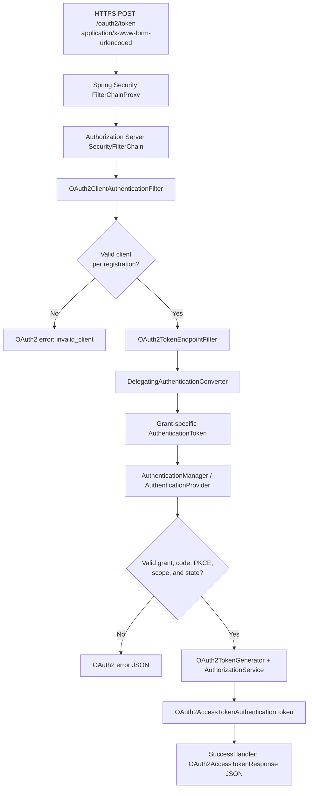

# OAuth2 Token Endpoint Request and Response Format

## 1. What Problem Does the Token Endpoint Solve?

In OAuth 2.0, the **Token Endpoint** is where a client sends an **access token request** to obtain an access token, request a new access token using a refresh token, or execute an authorization grant supported by the Authorization Server. In Spring Authorization Server, the default path is typically **`POST /oauth2/token`**.

For example, the **Orders Web** application has received an authorization code after the user consented to grant access. The Orders Web backend sends that code to the Token Endpoint and receives JSON containing `access_token`, its lifetime, token type, and additional fields depending on the grant/policy. A **Reports Worker** service with no end user instead sends `grant_type=client_credentials` to the **same endpoint**, though the request body, client authentication method, and token response may differ.

It is important **not to confuse the HTTP protocol at the Token Endpoint with a REST API accepting arbitrary JSON**. According to OAuth 2.0, a standard token request uses HTTP POST, parameters are typically encoded as **`application/x-www-form-urlencoded`**, and the token or error response is represented in **JSON**.

This lesson belongs to the **Token Endpoint** chapter in the `SPRING_SECURITY_OAUTH2_OIDC_AUTHORIZATION_SERVER` module, supporting the goal of **designing, configuring, securing, testing, and operating an OAuth 2.0/OpenID Connect Authorization Server with Spring Security and Spring Authorization Server in a Spring Boot application**.

### After This Lesson, You Will Be Able To

1. Write proper HTTP requests to `/oauth2/token` for common grants.
2. Distinguish **client authentication** from **authorization grant** verification fields.
3. Read token response JSON accurately: `access_token`, `token_type`, `expires_in`, `refresh_token`, `scope`, and `id_token` when OIDC applies.
4. Distinguish OAuth errors such as `invalid_client`, `invalid_grant`, `unauthorized_client`, and `invalid_scope`.
5. Understand the Spring Authorization Server pipeline `OAuth2ClientAuthenticationFilter` → `OAuth2TokenEndpointFilter` → converters/providers/handlers.
6. Test HTTP conformance and avoid pitfalls with Content-Type, Basic auth, encoding, PKCE, caching, and logging.

> **Version Scope:** DSL examples focus on **Spring Authorization Server 1.5.x / Spring Security 6.x**. Some grants and package/configurer names change or are integrated into Spring Security 7.x. Verify your active dependencies before copying code or assuming an extension grant is enabled by default.

## 2. Basic HTTP Contract

| Component | Expected Value | Reason |
| --- | --- | --- |
| **Endpoint URI** | `/oauth2/token` by default | Clients obtain the public URI from metadata/discovery or trusted configuration |
| **HTTP method** | **`POST`** | Avoids placing credentials, codes, or refresh tokens in GET query strings |
| **Transport** | **HTTPS/TLS** over the network | Protects client secrets, authorization codes, and tokens in transit |
| **Request Content-Type** | **`application/x-www-form-urlencoded`** | Token request parameter format per RFC 6749 |
| **Authorization header** | Depends on client authentication method, e.g., `Basic ...` | Not all clients use a client secret |
| **Body** | At minimum `grant_type` and grant-specific parameters | Allows the provider to determine which request type to process |
| **Success response** | Typically **`200 OK` + `application/json`** | Token fields appear at the top level of the JSON object |
| **Error response** | JSON containing `error`, typically HTTP 400 or HTTP 401 depending on the error | Allows the client to identify the OAuth cause rather than receiving an HTML login page |
| **Cache control** | `Cache-Control: no-store` and `Pragma: no-cache` on sensitive responses | Prevents intermediate caches/browsers from storing tokens |

`/oauth2/token` is a path **relative to the servlet context/reverse proxy**. If the public issuer is `https://login.example.com/auth` and the proxy handles the `/auth` prefix, the external Token Endpoint may be `https://login.example.com/auth/oauth2/token`. Do not use a backend `http://localhost:9000` URL in production clients.

### 2.1. Minimal Meaningful Request Example

A confidential client registered for `client_credentials` can send:

```http
POST /oauth2/token HTTP/1.1
Host: auth.example.com
Authorization: Basic <BASE64_OF_CLIENT_CREDENTIALS>
Content-Type: application/x-www-form-urlencoded
Accept: application/json

grant_type=client_credentials&scope=reports.read
```

Here `Basic` is **client authentication**, while `grant_type=client_credentials` is only the **authorization grant type**. Basic uses Base64 encoding for header transport, **not cryptographic encryption**; you must use TLS, manage secrets securely, and avoid logging the header.

### 2.2. How Does Form Encoding Differ from JSON?

Valid body for the request above:

```text
grant_type=client_credentials&scope=reports.read
```

Non-equivalent body:

```json
{
  "grant_type": "client_credentials",
  "scope": "reports.read"
}
```

Sending JSON with `Content-Type: application/json` **is not the RFC 6749 standard token request format**. Spring Authorization Server's default token endpoint filter is designed to read protocol-compliant request parameters; do not build clients that send JSON and then modify the server to accept non-standard requests unless a dedicated extension is intentionally designed.

## 3. Request Processing Layers in Spring Authorization Server



Key responsibilities:

1. **`OAuth2ClientAuthenticationFilter`** reads Basic credentials, form secrets, JWT client assertions, mTLS certificates, or public client details according to the registered method. It authenticates **the client's identity**, without directly issuing an access token.
2. **`OAuth2TokenEndpointFilter`** handles token requests at the matching HTTP POST/URI; do not replace it with form login or a custom controller.
3. **`AuthenticationConverter`** creates an authentication request for the grant type, such as `OAuth2AuthorizationCodeAuthenticationToken` or `OAuth2ClientCredentialsAuthenticationToken`.
4. **`AuthenticationProvider`** verifies the code/refresh token/device code, grant type, PKCE, scope, and grant-specific conditions.
5. **`OAuth2TokenGenerator`** generates the tokens required by the flow; **`OAuth2AuthorizationService`** manages authorization/token state.
6. **Success/error handlers** produce the OAuth 2.0 JSON response; modern releases use `OAuth2AccessTokenResponseAuthenticationSuccessHandler` and `OAuth2ErrorAuthenticationFailureHandler`.

In Spring Authorization Server 1.5.x, the documentation lists default converters/providers for `authorization_code`, `refresh_token`, `client_credentials`, Device Code, and Token Exchange. **The existence of a converter/provider does not mean every client is permitted to use that grant**: `RegisteredClient` and server policy still govern access.

### 3.1. Client Authentication Before Grant Validation

| Step | Example Data | What Is Checked |
| --- | --- | --- |
| Client identification | `client_id=orders-web` | Locating the matching `RegisteredClient` |
| Client authentication | HTTP Basic, `private_key_jwt`, mTLS, or `none` | Valid credentials and registered authentication method |
| Grant selection | `grant_type=authorization_code` | Whether an appropriate converter/provider is enabled |
| Grant authorization | Code, `code_verifier`, `redirect_uri`, scope | Whether the client is permitted to use the grant and the data is validly bound |
| Token issuance | Access token, optional refresh/ID token | Issuance policy and token types matching the grant |

A client sending a **valid secret** can still receive `invalid_grant` if the code has already been used; conversely, a valid code does not allow a confidential client to skip client authentication at the Token Endpoint.

## 4. HTTP Request Parameters by Grant

| Grant | `grant_type` | Specific Fields | Client Authentication |
| --- | --- | --- | --- |
| **Authorization Code** | `authorization_code` | `code`, `redirect_uri` when applicable, `code_verifier` if PKCE was used | Confidential client: registered method; public client: `client_id` and PKCE, no secret |
| **Client Credentials** | `client_credentials` | Optional `scope` per policy | Confidential client must authenticate |
| **Refresh Token** | `refresh_token` | `refresh_token`, optional `scope` that does not expand permissions | Per client type and policy |
| **Device Code** | `urn:ietf:params:oauth:grant-type:device_code` | `device_code`, `client_id` for public clients when needed | Per registration and client type |
| **Token Exchange** (if supported) | `urn:ietf:params:oauth:grant-type:token-exchange` | `subject_token`, `subject_token_type`; optionally `audience`, `resource`, `scope` | Per extension and registration policy |

Do not send every field in the table for every grant. For example, `code_verifier` is a parameter for authorization code exchange with PKCE, **not** a Client Credentials authentication parameter. `refresh_token` is only used after a refresh token has actually been issued by the server.

## 5. Authorization Code: Requests with Client Secret or PKCE

### 5.1. Confidential Client Exchanging a Code

A web backend that received a code at its registered redirect URI:

```http
POST /oauth2/token HTTP/1.1
Host: auth.example.com
Authorization: Basic <BASE64_OF_ORDERS_WEB_CREDENTIALS>
Content-Type: application/x-www-form-urlencoded

grant_type=authorization_code&
code=AUTH_CODE_EXAMPLE&
redirect_uri=https%3A%2F%2Forders.example.com%2Flogin%2Foauth2%2Fcode%2Forders-web&
code_verifier=PKCE_VERIFIER_EXAMPLE
```

The body lines are **wrapped for readability**; an actual request needs a valid form body without line breaks corrupting values. For this request:

- `code` must be **unexpired, unused, and bound to the right client**.
- `redirect_uri` must match the value sent in the authorization request when included in that step; never alter the callback when exchanging the code.
- `code_verifier` must pass PKCE verification if the transaction used PKCE (PKCE should also be used for confidential clients).
- Client authentication must match the registered method, such as `client_secret_basic` or `private_key_jwt`.

**Never add `client_secret` to the Token Endpoint query string.** When using Basic, the client secret goes in the Authorization header; when `client_secret_post` is required, send it in the form body per the registration—never combine both methods in the same request.

### 5.2. Public Client Using Authorization Code + PKCE

An SPA or native app cannot safely keep a long-lived secret. Its registration uses `ClientAuthenticationMethod.NONE` and typically requires PKCE S256. Illustrative token request:

```http
POST /oauth2/token HTTP/1.1
Host: auth.example.com
Content-Type: application/x-www-form-urlencoded

grant_type=authorization_code&
client_id=orders-spa&
code=AUTH_CODE_EXAMPLE&
redirect_uri=https%3A%2F%2Forders.example.com%2Fcallback&
code_verifier=PKCE_VERIFIER_EXAMPLE
```

`client_id` is an **identifier**, not a secret. `code_verifier` is a per-transaction random value that is never sent to the authorization endpoint, never logged, and never shared across logins. When using S256, the challenge is `BASE64URL(SHA256(ASCII(code_verifier)))`.

**PKCE alone does not guarantee refresh token issuance.** Whether refresh tokens are issued to public clients depends on policy and version; for example, the official Spring Authorization Server 1.5.x guide does not issue refresh tokens to public clients in the described SPA flow.

### 5.3. When Does a Response Include an ID Token?

With a valid **OpenID Connect Authorization Code Flow** including the `openid` scope and OIDC enabled on the server, the token response may contain an **`id_token`** alongside the access token. It is used by the **OIDC Client to verify the End-User login result**, not as a replacement for an access token when calling APIs.

```json
{
  "access_token": "ACCESS_TOKEN_EXAMPLE",
  "token_type": "Bearer",
  "expires_in": 600,
  "id_token": "HEADER.PAYLOAD.SIGNATURE",
  "scope": "openid profile"
}
```

In OIDC Core, an ID Token is a required part of a successful token response in the OIDC Authorization Code Flow. **Do not assume that every request to the OAuth2 Token Endpoint, every grant, or every request containing `scope=openid` must receive an ID Token.**

## 6. Client Credentials: Machine-to-Machine Requests

A service can send:

```http
POST /oauth2/token HTTP/1.1
Host: auth.example.com
Authorization: Basic <BASE64_CLIENT_CREDENTIALS>
Content-Type: application/x-www-form-urlencoded

grant_type=client_credentials&scope=reports.read
```

If valid, typical response:

```json
{
  "access_token": "ACCESS_TOKEN_FOR_REPORTS_API",
  "token_type": "Bearer",
  "expires_in": 600,
  "scope": "reports.read"
}
```

**There is no End-User authentication**, so there is no OIDC ID Token. RFC 6749 section 4.4.3 recommends **not issuing a refresh token** for Client Credentials (`SHOULD NOT`); Spring Authorization Server's default provider does not issue a refresh token in this flow. The service can re-authenticate and request a new access token when needed.

**Do not use Client Credentials directly in JavaScript/browsers with a hard-coded secret**: a secret embedded in an application distributed to users is no longer a confidential credential.

## 7. Refresh Token: Requests and Scope Policy

Once a client has been **issued a valid refresh token**, it can send:

```http
POST /oauth2/token HTTP/1.1
Host: auth.example.com
Authorization: Basic <BASE64_CLIENT_CREDENTIALS>
Content-Type: application/x-www-form-urlencoded

grant_type=refresh_token&
refresh_token=REFRESH_TOKEN_EXAMPLE&
scope=orders.read
```

Conditions to check:

1. The client is actually permitted to use `AuthorizationGrantType.REFRESH_TOKEN`.
2. The refresh token was issued, is still valid, has not been revoked, and is **bound to the right client/authorization**.
3. Client authentication matches the client type and policy.
4. Any requested `scope` (if provided) must **not exceed the originally granted scope**; if omitted, the originally granted scope applies per standard/policy.
5. Rotation, TTL, replay detection, and token state are enforced per implementation.

The response may return a new `refresh_token` if rotation is supported/enabled, or continue reusing the existing token per policy:

```json
{
  "access_token": "NEW_ACCESS_TOKEN",
  "token_type": "Bearer",
  "expires_in": 600,
  "refresh_token": "NEW_REFRESH_TOKEN",
  "scope": "orders.read"
}
```

Do not infer from `refreshTokenTimeToLive` or `reuseRefreshTokens(false)` configuration that the server originally issued a refresh token. If a client did not receive a refresh token in the Authorization Code response, it cannot "invent" one to send.

## 8. Device Authorization: Device Code Polling

Under RFC 8628, a device obtains a `device_code` from the **Device Authorization Endpoint**, then repeatedly POSTs to the Token Endpoint:

```http
POST /oauth2/token HTTP/1.1
Host: auth.example.com
Content-Type: application/x-www-form-urlencoded

grant_type=urn%3Aietf%3Aparams%3Aoauth%3Agrant-type%3Adevice_code&
device_code=DEVICE_CODE_EXAMPLE&
client_id=living-room-tv
```

This example is for a **public device client**; confidential device clients must authenticate with their registered credentials. Polling-specific errors:

| `error` | Meaning | What the Client Must Do |
| --- | --- | --- |
| `authorization_pending` | The user has not yet approved or denied | Continue polling at the configured interval |
| `slow_down` | Polling too fast or server requests throttling | Increase the polling interval by at least 5 seconds |
| `access_denied` | The user denied authorization | Stop polling |
| `expired_token` | The device code expired | Stop and initiate a new transaction if the user requests it |

In RFC 8628, if `interval` is not advertised, use an interval of **5 seconds**. These errors are returned in **OAuth error JSON** responses, not browser redirects to a login page. **The user code is entered on a secondary browser**, not as a field in the token request.

## 9. Extension Grant: Token Exchange Is Not a Universal Format for All Clients

Modern versions of Spring Authorization Server can support `urn:ietf:params:oauth:grant-type:token-exchange` (RFC 8693). A request may look like:

```http
POST /oauth2/token HTTP/1.1
Host: auth.example.com
Authorization: Basic <BASE64_CLIENT_CREDENTIALS>
Content-Type: application/x-www-form-urlencoded

grant_type=urn%3Aietf%3Aparams%3Aoauth%3Agrant-type%3Atoken-exchange&
subject_token=SUBJECT_TOKEN_EXAMPLE&
subject_token_type=urn%3Aietf%3Aparams%3Aoauth%3Atoken-type%3Aaccess_token&
audience=reports-api
```

Per the RFC 8693 extension, a successful response may include `issued_token_type`, `token_type`, and grant-specific fields. This is an **extension grant**, not a reason to tack `subject_token` onto Authorization Code or Client Credentials requests.

Only send this request when the server and client are configured for token exchange, trust/audience/delegation policies are established, and the resource server understands the resulting token. Do not assume every Spring version enables token exchange by default.

## 10. Client Authentication: Header, Form Body, or JWT Assertion?

The **grant request** format and the **client authentication** method are two independent dimensions. A registered client can be configured with:

| Method | Where Does the Client Send Credentials? | Notes |
| --- | --- | --- |
| `client_secret_basic` | `Authorization: Basic ...` | Common for confidential backends; requires TLS and secret protection |
| `client_secret_post` | `client_id`, `client_secret` in the form body | Compatible, but easier to leak in body logs; not preferred |
| `private_key_jwt` | `client_assertion_type`, `client_assertion` | JWT assertion signed with the **client's private key** |
| `client_secret_jwt` | JWT assertion signed with a shared secret | Must restrict algorithms/TTL and validate signature and audience |
| `tls_client_auth` / `self_signed_tls_client_auth` | Certificate in the TLS handshake | Control certificate binding and proxy trust boundaries |
| `none` | `client_id` in the form body when required by protocol | Public client; no secret, PKCE required for Authorization Code |

### 10.1. Client Secret in the Body

Only when the client is registered with `client_secret_post`:

```http
POST /oauth2/token HTTP/1.1
Host: auth.example.com
Content-Type: application/x-www-form-urlencoded

grant_type=client_credentials&
client_id=reports-worker&
client_secret=SECRET_VALUE&
scope=reports.read
```

Do not send both `Authorization: Basic` and `client_secret` in the body "for extra safety." RFC 6749 prohibits a client from using more than one authentication method in a single token request.

### 10.2. Private Key JWT Assertion

Example of a client authenticating with a JWT assertion:

```http
POST /oauth2/token HTTP/1.1
Host: auth.example.com
Content-Type: application/x-www-form-urlencoded

grant_type=client_credentials&
client_assertion_type=urn%3Aietf%3Aparams%3Aoauth%3Aclient-assertion-type%3Ajwt-bearer&
client_assertion=SIGNED_CLIENT_ASSERTION_JWT&
scope=reports.read
```

The assertion may contain `iss`, `sub`, `aud`, `iat`, `exp`, and `jti` per the JWT client authentication profile. **A client assertion is not an ID Token** and not an access token. The server must verify the signature/algorithm against trusted keys associated with `RegisteredClient`, as well as audience and validity; avoid trusting an arbitrary JWKS URL supplied by the client without prior registration.

### 10.3. URL-Encoding Client Credentials in Basic Auth

With `client_secret_basic`, the client ID and secret must not be naively concatenated as `Base64(client_id + ":" + secret)` if they contain special characters. **RFC 6749, section 2.3.1 specifies encoding each component according to `application/x-www-form-urlencoded` before joining them into Basic credentials**. Use Spring's standard OAuth2 library to avoid encoding mistakes, especially with `+`, `:`, `%`, spaces, and Unicode.

## 11. Successful Token Response: JSON and Field Meanings

Per RFC 6749, section 5.1, a typical token response:

```http
HTTP/1.1 200 OK
Content-Type: application/json;charset=UTF-8
Cache-Control: no-store
Pragma: no-cache

{
  "access_token": "ACCESS_TOKEN_EXAMPLE",
  "token_type": "Bearer",
  "expires_in": 3600,
  "refresh_token": "REFRESH_TOKEN_IF_ISSUED",
  "scope": "orders.read"
}
```

**Illustrative example**—not every response includes a refresh token or scope. `refresh_token` only appears if the server actually issues one; by default, Client Credentials responses typically omit it.

| Field | JSON Type | Required? | Notes |
| --- | --- | --- | --- |
| `access_token` | **string** | Required in a standard successful access token response | Credential to keep secret; may be JWT or opaque |
| `token_type` | **string** | Required | Typically `Bearer`; the Resource Server handles it per scheme |
| `expires_in` | **number** | Strongly recommended (`RECOMMENDED` per RFC 6749) | Lifetime in seconds, not a Unix timestamp |
| `refresh_token` | **string** | Optional | May be omitted depending on grant, client type, or policy |
| `scope` | **string** | Conditional | Scopes separated by **spaces**, not a JSON array |
| `id_token` | **string** | Required by OIDC protocol, not a plain OAuth2 requirement | JWT for the OIDC Client to verify the End-User |
| `issued_token_type` | **string** | Per RFC 8693 for token exchange | Not a standard field for all OAuth2 grants |
| Extension fields | Per specification | Depends on support | Clients must ignore unrecognized response parameters per RFC 6749 |

**Pay attention to three data types:** `expires_in` is a JSON number, while `scope` is a space-delimited string and `access_token` is a string. A custom application returning `"expires_in":"3600"` or `"scope":["orders.read"]` may be incompatible with standard OAuth2 clients.

### 11.1. Scope in the Response

Per RFC 6749, `scope` is **required when the granted scope differs from the scope requested by the client**, and optional if they are identical. When a client uses scopes to drive UI or logic, it should inspect the actual granted scopes rather than assuming every requested scope was approved.

If a client sends `scope=orders.read orders.write` but the server grants only `orders.read` per policy, the response must reflect the granted scope. Never let a client infer permissions from the original request parameter.

### 11.2. Do Not Infer the Access Token Format from the JSON Wrapper

An access token can be:

- **JWT** (self-contained), for the Resource Server to verify signature, issuer, audience, `exp`, scope, and policy.
- **Opaque/reference token**, for the Resource Server to verify via introspection or another trust mechanism.

Both types appear under the same JSON field `access_token`. Never use `String.split(".")` on a token and blindly trust the payload; for JWTs, always verify the signature and all claims per policy. To change the access token format in Spring, configure `TokenSettings`/token generators appropriately—do not change the HTTP response media type.

### 11.3. A Token Response Is Not a Login Session

The Token Endpoint issues tokens to an OAuth client. It is not like a form login `Set-Cookie` response and does not automatically create a web session across every Resource Server. The OIDC ID Token helps the client verify the login result in a valid OIDC flow, while the access token serves API calls.

## 12. Error Response: Standard JSON and HTTP Status

Per RFC 6749, section 5.2, a Token Endpoint error is typically returned as:

```http
HTTP/1.1 400 Bad Request
Content-Type: application/json;charset=UTF-8
Cache-Control: no-store
Pragma: no-cache

{
  "error": "invalid_grant"
}
```

Standard error fields:

| Field | Meaning | Required? |
| --- | --- | --- |
| `error` | OAuth error code such as `invalid_grant` | **Yes** |
| `error_description` | Client-facing description if policy permits | No |
| `error_uri` | URL to error documentation | No |

**Never** return stack traces, passwords, secrets, authorization codes, submitted tokens, or messages like "this client does not exist" in `error_description`. Security failures should be logged internally with a correlation ID and with sensitive data masked.

### 12.1. Key Error Codes

| `error` | Example Causes | Layer That Typically Detects It |
| --- | --- | --- |
| `invalid_request` | Missing `grant_type`, duplicate/malformed parameters, or invalid request | Converter/validator |
| `invalid_client` | Invalid client secret/JWT assertion/certificate, wrong client auth method | Client Authentication Filter/provider |
| `invalid_grant` | Wrong/expired/reused authorization code, mismatched redirect URI/PKCE binding, invalid refresh token | Grant-specific provider |
| `unauthorized_client` | Client is not permitted to use the requested grant | Grant provider/registration policy |
| `unsupported_grant_type` | Server does not support the submitted `grant_type` | Converter/provider or token endpoint policy |
| `invalid_scope` | Insufficient permissions, invalid scope, or policy violation | Grant validator/provider |
| `authorization_pending`, `slow_down` | Device Grant not yet completed or polling too fast | Device Code provider |
| `access_denied`, `expired_token` | Device Grant denied or expired | Device Code provider |

The **exact error code** depends on the processing stage, grant, version, and custom handlers. For example, HTTP 401 with `invalid_client` does not mean every error is 401. Do not write client logic that treats every 400/401 as "wrong user password."

### 12.2. When Are HTTP 401 and WWW-Authenticate Used?

Per RFC 6749, the default Token Endpoint error status is typically **HTTP 400**. When client authentication fails, the Authorization Server **may return HTTP 401**. If the client attempted authentication using an `Authorization` header, a 401 response must include a `WWW-Authenticate` header matching the authentication scheme.

Illustrative response for Basic auth:

```http
HTTP/1.1 401 Unauthorized
WWW-Authenticate: Basic realm="oauth2"
Content-Type: application/json
Cache-Control: no-store
Pragma: no-cache

{
  "error": "invalid_client"
}
```

Do not assume a request missing an `Authorization` header must always return 401: a valid public client may use `ClientAuthenticationMethod.NONE` for allowed grants. Always inspect the registration and grant before diagnosing an error.

## 13. Encoding: Subtle Mistakes That Trigger invalid_request/invalid_grant

### 13.1. Form Body Percent-Encoding

For `application/x-www-form-urlencoded`:

- `&` separates `name=value` pairs.
- `=` separates name and value.
- Spaces are typically represented as `+` or `%20` when encoded according to the applicable rules.
- A **literal `+` in data** must be encoded as `%2B`, otherwise it may be decoded as a space.
- `%` must be properly encoded; avoid double-encoding.
- The URI in `redirect_uri` must be encoded as a single form field value without stripping query parameters.

For example, `scope=openid profile` must stay within one form field:

```text
scope=openid+profile
```

Do not send:

```json
{"scope":["openid","profile"]}
```

because standard token requests do not use a JSON array for scopes.

### 13.2. Do Not Concatenate Query Strings Manually

If a redirect URI is:

```text
https://orders.example.com/callback?channel=web&theme=dark
```

then in the form body it must be **one encoded value**, not turning `&theme=dark` into a separate parameter of the token request:

```text
redirect_uri=https%3A%2F%2Forders.example.com%2Fcallback%3Fchannel%3Dweb%26theme%3Ddark
```

Use an OAuth2 client library or HTTP form encoder rather than assembling `grant_type=...&redirect_uri=...` via string interpolation.

### 13.3. Duplicate Parameters, Missing grant_type, HTTP GET

Test requests such as:

```text
grant_type=client_credentials&grant_type=authorization_code
grant_type=
POST /oauth2/token with Content-Type: application/json
GET /oauth2/token?grant_type=client_credentials
```

These cases must not be processed as normal token requests. The exact response may be an OAuth error or HTTP-level 405/415 depending on the rejecting layer and version; tests should verify **no token is issued** and **no credentials leak**, rather than forcing every HTTP-level error into a single OAuth error code.

## 14. Configuring the Token Endpoint in Spring Authorization Server

### 14.1. SecurityFilterChain and tokenEndpoint DSL

Example focusing on protocol configuration points using Spring Authorization Server 1.x:

```java
import org.springframework.context.annotation.Bean;
import org.springframework.context.annotation.Configuration;
import org.springframework.core.annotation.Order;
import org.springframework.security.config.annotation.web.builders.HttpSecurity;
import org.springframework.security.oauth2.server.authorization.config.annotation.web.configurers.OAuth2AuthorizationServerConfigurer;
import org.springframework.security.web.SecurityFilterChain;

@Configuration
class AuthorizationServerSecurityConfiguration {

    @Bean
    @Order(1)
    SecurityFilterChain authorizationServerSecurityFilterChain(HttpSecurity http)
            throws Exception {

        OAuth2AuthorizationServerConfigurer server =
                OAuth2AuthorizationServerConfigurer.authorizationServer();

        http
            .securityMatcher(server.getEndpointsMatcher())
            .with(server, authorizationServer ->
                authorizationServer.tokenEndpoint(tokenEndpoint -> {
                    // Default converters, providers, and JSON handlers are already registered.
                    // Only add custom converters/providers when an extension is needed.
                })
            )
            .authorizeHttpRequests(authorize ->
                authorize.anyRequest().authenticated());

        return http.build();
    }
}
```

This is a **configuration skeleton**, not a standalone runnable application. The server still requires `RegisteredClientRepository`, `OAuth2AuthorizationService`, `AuthorizationServerSettings`, a token generator/key store, a user authentication source for browser flows, and other beans required by your version.

### 14.2. Exact Extension Points

| `OAuth2TokenEndpointConfigurer` Method | Purpose |
| --- | --- |
| `accessTokenRequestConverter(...)` | Adds a converter for a token request type |
| `accessTokenRequestConverters(...)` | Customizes the list of default and additional converters |
| `authenticationProvider(...)` | Adds a provider to process/validate a grant |
| `authenticationProviders(...)` | Customizes the list of providers |
| `accessTokenResponseHandler(...)` | Replaces/wraps the handler after successful grant authentication |
| `errorResponseHandler(...)` | Customizes the handler for `OAuth2AuthenticationException` |

For instance, if an organization has a **standardized or custom extension grant**, you need a converter for request parameters and a provider to verify authorization; you cannot simply add a JSON field to the response and consider the grant supported.

**Note:** The framework handles OAuth response serialization by default. When replacing a handler, preserve `Content-Type`, `Cache-Control`/`Pragma`, JSON structure, HTTP status, and the rule against leaking credentials. Writing responses via a custom controller can violate the spec or bypass grant checks.

### 14.3. Changing the Token Endpoint URI

`AuthorizationServerSettings` lets you customize endpoint paths:

```java
@Bean
AuthorizationServerSettings authorizationServerSettings() {
    return AuthorizationServerSettings.builder()
            .issuer("https://auth.example.com")
            .tokenEndpoint("/oauth2/token")
            .build();
}
```

Here `/oauth2/token` is the default, shown only to illustrate where configuration lives. With a `/auth` context path, do not redundantly prepend `/auth` to `tokenEndpoint(...)` if the servlet container or proxy already handles the prefix.

When changing the public URL, update metadata/discovery and client registrations as well. **Never generate different issuers from untrusted request hostnames**; doing so can break issuer validation on Clients and Resource Servers.

## 15. Configuring RegisteredClient, Scopes, and TokenSettings

M2M registration example:

```java
RegisteredClient reportsClient = RegisteredClient.withId(
                UUID.randomUUID().toString())
        .clientId("reports-worker")
        .clientSecret(encodedClientSecret) // already encoded by PasswordEncoder
        .clientAuthenticationMethod(
                ClientAuthenticationMethod.CLIENT_SECRET_BASIC)
        .authorizationGrantType(AuthorizationGrantType.CLIENT_CREDENTIALS)
        .scope("reports.read")
        .tokenSettings(TokenSettings.builder()
                .accessTokenTimeToLive(Duration.ofMinutes(10))
                .build())
        .build();
```

`encodedClientSecret` is prepared from a secret manager, **not a hard-coded password string**. In production, persist client registrations durably and enforce rotation/revocation policies.

### 15.1. Client Registration Is Never Bypassed

Even if the body contains `grant_type=client_credentials` and the client authenticates successfully, the grant is rejected if `RegisteredClient` does not permit `AuthorizationGrantType.CLIENT_CREDENTIALS`. Similarly, an unregistered scope does not become valid simply because the client presented the right secret.

### 15.2. What Does TokenSettings Affect?

`TokenSettings` controls TTL and token formats supported by the framework, but it does not automatically produce:

- An ID Token for a grant without End-User authentication.
- A Refresh Token in flows where the provider/policy does not issue one.
- Scopes beyond registered permissions.
- Arbitrary audiences from unvalidated requests.

For JWT access tokens, custom claims can be added via `OAuth2TokenCustomizer<JwtEncodingContext>` when appropriate. **A token customizer is not a Token Endpoint response handler**: it customizes claims before encoding the token, whereas the response handler returns the JSON/HTTP fields.

## 16. Testing with curl Without Leaking Secrets

### 16.1. Client Credentials

In test environments, use environment variables instead of placing secrets directly in command history:

```bash
curl --request POST "https://auth.example.com/oauth2/token" \
  --user "$CLIENT_ID:$CLIENT_SECRET" \
  --header "Accept: application/json" \
  --data-urlencode "grant_type=client_credentials" \
  --data-urlencode "scope=reports.read"
```

`--data-urlencode` properly encodes form fields, and curl sets the appropriate form Content-Type. However, **`--user` can still expose credentials via process lists or tool logs depending on the environment**. In production/CI, use an OAuth2 client library and secure secret injection rather than copying commands with credentials.

### 16.2. Authorization Code + PKCE for a Public Client

```bash
curl --request POST "https://auth.example.com/oauth2/token" \
  --header "Content-Type: application/x-www-form-urlencoded" \
  --data-urlencode "grant_type=authorization_code" \
  --data-urlencode "client_id=orders-spa" \
  --data-urlencode "code=$AUTH_CODE" \
  --data-urlencode "redirect_uri=https://orders.example.com/callback" \
  --data-urlencode "code_verifier=$CODE_VERIFIER"
```

This illustrates a public client registered with `none` and an authorization transaction using PKCE. If the client is confidential, include client authentication according to its registered method. Do not test with a fake code or mismatched verifier and then conclude the server is misconfigured just because you receive `invalid_grant`.

### 16.3. Refresh Token

```bash
curl --request POST "https://auth.example.com/oauth2/token" \
  --user "$CLIENT_ID:$CLIENT_SECRET" \
  --data-urlencode "grant_type=refresh_token" \
  --data-urlencode "refresh_token=$REFRESH_TOKEN"
```

Only test this when the client has actually been issued a refresh token. Commands should use test data—never run them with production tokens in shared terminals or session-recorded environments.

## 17. Testing the Token Endpoint Against the HTTP Contract

| Test Case | Request | Outcome to Verify |
| --- | --- | --- |
| **Valid Client Credentials** | POST form + Basic, allowed grant/scope | HTTP 200, `access_token` and `token_type` with correct types |
| **Correct Content-Type** | `application/x-www-form-urlencoded` | Converter reads parameters properly |
| **Wrong Content-Type** | Send JSON instead of form | No token issued; HTTP/OAuth error per implementation |
| **Wrong method** | GET `/oauth2/token` | No token issued; credentials never placed in URL |
| **Missing grant_type** | POST form without `grant_type` | Error, no token created |
| **Duplicate grant_type** | Send two `grant_type` values | Does not silently pick one and issue a token |
| **Wrong secret** | Invalid Basic secret | `invalid_client`/appropriate HTTP status and headers |
| **Unregistered auth method** | Basic when only `private_key_jwt` is allowed | Client authentication rejected |
| **Confidential client omitting secret** | `client_credentials` without auth | No token issued |
| **Public code + valid PKCE** | `none` + valid code + verifier | Access token issued; no fake secret required |
| **Wrong PKCE verifier** | Invalid `code_verifier` | No token issued, typically `invalid_grant` |
| **Reused code** | Resubmit the same `code` | Replay rejected |
| **Wrong redirect URI** | Token request mismatches authorization | Rejected, no token issued |
| **Unauthorized grant** | Client requests `refresh_token`/`client_credentials` against registration | `unauthorized_client` or appropriate protocol error |
| **Excessive scope** | Request `reports.admin` when only `reports.read` is registered | No token issued with unauthorized scope |
| **Expired refresh token** | Use old refresh credential | No token issued, typically `invalid_grant` |
| **Device pending** | Poll device code before consent | `authorization_pending` JSON, client continues at interval |
| **Device slow_down** | Poll too fast | `slow_down` and interval increased |
| **Scope response** | Granted scope differs from requested scope | `scope` reflects the actual granted permissions |
| **No token caching** | Success response | `Cache-Control: no-store`, `Pragma: no-cache` |
| **Errors leak nothing** | Invalid client/grant | No raw secret/code/token or stack trace returned |
| **OIDC auth code** | `openid`, valid client/user/grant | Valid `id_token` per OIDC, not used as access token |
| **M2M has no ID Token** | Standard Client Credentials | `id_token` does not appear automatically |
| **Reverse proxy/TLS termination** | Call public HTTPS URL | Metadata/issuer/URI consistent, no redirect to internal backend |
| **Multiple instances** | Code generated on node A, exchanged on B | Authorization state and signing keys consistent |
| **Version upgrade** | Run same test suite across two versions | Detects changes in converters/providers/status/token fields |

### 17.1. Testing in Three Layers

**Protocol tests** check method, content type, form encoding, JSON shape, headers, and OAuth error codes. **Integration tests** check client registration, client authentication, code/refresh/device state, and actual token issuance. **Resource Server tests** check whether issued tokens have the expected issuer, audience, scope, and signature.

You cannot conclude the Token Endpoint is secure solely because `POST /oauth2/token` returns HTTP 200. If the Resource Server does not validate the audience, a token may be misused on the wrong API even though the HTTP response is completely valid.

### 17.2. Illustrative JSON Assertions

```java
// Pseudocode: test helpers are assumed to exist.
var response = exchangeClientCredentials("reports-worker", "reports.read");

assertThat(response.status()).isEqualTo(200);
assertThat(response.json().get("access_token")).isNotNull();
assertThat(response.json().get("token_type")).isEqualTo("Bearer");
assertThat(response.json().has("id_token")).isFalse();
assertThat(response.json().has("refresh_token")).isFalse();
assertThat(response.header("Cache-Control")).contains("no-store");
```

This snippet illustrates **testing intent**, not a standalone compilable JUnit class. Tests should use controllable time/token/key fixtures rather than relying on long sleeps or production codes/tokens.

## 18. Security and Operations for the Token Endpoint

### 18.1. Do Not Leak Credentials in Logs

Never log:

- `Authorization: Basic ...`, client secrets, or client assertion JWTs.
- `code`, `code_verifier`, `refresh_token`, or `device_code`.
- `access_token`, `id_token`, or refresh tokens in responses.

Log only correlation IDs, grant type, policy-safe client identifiers, error codes, latency, and aggregate metrics. Request body logging, reverse proxy access logs, APM/tracing, and exception messages must all be controlled.

### 18.2. Rate Limiting and Abuse Prevention

The Token Endpoint is a target for credential stuffing, brute-forcing client credentials, refresh token replay, and device polling abuse. Combine:

1. TLS and trusted proxy controls.
2. Rate limiting per client/workload and anomaly signals, not solely by IP.
3. Account/secret/key rotation and least privilege.
4. Refresh token TTL, rotation/replay detection when that grant is supported.
5. Device polling respecting intervals; server returning `slow_down` when appropriate.
6. Alerting and blocking mechanisms upon unusual spikes in `invalid_client`/`invalid_grant`.

### 18.3. Avoiding Retry Pitfalls

Authorization codes are typically **single-use**. If a client sends a code and the network drops the response, resending the code may return `invalid_grant`; **do not** assume the server "must return the same token" or retry indefinitely. Refresh token rotation also introduces retry/concurrency challenges; use an OAuth library and consistent storage to avoid reusing a rotated token.

For Client Credentials, re-requesting a token is usually easier to handle because the client can simply re-authenticate; still use caching and backoff to avoid overloading the Token Endpoint.

### 18.4. CORS and Browser Public Clients

If an SPA sends a Token Request directly from another origin, the Authorization Server may need an appropriate CORS policy on the Token Endpoint. **CORS does not replace OAuth client authentication, redirect URI validation, or PKCE**; a misconfigured CORS policy is never a reason to weaken server-side security. Restrict allowed origins to specific needs rather than opening arbitrary wildcards with credentials.

## 19. Quick Troubleshooting

| Symptom | Likely Cause | First Check |
| --- | --- | --- |
| HTTP 415/400 on POST | Wrong `Content-Type` or JSON body | Are you using form-urlencoded with proper encoding? |
| HTTP 405/404 | Using GET or wrong route/context path | Public token URI, proxy rewrite, method |
| `invalid_client` | Wrong method/secret/JWT assertion/certificate | `RegisteredClient.clientAuthenticationMethods` and client auth filter |
| `invalid_grant` when exchanging code | Code expired/reused, wrong redirect URI or PKCE | Client ID, redirect URI, verifier, authorization state |
| `unauthorized_client` | Client has not registered the grant | `RegisteredClient.authorizationGrantTypes` |
| `invalid_scope` | Scope out of allowed range | Registered scopes/policy and grant validator |
| POST token gets 302 to `/login` | Hit wrong SecurityFilterChain or global HTML entry point | Matcher/order, token endpoint error handler |
| `access_token` without `refresh_token` | Grant/client/policy does not issue refresh tokens | Distinguish a successful response from permission to use the refresh grant |
| Missing `id_token` | Not an OIDC code flow or OIDC not enabled | `openid`, grant, End-User, and OIDC config |
| `expires_in` looks wrong | TTL config, policy, or clock skew | `TokenSettings`, issuer/token claims environment |
| JWT rejected by API | Mismatched issuer/audience/signature/exp/scope | Token decoder, JWKS, resource server validators |
| Response scope changed | Server granted a subset different from the request | Inspect actual `scope`, do not guess permissions |
| Token endpoint returns unusual JSON | Non-standard custom handler/extension | JSON shape, Content-Type, cache-control, version |
| API path change behind proxy gives 404 | Duplicate or missing context path/prefix | `AuthorizationServerSettings`, trusted forwarded headers |

**Investigation order:** check HTTP method and URL → content type/encoding → client authentication → grant/PKCE/authorization state → token issuance → JSON/headers → Resource Server validation. Avoid modifying the token generator when the root cause is actually an unencoded `+`.

## 20. End-to-End Scenario: Two Clients, One Token Endpoint

A company operates:

- **Orders Web:** confidential OIDC client; users sign in with Authorization Code + PKCE, and the backend exchanges the code at `/oauth2/token`.
- **Reports Worker:** confidential service; uses Client Credentials to run scheduled reports.
- **Orders API / Reports API:** Resource Servers; each validates access tokens and its own permissions.

**Orders Web** sends:

```text
POST /oauth2/token
Authorization: Basic <orders-web-credentials>
Content-Type: application/x-www-form-urlencoded

grant_type=authorization_code&code=...&redirect_uri=...&code_verifier=...
```

If the OIDC request is valid, the server can return an access token, an ID token, and possibly a refresh token per policy. Orders Web verifies the ID token for login; Orders API receives the **access token** with the appropriate audience/scope.

**Reports Worker** sends:

```text
POST /oauth2/token
Authorization: Basic <reports-worker-credentials>
Content-Type: application/x-www-form-urlencoded

grant_type=client_credentials&scope=reports.read
```

It only needs an M2M access token, with no ID Token because there is no end user; by default, no Refresh Token is issued. When the token nears expiration, the worker re-authenticates to obtain a new token and calls the Reports API.

**Design takeaway:** **a single Token Endpoint URI can serve multiple grants**, but **validation, client authentication, response fields, and lifecycles** must follow each grant. Never build one fixed JSON response shape for all clients.

## 21. Pre-Production Checklist

- [ ] Clients use the correct public HTTPS URI for the Token Endpoint from metadata/trusted configuration.
- [ ] HTTP method is `POST`, body is `application/x-www-form-urlencoded`, and special fields are properly encoded.
- [ ] Only one registered client authentication method is used; secrets are never sent in URLs/logs.
- [ ] Authorization Code uses transaction-bound PKCE/redirect URI; codes are exchanged only once.
- [ ] Client Credentials are scoped/audience-restricted and cached/refetched upon expiration.
- [ ] Refresh grant is used only when a refresh token was issued, with appropriate TTL/rotation/revocation.
- [ ] Token response JSON includes `access_token`/`token_type` with correct data types, and optional fields appear only when actually issued.
- [ ] OIDC ID Token appears only when an appropriate OIDC flow/user authentication took place.
- [ ] OAuth error JSON includes `error`; `invalid_client`/HTTP status/`WWW-Authenticate` are tested.
- [ ] Sensitive responses include `Cache-Control: no-store` and `Pragma: no-cache`.
- [ ] Custom code does not break default converters/providers/handlers or bypass client validation.
- [ ] Logs/metrics contain no credentials/tokens; rate limiting, threat monitoring, and backoff are in place.
- [ ] All instances share consistent authorization storage/signing keys; Resource Servers validate issuer/audience/scope.
- [ ] Integration tests cover success/error paths for each grant, plus regression tests for version upgrades.

## 22. Summary

The Token Endpoint is not simply a REST API that returns tokens. It defines a **standardized HTTP contract**:

1. **Request:** HTTPS **POST**, **form-urlencoded** body containing `grant_type` and appropriate parameters; client authentication is performed independently per registration.
2. **Success:** HTTP **200 JSON** with `access_token`, `token_type`, and usually `expires_in`; `refresh_token`, `scope`, and `id_token` appear only per grant/standard/policy.
3. **Error:** **JSON containing `error`**, with HTTP status/headers per situation; never redirect machine clients to HTML login pages and never leak sensitive details.
4. **Spring:** `OAuth2ClientAuthenticationFilter` and `OAuth2TokenEndpointFilter` coordinate converters, providers, token generators, and success/error handlers; customize at the right layer to preserve security and compatibility.

If you keep clear the distinction between **client authentication**, **authorization grant validation**, and **token response serialization**, you can diagnose most Token Endpoint communication issues without accidentally breaking OAuth 2.0/OIDC.

### References

- [RFC 6749 — OAuth 2.0 Authorization Framework, Token Endpoint (Sections 3.2 and 5)](https://www.rfc-editor.org/rfc/rfc6749)
- [RFC 6750 — OAuth 2.0 Bearer Token Usage](https://www.rfc-editor.org/rfc/rfc6750)
- [RFC 7636 — Proof Key for Code Exchange (PKCE)](https://www.rfc-editor.org/rfc/rfc7636)
- [RFC 8628 — OAuth 2.0 Device Authorization Grant](https://www.rfc-editor.org/rfc/rfc8628)
- [RFC 8693 — OAuth 2.0 Token Exchange](https://www.rfc-editor.org/rfc/rfc8693)
- [RFC 9700 — OAuth 2.0 Security Best Current Practice](https://www.rfc-editor.org/rfc/rfc9700)
- [OpenID Connect Core 1.0 — Token Endpoint and ID Token](https://openid.net/specs/openid-connect-core-1_0.html)
- [Spring Authorization Server — Protocol Endpoints](https://docs.spring.io/spring-authorization-server/reference/protocol-endpoints.html)
- [Spring Authorization Server — Configuration Model](https://docs.spring.io/spring-authorization-server/reference/configuration-model.html)
- [Spring Authorization Server — Core Model Components](https://docs.spring.io/spring-authorization-server/reference/core-model-components.html)
- [Spring Authorization Server 1.5.8 — OAuth2TokenEndpointConfigurer API](https://docs.spring.io/spring-authorization-server/reference/api/java/org/springframework/security/oauth2/server/authorization/config/annotation/web/configurers/OAuth2TokenEndpointConfigurer.html)
- [Spring Security — OAuth2 Client Authorization Grants](https://docs.spring.io/spring-security/reference/servlet/oauth2/client/authorization-grants.html)
