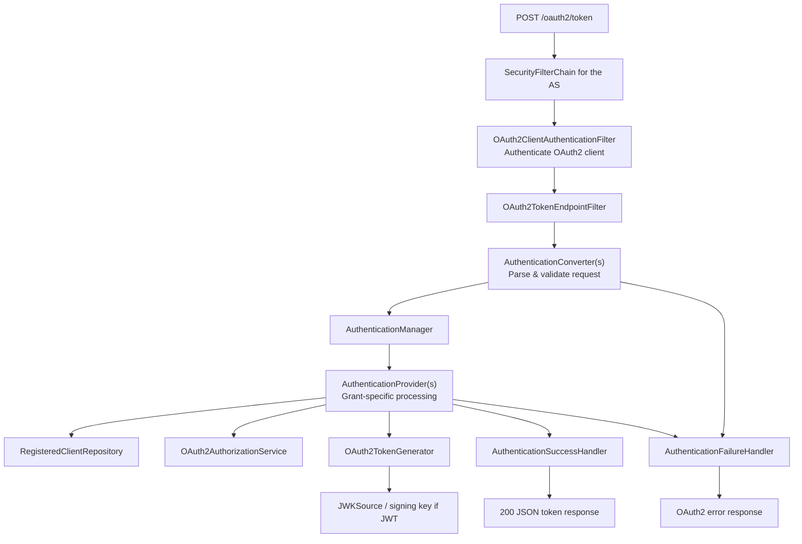
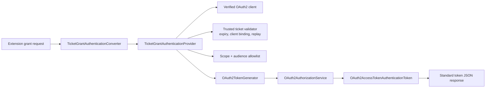
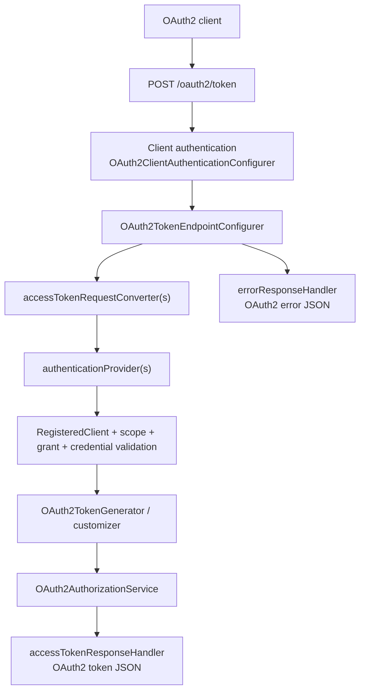

# OAuth2TokenEndpointConfigurer and Extension Points

## 1. Objectives and Context

In the **Token Endpoint** chapter of the **SPRING_SECURITY_OAUTH2_OIDC_AUTHORIZATION_SERVER** module, `OAuth2TokenEndpointConfigurer` is the Spring Authorization Server (SAS) configuration point that lets an application control **how token requests are received, how authentication providers are selected, how success responses are constructed, and how error responses are handled** at the token endpoint.

This lesson supports the goal of designing, configuring, securing, testing, and operating an **OAuth 2.0/OpenID Connect (OIDC) Authorization Server** with **Spring Security**, **Spring Authorization Server**, and **Spring Boot**. Not every project needs to customize the Token Endpoint: the default converters, providers, and handlers already handle the standard grants supported by your SAS version. Extending it is only worthwhile when you have **a specific protocol or integration requirement**, properly protected and thoroughly tested.

After this lesson, you will be able to:

- Locate `OAuth2TokenEndpointConfigurer` inside `OAuth2AuthorizationServerConfigurer` and `SecurityFilterChain`.
- Distinguish `OAuth2TokenEndpointFilter`, `AuthenticationConverter`, `AuthenticationProvider`, `AuthenticationSuccessHandler`, and `AuthenticationFailureHandler`.
- Properly use the extension points `accessTokenRequestConverter(s)`, `authenticationProvider(s)`, `accessTokenResponseHandler`, and `errorResponseHandler`.
- Design extension grants following the principle: **authenticate the client first, check grant/scope, verify proof, prevent replay, and only then issue tokens**.
- Know when to use `OAuth2TokenCustomizer`/`OAuth2TokenGenerator` instead of modifying the token response handler.
- Design tests, classify OAuth2 errors, and operate the Token Endpoint without leaking credentials or tokens.

**API Scope:** Code examples target the common DSL configuration of **Spring Authorization Server 1.x**, **Spring Security 6.x**, and **Spring Boot 3.x**. Default grant lists and API signatures may vary across versions. Before deploying code to production, check your actual documentation and dependencies. The extension grant example using `urn:example:params:oauth:grant-type:ticket` is an **internal illustrative grant**, not a standardized grant.

## 2. Where Does the Token Endpoint Fit in OAuth 2.0?

The Token Endpoint is the address where a client sends requests to **exchange an authorization code**, **refresh a token**, **use Client Credentials**, or execute other supported grants to obtain tokens. The common default path in SAS is `POST /oauth2/token`; this path can be changed via `AuthorizationServerSettings`.



This diagram shows **conceptual responsibilities**. In practice, client authentication has its own filter/providers running in the Spring Security filter chain; exceptions and internal ordering depend on configuration. Never assume every request flows through the same converter or that every grant issues a refresh token.

| Stage | Component | Responsibility |
| --- | --- | --- |
| Select HTTP endpoint | `SecurityFilterChain` + `OAuth2TokenEndpointFilter` | Ensures token requests enter the AS's handling pipeline. |
| Authenticate client | `OAuth2ClientAuthenticationFilter` and client authentication providers | Proves client identity per the registered method; protects confidential clients. |
| Parse token request | `AuthenticationConverter` | Classifies `grant_type`, validates parameter structure, and creates an authentication token describing the request. |
| Process grant | `AuthenticationProvider` | Validates client/grant, code or other proof, scope, and authorization state. |
| Mint/store token | `OAuth2TokenGenerator<?>`, `OAuth2AuthorizationService` | Issues tokens per settings; persists state and metadata when needed. |
| Return result | Success/error handlers | Enforces HTTP status, JSON fields, and OAuth2 error semantics. |

**Distinguish extension points:** Customizing **client authentication** belongs primarily in `OAuth2ClientAuthenticationConfigurer`; customizing **token grant requests** belongs in `OAuth2TokenEndpointConfigurer`. Never put `client_secret_basic` handling inside an extension grant's converter and accidentally bypass the standard authentication chain.

## 3. Where Does `OAuth2TokenEndpointConfigurer` Live in the DSL?

In SAS 1.x, `OAuth2AuthorizationServerConfigurer` organizes the Authorization Server endpoints. `tokenEndpoint(...)` is where the Token Endpoint is configured:

```java
@Configuration(proxyBeanMethods = false)
@EnableWebSecurity
public class AuthorizationServerSecurityConfig {

    @Bean
    @Order(1)
    SecurityFilterChain authorizationServerChain(HttpSecurity http)
            throws Exception {

        OAuth2AuthorizationServerConfigurer authorizationServer =
                OAuth2AuthorizationServerConfigurer.authorizationServer();

        http
            .securityMatcher(authorizationServer.getEndpointsMatcher())
            .with(authorizationServer, as -> as
                    .tokenEndpoint(token -> {
                        // Only register extension points when genuinely needed.
                    })
                    .oidc(Customizer.withDefaults()))
            .authorizeHttpRequests(authorize ->
                    authorize.anyRequest().authenticated())
            .exceptionHandling(exceptions ->
                    exceptions.defaultAuthenticationEntryPointFor(
                            new LoginUrlAuthenticationEntryPoint("/login"),
                            new MediaTypeRequestMatcher(MediaType.TEXT_HTML)))
            .oauth2ResourceServer(oauth2 ->
                    oauth2.jwt(Customizer.withDefaults()));

        return http.build();
    }

    @Bean
    @Order(2)
    SecurityFilterChain applicationChain(HttpSecurity http)
            throws Exception {

        http.authorizeHttpRequests(authorize ->
                    authorize.anyRequest().authenticated())
            .formLogin(Customizer.withDefaults());

        return http.build();
    }
}
```

**Meaning:** `getEndpointsMatcher()` scopes the AS chain to the endpoints managed by the configurer. The application chain serves `/login` and interactive pages. `.oidc(...)` enables OIDC, which requires appropriate token signing/decoding beans and supporting infrastructure. The configuration above is a **skeleton**; it does not yet register clients, an authorization service, `JWKSource`, issuer, or user authentication.

When you only need default Authorization Code, Refresh Token, or Client Credentials behavior, **there is no need to declare converters/providers manually**. SAS configures them according to the supported grants and features. Registering extra converters/providers carelessly can alter processing order or open an unintended token-issuing path.

## 4. Six Extension Points of `OAuth2TokenEndpointConfigurer`

### 4.1. Summary Table

| Configuration API | Input Type | Purpose | Risk When Misused |
| --- | --- | --- | --- |
| `accessTokenRequestConverter(...)` | `AuthenticationConverter` | Adds a converter to parse a token request format, typically for an extension grant. | Falsely claims standard grants, skips parameter checks, leaks sensitive data. |
| `accessTokenRequestConverters(...)` | `Consumer<List<AuthenticationConverter>>` | Accesses and adjusts the configured list of converters. | Deletes/reorders standard converters, breaking grant handling. |
| `authenticationProvider(...)` | `AuthenticationProvider` | Adds a provider to handle a custom authentication token/grant. | Issues tokens without verifying client, ticket, scope, or replay protection. |
| `authenticationProviders(...)` | `Consumer<List<AuthenticationProvider>>` | Accesses and adjusts the list of providers. | Drops standard providers, selects the wrong provider, or creates `supports(...)` conflicts. |
| `accessTokenResponseHandler(...)` | `AuthenticationSuccessHandler` | Customizes how a successful token request response is written. | Response violates OAuth2 JSON, drops anti-cache headers, or leaks tokens. |
| `errorResponseHandler(...)` | `AuthenticationFailureHandler` | Customizes how OAuth2 error responses are returned. | Wrong HTTP status/error code, leaks stack traces/secrets, or turns auth failures into redirects. |

The singular methods are convenient for **adding** a converter/provider. The plural variants provide deeper access to inspect or edit the list, so be extra careful with ordering and default components. Never treat converters and providers as interchangeable alternatives: they perform **two separate steps**.

### 4.2. Principles for Choosing the Right Extension Point

- To add **a new grant type**: you normally need **both a request converter and an authentication provider**.
- To adjust **JWT access token claims**: usually use `OAuth2TokenCustomizer<JwtEncodingContext>`, not the success handler.
- To change **token generation/algorithm**: evaluate `OAuth2TokenGenerator<?>` and token settings, never mint tokens in a servlet controller.
- To change **client authentication methods**: look at `clientAuthentication(...)` and its providers, never skip client authentication at the Token Endpoint.
- To record **audits/metrics**: prefer events/service layers or decorating a protocol-compliant handler; never hand-craft JSON token responses just to add a log line.
- To change **endpoint paths/issuer**: use `AuthorizationServerSettings`, never modify a converter to accept an arbitrary URL.

## 5. `AuthenticationConverter`: Parsing Requests Without Issuing Tokens

`AuthenticationConverter#convert(HttpServletRequest)` takes an HTTP request and returns an `Authentication` object representing the grant request, or `null` if the converter **does not handle this request type**.

At the Token Endpoint:

1. The converter reads `grant_type` and determines whether the request belongs to the grant it handles.
2. If the grant does not match, it returns `null` so another converter can handle it.
3. If the grant matches but parameters are missing, duplicated, or invalid, it throws an `invalid_request` error per contract—**never return `null` to "let it slide."**
4. If the request is **structurally valid**, it creates an authentication token holding the values needed for the provider to verify.
5. It **must not** issue tokens, arbitrarily query sensitive data, or trust credentials simply because the request contains a `client_id`.

### 5.1. Default Converters and Extension Grants

Standard grants such as `authorization_code`, `refresh_token`, `client_credentials`, and Device Code Grant (when supported by the framework) have built-in converters/providers. The exact set of default grants depends on the **SAS version and enabled protocol features**; do not assume an extension like token exchange is enabled in every version.

For an internal grant example:

```http
POST /oauth2/token HTTP/1.1
Host: auth.example.com
Authorization: Basic <CLIENT_CREDENTIALS>
Content-Type: application/x-www-form-urlencoded

grant_type=urn:example:params:oauth:grant-type:ticket&ticket=ONE_TIME_TRUSTED_TICKET
```

The converter must recognize the exact `grant_type`, validate a structurally valid single `ticket` value, and pass it to the provider. `ticket` is a sensitive credential; never log its raw value.

### 5.2. Authentication Token for an Extension Grant

Here is an example **authentication request type**, containing no ticket verification or token issuance logic:

```java
public final class TicketGrantAuthenticationToken
        extends OAuth2AuthorizationGrantAuthenticationToken {

    public static final AuthorizationGrantType GRANT_TYPE =
            new AuthorizationGrantType(
                    "urn:example:params:oauth:grant-type:ticket");

    public TicketGrantAuthenticationToken(
            Authentication clientPrincipal, String ticket) {

        super(GRANT_TYPE, clientPrincipal, Map.of("ticket", ticket));
    }

    public String getTicket() {
        return (String) getAdditionalParameters().get("ticket");
    }
}
```

`OAuth2AuthorizationGrantAuthenticationToken` represents a **grant request** and holds the client principal authenticated by the prior layer. It **does not prove the ticket is valid** and is not an issued access token.

### 5.3. Converter Validating Form Parameters

```java
public final class TicketGrantAuthenticationConverter
        implements AuthenticationConverter {

    @Override
    public Authentication convert(HttpServletRequest request) {
        String grantType = request.getParameter(
                OAuth2ParameterNames.GRANT_TYPE);

        if (!TicketGrantAuthenticationToken.GRANT_TYPE
                .getValue().equals(grantType)) {
            return null;
        }

        String[] tickets = request.getParameterValues("ticket");

        if (tickets == null || tickets.length != 1
                || !StringUtils.hasText(tickets[0])) {
            throw new OAuth2AuthenticationException(
                    new OAuth2Error(OAuth2ErrorCodes.INVALID_REQUEST));
        }

        Authentication clientPrincipal =
                SecurityContextHolder.getContext()
                        .getAuthentication();

        return new TicketGrantAuthenticationToken(
                clientPrincipal, tickets[0]);
    }
}
```

Imports are omitted; this illustrates checking for **exactly one** ticket. In a real implementation, the converter must also check for duplicate `grant_type` parameters, verify an appropriate content type, reject unexpected extra parameters per policy, and enforce input length limits. Avoid calling `getParameter(...)` alone as proof that a request has no duplicate values. These validations cover **request structure**; ticket validity and single-use guarantees belong in the provider/service.

**Never** accept a ticket merely because it is a non-empty string. The ticket must be issued by an authoritative source, bound to client/recipient/scope/time, and protected against replay; otherwise, the extension grant becomes an unauthorized token-minting endpoint.

## 6. `AuthenticationProvider`: Verifying Proof and Processing the Grant

`AuthenticationProvider` receives the authentication token from the converter, checks all protocol and business rules, and returns a successful authentication result only when every condition is met.

### 6.1. Minimum Contract

A provider for `TicketGrantAuthenticationToken` can be structured as:

```java
public final class TicketGrantAuthenticationProvider
        implements AuthenticationProvider {

    private final TrustedOneTimeTicketService ticketService;
    private final OAuth2TokenGenerator<?> tokenGenerator;
    private final OAuth2AuthorizationService authorizationService;

    public TicketGrantAuthenticationProvider(
            TrustedOneTimeTicketService ticketService,
            OAuth2TokenGenerator<?> tokenGenerator,
            OAuth2AuthorizationService authorizationService) {

        this.ticketService = ticketService;
        this.tokenGenerator = tokenGenerator;
        this.authorizationService = authorizationService;
    }

    @Override
    public boolean supports(Class<?> authentication) {
        return TicketGrantAuthenticationToken.class
                .isAssignableFrom(authentication);
    }

    @Override
    public Authentication authenticate(Authentication authentication) {
        TicketGrantAuthenticationToken grant =
                (TicketGrantAuthenticationToken) authentication;

        // Step 1: Require an authenticated client principal.
        // Step 2: Look up RegisteredClient and check grant type.
        // Step 3: Verify and consume the one-time ticket bound to the right client.
        // Step 4: Restrict scopes/audience per server policy.
        // Step 5: Invoke tokenGenerator and save OAuth2Authorization.
        // Step 6: Return OAuth2AccessTokenAuthenticationToken.
        // This is a skeleton illustrating control order, not a
        // production-ready token-issuing implementation.
        throw new UnsupportedOperationException(
                "Implement audited ticket grant validation first");
    }
}
```

`TrustedOneTimeTicketService` is a **hypothetical application interface**, not a built-in SAS bean. The template intentionally **does not issue tokens**: a complete token-issuing snippet without trusted ticket verification and atomic consumption would create a false sense of security.

### 6.2. Security Invariants of a Provider

| Check | Must Happen Before Token Issuance | Consequence If Missing |
| --- | --- | --- |
| Authenticated client principal | Yes; never trust form `client_id` | Unauthenticated or spoofed client can request tokens. |
| Client permitted to use the grant | Yes; verify against `RegisteredClient.authorizationGrantTypes` | Client uses an unregistered grant. |
| Ticket/proof unexpired and issued by trusted source | Yes | Forged or stolen tickets may be accepted. |
| Ticket bound to right client and intended recipient | Yes | Client A's ticket redeemed by client B. |
| Single-use ticket consumed atomically | Yes | Replay or race condition mints multiple tokens. |
| Permitted scopes | Yes; bounded by registered scopes and policy | Token receives privileges beyond approved scope. |
| Appropriate audience for Resource Server | Yes; controlled by AS | Cross-resource token replay. |
| Working token generator/authorization service | Yes | Returns tokens not persisted/tracked per policy. |
| Standard error semantics | Yes | API clients receive unpredictable errors that may leak data. |

When implementing a provider yourself, it usually needs `RegisteredClientRepository`, `OAuth2AuthorizationService`, `OAuth2TokenGenerator<?>`, a trusted verifier/ticket store, and `AuthorizationServerContext`. **Never reimplement client authentication** inside the grant via ad-hoc matching, and never accept `Authenticated=true` derived from client-supplied input.

### 6.3. Provider Token Issuance Result

After validating every condition, the provider typically mints an access token via `OAuth2TokenGenerator<?>` with an appropriate `OAuth2TokenContext`, saves `OAuth2Authorization`, and returns an `OAuth2AccessTokenAuthenticationToken` result. The framework's response handler then builds the standard HTTP JSON response.

If the generator produces a JWT, the token context must reflect **the exact registered client, principal, grant type, authorized scopes, token type, and AS context**. If an extension supports refresh tokens or OIDC ID tokens, those rules must be explicitly designed; **never issue refresh/ID tokens by default** simply because an extension grant succeeded.

## 7. Registering Converters and Providers via the Token Endpoint DSL

Once you have secure implementations, register them:

```java
@Bean
@Order(1)
SecurityFilterChain authorizationServerChain(
        HttpSecurity http,
        TicketGrantAuthenticationConverter ticketConverter,
        TicketGrantAuthenticationProvider ticketProvider)
        throws Exception {

    OAuth2AuthorizationServerConfigurer as =
            OAuth2AuthorizationServerConfigurer.authorizationServer();

    http
        .securityMatcher(as.getEndpointsMatcher())
        .with(as, authorizationServer ->
                authorizationServer.tokenEndpoint(tokenEndpoint ->
                        tokenEndpoint
                            .accessTokenRequestConverter(ticketConverter)
                            .authenticationProvider(ticketProvider)))
        .authorizeHttpRequests(authorize ->
                authorize.anyRequest().authenticated());

    return http.build();
}
```

This snippet shows how to **wire extension points**, not a full Authorization Server. You still need the client authentication chain, JWT/authorization infrastructure, registered clients, and login if applicable; the template `TicketGrantAuthenticationProvider` from the previous section must be fully implemented and tested before handling real requests.

### 7.1. List-Adjustment Variants

You can use the consumer-based methods:

```java
tokenEndpoint
    .accessTokenRequestConverters(converters -> {
        // Permitted to inspect/adjust the converter list.
        // For example, check order so a custom converter
        // does not hijack authorization_code requests.
    })
    .authenticationProviders(providers -> {
        // Permitted to inspect/adjust providers.
        // Do not remove standard providers unless truly necessary.
    });
```

**Caution:** This illustrates the list-consumer callbacks; do not paste this code where `tokenEndpoint` does not exist. When adjusting order, check your SAS version's exact contract and registered converters/providers. A converter returning `Authentication` for every request blocks the legitimate converters, and a provider with an overly broad `supports(...)` can misroute grants.

### 7.2. Avoid Duplicate Extension Registrations

If the same converter is added multiple times or two providers both `supports` the same token class with conflicting logic, behavior depends on how `AuthenticationManager` selects and iterates providers. Maintain a single clear execution path per grant and write tests verifying your converter/provider does not affect other grants.

A clean way to organize this is to group each extension grant into its own module, registering one converter and one provider per grant type; client/scope/ticket verification policies should live in dedicated services rather than being crammed into DSL lambdas.

## 8. Customizing the Success Response: When Is It Actually Needed?

`accessTokenResponseHandler(AuthenticationSuccessHandler)` lets you replace how the Token Endpoint responds when authentication succeeds.

In the standard flow, the handler must return **HTTP 200**, a JSON body containing `access_token`, `token_type`, `expires_in`, and applicable fields, while ensuring sensitive responses are never cached:

```http
HTTP/1.1 200 OK
Content-Type: application/json
Cache-Control: no-store
Pragma: no-cache

{
  "access_token": "<REDACTED>",
  "token_type": "Bearer",
  "expires_in": 300,
  "scope": "orders.read"
}
```

**Do not replace the success handler just to add a claim to a JWT.** The JWT has already been generated **before** the response handler runs. Adding a JSON field `"role"` to the outer response does not give the Resource Server a `role` claim inside the verified access token.

### 8.1. Cases Where You Should Keep the Default Handler

- You only want to add `aud`/`roles` to the JWT access token.
- You only want to adjust token TTLs.
- You only want to switch between JWT and opaque token formats.
- You only want to record an audit log or increment a metric counter without altering the protocol payload.
- You only want to expose a new field on a Resource Server API.

In those cases, use token settings, token customizers, generators, or appropriate metrics/events. The default handler preserves easily overlooked protocol details: content type, no-store headers, JSON serialization, and status codes.

### 8.2. If You Must Replace the Handler

Safe sequence:

1. Define the exact OAuth2 response contract and standard behavior for your SAS version.
2. Delegate **actual response writing** to a verified/standard handler when possible.
3. If adding auditing, avoid capturing raw tokens, refresh tokens, or serialized `Authentication` objects.
4. Ensure the response is never written twice; never mix HTML redirects with JSON token responses.
5. Test status codes, `Cache-Control: no-store`, `Pragma: no-cache`, JSON fields, and network/serialization failures.
6. Never open global CORS or put tokens into query URLs merely to accommodate a non-compliant client.

You can register a custom handler via:

```java
tokenEndpoint.accessTokenResponseHandler(customSuccessHandler);
```

`customSuccessHandler` must be an `AuthenticationSuccessHandler` implemented and tested by your application. This is an illustrative DSL snippet, not a built-in framework bean.

## 9. Customizing the Error Handler and Preserving the OAuth2 Error Contract

`errorResponseHandler(AuthenticationFailureHandler)` controls how the Token Endpoint returns errors. Without customization, SAS returns protocol-compliant errors; applications should replace the handler only for concrete, testable interoperability or auditing requirements.

| Error | Common Cause | Expected Behavior |
| --- | --- | --- |
| `invalid_request` | Missing/duplicate parameter, malformed data | Error HTTP status with OAuth2 JSON; no token returned. |
| `invalid_client` | Invalid client secret/method/assertion | Reject client authentication; compliant HTTP status/headers. |
| `invalid_grant` | Invalid, expired, reused, or mismatched code/refresh token/ticket | Issue no token; never reveal credential owner. |
| `unauthorized_client` | Client is not permitted to use the grant | Disallow grants beyond registration. |
| `unsupported_grant_type` | Grant unsupported by the AS | Never silently fall back to a weaker grant. |
| `invalid_scope` | Scope out of bounds or invalid | Never grant broader permissions than approved. |
| `server_error` | Internal/infrastructure failure | Never expose stack traces, secrets, or database details. |

HTTP example when an authorization code is invalid:

```http
HTTP/1.1 400 Bad Request
Content-Type: application/json
Cache-Control: no-store
Pragma: no-cache

{"error":"invalid_grant"}
```

For client authentication errors, HTTP 401 and an appropriate `WWW-Authenticate` header may be required depending on the scheme. Never force all Token Endpoint errors to return 200 or redirect browsers to `/login`; this is a token-issuing API, not an interactive login page.

### 9.1. How to Design a Custom Error Handler

```java
tokenEndpoint.errorResponseHandler(customErrorHandler);
```

The handler must map exceptions to standard OAuth2 errors, strip sensitive data, preserve `Cache-Control: no-store`, and avoid revealing granular differences such as "client ID exists but secret is wrong." For auditing, log **standardized error codes** and a correlation ID; never log raw `code`, `refresh_token`, `client_secret`, tickets, JWTs, or full request/response bodies.

If clients need clearer failure guidance, document `error` codes and recovery flows. Never embed PII or stack traces in public JSON `error_description` fields.

## 10. Customizing Token Contents: Use the Right Extension Point

### 10.1. JWT Access Token Claims

When adding `aud` or AS-managed claims, use `OAuth2TokenCustomizer<JwtEncodingContext>`:

```java
@Bean
OAuth2TokenCustomizer<JwtEncodingContext> jwtTokenCustomizer() {
    return context -> {
        if (!OAuth2TokenType.ACCESS_TOKEN.equals(
                context.getTokenType())) {
            return;
        }

        if (AuthorizationGrantType.CLIENT_CREDENTIALS.equals(
                context.getAuthorizationGrantType())) {

            String clientId =
                    context.getRegisteredClient().getClientId();

            // Server-side allowlist policy; never take aud
            // directly from the request without verification.
            if ("orders-worker".equals(clientId)) {
                context.getClaims().audience(List.of("orders-api"));
            }
        }
    };
}
```

**Caution:** Claims in an **OIDC ID token** serve a different purpose than access tokens. Always check `ACCESS_TOKEN` before modifying JWT access token audiences so you do not inadvertently alter an ID token's `aud`. When combining multiple JWT customizers or a custom token generator, verify how customizers are composed in your framework version.

When enforcing audience policies across multiple clients, do not simply skip unmapped clients and emit JWTs with an ambiguous audience. Policy can reject the grant in the provider before minting tokens, or enforce trust checks elsewhere, backed by fail-closed integration tests.

### 10.2. Opaque Access Tokens and Claim Customization

If an access token uses `OAuth2TokenFormat.REFERENCE`, `OAuth2TokenCustomizer<OAuth2TokenClaimsContext>` can attach claims to opaque access tokens when paired with the appropriate `OAuth2AccessTokenGenerator`. The Resource Server will then typically need introspection or a corresponding token-state verifier.

Do not assume a `JwtEncodingContext` customizer automatically applies to opaque tokens. Conversely, an `OAuth2TokenCustomizer<OAuth2TokenClaimsContext>` does not automatically turn an OIDC ID token into a different JWT.

### 10.3. When to Register Your Own `OAuth2TokenGenerator<?>`?

Consider this when coordinating specialized generators or changing how tokens are encoded per policy. However, if you define a custom generator bean, you must preserve generation for every token type your AS supports: JWT access tokens, opaque access tokens, refresh tokens, and OIDC ID tokens when needed. Never register a generator that handles only access tokens and accidentally breaks refresh or OIDC flows.

`OAuth2TokenGenerator` is the **token-generation layer**, whereas `OAuth2TokenEndpointConfigurer` is the **request-pipeline configuration layer**. Placing logic at the right extension point keeps the protocol contract intact.

## 11. Related Beans and Configurations Outside the Token Endpoint DSL

| Component | Role | Where Is It Typically Configured? |
| --- | --- | --- |
| `RegisteredClientRepository` | Client ID, grant types, client authentication, scopes, token settings | Infrastructure bean. |
| `OAuth2AuthorizationService` | Persists codes, tokens, authorization state | In-memory, JDBC, or custom bean. |
| `OAuth2AuthorizationConsentService` | User consent per client | Infrastructure bean when grants need consent. |
| `OAuth2TokenGenerator<?>` | Generates JWTs, access/refresh tokens | Bean or SAS default configuration. |
| `JWKSource<SecurityContext>` | Provides private signing keys/public JWKS | Infrastructure bean when signing JWTs. |
| `JwtDecoder` | Verifies JWTs for features that need it (e.g., OIDC) | Infrastructure bean. |
| `AuthorizationServerSettings` | Issuer and endpoint paths | AS configuration bean. |
| `OAuth2ClientAuthenticationConfigurer` | Client auth methods, converters/providers, handlers | `clientAuthentication(...)` in the AS DSL. |
| `OAuth2TokenEndpointConfigurer` | Grant request converters/providers and token response handlers | `tokenEndpoint(...)` in the AS DSL. |

### 11.1. Difference Between `clientAuthentication` and `tokenEndpoint`

A confidential client `orders-backend` sends `Authorization: Basic ...` to authenticate, **and then** uses `grant_type=client_credentials` to request a token.

- Wrong secret: **client authentication** error (`invalid_client`).
- Valid secret, unregistered grant: **grant authorization** error (`unauthorized_client`).
- Scope exceeds registration: **grant/scope policy** error (`invalid_scope`).
- Already-used code: **grant state** error (`invalid_grant`).

Do not collapse these into a generic "wrong password" error or try to handle all of them inside a single converter.

### 11.2. Changing the Endpoint Path

If the Token Endpoint must use a different path:

```java
@Bean
AuthorizationServerSettings authorizationServerSettings() {
    return AuthorizationServerSettings.builder()
            .issuer("https://auth.example.com")
            .tokenEndpoint("/oauth2/token")
            .build();
}
```

This explicitly shows the default path; to use another path, substitute the desired value and update metadata/gateway/client configs accordingly. Never hard-code a new URL inside a converter while ignoring `AuthorizationServerSettings` and `SecurityFilterChain`.

## 12. Designing a Secure Extension Grant

Before writing code, answer these questions:

1. **Why aren't standard grants sufficient?** If Authorization Code + PKCE, Client Credentials, Device Code, or Refresh Token fits, prefer the standard.
2. **Who issues the proof?** Tickets or assertions must have a trusted issuer and verification contract.
3. **Which client is the ticket bound to?** Never accept another client's ticket.
4. **Whom does the ticket represent?** End-user delegation or workload identity only? Be explicit to prevent privilege escalation.
5. **Who decides scope and audience?** The AS enforces them, never the caller's unchecked input.
6. **How is replay prevented?** Single-use tickets require atomic consumption, even across multiple nodes.
7. **What are the lifetimes?** Use server clocks, short TTLs, and clock-skew policies.
8. **What does the token response contain?** Never issue refresh tokens or ID tokens unless warranted.
9. **What are the error semantics?** Distinguish malformed requests, invalid clients, invalid grants, and server faults.
10. **What observability is needed?** Audit logs and metrics must use safe identifiers and never log credentials.

One clean architecture:



**Never cut corners** by minting JWTs directly in a converter, copying client-requested `scope` values unchecked into tokens, or skipping persistence when a grant requires state tracking. An extension grant is a high-risk token issuance surface requiring dedicated review and testing.

## 13. Testing Extension Points

### 13.1. Converter/Provider Test Matrix

| Test Case | Converter | Provider | Expected Outcome |
| --- | --- | --- | --- |
| `grant_type` belongs to another grant | Returns `null` | Custom provider not invoked | Standard converter handles the request properly. |
| Matching `grant_type`, missing ticket | Throws `invalid_request` | No token issued | Never bypasses validation by returning `null`. |
| Multiple `ticket` values | Rejects invalid request | No token issued | Does not arbitrarily pick the first/last value. |
| Oversized or invalid-character ticket | Rejects early | No token issued | Avoids overloading parsers/stores. |
| Unauthenticated client | Converter may construct request token | Provider rejects `invalid_client` | No token issued. |
| Client not registered for custom grant | Request constructed | Provider rejects `unauthorized_client` | No token issued. |
| Wrong, expired, or mismatched-client ticket | Request constructed | Provider rejects `invalid_grant` | Never reveals ticket owner. |
| Already-used ticket | Request constructed | Provider rejects replay | No extra token issued. |
| Scopes exceed allowlist | Request constructed | Provider rejects or narrows per explicit policy | No unauthorized scopes granted. |
| Missing audience policy | Request constructed | Fail closed | No token issued for an undetermined resource. |
| Valid ticket | Builds valid authentication request | Provider mints/saves token, returns result | Standard handler emits OAuth2 JSON. |
| Two requests with same ticket | May run concurrently | Verifier consumes atomically | Ticket cannot be redeemed twice. |

### 13.2. Testing That Standard Grants Remain Unaffected

After registering a new extension, re-run at least:

- Authorization Code + valid PKCE and invalid verifier.
- Refresh Token Grant valid, expired, and invalidated tokens.
- Client Credentials valid and disallowed scopes.
- Device Code Grant if enabled.
- OIDC token generation and ID token validation when `openid` is present.
- Basic/POST/private-key JWT client authentication if supported.

The goal is to prove the new converter/provider **does not hijack requests** meant for standard grants and does not drop default handlers or providers. Do not test only the extension grant's happy path.

### 13.3. Spring Security Test/MockMvc

A test for malformed parameters may look like:

```java
@Test
void extensionGrantRejectsMissingTicket() throws Exception {
    mockMvc.perform(post("/oauth2/token")
            .contentType(
                    MediaType.APPLICATION_FORM_URLENCODED)
            .param("grant_type",
                    "urn:example:params:oauth:grant-type:ticket")
            .with(httpBasic("trusted-client", "test-secret")))
        .andExpect(status().isBadRequest())
        .andExpect(jsonPath("$.error")
                .value("invalid_request"));
}
```

This is **not a self-contained test**: you must initialize a test context with the custom converter/provider, a registered client permitted to use the grant, a properly encoded client secret, and required infrastructure beans. If client authentication fails before the converter runs, the test will observe `invalid_client` instead of `invalid_request`—an important distinction to verify with test fixtures.

For end-to-end testing, include integration tests against a real database or Testcontainers for ticket consumption and authorization persistence. A mocked verifier returning success cannot prove single-use safety under race conditions.

### 13.4. Testing Response Handlers

If custom handlers are registered, verify:

| Case | Assertion |
| --- | --- |
| Token issued successfully | HTTP 200, JSON Content-Type, accurate `access_token` and `token_type`. |
| Sensitive token | `Cache-Control: no-store`, `Pragma: no-cache` per policy. |
| Invalid grant | Matching JSON `error`, no access token. |
| Client authentication failed | Compliant OAuth2 status/headers, no browser redirect to HTML login. |
| Exception handling | No stack trace, secret, or full token exposed in response/logs. |
| Double response write | No double-write error, mixed content, or broken response headers. |
| Replaced handler | Standard grants still return OAuth2-client-compatible responses. |

## 14. Operating and Observing the Token Endpoint

### 14.1. Useful Metrics

- `POST /oauth2/token` traffic by grant type and standardized error code.
- Rates of `invalid_client`, `invalid_grant`, `invalid_scope`, and `unsupported_grant_type`.
- P50/P95/P99 latencies for client authentication, grant validation, token generation, and authorization persistence.
- Signing key/KMS/JWKS health checks and token generator failures.
- Expired/replayed ticket rejection rates by anonymized group.
- Active custom providers/extensions per instance, version config, and rollout consistency.

**Never record in logs/metrics:** `Authorization` Basic headers, `client_secret`, authorization codes, refresh tokens, access tokens, custom tickets, `code_verifier`, private keys, or full `OAuth2Authorization` records. Use **credential-free** correlation IDs and restrict audit log access.

### 14.2. Multi-Instance Deployments

When running multiple AS nodes:

- `RegisteredClientRepository` and scope policies must be consistent.
- `OAuth2AuthorizationService` must share state when grants read and update tokens.
- Extension ticket stores must support **atomic single-use consumption across all nodes**.
- Signing keys/JWKS, `issuer`, token settings, and clock policies must align.
- Custom converters/providers must run the same version and be enabled consistently across instances.
- Rolling deployments must not cause requests to intermittently succeed or fail with `unsupported_grant_type`.

If a client obtains a token using a ticket already redeemed on another node, treat it as a **concurrency security vulnerability**, not a minor UX glitch.

### 14.3. Triaging Common Failures

| Symptom | Possible Cause | Check |
| --- | --- | --- |
| `POST /oauth2/token` returns 404 | Wrong endpoint path, matcher, or chain order | `AuthorizationServerSettings`, `getEndpointsMatcher()`. |
| Endpoint returns HTML login | Application chain matched first, wrong entry point | AS filter chain, client authentication flow. |
| `unsupported_grant_type` | Missing converter/provider registration, mismatched or unsupported grant type | `grant_type` and token endpoint DSL. |
| `invalid_request` on extension grant | Converter matched request, but parameter missing/duplicated | Request validation and encoding. |
| `invalid_client` | Client auth failed | `RegisteredClient`, secret/method, client filter configurer. |
| `unauthorized_client` | Client lacks permission for the extension grant | Allowed grant types in registered client. |
| `invalid_grant` | Ticket/code expired, replayed, or wrong client binding | Authorization/ticket state and policy. |
| 200 but Resource Server rejects JWT | Wrong `iss`, `aud`, signature, or scope | Token customizer, JWKS, Resource Server validator. |
| Missing ID token | OIDC not enabled, missing `openid`, or broken token generator | OIDC settings and token types. |
| Response lacks `Cache-Control: no-store` | Custom handler broke HTTP contract | Success/error handlers and integration tests. |
| Extension grant breaks code/refresh | Converter/provider matches too broadly or removed defaults | Converter `null` return, `supports`, and list order. |
| Tokens leaked in logs | Raw request/response body logging | Redaction at gateways, filters, tracing, handlers. |

## 15. Anti-Patterns to Avoid

| Anti-Pattern | Why It Is Dangerous | Alternative |
| --- | --- | --- |
| Writing a `@PostMapping("/oauth2/token")` controller that mints JWTs | Bypasses standard client auth/provider/state/error handling | Configure SAS and proper extension points. |
| Converter returns an authentication for every request | Hijacks grants it does not own | Match exact `grant_type`; return `null` otherwise. |
| Provider skips registered client/grant checks | Any client can obtain tokens | Enforce client principal, allowlists, and policy. |
| Redeeming single-use tickets with separate `findById` then `delete` | Race/replay across concurrent requests | Consume atomically with transactions/locking. |
| Copying requested scopes into tokens unchecked | Privilege escalation | Constrain by registered scopes and policy. |
| Reading `audience` from arbitrary parameters | Issues tokens for unauthorized resources | Server-side client–resource allowlists. |
| Modifying JWT claims inside the success handler | JWT is already signed; outer JSON does not change JWT signature | Use `OAuth2TokenCustomizer` before token generation. |
| Custom handler returns HTML redirect for token requests | Incompatible with OAuth2 and risks leaking tokens | Preserve the OAuth2 JSON/HTTP contract. |
| Deleting all standard providers to simplify adding one grant | Breaks `authorization_code`, refresh, device, etc. | Add dedicated converter/provider alongside defaults. |
| Logging full token responses for debugging | Credential leakage | Structured logs with redaction. |

## 16. Acceptance Checklist

- [ ] Configured `OAuth2AuthorizationServerConfigurer.tokenEndpoint(...)` inside the right AS `SecurityFilterChain`.
- [ ] Understood the distinct roles of `AuthenticationConverter`, `AuthenticationProvider`, and response handlers.
- [ ] Added converters/providers for new grants only with clear need and security contracts.
- [ ] Converters return `null` when grants do not match, and reject malformed/duplicate parameters for their own grant.
- [ ] Providers verify client principal, registered grant, valid ticket/credential, scope, and audience.
- [ ] Single-use credentials are consumed atomically with replay protection across instances.
- [ ] Tokens are generated via `OAuth2TokenGenerator<?>` and saved via `OAuth2AuthorizationService` when required.
- [ ] Access/ID/refresh tokens are never issued outside grant policy.
- [ ] Claims are modified via `OAuth2TokenCustomizer`, not faked in response JSON.
- [ ] Success/error handlers preserve OAuth2 statuses, JSON fields, and no-store cache headers.
- [ ] Tokens, codes, tickets, verifiers, and client secrets never leak into logs, traces, or HTTP errors.
- [ ] Tested extension grant success/failure alongside intact standard grants.
- [ ] Tested wrong client, disallowed grant, malformed requests, expired/replayed credentials, and excessive scopes.
- [ ] Resource Server independently validates signature, issuer, audience, expiry, and scope.
- [ ] Multi-instance deployments synchronize policies, signing keys, persistence, and extension versions.
- [ ] Not treating snippet compilation or Markdown authoring alone as full module QA sign-off.

## 17. Summary



**`OAuth2TokenEndpointConfigurer` is a tool for wiring the Token Endpoint processing pipeline, not a shortcut to bypass protocol policies.** For standard grants, prefer Spring Authorization Server's default configuration. When an extension grant is needed, add a converter and provider with strict contracts covering client authentication, allowlists, expiration, single-use guarantees, and proper token generation/storage; replace response handlers only when genuinely required. Maintaining clean separation across endpoint configuration, token generation, persistence, and Resource Server verification keeps a Spring Security/Spring Boot Authorization Server both extensible and operationally secure.
