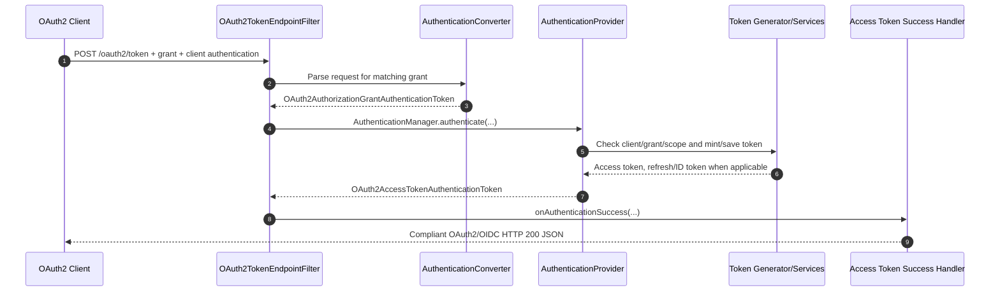

# Customizing Success Responses While Preserving Protocol Structure

## Lesson Objectives

In the **Token Endpoint** chapter of the **SPRING_SECURITY_OAUTH2_OIDC_AUTHORIZATION_SERVER** module, we explore how to customize **successful token issuance responses** while remaining compliant with the OAuth 2.0/OpenID Connect (OIDC) contract, using **Spring Security** and **Spring Authorization Server** in a **Spring Boot** application.

A system may need to add an extension field for policy-version diagnostics, partner integration support, or minor response adjustments. However, the Token Endpoint **is not an arbitrary JSON API**: OAuth2 client libraries, OIDC Relying Parties, and downstream components depend on exact field names, data types, HTTP statuses, cache headers, token values, and grant-specific rules.

After this lesson, you will be able to:

- Describe the exact flow `OAuth2TokenEndpointFilter` → converter → provider → success handler.
- Recognize `access_token`, `token_type`, `expires_in`, `refresh_token`, `scope`, `id_token`, and grant-specific extension fields.
- Use `OAuth2TokenEndpointConfigurer.accessTokenResponseHandler(...)` with `OAuth2AccessTokenResponseAuthenticationSuccessHandler` to preserve standard handling.
- Use `setAccessTokenResponseCustomizer(...)` and `OAuth2AccessTokenResponse.Builder.additionalParameters(...)` when adding **non-sensitive** metadata.
- Distinguish **outer JSON response parameters** from **claims inside JWT/opaque tokens**, as well as `TokenSettings` changes and grant validation.
- Write contract tests for token responses across `client_credentials`, `authorization_code`, `refresh_token`, Device Flow, and OIDC when supported.
- Protect access tokens, refresh tokens, and ID Tokens from leaking via logs, APM, gateways, caches, and custom response handlers.

> **Running Scenario:** The Authorization Server issues access tokens for `inventory-worker`. The operations team wants to add a `policy_version` field to the successful JSON response so the client knows the active policy contract version. Mandatory requirements: preserve `access_token`/`token_type`/`expires_in`, never alter issued scopes/tokens, never leak internal data, and never break OIDC clients or other grants.

## 1. Do Not Treat the Token Endpoint Like a Regular REST Controller

In OAuth2, the Token Endpoint is where clients exchange an authorization grant or suitable credential for tokens. By default, Spring Authorization Server exposes `POST /oauth2/token`; this path can be changed via `AuthorizationServerSettings.tokenEndpoint(...)`.

Common grants supported by the framework depending on version:

- `authorization_code`: exchanges an authorization code for tokens; checks code, `redirect_uri`, PKCE, and client authentication per registration.
- `refresh_token`: exchanges a valid refresh token for a new access token, optionally rotating the refresh token per policy.
- `client_credentials`: confidential client authenticates itself to request a machine-to-machine access token.
- `urn:ietf:params:oauth:grant-type:device_code`: device polls after the user completes Device Flow verification.
- `urn:ietf:params:oauth:grant-type:token-exchange`: token exchange extension if supported and registered.

Some grants or extensions include specialized response fields. Never customize a success handler under the assumption that **"every token response has only three fields."**

### 1.1. Standard Processing Path in Spring Authorization Server



Role of each layer:

| Component | Responsibility | When to Customize? |
|---|---|---|
| `AuthenticationConverter` | Converts HTTP request into a grant authentication request object. | Extending parsing/validation for specialized requests. |
| `AuthenticationProvider` | Validates the grant, enforces policies, and produces the token result. | Changing grant logic or evaluated policies. |
| `OAuth2TokenGenerator` / `OAuth2TokenCustomizer` | Mints tokens or adjusts claims/headers properly. | Adding `aud`, role/tenant claims inside tokens per policy. |
| `OAuth2TokenEndpointFilter` | Coordinates request dispatch and success/failure handling. | Usually keep default. |
| `AuthenticationSuccessHandler` | Serializes the authenticated result into an HTTP token response. | Adding safe response metadata and required headers. |
| `AuthenticationFailureHandler` | Returns OAuth2 errors, never success responses. | Needing custom, well-tested error policies. |

**If you only want to add claims to a JWT, do not use the success handler to modify the JWT**: once signed, altering the JWT string breaks the signature, invalidates `aud`/`iss` checks, or desynchronizes data saved in `OAuth2AuthorizationService`.

## 2. Token Endpoint Contract per RFC 6749

RFC 6749 **section 5.1** defines a successful access token response with HTTP **200 OK**, an **`application/json`** body, standardized field names, and cache-control rules. Illustrative example:

```http
HTTP/1.1 200 OK
Content-Type: application/json;charset=UTF-8
Cache-Control: no-store
Pragma: no-cache

{
  "access_token": "EXAMPLE_ACCESS_TOKEN_NOT_REAL",
  "token_type": "Bearer",
  "expires_in": 300,
  "scope": "inventory.read"
}
```

These values are purely illustrative and **not real tokens**. A successful JSON response must be a top-level object; fields must never be arbitrarily wrapped inside `data` or `result`.

### 2.1. Which Fields Are Required and Which Are Conditional?

| Field | JSON Type | Rules / Practices |
|---|---|---|
| `access_token` | String | **REQUIRED** in an access token response per RFC 6749 section 5.1. Must be the actual issued token. |
| `token_type` | String | **REQUIRED**, e.g., `Bearer`; must match the actual token type. |
| `expires_in` | Number (seconds) | **RECOMMENDED** per RFC 6749; should be returned when TTL exists. Never use string `"300"` if clients expect a JSON number. |
| `refresh_token` | String | Grant/policy-dependent; **never** fabricate when no valid refresh token was issued. |
| `scope` | String | Typically returned when granted scopes differ from requested scopes; never replace with registered scopes or display labels. |
| `id_token` | String | Field of an **OIDC Token Response** in OIDC flows that require it; not a mandatory field for every OAuth2 grant. |
| `issued_token_type` | String | Can be **required** in RFC 8693 Token Exchange; do not drop when adding extensions. |
| Controlled extension fields | String/number/boolean per contract | Add only if non-colliding with standard fields, secret-free, and documented. |

**Common confusion around `scope`:** RFC 6749 makes `scope` optional when the granted scope matches the requested scope; if they differ, it must be included so the client knows the actual scope granted. Never use a success handler to advertise scopes the provider did not grant.

### 2.2. Headers That Must Not Be Lost When Replacing the Success Handler

RFC 6749 requires when responses contain tokens, credentials, or sensitive data:

- `Cache-Control: no-store`.
- `Pragma: no-cache`.
- Proper JSON content type and appropriate HTTP status.
- No public or shared HTTP caching for token responses.

If a gateway/CDN/ingress overrides `Cache-Control` to `public, max-age=...`, that is a **security vulnerability**, even if the Java handler produces valid JSON. Tokens could be cached or replayed to another client.

### 2.3. Do Not Turn Errors into Success Responses

The OAuth2 Token Endpoint has its own **error response** per RFC 6749 section 5.2:

```http
HTTP/1.1 400 Bad Request
Content-Type: application/json
Cache-Control: no-store
Pragma: no-cache

{"error":"invalid_grant"}
```

For `invalid_client` when the client attempted authentication via an HTTP `Authorization` header, `401` and an appropriate `WWW-Authenticate` header may be required. Never "standardize REST responses" by returning `200 {"success":false,...}` on failure, as OAuth2 client libraries will misinterpret or fail to parse it.

## 3. Fields That Vary by Grant and OIDC

A single success handler operates across **multiple grant types**; understand how they differ before adding fields.

### 3.1. Client Credentials

Example:

```json
{
  "access_token": "EXAMPLE_M2M_TOKEN",
  "token_type": "Bearer",
  "expires_in": 300,
  "scope": "inventory.read"
}
```

RFC 6749 section 4.4.3 states that a refresh token **SHOULD NOT** be included for `client_credentials`. Never use a handler to tack on a `refresh_token` from a session or database "for convenience." This grant also has no ID Token, login session, or user consent.

### 3.2. Authorization Code + PKCE

```json
{
  "access_token": "EXAMPLE_ACCESS_TOKEN",
  "token_type": "Bearer",
  "expires_in": 600,
  "refresh_token": "EXAMPLE_REFRESH_TOKEN_WHEN_ISSUED",
  "scope": "orders.read"
}
```

`refresh_token` above is **illustrative for when the grant/client policy actually issues one**; a public client may have a different refresh token policy than a confidential client depending on policy and framework version. PKCE is verified **before the success handler**, and cannot be "patched in" by editing JSON.

### 3.3. OpenID Connect: Preserve `id_token`

An OIDC token response from an Authorization Code flow may include an ID Token:

```json
{
  "access_token": "EXAMPLE_ACCESS_TOKEN",
  "token_type": "Bearer",
  "expires_in": 600,
  "id_token": "EXAMPLE_SIGNED_ID_TOKEN",
  "scope": "openid profile"
}
```

`id_token` must carry content, signature, and claims per OIDC Core (e.g., `iss`, `sub`, `aud`, `exp`, `iat`, and `nonce` when applicable); it cannot be replaced with user profile JSON or an access token. Never drop `id_token` when inserting `additionalParameters`.

**Distinction:** The ID Token authenticates the user to the OIDC Client; the access token is used with the Resource Server. Never send an ID Token to an API in place of an access token. One Token Endpoint may share the same success handler for both OIDC clients and plain OAuth2 clients, so any extension must preserve both behaviors.

### 3.4. Refresh Token

For `grant_type=refresh_token`, the token response must reflect the new access token, expiration, and actual scopes. If the server enables **refresh token rotation**, the response may contain a new refresh token; do not retain the old refresh token merely for convenience.

Persisted authorization records must stay consistent with actually issued tokens. Never issue a `refresh_token` inside a success handler: it will have no corresponding state in `OAuth2AuthorizationService` and creates replay risks.

### 3.5. Device Code and Token Exchange

- Device Flow returns an access token only after the user completes verification/consent. `authorization_pending`, `slow_down`, `access_denied`, and `expired_token` occur on the **Token Endpoint error path**, not in the success handler.
- RFC 8693 Token Exchange defines specific fields such as `issued_token_type`. When this extension is active, never discard `additionalParameters` produced by the provider to fulfill the grant contract.
- For sender-constrained tokens (mTLS/DPoP or similar profiles), the meaning of `token_type`, binding, and client usage depends on the protocol. Never force `Bearer` if the actual token type is not Bearer.

## 4. Primary Extension Point: `accessTokenResponseHandler(...)`

`OAuth2TokenEndpointConfigurer` provides hooks for requests and responses. For this lesson's topic, the key hook is:

```java
tokenEndpoint.accessTokenResponseHandler(authenticationSuccessHandler);
```

Spring Authorization Server docs describe `accessTokenResponseHandler(...)` as accepting an `AuthenticationSuccessHandler` that handles `OAuth2AccessTokenAuthenticationToken` and writes an `OAuth2AccessTokenResponse`. The default success handler is `OAuth2AccessTokenResponseAuthenticationSuccessHandler`, and the default failure handler is `OAuth2ErrorAuthenticationFailureHandler`.

| Hook | Responsibility | Is This the Place to Modify Success JSON? |
|---|---|---|
| `accessTokenRequestConverter(...)` | Parses token requests, extends grant request handling. | No. |
| `authenticationProvider(...)` | Validates grants, mints/saves tokens. | No; provider results shape token contents. |
| `accessTokenResponseHandler(...)` | Serializes successful responses. | **Yes**; build on standard mechanics via the default handler. |
| `errorResponseHandler(...)` | Returns OAuth2 errors. | Not for success responses. |

### 4.1. Preferred Option: Keep the Default Handler Unchanged

If no extension field is genuinely required, **do not install a custom handler**. The framework already handles content type, HTTP status, body serialization, and grant-level additional parameters. Unnecessary custom code only increases the risk of dropping `id_token`, breaking `expires_in`, or losing cache headers.

Ask before customizing:

1. Must this really be a **top-level field in the JSON Token Response**?
2. Is it **safe for clients to see** and completely non-sensitive?
3. Does an existing OAuth2/OIDC standard or extension profile already define a field name?
4. Is this field needed for **all grants/clients** or only a specific subset?
5. Do tests prove real clients either parse or safely ignore the extension field?

## 5. Safe Customization with `OAuth2AccessTokenResponseAuthenticationSuccessHandler`

Starting in **Spring Authorization Server 1.3+**, `OAuth2AccessTokenResponseAuthenticationSuccessHandler` exposes `setAccessTokenResponseCustomizer(Consumer<OAuth2AccessTokenAuthenticationContext>)`. The context provides `OAuth2AccessTokenAuthenticationToken` and the `OAuth2AccessTokenResponse.Builder`, allowing you to add extension fields **before standard serialization runs**.

### 5.1. Example: Adding `policy_version` for a Specific Client

The Java snippet below applies to **Spring Authorization Server 1.3–1.5.x** and matching Spring Security APIs in a Spring Boot app with all required Authorization Server beans configured.

```java
package com.example.authserver.config;

import java.util.LinkedHashMap;
import java.util.Map;

import org.springframework.context.annotation.Bean;
import org.springframework.context.annotation.Configuration;
import org.springframework.core.annotation.Order;
import org.springframework.security.config.annotation.web.builders.HttpSecurity;
import org.springframework.security.oauth2.server.authorization.authentication.OAuth2AccessTokenAuthenticationToken;
import org.springframework.security.oauth2.server.authorization.config.annotation.web.configurers.OAuth2AuthorizationServerConfigurer;
import org.springframework.security.oauth2.server.authorization.web.authentication.OAuth2AccessTokenResponseAuthenticationSuccessHandler;
import org.springframework.security.web.SecurityFilterChain;

@Configuration(proxyBeanMethods = false)
public class TokenResponseConfiguration {

    @Bean
    @Order(1)
    SecurityFilterChain authorizationServerSecurityFilterChain(
            HttpSecurity http) throws Exception {

        var authorizationServer =
                OAuth2AuthorizationServerConfigurer.authorizationServer();

        var responseHandler =
                new OAuth2AccessTokenResponseAuthenticationSuccessHandler();

        responseHandler.setAccessTokenResponseCustomizer(context -> {
            OAuth2AccessTokenAuthenticationToken result =
                    context.getAuthentication();

            // START from the additional parameters produced by the provider:
            // They may contain id_token or extension grant fields.
            Map<String, Object> additional =
                    new LinkedHashMap<>(result.getAdditionalParameters());

            if ("inventory-worker".equals(
                    result.getRegisteredClient().getClientId())) {

                // Add only non-sensitive metadata whose names do not collide
                // with standard fields. Do not alter token values.
                additional.putIfAbsent("policy_version", "2026-11");
            }

            context.getAccessTokenResponse().additionalParameters(additional);
        });

        http.securityMatcher(authorizationServer.getEndpointsMatcher())
            .with(authorizationServer, configurer -> configurer
                    .tokenEndpoint(endpoint ->
                            endpoint.accessTokenResponseHandler(responseHandler)))
            .authorizeHttpRequests(authorize ->
                    authorize.anyRequest().authenticated());

        return http.build();
    }
}
```

This is a **Token Endpoint configuration skeleton**, not a complete runnable Authorization Server: you also need `RegisteredClientRepository`, `OAuth2AuthorizationService`, `JWKSource`, `AuthorizationServerSettings`, another login/security chain if using Authorization Code, and OIDC if issuing ID Tokens. Do not mix Spring Security 7.x packages with Spring Authorization Server 1.x; verify exact class names against your dependencies.

**Why is this safer than writing raw JSON manually?**

- It keeps `OAuth2AccessTokenResponseAuthenticationSuccessHandler` and Spring's serializer.
- `result.getAdditionalParameters()` preserves parameters emitted by the provider, notably OIDC `id_token` and extension fields like `issued_token_type`.
- `context.getAccessTokenResponse().additionalParameters(...)` adds only the extension metadata; it does not alter `access_token`, `token_type`, `expires_in`, or `scope` constructed by the standard builder.
- It applies conditionally only to approved clients with a verified need, avoiding unintended exposure to every client.
- `policy_version` is not a standard OAuth2 field; clients can ignore it if unrecognized.

**Be careful with `additionalParameters(...)`:** depending on the builder implementation, this call may **replace the entire additional parameters map** rather than merging. Always copy `result.getAdditionalParameters()` before adding fields. Never write `additionalParameters(Map.of("policy_version", "..."))` if doing so wipes out `id_token` or provider-supplied extension fields.

### 5.2. Ensuring the Final Response Honors the Contract

For example, `inventory-worker` may receive:

```http
HTTP/1.1 200 OK
Content-Type: application/json
Cache-Control: no-store
Pragma: no-cache

{
  "access_token": "EXAMPLE_ACCESS_TOKEN",
  "token_type": "Bearer",
  "expires_in": 300,
  "scope": "inventory.read",
  "policy_version": "2026-11"
}
```

`policy_version` is an example of public metadata **not used for authorization**, reflecting neither secrets nor internal DB state. Never use it in place of `scope`, `aud`, consent, or Resource Server policy. RFC 6749-compliant clients must ignore unknown fields; still, test real client libraries because overly strict custom parsers may reject extra keys.

### 5.3. Why Not Add `success: true` or Wrap Inside `data`?

A structure like the following **violates the standard Token Response contract**:

```json
{
  "success": true,
  "data": {
    "access_token": "EXAMPLE_ACCESS_TOKEN",
    "token_type": "Bearer"
  }
}
```

OAuth2 clients look for `access_token` and `token_type` at the **top level**. If wrapped inside `data`, standard clients cannot find them even though the response is HTTP 200. Likewise, never rename RFC-defined snake_case fields to `accessToken` or `expiresIn`.

If your organization enforces a global REST response envelope, **exclude the Token Endpoint from that JSON wrapper** via MVC/filter configuration rather than modifying OAuth2 client libraries to parse a non-standard format.

## 6. Adding Headers or Auditing Without Altering the Body

Not every observability need requires an extra JSON field. For correlation IDs, controlled middleware or gateways can generate and propagate `X-Request-ID` headers safely. Never encode secrets, sensitive client IDs, or access tokens into request IDs.

If wrapping the success handler to measure metrics, keep delegation intact:

```java
var standard =
        new OAuth2AccessTokenResponseAuthenticationSuccessHandler();

AuthenticationSuccessHandler measured = (request, response, authentication) -> {
    long startedNanos = System.nanoTime();
    try {
        standard.onAuthenticationSuccess(request, response, authentication);
    } finally {
        // Record only endpoint, status, and latency; never toString(authentication).
        metrics.recordTokenResponseLatency(System.nanoTime() - startedNanos);
    }
};

// Usage: tokenEndpoint.accessTokenResponseHandler(measured)
```

Here `metrics` is a **hypothetical** application component, not a built-in Spring Authorization Server API. Place this snippet inside an appropriate configuration and add imports if used directly.

**Limitation:** this handler runs **only after authentication succeeds**. Metrics here do not capture authentication/provider failures or requests rejected by the client-authentication filter. To measure all responses, use filters/observability designed with proper redaction instead of writing a handler that both alters JSON and logs tokens.

### 6.1. Keep Responses Uncached

When adding headers or observers, never strip:

```http
Cache-Control: no-store
Pragma: no-cache
Content-Type: application/json
```

Never add `ETag` to token responses so proxies/caches can reuse results; never allow CDNs to cache OAuth2 tokens. Avoid HTTP body logging at gateways and APM agents, even for 200 responses.

## 7. Distinguishing Response Customization from JWT Claim Customization

If you need `tenant_id` or `permissions` **inside the access token** for Resource Server validation, use `OAuth2TokenCustomizer` at token-creation time—never the token response handler.

### 7.1. Example: Non-Sensitive Claim in a JWT Access Token

```java
import org.springframework.context.annotation.Bean;
import org.springframework.context.annotation.Configuration;
import org.springframework.security.oauth2.server.authorization.OAuth2TokenType;
import org.springframework.security.oauth2.server.authorization.token.JwtEncodingContext;
import org.springframework.security.oauth2.server.authorization.token.OAuth2TokenCustomizer;

@Configuration(proxyBeanMethods = false)
class JwtClaimsConfiguration {

    @Bean
    OAuth2TokenCustomizer<JwtEncodingContext> jwtCustomizer() {
        return context -> {
            if (OAuth2TokenType.ACCESS_TOKEN.equals(context.getTokenType())) {
                context.getClaims().claim("service_class", "inventory");
            }
        };
    }
}
```

This example only shows where claims are added; never attach `service_class=inventory` indiscriminately to every token in a real system. Scope claims by `RegisteredClient`, grant, and policy, check `ACCESS_TOKEN`, and configure Resource Servers to validate meaningful claims.

| Need | Right Component |
|---|---|
| Add `policy_version` in **top-level JSON** for client visibility | `accessTokenResponseCustomizer` / response handler. |
| Add `aud`, `tenant_id`, or roles inside a **JWT access token** for API checks | `OAuth2TokenCustomizer<JwtEncodingContext>` with policy/validators. |
| Customize claims on an opaque access token | `OAuth2TokenCustomizer<OAuth2TokenClaimsContext>` when supported by the generator. |
| Change token TTL | `RegisteredClient.tokenSettings.accessTokenTimeToLive` or appropriate policy/generator. |
| Change granted scopes | Grant provider/policy during request processing; never edit `scope` in JSON without persisting state. |
| Issue a new refresh token | Grant/provider and `OAuth2AuthorizationService` per rotation policy. |
| Issue an OIDC ID Token | OIDC grant/token generator, preserving the `id_token` response field. |
| Switch `token_type` to DPoP/mTLS profiles | End-to-end sender-constraining protocol support, not manual string edits. |

**Changing `expires_in` in JSON without changing the access token's `expiresAt`** makes clients cache tokens for too long or too short; changing `scope` without changing granted permissions causes clients and Resource Servers to disagree. A success handler must never be used to "patch over" a broken token policy.

### 7.2. Avoid Sensitive Data in Extension Metadata

Never include the following in a Token Response:

- Passwords, client secrets, client assertions, or private keys.
- Hashes or token fingerprints that could unintentionally identify or look up tokens.
- Authorization codes, verifiers/challenges, cookies, or session IDs.
- Internal database details, KMS keys, or node/pod names carrying sensitive context.
- Unnecessary PII such as email addresses, phone numbers, or out-of-contract role lists.

Clients receiving the response may log the entire JSON payload in debug mode. Therefore, **added metadata must be evaluated as data visible to anyone controlling the client**, not as a private "internal" field.

## 8. Step-by-Step Safe Implementation Workflow

Suppose the official requirement is to add `policy_version` for `inventory-worker`. Workflow:

1. **Define the contract:** field name `policy_version`, meaning, String type, non-sensitive value, intended readers, and whether clients must understand it.
2. **Check versions:** confirm Spring Authorization Server 1.3+ if using `setAccessTokenResponseCustomizer(...)`; verify package names. If using Spring Security 7.x integration, check that branch's API docs.
3. **Keep the standard handler:** use `OAuth2AccessTokenResponseAuthenticationSuccessHandler` instead of building raw HTTP bodies with `response.getWriter().write(...)`.
4. **Preserve additional parameters:** start from `OAuth2AccessTokenAuthenticationToken.getAdditionalParameters()` rather than creating an empty map that drops `id_token` or extension fields.
5. **Filter by client:** inspect the authenticated `RegisteredClient` from the authentication result, never trusting a query/header `client_id` after the provider has run.
6. **Limit fields:** add only approved metadata, avoiding collisions with standard fields or names that client SDKs might misinterpret.
7. **Test across grants:** run `client_credentials`, `authorization_code`, `refresh_token`, and OIDC/Device/Token Exchange if supported by the app.
8. **Inspect HTTP outside the proxy:** verify status, headers, top-level JSON, no caching, and no token leakage in logs/traces.
9. **Roll out via canary/rolling deploy:** monitor response parsing and OAuth2 Client SDK errors, with rollback ready by removing the extension and restoring defaults.
10. **Document:** share extension details with partners and confirm clients never rely on it for token verification or API authorization.

### 8.1. Should Extensions Apply to Every Client?

Not necessarily. If an extension is meant for a single integration, restrict it by `RegisteredClient` or a controlled feature flag. A standard OIDC client has no need to see `inventory-worker`'s policy version; exposing it to all clients adds unnecessary disclosure or incompatibility risks.

Each grant can carry its own additional parameters; if an extension touches standardized names such as `id_token`, `issued_token_type`, or `cnf` in specialized profiles, verify the governing specification before making changes.

## 9. Testing the JSON and HTTP Contract

Token Endpoint customizations must verify **protocol structure**, not just `status=200`.

### 9.1. Minimum Test Matrix

| Case | Expectation |
|---|---|
| `client_credentials` with valid client/secret/grant/scope | 200 JSON, non-empty String `access_token` and `token_type`, numeric `expires_in`; extension present if eligible. |
| Client outside the extension group | Standard response, no `policy_version` leaked against policy. |
| Successful Authorization Code + PKCE | Access token, scope, and optional grant fields; issued refresh token preserved. |
| OIDC Authorization Code | **`id_token` remains present** when OIDC requires it; valid ID Token issuer/audience/signature. |
| Refresh Token + rotation | Response reflects the new access token and new refresh token per policy; never emits stale state. |
| Device Code after approval | Standard token response; `authorization_pending` before approval; success handler does not interfere with errors. |
| Token Exchange if enabled | `issued_token_type` and required extension fields preserved. |
| Invalid grant or wrong client secret | Proper OAuth2 error code and HTTP status/challenge per spec, never HTTP 200. |
| Expired token or narrowed scope | JSON reflects actual token/authorization, never faked TTL/scope. |
| Reverse proxy/CDN | `Cache-Control: no-store`, `Pragma: no-cache` not stripped or overwritten. |
| Multiple replicas | Consistent extension policy and synchronized issuer/token signing state. |
| Legacy client parsers | Continue reading standard fields and safely ignore unknown extension fields. |
| Logs/tracing | No access/refresh/ID tokens, client secrets, or raw Token Endpoint bodies. |

### 9.2. MockMvc Example for Client Credentials

Assumes the test app has `RegisteredClient` `inventory-worker` with `CLIENT_SECRET_BASIC`, `CLIENT_CREDENTIALS`, scope `inventory.read`, test secret `test-secret`, and all required Authorization Server beans.

```java
@SpringBootTest
@AutoConfigureMockMvc
class TokenResponseContractTest {

    @Autowired
    MockMvc mvc;

    @Test
    void clientCredentialsKeepsOAuth2ResponseContract() throws Exception {
        mvc.perform(post("/oauth2/token")
                .with(httpBasic("inventory-worker", "test-secret"))
                .contentType(MediaType.APPLICATION_FORM_URLENCODED)
                .param("grant_type", "client_credentials")
                .param("scope", "inventory.read"))
            .andExpect(status().isOk())
            .andExpect(content().contentTypeCompatibleWith(
                    MediaType.APPLICATION_JSON))
            .andExpect(header().string(
                    "Cache-Control",
                    org.hamcrest.Matchers.containsString("no-store")))
            .andExpect(header().string("Pragma", "no-cache"))
            .andExpect(jsonPath("$.access_token")
                    .isNotEmpty())
            .andExpect(jsonPath("$.token_type")
                    .value("Bearer"))
            .andExpect(jsonPath("$.expires_in")
                    .isNumber())
            .andExpect(jsonPath("$.policy_version")
                    .value("2026-11"))
            .andExpect(jsonPath("$.refresh_token")
                    .doesNotExist());
    }
}
```

Imports, fixtures, and error scenarios are omitted to highlight the assertions. `policy_version` appears only if the matching customizer example is configured. Real-world header assertions may need flexibility for combined directives; some environments append other directives alongside `no-store`, so avoid asserting exact equality on a single value when multiple directives are valid.

If the Token Endpoint path was customized, adjust `post("/oauth2/token")` to match `AuthorizationServerSettings` and test via the public gateway URL.

### 9.3. Testing OIDC to Avoid Dropping `id_token`

With a real OIDC Authorization Code flow enabled, perform authorize/login/consent, obtain a valid authorization code, and POST to the Token Endpoint with proper client authentication/PKCE. Then verify:

```java
// Illustrative assertions after receiving a successful OIDC token response:
.andExpect(jsonPath("$.access_token").isNotEmpty())
.andExpect(jsonPath("$.token_type").value("Bearer"))
.andExpect(jsonPath("$.id_token").isNotEmpty())
```

Never fake an OIDC ID Token by inserting an `id_token` field in the success handler. Always verify a genuine signed JWT ID Token containing `iss`/`aud`/`sub`/`exp`/`iat` per OIDC Core. If `additionalParameters(Map.of(...))` drops the ID Token, treat it as a severe regression.

### 9.4. Compatibility Testing with Real Clients

- Spring Security OAuth2 Client: use `ClientRegistration`/`OAuth2AuthorizedClientManager` to execute grants and parse responses.
- Third-party clients: test SDKs with strict JSON schemas or no knowledge of `policy_version`.
- Run integration tests when adding, removing, or updating metadata values (without breaking the contract).
- Never require clients to read a new extension field before a formal contract version is established.
- If clients cache metadata/authorized clients, verify token issuance and parsing across rolling deployments.

## 10. Common Design Mistakes

| Symptom or Misconception | Problem | Solution |
|---|---|---|
| Wrapping JSON in `data`/`result` | OAuth2 Clients cannot find top-level `access_token`. | Keep JSON compliant with RFC 6749. |
| Changing `expires_in` from number to string | Clients miscalculate expiry or fail to parse. | Keep seconds as a JSON number. |
| Omitting `token_type` because the client "knows it is Bearer" | Violates required field rule. | Always emit the accurate `token_type`. |
| Adding a fake `refresh_token` | Lacks persisted state/token, causing failures or security risks. | Let only the provider/generator issue tokens per policy. |
| Dropping `id_token` when adding extensions | OIDC Clients cannot authenticate the login session. | Merge existing additional parameters. |
| Stripping `issued_token_type` in token exchange | Breaks the RFC 8693 contract. | Preserve extension fields provided by the grant provider. |
| Modifying JWT after signing in the success handler | Invalidates signature; desynchronizes state. | Use `OAuth2TokenCustomizer` before signing. |
| Increasing `expires_in` only in JSON | Client thinks the token is still valid while Resource Server rejects it. | Adjust `TokenSettings`/token lifecycle at the source. |
| Returning `200` for `invalid_client` | Violates RFC 6749 error handling. | Keep the standard failure handler. |
| Setting `Cache-Control: public` | Tokens may be cached by proxies/CDNs. | Enforce `no-store`, `no-cache`, and verify infrastructure. |
| Logging `authentication.toString()` | May dump tokens, secrets/claims, and internal data. | Log redacted events; never log bodies/tokens. |
| Issuing tokens inside the success handler | Skips authorization state/rotation persistence. | Tokens must be created by providers/generators; success handlers only serialize. |

## 11. Practice Exercise

**Context:** An Authorization Server uses issuer `https://auth.example.com` and serves two clients:

- `inventory-worker`: `client_credentials`, `inventory.read`, `client_secret_basic`.
- `employee-portal`: OIDC Authorization Code + PKCE, eligible to receive an ID Token.

Product requirement: add `policy_version="2026-11"` exclusively for `inventory-worker` without breaking any OAuth2/OIDC clients.

Steps:

1. Inspect `OAuth2TokenEndpointConfigurer` to identify the default handler, `OAuth2AccessTokenAuthenticationToken`, and the context builder.
2. Configure `OAuth2AccessTokenResponseAuthenticationSuccessHandler` with `setAccessTokenResponseCustomizer(...)`.
3. Copy `result.getAdditionalParameters()` into a new map, add `policy_version` based on the authenticated `RegisteredClient`, and pass it back to the builder.
4. Test `client_credentials` success and wrong-secret failure; verify `access_token`, `token_type`, `expires_in`, 200/error status, and cache headers.
5. Test another client to confirm it does not receive out-of-policy extensions.
6. Test OIDC Authorization Code with `openid`, confirming `id_token` and PKCE work normally.
7. Test Refresh Token, Device Code, and Token Exchange if enabled, focusing on grant-specific response fields and error paths.
8. Temporarily change the response to `{"data":{...}}` and observe how an OAuth2 client fails to parse it; then revert.
9. Temporarily fake `expires_in` and explain the consequences; adjust TTLs properly in `TokenSettings` only.
10. Verify ingress/gateway/observability: no Token Endpoint caching and no secrets/tokens/response bodies in logs.
11. Write a brief ADR covering extension purpose, data classification, SDK compatibility, rollback, testing, and client scope.

**Completion Criteria:** The Token Endpoint still returns RFC/OIDC-compliant JSON, only the approved safe extension is emitted, all tokens/grants behave as before, and real client SDKs suffer zero regressions.

## 12. Pre-Handover Checklist

- [ ] Distinguished Token Response JSON from claims inside tokens and authorization state data.
- [ ] Successful responses return HTTP 200, a top-level JSON object, and compliant `access_token` and `token_type`.
- [ ] `expires_in` is a reasonable number of seconds; `scope` reflects granted scopes rather than unverified requested scopes.
- [ ] `refresh_token` is present only when actually issued by the grant/provider; Client Credentials does not rely on refresh tokens.
- [ ] OIDC ID Token is preserved when required by protocol; Token Exchange `issued_token_type` is preserved if used.
- [ ] `Cache-Control: no-store`, `Pragma: no-cache`, and JSON Content-Type are neither omitted nor overwritten.
- [ ] Default success-handler behavior is preserved via `OAuth2AccessTokenResponseAuthenticationSuccessHandler`.
- [ ] When calling `additionalParameters(...)`, existing provider parameters are preserved without overwriting standard fields.
- [ ] The success handler is never used to alter token values, TTLs, scopes, or mint refresh tokens.
- [ ] JWT claim needs are handled via a token customizer before signing and verified by Resource Server validation.
- [ ] Extension metadata contains no PII/credentials and is emitted only to authorized clients.
- [ ] Success and error handlers remain separate, with protocol-compliant HTTP statuses and `WWW-Authenticate` headers.
- [ ] MockMvc and E2E tests cover happy paths, wrong secrets, and OIDC/Device/Refresh when supported.
- [ ] Verified legacy client SDKs, gateway `no-store` preservation, log redaction, and metrics.
- [ ] Rollout/rollback plan and extension contract documentation are in place.

## Summary

In Spring Authorization Server, **`OAuth2TokenEndpointConfigurer.accessTokenResponseHandler(...)`** is the post-processing extension point for customizing HTTP responses on successful token issuance. The safest approach is to **reuse `OAuth2AccessTokenResponseAuthenticationSuccessHandler`** and, when supported by your version, `setAccessTokenResponseCustomizer(...)` to attach approved metadata via `OAuth2AccessTokenResponse.Builder.additionalParameters(...)`.

Regardless of customization, OAuth2 responses must retain `access_token`, `token_type`, grant/OIDC-specific fields, accurate HTTP status, Content-Type, and cache headers. **Never alter claims, TTLs, or tokens in the response serialization layer.** Changes to token contents belong in the token generator/customizer and must be verified on the Resource Server. Consider implementation complete only after real client SDKs, E2E tests, and security tests all pass.

## References

1. [RFC 6749, Section 5.1 — Successful Token Response](https://www.rfc-editor.org/rfc/rfc6749#section-5.1): `access_token`, `token_type`, `expires_in`, `refresh_token`, `scope`, JSON, and cache headers.
2. [RFC 6749, Section 5.2 — Error Response](https://www.rfc-editor.org/rfc/rfc6749#section-5.2): OAuth2 error codes and HTTP status.
3. [Spring Authorization Server 1.x — Protocol Endpoints](https://docs.spring.io/spring-authorization-server/reference/protocol-endpoints.html): `OAuth2TokenEndpointConfigurer`, `accessTokenResponseHandler`, filters, converters/providers, and default handlers.
4. [Spring Authorization Server 1.5.x — OAuth2TokenEndpointConfigurer API](https://docs.spring.io/spring-authorization-server/reference/api/java/org/springframework/security/oauth2/server/authorization/config/annotation/web/configurers/OAuth2TokenEndpointConfigurer.html): Token Endpoint customization hooks.
5. [Spring Authorization Server — OAuth2AccessTokenResponseAuthenticationSuccessHandler API](https://docs.spring.io/spring-authorization-server/docs/current/api/org/springframework/security/oauth2/server/authorization/web/authentication/OAuth2AccessTokenResponseAuthenticationSuccessHandler.html): `setAccessTokenResponseCustomizer`.
6. [Spring Authorization Server — OAuth2AccessTokenAuthenticationContext API](https://docs.spring.io/spring-authorization-server/docs/current/api/org/springframework/security/oauth2/server/authorization/authentication/OAuth2AccessTokenAuthenticationContext.html): `getAuthentication()` and `getAccessTokenResponse()`.
7. [Spring Authorization Server — Core Model / Components](https://docs.spring.io/spring-authorization-server/reference/core-model-components.html): `OAuth2TokenCustomizer`, JWT/opaque token generators, and `TokenSettings`.
8. [Spring Authorization Server — Custom JWT Claims](https://docs.spring.io/spring-authorization-server/reference/guides/how-to-custom-claims-authorities.html): example using `JwtEncodingContext`.
9. [OpenID Connect Core 1.0](https://openid.net/specs/openid-connect-core-1_0.html): OIDC Token Response, `id_token`, and ID Token validation.
10. [RFC 8693 — OAuth 2.0 Token Exchange](https://www.rfc-editor.org/rfc/rfc8693): `issued_token_type` and extension grant responses.
11. [RFC 8628 — Device Authorization Grant](https://www.rfc-editor.org/rfc/rfc8628): devices polling the Token Endpoint and error codes.
12. [Spring Security — OAuth2 Authorization Server Protocol Endpoints](https://docs.spring.io/spring-security/reference/servlet/oauth2/authorization-server/protocol-endpoints.html): API reference when using Spring Security branches with integrated Authorization Server.
