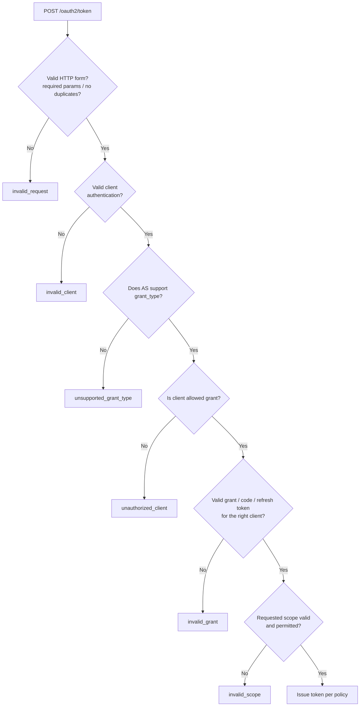
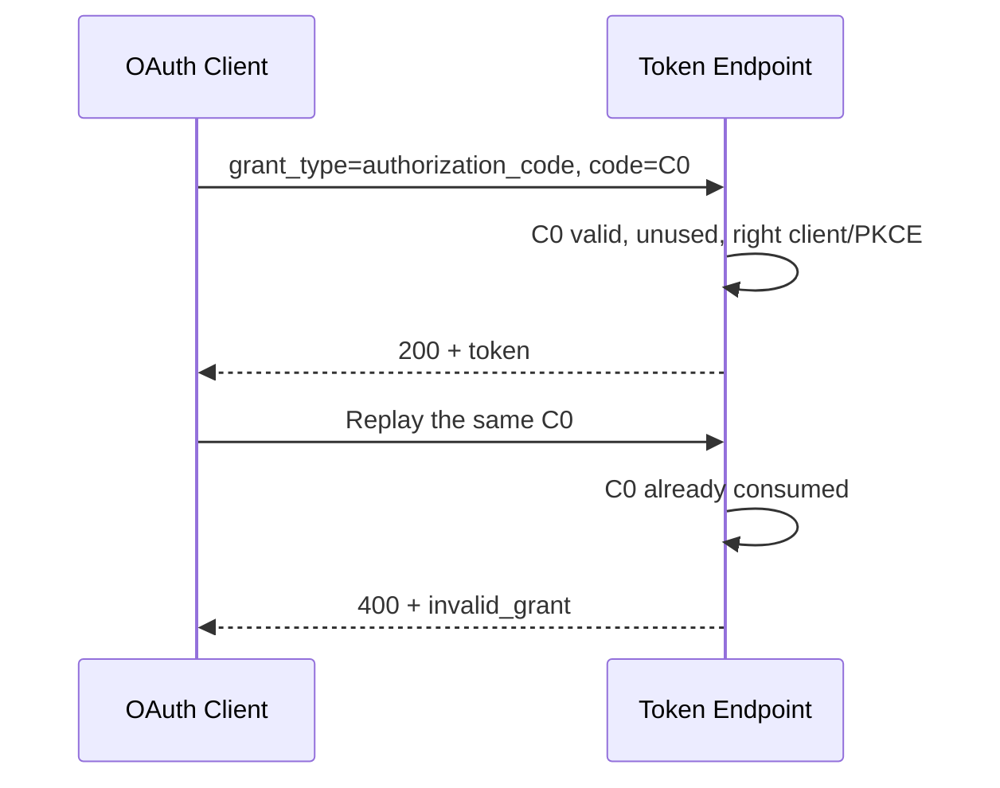
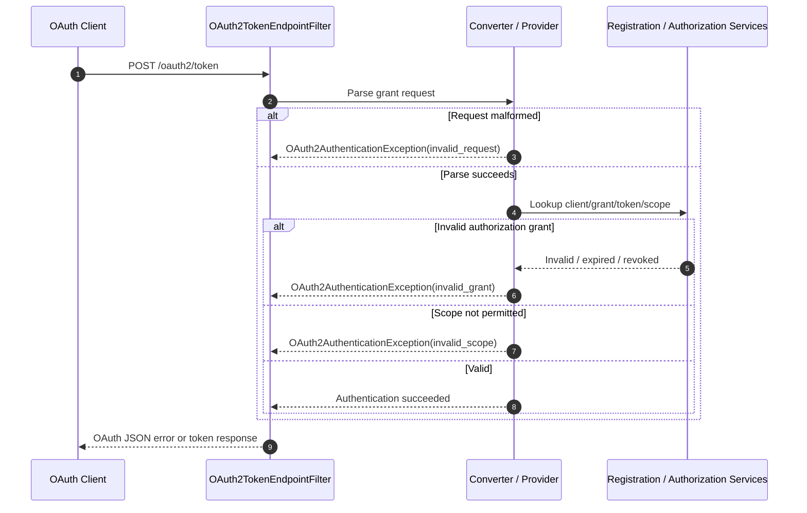
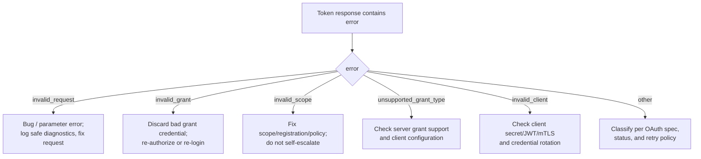

# Standardizing invalid_request, invalid_grant, invalid_scope, and unsupported_grant_type

In a **Spring Security OAuth2/OIDC Authorization Server** running on Spring Boot, the Token Endpoint (`/oauth2/token`) is where clients exchange authorization codes, use refresh tokens, request tokens via client credentials, or execute other server-supported grants. When a request is rejected, returning the right **OAuth 2.0 error code** is just as important as issuing valid tokens: clients rely on the error code to decide whether to fix the request, restart login, narrow scopes, or report a configuration failure.

Four error codes are frequently misused: **`invalid_request`, `invalid_grant`, `invalid_scope`, and `unsupported_grant_type`**. They are not four arbitrary ways to express an HTTP 400. Each marks a distinct validation boundary defined in **RFC 6749, Section 5.2**, and misusing them causes pointless client retries, masks security flaws, or complicates testing.

This lesson belongs to the **Token Endpoint** chapter of the **SPRING_SECURITY_OAUTH2_OIDC_AUTHORIZATION_SERVER** module, aimed at learning how to design, configure, secure, test, and operate an OAuth 2.0/OpenID Connect Authorization Server using Spring Security and Spring Authorization Server in a Spring Boot application.

**After this lesson, you will be able to:**

1. Interpret all four error codes accurately and distinguish them from `invalid_client`, `unauthorized_client`, `access_denied`, and extension-grant-specific errors.
2. Pinpoint whether a failure occurs during HTTP request parsing, grant/token validation, scope validation, or grant-support checks.
3. Standardize HTTP statuses, JSON bodies, headers, and error descriptions without leaking tokens, codes, or client secrets.
4. Understand error paths in Spring Authorization Server and how to customize grants while preserving OAuth semantics.
5. Build a positive/negative test matrix, define operational metrics, and design appropriate OAuth client error handling.

## 1. The Token Endpoint and Where Errors Originate

A typical token request is a POST to the address published in Authorization Server metadata, for example:

```http
POST /oauth2/token HTTP/1.1
Host: login.example.com
Authorization: Basic <ENCODED_CLIENT_CREDENTIALS>
Content-Type: application/x-www-form-urlencoded

grant_type=authorization_code&code=<AUTHORIZATION_CODE>&redirect_uri=https%3A%2F%2Fportal.example.com%2Flogin%2Foauth2%2Fcode%2Fsas&code_verifier=<PKCE_VERIFIER>
```

This example illustrates a **confidential client**; the body is written on a single line to show realistic encoding. The Token Endpoint runs through several validation layers before issuing tokens.



This diagram is a **classification model**, not a guarantee of exact filter/provider order in every configuration. In practice, client authentication, grant parsing, and validation depend on the grant and Spring Authorization Server version. If a request violates multiple conditions at once, the observed error is normally whichever step **fails first**, not necessarily the error a tester expected to isolate.

**Testing principle:** to verify `invalid_scope` in isolation, supply valid client authentication, a valid grant, and valid supporting parameters. If you deliberately send both a wrong secret and an invalid scope, the server may return `invalid_client` before ever inspecting scopes.

## 2. Where Do the Four Error Codes Differ?

| Error Code | Nature | Typical Scenarios | How the Client Should Respond |
| --- | --- | --- | --- |
| **`invalid_request`** | Request is missing parameters, has duplicates, is malformed, or uses syntactically/structurally invalid parameters. | Missing `grant_type`; multiple `grant_type` values; invalid combination of multiple client authentication methods. | Fix how the HTTP request and parameters are constructed; do not retry verbatim. |
| **`invalid_grant`** | The **submitted authorization grant/refresh token** is invalid, expired, revoked, mismatched with the redirect URI, or issued to another client. | Reused authorization code; expired code; refresh token replaced by rotation; `redirect_uri` mismatches the transaction. | Discard the unusable grant/token; request new authorization or re-authenticate as appropriate. |
| **`invalid_scope`** | Requested scope is invalid, unknown, malformed, or exceeds allowed permissions. | Unregistered `scope=orders.admin`; refresh request asks for broader permissions than originally granted. | Fix requested scope/registration or narrow permissions; never escalate via retries. |
| **`unsupported_grant_type`** | The **Authorization Server does not support** the requested `grant_type`. | Sending an extension grant without a registered converter/provider; sending a grant type the server does not implement. | Fix the grant type or implement/enable corresponding support on the AS. |

These four codes typically appear with **HTTP 400** per RFC 6749 Section 5.2. An important exception involves **other error codes**, such as `invalid_client`, which have specific status/challenge rules. Never claim that every Token Endpoint error must return HTTP 400.

### 2.1. A Memorable Example

Suppose client `orders-portal` uses Authorization Code + PKCE:

- Omitting `code` in the exchange request → **`invalid_request`** (missing required parameter).
- Sending a structurally valid code that was already exchanged earlier → **`invalid_grant`** (the grant is no longer usable).
- Using a valid refresh token while asking for extra `orders.admin` scope beyond granted permissions → **`invalid_scope`** (requested permission scope is invalid).
- Sending `grant_type=urn:example:unsupported-grant` which the AS does not implement → **`unsupported_grant_type`**.

If the client is recognized but **not registered for a grant that the server does support**, the proper error is **`unauthorized_client`**, **not `unsupported_grant_type`**.

## 3. Error Response Format per RFC 6749 Section 5.2

A Token Endpoint error response uses JSON and contains at minimum the **`error`** field.

```http
HTTP/1.1 400 Bad Request
Content-Type: application/json;charset=UTF-8
Cache-Control: no-store
Pragma: no-cache

{
  "error": "invalid_grant",
  "error_description": "The authorization grant is invalid."
}
```

This is an **illustrative** response. In practice, Spring Authorization Server may include or omit description fields depending on the situation and version; never build client logic that depends on exact English description strings.

| Field | Per RFC 6749 Section 5.2 | Meaning |
| --- | --- | --- |
| `error` | **Required** | Machine-readable error code, such as `invalid_grant`. |
| `error_description` | **Optional** | Brief explanation intended to aid debugging. Not a code for client branching logic. |
| `error_uri` | **Optional** | URI pointing to documentation about the error. Not for automatic browser redirects. |

**Never** place authorization codes, refresh tokens, access tokens, passwords, client secrets, or JWT contents inside `error_description`. Descriptions must adhere to RFC 6749's safe character set; if localized guidance is needed, provide admin documentation or dedicated UI messages rather than stuffing stack traces or internal data into protocol JSON.

For responses containing tokens, RFC 6749 requires `Cache-Control: no-store` and `Pragma: no-cache`; applying the same no-cache rule to token endpoint errors is also good defensive practice since requests/responses involve credentials. Verify actual headers through your proxy/CDN.

### 3.1. Token Endpoint Errors Are Not Authorization Endpoint Errors

Errors at the **Authorization Endpoint** during browser interaction may be returned to a **verified `redirect_uri`**, such as `error=access_denied` with `state`. By contrast, the Token Endpoint returns **JSON directly** to the HTTP client making the token request, never redirecting the user to a callback.

```text
Authorization Endpoint:  GET /oauth2/authorize
  -> May redirect errors to a validated callback

Token Endpoint:          POST /oauth2/token
  -> JSON HTTP response containing "error" and appropriate HTTP status
```

Do not take `access_denied` handling from the consent screen and respond with `302 Location` when an authorization code exchange fails. The Token Endpoint must minimize information disclosure and never accept an arbitrary `redirect_uri` as an error redirect target.

### 3.2. Should You Add Application Error Codes Like TOKEN_EXPIRED?

In standard OAuth responses, `error` must use the appropriate protocol code. For example:

```json
{
  "error": "invalid_grant",
  "error_description": "The authorization grant is invalid."
}
```

Do not replace it with:

```json
{
  "error": "TOKEN_EXPIRED_IN_DATABASE",
  "java_exception": "TokenLookupException",
  "internal_sql": "SELECT * FROM ..."
}
```

Standard OAuth clients will not understand custom codes, and the second response leaks internal system details. If your organization needs deep diagnostics, use **server-side structured logs** with correlation IDs and masked fields—never embed sensitive internals in responses.

Extension grants may define error codes specified by their own extension specification, provided they preserve OAuth semantics and interoperability rather than renaming standard errors on a whim.

## 4. invalid_request — Structurally Invalid Request

Per RFC 6749, `invalid_request` covers missing required parameters, invalid parameter values, parameters appearing more than once, multiple/invalid client authentication methods, or otherwise malformed requests.

### 4.1. Missing grant_type

Example POST containing only `code`:

```http
POST /oauth2/token HTTP/1.1
Host: login.example.com
Authorization: Basic <ENCODED_CLIENT_CREDENTIALS>
Content-Type: application/x-www-form-urlencoded

code=<SOME_CODE>
```

Because `grant_type` is required at the Token Endpoint, the server must reject the request. This is a **missing grant definition** error, not `unsupported_grant_type`, since no value was provided to identify the desired grant.

Conceptual response:

```json
{
  "error": "invalid_request",
  "error_description": "Missing required parameter."
}
```

### 4.2. Duplicate Parameters

Example:

```http
POST /oauth2/token HTTP/1.1
Host: login.example.com
Content-Type: application/x-www-form-urlencoded
Authorization: Basic <ENCODED_CLIENT_CREDENTIALS>

grant_type=client_credentials&grant_type=authorization_code
```

Do not pick "the first value" or "the last value" via default HTTP parameter helpers and proceed normally. Converters/providers must check parameter cardinality for critical fields; requests with multiple values altering semantics must be rejected.

### 4.3. Missing Grant Parameters

For `authorization_code`, the client must send `code`; when PKCE is required, it must also send `code_verifier` in the token request. Missing a required parameter typically yields `invalid_request`. When a **`code_verifier` is present but mismatches** the registered challenge, the error can be `invalid_grant` because the authorization code binding failed. Exact behavior depends on your SAS version's validators and PKCE config; test each case separately.

For `refresh_token`, omitting the `refresh_token` parameter is likewise a missing-data request error. If the parameter is present but the token does not exist, has expired, or was revoked, that is `invalid_grant`.

### 4.4. Do Not Confuse with invalid_client

If a confidential client sends `Authorization: Basic ...` with the wrong secret, the cause is **client authentication failure** → `invalid_client`; do not classify it as `invalid_request` merely because the header held a bad password.

If a request supplies **two client authentication mechanisms simultaneously** in violation of the spec, RFC classifies this as a malformed request; in practice, the client authentication filter and specific providers may return `invalid_request` or `invalid_client` depending on the failure mode and method. The crucial rule is to **never accept conflicting identities** or ignore bad credentials and proceed.

## 5. invalid_grant — Submitted Grant or Token Is Invalid

`invalid_grant` is usually the most frequent error in Authorization Code and Refresh Token flows. It does not mean "the server does not support this grant type"; it means **this specific grant credential** cannot be redeemed.

### 5.1. Expired Authorization Code

```text
10:00:00  Authorization Endpoint issues code C0 (2-minute TTL)
10:03:00  Client sends C0 to /oauth2/token
=> C0 has expired; no token issued
=> invalid_grant
```

Do not "fix" this by extending code TTLs to hours or allowing expired codes to be redeemed. The client should start a fresh Authorization Code Flow.

### 5.2. Already-Used Authorization Code

Codes are **single-use**:



If exchanging the code succeeded but the response was lost over the network, retrying verbatim can receive `invalid_grant`. Clients must not assume "retrying the same code will return the same token" unless a dedicated, secure idempotency mechanism exists; normally the authorization flow must be restarted.

### 5.3. Redirect URI Mismatches the Transaction

Suppose a client initiates the request with callback:

```text
https://portal.example.com/login/oauth2/code/sas
```

but during code exchange sends:

```text
https://portal.example.com/login/oauth2/code/sas/
```

A trailing `/` difference breaks `redirect_uri` binding and triggers `invalid_grant`, even if the authorization code is still within its TTL. Never disable this check "to accommodate proxies."

For authorization requests containing `redirect_uri`, the token exchange must enforce exact URI binding per spec. Clients should preserve the exact canonical callback between the authorization request and token request.

### 5.4. Client Is Not the Grant Owner

A code or refresh token issued to client A cannot be redeemed by client B, even if B authenticates with its own valid secret. Grant bound to the wrong client → `invalid_grant` (after client B has authenticated).

Never return messages like "this code belongs to client A, subject Alice, created at 10:03." Distinguishing nonexistent tokens from another client's tokens must not leak sensitive administrative data.

### 5.5. Replaced or Revoked Refresh Token

With `TokenSettings.reuseRefreshTokens(false)`, a successful refresh may issue `R1` to replace `R0`. Subsequent submissions of `R0` must be rejected per authorization state; the typical error is `invalid_grant`.

```text
R0 --refresh succeeds--> R1
R0 --refresh again--> invalid_grant (old token no longer active)
R1 --valid refresh--> R2 (if policy permits)
```

Note: **rotation is not the same as replay detection**. An `invalid_grant` response for `R0` does not by itself prove the server recognized a malicious replay or revoked the entire token family. If reuse detection and family-wide revocation are required, you need explicit token-family history tracking, atomic concurrency handling, and dedicated auditing—do not assume a single `reuseRefreshTokens(false)` flag does it all automatically.

### 5.6. Not Every invalid_grant Is an Attack

Common operational causes:

- A proxy rewrote the callback scheme, host, or path.
- The authorization code expired due to slow networks or delayed client processing.
- The client exchanged the same code twice due to faulty retry logic.
- A client instance held a stale refresh token in its DB while the rotated token failed to persist.
- In-memory authorization state was lost across a server restart.
- Two concurrent refresh requests raced on a single rotated refresh token.

The server should emit metrics to investigate; clients should treat rejected grants as unusable unless proven otherwise and **never retry indefinitely** with the same code or refresh token.

## 6. invalid_scope — Requested Permissions Are Invalid

`invalid_scope` indicates the requested scope violates AS rules. Requests can be rejected when a scope is malformed, unknown, absent from client registration, or exceeds the granted authorization.

### 6.1. Client Credentials Requesting an Unregistered Scope

Suppose client `reporting-service` is registered only with:

```java
.scope("reports.read")
```

Yet it requests:

```http
POST /oauth2/token HTTP/1.1
Host: login.example.com
Authorization: Basic <VALID_CLIENT_CREDENTIALS>
Content-Type: application/x-www-form-urlencoded

grant_type=client_credentials&scope=reports.admin
```

`client_credentials` is supported by the AS and permitted for this client, but `reports.admin` exceeds registered scopes → `invalid_scope`, **not `unsupported_grant_type` or `invalid_grant`**.

### 6.2. Refresh Tokens Cannot Escalate Permissions

A client was previously granted `orders.read` and holds refresh token `R0`. Later it sends:

```http
POST /oauth2/token HTTP/1.1
Host: login.example.com
Authorization: Basic <VALID_CLIENT_CREDENTIALS>
Content-Type: application/x-www-form-urlencoded

grant_type=refresh_token&refresh_token=<R0>&scope=orders.read%20orders.write
```

If `orders.write` was not part of the granted authorization, the client cannot add it during refresh. Per RFC 6749 Section 6, the scope of a refresh request must not include any scope not originally granted by the resource owner. When scope checks fail, return `invalid_scope`.

Distinguish two cases:

- **Refresh token R0 expired or invalid** → `invalid_grant`.
- **R0 valid, but requested scope exceeds granted permissions** → `invalid_scope`.

If both conditions fail simultaneously, the server may detect the invalid grant before checking scopes; tests aiming to verify `invalid_scope` must supply a valid token.

### 6.3. Scope Is Policy Data, Not Just a String

A scope registered on a client does not by itself authorize access to every object under that scope at the API. The Resource Server must still validate issuer, audience, expiration, scope, and fine-grained data/tenant permissions.

Likewise, never read scopes from unchecked query/body inputs to widen permissions. When extending grants or customizing token generators, preserve checks on registered scopes, authorization scopes, and policies.

**Note:** if a client requests multiple scopes and the AS is configured to issue a subset, the success response must reflect the actual granted scopes per spec. Never silently grant broader permissions than requested or hide serious misconfigurations by loosening scope rules.

## 7. unsupported_grant_type — Server Does Not Support the Grant Type

`grant_type` specifies **how the client wants to obtain a token**. Each grant type must be backed by corresponding server-side support.

Example:

```http
POST /oauth2/token HTTP/1.1
Host: login.example.com
Authorization: Basic <VALID_CLIENT_CREDENTIALS>
Content-Type: application/x-www-form-urlencoded

grant_type=urn%3Aexample%3Agrant%3Anot-supported
```

If the AS does not implement this grant, the appropriate error is:

```json
{
  "error": "unsupported_grant_type"
}
```

There is no reason to ask whether "the authorization code expired" or "the scope is valid": **the server does not support processing that grant type**.

### 7.1. Unsupported vs. Unauthorized

Suppose the server supports `client_credentials`, while registered client `web-portal` is allowed only `authorization_code`:

```text
Server supports client_credentials = true
Client web-portal registered client_credentials = false

Request grant_type=client_credentials
=> unauthorized_client (client not permitted to use grant)
```

Conversely:

```text
Server supports urn:example:grant:not-supported = false

Request grant_type=urn:example:grant:not-supported
=> unsupported_grant_type
```

In Spring Authorization Server, an extension grant can require a **request converter**, an **authentication provider**, token generation policies, and matching client registration. Simply adding an `AuthorizationGrantType` to `RegisteredClient` **does not teach the server how to process an unimplemented grant**.

### 7.2. Version-Sensitive: Do Not Guess Which Grants Are Enabled

Common grants in Spring Authorization Server can include Authorization Code, Refresh Token, Client Credentials, and extensions depending on version/configuration such as Device Authorization or Token Exchange. Exact availability varies with **library version and endpoint configuration**.

When a token-exchange request fails with `unsupported_grant_type`, verify:

1. Does the running SAS version support this grant, or has the extension been installed?
2. Does the request converter recognize the exact `grant_type` URI?
3. Is the corresponding authentication provider registered on the Token Endpoint?
4. Is the client registered for that grant?
5. Do policies and token generators handle the resulting tokens properly?

If the grant **is implemented and recognized**, yet only the calling client is disallowed from using it, the proper error shifts to `unauthorized_client` instead of `unsupported_grant_type`.

## 8. Two Easily Confused Codes: invalid_client and unauthorized_client

Even though this lesson focuses on four error codes, standardizing them properly requires understanding at least these two as well.

| Code | Primary Cause | Examples |
| --- | --- | --- |
| `invalid_client` | Client authentication failed or required authentication is missing. | Wrong client secret, invalid `private_key_jwt` assertion, mismatched mTLS certificate. |
| `unauthorized_client` | Client was identified/authenticated but is not permitted to use the requested grant type. | Client registered only for `authorization_code` attempts `client_credentials`. |

For HTTP Basic client authentication, RFC 6749 requires that failed authentication using the `Authorization` header return **HTTP 401** with an appropriate `WWW-Authenticate` header. Typical error response:

```http
HTTP/1.1 401 Unauthorized
WWW-Authenticate: Basic realm="oauth2"
Content-Type: application/json

{
  "error": "invalid_client"
}
```

This is illustrative; exact realm/challenge values depend on configuration. Never force HTTP 400 across all errors via a global error handler, as doing so breaks `invalid_client` semantics.

**Never implement "any token exchange failure returns `invalid_grant`."** If the client secret is wrong, keep `invalid_client`. If the server does not recognize the grant, keep `unsupported_grant_type`. If the client is disallowed from using a recognized grant, keep `unauthorized_client`.

## 9. Where Does Spring Authorization Server Handle Errors?

In Spring Authorization Server, the Token Endpoint is handled inside the **Spring Security filter chain**, not in an ad-hoc `@RestController`. Key components (exact class/extension names may vary by library version) include:

| Component | Responsibility |
| --- | --- |
| `OAuth2TokenEndpointFilter` | Receives HTTP requests at the token endpoint, invokes converters/manager, and writes success/error responses. |
| Per-grant `AuthenticationConverter`s | Parse parameters, identify the grant, and validate request structure. |
| Per-grant `AuthenticationProvider`s | Verify grants/tokens, clients, and scopes per provider responsibility. |
| `RegisteredClientRepository` | Looks up clients, auth methods, grant types, scopes, and `TokenSettings`. |
| `OAuth2AuthorizationService` | Looks up authorization codes, refresh tokens, token state, and client bindings. |
| `OAuth2TokenGenerator` | Mints tokens once the request is validated. |
| `OAuth2TokenEndpointConfigurer` | Configures converters, providers, and token endpoint handlers per SAS version API. |

### 9.1. Error Path



This is a conceptual diagram and does not require every error to flow through the exact same service. Notably, **client authentication** can run in its own filter/chain before token grant providers execute. When debugging, determine whether the error originated in the *converter*, *client authentication provider*, *grant provider*, or *persistence layer*.

### 9.2. Prefer Keeping Default Behavior

When using standard grants supported by Spring Authorization Server, you normally **do not need to rewrite** JSON error responses. The framework already handles OAuth2 errors. Limit customization to concrete needs: metrics, tracing, or custom grant validation rules.

If you configure `OAuth2TokenEndpointConfigurer.errorResponseHandler(...)` or equivalent, ensure you:

- Never collapse all errors into `invalid_request`.
- Never turn `invalid_client` into HTTP 400 when 401/challenge is required.
- Never return stack traces, raw tokens, or secrets.
- Never drop JSON `Content-Type` or no-store cache headers.
- Never rely on MVC `@ControllerAdvice` to catch filter-chain errors it does not manage.
- Never turn a Token Endpoint response into HTML or an HTTP redirect.
- Never craft distinct error messages that reveal whether a particular user's code or token exists.

Any change to the error handler requires integration tests covering **all four codes in this lesson** as well as `invalid_client` and `unauthorized_client`.

### 9.3. Emitting Standard Errors in a Custom AuthenticationProvider

When writing a **custom grant**, throw `OAuth2AuthenticationException` carrying an `OAuth2Error` with a standard error code.

Example of **a small helper, not a full provider**:

```java
import org.springframework.security.oauth2.core.OAuth2AuthenticationException;
import org.springframework.security.oauth2.core.OAuth2Error;
import org.springframework.security.oauth2.core.OAuth2ErrorCodes;

final class TokenGrantErrors {

    private TokenGrantErrors() {
    }

    static OAuth2AuthenticationException invalidRequest() {
        return new OAuth2AuthenticationException(
            new OAuth2Error(OAuth2ErrorCodes.INVALID_REQUEST));
    }

    static OAuth2AuthenticationException invalidGrant() {
        return new OAuth2AuthenticationException(
            new OAuth2Error(OAuth2ErrorCodes.INVALID_GRANT));
    }

    static OAuth2AuthenticationException invalidScope() {
        return new OAuth2AuthenticationException(
            new OAuth2Error(OAuth2ErrorCodes.INVALID_SCOPE));
    }

    static OAuth2AuthenticationException unsupportedGrantType() {
        return new OAuth2AuthenticationException(
            new OAuth2Error(OAuth2ErrorCodes.UNSUPPORTED_GRANT_TYPE));
    }
}
```

A custom provider can use:

```java
if (grantCredential == null || grantCredential.isBlank()) {
    throw TokenGrantErrors.invalidRequest();
}

if (!verifiedGrant.isActive()) {
    throw TokenGrantErrors.invalidGrant();
}

if (!allowedScopes.containsAll(requestedScopes)) {
    throw TokenGrantErrors.invalidScope();
}
```

**This is Java-like pseudocode** for provider logic: `verifiedGrant` and `requestedScopes` represent values **already validated and inspected** from the request and authorization state. Neither variable exists automatically in Spring; the snippet only illustrates **when** to throw each error. Converters, client authentication, grant registration, token generation, and authorization state persistence must still follow the SAS API of your version.

For `unsupported_grant_type`, the Token Endpoint normally decides this when **no converter/provider supports the grant**. A provider that recognizes its grant yet finds the client lacks permission should return `unauthorized_client` per policy, rather than pretending the grant is "unsupported."

## 10. Standardizing Error Codes per Grant

A classification table helps development and QA teams align before writing code.

| Grant / Condition | Error to Verify | Notes |
| --- | --- | --- |
| Authorization Code: missing `code` | `invalid_request` | Missing required parameter. |
| Authorization Code: nonexistent code | `invalid_grant` | Grant cannot be redeemed. |
| Authorization Code: expired code | `invalid_grant` | Never extend TTL to hide errors. |
| Authorization Code: reused code | `invalid_grant` | Codes are single-use. |
| Authorization Code: mismatched `redirect_uri` | `invalid_grant` | Grant binding failure; syntactically malformed URIs may fail as `invalid_request`. |
| Authorization Code: wrong PKCE verifier | `invalid_grant` | Invalid code exchange proof. |
| Authorization Code: missing required `code_verifier` | `invalid_request` or validator request error | Test per version/config. |
| Refresh Token: missing `refresh_token` | `invalid_request` | Required parameter. |
| Refresh Token: expired/revoked/replaced | `invalid_grant` | Token is no longer active. |
| Refresh Token: token belongs to another client | `invalid_grant` | After caller authentication succeeds. |
| Refresh Token: scope exceeds originally granted scope | `invalid_scope` | Evaluated only when the refresh token is valid. |
| Client Credentials: unregistered scope | `invalid_scope` | Clients cannot self-escalate scopes. |
| Any grant: missing `grant_type` | `invalid_request` | Request does not specify which grant is sought. |
| Any grant: duplicate `grant_type` | `invalid_request` | Prevents HTTP parameter pollution. |
| Any grant: `grant_type` unsupported by AS | `unsupported_grant_type` | Requires matching grant handler/extension. |
| Grant supported by AS, unregistered for client | `unauthorized_client` | Do not confuse with unsupported. |
| Confidential client wrong secret/JWT assertion | `invalid_client` | Do not confuse with `invalid_grant`. |
| Token Exchange extension: disallowed target | `invalid_target` per RFC 8693 | Extension-specific error; do not force every error into the four core codes. |

**Detection order is a testing precondition:** a request with multiple defects usually stops at the first failing check. The table above describes the expected error **assuming all preceding conditions are valid**, not a promise that the server evaluates every check and picks from a global priority list.

## 11. HTTP and curl Scenarios for Self-Verification

### 11.1. invalid_request: Missing grant_type

```bash
curl --silent --show-error --include \
  --user "orders-portal:$PORTAL_CLIENT_SECRET" \
  --header "Content-Type: application/x-www-form-urlencoded" \
  --data-urlencode 'code=some-code' \
  'https://login.example.com/oauth2/token'
```

Expected: the request is rejected with `invalid_request` due to missing `grant_type`, assuming client authentication succeeded.

### 11.2. invalid_grant: Nonexistent Authorization Code

```bash
curl --silent --show-error --include \
  --user "orders-portal:$PORTAL_CLIENT_SECRET" \
  --header "Content-Type: application/x-www-form-urlencoded" \
  --data-urlencode 'grant_type=authorization_code' \
  --data-urlencode 'code=not-a-real-code' \
  --data-urlencode \
    'redirect_uri=https://portal.example.com/login/oauth2/code/sas' \
  --data-urlencode 'code_verifier=VERIFIER_FOR_TEST' \
  'https://login.example.com/oauth2/token'
```

Expected: `invalid_grant` if the client is registered for the grant and parsing checks succeed. `VERIFIER_FOR_TEST` is a placeholder; never use it as a real PKCE verifier. If the verifier is flagged as malformed before code lookup, the server may return a request error depending on implementation. Dedicated integration tests should supply a valid verifier when isolating code errors.

### 11.3. invalid_scope: Client Credentials Requesting Unauthorized Scope

Assuming `reporting-service` is registered for `client_credentials` with only `reports.read`:

```bash
curl --silent --show-error --include \
  --user "reporting-service:$REPORTING_CLIENT_SECRET" \
  --header "Content-Type: application/x-www-form-urlencoded" \
  --data-urlencode 'grant_type=client_credentials' \
  --data-urlencode 'scope=reports.admin' \
  'https://login.example.com/oauth2/token'
```

Expected: `invalid_scope`, provided client authentication, grant registration, and request formatting are all valid.

### 11.4. unsupported_grant_type: Server Does Not Recognize Grant

```bash
curl --silent --show-error --include \
  --user "orders-portal:$PORTAL_CLIENT_SECRET" \
  --header "Content-Type: application/x-www-form-urlencoded" \
  --data-urlencode 'grant_type=urn:example:grant:not-supported' \
  'https://login.example.com/oauth2/token'
```

Expected: `unsupported_grant_type` when the AS truly does not support this value and client authentication did not fail first.

**General note:** these are **test requests** and contain no real credentials or tokens. In real environments, use HTTPS, protect shell history and environment variables, and avoid verbose HTTP logging that dumps tokens. For negative testing, use authorized test environments/accounts rather than probing production clients.

## 12. Automated Testing with Spring Security Test / MockMvc

A system needs tests driving real HTTP requests through the filter chain, not merely unit tests of helpers returning `OAuth2Error`.

### 12.1. Example Assertion for invalid_grant

The snippet below is an **excerpt** from an integration test with an initialized Spring Boot app, registered client `orders-portal`, and required mock/test authorization state:

```java
import static org.springframework.security.test.web.servlet.request
    .SecurityMockMvcRequestPostProcessors.httpBasic;
import static org.springframework.test.web.servlet.request
    .MockMvcRequestBuilders.post;
import static org.springframework.test.web.servlet.result
    .MockMvcResultMatchers.jsonPath;
import static org.springframework.test.web.servlet.result
    .MockMvcResultMatchers.status;

import org.junit.jupiter.api.Test;
import org.springframework.beans.factory.annotation.Autowired;
import org.springframework.http.MediaType;
import org.springframework.test.web.servlet.MockMvc;

class TokenEndpointErrorTests {

    @Autowired
    MockMvc mockMvc;

    @Test
    void expiredOrUnknownAuthorizationCodeReturnsInvalidGrant()
            throws Exception {

        mockMvc.perform(post("/oauth2/token")
                .with(httpBasic("orders-portal", "test-client-secret"))
                .contentType(MediaType.APPLICATION_FORM_URLENCODED)
                .param("grant_type", "authorization_code")
                .param("code", "unknown-code")
                .param("redirect_uri",
                    "https://portal.example.com/login/oauth2/code/sas")
                .param("code_verifier",
                    "sufficiently-long-test-pkce-verifier-1234567890"))
            .andExpect(status().isBadRequest())
            .andExpect(jsonPath("$.error").value("invalid_grant"));
    }
}
```

**Not a standalone runnable snippet:** this class must live inside a test with `@SpringBootTest`/`@AutoConfigureMockMvc` or equivalent MockMvc setup and full AS beans; the test secret must match the encoded client registration. Notice the test name mentions both expired and unknown codes while the request uses an **unknown code**. A true expiration test must create a valid code and then advance a controlled clock/expiration.

For custom grants, test both converters/providers directly **and** via integration tests through the Token Endpoint, preventing situations where a provider throws the right error yet the filter/handler returns the wrong status or body.

### 12.2. Negative Test Matrix and Security Invariant Checks

| Case | Primary Assertion | What Must Never Happen |
| --- | --- | --- |
| Missing `grant_type` | `$.error == invalid_request` | No token issued. |
| Duplicate `grant_type` | `invalid_request` per validator | Never silently pick one grant and issue tokens. |
| Expired code | `invalid_grant` | No token issued for old code. |
| Reused code | `invalid_grant` | Code cannot be redeemed twice. |
| Mismatched redirect URI | `invalid_grant` | Never ignore code binding. |
| Revoked refresh token | `invalid_grant` | No new access token created. |
| Refresh token replaced by rotation | `invalid_grant` when reusing old token | Old token cannot be resurrected. |
| Unregistered scope | `invalid_scope` | New scope is never issued. |
| Refresh scope exceeds initial grant | `invalid_scope` | No privilege escalation via refresh. |
| Unimplemented grant | `unsupported_grant_type` | Never arbitrarily treated as client credentials. |
| Supported grant disallowed for client | `unauthorized_client` | Client cannot use grants outside registration. |
| Wrong secret | `invalid_client`, appropriate status/challenge | No token issued, no secret leaked. |
| Request with multiple errors | Fail-fast error matching active check | No token issued and no sensitive state revealed. |
| Custom handler returning token errors | Compliant JSON/HTTP semantics | Must not lose required `WWW-Authenticate` on `invalid_client`. |
| Errors through reverse proxy | Status/body/cache headers intact | Never redirects to an arbitrary HTML page. |

A strong integration test should assert at least **HTTP status, Content-Type, `error`, absence of `access_token`/`refresh_token`**, and relevant headers, while verifying **authorization state is not mutated improperly**. Never assert solely on exact `error_description` strings—descriptions can change across Spring upgrades.

### 12.3. Do Not Mask Errors with a Custom Exception Handler

Many applications define a global `@RestControllerAdvice`:

```java
// ANTI-PATTERN: do not use as a blanket handler for all OAuth errors.
@ExceptionHandler(Exception.class)
ResponseEntity<Map<String, String>> onAnyFailure(Exception ex) {
    return ResponseEntity.badRequest()
        .body(Map.of("error", "invalid_request"));
}
```

With the Spring Security filter chain, this handler will not necessarily catch Token Endpoint errors; if it somehow intercepts OAuth errors, it can **conflate `invalid_client`, `invalid_grant`, and server errors**. Keep standard OAuth error handling inside filters/`AuthenticationFailureHandler` and reserve global controller advice for normal MVC endpoints.

## 13. Appropriate Client-Side Error Handling

Clients should branch on **`error`**, never on `error_description`. Typical decision flow:



### 13.1. Do Not Blindly Retry `invalid_grant`

With refresh token rotation, if a client keeps submitting an old refresh token it triggers repeated `invalid_grant` errors and, if replay detection is active, may cause the entire token family to be revoked. Make refreshes **single-flight**, update the new token atomically, and trigger re-authorization when a credential is no longer usable.

### 13.2. Do Not Mutate Scopes to Bypass Policy

`invalid_scope` is not an invitation to keep retrying with `admin` or alternative scope strings until the AS accepts one. Clients must request only registered scopes granted by the user or policy. If the product needs new permissions, go through the proper authorization/consent workflow.

### 13.3. Distinguish Configuration Errors from Infrastructure Errors

Some failures are not OAuth `400` responses—for example, a proxy `502/503`, client timeout, or DNS/TLS failure. For transient network errors, backoff retries may apply, but **never retry an authorization code that may already have been consumed** as though it were safe/idempotent. With refresh token rotation, losing a response after the AS commits can render the old refresh token invalid.

Design retry rules specifically around each grant, token state, and system idempotency contract; never apply a blanket "retry every POST 3 times" rule.

## 14. Security, Observability, and Error Operations

### 14.1. Do Not Turn `error_description` into a Leak Channel

Avoid messages such as:

```text
code=abc123 was issued to alice@example.com at 2026-11-16T...
refresh_token=... exists in database record id=...
client_secret for orders-portal is wrong; expected hash=...
tenant=payroll-private, scope=salary.admin was denied for user X
```

Return concise descriptions and standard `error` codes. Investigative details belong in **access-controlled server logs** tied to a correlation ID, without storing raw authorization codes, tokens, or secrets.

### 14.2. Recommended Metrics

| Metric | Operational Meaning |
| --- | --- |
| `oauth_token_requests_total` by grant and outcome | Tracks success/failure rates. |
| `oauth_token_invalid_request_total` | Detects client integration bugs and HTTP parameter pollution. |
| `oauth_token_invalid_grant_total` | Detects expired codes, bad retries, refresh rotation races, or revoked tokens. |
| `oauth_token_invalid_scope_total` | Identifies scope registration or policy mismatches. |
| `oauth_token_unsupported_grant_total` | Detects clients calling unsupported grants after deployments. |
| `oauth_token_invalid_client_total` | Tracks auth failures, secret rotation issues, and credential-stuffing probes. |
| `oauth_token_latency_seconds` | Tracks slowdowns in authorization DB, crypto, policy, or token generation. |

Avoid high-cardinality labels like raw `code`, refresh tokens, client secrets, user IDs, or client IPs. If client-level visibility is needed, use managed client identifiers and consider anonymization in multi-tenant environments.

### 14.3. Separating User Mistakes from Operational Failures

- **Spike in `invalid_request`:** may indicate a client SDK changed parameter encoding, duplicated parameters, or a proxy stripped content type.
- **Spike in `invalid_grant`:** may indicate an AS restart wiped in-memory authorization state, clock skew, slow login flows, refresh rotation races, or code retries.
- **Spike in `invalid_scope`:** may indicate a client rolled out a new scope not yet registered on the AS or a tenant policy change.
- **Spike in `unsupported_grant_type`:** may indicate a client rolled out before the AS deployed the provider or requests hit the wrong issuer/environment.
- **Spike in `invalid_client`:** may indicate expired client secrets, unsynchronized JWT key rotation, mismatched mTLS certificates, or misconfigured client auth methods.

Never work around these by returning HTTP 200 with `success=false`: that breaks the OAuth contract and confuses clients and proxies.

### 14.4. Multi-Instance Deployments and Version Mismatches

When Spring Authorization Server runs multiple instances, every instance must share consistent **issuer, client registrations, grant support, scopes/policies, signing keys, and authorization state**. One instance having a Token Exchange converter/provider while another does not causes sporadic `unsupported_grant_type` failures. One instance missing authorization codes/refresh tokens due to unshared storage causes sporadic `invalid_grant` failures.

During version upgrades, re-test error bodies, statuses, and headers; never rely on exact `error_description` strings. Upgrade clients and AS in order, keep rollback ready, and monitor per-instance error rates.

## 15. Error-Classification Exercise

A team manages three clients:

| Client | Registered Grants | Registered Scopes |
| --- | --- | --- |
| `portal-web` | `authorization_code`, `refresh_token` | `openid`, `profile`, `orders.read` |
| `reports-worker` | `client_credentials` | `reports.read` |
| `legacy-batch` | `client_credentials` | `batch.read` |

The following four HTTP requests are sent to the Token Endpoint (assuming valid client authentication):

**Request A**

```text
grant_type=authorization_code
redirect_uri=https://portal.example.com/callback
(code is missing)
```

**Request B**

```text
grant_type=refresh_token
refresh_token=R0
(R0 was once valid but has been replaced via rotation by R1)
```

**Request C**

```text
grant_type=client_credentials
scope=reports.admin
(client reports-worker is allowed only reports.read)
```

**Request D**

```text
grant_type=urn:example:grant:not-implemented
```

Identify the corresponding error codes and explain why:

1. Is Request A a structural error or an expired grant?
2. Should Request B still succeed if `R0`'s TTL has not elapsed yet?
3. Should Request C receive the new scope simply because the client authenticated successfully?
4. How does Request D differ from `portal-web` calling `client_credentials` when the AS does support `client_credentials`?
5. If Request A also sends an invalid client secret, which error may appear first?
6. If you write a global handler returning `invalid_request` for every exception, what breaks in clients and tests?
7. If Request B fails because an in-memory token store was wiped on restart, should you immediately conclude an attacker is replaying a refresh token?
8. Why shouldn't the client keep retrying Request A or B verbatim until it gets HTTP 200?

**Suggested Answers:** A → `invalid_request`; B → `invalid_grant`; C → `invalid_scope`; D → `unsupported_grant_type`. When a grant is supported by the AS but disallowed for the client, the applicable code is `unauthorized_client`. When client authentication fails, check `invalid_client` and HTTP status/challenge rules.

## 16. Token Endpoint Standardization Checklist

- [ ] Defined clear boundaries for request parsing, client authentication, grant support, grant validation, and scope validation.
- [ ] Missing or duplicate critical parameters yield `invalid_request`; conflicting parameters are never silently accepted.
- [ ] Expired, reused, revoked, or misbound authorization codes/refresh tokens are rejected with `invalid_grant` as appropriate.
- [ ] Invalid or out-of-policy scopes are rejected with `invalid_scope`, with no escalation via refresh or client credentials.
- [ ] Unsupported server grants return `unsupported_grant_type`; supported grants disallowed for a client return `unauthorized_client`.
- [ ] Client authentication failures return `invalid_client` with appropriate HTTP status and `WWW-Authenticate` headers per method.
- [ ] Error responses include standard `error`, JSON Content-Type, compliant status, and safe cache-control headers.
- [ ] `error_description` is brief and free of credentials, tokens, raw codes, sensitive PII, or internal exceptions.
- [ ] Token Endpoint errors never turn into `302` callback redirects or HTTP 200 responses with custom application JSON.
- [ ] Default Spring Authorization Server handlers/converters/providers are preserved unless customization is genuinely needed.
- [ ] Custom grants emit standard error codes and properly enforce authentication, token binding, scopes, and registration.
- [ ] Real endpoint tests cover at least the four core codes plus `invalid_client` and `unauthorized_client`.
- [ ] Clients branch on `error` rather than description text, avoiding non-idempotent retries on codes/refresh tokens.
- [ ] Metrics/logs include correlation IDs without leaking tokens/secrets; error rates are monitored during upgrades.
- [ ] Multi-instance deployments share consistent registrations, authorization state, grant handlers, and scope policies.
- [ ] Proxy/TLS-layer errors are tested with the understanding that they will not necessarily be OAuth JSON.

**Key Takeaway:** `invalid_request` means **the request was built wrong**; `invalid_grant` means **the submitted grant/token is no longer valid**; `invalid_scope` means **the requested permissions are invalid or exceed policy**; `unsupported_grant_type` means **the Authorization Server does not support that grant type**. In Spring Authorization Server, let protocol filters and validators emit the right code rather than collapsing everything into one generic error. Clients, APIs, logs, and tests all operate much more safely when error boundaries remain crystal clear.

**References:**

- [RFC 6749 — The OAuth 2.0 Authorization Framework](https://www.rfc-editor.org/rfc/rfc6749.html): Section **5.2** (Error Response), Sections 4.1.3–4.1.4 (Authorization Code Token Request), Section 4.4 (Client Credentials), Section 6 (Refreshing an Access Token).
- [RFC 7636 — Proof Key for Code Exchange](https://www.rfc-editor.org/rfc/rfc7636.html): `code_verifier` checks and authorization code binding.
- [RFC 7009 — OAuth 2.0 Token Revocation](https://www.rfc-editor.org/rfc/rfc7009.html): token state and revocation.
- [RFC 9700 — OAuth 2.0 Security Best Current Practice](https://www.rfc-editor.org/rfc/rfc9700.html): protecting tokens, client authentication, and preventing replay.
- [Spring Authorization Server — Protocol Endpoints](https://docs.spring.io/spring-authorization-server/reference/protocol-endpoints.html): Token Endpoint, converters/providers, and customization hooks.
- [Spring Authorization Server — Core Model and Components](https://docs.spring.io/spring-authorization-server/reference/core-model-components.html): `RegisteredClient`, `OAuth2AuthorizationService`, and `TokenSettings`.
- [Spring Security — OAuth 2.0 Core](https://docs.spring.io/spring-security/reference/servlet/oauth2/index.html): `OAuth2Error`, `OAuth2AuthenticationException`, and OAuth integration.
