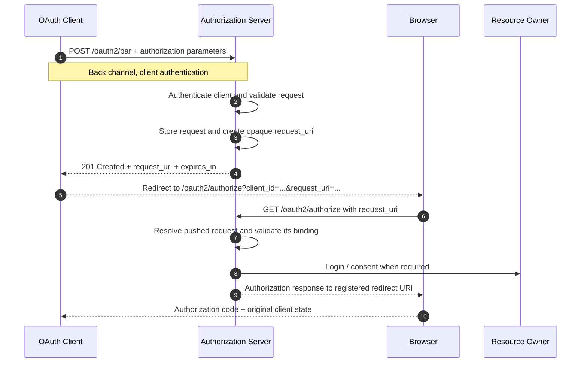

# Configuring the Pushed Authorization Request Endpoint

## 1. What problem does PAR solve?

In the **SPRING_SECURITY_OAUTH2_OIDC_AUTHORIZATION_SERVER** module, we learn how to design, configure, secure, test, and operate an OAuth 2.0/OpenID Connect Authorization Server using **Spring Security**, **Spring Authorization Server**, and **Spring Boot**. This lesson focuses on configuring the **Pushed Authorization Request Endpoint (PAR Endpoint)** per RFC 9126.

With the standard Authorization Code Flow, the application redirects the browser to the Authorization Server using a URL containing parameters such as:

- `client_id`, `response_type=code`;
- `redirect_uri` and `scope`;
- `state`;
- `code_challenge`, `code_challenge_method`;
- OpenID Connect or application extension parameters.

The URL can be long and contain sensitive data about login context, transactions, or requested permissions. These parameters can appear in browser history, proxy access logs, URL analytics systems, or referrer headers if deployed carelessly.

**Pushed Authorization Requests (PAR)** changes how the request is transmitted: the client sends the entire authorization request directly to the Authorization Server via an HTTP POST over the back channel. The server authenticates the client, validates the request, and returns a short reference named **`request_uri`**. Afterward, the client redirects the browser using only this reference to continue the Authorization Code Flow.



PAR helps:

1. **Reduce data on the front channel:** authorization request parameters do not need to sit in a long query string during the browser redirect.
2. **Authenticate the client early:** the Authorization Server receives the request directly from the client and applies client authentication before the user is redirected to the login page.
3. **Validate requests early:** redirect URI, scope, and parameters can be verified before starting user interaction.
4. **Bind the request to the client:** the request URI is randomly generated and bound to the client that pushed the request.
5. **Support high-security policies:** the Authorization Server can require a specific client or all clients to initiate authorization exclusively via PAR.

**PAR does not replace** the Authorization Code Flow, PKCE, `state`, consent, redirect URI validation, or token validation at the Resource Server. PAR only changes how the authorization request is delivered to and referenced at the Authorization Server.

## 2. Terms and endpoints to distinguish

| Component | Role |
| --- | --- |
| **PAR Endpoint** | Receives the authorization request via HTTP POST from the client |
| **Authorization Endpoint** | Continues the authorization flow via browser, login, consent, and returns the authorization response |
| **Token Endpoint** | Exchanges the authorization code for an access token/ID token per grant |
| `request_uri` | Short reference to the authorization request pushed to the server |
| `client_id` | Identifier of the registered OAuth client |
| `state` | Client-generated value to bind the authorization response to the client's request |
| `code_challenge` | PKCE value stored in the pushed request, matched against the verifier during code exchange |
| `expires_in` | Remaining lifetime of the request URI, in seconds |

### PAR is not JAR

The two specifications can be used together, but they solve different problems:

- **PAR (RFC 9126):** the client pushes the authorization request to the server and receives a request URI referencing the stored data.
- **JAR (RFC 9101):** the authorization request is packaged as a Request Object, which can be signed and/or encrypted to protect the integrity and confidentiality of its content.

PAR does not encrypt the payload by default like JAR. TLS protects the transport channel; once received, data is stored on the server and does not need to be exposed to third parties via `request_uri`. When a system needs both Request Object content protection and reduced front-channel data, JAR and PAR can be combined under compatible client/server configurations.

### Distinguishing the two URI types

- `redirect_uri` is the client callback where the Authorization Server returns the authorization code or error after exact verification against the registration.
- `request_uri` is the reference issued by the PAR Endpoint, used at the Authorization Endpoint to retrieve the stored request.

Do not use `request_uri` as a redirect URI, and do not fabricate a predictable URL to replace the server-issued reference.

## 3. RFC 9126: PAR Endpoint contract

The PAR Endpoint is an HTTP API accepting **POST** with a body formatted as:

```http
Content-Type: application/x-www-form-urlencoded
```

The encoding is UTF-8. The PAR Endpoint URL **MUST use HTTPS**. The endpoint accepts parameters usable at the Authorization Endpoint per OAuth 2.0 and applicable extensions, such as PKCE, Resource Indicators, and OpenID Connect.

### Steps the server must perform

1. Authenticate the client using the same method used at the Token Endpoint. For confidential clients, examples include `client_secret_basic`, `private_key_jwt`, or mTLS per registration; public clients use a method appropriate for the client type and policy.
2. Reject if the PAR request itself sends the `request_uri` parameter. This reference must be generated by the server after receiving the request.
3. Validate the authorization request as if handled at the Authorization Endpoint, such as valid client, registered redirect URI, and allowed scopes. If a check cannot be performed at push time, the server must ensure that check is still performed when processing the authorization request.
4. If the request is valid, generate a random, unpredictable request URI bound to the client that sent the request and store the corresponding request for a short period.
5. Return HTTP 201 Created with JSON containing `request_uri` and `expires_in`.

### Successful response per RFC

```http
HTTP/1.1 201 Created
Content-Type: application/json
Cache-Control: no-cache, no-store
Pragma: no-cache

{
  "request_uri": "urn:ietf:params:oauth:request_uri:6esc_11ACC5bwc014ltc14eY22c",
  "expires_in": 60
}
```

`request_uri` must contain a portion generated from a strong cryptographic random source, hard enough to prevent guessing or brute-forcing. It must be bound to the client that sent the request. `expires_in` is a positive integer representing the reference lifetime; the RFC notes lifetimes are typically quite short, such as around 5–600 seconds, though the actual value is decided by the Authorization Server.

`request_uri` is an **opaque reference** to the client. The client must not decode or construct its internal content. The authorization request data must be retained by the server and retrieved using that reference.

### Parameters commonly pushed

```text
client_id=orders-web
response_type=code
redirect_uri=https://orders.example.com/callback
scope=openid orders.read
state=<random-client-state>
nonce=<random-oidc-nonce>
code_challenge=<S256-challenge>
code_challenge_method=S256
```

This is a structural example; not every client requires `nonce` or the `openid` scope. Client authentication parameters are sent according to the registered method, typically in the HTTP Authorization header or corresponding assertion body; they serve **client authentication**, not part of the authorization data the client wants the user to approve.

**Do not send `request_uri` in the PAR request.** The server only issues the reference after authenticating and successfully processing the request.

## 4. Request URI lifecycle

After receiving the PAR response, the client redirects the user agent to the Authorization Endpoint, typically using:

```http
GET /oauth2/authorize?client_id=orders-web&request_uri=urn%3Aietf%3Aparams%3Aoauth%3Arequest_uri%3A6esc_11ACC5bwc014ltc14eY22c HTTP/1.1
Host: auth.example.com
```

The Authorization Server uses `request_uri` to retrieve the stored data, verifies that the reference belongs to the right client and is not expired, and continues processing the authorization request. The client **does not need to resend** all of scope, redirect URI, state, and PKCE challenge in the browser URL.

### Typical states

| State | Behavior |
| --- | --- |
| Valid PAR request, newly created | Server issues `request_uri` and expiration |
| Request URI unexpired, matching client | Can be used to continue at the Authorization Endpoint |
| Request URI expired | Server must reject as an invalid request |
| Request URI tampered with or guessed | Not found/unverifiable; rejected |
| Different client uses the URI | Rejected because the reference must be bound to the pushing client |
| Request URI resubmitted | Authorization Server SHOULD treat it as a one-time reference; RFC allows considering duplicates due to browser reload |

Because PKCE challenge and `state` are typically unique per authorization request, the client **MUST use a `request_uri` only once**. The Authorization Server SHOULD treat the URI as one-time-use, though it may allow repeated requests in browser reload/refresh cases to avoid breaking user experience. Expired request URIs MUST be rejected.

### Distinguishing from authorization code

| `request_uri` | Authorization code |
| --- | --- |
| Issued after PAR | Issued after the authorization request and user interaction complete |
| Reference to stored authorization request data | Intermediate grant to exchange for tokens |
| Used at the Authorization Endpoint | Used at the Token Endpoint |
| Short lifetime per PAR policy | Short lifetime per authorization code policy |
| Bound to the pushing client | Bound to the client and authorization code conditions |

A successful PAR **does not mean the user has logged in, consent has been granted, or an access token has been issued**.

## 5. PAR support in Spring Authorization Server

According to the current API reference, Spring Authorization Server's PAR components have been available since **version 1.5**. Key classes and APIs include:

| Component | Role |
| --- | --- |
| `AuthorizationServerSettings` | Declares the URL/URI of the PAR Endpoint |
| `OAuth2PushedAuthorizationRequestEndpointConfigurer` | Customizes converter, provider, success handler, and error handler |
| `OAuth2PushedAuthorizationRequestEndpointFilter` | Handles HTTP requests at the PAR Endpoint |
| `OAuth2AuthorizationCodeRequestAuthenticationConverter` | Converts HTTP parameters into the appropriate authentication request |
| `OAuth2PushedAuthorizationRequestAuthenticationProvider` | Processes pushed requests, validates, and stores state |
| `OAuth2PushedAuthorizationRequestAuthenticationToken` | Represents the PAR authentication request and request URI info |
| `OAuth2AuthorizationService` | Authorization state store used by the provider |

**Check version before configuring:** if your project uses a Spring Authorization Server version earlier than 1.5, the PAR classes listed above may not exist. Upgrade using dependency management compatible with your project's Spring Boot/Spring Security versions; do not copy a single newer JAR into an application using other Spring modules of different versions.

In Spring Authorization Server 1.5.x, the default endpoints are:

| Endpoint | Default URI |
| --- | --- |
| Authorization Endpoint | `/oauth2/authorize` |
| Pushed Authorization Request Endpoint | `/oauth2/par` |
| Token Endpoint | `/oauth2/token` |

The PAR Endpoint is configured in the authorization server security chain. If there are no requirements to alter behavior, the default converter, provider, response handler, and error handler already provide standard processing.

## 6. Configuring the endpoint and security filter chain

### 6.1. Declaring `AuthorizationServerSettings`

`AuthorizationServerSettings` is a required component of the Authorization Server. In the default configuration, the PAR Endpoint already has URI `/oauth2/par`. You can explicitly declare the endpoint and issuer to document the configuration or change the path:

```java
package com.example.authserver;

import org.springframework.context.annotation.Bean;
import org.springframework.context.annotation.Configuration;
import org.springframework.security.oauth2.server.authorization.settings.AuthorizationServerSettings;

@Configuration
public class AuthorizationServerEndpointConfig {

    @Bean
    AuthorizationServerSettings authorizationServerSettings() {
        return AuthorizationServerSettings.builder()
                .issuer("https://auth.example.com")
                .authorizationEndpoint("/oauth2/authorize")
                .pushedAuthorizationRequestEndpoint("/oauth2/par")
                .tokenEndpoint("/oauth2/token")
                .build();
    }
}
```

If the application already has an `AuthorizationServerSettings` bean, add `pushedAuthorizationRequestEndpoint(...)` to the existing bean rather than creating a second bean. When using `@Import(OAuth2AuthorizationServerConfiguration.class)`, minimal configuration can automatically register default settings if the application does not provide its own bean.

If you want to change the endpoint to `/oauth2/v1/par`, update consistently:

- `AuthorizationServerSettings`;
- Authorization Server metadata used by clients for discovery;
- the URL clients call on the back channel;
- the URL allowed through API gateway, reverse proxy, firewall, and monitoring;
- discovery tests and actual request tests.

Do not hard-code the old URL in clients after changing the path. Clients should retrieve the endpoint from metadata for the matching issuer when discovery is used.

### 6.2. Registering the PAR Endpoint in SecurityFilterChain

Example PAR configuration with Spring Authorization Server 1.5.x APIs:

```java
package com.example.authserver;

import org.springframework.context.annotation.Bean;
import org.springframework.context.annotation.Configuration;
import org.springframework.core.annotation.Order;
import org.springframework.security.config.Customizer;
import org.springframework.security.config.annotation.web.builders.HttpSecurity;
import org.springframework.security.oauth2.server.authorization.config.annotation.web.configurers.OAuth2AuthorizationServerConfigurer;
import org.springframework.security.web.SecurityFilterChain;

@Configuration
public class AuthorizationServerSecurityConfig {

    @Bean
    @Order(1)
    SecurityFilterChain authorizationServerSecurityFilterChain(HttpSecurity http)
            throws Exception {

        OAuth2AuthorizationServerConfigurer authorizationServerConfigurer =
                OAuth2AuthorizationServerConfigurer.authorizationServer();

        http
            .securityMatcher(authorizationServerConfigurer.getEndpointsMatcher())
            .with(authorizationServerConfigurer, authorizationServer ->
                authorizationServer
                    .pushedAuthorizationRequestEndpoint(Customizer.withDefaults())
            );

        return http.build();
    }
}
```

This code snippet demonstrates endpoint configuration; it does not replace required Authorization Server beans such as `RegisteredClientRepository`, `AuthorizationServerSettings`, authorization service, JWK source/token generator, and user authentication configuration for the Authorization Code Flow. If the project already uses minimal configuration via `OAuth2AuthorizationServerConfiguration`, inspect the existing filter chain before adding a second chain.

`getEndpointsMatcher()` aggregates the Authorization Server's endpoints, including PAR in supported versions. Do not create a separate MVC controller for `/oauth2/par` or add an endpoint at the same path outside the filter chain, as doing so can bypass framework client authentication and validation.

### 6.3. PAR Endpoint extension points

`OAuth2PushedAuthorizationRequestEndpointConfigurer` provides the following extension points:

| API | Purpose |
| --- | --- |
| `pushedAuthorizationRequestConverter(...)` | Add a converter to read HTTP requests |
| `pushedAuthorizationRequestConverters(...)` | Access the default converter list to add, remove, or replace converters |
| `authenticationProvider(...)` | Add a provider to process PAR authentication |
| `authenticationProviders(...)` | Access the default provider list for configuration |
| `pushedAuthorizationResponseHandler(...)` | Customize the response when PAR succeeds |
| `errorResponseHandler(...)` | Customize how OAuth errors are returned when processing fails |

The default filter uses a converter based on `OAuth2AuthorizationCodeRequestAuthenticationConverter`, the `OAuth2PushedAuthorizationRequestAuthenticationProvider` provider, an internal success handler, and an OAuth2 error handler. Only customize what is truly needed for your system policy; keeping the default components reduces the risk of missing protocol rules.

### 6.4. Adding business validation while preserving default checks

Spring Authorization Server provides `setAuthenticationValidator(...)` on `OAuth2PushedAuthorizationRequestAuthenticationProvider`. The default validator checks `redirect_uri` and `scope`. If adding business checks, you must **retain** both default checks and chain the application's rules onto them.

Example provider configuration skeleton:

```java
import java.util.List;
import java.util.function.Consumer;

import org.springframework.security.authentication.AuthenticationProvider;
import org.springframework.security.oauth2.server.authorization.authentication.OAuth2AuthorizationCodeRequestAuthenticationContext;
import org.springframework.security.oauth2.server.authorization.authentication.OAuth2AuthorizationCodeRequestAuthenticationValidator;
import org.springframework.security.oauth2.server.authorization.authentication.OAuth2PushedAuthorizationRequestAuthenticationProvider;

private Consumer<List<AuthenticationProvider>> configureParProviders() {
    return providers -> providers.forEach(provider -> {
        if (provider instanceof OAuth2PushedAuthorizationRequestAuthenticationProvider parProvider) {
            Consumer<OAuth2AuthorizationCodeRequestAuthenticationContext> validator =
                    OAuth2AuthorizationCodeRequestAuthenticationValidator.DEFAULT_REDIRECT_URI_VALIDATOR
                            .andThen(OAuth2AuthorizationCodeRequestAuthenticationValidator.DEFAULT_SCOPE_VALIDATOR)
                            .andThen(this::validateApplicationPolicy);

            parProvider.setAuthenticationValidator(validator);
        }
    });
}
```

Then pass this consumer into:

```java
authorizationServer.pushedAuthorizationRequestEndpoint(par ->
        par.authenticationProviders(configureParProviders()));
```

`validateApplicationPolicy` is an application-defined method receiving `OAuth2AuthorizationCodeRequestAuthenticationContext` to verify additional rules such as tenant, client tier, sensitive scopes, or transaction conditions. If invalid, the validator must throw `OAuth2AuthorizationCodeRequestAuthenticationException` with an appropriate OAuth error.

This is an **extension skeleton**, not a complete policy to copy verbatim. Do not replace the default validator with a function that only checks custom business rules; doing so could allow requests to bypass framework-provided redirect URI or scope checks.

## 7. Client authentication and client registration

PAR requests are sent directly from the OAuth client to the Authorization Server. RFC 9126 requires client authentication consistent with the Token Endpoint. For confidential clients, the Authorization Server must verify credentials according to the registered method; public clients have no secret to keep confidential and must follow the public client model with PKCE.

### 7.1. Registering a confidential web client

Example registration for the `orders-web` application:

```java
import java.util.UUID;

import org.springframework.security.crypto.password.PasswordEncoder;
import org.springframework.security.oauth2.core.AuthorizationGrantType;
import org.springframework.security.oauth2.core.ClientAuthenticationMethod;
import org.springframework.security.oauth2.server.authorization.client.RegisteredClient;
import org.springframework.security.oauth2.server.authorization.settings.ClientSettings;

RegisteredClient ordersWeb = RegisteredClient
        .withId(UUID.randomUUID().toString())
        .clientId("orders-web")
        .clientSecret(passwordEncoder.encode("lab-only-change-this-secret"))
        .clientAuthenticationMethod(ClientAuthenticationMethod.CLIENT_SECRET_BASIC)
        .authorizationGrantType(AuthorizationGrantType.AUTHORIZATION_CODE)
        .redirectUri("https://orders.example.com/callback")
        .scope("openid")
        .scope("orders.read")
        .clientSettings(ClientSettings.builder()
                .requireProofKey(true)
                .requireAuthorizationConsent(true)
                .build())
        .build();
```

This is an illustrative registration snippet; it must be stored via `RegisteredClientRepository`. The secret is for lab environments only; production must fetch it from a secret manager and store the value encoded with `PasswordEncoder`. `InMemoryRegisteredClientRepository` is suitable for development/testing, whereas production systems need a persistent repository such as JDBC or an equivalent implementation.

**PAR is not a separate grant type.** The client still registers `authorization_code` for exchanging the code for tokens. PAR is the endpoint receiving the authorization request before the browser starts that flow. Do not add a fake grant such as `pushed_authorization_request` to `RegisteredClient.authorizationGrantTypes`.

### 7.2. PAR request structure

Sample request from a confidential client:

```http
POST /oauth2/par HTTP/1.1
Host: auth.example.com
Authorization: Basic <base64-client-id-and-secret>
Content-Type: application/x-www-form-urlencoded

client_id=orders-web
&response_type=code
&redirect_uri=https%3A%2F%2Forders.example.com%2Fcallback
&scope=openid%20orders.read
&state=CLIENT_STATE
&nonce=OIDC_NONCE
&code_challenge=PKCE_S256_CHALLENGE
&code_challenge_method=S256
```

The strings `CLIENT_STATE`, `OIDC_NONCE`, and `PKCE_S256_CHALLENGE` are placeholders. The client must generate appropriate random values for each authorization request. Secrets are sent via the client authentication method, not placed in the URL.

Notes:

- The PAR Endpoint accepts POST with `application/x-www-form-urlencoded`; do not use GET to push requests.
- The request needs `client_id` along with the appropriate authorization parameters.
- `request_uri` **must not** be sent in the body of a PAR request.
- Do not send authorization requests over plain HTTP; the PAR endpoint requires HTTPS.
- If the client uses `private_key_jwt` or mTLS, replace the Basic header with the corresponding authentication mechanism.
- Do not use `client_secret_post` merely because it is easy to test with curl; if your organization permits that method, protect the body and logs, and prefer a method matching your security policy.

### 7.3. Public clients and PKCE

A native app or SPA cannot reliably keep a shared secret confidential. PAR does not turn a public client into a confidential client. For public clients:

- use `ClientAuthenticationMethod.NONE` per appropriate registration;
- send `client_id` so the server can identify the client;
- require PKCE per policy, preferring `S256`;
- bind the authorization code to `code_verifier`;
- restrict redirect URIs according to the requirements for the application type.

When a client sends PAR, it still needs to generate and keep `code_verifier` on the client side; PAR only stores the request containing `code_challenge` on the server.

### 7.4. What must be verified at the PAR Endpoint

| Check | Goal |
| --- | --- |
| Client authentication/identification | Request comes from a registered client using its declared method |
| Client has Authorization Code grant | Client is allowed to use the flow requested |
| Redirect URI | Callback matches a registered URI exactly or an allowed specific rule |
| Scope | Client requests only permissions allowed by registration and policy |
| PKCE | Challenge/method is valid per client policy |
| OIDC parameters | `openid`, `nonce`, and extensions are handled per OIDC configuration |
| No input `request_uri` | Only the server may issue a PAR reference |
| Request limits | Body size, parameter count, and request rate are within thresholds |

Successful client authentication does not mean every scope, redirect URI, or extension parameter is valid. The PAR Endpoint must validate the authorization request before issuing a reference.

## 8. Requiring clients to use PAR (PAR-only policy)

RFC 9126 allows the Authorization Server to mandate PAR as the **only way** to initiate authorization requests, either server-wide or per client. If a PAR-required client sends an authorization request directly to the Authorization Endpoint without a valid `request_uri` issued by the PAR Endpoint, the server must reject it with an `invalid_request` error.

The RFC defines metadata:

| Metadata | Meaning |
| --- | --- |
| `pushed_authorization_request_endpoint` | URL of the PAR Endpoint |
| `require_pushed_authorization_requests` in server metadata | Boolean indicating whether the server accepts authorization requests only via PAR |
| `require_pushed_authorization_requests` in client metadata | Boolean indicating whether a specific client may initiate authorization only via PAR |

### Distinguishing PAR capability from mandatory PAR policy

- Advertising only `pushed_authorization_request_endpoint` means the server **supports PAR**; clients may choose to use it.
- Advertising `require_pushed_authorization_requests=true` means the server requires PAR for the described policy/scope.
- A single client can require PAR even when the server does not require all other clients to use PAR.

**Note when using Spring Authorization Server:** `AuthorizationServerSettings` configures the endpoint URI; the standard `RegisteredClient` model does not have a dedicated field named `requirePushedAuthorizationRequests`. Do not assume that merely calling `pushedAuthorizationRequestEndpoint(...)` automatically blocks direct authorization requests.

If the system requires PAR-only, implement the policy on the Authorization Endpoint processing path and manage the mandatory-PAR flag in your application's client/policy configuration. The policy must verify that the request URI was actually issued by the PAR Endpoint, is unexpired, has not been improperly used, and is bound to the exact client. Merely checking "does the query string have a `request_uri` parameter" is **not enough**: an attacker could send any arbitrary string.

Discovery metadata must also reflect the actual policy. If the current SAS version or metadata configuration does not emit `require_pushed_authorization_requests`, add it via the appropriate metadata extension point and test the discovery output; do not let metadata say "not required" while the server silently rejects non-PAR requests.

### Testing PAR-only policy

| Request | Non-mandatory PAR policy | Client/server requires PAR |
| --- | --- | --- |
| Direct authorization request without `request_uri` | Can be processed if all other validations pass | Rejected with `invalid_request` |
| Authorization request with valid PAR `request_uri` | Continues using the stored request | Continues using the stored request |
| `request_uri` does not exist or was not issued by PAR | Rejected | Rejected |
| `request_uri` belongs to another client | Rejected | Rejected |
| Expired `request_uri` | Rejected | Rejected |

If there is no PAR-only requirement, do not turn this policy on unprompted. If there is, test both direct authorization requests and requests using valid URIs to avoid misconfigurations that accidentally block clients or break browser flows.

## 9. Hands-on: sending a PAR request

### 9.1. Preparation

The hands-on example assumes:

- Authorization Server running at `https://auth.example.com`;
- PAR Endpoint at `/oauth2/par`;
- Authorization Endpoint at `/oauth2/authorize`;
- client `orders-web` registered with `authorization_code`, redirect URI `https://orders.example.com/callback`, and scope `orders.read`;
- confidential client with valid credentials and PKCE required.

Generate a fresh `state` and PKCE verifier/challenge for each run. Do not reuse values from old requests. For `S256`:

```text
code_challenge =
  BASE64URL_NO_PADDING(SHA256(ASCII(code_verifier)))
```

The client must store `code_verifier` safely to send later when exchanging the authorization code.

### 9.2. Sending the HTTP request directly

```http
POST /oauth2/par HTTP/1.1
Host: auth.example.com
Authorization: Basic <base64-client-credentials>
Content-Type: application/x-www-form-urlencoded

client_id=orders-web
&response_type=code
&redirect_uri=https%3A%2F%2Forders.example.com%2Fcallback
&scope=orders.read
&state=CLIENT_STATE
&code_challenge=PKCE_CHALLENGE
&code_challenge_method=S256
```

If successful, the response looks like:

```json
{
  "request_uri": "urn:ietf:params:oauth:request_uri:opaque-random-value",
  "expires_in": 60
}
```

The value `expires_in=60` here is only an example. The client must use the actual lifetime returned by the server rather than hard-coding 60 seconds.

### 9.3. Trying in PowerShell

The following example uses a lab environment variable to avoid writing secrets directly in source:

```powershell
$clientSecret = $env:LAB_ORDERS_WEB_SECRET
if ([string]::IsNullOrWhiteSpace($clientSecret)) {
    throw "Please configure LAB_ORDERS_WEB_SECRET before running"
}
$rng = [Security.Cryptography.RandomNumberGenerator]::Create()
$stateBytes = New-Object byte[] 32
$verifierBytes = New-Object byte[] 32
$rng.GetBytes($stateBytes)
$rng.GetBytes($verifierBytes)
$rng.Dispose()

$clientState = [Convert]::ToBase64String($stateBytes)
$codeVerifier = [Convert]::ToBase64String($verifierBytes).TrimEnd('=').Replace('+', '-').Replace('/', '_')

$sha = [Security.Cryptography.SHA256]::Create()
$challengeBytes = $sha.ComputeHash(
    [Text.Encoding]::ASCII.GetBytes($codeVerifier))
$codeChallenge = [Convert]::ToBase64String($challengeBytes).TrimEnd('=').Replace('+', '-').Replace('/', '_')
$sha.Dispose()

$parJson = curl.exe -sS `
    -u ("orders-web:" + $clientSecret) `
    -H "Content-Type: application/x-www-form-urlencoded" `
    --data-urlencode "client_id=orders-web" `
    --data-urlencode "response_type=code" `
    --data-urlencode "redirect_uri=https://orders.example.com/callback" `
    --data-urlencode "scope=orders.read" `
    --data-urlencode "state=$clientState" `
    --data-urlencode "code_challenge=$codeChallenge" `
    --data-urlencode "code_challenge_method=S256" `
    "https://auth.example.com/oauth2/par"

$par = $parJson | ConvertFrom-Json
if ([string]::IsNullOrWhiteSpace($par.request_uri)) {
    throw "PAR request failed; check OAuth error"
}

$encodedRequestUri = [uri]::EscapeDataString($par.request_uri)
$authorizationUrl = "https://auth.example.com/oauth2/authorize?client_id=orders-web&request_uri=$encodedRequestUri"

[pscustomobject]@{
    RequestUri = $par.request_uri
    ExpiresIn = $par.expires_in
    AuthorizationUrl = $authorizationUrl
}
```

The example above illustrates generating random values and calling the endpoint. In production, prefer an HTTP client with secure credential management, full TLS verification, verbose logging disabled, and no secrets/tokens in process arguments or shell history. Avoid printing `request_uri` in operational logs because it is a reference that can continue the authorization flow while valid.

### 9.4. Redirecting the browser to the Authorization Endpoint

The client uses the URI just received:

```text
GET https://auth.example.com/oauth2/authorize
    ?client_id=orders-web
    &request_uri=<URL-ENCODED-PAR-REQUEST-URI>
```

The Authorization Server restores the stored request and continues login/consent according to policy. On success, the browser is redirected back to the registered `redirect_uri` with the authorization code and the client's original `state`. The client must verify `state` at the callback, then exchange the code at the Token Endpoint using `code_verifier` and appropriate client authentication.

**Do not resend** `scope`, `redirect_uri`, or `code_challenge` as replacement parameters in the browser URL. Authoritative data must come from the pushed request validated and stored by the server.

### 9.5. Checking metadata

Clients can discover the endpoint via Authorization Server Metadata per RFC 8414. The metadata document should advertise `pushed_authorization_request_endpoint` with a publicly reachable URL. If the issuer supports OpenID Connect Discovery, clients can also read metadata from the corresponding OIDC discovery endpoint.

After changing the PAR path, verify that metadata returns the correct external URL clients must call, especially when the server runs behind a reverse proxy or uses a context path. Do not expose an internal container/pod URL to external clients.

## 10. Error handling and troubleshooting

| Error/Symptom | Common cause | How to investigate |
| --- | --- | --- |
| `invalid_client` | Client authentication failed, wrong secret/assertion, or unknown client | Check client ID, authentication method, credentials, clock skew, and JWKS/mTLS config |
| `unauthorized_client` | Client is not permitted to use Authorization Code Flow or PAR policy | Check `RegisteredClient.authorizationGrantTypes` and client policy |
| `invalid_request` | Missing parameter, `request_uri` sent in PAR body, invalid format, or request violates policy | Inspect form body and RFC 9126 parameters |
| `invalid_scope` | Scope not registered or rejected by policy | Compare requested scopes against client registration and scope validator |
| `invalid_redirect_uri` or `invalid_request` | Redirect URI mismatch or disallowed | Check registered URI, scheme, host, port, path, and characters |
| HTTP 404 at `/oauth2/par` | Wrong version, path, or filter chain does not include PAR endpoint | Check Spring Authorization Server 1.5+, settings, security matcher, and proxy routing |
| HTTP 401/403 | Client authentication or filter chain authorization rules misconfigured | Check client authentication filter and security chain ordering |
| HTTP 201 but browser flow fails | Request URI expired, client mismatch, or request altered | Check expiration, client binding, and stored state |
| `request_uri` cannot be used a second time | Server enforces one-time-use or reference expired | Create a new PAR request; do not reuse old URIs |
| Browser URL is still very long | Client still sends authorization parameters directly instead of only client ID and request URI | Check the redirect URL built by the client |
| Discovery missing PAR endpoint | Metadata endpoint does not advertise it or client reads wrong issuer/discovery URL | Check RFC 8414/OIDC metadata and settings configuration |

### Error handling principles

- Do not relax redirect URIs to wildcards just to make a failing PAR request work.
- Do not disable client authentication upon receiving `invalid_client`.
- Do not remove the scope validator to work around `invalid_scope`.
- Do not extend `request_uri` lifetime indefinitely just to accommodate slow browser opening.
- Do not return stack traces, client secrets, raw requests, or tokens in OAuth error responses.
- Log a correlation ID and categorized error type for tracing; mask sensitive parameters.

## 11. Security, storage, and operations

### 11.1. Protecting the request URI

`request_uri` must have strong entropy and be practically unguessable. The Authorization Server must:

- generate the reference using a cryptographically strong random generator;
- bind the reference to the authenticated client and original request;
- set a short lifetime and return an accurate `expires_in`;
- reject expired or non-existent references;
- have replay protection appropriate for one-time-use requirements;
- avoid writing raw request URIs to access logs, analytics, and exception logs.

Do not use sequential IDs, timestamps, client ID concatenated with an incrementing counter, or unsalted hashes as request URIs. Others could guess or brute-force structured values.

### 11.2. Preventing open redirects and client spoofing

PAR allows the server to authenticate the client before accepting a request, but this does not mean clients can register arbitrary new redirect URIs in every request. RFC 9126 requires the Authorization Server to accept new redirect URIs in a pushed request only from authenticated clients and according to policy. For standard registrations, match the registered redirect URI exactly.

Do not trust `client_id`, `redirect_uri`, or scope simply because they appear in the POST body. The server must load the registration from a trusted repository, authenticate the client, and only then validate the request parameters.

### 11.3. Resource limits and abuse prevention

The PAR Endpoint is a back-channel API, so you should apply:

- rate limiting per client ID, source address, and risk signals;
- limits on HTTP body size, parameter count, and individual value lengths;
- limits on the number of active PAR requests per client;
- short TTLs and cleanup jobs for expired data;
- metrics by client/endpoint/outcome to detect abuse;
- failed authentication limits to mitigate credential brute-forcing.

Do not set a global rate limit so low that legitimate clients cannot log in concurrently; likewise, do not allow a single client to submit millions of PAR requests and pressure the authorization store.

### 11.4. In-memory storage and multiple instances

Spring Authorization Server's PAR provider works with `OAuth2AuthorizationService` to store the state required for pushed authorization requests. In a multi-node environment, all instances must be able to access the same state:

| Storage type | Characteristics |
| --- | --- |
| In-memory | Suitable for single-node demos/tests; loses data on restart and is not shared across instances |
| JDBC/shared database | Suitable for systems needing persistence and multiple nodes; requires version-matching schema, transactions, indexes, and cleanup |
| Distributed store/custom service | Can meet specific latency or scale needs; must guarantee atomicity, TTL, client binding, and replay protection |

If a client pushes a request on node A and the browser continues on node B, node B must be able to look up the exact request URI and expiration. Sticky sessions cannot substitute for shared state storage if the system has failovers or requires high availability.

### 11.5. Revalidating the authorization request

The Authorization Server **MUST validate an authorization request originating from PAR just like any other authorization request**. The RFC allows skipping certain steps already performed at push time if the server is certain the request is a PAR request and the request/policy was not modified in a way that affects the outcome. When customizing providers or optimizing performance, do not skip validation without mechanisms proving those conditions hold.

### 11.6. Operational metrics to monitor

- Total successful and failed PAR requests per client;
- number of currently active request URIs and actual lifetimes;
- rate of URIs expiring before browser use;
- rates of client authentication, invalid scope, and redirect URI errors;
- count of resubmitted request URIs or client binding mismatches;
- latency of the repository and PAR provider;
- count of requests rejected due to rate limits or size limits.

Do not log raw client secrets, authorization codes, access/refresh tokens, cookies, PKCE verifiers, or full PAR bodies. When debugging is needed, use correlation IDs and filtered metadata.

## 12. Testing, exercises, and deployment checklist

### 12.1. Test matrix

| ID | Scenario | Expected outcome |
| --- | --- | --- |
| PAR-01 | Valid confidential client sends a valid request | HTTP 201, with `request_uri` and `expires_in` |
| PAR-02 | Invalid client authentication | Rejected; no request URI issued |
| PAR-03 | Non-existent client | Rejected; no authorization state created |
| PAR-04 | Client not permitted to use Authorization Code Flow | Request rejected |
| PAR-05 | Missing `client_id` or `response_type` | Invalid request rejected |
| PAR-06 | `request_uri` sent in PAR body | Rejected per RFC 9126 |
| PAR-07 | Unregistered Redirect URI | Rejected; no reference issued |
| PAR-08 | Scope exceeds registration | Rejected with appropriate scope error |
| PAR-09 | Valid PKCE challenge | Request stored with corresponding challenge |
| PAR-10 | Disallowed PKCE method | Rejected per client/server policy |
| PAR-11 | Random, unpredictable Request URI | Verified not to use sequential IDs or derivable values |
| PAR-12 | Browser uses matching request URI and client | Authorization flow proceeds |
| PAR-13 | Browser uses another client's request URI | Rejected |
| PAR-14 | Browser uses an expired request URI | Rejected |
| PAR-15 | Browser reuses an already consumed URI | Behavior matches one-time/reload policy and RFC |
| PAR-16 | Direct authorization request when PAR is not mandatory | Proceeds if request is valid |
| PAR-17 | Direct authorization request when client requires PAR | Rejected with `invalid_request` |
| PAR-18 | Metadata discovery | Advertises exact PAR endpoint and corresponding policy |
| PAR-19 | Authorization Server restart with JDBC | Unexpired requests remain retrievable as designed |
| PAR-20 | Push on node A, continue on node B | Node B retrieves request URI from shared store |
| PAR-21 | Request body exceeds size limit | Rejected before creating stored state |
| PAR-22 | Client sends PAR requests at an abnormal rate | Rate limit and metrics triggered |
| PAR-23 | Reverse proxy changes host/scheme | Discovery and request URI use the proper public URL |
| PAR-24 | Pushed request has valid scope/redirect, but policy changes before use | Server ensures revalidation or proves request is unaffected |

### 12.2. Hands-on exercise

Set up an Authorization Server with `orders-web` and a Resource Server `orders-api`:

1. Register `orders-web` with Authorization Code, PKCE S256, a fixed redirect URI, and scope `orders.read`.
2. Configure the PAR endpoint at `/oauth2/par`.
3. Send a valid PAR request and store `request_uri` and `expires_in`.
4. Use the browser to continue at the Authorization Endpoint with `client_id` and `request_uri`.
5. Complete login/consent, obtain the authorization code, and exchange it for a token using the PKCE verifier.
6. Retry the request URI after expiration and retry the request URI with a different client ID.
7. Enable PAR-only for the client in a custom policy, and test that direct authorization requests are rejected.
8. Switch the repository to shared storage, test pushing on node A and continuing on node B.

### 12.3. Self-check questions

**Q1.** Is PAR a grant type that replaces `authorization_code`?  
**Answer:** No. PAR is an endpoint for receiving authorization requests; the client still uses the Authorization Code Flow if that is its registered grant.

**Q2.** Can `request_uri` be sent in the POST body to the PAR Endpoint?  
**Answer:** No. The server generates the reference after receiving and verifying the pushed request.

**Q3.** What HTTP status does a successful PAR response have?  
**Answer:** RFC 9126 specifies HTTP 201 Created along with JSON containing `request_uri` and `expires_in`.

**Q4.** Can `request_uri` be used for multiple different authorization attempts?  
**Answer:** The client MUST use it only once; the server SHOULD treat the URI as one-time-use, optionally allowing duplicates from browser reloads. Expired URIs must be rejected.

**Q5.** Does enabling `pushedAuthorizationRequestEndpoint(...)` alone force every client to use PAR?  
**Answer:** Not yet. A server/client-level PAR-only policy is needed to block direct authorization requests and advertise the corresponding metadata.

**Q6.** Does PAR replace PKCE or `state`?  
**Answer:** No. PKCE and state still serve their own roles in protecting the authorization code and binding the response to the client's request.

### 12.4. Pre-production checklist

- [ ] Use a Spring Authorization Server version with PAR support (1.5 or higher per referenced API docs).
- [ ] `AuthorizationServerSettings` declares the issuer and PAR endpoint with the proper public URLs.
- [ ] PAR Endpoint serves HTTPS only, behind a trusted reverse proxy/gateway configuration.
- [ ] Clients are registered with the Authorization Code grant and appropriate client authentication methods.
- [ ] Redirect URI, scope, PKCE, and OIDC parameters are validated.
- [ ] PAR requests do not accept the `request_uri` parameter from clients.
- [ ] Request URIs have strong entropy, are bound to the client, have a short TTL, and prevent replay.
- [ ] Successful responses return HTTP 201, JSON, and `Cache-Control: no-store`.
- [ ] Authorization Endpoint accurately restores the request from the request URI and still ensures necessary validation.
- [ ] PAR-only policy is implemented and metadata advertises it accurately if required by the organization.
- [ ] PAR data is stored in a repository suitable for restarts, failover, and multiple instances.
- [ ] Body size limits, rate limits, cleanup, and operational metrics are in place.
- [ ] Raw credentials, tokens, codes, PKCE verifiers, or full PAR bodies are not logged.
- [ ] Negative tests exist for invalid clients, wrong redirect/scope, expired URIs, cross-client URIs, and replay.

### Memory map

```text
OAuth Client
   |
   | POST /oauth2/par
   | client authentication + authorization parameters
   v
PAR Endpoint (Spring Authorization Server)
   |
   +--> Validate client / redirect_uri / scope / PKCE
   |
   +--> Save request in authorization state
   |
   +--> Generate client-bound opaque request_uri + expires_in
   |
   v
HTTP 201 Created
   |
   v
Browser -> /oauth2/authorize?client_id=...&request_uri=...
   |
   v
Authorization Endpoint resolves pushed request
   |
   v
Login / Consent -> Authorization Code
   |
   v
POST /oauth2/token -> Access Token / ID Token (if OIDC)
```

**Key takeaway:** The PAR Endpoint allows clients to send authorization requests over a back channel and receive a short, time-limited `request_uri` bound to the client. In Spring Authorization Server 1.5+, configure the endpoint with `AuthorizationServerSettings` and customize it via `OAuth2PushedAuthorizationRequestEndpointConfigurer`. To operate securely, maintain client authentication, redirect/scope/PKCE validation, request URI management, shared storage, and a PAR-only policy if required by your system.

## Authoritative references

- [RFC 9126 — OAuth 2.0 Pushed Authorization Requests](https://www.rfc-editor.org/rfc/rfc9126): PAR protocol, request URI, client binding, responses, and security considerations.
- [Spring Authorization Server — Protocol Endpoints](https://docs.spring.io/spring-authorization-server/reference/protocol-endpoints.html): PAR endpoint configurer, converter, provider, response/error handler, and validation.
- [Spring Authorization Server — Configuration Model](https://docs.spring.io/spring-authorization-server/reference/configuration-model.html): filter chain configuration and `AuthorizationServerSettings`.
- [Spring Authorization Server — AuthorizationServerSettings API](https://docs.spring.io/spring-authorization-server/reference/api/java/org/springframework/security/oauth2/server/authorization/settings/AuthorizationServerSettings.html): default URI and builder for the PAR endpoint.
- [Spring Authorization Server — OAuth2PushedAuthorizationRequestAuthenticationProvider API](https://docs.spring.io/spring-authorization-server/reference/api/java/org/springframework/security/oauth2/server/authorization/authentication/OAuth2PushedAuthorizationRequestAuthenticationProvider.html): provider processing pushed authorization requests.
- [RFC 8414 — OAuth 2.0 Authorization Server Metadata](https://www.rfc-editor.org/rfc/rfc8414): Authorization Server discovery metadata.
- [RFC 7636 — Proof Key for Code Exchange (PKCE)](https://www.rfc-editor.org/rfc/rfc7636): binding the authorization code to the client.
- [RFC 9101 — JWT-Secured Authorization Request (JAR)](https://www.rfc-editor.org/rfc/rfc9101): Request Object that can be combined with PAR.
