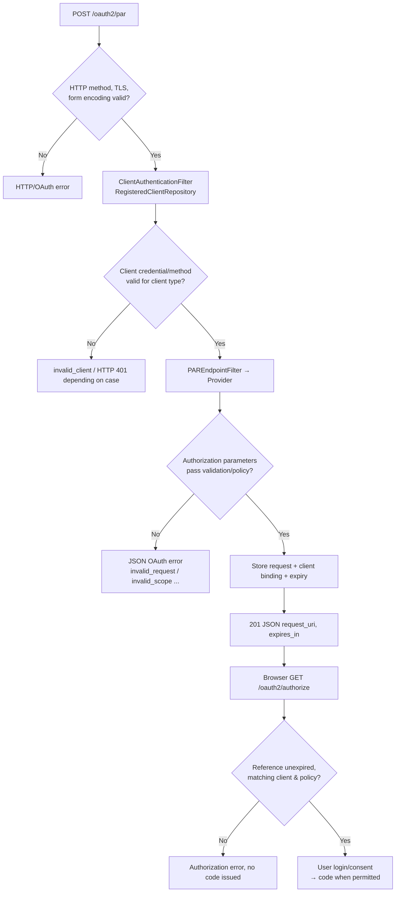
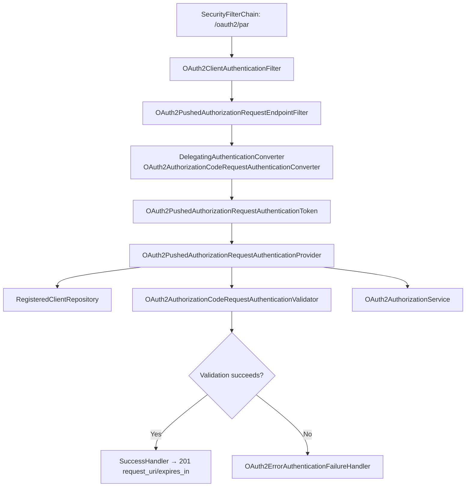

# Client Authentication and Validation of Pushed Authorization Parameters

## 1. Why does PAR need to authenticate the client and validate the request upfront?

In the traditional OAuth 2.0 Authorization Code Flow, the OAuth Client redirects the browser to `/oauth2/authorize` with parameters in the URL, such as `client_id`, `redirect_uri`, `scope`, `state`, and `code_challenge`. The browser passes through many components, exposing the request to tampering, URL history leakage, or URL length limits.

**Pushed Authorization Requests (PAR, RFC 9126)** adds a **back-channel** step: the client sends all authorization parameters directly to the **PAR Endpoint** over HTTPS. The Authorization Server validates the client and parameters **before** issuing a short-lived `request_uri` for the browser to carry to the Authorization Endpoint.

For example: the **Orders Web** backend wants the user to grant `orders.read`. Instead of letting the browser carry the full authorization request, Orders Web sends a POST to `https://login.example.com/oauth2/par`. If the request is valid, the server returns `request_uri`. The browser only needs to navigate to `/oauth2/authorize?client_id=orders-web&request_uri=...`.

PAR shifts many validation steps to a direct channel between the client and the Authorization Server, yet **does not replace user authentication, PKCE, consent, or re-checking the request at the Authorization Endpoint when needed**.

This lesson belongs to the **PAR** chapter of the `SPRING_SECURITY_OAUTH2_OIDC_AUTHORIZATION_SERVER` module. The goal is to learn **how to design, configure, secure, test, and operate an OAuth 2.0/OpenID Connect Authorization Server using Spring Security and Spring Authorization Server in a Spring Boot application**, focusing on **client authentication and validation of pushed authorization requests**.

### What you should be able to do after this lesson

1. Distinguish the identities of the **OAuth Client**, **end user**, and the two requests at the **PAR Endpoint** and **Authorization Endpoint**.
2. Construct an RFC 9126-compliant form-encoded HTTP POST with client authentication appropriate to the client type.
3. Explain each validation step for `client_id`, `response_type`, `redirect_uri`, `scope`, PKCE, `state`, and OIDC/JAR extensions.
4. Understand that `request_uri` must be bound to the client, have a short lifetime, and be managed to prevent guessing/replay.
5. Configure and customize `OAuth2PushedAuthorizationRequestEndpointConfigurer` in Spring Authorization Server 1.x without bypassing default validators.
6. Create integration tests for valid requests, client authentication failures, parameter errors, and `request_uri` reuse.

> **Version scope:** Java examples focus on **Spring Authorization Server 1.5.x / Spring Security 6.x**. In Spring Security 7.x, the DSL/packages may differ; verify against the exact version documentation and do not assume additional custom policies unless explicitly configured.

## 2. Two endpoints, two kinds of checks

| Processing point | Who calls it? | Typical input | What it decides |
| --- | --- | --- | --- |
| **PAR Endpoint** `POST /oauth2/par` | OAuth Client directly over HTTPS | Authorization parameters, `client_id`, and client authentication when applicable | Is the client identified/authenticated with the proper method? Is the request eligible to be stored under `request_uri`? |
| **Authorization Endpoint** `GET /oauth2/authorize` | User's browser | `client_id` and the received `request_uri` | Is the reference still valid/matching the client? Has the user authenticated and consented? Does the request still comply with current policy? |
| **Token Endpoint** `POST /oauth2/token` | OAuth Client directly | Authorization code, redirect URI/PKCE, client authentication | Are the code and client valid? Can an access token and other tokens be issued per policy? |

**Client authentication** at the PAR Endpoint is distinct from **user login**. A client secret or client assertion must never be sent through the browser at `/oauth2/authorize`. The browser neither needs nor should know the backend's client secret.

```mermaid
sequenceDiagram
    autonumber
    participant C as Orders Web / OAuth Client
    participant PAR as PAR Endpoint
    participant S as Authorization Storage
    participant B as Browser
    participant AU as Authorization Endpoint
    participant TOK as Token Endpoint
    actor U as User
    C->>PAR: POST /oauth2/par + client authentication<br/>authorization parameters
    PAR->>PAR: Authenticate client, validate request
    PAR->>S: Save parameters, client binding, and expiry
    PAR-->>C: 201 JSON: request_uri + expires_in
    C-->>B: 302 /oauth2/authorize?client_id=...&request_uri=...
    B->>AU: GET /oauth2/authorize?client_id=...&request_uri=...
    AU->>S: Look up request_uri, check client/expiry/replay
    S-->>AU: Pushed authorization parameters
    AU->>AU: Revalidate per policy if needed
    AU->>U: Login / consent as required
    U-->>AU: Authenticate and approve
    AU-->>B: 302 redirect_uri?code=...&state=...
    B->>C: Client callback
    C->>C: Match state
    C->>TOK: POST /oauth2/token + code + PKCE/client auth
    TOK-->>C: Token response when valid
```

The diagram clearly separates the **PAR Endpoint**, **Authorization Endpoint**, and **Token Endpoint**. `request_uri` **is not an authorization code** and does not grant API access yet; only after the user completes authorization can the client exchange the code at the Token Endpoint.

## 3. HTTP structure of a PAR request

Per **RFC 9126**, the PAR Endpoint must use HTTPS and accept **POST** with a UTF-8 encoded `application/x-www-form-urlencoded` body. The default URI described by Spring Authorization Server 1.5.x is `/oauth2/par`.

Example of a confidential client using `client_secret_basic`:

```http
POST /oauth2/par HTTP/1.1
Host: login.example.com
Authorization: Basic <ENCODED_CLIENT_CREDENTIALS>
Content-Type: application/x-www-form-urlencoded
Accept: application/json

response_type=code&client_id=orders-web&
redirect_uri=https%3A%2F%2Forders.example.com%2Flogin%2Foauth2%2Fcode%2Forders-web&
scope=openid%20profile%20orders.read&
state=RANDOM_STATE_PER_TRANSACTION&
code_challenge=BASE64URL_SHA256_CODE_VERIFIER&
code_challenge_method=S256&
nonce=RANDOM_NONCE_PER_OIDC_TRANSACTION
```

The body is **wrapped across lines for readability**; an actual request must be a valid single form-encoded string. Do not insert newlines between parameter names/values, and do not send a JSON body when the header says `application/x-www-form-urlencoded`.

### 3.1. Why still send `client_id` when Basic auth is present?

RFC 9126 requires `client_id` as an **authorization request parameter**, even when the client is authenticated via another method. The server must verify:

- The `client_id` in the request exists and belongs to a `RegisteredClient`.
- The client authentication result matches **that exact client**.
- There is no mismatch between the authenticated client ID and the client ID in the pushed content.

`client_id` is merely an identifier, **not a secret**. HTTP Basic, JWT assertions, or certificates are proof-of-identity mechanisms for confidential clients.

### 3.2. Client authentication vs. authorization parameters

| Group | Parameter/header | Purpose |
| --- | --- | --- |
| Client identification | `client_id` | Look up client record and bind `request_uri` |
| Client authentication | `Authorization: Basic ...` or `client_assertion_type` + `client_assertion`, mTLS | Prove confidential client identity |
| Authorization request | `response_type`, `redirect_uri`, `scope`, `state` | Describe the authorization request the browser is about to execute |
| PKCE | `code_challenge`, `code_challenge_method` | Bind code exchange to the verifier |
| OIDC | `nonce`, `prompt`, `max_age`, or `claims` when applicable | Applicable user authentication/claims rules |
| OAuth extension | `resource`, `authorization_details`, or `request` when supported | Add resource target hints, authorization details, or JAR Request Object |

**Token request parameters that do not serve client authentication**, such as `grant_type=refresh_token`, `code_verifier`, or `refresh_token`, have no default meaning at the PAR Endpoint. **`request_uri` must never be sent as a parameter inside a pushed authorization request**; it is issued by the server **after** accepting the request.

## 4. Successful PAR response: 201, request_uri, and expires_in

Upon successful validation, RFC 9126 requires **HTTP 201 Created** and JSON containing `request_uri` and `expires_in`:

```http
HTTP/1.1 201 Created
Content-Type: application/json
Cache-Control: no-cache, no-store

{
  "request_uri": "urn:ietf:params:oauth:request_uri:random-reference-example",
  "expires_in": 60
}
```

**Two important properties:**

- `request_uri` references the authorization content accepted by the server; its value must be unpredictable and **bound to the client** that submitted the request. There is no requirement that it be a public HTTP URL fetchable via GET.
- `expires_in` is a **JSON number** indicating the lifetime in seconds; the RFC allows the server to choose a short TTL, typically around **5–600 seconds**, not necessarily exactly 60.

Upon receiving this response, the client redirects the browser to the Authorization Endpoint:

```http
GET /oauth2/authorize?client_id=orders-web&
request_uri=urn%3Aietf%3Aparams%3Aoauth%3Arequest_uri%3Arandom-reference-example HTTP/1.1
Host: login.example.com
```

This request is also **wrapped for illustration**. The real URL must encode `request_uri` as a query parameter. The browser does not need to carry `redirect_uri`, `scope`, or `code_challenge` outside the reference. Do not allow extra front-channel parameters to override the pushed values.

**Do not confuse:**

- `201` at PAR **does not mean** the user has logged in or consented.
- `request_uri` **is not** `code`, `access_token`, `refresh_token`, or an ID Token.
- `expires_in` of `request_uri` **is not** the lifetime of the subsequent access token.

## 5. Authenticating clients per registered method

RFC 9126 specifies that the PAR Endpoint applies **the same client authentication rules as the Token Endpoint** (RFC 6749). If the client is confidential, the server must verify the registered method and proof belonging to that specific client.

| Method | How it is sent at PAR | Verification point |
| --- | --- | --- |
| `client_secret_basic` | `Authorization: Basic ...` | Valid secret, unexpired, method registered |
| `client_secret_post` | `client_id` + `client_secret` in form body | Match secret; avoid body logging |
| `private_key_jwt` | `client_assertion_type` + JWT `client_assertion` | Registered public key, signature, algorithm, `iss/sub/aud/exp` |
| `client_secret_jwt` | JWT assertion signed with shared secret | Valid secret/algorithm/claims and expiration |
| `tls_client_auth` | Certificate in mTLS handshake | PKI and certificate binding to registered client |
| `self_signed_tls_client_auth` | Self-signed certificate linked to registration | Certificate/trust binding per RFC 8705 |
| `none` | Public client declares `client_id` | No long-lived secret; still validate registration, grant, redirect URI, and PKCE |

### 5.1. Confidential clients: proving identity before storing the request

Suppose `orders-web` registers `CLIENT_SECRET_BASIC`. A request with the right client ID but wrong Basic secret must be rejected. Similarly, sending `client_secret_post` when the client only permits `client_secret_basic` must not be accepted merely because the secret looks right.

Do not use multiple client authentication methods in the same request. With Basic, credentials are formed according to RFC 6749 URL-encoding rules and encoded into the header; Base64 **does not protect the secret** without HTTPS.

### 5.2. JWT client assertion: how should audience be checked?

When using `private_key_jwt` or `client_secret_jwt`, the JWT client assertion contains claims such as `iss`, `sub`, `aud`, `exp`, and optionally `jti`. According to RFC 9126, **the Authorization Server's issuer URL should be used by the client as the audience**. For interoperability, the Authorization Server must accept its issuer identifier, Token Endpoint URL, or PAR Endpoint URL as audience values identifying itself.

Example assertion payload:

```json
{
  "iss": "orders-web",
  "sub": "orders-web",
  "aud": "https://login.example.com",
  "iat": 1794000000,
  "exp": 1794000060,
  "jti": "unique-client-assertion-001"
}
```

This is an **unsigned illustrative payload**, not a usable assertion. The server must verify the signature using a trusted public key associated with the `RegisteredClient`, and enforce `alg/kid`, clock skew, and replay policy. Never dynamically fetch and trust an arbitrary JWKS URL supplied in the request by a client.

A subtle distinction: a JWT client assertion is used for **client authentication**. It is neither the `request` JWT of **JWT-Secured Authorization Request (JAR)** nor an OIDC ID Token.

### 5.3. Public clients: identification differs from cryptographic authentication

RFC 9126 applies Token Endpoint client authentication rules; public clients registered with `ClientAuthenticationMethod.NONE` have no shared secret or private key trusted as proof. For them, the server **identifies via `client_id`** and checks configuration/permissions; a `none` request should not be described as strongly authenticating the application's identity.

Because `client_id` can be known by anyone, public clients require special focus on fixed/registered `redirect_uri`, PKCE S256, `state`, rate limits, and PAR policy. PAR does not turn JavaScript/mobile apps distributed to end users into confidential clients.

### 5.4. Do not send secrets through the browser

Client authentication occurs on the **PAR back-channel**. Afterward, the browser only uses `client_id` + `request_uri`. Never place secrets, assertion JWTs, or certificate material in query strings, fragments, HTML, JavaScript, or redirect URIs.

## 6. Mandatory validation chain before returning request_uri



Checks are split into two tiers:

1. **PAR-time validation:** can the request be validly stored? Does it specify a valid client, redirect URI, grant, scope, PKCE, and extensions?
2. **Authorization-time validation:** is the reference still unexpired/matching the client/unabused? Has client policy changed? Has the user authenticated, satisfied OIDC interaction requirements, and granted appropriate consent?

RFC 9126 allows **deferring checks that cannot be completed at PAR time** until the Authorization Endpoint, but **never skipping them permanently**. Steps already checked at PAR may only be skipped when the server proves the request was indeed pushed and no data/policy changes affect the result.

## 7. Validating each authorization parameter

| Parameter | Key check | Consequence if skipped |
| --- | --- | --- |
| `client_id` | Required; exists, matches credential/identified client and request URI binding | Client impersonation/confused deputy |
| `response_type` | Valid, within response/grant types supported by server and client; for Authorization Code typically `code` | Processing an unregistered flow |
| `redirect_uri` | Matches registered list and URI policy; default Spring validator checks redirect URI | Open redirect, authorization code theft |
| `scope` | Valid syntax, within registered and permitted scopes | Over-privileged access |
| `state` | Client generates a per-transaction random value; preserved intact until callback | CSRF/callback mix-up on client |
| `code_challenge` | Present when client/flow requires PKCE; valid challenge format | Authorization code interception |
| `code_challenge_method` | Prefer/enforce `S256` per policy; prevent unintended downgrade | PKCE downgrade |
| `nonce` | When required by OIDC; client must verify in ID Token | Token injection/replay in OIDC |
| `prompt`, `max_age`, `claims` | Syntax and policy when using OIDC; interaction handled later | Failure to honor user authentication requirements |
| `resource`/`authorization_details` | When supported by server; verify resource/audience/permissions per trust policy | Token used on wrong API or out-of-scope business permissions |
| `request` | If using JAR, validate/verify Request Object per rules | Forged JWT, conflicting claims |
| `request_uri` | **Must not appear in a pushed request** | Using a reference instead of data that should be pushed |

### 7.1. `client_id` must be consistent across both steps

Suppose `orders-web` creates a PAR and receives `request_uri=urn:...:abc`. A browser request with `client_id=other-client&request_uri=urn:...:abc` must be rejected: RFC 9126 **mandates binding the request URI to the client that created it**.

Do not trust the browser-supplied `client_id` enough to pick or change ownership of a reference. When looking up `request_uri`, the server must cross-check the stored identifier and `RegisteredClient` metadata.

### 7.2. `redirect_uri` must follow policy

By default, Spring Authorization Server uses validators for `redirect_uri` and `scope` on authorization code requests. In a typical configuration, the redirect URI must match the registration, usually via **exact string matching**:

```text
Registered:
https://orders.example.com/login/oauth2/code/orders-web

Valid request:
https://orders.example.com/login/oauth2/code/orders-web

Invalid request:
https://attacker.example/callback
https://orders.example.com/login/oauth2/code/orders-web/extra
```

**Exception per RFC 9126, section 2.4:** For **clients with genuinely verifiable credentials**, the Authorization Server **may** allow per-transaction URIs outside the registered list under a clearly restricted policy. This is an **implementation option**, not default behavior to enable blindly, and must **not** be casually applied to public clients. When there is no real need, keep registered URI matching to reduce open redirect risks.

### 7.3. `scope` and business permissions

`scope=orders.read` is valid only if the client is permitted to request that scope. If a request asks for `orders.admin` while the client only registered `orders.read`, PAR should reject early or handle per the appropriate scope/policy rule, rather than issuing a `request_uri` that leads to admin privileges after login.

Business-related permissions such as payments, monetary amounts, tenants, or resource indicators must be validated at the server policy level, not blindly trusted from the client merely because PAR uses HTTPS.

### 7.4. PKCE must not push `code_verifier`

With Authorization Code + PKCE:

- At PAR: send `code_challenge` and `code_challenge_method=S256`.
- At the Authorization Endpoint: use the values stored in PAR, without modifying them from browser query params.
- At the Token Endpoint: only here does the client send `code_verifier` to prove its right to exchange the code.

**Do not send `code_verifier` at PAR or the Authorization Endpoint**. It is a transaction secret the client must keep until the code exchange step. PKCE prevents code interception and reduces transaction substitution risk; `state` remains useful to protect the corresponding callback.

### 7.5. Whose responsibility are `state`, `nonce`, and validation?

The Authorization Server must **preserve and properly use the pushed parameters**, checking required syntax and policy. However, the **OAuth Client** is the party that generates and **matches `state` when the callback returns**. With OIDC, the client must also verify `nonce`/ID Token where applicable.

Do not treat PAR as a reason to drop `state` or PKCE. PAR reduces the browser's ability to alter authorization request content, **not all token substitution, login CSRF, or session attacks**.

## 8. PAR and JAR: two distinct concepts

**PAR (RFC 9126)** is a **way to send** authorization parameters over the back-channel and receive a `request_uri` reference. **JAR (RFC 9101)** is a **way to package** authorization parameters into a **JWT Request Object** that can be signed and/or encrypted.

| Property | PAR | JAR |
| --- | --- | --- |
| Primary purpose | Push request directly, reduce front-channel reliance | Protect integrity/authenticity of the Request Object via JWT |
| Typical data format | Form fields in HTTP POST | JWT in the `request` parameter |
| Can they be combined? | **Yes** | **Yes** — push the Request Object to PAR |
| Signed by default? | **No**; HTTPS/client authentication when applicable protects the channel | Signed when JAR policy requires it |
| What does the browser carry next? | `client_id` + `request_uri` | Depends on how JAR/PAR is used |

### 8.1. When sending JAR's `request` parameter

According to RFC 9126, if `request` containing a JWT Request Object is used at PAR, **other authorization parameters must reside inside the JWT**, not outside the JWT as separate form fields. Exceptions are parameters used for **client authentication** (such as `client_assertion` and `client_assertion_type`) and parameters required by the client authentication contract.

Conceptual example:

```http
POST /oauth2/par HTTP/1.1
Host: login.example.com
Content-Type: application/x-www-form-urlencoded
Authorization: Basic <ENCODED_CLIENT_CREDENTIALS>

client_id=orders-web&request=SIGNED_REQUEST_OBJECT_JWT
```

In this example, `client_id` is still required per RFC 9126; other authorization parameters like `redirect_uri`, `scope`, `state`, and `code_challenge` live **inside the JWT**. If client authentication and the Request Object use different identifiers, the server must reject; the server must also verify signature/encryption, expiration, and claims per RFC 9101.

**Do not confuse the two JWTs:**

- The `client_assertion` JWT proves the client is authorized to submit the request.
- The `request` JWT describes the **authorization request**.

The two JWTs have different issuers/audiences/keys/policies and cannot substitute for one another.

## 9. Errors and HTTP statuses at the PAR Endpoint

PAR receives requests from the **client**, not end-user interaction. Per RFC 9126, when an error occurs, the endpoint typically returns a **JSON OAuth error** in a format similar to the Token Endpoint. Do not redirect to an HTML login page simply because an authorization parameter is missing or the client secret is wrong.

Example error response:

```http
HTTP/1.1 400 Bad Request
Content-Type: application/json
Cache-Control: no-cache, no-store

{
  "error": "invalid_request"
}
```

| Scenario | Common response | Key point |
| --- | --- | --- |
| Wrong secret/method or JWT assertion | `invalid_client`, HTTP 400/401 per client authentication | Do not reveal whether the secret or client exists |
| `request_uri` appears in PAR POST | `invalid_request` | RFC mandates rejection |
| Missing/invalid `redirect_uri` | `invalid_request` or appropriate error | Do not redirect errors to an untrusted URI |
| Client not permitted to use grant/response type | `unauthorized_client` or appropriate code | Check registration/policy |
| Out-of-scope permission requested | `invalid_scope` or appropriate code | Do not grant scopes violating policy |
| Signed Request Object required but missing/invalid | `invalid_request`, HTTP 400 | Do not silently fall back to unsigned requests |
| HTTP method other than POST | HTTP **405** | Per RFC 9126 |
| Request exceeds size limit | HTTP **413** | Per RFC 9126 |
| Excessive request rate/limit | HTTP **429** | Per RFC 9126 |

RFC 9126 emphasizes that **user-interaction errors** such as `consent_required` must not be raised during **initial PAR processing**, because the user has not participated in this step yet. Situations requiring login/consent belong to the subsequent Authorization Endpoint.

**Do not disclose sensitive details** such as wrong secret or non-existent client ID via `error_description`. Record a correlation ID, error category, and minimal operational metadata in protected internal logs.

## 10. `request_uri`: binding, lifetime, and replay protection

After issuing `request_uri`, the Authorization Server must protect a **reference used to restore the exact original request**.

| Constraint | Rule/verification |
| --- | --- |
| **Unpredictability** | Generated from a cryptographic random source with sufficient entropy |
| **Client binding** | RFC 9126 `MUST`: reference belongs to the client that pushed the request |
| **Short lifetime** | Must be rejected once `expires_in` elapses |
| **One-time use** | Client uses it only once; server `SHOULD` enforce one-time processing, with very narrow allowance for browser reloads |
| **Immutability** | Browser cannot overwrite stored redirect URI/scope/PKCE |
| **Policy revalidation** | If client registration/policy changes, do not blindly trust stale validation results |
| **Multi-node consistency** | PAR on node A and Authorization Endpoint on node B both retrieve the same authorization state |

### 10.1. Why not treat the reference as an arbitrary redirect/fetch URL?

The `request_uri` string may look like a URN, yet it is **not a target that the client or browser asks the server to fetch over HTTP**. If an implementation turns any `request_uri=https://...` into an outbound fetch URL, it risks SSRF and trusting external data outside its control.

It must map to an authorization request received, stored, and managed by **the Authorization Server itself**. Never allow a client to specify an existing reference inside a PAR POST.

### 10.2. Replay and browser reloads

The client may use a reference for only one authorization request. The RFC recommends the server treat the reference as **single-use**, while allowing reasonable handling of repeated requests caused by browser reload/refresh. Do not equate "allowing reload" with letting a reference be reused indefinitely or by another client.

If a request is duplicated/expired, respond with an error and require the client to **create a new PAR**; do not revive an already consumed authorization request.

### 10.3. Do not confuse PAR lifetime with authorization code lifetime

`expires_in=60` in the PAR response only states that the reference remains valid for 60 seconds from issuance. The authorization code is issued **after user login/consent**, with its own lifetime. Do not increase `request_uri` lifetime to hours to accommodate slow logins unless your threat model explicitly permits it.

## 11. Spring Authorization Server integration: participating components

Spring Authorization Server 1.5.x provides **`OAuth2PushedAuthorizationRequestEndpointConfigurer`** under `OAuth2AuthorizationServerConfigurer`.



According to the official documentation, the default components include:

- **`OAuth2PushedAuthorizationRequestEndpointFilter`**: filter handling HTTP requests at the PAR Endpoint.
- **`OAuth2AuthorizationCodeRequestAuthenticationConverter`**: component converting authorization parameters into an authentication request that the PAR filter can process.
- **`OAuth2PushedAuthorizationRequestAuthenticationProvider`**: component processing pushed requests and applying validation, along with related services/settings.
- **`OAuth2AuthorizationCodeRequestAuthenticationValidator`**: default validator for **`redirect_uri` and `scope`** in an authorization code request.
- **Success handler**: returns the `201` response with `request_uri`/`expires_in`.
- **`OAuth2ErrorAuthenticationFailureHandler`**: produces the OAuth error response on the failure branch.

**Caution:** Both `redirect_uri` and `scope` checks are explicitly documented for the default validator, while many other protocol checks reside in providers/downstream flows. Do not assume **every extension parameter** such as `authorization_details`, `resource`, or a custom OIDC claim is validated by default according to your business policy.

## 12. Configuring SecurityFilterChain and PAR Endpoint URI

### 12.1. Spring Authorization Server 1.x configuration pattern

```java
import org.springframework.context.annotation.Bean;
import org.springframework.context.annotation.Configuration;
import org.springframework.core.annotation.Order;
import org.springframework.security.config.annotation.web.builders.HttpSecurity;
import org.springframework.security.oauth2.server.authorization.config.annotation.web.configurers.OAuth2AuthorizationServerConfigurer;
import org.springframework.security.web.SecurityFilterChain;

@Configuration
class AuthorizationServerSecurityConfiguration {

    @Bean
    @Order(1)
    SecurityFilterChain authorizationServerSecurityFilterChain(
            HttpSecurity http) throws Exception {

        OAuth2AuthorizationServerConfigurer server =
                OAuth2AuthorizationServerConfigurer.authorizationServer();

        http
            .securityMatcher(server.getEndpointsMatcher())
            .with(server, authorizationServer ->
                authorizationServer
                    .pushedAuthorizationRequestEndpoint(par -> {
                        // Default converters/providers/handlers already exist.
                        // Customize only if additional policy checks are needed.
                    })
            )
            .authorizeHttpRequests(authorize ->
                authorize.anyRequest().authenticated());

        return http.build();
    }
}
```

This is a **filter chain skeleton**, not a standalone runnable project. You must add `RegisteredClientRepository`, `OAuth2AuthorizationService`, `AuthorizationServerSettings`, and beans related to keys/tokens/grants; if handling browser Authorization Code flows, you also need a user login chain.

Do not write an MVC controller on `POST /oauth2/par` to issue `request_uri` manually and bypass Spring's built-in components.

### 12.2. Setting the public issuer and endpoint URI

```java
@Bean
AuthorizationServerSettings authorizationServerSettings() {
    return AuthorizationServerSettings.builder()
            .issuer("https://login.example.com")
            .pushedAuthorizationRequestEndpoint("/oauth2/par")
            .authorizationEndpoint("/oauth2/authorize")
            .tokenEndpoint("/oauth2/token")
            .build();
}
```

The public PAR Endpoint must use **HTTPS**. If the Authorization Server runs behind a reverse proxy or has a `/auth` context path, ensure discovery, issuer, and external URLs are accurate, e.g., `https://login.example.com/auth/oauth2/par`. Do not double-prefix `pushedAuthorizationRequestEndpoint(...)` when the proxy/servlet context already handles it.

Standard RFC 8414/RFC 9126 metadata can advertise:

```json
{
  "issuer": "https://login.example.com",
  "pushed_authorization_request_endpoint": "https://login.example.com/oauth2/par",
  "authorization_endpoint": "https://login.example.com/oauth2/authorize",
  "require_pushed_authorization_requests": false
}
```

This is an **illustrative excerpt**, not automatic metadata across all versions. `require_pushed_authorization_requests` is standard policy metadata: when `true`, the server accepts authorization requests only via PAR within the applicable scope. The RFC also defines a matching **per-client** metadata property; **do not assume** Spring Authorization Server 1.5.x provides a builder property with that exact name without checking the API. To enforce PAR, you must enforce the policy at the Authorization Endpoint as well, not merely display a JSON flag.

## 13. RegisteredClient and related ClientSettings

Example confidential client using Authorization Code + PKCE:

```java
RegisteredClient ordersWeb = RegisteredClient.withId(
                UUID.randomUUID().toString())
        .clientId("orders-web")
        // PasswordEncoder-hashed value from secret manager.
        .clientSecret(encodedClientSecret)
        .clientAuthenticationMethod(
                ClientAuthenticationMethod.CLIENT_SECRET_BASIC)
        .authorizationGrantType(AuthorizationGrantType.AUTHORIZATION_CODE)
        .authorizationGrantType(AuthorizationGrantType.REFRESH_TOKEN)
        .redirectUri(
                "https://orders.example.com/login/oauth2/code/orders-web")
        .scope("openid")
        .scope("profile")
        .scope("orders.read")
        .clientSettings(ClientSettings.builder()
                .requireProofKey(true)
                .requireAuthorizationConsent(true)
                .build())
        .build();
```

Imports/repository beans are omitted; `encodedClientSecret` is not a hard-coded string. `requireProofKey(true)` applies to Authorization Code + PKCE and does not imply mandatory PAR. `requireAuthorizationConsent(true)` applies consent policy and likewise does not imply PAR is enabled/mandatory.

### 13.1. Public clients and identification limits

```java
RegisteredClient ordersSpa = RegisteredClient.withId(
                UUID.randomUUID().toString())
        .clientId("orders-spa")
        .clientAuthenticationMethod(ClientAuthenticationMethod.NONE)
        .authorizationGrantType(AuthorizationGrantType.AUTHORIZATION_CODE)
        .redirectUri("https://app.example.com/callback")
        .scope("orders.read")
        .clientSettings(ClientSettings.builder()
                .requireProofKey(true)
                .build())
        .build();
```

An SPA cannot reliably keep a client secret confidential; a PAR request from a public client **has no strong identity proof based solely on `client_id`**. If deploying for an SPA, test CORS/trust boundaries, PKCE enforcement, and redirect policies. Do not embed secrets in JavaScript to "make PAR more secure".

### 13.2. PKCE and client authentication complement each other

For confidential clients, **client authentication** proves the PAR sender possesses the credential; **PKCE** binds the authorization code exchange to `code_verifier`. Even when a confidential client authenticates via Basic or `private_key_jwt`, using PKCE where appropriate strengthens defense against code interception/injection.

## 14. Customizing the pushed authorization request validator

### 14.1. Available extension points

| DSL | Role |
| --- | --- |
| `pushedAuthorizationRequestConverter(...)` | Add a converter to extract information from the HTTP request |
| `pushedAuthorizationRequestConverters(...)` | Inspect/customize the list of converters |
| `authenticationProvider(...)` | Add a provider to process pushed requests |
| `authenticationProviders(...)` | Customize existing providers, e.g., attach a validator |
| `pushedAuthorizationResponseHandler(...)` | Handle successful responses |
| `errorResponseHandler(...)` | Return OAuth errors on failure |

If custom policy checks (tenant/resource/audience) are needed, **keep Spring's mandatory validator** and append your check rather than replacing the whole validator with one that inspects only a single field.

### 14.2. Example: chaining a custom validator after the default validator

The snippet below focuses on **how to register the policy** in Spring Authorization Server 1.x:

```java
@Bean
@Order(1)
SecurityFilterChain authorizationServerSecurityFilterChain(
        HttpSecurity http) throws Exception {

    OAuth2AuthorizationServerConfigurer server =
            OAuth2AuthorizationServerConfigurer.authorizationServer();

    http
        .securityMatcher(server.getEndpointsMatcher())
        .with(server, authorizationServer ->
            authorizationServer.pushedAuthorizationRequestEndpoint(par ->
                par.authenticationProviders(providers ->
                    providers.forEach(provider -> {
                        if (provider instanceof
                                OAuth2PushedAuthorizationRequestAuthenticationProvider p) {

                            Consumer<OAuth2AuthorizationCodeRequestAuthenticationContext>
                                    validation =
                                    new OAuth2AuthorizationCodeRequestAuthenticationValidator()
                                        .andThen(context -> {
                                            String clientId =
                                                    context.getRegisteredClient().getClientId();
                                            boolean forbiddenScope =
                                                    context.getAuthentication().getScopes()
                                                        .contains("payments.transfer");

                                            // Custom policy example: Orders Web
                                            // must not request transfer permissions.
                                            if ("orders-web".equals(clientId)
                                                    && forbiddenScope) {
                                                throw new
                                                    OAuth2AuthorizationCodeRequestAuthenticationException(
                                                        new OAuth2Error(
                                                            OAuth2ErrorCodes.INVALID_SCOPE),
                                                        null);
                                            }
                                        });

                            p.setAuthenticationValidator(validation);
                        }
                    })
                )
            )
        )
        .authorizeHttpRequests(authorize ->
            authorize.anyRequest().authenticated());

    return http.build();
}
```

The example uses these types: `Consumer`, `OAuth2PushedAuthorizationRequestAuthenticationProvider`, `OAuth2AuthorizationCodeRequestAuthenticationContext`, `OAuth2AuthorizationCodeRequestAuthenticationValidator`, `OAuth2AuthorizationCodeRequestAuthenticationException`, `OAuth2Error`, and `OAuth2ErrorCodes`; add imports from the exact packages matching your dependencies. This snippet **does not contain enough beans to run a standalone server**.

**Why is this safer?** `new OAuth2AuthorizationCodeRequestAuthenticationValidator()` runs the default `redirect_uri` and `scope` checks **first**, and then `andThen(...)` runs the additional policy check. It avoids accidentally replacing open-redirect or unregistered-scope detection with a `Consumer` that only checks `client_id`.

For systems with many policies, extract custom validators into dedicated classes, write unit tests, and share truly applicable policies across PAR and the Authorization Endpoint. **Never drop validation at the Authorization Endpoint just because PAR previously succeeded**.

## 15. Direct HTTP testing with curl

Confidential client test example (do not use production credentials):

```bash
curl --request POST "https://login.example.com/oauth2/par" \
  --user "$CLIENT_ID:$CLIENT_SECRET" \
  --header "Accept: application/json" \
  --data-urlencode "response_type=code" \
  --data-urlencode "client_id=orders-web" \
  --data-urlencode "redirect_uri=https://orders.example.com/login/oauth2/code/orders-web" \
  --data-urlencode "scope=openid profile orders.read" \
  --data-urlencode "state=STATE_GENERATED_FOR_TEST" \
  --data-urlencode "code_challenge=S256_CODE_CHALLENGE_GENERATED_FOR_TEST" \
  --data-urlencode "code_challenge_method=S256" \
  --data-urlencode "nonce=NONCE_GENERATED_FOR_TEST"
```

The command uses `--data-urlencode` to encode form fields properly; `curl --user` can expose credentials via runtime environment/process list/logs, so production/CI should use an OAuth2 client library and proper secret provisioning.

Do not replace `code_challenge` with a placeholder string in a valid test: an actual PKCE challenge must be derived from a randomly generated `code_verifier` with standard format/length, and that verifier must later be used at the Token Endpoint. If a test fails due to an invalid challenge format, that is a test-data error, not proof that PAR is broken.

### 15.1. Separating the two HTTP calls

Step 1: backend/client POSTs to `/oauth2/par` and reads the JSON `request_uri`. Step 2: the browser uses **`GET /oauth2/authorize`** with `client_id` and `request_uri`; do not run `curl` pretending to be a browser and conclude authorization succeeded before login/consent occurs.

Only after receiving the authorization code at the client callback does the backend call **`POST /oauth2/token`** with the code + PKCE verifier + appropriate client authentication. PAR does not replace the Token Endpoint.

## 16. Client authentication and validation test matrix

| Test case | Request/condition | Expected result |
| --- | --- | --- |
| Valid Confidential Basic | Valid `client_id`/secret, valid request | `201` JSON `request_uri` + `expires_in` |
| Wrong or expired secret | Same client ID, invalid credential | Reject with `invalid_client`/appropriate status, no reference issued |
| Unregistered method | Send `client_secret_post` when only Basic is allowed | Reject client authentication |
| Basic and secret in body together | Multiple methods in one request | Reject ambiguity |
| Valid JWT assertion | Signed properly with registered key | PAR proceeds to validate authorization parameters |
| JWT assertion wrong audience/expiry/signature | Invalid `private_key_jwt` | No reference issued |
| Public `none` + PKCE | Registered client, valid redirect/scope | Per public PAR policy; do not require fake secret |
| Non-existent Client ID | Arbitrary `client_id` | Reject without leaking sensitive metadata |
| Client ID differs from authenticated identity | Basic for client A, body states client B | Reject |
| Missing `client_id` | Request without identifier | Reject per RFC 9126 |
| Missing/wrong `response_type` | No matching grant/response type | Do not return reference |
| Unregistered Redirect URI | `redirect_uri` points to attacker | Reject, do not redirect to that URI |
| Redirect URI differs only by trailing slash | Does not match registration | Reject per default exact matching policy |
| Out-of-bounds scope | Disallowed `scope=orders.admin` | `invalid_scope` or appropriate error |
| Missing PKCE when mandatory | No challenge sent for `requireProofKey(true)` | Rejected at appropriate validation step |
| Invalid PKCE challenge | Wrong format/`code_challenge_method` | Rejected |
| Different transaction `state` | Callback does not match state | OAuth Client rejects callback; do not skip because of PAR |
| `request_uri` in PAR POST | Client sends reference itself | **Must reject** |
| Invalid Request Object/JAR signature | Signed JAR per policy | Reject per RFC 9101/PAR policy |
| Signed JAR required but missing | Client/AS policy requires JWT | HTTP 400 `invalid_request` |
| Send JSON instead of form | `Content-Type: application/json` | No reference issued |
| Use GET on PAR | Wrong method | HTTP **405** |
| Body too large | Exceeds request size limit | HTTP **413** |
| Too many PAR requests | Exceeds rate limit | HTTP **429** |
| Reference for wrong client | `client_id=B` + A's `request_uri` | No code issued |
| Expired reference | `request_uri` past `expires_in` | Rejected |
| Replayed reference | Reused multiple times violating policy | Rejected or controlled reload exception |
| Browser alters `scope` in query | A's Request URI + `scope=admin` | Does not overwrite pushed data |
| Client policy changes between steps | Scope/redirect removed after PAR succeeded | Revalidate and reject when no longer valid |
| Unauthenticated at authorization endpoint | PAR succeeded, anonymous browser | Redirect to login/appropriate flow; **no** code before authentication |
| Unsatisfiable `prompt=none` request | OIDC interactive requirement | Authorization Endpoint returns appropriate protocol error, not PAR error `consent_required` |
| Multiple instances | PAR on node A, authorize on node B | Reference/storage/expiry/client binding consistent |
| TLS/proxy changes | Public issuer/prefix `/auth` | PAR URL and Authorization URL correct, no internal backend leakage |
| Spring upgrade | Same test suite on newer version | Detect changes in matchers, validators, status/metadata, and request URI lifecycle |

### 16.1. Test categorization

**HTTP protocol tests**: form/UTF-8 POST, `201`/`400`/`401`/`405`/`413`/`429` statuses, JSON fields, `Cache-Control`, and errors not leaking secrets.

**Spring integration tests**: use real test-environment `RegisteredClientRepository`, `OAuth2AuthorizationService`, client authentication methods, and providers/validators to confirm references are bound to the right client.

**End-to-end tests**: PAR → browser authorization/login/consent → client callback → code exchange with PKCE and client authentication → Resource Server verifies token/issuer/audience/scope. Do not conclude the system works merely because PAR returns `201`.

### 16.2. Checking JSON response with assertions

```java
// Pseudocode test helper — not a complete JUnit class.
var response = sendPushedAuthorizationRequest("orders-web", validParameters);

assertThat(response.status()).isEqualTo(201);
assertThat(response.json().get("request_uri")).isNotBlank();
assertThat(response.json().get("expires_in")).isPositive();
assertThat(response.json().has("access_token")).isFalse();
assertThat(response.header("Cache-Control")).contains("no-store");
```

The `access_token` field does not appear in the PAR response because this is **not yet the token issuance step**. A separate integration test must prove that using the reference with a different client, after expiration, or with altered parameters cannot produce an authorization code.

## 17. Securing PAR in production operations

### 17.1. Rate limiting, request size, and abuse

Because PAR operates on a direct channel, the endpoint can be abused to mint large numbers of references and consume storage. Design for:

- Rate limiting by client identity, IP/risk signals, and appropriate quotas, not just a single IP.
- Limits on HTTP body size, request object size, and parameter count.
- Short TTLs, timely cleanup, and monitoring of pending request counts.
- No long-term storage allocation for unused requests without an explicit requirement.

### 17.2. Preventing credential and request reference leakage

Do not log the `Authorization` header, `client_secret`, `client_assertion`, `request` JWT, `state`, `nonce`, authorization code, or raw tokens. `request_uri` is a short-lived reference, yet you should still avoid logging it verbatim in analytics/metric labels because it can be used while valid.

For confidential clients, protect secrets/private keys in a secret manager or KMS; rotate credentials, apply least privilege, and monitor `invalid_client`. With mTLS behind a proxy, trust certificate info only when verified by a trusted TLS stack and forwarded over a secure hop.

### 17.3. Redirect URI and SSRF

Do not relax `redirect_uri` validation simply because the client "used PAR". If business requirements demand dynamic redirect URIs, consider them only for authenticated confidential clients with strict allowlist/prefix/resource policies per RFC 9126 section 2.4. Never allow any client to supply a redirect URI pointing to an attacker host and receive an authorization code.

Never automatically HTTP-fetch `request_uri` from the browser as an arbitrary URL. The reference must map strictly to data stored by the Authorization Server itself.

### 17.4. Multiple instances and consistency

Suppose node A handles `POST /oauth2/par`, node B handles `GET /oauth2/authorize`, and node C handles `POST /oauth2/token`. They must share/trust:

1. Registered clients and grant/scope policies.
2. Authorization state/references from PAR and authorization code states.
3. Shared issuer/keys or token services for issuing tokens.
4. Session/consent when the Authorization Endpoint involves browser login.

Node-local in-memory repositories can cause PAR to return 201 while the Authorization Endpoint fails with a missing reference error. Propagate a safe correlation ID across hops for diagnostics.

## 18. Common misconceptions

| Claim | Assessment | Reason |
| --- | --- | --- |
| "PAR returning 201 means the user is logged in." | **False** | PAR involves no user interaction yet |
| "Having `client_id` means the client is cryptographically authenticated." | **False** | Public clients may only be identified |
| "PAR replaces PKCE." | **False** | PKCE protects the authorization code exchange |
| "Request URI is an access token." | **False** | The reference only points to the authorization request |
| "`request_uri` can be sent in a PAR POST." | **False** | RFC 9126 `MUST NOT` |
| "The browser is allowed to modify `redirect_uri` after PAR succeeds." | **False** | Must use the stored/validated parameters |
| "PAR requires signed JAR in every deployment." | **False** | JAR can be combined with PAR, but is not always mandatory |
| "All dynamic redirect URIs are accepted thanks to PAR." | **False** | RFC allows restricted options for authenticated clients; default is typically exact |
| "A custom validator only needs to check one scope and skip redirect URI." | **False** | Foundational checks and remaining steps must be preserved |
| "Sending a Basic secret from an SPA makes it confidential." | **False** | A secret embedded in the browser is no longer secret |
| "`expires_in` of `request_uri` is the access token TTL." | **False** | It is the lifetime of the PAR reference |
| "PAR protects the entire browser login/consent flow." | **False** | User authentication, session/CSRF/consent, and authorization validation are still needed |

## 19. Troubleshooting common issues

| Symptom | Likely cause to check | How to verify |
| --- | --- | --- |
| `POST /oauth2/par` returns 404 | Endpoint not configured/filter chain mismatch, wrong proxy prefix | Check `AuthorizationServerSettings`, matcher, discovery |
| `invalid_client` | Wrong secret/JWT assertion/mTLS or client ID mismatch | Check registration/method/issuer/audience without logging credentials |
| `invalid_request` with `request_uri` | Client sent a reference itself during the push step | Remove `request_uri` from the PAR body |
| `invalid_request` redirect URI | Wrong/unregistered URI or custom policy | Match the redirect URI exactly |
| `invalid_scope` | Scope exceeds registration | Check `RegisteredClient.scopes` and validator |
| 405/413/429 | Method/body/rate limit | Check HTTP method, payload size/quota |
| PAR returns 201 but browser receives `invalid_request` | Reference expired/wrong client/replayed or inconsistent storage | Check binding/TTL/one-time state |
| Browser reports missing PKCE | Challenge was not pushed/stored, or query overrode it | Inspect PAR body, reference data, token exchange |
| Using PAR yet OAuth login switches to another client | Client/state confusion, request URI swapping | Check client binding, `state`/PKCE |
| Backend returns HTTP URI behind reverse proxy | Wrong issuer/forwarded headers/context path | Check external URL, TLS termination, metadata |
| PAR succeeds yet consent is denied | User/policy/consent happens in a later step | Do not alter PAR success handler to auto-approve |
| Custom validator allows unknown URIs | Default redirect validator was replaced | Re-chain `OAuth2AuthorizationCodeRequestAuthenticationValidator` |

A useful debugging sequence: **URI/method/TLS → client authentication → PAR converter → provider/validator → storage/binding/TTL → browser authorization → login/consent → token exchange**.

## 20. End-to-end scenario: Orders Web and access requests

A company has `orders-web` (confidential backend), `orders-api` (Resource Server), and Spring Authorization Server at `https://login.example.com`.

1. **Client registration:** `CLIENT_SECRET_BASIC`, `AUTHORIZATION_CODE`, fixed redirect URI, scopes `openid` and `orders.read`, `requireProofKey(true)`.
2. **Request creation:** backend generates `state`, `nonce`, `code_verifier`, and S256 `code_challenge`; keeps the verifier on the client side.
3. **PAR call:** backend sends authorization fields and Basic authentication to `POST /oauth2/par` over HTTPS/form-encoded.
4. **Early validation:** Spring authenticates the client, validates `client_id`, grant/response type, redirect URI, scope, PKCE, and policy. Invalid requests are rejected before the browser starts.
5. **Reference storage:** server issues `201` with a short-lived client-bound `request_uri`; backend redirects the browser to `/oauth2/authorize` carrying only `client_id` and `request_uri`.
6. **User authentication:** server looks up the request, checks reference/policy, performs login/consent when required; only then issues the authorization code to the registered callback.
7. **Code exchange:** backend verifies `state`, sends the code and `code_verifier` to the Token Endpoint with client authentication. The API verifies the access token's issuer/audience/scope.
8. **Operations:** rate-limit PAR, bound storage TTL, use a shared multi-node authorization service, redact request references/credentials in logs, and run regression tests when upgrading Spring versions.

If an attacker swaps Orders Web's `request_uri` with another reference, the system must enforce **client binding**, expiration, and replay policy. At the same time, the client uses `state` and PKCE to detect a substituted transaction or mismatched callback.

## 21. Pre-production checklist

- [ ] Public PAR Endpoint uses **HTTPS**, correct issuer, path/context, and is advertised in metadata.
- [ ] Accepts **POST** UTF-8 form-encoded only; never accepts `request_uri` as an authorization parameter at PAR.
- [ ] `client_id` is required and matches the authenticated identity; method matches `RegisteredClient`.
- [ ] Confidential clients protect Basic secrets/JWT private keys/mTLS; public clients do not carry fake secrets.
- [ ] `response_type`/grant, `redirect_uri`/`scope`/PKCE, and extension parameters are validated per policy.
- [ ] If using a custom validator, `redirect_uri`/`scope` checks and other mandatory validations are preserved.
- [ ] `request_uri` is unpredictable, bound to the client, has a short TTL, and enforces safe one-time/reload policies.
- [ ] Authorization Endpoint revalidates reference/policy and performs user authentication/consent.
- [ ] Browser cannot overwrite pushed data; Client still verifies `state`/`nonce` and uses PKCE.
- [ ] Signed JAR is required/verified only per explicit policy; not confused with JWT client assertions.
- [ ] `201` response includes JSON `request_uri`/`expires_in`; errors return OAuth JSON, HTTP 405/413/429 where applicable.
- [ ] Reverse proxy/TLS termination and multi-instance setup keep storage/issuer/keys consistent.
- [ ] Client secrets, request JWTs, raw request references, codes/tokens are never logged; safe rate limits/metrics exist.
- [ ] Integration tests cover both successful PAR + authorization/code exchange and invalid client/URI/scope/replay/expiry cases.

## 22. Summary

**PAR security begins with authenticating the client and validating the authorization request before issuing `request_uri`.** Here are three core principles to remember:

1. **Client authentication:** PAR applies authentication methods corresponding to the Token Endpoint; `client_id` is mandatory but **is not itself a secret**.
2. **Authorization validation:** validate `response_type`, `redirect_uri`, `scope`, PKCE, and extensions as early as possible; never accept `request_uri` inside a pushed request; continue checking at the Authorization Endpoint when needed.
3. **Reference lifecycle:** `201` returns a short-lived, unpredictable, client-bound `request_uri`, safely used in the front-channel to restore the request, yet **it does not replace user login, consent, PKCE, or token issuance**.

In Spring Authorization Server, use `OAuth2PushedAuthorizationRequestEndpointConfigurer`, `OAuth2PushedAuthorizationRequestAuthenticationProvider`, and the default validator as extension points at the **right layer**. This preserves RFC 9126 compliance without inadvertently dropping OAuth 2.0/OIDC security boundaries.

### References

- [RFC 9126 — OAuth 2.0 Pushed Authorization Requests](https://www.rfc-editor.org/rfc/rfc9126)
- [RFC 9101 — The OAuth 2.0 Authorization Framework: JWT-Secured Authorization Request (JAR)](https://www.rfc-editor.org/rfc/rfc9101)
- [RFC 6749 — OAuth 2.0 Authorization Framework](https://www.rfc-editor.org/rfc/rfc6749)
- [RFC 7636 — Proof Key for Code Exchange (PKCE)](https://www.rfc-editor.org/rfc/rfc7636)
- [RFC 8705 — OAuth 2.0 Mutual-TLS Client Authentication](https://www.rfc-editor.org/rfc/rfc8705)
- [RFC 8707 — Resource Indicators for OAuth 2.0](https://www.rfc-editor.org/rfc/rfc8707)
- [RFC 9700 — OAuth 2.0 Security Best Current Practice](https://www.rfc-editor.org/rfc/rfc9700)
- [Spring Authorization Server 1.5.8 — Protocol Endpoints / Pushed Authorization Request Endpoint](https://docs.spring.io/spring-authorization-server/reference/protocol-endpoints.html)
- [Spring Authorization Server 1.5.8 — Configuration Model](https://docs.spring.io/spring-authorization-server/reference/configuration-model.html)
- [Spring Authorization Server — Core Model Components](https://docs.spring.io/spring-authorization-server/reference/core-model-components.html)
- [Spring Security — Authorization Server Configuration Model](https://docs.spring.io/spring-security/reference/servlet/oauth2/authorization-server/configuration-model.html)
