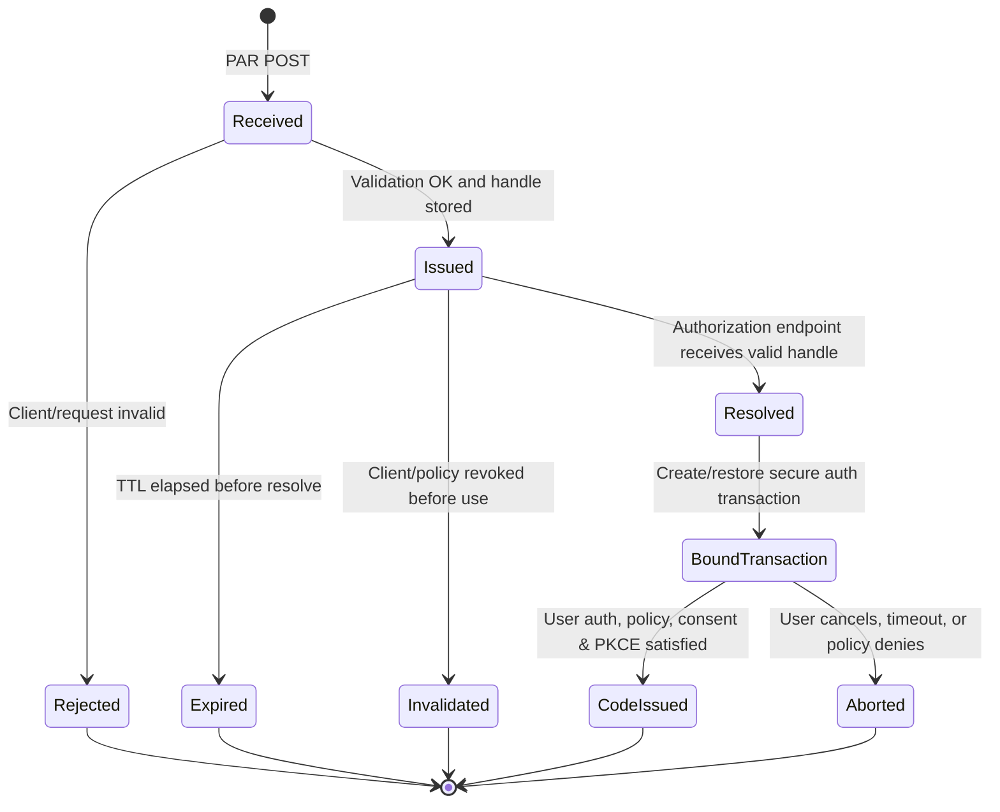

# Issuing request_uri and Handling Request Expiration

In the traditional **OAuth 2.0 Authorization Code** flow, the OAuth2 Client typically sends many parameters through the browser to the Authorization Server: `client_id`, `redirect_uri`, `scope`, `state`, `code_challenge`, and in OpenID Connect (OIDC) also `nonce` or additional authentication requirements. When an application needs to transmit a longer or more sensitive authorization request, placing all parameters in the front-channel URL introduces issues with length, integrity, and data observability.

**Pushed Authorization Requests (PAR, RFC 9126)** adds a step: the OAuth2 Client **pre-submits the authorization request over HTTPS to the PAR endpoint** of the Authorization Server (AS). If the request is accepted, the AS returns a short-lived **`request_uri`** and **`expires_in`**. Afterward, the Client redirects the browser to the authorization endpoint, sending **`client_id` and `request_uri`** so the AS retrieves the stored authorization request instead of resending the entire request payload in the URL.

The crucial part of this lesson is not merely how to obtain a `request_uri` value, but how to **issue, bind to the right client, store, check expiration, handle reuse, clean up data, and operate pending state** in Spring Authorization Server.

This lesson belongs to the **PAR** chapter of the **SPRING_SECURITY_OAUTH2_OIDC_AUTHORIZATION_SERVER** module — learning how to design, configure, secure, test, and operate an OAuth 2.0/OpenID Connect Authorization Server using Spring Security and Spring Authorization Server in Spring Boot.

> **Distinguish from the start:** the `request_uri` issued by the PAR endpoint is **not** the application's `redirect_uri`, **not an authorization code**, **not an access token**, and **not a refresh token**. `expires_in` in the PAR response is **the validity duration of the reference to the authorization request**, not the access token TTL.

## 1. What problem does PAR solve?

A traditional authorization request might look like:

```http
GET /oauth2/authorize?response_type=code&client_id=portal-web&redirect_uri=https%3A%2F%2Fportal.example.com%2Flogin%2Foauth2%2Fcode%2Fcompany&scope=openid%20profile%20documents.read&state=STATE_RANDOM&code_challenge=PKCE_CHALLENGE&code_challenge_method=S256&nonce=NONCE_RANDOM HTTP/1.1
Host: identity.example.com
```

The values `STATE_RANDOM`, `PKCE_CHALLENGE`, and `NONCE_RANDOM` are placeholders. In production, they must be generated and verified according to the corresponding security standards.

With PAR, the Client sends the parameters to a separate HTTPS endpoint over the back channel and receives a reference:

```http
HTTP/1.1 201 Created
Content-Type: application/json
Cache-Control: no-store
Pragma: no-cache

{
  "request_uri": "urn:ietf:params:oauth:request_uri:OPAQUE_RANDOM_HANDLE",
  "expires_in": 90
}
```

Then it simply directs the browser to:

```http
GET /oauth2/authorize?client_id=portal-web&request_uri=urn%3Aietf%3Aparams%3Aoauth%3Arequest_uri%3AOPAQUE_RANDOM_HANDLE HTTP/1.1
Host: identity.example.com
```

**Meaning:** The Authorization Server has received and stored the authorization request from the client over a protected channel, so the browser carries only a reference. This reduces the risk of authorization parameters being tampered with along the browser path, shortens the authorization URL, and allows the AS to apply certain validations before the browser begins the login flow.

**PAR does not perform** user login, MFA, consent, PKCE, or protection of the access token after issuance by itself. Those steps still must be verified during the authorization flow.

### 1.1. PAR differs from Request Object/JAR and JARM

| Mechanism | Purpose | Output/characteristics |
|---|---|---|
| **PAR — RFC 9126** | Push the authorization request directly to the AS before the browser redirect step | AS issues `request_uri` and `expires_in` |
| **JAR — RFC 9101** | Represent the authorization request as a JWT Request Object, optionally signed/encrypted | `request` parameter or `request_uri` reference per profile |
| **JARM** | Protect the **authorization response** (code/error response) as a JWT | Does not replace the PAR endpoint |
| **PKCE — RFC 7636** | Bind the authorization code to the client knowing `code_verifier` | Does not issue `request_uri` |
| **OIDC** | Authenticate users and issue ID Tokens per protocol | Can combine with PAR/JAR, not synonymous with PAR |

PAR can be used **together with a Request Object** depending on AS policy. Pushing a request via PAR does not mean the AS should skip signature/JAR verification if the deployment requires JAR.

## 2. Actors and trust boundaries

Assume:

- **`portal-web`**: confidential OAuth2 Client/OIDC Relying Party running on a Spring Boot backend.
- **`identity.example.com`**: Spring Authorization Server and OP, supporting PAR and Authorization Code.
- **Browser**: user agent receiving the redirect after the client obtains `request_uri`.
- **User**: logs in, completes MFA/consent when prompted.
- **`documents-api`**: Resource Server accepting access tokens after the flow completes.

| Component | What does it know or do? | What should it not do? |
|---|---|---|
| OAuth2 Client backend | Creates authorization parameters, authenticates with the PAR endpoint when applicable, receives `request_uri`, builds redirect | Pass secrets/subject tokens in query strings; fabricate `request_uri` pretending to be the AS |
| PAR endpoint | Receives requests over HTTPS, authenticates client per policy, validates request, stores reference, returns TTL | Treat `request_uri` as proof of user consent |
| Authorization endpoint | Receives `request_uri` from browser, resolves matching client and expiration, continues login/consent/code | Trust replacement parameters in the URL contradicting the pushed request |
| Browser | Only forwards the reference and receives protocol responses | Decide scope/audience based on self-asserted values |
| User | Authenticates and consents per policy | Be required to finish login before the client sends the PAR request |
| Resource Server | Validates tokens after issuance | Treat a PAR handle as a Bearer access token |

**Client authentication at the PAR endpoint** protects client submission and helps the AS bind the reference to the exact client. Depending on policy/client type, public clients differ in authentication capability; **never assume a public client can keep a client secret**. For public clients, PKCE and AS validation remain especially critical.

## 3. Full flow from PAR POST to authorization code issuance

```mermaid
sequenceDiagram
    autonumber
    actor U as User
    participant B as Browser
    participant C as portal-web (OAuth2 Client)
    participant PAR as PAR Endpoint (/oauth2/par)
    participant S as PAR Request Store
    participant AZ as Authorization Endpoint
    participant T as Token Endpoint

    U->>B: Open feature requiring login
    B->>C: GET /documents
    C->>C: Generate state, nonce, code_verifier, and code_challenge
    C->>PAR: POST request parameters + client authentication
    PAR->>PAR: Authenticate client, validate PAR request
    PAR->>S: Store request, bind client and expiration
    S-->>PAR: Opaque request_uri, expires_at
    PAR-->>C: 201 request_uri + expires_in
    C-->>B: 302 /oauth2/authorize?client_id=...&request_uri=...
    B->>AZ: GET /oauth2/authorize with request_uri
    AZ->>S: Resolve and check client, TTL, lifecycle
    alt request_uri expired, invalid, or wrong client
        S-->>AZ: Reference rejected
        AZ-->>B: OAuth authorization error / safe response
    else request_uri valid
        S-->>AZ: Pushed authorization request
        AZ->>AZ: Verify user, MFA, policy, and consent
        AZ-->>B: Redirect to registered redirect_uri with code, state
        B->>C: OAuth callback
        C->>T: POST code + code_verifier + client auth
        T-->>C: Access token (+ ID Token if OIDC)
    end
```

This diagram is a **logical model** to explain expiration and components. How Spring Authorization Server maintains state when a user transitions through login/consent screens may involve additional internal transactions and persistence; do not assume every step is a single database read.

### 3.1. Why issue `request_uri` before knowing the user?

A PAR request is sent by the **client** before the browser begins interacting with the AS. Thus the PAR endpoint knows:

- Which client is making the request;
- `redirect_uri`, grant/response type, scopes;
- `state`, `code_challenge`, and request object if provided;
- the timestamp the request was accepted and the granted TTL.

However, the PAR endpoint **does not yet have proof** that the user has logged in, completed MFA, consented, or holds data permissions at the Resource Server. Those decisions must occur afterward inside the authorization transaction. **Never issue an authorization code at the PAR endpoint.**

## 4. HTTP POST to the Pushed Authorization Request endpoint

The commonly encountered default PAR path in Spring Authorization Server is **`/oauth2/par`**; the actual URL depends on `AuthorizationServerSettings` and the configuration/version in use.

An illustrative request from a confidential client:

```http
POST /oauth2/par HTTP/1.1
Host: identity.example.com
Authorization: Basic <REDACTED_CLIENT_AUTH>
Content-Type: application/x-www-form-urlencoded
Accept: application/json

response_type=code&client_id=portal-web&redirect_uri=https%3A%2F%2Fportal.example.com%2Flogin%2Foauth2%2Fcode%2Fcompany&scope=openid%20profile%20documents.read&state=STATE_RANDOM&code_challenge=PKCE_CHALLENGE&code_challenge_method=S256&nonce=NONCE_RANDOM
```

**Notes:**

1. The PAR endpoint uses **POST**, URL-encoded form over HTTPS.
2. Confidential clients must authenticate using a method permitted by the AS and registration, such as `client_secret_basic`; do not pass secrets in the URL.
3. Parameters must be properly encoded, especially the redirect URI, scope, and strings with special characters. HTTP clients should use a form encoder rather than manual raw string concatenation.
4. `state` helps the OAuth2 Client verify the callback and prevent CSRF on the authorization response; `nonce` is used in OIDC when applicable; PKCE uses `code_challenge` in the authorization request and `code_verifier` at the token endpoint.
5. The PAR endpoint **does not accept a client-chosen `request_uri` to replace** the AS-stored request. The AS itself issues the reference handle.

### 4.1. Ensuring the client is allowed to send PAR

The AS must validate against registration/policy:

| Check | Example | Failure if skipped |
|---|---|---|
| Does the client exist? | `client_id=portal-web` | Could allocate unbounded storage for fake clients |
| Is the client authentication method allowed? | `client_secret_basic` | Impersonation of the client |
| Is the client allowed the authorization grant? | `authorization_code` | Storing requests for disallowed grants |
| Is the Redirect URI valid? | URI matches registration | Risk of redirecting codes to an attacker |
| Are scopes permitted? | `openid profile documents.read` | Scopes exceeding registration |
| Are PKCE and response type valid? | `S256`, `response_type=code` | Unprotected code flow |
| Is the Request Object valid if using JAR? | Signature, issuer/audience, time claims | Trusting tampered or expired JWT parameters |
| Resource limits enforced? | Body size, request count, TTL | DoS against PAR storage |

Checks at PAR **do not eliminate** additional validation when the authorization endpoint processes the request and issues the code. Conditions depending on principal, consent, or current security state may only be evaluable later.

### 4.2. Client authentication and public clients

PAR is commonly useful for confidential web clients authenticating with the PAR endpoint. However, **PAR is not exclusively for confidential clients**; public clients may use it depending on AS support and policy. For public clients:

- `client_id` is a public identifier, **not secret proof**.
- Do not embed `client_secret` in SPAs/mobile apps just to "qualify for PAR".
- Control `request_uri`/client binding within protocol capabilities and enforce PKCE to defend against tampering/phishing.
- Check RFC 9126, discovery metadata, and the AS's specific security requirements when allowing public clients to use PAR.

**Do not infer** that a public client was cryptographically authenticated merely because the AS issued a `request_uri` for a request containing `client_id`.

## 5. Successful response: `201 Created`, `request_uri`, and `expires_in`

Per RFC 9126, a successful PAR endpoint response looks like:

```http
HTTP/1.1 201 Created
Content-Type: application/json
Cache-Control: no-store
Pragma: no-cache

{
  "request_uri": "urn:ietf:params:oauth:request_uri:RANDOM_OPAQUE_VALUE",
  "expires_in": 90
}
```

Two fields to understand distinctly:

| Field | Meaning | Must not be mistaken for |
|---|---|---|
| **`request_uri`** | AS-issued reference to the pushed authorization request | Client redirect URL; authorization code; token; an endpoint to fetch freely over the Internet |
| **`expires_in`** | Number of seconds of validity the AS advertises for the reference | TTL of access token, refresh token, browser session, or deadline for user to finish MFA |

**`request_uri` is opaque:** The client must keep and pass back the **exact value**; do not split out the random portion to infer client, scopes, or expiration time. The URN format `urn:ietf:params:oauth:request_uri:...` helps the AS manage references within a namespace dedicated to PAR.

**`expires_in` is a duration, not a timestamp.** For example, `expires_in: 90` means the AS announces a 90-second lifetime for the reference. Clients must use the value from the response rather than hard-coding 90 seconds; this example **does not claim Spring returns 90 seconds by default**.

### 5.1. Why does PAR return 201 instead of a 200 token response?

`201 Created` indicates that the AS accepted and created a **server-side reference** to a new request. The token endpoint, when successfully issuing tokens, typically returns `200 OK` with `access_token`. The two endpoints have different contracts and behaviors:

```text
PAR:
  POST /oauth2/par
  -> 201 Created
  -> request_uri, expires_in

Authorization:
  GET /oauth2/authorize?client_id=...&request_uri=...
  -> user authentication/consent
  -> authorization code or OAuth error

Token:
  POST /oauth2/token (grant_type=authorization_code)
  -> 200 OK if valid
  -> access_token (+ id_token in the corresponding OIDC flow)
```

Do not send `request_uri` directly to a Resource Server in a Bearer header, and do not treat it as a credential usable at the token endpoint.

### 5.2. Do not treat `request_uri` as an HTTP GETtable URL

A string starting with `urn:ietf:params:oauth:request_uri:` is **not an HTTPS URL** for the client to invoke directly. The client puts it into the **`request_uri` parameter of the authorization endpoint**. Actual dereferencing happens **inside the Authorization Server** using the AS's storage/logic.

If an extended deployment uses another format, the client must still follow the issuer's discovery/profile/contract; never fetch content from arbitrary URIs supplied by untrusted parties.

## 6. Issuing `request_uri` securely: entropy, uniqueness, and client binding

`request_uri` must be an **unpredictable reference**, not a string guessable from `client_id`, timestamp, or an incrementing sequence. If someone guesses a still-valid reference, they could try to reuse an authorization transaction, cause fixation, disrupt the flow, or exhaust resources.

One way to conceptualize the storage structure:

```text
opaqueHandle -> PAR record
    registeredClientId  = "registered-client-internal-id"
    clientId            = "portal-web"
    requestData         = validated immutable authorization request
    createdAt           = server timestamp
    expiresAt           = server timestamp
    lifecycleState      = ISSUED / RESOLVED / EXPIRED / INVALIDATED
```

This is a **proposed model for understanding the system**, not the default schema or field names of Spring Authorization Server. The AS may use a different internal storage/mapping approach depending on version.

### 6.1. Generating the handle

Principles:

1. Generate the value using a **cryptographically secure random number generator (CSPRNG)** with enough entropy to prevent guessing.
2. Use the `request_uri` namespace/format supported by the AS to produce a unique reference.
3. Store the exact verified authorization request along with metadata, expiration, and the **identifier of the client permitted to use it**.
4. Do not embed raw `client_secret`, user PII, or sensitive request content in the handle itself.
5. Do not let callers pick arbitrary handles or extend validity simply by adding to a timestamp in the string.
6. Bound handle/response lengths to prevent abuse and handle encoding consistently.

**Pseudocode example, not a Spring Authorization Server API:**

```java
// PSEUDOCODE: ParStore, SecureHandle, and ValidatedParRequest
// are application-designed components if customizing PAR storage.
String handle = secureHandleGenerator.newOpaqueHandle();
Instant expiresAt = clock.instant().plus(Duration.ofSeconds(ttlSeconds));

ParRecord record = new ParRecord(
    handle,
    registeredClient.getId(),
    immutableValidatedRequest,
    clock.instant(),
    expiresAt,
    ParState.ISSUED);

parStore.insertIfAbsent(record);  // unique key and atomic insert

return new ParResponse(
    "urn:ietf:params:oauth:request_uri:" + handle,
    ttlSeconds);
```

Do not copy this pseudocode into a custom PAR endpoint that bypasses the framework's filters/providers. In a Spring Authorization Server application, **prefer the built-in endpoint and reference issuance mechanism of your deployed version**, customizing persistence/validation only when truly necessary.

### 6.2. Binding the handle to the client

Suppose the AS issues a `request_uri` to `portal-web`. The browser later sends:

```http
GET /oauth2/authorize?client_id=other-client&request_uri=urn%3Aietf%3Aparams%3Aoauth%3Arequest_uri%3ARANDOM_OPAQUE_VALUE HTTP/1.1
Host: identity.example.com
```

**The AS must reject the mismatch.** Do not use a request from `portal-web` to complete an authorization request under the identity `other-client`. Binding must rely on verified, server-side stored information, not merely matching a tamperable `client_id` string.

In multi-tenant environments with overlapping client ID scopes or issuer federation, metadata must preserve the proper **tenant/issuer boundary** to avoid looking up references in the wrong store.

### 6.3. Do not treat `request_uri` as a bearer access token

Although `request_uri` acts as a **handle to continue a transaction**, it does not prove:

- The user is logged in;
- The user has completed MFA or consent;
- The client has exchanged an authorization code for an access token;
- The Resource Server has authorized access to data;
- Anyone who sees `request_uri` is allowed to access APIs.

Short lifetimes and client binding reduce risk, but do not allow skipping any of the remaining checks.

## 7. `expires_in` lifetime: how to compute and enforce it

The AS needs a **deterministic server-side expiration timestamp**; the client receives only a **validity duration**. In a storage model with `createdAt` and `expiresAt`:

```text
createdAt = 2026-11-16T12:00:00Z
ttl       = 90 seconds
expiresAt = 2026-11-16T12:01:30Z

At 12:00:10Z -> still within TTL
At 12:01:30Z -> expired
At 12:01:31Z -> expired
```

These timestamps merely illustrate the check logic and are not fixed values for your system. When storing timestamps in a DB, ensure consistent timezone/precision across nodes.

### 7.1. Validation rules at the authorization endpoint

Logic typically needs to do:

```java
// PSEUDOCODE: ParRecord/ParStore are not public SAS APIs.
ParRecord record = parStore.findByRequestUri(requestUri);

if (record == null) {
    rejectReference();
}
if (!record.registeredClientId().equals(resolvedClient.getId())) {
    rejectReference();
}
if (!clock.instant().isBefore(record.expiresAt())) {
    rejectExpiredReference();
}
if (!record.isUsableAccordingToLifecycle()) {
    rejectConsumedOrInvalidatedReference();
}

// After retrieving a valid request, process remaining authorization conditions.
continueAuthorization(record.validatedRequest());
```

The reject/reuse functions above are placeholders. **Important:** Do not rely merely on whether a record still exists in the DB/cache. **TTL must be checked at resolve time**, because cleanup jobs may lag or not have run yet.

### 7.2. `expires_in` is not the deadline for completing MFA/consent

A common point of confusion:

> `expires_in` governs **how long the reference may be used to start/continue resolving the authorization request per AS design**; it **does not directly set the access token lifetime and does not force the user to enter a password/MFA or approve all scopes within those same seconds**.

For example, the AS issues a reference valid for 90 seconds:

- The client redirects the browser after 2 seconds.
- The authorization endpoint receives the valid reference and creates or maintains a controlled **authorization transaction**.
- The user takes 4 minutes to log in/complete MFA.

An AS can maintain the login/consent transaction via its own **secure separate state** once the reference has been validly accepted, depending on framework implementation. **Do not silently extend `request_uri` lifetime** to permit arbitrary reuse simply because users take a long time to log in. If the current flow requires the browser to dereference `request_uri` again after TTL expires, design proper transaction resumption or initiate a new PAR request per the AS contract.

**Takeaway:** Distinguish **PAR handle TTL** from **authorization transaction TTL**, **authorization code TTL**, **user session TTL**, and **access token TTL**.

### 7.3. Why should the client not rely solely on its own clock?

The client receives `expires_in` and should redirect the browser **immediately upon receiving a successful response**. If the client waits until nearly the end of TTL before redirecting, network latency, proxies, the browser, or clock skew may cause the reference to be expired when it reaches the AS. The client can use TTL to manage caching and retry planning, but **the AS makes the final decision** on whether a reference is still valid.

Do not fabricate a new `request_uri` from an old handle or inflate `expires_in` on the client. To obtain a new reference, the client must **send a new valid PAR request** and receive another reference from the AS.

## 8. State machine for a PAR reference lifecycle

A secure implementation can model states as follows:



This diagram is a **proposed logical lifecycle**, not an assertion that Spring Authorization Server uses these exact state names or creates such a table. An authorization transaction may outlive the initial reference by authentication design, while still keeping client, request parameters, session, and security policy intact.

### 8.1. Single-use or multi-use?

A practical security model should **treat `request_uri` as a short-lived reference with restricted reuse**; for systems needing strong replay defense, implement **single-use or per-transaction binding** and test race conditions. To comply with a specific deployment profile, apply the reuse rules mandated by RFC 9126, SAS documentation, and any additional security profiles.

If the AS needs to take the user through multiple login and consent steps, those steps should rely on a **linked, controlled transaction**, rather than treating every GET to a URL containing the handle as an independent authorization request allowed to mint a new code.

### 8.2. Two concurrent requests using one reference

Suppose the browser opens two tabs with the same authorization URL:

```text
T0  AS issues PAR reference R1 to portal-web.
T1  Tab A sends GET /oauth2/authorize?request_uri=R1.
T1  Tab B also sends GET /oauth2/authorize?request_uri=R1.
T2  Two AS nodes both read R1 = ISSUED.
T3  Without atomic claim/transaction binding, both branches proceed.
```

If policy requires single-use, the **claim/consume operation on R1 must be atomic** via transaction/compare-and-swap or equivalent mechanism. Never just write:

```text
if (record.isUnused()) {
    processRequest();
    record.markUsed();
}
```

because two nodes can both evaluate `isUnused()` before either writes. For flows that need to resume across multiple steps, avoid deleting the single transaction prematurely and breaking valid login/MFA; separate reference lifecycle from authorization transaction lifecycle.

### 8.3. Reasons to issue a new reference

The client should obtain a new PAR handle when:

- The old reference expired before the browser used it;
- An authorization attempt was canceled/failed and the client must restart;
- State/nonce/PKCE challenge or requested scopes changed;
- Registered client/policy changed, invalidating the old request;
- The AS rejects an already used or non-existent handle.

Do not reuse a reference from user A's cache for user B, or from an old login transaction for a new scope request.

## 9. Front-channel parameters after PAR: do not alter the pushed request

The client redirects with `client_id` and `request_uri`:

```http
HTTP/1.1 302 Found
Location: https://identity.example.com/oauth2/authorize?client_id=portal-web&request_uri=urn%3Aietf%3Aparams%3Aoauth%3Arequest_uri%3ARANDOM_OPAQUE_VALUE
```

The Authorization Server reads parameters from the **stored PAR record**, never trusting extra parameters injected into the browser URL to escalate privileges:

```http
GET /oauth2/authorize?client_id=portal-web&request_uri=urn%3Aietf%3Aparams%3Aoauth%3Arequest_uri%3ARANDOM_OPAQUE_VALUE&scope=admin HTTP/1.1
Host: identity.example.com
```

**Never treat an appended `scope=admin` as part of the request verified at PAR.** Under Request Object/PAR rules, the AS must follow parameter-source rules and detect/handle conflicts, never letting the browser override parameters sent over the back channel.

### 9.1. `request_uri` differs from `redirect_uri`

| Property | `request_uri` | `redirect_uri` |
|---|---|---|
| Who issues/declares it? | **AS issues after PAR POST** | Client registers/declares per OAuth contract |
| Where is it used? | Browser sends to **AS authorization endpoint** | AS redirects browser back to **OAuth2 Client callback** |
| Purpose | Reference to the pushed authorization request | Destination receiving authorization code/error after processing |
| Validity | Short, per `expires_in` and lifecycle | Per client registration and policy; not derived from PAR TTL |
| Can it be exchanged for code/token? | **No** | Receives code/error, though the URI itself is not a code |
| How it is verified | Handle belongs to client, exists, unexpired, valid lifecycle | URI permitted per client registration, strict matching |

Do not let clients send a `redirect_uri` equal to `request_uri` assuming the AS will sort it out. These are two independent concepts.

### 9.2. `state`, `nonce`, and PKCE must still be properly bound

PAR reduces the browser's ability to tamper with the request, yet **does not replace authorization response protection**:

- Client generates and stores `state` to match against the callback.
- OIDC Client generates/verifies `nonce` where applicable.
- Client generates `code_verifier`, sends `code_challenge` in the request, and presents `code_verifier` when exchanging the code.
- AS verifies client binding, redirect URI, scope, user authentication/consent, and authorization code at the appropriate steps.

Never skip PKCE or return codes to unregistered URIs just because PAR is used.

## 10. Spring Authorization Server configuration: points to verify

Spring Authorization Server versions supporting PAR provide the **Pushed Authorization Request Endpoint** and related customization points in `OAuth2AuthorizationServerConfigurer`. Components/extension points to verify against your exact version include:

- `OAuth2PushedAuthorizationRequestEndpointFilter` and the endpoint's converter/provider;
- client authentication and `RegisteredClientRepository`;
- `AuthorizationServerSettings` to advertise the endpoint path;
- the service used to store/read authorization/PAR state;
- the ability to require **mandatory PAR** via `ClientSettings` or corresponding configuration/profile.

**Do not rely on an unverified class name or DSL across versions** to conclude the AS properly protects references. In particular, PAR support and state storage details can differ across Spring Authorization Server versions. Testing against the real endpoint is mandatory before production.

### 10.1. Authorization Server configuration skeleton

```java
@Bean
@Order(1)
SecurityFilterChain authorizationServerChain(HttpSecurity http)
        throws Exception {

    OAuth2AuthorizationServerConfigurer authorizationServer =
        OAuth2AuthorizationServerConfigurer.authorizationServer();

    http.securityMatcher(authorizationServer.getEndpointsMatcher())
        .with(authorizationServer, server ->
            server.oidc(Customizer.withDefaults()))
        .authorizeHttpRequests(auth ->
            auth.anyRequest().authenticated());

    return http.build();
}
```

This is a **basic skeleton**, not a complete PAR configuration. You must configure `RegisteredClientRepository`, `OAuth2AuthorizationService`, issuer/settings, JWK/token generator, the user login security chain, and other beans. For token/PAR endpoints requiring client authentication, use the appropriate OAuth filter/entry point rather than redirecting API clients to an HTML login form when the client secret is wrong.

### 10.2. `RegisteredClient` and PAR requirement

An Authorization Code + PKCE client example:

```java
RegisteredClient portal = RegisteredClient.withId(
        "portal-web-internal-id")
    .clientId("portal-web")
    .clientSecret(passwordEncoder.encode(secretFromSecureStore))
    .clientAuthenticationMethod(
        ClientAuthenticationMethod.CLIENT_SECRET_BASIC)
    .authorizationGrantType(
        AuthorizationGrantType.AUTHORIZATION_CODE)
    .authorizationGrantType(
        AuthorizationGrantType.REFRESH_TOKEN)
    .redirectUri(
        "https://portal.example.com/login/oauth2/code/company")
    .scope(OidcScopes.OPENID)
    .scope(OidcScopes.PROFILE)
    .scope("documents.read")
    .clientSettings(ClientSettings.builder()
        .requireProofKey(true)
        .requireAuthorizationConsent(true)
        .build())
    .build();
```

This is only the registration portion: add imports, beans, encoder, and an appropriate secret manager. If your Spring Authorization Server version supports **`ClientSettings.requirePushedAuthorizationRequests(true)`**, you can use that policy to require the client to use PAR; verify that the method/property exists in your version and how it is enforced at both PAR and the authorization endpoint. If the version lacks this API, use the policy mechanism supported by your version/profile—**do not simply invent a similarly named YAML property and assume mandatory PAR is active**.

### 10.3. Endpoint registration and discovery metadata

The client needs to know the PAR endpoint from trusted configuration or discovery metadata published by the AS. In OAuth 2.0 Authorization Server Metadata, the standard property is **`pushed_authorization_request_endpoint`**. Other metadata/policy fields can indicate whether the AS requires PAR for authorization requests, such as `require_pushed_authorization_requests` per relevant specifications.

```json
{
  "issuer": "https://identity.example.com",
  "authorization_endpoint": "https://identity.example.com/oauth2/authorize",
  "token_endpoint": "https://identity.example.com/oauth2/token",
  "pushed_authorization_request_endpoint": "https://identity.example.com/oauth2/par"
}
```

This metadata is **illustrative**, not an actual verified response from your application. Clients should obtain the endpoint from discovery or trusted issuer configuration and verify HTTPS/certificates/issuer. **Never follow a PAR endpoint supplied in a user request** to avoid sending credentials/tokens to an imposter server.

## 11. Configuring TTL and storage: what to assume and what not to assume

Specific PAR TTL tuning options depend on **Spring Authorization Server version and extension points**. What is architecturally essential:

1. Server **assigns an explicit bounded TTL** when issuing the handle.
2. Server **returns an accurate `expires_in`** to the client.
3. Server **records/maintains `expiresAt` or equivalent state** with the reference.
4. Server **enforces expiration upon receiving `request_uri`**, not relying solely on cleanup.
5. Across multiple nodes, storage/lifecycle is properly shared or synchronized.
6. If a custom TTL is required, verify the expiration hook supported by your version; **do not mutate internal framework fields via reflection or write directly to undocumented schema tables**.

### 11.1. There is no "fixed 90-second standard TTL"

The value 90 in this lesson is only an example. RFC 9126 returns `expires_in` so the client learns the lifetime chosen by the AS. Choosing the number of seconds depends on security policy and deployment latency. Clients must honor the actual response:

```json
{
  "request_uri": "urn:ietf:params:oauth:request_uri:EXAMPLE",
  "expires_in": 60
}
```

If the AS returns 60, the client must not assume 90 or 300. The server also retains the right to reject a reference invalidated by policy even if its nominal lifetime has not yet elapsed.

### 11.2. Separate table, JDBC, Redis, or framework store?

Spring Authorization Server includes authorization storage services and protocol state management mechanisms. When deploying PAR:

- **Prefer the official default/integrated path** of your deployed SAS version.
- If using JDBC, ensure matching schema/migrations and transactions; do not assume a table named `oauth2_par_request` is automatically created by Spring.
- If using Redis/a custom store, enforce client binding, TTL, lifecycle, and atomic consumption; enable size/count limits.
- With multiple AS nodes, avoid situations where a reference created on node A cannot be resolved by an authorization GET on node B.
- Do not rely solely on the user's browser session to store PAR requests, since PAR is **sent by the client over the back channel before browser interaction**.

### 11.3. Storage TTL differs from protocol TTL

For example, custom Redis may have key TTL for automatic eviction; **Redis TTL should not be the sole arbiter of validity** when complex state/race conditions exist. When caching across multiple nodes, an expired or consumed entry must never be resurrected by a stale cache. Resolution logic must still verify `expiresAt`/lifecycle against the authoritative state source.

## 12. Multi-node issues and race conditions

A deployment may behave like:

```text
Client POST /oauth2/par    -> AS node A
Browser GET /oauth2/authorize?request_uri=... -> AS node B
User POST consent          -> AS node C
Client POST /oauth2/token  -> AS node A
```

**State must be designed across nodes**: if A stores PAR requests only in RAM, B may fail with a missing-handle error. Shared persistence or a verified affinity/replication mechanism is necessary depending on infrastructure capabilities.

### 12.1. Clock synchronization and TTL

If nodes have skewed clocks, node B may treat a reference as expired earlier than node A. Synchronize system clocks and standardize `Instant`/epoch representations in storage. Do not try to fix clock skew by granting all expired references a wide grace window without security review. Any accepted tolerance must be policy-driven and tested.

### 12.2. Atomic claim/consume

In a single-use system, two concurrent browser requests or retries must never both mark a valid reference via an unprotected read-then-write sequence. Use an atomic update/compare-and-swap or an appropriate transaction isolation level. When using a distributed cache, understand the store's cluster-wide atomicity semantics.

### 12.3. TTL and replication lag

A newly issued PAR reference might not yet be visible on a replica read by the authorization endpoint. With short-lived references, even a few seconds of replication lag matters. Depending on storage, read from an authoritative/consistent source on resolve or design for read-after-write guarantees. Do not solve this by making TTL huge; that widens the replay window.

### 12.4. Safe cleanup

Cleaning up too early can break unresolved transactions; cleaning up too late wastes storage, yet **a reference must never be usable simply because it has not been deleted yet**. Cleanup should be idempotent, batched by expiry, instrumented with metrics, and free of raw authorization requests/tokens in logs.

## 13. Error handling and responses when `request_uri` expires

PAR has **two distinct error phases**:

- **PAR POST phase:** client authentication/request validation/storage errors, before a handle exists.
- **Authorization GET phase:** `request_uri` submitted by the browser does not exist, has expired, was already consumed, belongs to another client, or is no longer valid.

### 13.1. Errors during PAR POST

| Scenario | Typically appropriate error group | Client action |
|---|---|---|
| Invalid client authentication | `invalid_client` | Check registration/credentials; do not retry infinitely |
| Client not permitted for flow/parameter | `unauthorized_client` or appropriate authorization request error | Fix configuration/registration |
| Invalid `redirect_uri`/`response_type`/`scope` | OAuth2 errors such as `invalid_request`, `unsupported_response_type`, `invalid_scope` depending on cause | Do not switch to an unregistered URI |
| Request Object bad signature/expired (if JAR) | Corresponding JAR/authorization request error | Fix request object; do not bypass validation |
| Over size or rate limit | HTTP/OAuth error per deployment policy | Backoff, alert, optimize request |
| Persistence error/AS unavailable | Server/network error | Controlled retry; do not fabricate a session or issue a "fallback" code |

Do not echo raw `client_secret`, sensitive request objects, `state`/`nonce`, or tokens in `error_description`. When client authentication fails, HTTP status/challenges must match the client authentication mechanism used; do not treat every error identically as 400.

### 13.2. Errors during authorization GET with an invalid reference

| Error | Cause | Must guarantee |
|---|---|---|
| Unknown `request_uri` | Reference does not exist, wrong issuer/storage | Never fall back to another client's request or defaults |
| Expired `request_uri` | Past TTL/lifecycle | Never continue to issue an authorization code from an expired handle |
| Consumed/replayed `request_uri` | Duplicate reference after use per policy | Never start a new transaction/code violating policy |
| Client mismatch | URL `client_id` does not match record | Never issue a code to the wrong client |
| Revoked/invalidated request | Client/policy changed or request canceled | Never continue based on a stale reference |
| Storage outage | Cannot reliably resolve request | Fail closed safely, never fail-open |

Profiles involving Request Objects include error codes such as `invalid_request_uri`; **exact error codes, statuses, and delivery locations must be verified against the RFC/profile and Spring Authorization Server version**. Crucially, **never redirect to an unverified `redirect_uri`**, especially when the AS could not resolve the PAR request to know a trusted callback.

### 13.3. What should the client do when the handle expires?

A sensible handling flow:

1. The client receives the expired/invalid reference error per contract.
2. Do not attempt to inflate `expires_in` or alter the `request_uri` string.
3. Start a **new authorization transaction**, generate fresh `state`/`nonce`/PKCE challenge, and resend PAR POST.
4. Receive the new reference and redirect the browser immediately.
5. Limit retry attempts and guard UX against redirect loops.

If the user already completed a login/MFA step when the PAR handle expired, the system needs a safe resumption mechanism or must restart authorization; **never manually mint a code** from a controller merely because the user logged in.

## 14. Security risks when issuing and using PAR handles

### 14.1. Request URI leakage and fixation

`request_uri` may appear in browser history, AS access logs, tracing, or error reports. Even though the reference itself carries no secret, **it references a pending authorization transaction**. Therefore:

- Issue **random, unpredictable, short-lived** references.
- Bind to the client, enforce replay-limiting lifecycles, and validate thoroughly.
- Do not reflect raw authorization parameters unnecessarily back to the browser.
- Do not log full query strings containing sensitive handles/state/nonce/PII.
- Set `Referrer-Policy` and exclude unnecessary third-party trackers on login/consent pages.

### 14.2. Do not confuse PAR with "no need to validate `redirect_uri`"

A request pushed over the back channel can still contain a misconfigured or malicious `redirect_uri` from a client. The AS must validate the URI against the registered client and strict redirect policies, never sending codes or errors to an untrusted destination.

### 14.3. Do not turn the PAR endpoint into an unbounded store

Attackers can flood PAR requests to exhaust RAM/DB. Enforce rate limits by client/IP/risk policy, pending request quotas, body size limits, short TTLs, backpressure, cleanup, and storage protection. Confidential clients must authenticate, yet **a valid client with compromised credentials can still cause DoS**.

### 14.4. Do not reuse handles across tenants or users

A reference belongs to **one client's authorization request**, not a "shared login ticket". If multiple users hit an authorization URL containing the same handle, ensure state and policy prevent cross-routing `state`, PKCE verifiers, or consent. Clients should create a distinct reference per authorization attempt rather than caching one site-wide.

### 14.5. HTTPS and proxy boundaries

PAR requests over HTTPS may pass through a reverse proxy/API gateway terminating TLS. At that boundary, the proxy can see headers/form bodies, so redact `Authorization`/client secrets and sensitive request data. Internal TLS and network segmentation may be required depending on your threat model. Never trust unvalidated forwarded host/scheme headers when constructing endpoint/issuer URLs.

## 15. OAuth2 Client example: managing responses and redirects

In a Spring Boot backend, leverage **Spring Security's OAuth2 Client/JAR/PAR support for your version or a compatible OAuth library** when available. The following pseudocode accurately illustrates the `request_uri` lifecycle:

```java
// PSEUDOCODE: HttpParClient, ParResponse, and AuthorizationAttemptStore
// are application or adapter classes, NOT default Spring APIs.
AuthorizationAttempt attempt = attemptFactory.newAttempt(
    "portal-web", "documents.read");

ParResponse pushed = parClient.post(
    "https://identity.example.com/oauth2/par",
    attempt.authorizationParameters(),
    confidentialClientAuthentication);

if (pushed.requestUri() == null || pushed.expiresInSeconds() <= 0) {
    throw new IllegalStateException("Invalid PAR response");
}

attemptStore.savePending(
    attempt.id(),
    attempt.state(),
    attempt.codeVerifier(),
    pushed.requestUri(),
    pushed.expiresInSeconds());

String authorizationUrl = UriComponentsBuilder
    .fromUriString("https://identity.example.com/oauth2/authorize")
    .queryParam("client_id", "portal-web")
    .queryParam("request_uri", pushed.requestUri())
    .build()
    .encode()
    .toUriString();

return redirectToBrowser(authorizationUrl);
```

**Do not run verbatim:** classes/methods named `attemptStore.savePending`, `redirectToBrowser`, and `ParResponse` are illustrative. Every request must have its own `state`, and `code_verifier` must be kept secret on the Client—never sent to the PAR endpoint or the browser. The client must handle OAuth errors, TLS, retry timeouts, and content types.

### 15.1. Clients should not cache PAR handles for too long

`expires_in` can be short. When the backend stores a pending attempt, do not cache the reference forever and do not reuse a failed reference. To avoid stale caches, the client can record a local deadline to **proactively re-initiate** before expected expiration; still, the AS has final authority.

### 15.2. Why not retry PAR POST indefinitely after a timeout?

A timeout can occur after the AS recorded the PAR entry but before the client received the response. If the client retries, the AS may create a **second reference**. That is not necessarily a violation; however, if the client creates unbounded pending records, storage can be abused and state/PKCE transactions become error-prone. Apply backoff, timeouts, retry caps, internal correlation IDs, and TTL-based cleanup.

Do not assume PAR POST is idempotent with a standard key; if application-layer idempotency is desired, design it carefully in alignment with protocol and security requirements.

## 16. Testing PAR responses, TTL, and binding

Proper testing must exercise the **actual PAR endpoint and authorization endpoint**. Unit-testing a random string helper or sending a `GET` to a URI does not prove client binding, validation, and lifecycle work.

### 16.1. Test matrix

| Scenario | Outcome to verify |
|---|---|
| Valid client sends PAR POST | Returns **201**, JSON has valid `request_uri` and positive `expires_in` |
| Client sends wrong Basic secret | No reference issued, appropriate client authentication error |
| Client lacks permission per policy | No reference issued, appropriate error returned |
| `redirect_uri` not registered to client | No valid reference issued/no code redirected to that URI |
| Unregistered scope | No permission granted beyond registration |
| Missing/invalid `response_type` | Request rejected per contract |
| Supported public client | Does not require fake secret, still validates PKCE/client ID |
| Oversized PAR request | Endpoint enforces appropriate body/DoS limits |
| Client obtains reference and redirects immediately | AS resolves exact request and continues login/consent |
| Browser appends `scope` alongside `request_uri` | Does not alter pushed request scopes |
| Browser swaps `client_id` | Cannot use another client's reference |
| Non-existent reference | AS rejects safely |
| Expired TTL reference | AS rejects, no code issued |
| Reference invalidated/consumed per policy | AS never issues code violating lifecycle |
| Two tabs use the same reference concurrently | Does not spawn multiple transactions/codes violating single-use policy |
| User spends several minutes on login/MFA | Flow follows transaction/resumption contract without extending handle |
| AS node A issues, node B resolves | Works properly when shared state/replication architecture supports it |
| Slow cleanup job | Expired reference still rejected at resolve time |
| Replica read lag | Does not falsely report missing right after issuance when read-after-write is required |
| Token endpoint after authorization code | Still checks PKCE, client auth, single-use code |
| Logging/tracing | No leakage of client secrets, raw tokens, or authorization request PII |

### 16.2. MockMvc test for a successful PAR response

Skeleton Spring Boot test with a registered `portal-web` client configured with Authorization Code, redirect URI, scope, and a test client secret:

```java
@SpringBootTest
@AutoConfigureMockMvc
class PushedAuthorizationRequestTests {

    @Autowired
    MockMvc mvc;

    @Test
    void validPushedRequestReturnsOpaqueReference() throws Exception {
        mvc.perform(post("/oauth2/par")
                .with(httpBasic("portal-web", "test-client-secret"))
                .contentType(MediaType.APPLICATION_FORM_URLENCODED)
                .param("client_id", "portal-web")
                .param("response_type", "code")
                .param("redirect_uri",
                    "https://portal.example.com/login/oauth2/code/company")
                .param("scope", "openid profile documents.read")
                .param("state", "test-state-value")
                .param("code_challenge", "TEST_VALID_S256_CHALLENGE")
                .param("code_challenge_method", "S256")
                .param("nonce", "test-oidc-nonce"))
            .andExpect(status().isCreated())
            .andExpect(content().contentTypeCompatibleWith(
                MediaType.APPLICATION_JSON))
            .andExpect(jsonPath("$.request_uri").isNotEmpty())
            .andExpect(jsonPath("$.expires_in").isNumber());
    }
}
```

This code is a **test skeleton**, requiring imports, Spring Authorization Server beans, RSA/JWK/issuer setup, registered client, and corresponding test fixtures. **Replace `TEST_VALID_S256_CHALLENGE` with a valid real S256 challenge** before running; `test-client-secret` is for test environments only. Never hard-code it in production. Expecting `201` verifies the successful PAR contract, not `200` like the token endpoint.

### 16.3. Testing TTL without waiting in real time

For a custom PAR store or adapter layer that accepts an injected `Clock`:

```java
// PSEUDOCODE illustrating Clock testing, does not compile verbatim.
Clock clock = fixedClock("2026-11-16T12:00:00Z");
ParResponse pushed = issuePar(validRequest, clock, 90);

assertThat(pushed.expiresInSeconds()).isEqualTo(90);

clock = fixedClock("2026-11-16T12:01:29Z");
assertThat(resolve(pushed.requestUri(), clock)).isUsable();

clock = fixedClock("2026-11-16T12:01:30Z");
assertThat(resolve(pushed.requestUri(), clock)).isRejectedAsExpired();
```

This is a **test design for custom TTL logic**. With default Spring Authorization Server if no injectable clock is exposed via public API, use whatever testing mechanism your version supports or construct controlled expiration fixtures directly through the service. **Never rely on lots of `Thread.sleep(90_000)` calls** to test expiration; it is both slow and flaky.

If references are configured as single-use, TTL tests must use a **fresh reference per resolve attempt** or test consume/expiry ordering separately. Do not reuse a reference consumed in the first check and mistake the second rejection for TTL expiration.

### 16.4. Binding and replay tests

```text
Given:
  Client A pushes a valid authorization request and receives request_uri=R1.
When:
  Browser calls /oauth2/authorize?client_id=B&request_uri=R1.
Then:
  No authorization code may be issued to client B.

Given:
  R2 has expired on the server.
When:
  Browser calls the authorization endpoint with R2.
Then:
  No code is issued and R2's lifetime is never refreshed.

Given:
  R3 was resolved/consumed under single-use policy.
When:
  Two other requests try to keep using R3.
Then:
  No new authorization is created violating policy.

Given:
  Node A issued R4; Node B handles the authorization request.
When:
  R4 is unexpired and the system supports shared state.
Then:
  B resolves the same request without mixing up another client's data.
```

**For unverifiable redirect URIs, tests must prove no redirect occurs to an attacker URI.** A PAR handle error must never turn into an open redirect.

## 17. Operational observability without leaking `request_uri` or credentials

| Event/metric | Purpose | Must not log |
|---|---|---|
| `par_request_received` | PAR request count by client and endpoint | Raw Authorization header/client secret |
| `par_request_accepted` | Acceptance rate, record creation latency | Full raw request body containing PII |
| `par_reference_issued` | TTL/version stats, request count | Verbatim `request_uri` value in broad log systems |
| `par_reference_resolved` | Measure rate of browsers reaching authorization endpoint | Raw handle and session cookies |
| `par_reference_expired` | Detect network issues/slow browser redirects | Raw request parameters |
| `par_reference_client_mismatch` | Alert on misuse or integration bugs | Tokens/credentials |
| `par_reference_reused` | Detect replay/races/duplicate GETs | Full link containing the reference |
| `par_store_unavailable` | Monitor storage outages/latency | Sensitive database record dumps |
| `par_cleanup_backlog` | Monitor uncollected expired data | Authorization parameters with PII |

You can use an **internal correlation ID** or pseudonymized record ID to link event chains without broadcasting raw references/tokens across the observability stack.

### 17.1. SLAs to measure

- PAR POST success rate and p95/p99 latency.
- Rate of references expiring **before the browser starts authorization**.
- Rate of client mismatch/invalid reference errors and trends indicating potential attacks.
- Pending reference count per client and uncleaned expired record count.
- Error rate after rolling deployments or when an AS node loses store connectivity.
- Difference between **time to reach the authorization endpoint** and **time for the user to complete MFA/consent**, so slow user interaction is not mistaken for a TTL error.

## 18. Common implementation mistakes

| Misconception/mistake | Consequence | Remedy |
|---|---|---|
| "`request_uri` is the application's `redirect_uri`" | Redirecting to wrong endpoint or open redirect | Distinguish PAR reference from registered client callback |
| "`expires_in` is the access token lifetime" | Broken lifecycle handling, token caching bugs | Separate PAR TTL from code/token/session TTL |
| "Client creates `request_uri` itself and puts parameters in URL" | AS has no record or handles are abused | Use only the AS-issued value from PAR POST |
| "Having a handle means the user consented" | Risk of premature code issuance | Still check login, MFA, consent, client, and request |
| "`client_id` in URL doesn't need to match the record" | Cross-client request substitution | Bind to the stored registered client ID |
| "Appending scope to the query after PAR will be accepted" | Privilege escalation | Never allow overriding the pushed request |
| "Only delete from DB during cleanup, skip expiry check" | Expired records can still be used | Enforce TTL on every resolve |
| "Each AS node keeps PAR in local RAM" | Redirect to another node fails to resolve | Proper shared state/affinity and failover testing |
| "Every `request_uri` stays valid on reuse forever" | Replay and request fixation | Short TTL and profile-appropriate single-use/lifecycle |
| "With PAR, PKCE isn't needed" | Authorization code interception | Keep using PKCE per client type/policy |
| "Use SPA's secret to authenticate to the PAR endpoint" | Credential leaked in browser | Public client + PKCE, matching PAR policy |
| "Open `POST /oauth2/par` without auth/rate limits" | Storage abuse and mass reference generation | Client authentication when applicable, quotas/rate limits |
| "Put raw `request_uri`/secrets in support logs" | Exposure of pending transactions/credentials | Redaction, correlation IDs, retention limits |
| "Set a huge TTL to avoid slow-login errors" | Widens replay window | Separate handle TTL from interactive transaction lifecycle |
| "Only test the JSON response, skip the authorization endpoint" | Misses client mismatch/expiry/replay bugs | Integration test both endpoints and the code flow |

## 19. Checklist before moving PAR to production

1. **Verified your Spring Authorization Server version supports PAR?** Exact endpoint filter/converter/provider, DSL, discovery metadata, and client policy?
2. **Do clients fetch the endpoint from a trusted source?** HTTPS, issuer, and certificates verified, never following browser-supplied endpoints?
3. **Is PAR POST spec-compliant?** `application/x-www-form-urlencoded`, client authentication, response type, registered redirect URI, scope, PKCE, state/nonce?
4. **Is `request_uri` unpredictable and client-bound?** Sufficient entropy, unique key, registered client binding, tenant isolation?
5. **Is `expires_in` consistent?** Server returns a positive value, enforces `expiresAt`, does not rely solely on cleanup?
6. **Separated PAR reference lifetime from login transaction lifetime?** Slow user MFA does not lead to policy-violating handle extensions?
7. **Protected against replay/duplicate GETs?** Single-use or transaction binding per profile, atomic across multiple nodes?
8. **Is storage multi-node ready?** Read-after-write, replication, TTL, transactions, backup/cleanup, and rolling upgrades?
9. **Browser cannot alter the pushed request?** No overriding scope/redirect URI/response type from query params outside the record?
10. **Are errors handled safely?** Invalid/expired URIs never mint codes and never redirect to unverified callbacks?
11. **DoS protections in place?** Rate limits, body size limits, per-client quotas, and cleanup of expired pending records?
12. **Logging safe enough?** No secrets, raw tokens, `request_uri`, or unnecessary PII logged; proper correlation IDs?
13. **Tested both positive and negative paths?** Successful `201` POST, expiry, mismatch, replay, timeout, multi-node, redirect URI, and PKCE?
14. **Restart procedure exists on expiration?** Client creates a new authorization attempt and re-POSTs PAR, with retry/redirect-loop caps?
15. **Still validating the full OAuth/OIDC flow?** Login, MFA, consent, single-use code, client authentication, and token validation?

## 20. Practice exercises

**Scenario A — Client redirects too slowly.** The AS returns `expires_in=60`. The backend caches the handle for 10 minutes; the browser opens the URL after 2 minutes and fails. Identify the mistake, how to re-initiate, and how to avoid a "redirect loop" if the network stays slow.

**Scenario B — Two AS instances.** PAR POST to node A returns `request_uri`, but the browser authorization GET lands on node B and B cannot find the reference. Explain how to use shared storage/consistency and test that the issue is resolved.

**Scenario C — Altering scope in the URL.** The client pushes `documents.read`, and an attacker appends `scope=documents.write` in the authorization URL. Where must the AS obtain the scope from, and why must the new query param not be used to escalate privileges?

**Scenario D — User MFA takes 4 minutes.** The PAR handle has a 90-second TTL but is validly submitted by the browser in the first 2 seconds. What design lets login/MFA continue without arbitrarily extending `request_uri`? Distinguish handle TTL from interactive authorization transaction TTL.

**Scenario E — Replay.** Two tabs open the link containing reference R1 simultaneously. If the system has a single-use policy, which operation must be atomic? What must a test do to prove two rule-violating flows are not spawned?

**Hints:** A needs a fresh `request_uri` via PAR POST plus backoff/loop limits; B needs state resolvable across nodes; C uses the pushed and validated authorization request; D maintains a separate secure transaction with client/session binding; E uses atomic consume/claim with concurrency tests.

## 21. Summary

- **PAR (RFC 9126)** enables an OAuth2 Client to send an authorization request over a back channel to the AS before the browser navigates to the authorization endpoint.
- Success at the PAR endpoint returns **`201 Created`**, along with **`request_uri`** (an opaque AS-issued reference) and **`expires_in`** (the reference validity duration).
- **`request_uri` differs from `redirect_uri`, authorization code, and tokens**. The client passes the reference to `/oauth2/authorize` with `client_id`; the AS looks up the stored request bound to that exact client.
- **The server enforces TTL**: expired references must be rejected even if the record has not yet been cleaned up. Clients must not extend lifetimes themselves, guess new handles, and should redirect immediately upon receiving the response.
- **PAR handle TTL is not login/MFA/consent duration**. Interactive flows may need separate transaction persistence so users can complete authentication after a handle has been validly accepted.
- Secure operations require **entropy, client binding, profile-compliant replay/single-use controls, atomicity, multi-node shared state, storage limits, monitoring, and integration tests**.
- Spring Authorization Server provides PAR components in supported versions, yet **configuration and actual lifecycle behavior must be verified on your exact version and running persistence stack**. PAR does not replace PKCE, user authentication, consent, or grant/token checks.

Mastering `request_uri` issuance and expiration handling helps design an OAuth2/OIDC-compliant Authorization Server, preventing cross-client reference misuse, expired handles, or replays while delivering a reliable login experience across multiple Spring Boot nodes.

## 22. References

- [RFC 9126 — OAuth 2.0 Pushed Authorization Requests](https://www.rfc-editor.org/rfc/rfc9126): PAR endpoint, request parameters, `request_uri`/`expires_in` response, client binding, authorization endpoint, and Security Considerations.
- [RFC 6749 — The OAuth 2.0 Authorization Framework](https://www.rfc-editor.org/rfc/rfc6749): client authentication, authorization request, Authorization Code, and token endpoint.
- [RFC 7636 — Proof Key for Code Exchange](https://www.rfc-editor.org/rfc/rfc7636): binding codes to `code_verifier`/`code_challenge`.
- [RFC 9101 — The OAuth 2.0 JWT-Secured Authorization Request (JAR)](https://www.rfc-editor.org/rfc/rfc9101): Request Object, `request`, `request_uri`, and related requirements.
- [RFC 8414 — OAuth 2.0 Authorization Server Metadata](https://www.rfc-editor.org/rfc/rfc8414): discovery metadata and endpoint capabilities.
- [RFC 9700 — Best Current Practice for OAuth 2.0 Security](https://www.rfc-editor.org/rfc/rfc9700): securing OAuth2 and mitigating authorization request risks.
- [OpenID Connect Core 1.0](https://openid.net/specs/openid-connect-core-1_0.html): authorization requests, `state`/`nonce`, and OIDC requirements.
- [Spring Authorization Server Reference](https://docs.spring.io/spring-authorization-server/reference/): OAuth2/OIDC endpoints, pushed authorization request support, registered clients, and settings.
- [Spring Security Reference](https://docs.spring.io/spring-security/reference/): OAuth2 Client, Authorization Code + PKCE, SecurityFilterChain, and authentication mechanisms.
