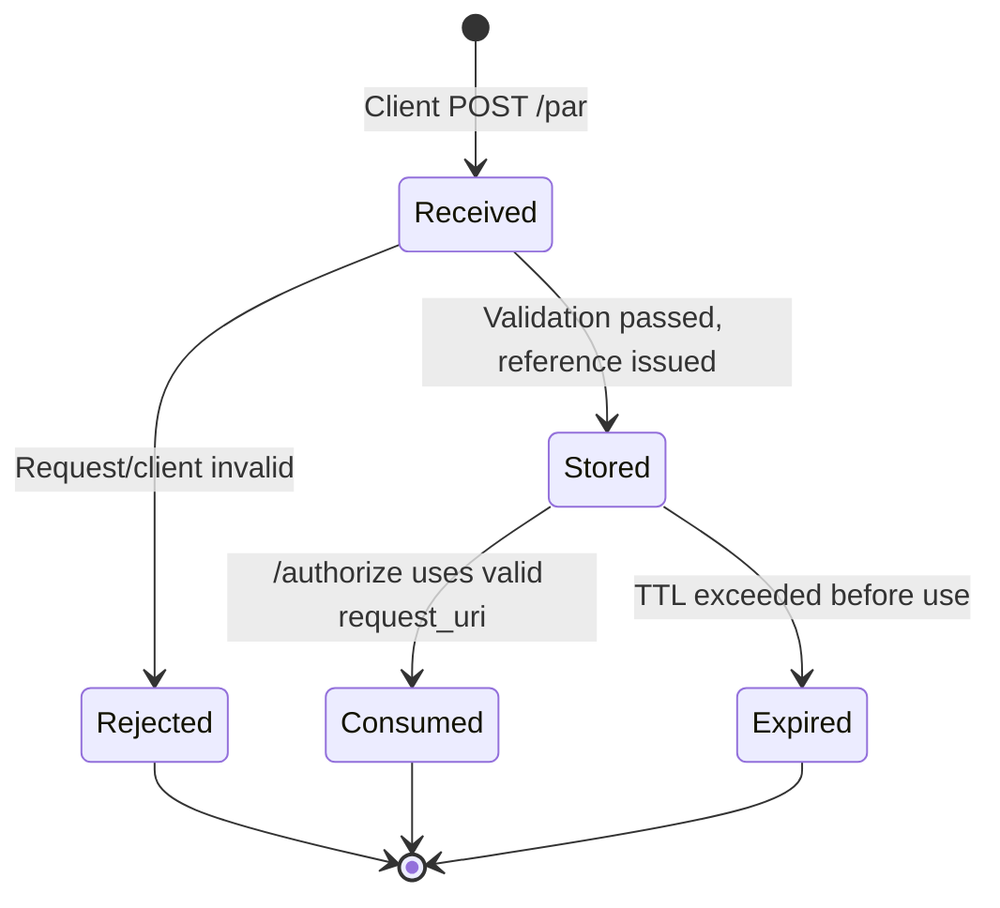
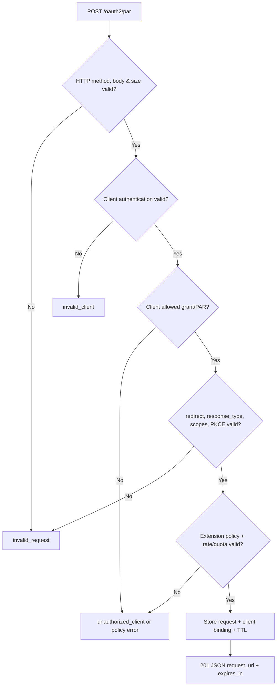
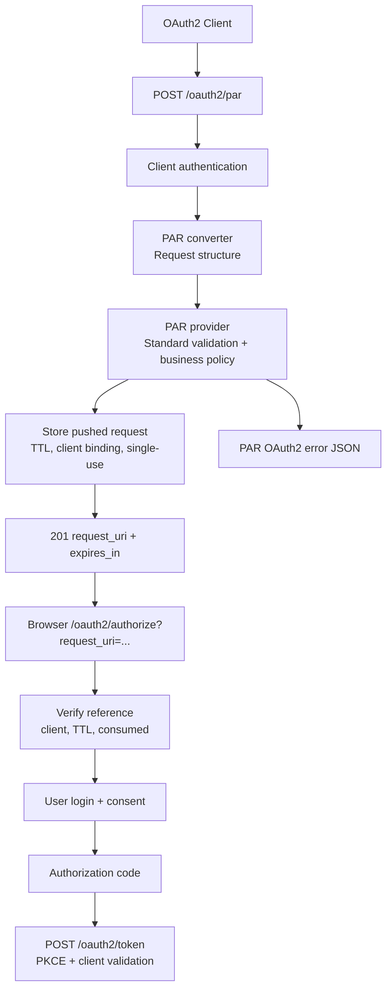

# Customizing PAR Validation, Providers, and Error Responses

## 1. Goals and context

In the **PAR** (*Pushed Authorization Requests*) chapter of the **SPRING_SECURITY_OAUTH2_OIDC_AUTHORIZATION_SERVER** module, we explore how to extend the ingestion, validation, and response handling for authorization requests **pushed to the Authorization Server (AS) over a back channel**. This lesson aligns with the goals of designing, configuring, securing, testing, and operating an **OAuth 2.0/OpenID Connect Authorization Server** with **Spring Security**, **Spring Authorization Server (SAS)**, and **Spring Boot**.

Per **RFC 9126**, the client sends authorization request parameters to the **Pushed Authorization Request Endpoint** first, receives a time-limited `request_uri`, and then directs the user's browser to the Authorization Endpoint with that `request_uri`. This model reduces passing sensitive or complex parameters through the front channel while enabling the AS to validate the request before browser interaction.

After this lesson, you will be able to:

- Explain the boundaries between the **PAR Endpoint**, **Authorization Endpoint**, **Token Endpoint**, and the login/consent flow.
- Analyze the `POST /oauth2/par` workflow, HTTP `201 Created`, `request_uri`, and `expires_in`.
- Identify mandatory checks for the client, `redirect_uri`, `response_type`, scopes, PKCE, and request parameters.
- Understand the extension points of `OAuth2PushedAuthorizationRequestEndpointConfigurer`: converters, providers, and success/error handlers.
- Add business validation **without replacing or disabling SAS protocol checks**.
- Design OAuth 2.0-compliant error responses, distinguish `invalid_client` from invalid requests, and prevent information leakage.
- Test expired request URIs, reuse, wrong clients, invalid redirects, malformed requests, race conditions, and multiple AS instances.

**Assumptions:** Examples target common APIs of **Spring Authorization Server 1.x / Spring Security 6.x / Spring Boot 3.x** that support PAR. Specific versions may differ in endpoint configurers, default provider lists, validation customization methods, and auto-configuration. Verify against your actual dependencies when applying them.

> **Guiding principle:** PAR **pushes an authorization request**; it does not directly issue an authorization code or access token. `request_uri` is a reference to a request accepted by the AS; it does not replace `code_verifier`, user authentication, consent, or code exchange at the Token Endpoint.

## 2. What does PAR improve and what does it not solve?

In the traditional Authorization Code Flow, the browser is redirected to a URL containing `client_id`, `redirect_uri`, `scope`, `state`, `code_challenge`, and potentially additional OIDC or extension parameters. The client and AS must protect the integrity, redirect scope, and contents of this data.

**PAR splits the request into two steps:**

1. The client sends **request parameters** to the PAR Endpoint via HTTP POST over an appropriate channel, with **client authentication** if the client is confidential.
2. The AS verifies the client and request, stores the authorization request object in temporary state, and returns `request_uri`. The browser carries only `client_id` and `request_uri` to the Authorization Endpoint for the AS to restore the request.

```mermaid
sequenceDiagram
    autonumber
    actor U as Browser / User
    participant C as OAuth2/OIDC Client
    participant PAR as AS PAR Endpoint
    participant STORE as PAR request state
    participant AUTH as Authorization Endpoint
    participant TOKEN as Token Endpoint
    C->>C: Generate state and PKCE verifier/challenge
    C->>PAR: POST /oauth2/par + client credentials + authorization params
    PAR->>PAR: Verify client and request
    PAR->>STORE: Store verified request, TTL, and client binding
    PAR-->>C: 201 request_uri, expires_in
    C-->>U: Redirect /oauth2/authorize?client_id=...&request_uri=...
    U->>AUTH: GET /oauth2/authorize with request_uri
    AUTH->>STORE: Look up, verify validity and client binding
    AUTH->>AUTH: User login, consent, policy
    AUTH-->>U: 302 back to client with authorization code + state
    U->>C: Callback carrying code + state
    C->>TOKEN: POST /oauth2/token with code, code_verifier
    TOKEN-->>C: Token response if valid
```

**PAR reduces** the risk of parameter tampering during browser redirects, overly long URLs, and certain authorization request data disclosures. However, PAR **does not automatically**:

- Prevent all phishing, login CSRF, or consent abuse.
- Protect a confidential client if client credentials have been leaked.
- Waive checks on `redirect_uri`, `scope`, `state`, or PKCE.
- Turn an unapproved request into a valid authorization code.
- Replace the Authorization Server's authentication, state storage, and signing key requirements.

### 2.1. Distinguishing values in the flow

| Value | Created/held by | Role | Protection point |
| --- | --- | --- | --- |
| `request_uri` | Issued by AS after PAR, carried by client to browser | Reference to the pushed authorization request accepted by AS | Must be client-bound, short-TTL, and single-use per RFC 9126 |
| `state` | Generated and stored by client per authorization flow | Helps client bind callback to initial request | Preserved by AS on response; client must verify on callback |
| `code_challenge` | Computed by client from verifier | Sent in PAR request so AS stores PKCE condition | Validate syntax/method; never replace with verifier |
| `code_verifier` | Kept secret by client per flow | Sent at Token Endpoint after receiving authorization code | Verified against `code_challenge` |
| Authorization code | Issued by AS after valid login/consent | Short-lived credential exchanged for tokens at `/oauth2/token` | Client/redirect/PKCE bound, single-use |
| Access/ID/refresh token | Issued by AS via Token Endpoint when eligible | Credentials for API use/login/refresh | Never appears in PAR response |

**`request_uri` is not an authorization code**. Using `request_uri` to request an access token directly violates the protocol.

## 3. HTTP contract of a Pushed Authorization Request

### 3.1. Client sends HTTP POST

Example of confidential web client `portal-web` registered with the Authorization Code Grant, callback, and `client_secret_basic` client authentication method:

```http
POST /oauth2/par HTTP/1.1
Host: auth.example.com
Authorization: Basic <REDACTED_CLIENT_CREDENTIALS>
Content-Type: application/x-www-form-urlencoded
Accept: application/json

response_type=code&client_id=portal-web&redirect_uri=https%3A%2F%2Fportal.example.com%2Fcallback&scope=openid%20profile&state=RANDOM_STATE&code_challenge=PKCE_S256_CHALLENGE&code_challenge_method=S256
```

`POST /oauth2/par` is the common path in SAS; the actual endpoint path can be configured differently. **Do not send raw `code_verifier`** in the PAR request. The client retains it until code exchange at the Token Endpoint.

**Confidential clients** authenticate to the AS with their registered method (Basic, private-key JWT, mTLS, or another supported method). **Public clients** may send `client_id` per AS policy when allowed to use PAR, yet do not become confidential by doing so; they require PKCE, valid redirect URIs, and abuse controls. Never embed a secret in an SPA/mobile app and treat it as confidential.

### 3.2. Successful PAR response: 201 Created

If the request is valid and accepted:

```http
HTTP/1.1 201 Created
Content-Type: application/json
Cache-Control: no-store

{
  "request_uri": "urn:ietf:params:oauth:request_uri:EXAMPLE_OPAQUE_REFERENCE",
  "expires_in": 90
}
```

The values are **illustrative**, not real URIs/tokens. `expires_in` represents the reference's lifetime in seconds starting from the response. Do not assume `90` seconds is mandatory for all products; compare it against `AuthorizationServerSettings`, the token/authorization store, and SAS version policies.

`request_uri` may take a URN form supported by the AS; the client must **use the exact value** returned by the AS, without fabricating, decoding, or building an internal database path from it.

### 3.3. Browser uses `request_uri` at the Authorization Endpoint

After PAR, the client sends the browser to:

```http
GET /oauth2/authorize?client_id=portal-web&request_uri=urn%3Aietf%3Aparams%3Aoauth%3Arequest_uri%3AEXAMPLE_OPAQUE_REFERENCE HTTP/1.1
Host: auth.example.com
```

At this step, the AS restores the stored request from `request_uri` and verifies expiration, validity, and client binding. Only then do login, consent, authorization code issuance, and callback redirect take place.

**Do not resend `redirect_uri`, `scope`, `state`, or `code_challenge` over the front channel to alter a pushed request.** If the client wants a different parameter set, it must initiate a new PAR request. The AS must never allow arbitrary front-channel parameters to override parameters verified at the PAR Endpoint.

### 3.4. Differences from the standard Authorization Endpoint

| Characteristic | PAR Endpoint | Authorization Endpoint |
| --- | --- | --- |
| Request sender | OAuth2 client, over back channel | Redirected user browser |
| HTTP method | POST | Usually GET |
| Client authentication | Confidential clients must use appropriate method; public per policy | Browser does not send client secret |
| Request validation | Structure, client, redirect, response type, scope, PKCE, and extensions | `request_uri` binding/TTL, login, consent, and subsequent protocol checks |
| State generated | Short-lived `request_uri` reference | Authorization code after user qualifies |
| Success response | HTTP 201 JSON `request_uri` and `expires_in` | HTTP redirect to callback with `code`/`state` |
| Error response | OAuth2 error JSON, not a browser redirect | Redirect error if callback is trusted, or error at AS |

Do not write a `POST /oauth2/par` controller that mints URIs itself while bypassing SAS converters/providers. When integrating, keep the endpoint inside the properly protected `SecurityFilterChain`.

## 4. Data model and request URI lifecycle

The PAR Endpoint typically needs to keep a **verified authorization request record** for the Authorization Endpoint to look up. This state is separate from the user's login session.



This diagram is a **mental model**, not a mandatory enum in the SAS API.

### 4.1. Security invariants to preserve

- `request_uri` is **generated by the AS**; never accept an arbitrary client URI as a trusted reference.
- The reference must be **unpredictable**, short-lived, and protected against enumeration.
- Each `request_uri` is bound to **one pushed request and the exact client**.
- The Authorization Endpoint must verify `client_id` matches the client used in the PAR request.
- `request_uri` must be processed **once** per RFC 9126; reading and marking it used must be consistent across concurrent requests.
- Expired or already-consumed URIs cannot be reused.
- If storage fails, the AS must never issue a `request_uri` that cannot be resolved later.
- After the reference is validly used, login/consent and authorization codes still follow their own rules.

### 4.2. Information to store or reconstruct

| Data group | Meaning |
| --- | --- |
| Reference ID/`request_uri` value | Used to look up the pushed request |
| Registered client ID | Binds reference to the verified client |
| Authorized request parameters | `response_type`, `redirect_uri`, scopes, `state`, PKCE challenge/method, OIDC fields |
| Issued/expires timestamps | Enforce TTL |
| Consumed/invalidated state | Prevent replay |
| Internal metadata | Policy version, sanitized audit correlation ID, optional extension fields |

In SAS, state is managed by the framework's appropriate services/authorization models. **Never assume** default JDBC tables or fields accommodate every extension data type; if replacing persistence yourself, verify serialization, TTL, indexes, and version consistency.

### 4.3. PAR reference vs. authorization code

A `request_uri` is consumed at the Authorization Endpoint when the client/browser uses the pushed request. An authorization code is created **only after** user login/consent satisfies conditions; afterward, the Token Endpoint exchanges the code for tokens. The two objects have separate TTLs, purposes, and replay states.

## 5. Threat model when customizing validation

PAR validation spans multiple layers. Never collapse everything into a single `if` statement or validate only in the browser.



### 5.1. Essential validation table

| Check | What does it protect? | Typical error |
| --- | --- | --- |
| HTTP method and content type | PAR accepts only protocol-compliant requests, not arbitrary URLs | `invalid_request` / HTTP method error |
| Required parameters, duplicate parameters | Prevents parser from picking one of multiple values arbitrarily | `invalid_request` |
| Client authentication | Only the exact client may push requests; confidential clients prove credentials | `invalid_client` |
| `client_id` matches principal | Prevents client A from claiming client B's `client_id` | `invalid_client` or `invalid_request` depending on case |
| Grant/response type | Client is registered for `authorization_code` and `response_type=code` when using code flow | `unauthorized_client` / `unsupported_response_type` |
| `redirect_uri` | Prevents open redirects or sending codes to other domains | `invalid_request` |
| Requested scopes | Never grant permissions beyond registration/policy | `invalid_scope` |
| PKCE `code_challenge`/method | Prevents code interception; honors `requireProofKey` | `invalid_request` |
| OIDC `nonce`/`prompt`/`max_age` if used | Preserves valid OIDC semantics, prevents policy bypass | `invalid_request` or profile error |
| Resource/audience extensions | Prevents client from picking unapproved APIs | Reject with meaningful standardized error |
| Request length, pending flow count | Mitigates DoS, state exhaustion | HTTP 413/429 or throttling-layer OAuth error |
| Request URI uniqueness/TTL | Blocks guessable, expired, or reused references | Error at `/authorize` when reference is invalid |

**Not all errors are equal:** A wrong client secret should be handled during **client authentication**, not in an authorization-parameter validator. Meanwhile, an invalid redirect URI must be rejected **before** the URI enters any response/flow.

### 5.2. Why must `redirect_uri` validation be exact?

Suppose `portal-web` only registered callback:

```text
https://portal.example.com/callback
```

A request tries to push:

```text
redirect_uri=https://attacker.example/capture
```

The AS must reject it and not return a `request_uri`. Never use prefix matching, arbitrary wildcards, or client-altered redirect URIs after PAR. Any special rules for native loopback redirects, if supported by standards/profiles, require dedicated configuration and testing.

### 5.3. PKCE must be enforced from PAR through the Token Endpoint

With Authorization Code + PKCE:

1. Client generates `code_verifier` and `code_challenge = BASE64URL(SHA256(ASCII(verifier)))`.
2. Client sends `code_challenge` and `code_challenge_method=S256` **in the PAR request**.
3. AS stores the challenge in the authorization request and binds it to `request_uri`.
4. Browser uses `request_uri` to authorize; AS accepts no alternative challenge from the front channel to override it.
5. Client receives the code, then sends **verifier** at `/oauth2/token`.
6. SAS verifies the verifier matches the challenge along with all other code/client/redirect conditions.

Do not send `code_verifier` in PAR, do not trust `state` to replace PKCE, and do not skip PKCE because "PAR already authenticated the client". Confidential clients should still use PKCE whenever policy supports it.

## 6. Placement of `OAuth2PushedAuthorizationRequestEndpointConfigurer`

Spring Authorization Server provides PAR configuration DSL inside `OAuth2AuthorizationServerConfigurer`. Skeleton example:

```java
@Configuration(proxyBeanMethods = false)
@EnableWebSecurity
public class AuthorizationServerSecurityConfig {

    @Bean
    @Order(1)
    SecurityFilterChain authorizationServerChain(
            HttpSecurity http) throws Exception {

        OAuth2AuthorizationServerConfigurer as =
                OAuth2AuthorizationServerConfigurer.authorizationServer();

        http
            .securityMatcher(as.getEndpointsMatcher())
            .with(as, authorizationServer ->
                    authorizationServer
                        .pushedAuthorizationRequestEndpoint(par -> {
                            // Customization points added as needed.
                        })
                        .oidc(Customizer.withDefaults()))
            .authorizeHttpRequests(auth ->
                    auth.anyRequest().authenticated())
            .exceptionHandling(exceptions ->
                    exceptions.defaultAuthenticationEntryPointFor(
                            new LoginUrlAuthenticationEntryPoint("/login"),
                            new MediaTypeRequestMatcher(MediaType.TEXT_HTML)))
            .oauth2ResourceServer(resourceServer ->
                    resourceServer.jwt(Customizer.withDefaults()));

        return http.build();
    }

    @Bean
    @Order(2)
    SecurityFilterChain applicationChain(
            HttpSecurity http) throws Exception {

        http.authorizeHttpRequests(auth ->
                    auth.anyRequest().authenticated())
            .formLogin(Customizer.withDefaults());

        return http.build();
    }
}
```

This is a **skeleton showing where PAR sits in the filter chain**, not a standalone runnable AS. You must add issuer, `RegisteredClientRepository`, `OAuth2AuthorizationService`, `OAuth2AuthorizationConsentService` where appropriate, `JWKSource`/keys/JWT decoder for OIDC/JWT, and user authentication. Never write another `@PostMapping("/oauth2/par")` to "override" the standard endpoint.

**Version note:** Verify PAR support in your running SAS version. If `pushedAuthorizationRequestEndpoint(...)` does not yet exist in your dependencies, do not build a lookalike endpoint and assume RFC 9126 compliance; choose a supporting version or implement from an expertly reviewed design.

### 6.1. Clients requiring mandatory PAR

In versions that have `ClientSettings.requirePushedAuthorizationRequests(boolean)`, you can configure a client so it cannot bypass PAR:

```java
RegisteredClient client = RegisteredClient
        .withId("portal-web-local-001")
        .clientId("portal-web")
        .clientSecret(passwordEncoder.encode(rawClientSecret))
        .clientAuthenticationMethod(
                ClientAuthenticationMethod.CLIENT_SECRET_BASIC)
        .authorizationGrantType(
                AuthorizationGrantType.AUTHORIZATION_CODE)
        .redirectUri("https://portal.example.com/callback")
        .scope(OidcScopes.OPENID)
        .scope(OidcScopes.PROFILE)
        .clientSettings(ClientSettings.builder()
                .requireProofKey(true)
                .requireAuthorizationConsent(true)
                .requirePushedAuthorizationRequests(true)
                .build())
        .build();
```

This snippet only constructs `RegisteredClient`; the client must be saved in the repository. `passwordEncoder` and `rawClientSecret` come from secure configuration/secret management, not hard-coding. When enabling `requirePushedAuthorizationRequests(true)`, **directly test** that an authorization request without `request_uri` is rejected per policy. Do not treat this flag as proof across every flow/version without testing.

### 6.2. Configuring endpoint path and discovery

When supported by the application, `AuthorizationServerSettings` can configure the PAR path:

```java
@Bean
AuthorizationServerSettings authorizationServerSettings() {
    return AuthorizationServerSettings.builder()
            .issuer("https://auth.example.com")
            .pushedAuthorizationRequestEndpoint("/oauth2/par")
            .build();
}
```

The path here is a common illustrative value; the production issuer must be the public HTTPS URL matching discovery metadata and token claims. When running behind an ingress, ensure forwarded headers are sanitized by a trusted proxy; never let clients spoof scheme/host via headers.

In Authorization Server metadata, clients can discover `pushed_authorization_request_endpoint` when the server advertises PAR. Meanwhile, `require_pushed_authorization_requests` metadata carries semantics per server/profile; avoid relying on hard-coded URLs if clients support standard discovery.

## 7. Extension points in the PAR Endpoint DSL

### 7.1. API table

`OAuth2PushedAuthorizationRequestEndpointConfigurer` provides common extension point groups:

| API | Input | Effect | What to safeguard |
| --- | --- | --- | --- |
| `pushedAuthorizationRequestConverter(...)` | `AuthenticationConverter` | Add/adjust PAR request parsing | Do not swallow malformed errors or misidentify other requests |
| `pushedAuthorizationRequestConverters(...)` | `Consumer<List<AuthenticationConverter>>` | Inspect/adjust converter list | Do not remove default converters or reorder without testing |
| `authenticationProvider(...)` | `AuthenticationProvider` | Add a provider handling authentication requests | Do not issue `request_uri` while skipping standard validation |
| `authenticationProviders(...)` | `Consumer<List<AuthenticationProvider>>` | Inspect/adjust provider list | Avoid overly broad `supports(...)` or bypassing default provider |
| `pushedAuthorizationResponseHandler(...)` | `AuthenticationSuccessHandler` | Customize PAR success response | Preserve HTTP 201, JSON `request_uri`/`expires_in`, and `no-store` |
| `errorResponseHandler(...)` | `AuthenticationFailureHandler` | Customize error responses | Preserve OAuth2 error JSON, exact codes/statuses, no credential leaks |

Verify exact names and signatures against your **running SAS version**. Using `OAuth2TokenEndpointConfigurer` instead of the PAR configurer will not affect `/oauth2/par` parsers/providers, because the two endpoints serve different roles.

### 7.2. Choosing the right extension point

- Need to inspect **a new request parameter**: converter extracts the data, provider or policy service verifies semantics.
- Need to control **which resource/audience a client may use with PAR**: enforce policy based on the authenticated registered client.
- Need to guard against oversized bodies or mass pushed-request floods: use a protected gateway/`OncePerRequestFilter` with appropriate quotas.
- Need standard PKCE/redirect/scope validation: **keep SAS's validators/providers** and only append custom controls.
- Need to customize the success response while remaining RFC-compliant: preserve `201 Created`, `request_uri`, `expires_in`, and cache headers.
- Need to change JWT/claim generation after code exchange: use a token customizer/generator at the **Token Endpoint**, not the PAR success handler.
- Need to change client authentication: configure `clientAuthentication(...)` and its corresponding provider, rather than checking secrets inside a PAR converter.

**Never solve a simple extension requirement by replacing the entire default provider.** That is an easy way to create bypasses for `redirect_uri`, scopes, PKCE, and client binding.

## 8. Converter: recognizing and checking request structure

`AuthenticationConverter#convert(HttpServletRequest)` reads form parameters and returns an `Authentication` describing the pushed request, or `null` if the converter does not handle the request. It has **no** authority to conclude user consent or issue an authorization code.

### 8.1. Validate structure before semantics

An appropriate converter should distinguish:

- Request does not match the type it handles → `null` so other converters can try.
- Request matches its type but has missing/duplicate parameters → `invalid_request`.
- Parameters are syntactically valid but unauthorized → provider/policy service rejects.
- Input is too long or has unexpected fields → block within bounds using controlled responses.
- Client supplies `request_uri` itself in a PAR request to override AS references → reject per profile; clients may never choose AS storage references.

### 8.2. Request size guard filter example

A check relatively independent of the parser is bounding body size. You can use a **gateway** or a filter running before PAR to prevent oversized requests. The snippet below illustrates a simple application-layer check:

```java
public final class ParBodySizeGuard extends OncePerRequestFilter {

    private static final long MAX_DECLARED_LENGTH = 16 * 1024;

    @Override
    protected void doFilterInternal(
            HttpServletRequest request,
            HttpServletResponse response,
            FilterChain chain)
            throws ServletException, IOException {

        boolean parPath =
                "/oauth2/par".equals(request.getServletPath());

        if (parPath && request.getContentLengthLong() > MAX_DECLARED_LENGTH) {
            response.sendError(
                    HttpServletResponse.SC_REQUEST_ENTITY_TOO_LARGE);
            return;
        }

        chain.doFilter(request, response);
    }
}
```

**Limitations of the example:** The `Content-Length` header may be absent or fail to reflect actual payload size after chunked/proxy handling. For **true byte limits**, configure limits at the gateway/servlet container, use budgeted body reading, and handle transfer encoding properly. Never rely solely on `getContentLengthLong()` for DoS defense. Also bound request rates, pending pushed requests, and individual parameter lengths.

When adding custom filters, check ordering in `SecurityFilterChain`; avoid consuming the body so standard converters cannot read it, or logging raw form parameters containing `state`/`nonce`/request objects.

### 8.3. Example of rejecting duplicate parameters

```java
String[] redirectUris = request.getParameterValues(
        OAuth2ParameterNames.REDIRECT_URI);

if (redirectUris != null && redirectUris.length > 1) {
    throw new OAuth2AuthenticationException(
            new OAuth2Error(OAuth2ErrorCodes.INVALID_REQUEST));
}
```

This is a **validation snippet** to place inside an appropriate converter/filter, not a complete PAR converter. Never turn a duplicate `redirect_uri` error into success by picking the first or last value; parsing differences between the AS and client/gateway can cause security bugs.

## 9. Provider: adding policy without skipping standard validators

`OAuth2PushedAuthorizationRequestAuthenticationProvider` (in versions with matching PAR support) handles verification of pushed authorization requests. Typical checks include: authenticated/validly identified client, grant/response type, registered redirect URI, scope, PKCE, and protocol rules before creating a request reference.

### 9.1. Additional business validation vs. protocol validation

For example, an organization might require:

- Only allowlisted clients may push requests with the sensitive scope `payments.approve`.
- A client may only use a redirect URI that is registered **and** belongs to an approved hostname set.
- Clients have dedicated pending PAR quotas and rate limits.
- Extension parameter `resource`, if supported, must belong to an approved API list.
- For specific OIDC policies, `acr_values` or `max_age` must fall within supported ranges.
- Certain clients require PKCE S256 even if not yet enforced system-wide.

Those conditions should be enforced **after the client is reliably identified**, yet **before `request_uri` is issued**. Never enforce business policies by letting the default provider issue a reference and then trying to cancel it in the success handler; by then state may already be persisted, causing broken flows or leaks.

### 9.2. Ways to integrate policy

Depending on your SAS version, you can:

1. Use the validator customization method on the standard provider **if supported by the version's API**, making sure to preserve required default validators.
2. Wrap (**decorate**) the standard provider via `authenticationProviders(...)` to run additional policy before delegating to the standard provider.
3. Add a separate authentication provider **only when** it satisfies the full contract and never accepts/returns success for requests the standard provider must validate.
4. Use a dedicated filter/gateway for rate limits, body limits, or policies that do not need full protocol parsing.

Do not assume every provider in every version shares the same `setAuthenticationValidator(...)` setter; if using a specific setter, verify its signature and **combine** default validation rather than replacing it with a consumer that only checks business rules.

### 9.3. Decorator example protecting the default provider

The following snippet illustrates the **provider wrapping principle** without minting `request_uri` itself. The `ParAdmissionPolicy` interface is an **application service**, not a built-in SAS API.

```java
@FunctionalInterface
public interface ParAdmissionPolicy {
    void validate(Authentication request);
}

public final class PolicyGuardedParProvider
        implements AuthenticationProvider {

    private final AuthenticationProvider delegate;
    private final ParAdmissionPolicy policy;

    public PolicyGuardedParProvider(
            AuthenticationProvider delegate,
            ParAdmissionPolicy policy) {
        this.delegate = delegate;
        this.policy = policy;
    }

    @Override
    public boolean supports(Class<?> authentication) {
        return delegate.supports(authentication);
    }

    @Override
    public Authentication authenticate(Authentication authentication) {
        // Only invoked on authentication classes supported by delegate.
        // Policy must read client identity from SAS-authenticated
        // authentication, not from an unverified client_id.
        policy.validate(authentication);

        // Let the standard provider run protocol validation,
        // persist the pushed request, and build the response authentication.
        return delegate.authenticate(authentication);
    }
}
```

Register the decorator in the provider list once you have identified the exact standard provider in your application's version:

```java
authorizationServer.pushedAuthorizationRequestEndpoint(par ->
    par.authenticationProviders(providers -> {
        ListIterator<AuthenticationProvider> iterator =
                providers.listIterator();

        while (iterator.hasNext()) {
            AuthenticationProvider current = iterator.next();

            if (current instanceof
                    OAuth2PushedAuthorizationRequestAuthenticationProvider) {

                iterator.set(new PolicyGuardedParProvider(
                        current, parAdmissionPolicy));
            }
        }
    }));
```

This DSL snippet assumes `authorizationServer` and `parAdmissionPolicy` are already available; running it requires `@Configuration`, dependencies, and a `ParAdmissionPolicy` implementation. **Do not consider `policy.validate(authentication)` secure** if the implementation just reads `client_id` or `scope` without checking a trusted source. Before delegating to the standard provider, the policy should inspect the client principal, registered client, quotas, and extension inputs from the converter-produced object.

**Important limitation:** A decorator can alter provider ordering and selection, especially when multiple providers match `supports(...)`. Replace only the exact target instance, test all relevant grants, and verify no bypass path exists. If the framework configuration supports attaching a validator to the provider more safely, prefer that mechanism.

### 9.4. When policy rejects

A policy can throw `OAuth2AuthenticationException` with a chosen error code after classifying the cause:

```java
throw new OAuth2AuthenticationException(
        new OAuth2Error(
                OAuth2ErrorCodes.INVALID_REQUEST,
                "Authorization request is not permitted by policy",
                null));
```

The message above intentionally **omits** client secrets, sensitive redirect URIs, user IDs, or request contents. A policy rejecting an unauthenticated client must flow through client authentication and its corresponding error semantics (`invalid_client`), rather than turning every authentication failure into `invalid_request`.

## 10. Distinguishing PAR validation from Authorization Endpoint validation

PAR can validate parameters **before** user login, yet does not reduce the Authorization Endpoint to a mere formality.

| Condition | PAR Endpoint | Authorization Endpoint |
| --- | --- | --- |
| Client identity/registration | Checks client and appropriate method | Verifies `request_uri` is bound to the exact client |
| Redirect URI/response type | Validates request | Uses verified values, disallows overrides |
| Scope and PKCE | Checks syntax/allowlist/policy | Enforces binding when issuing code |
| `request_uri` TTL/single-use | Generates/stores reference | Looks up reference and marks used safely |
| User login | No login interaction needed at PAR | Authenticates principal/browser session |
| Consent | Cannot be completed for user at PAR | User reviews and approves permissions per policy |
| Authorization code | Not issued | Issued after conditions are met |
| Token | Not issued | Not issued directly in code flow; Token Endpoint issues later |

**An accepted PAR request does not mean the user has granted authorization.** If the user is not logged in, denies consent, the session expires, or policy changes, the Authorization Endpoint can still reject or require the necessary steps again.

### 10.1. Disallow browser overrides

If the client pushed `scope=openid profile` and `redirect_uri=https://portal.example.com/callback`, the browser must not add `scope=payments.approve` or `redirect_uri=https://attacker.example/capture` to alter the pushed request. The Authorization Endpoint uses only the reference and client ID per RFC 9126 and the active profile.

### 10.2. PAR does not replace the PKCE requirement

PAR lets the AS receive requests over the back channel, yet authorization codes can still be stolen/injected in the browser callback. **PKCE S256** and `state` remain vital; for confidential clients, client authentication at the Token Endpoint must still be enforced per registration.

## 11. Success handler: preserving the RFC 9126 response

`pushedAuthorizationResponseHandler(AuthenticationSuccessHandler)` allows customizing how the PAR Endpoint returns successful responses. Under normal circumstances, SAS's default handler is all you need.

### 11.1. Standard success response

```http
HTTP/1.1 201 Created
Content-Type: application/json
Cache-Control: no-store

{
  "request_uri": "urn:ietf:params:oauth:request_uri:REDACTED_REFERENCE",
  "expires_in": 90
}
```

A custom handler must still preserve:

- HTTP `201 Created`.
- `Content-Type: application/json`.
- AS-generated `request_uri` bound to the exact client.
- `expires_in` reflecting the active TTL per contract.
- `Cache-Control: no-store` and required response-protection headers.
- No raw authorization request, client secret, or session data in the body.

**Never add an access token, authorization code, or ID token to a PAR response.** To add JWT claims, use extension points at token generation time, not the PAR success handler.

### 11.2. When is a custom handler genuinely needed?

Possible needs: response-format compatibility within a standardized profile, attaching non-sensitive correlation/audit headers, or tracking latency without modifying the body. Even so, auditing is usually better handled via services/events/metrics to keep the handler standard.

Register the handler in the DSL:

```java
authorizationServer.pushedAuthorizationRequestEndpoint(par ->
        par.pushedAuthorizationResponseHandler(customParSuccessHandler));
```

`customParSuccessHandler` is an application-written and tested `AuthenticationSuccessHandler` bean, not a bean provided automatically.

**Never call the default handler and then write JSON a second time**: the response may already be committed. If wrapping/delegating to a handler, only perform safe logging/headers **before** the handler writes the response, or use a tested response decorator mechanism.

## 12. Error handler: failing safely and preserving HTTP/OAuth2 contracts

`errorResponseHandler(AuthenticationFailureHandler)` lets the application customize PAR error responses. Error responses travel over the **back channel** to the OAuth2 client, not as a browser redirect to `redirect_uri`.

### 12.1. Typical error codes

| Scenario | Expected error/response | Reason |
| --- | --- | --- |
| Missing `response_type` or malformed request | `invalid_request`, typically HTTP 400 | Invalid authorization parameters |
| `redirect_uri` mismatch | `invalid_request`/corresponding error | Redirect URI cannot be accepted |
| Unregistered scope | `invalid_scope`, typically HTTP 400 | Client lacks permission to request scope |
| Client disallowed from grant/flow | `unauthorized_client` | Grant restricted by registration/policy |
| Unsupported response type | `unsupported_response_type` | Do not silently switch to another flow |
| Client authentication failed | `invalid_client`, possibly HTTP 401/matching header | Client has not proven identity |
| Client/PAR policy disallows extension input | `invalid_request` or defined policy error | Do not issue references outside policy |
| Body too large or rate limit triggered | Possibly HTTP 413/429 at gateway/filter | Infrastructure protection; not every case is an OAuth2 error |
| PAR state store error | Safe server error, appropriate HTTP 5xx | Never return an unpersisted reference |

The RFC and specific implementation determine the exact status/headers for each error. Never claim every error always uses the same HTTP status, and never turn a client authentication error into fake success.

### 12.2. Request error example

```http
HTTP/1.1 400 Bad Request
Content-Type: application/json
Cache-Control: no-store

{
  "error": "invalid_request"
}
```

If `error_description` is needed, provide only a neutral description—never stack traces, raw `client_secret`, `request_uri`, `state`, `nonce`, `code_challenge`, or PII. Avoid using public responses to confirm whether a client ID exists, a private redirect URI is registered, or a sensitive request object was stored.

### 12.3. Client authentication error example

```http
HTTP/1.1 401 Unauthorized
Content-Type: application/json
Cache-Control: no-store
WWW-Authenticate: Basic realm="oauth2"

{
  "error": "invalid_client"
}
```

This HTTP example illustrates **one client authentication method**; the actual `WWW-Authenticate` header and status depend on Basic/POST/JWT/mTLS and corresponding RFC handling. Never copy the Basic header verbatim for every client authentication method.

### 12.4. Requirements for custom error handlers

```java
authorizationServer.pushedAuthorizationRequestEndpoint(par ->
        par.errorResponseHandler(customParErrorHandler));
```

The handler should:

1. Preserve the distinction between **client authentication** errors, **authorization request** errors, and **infrastructure** errors.
2. Return OAuth2 JSON when required by protocol; never return an HTML login page to a back-channel client.
3. Never redirect to an unverified request `redirect_uri`.
4. Preserve anti-caching headers and never log credentials.
5. Never let the handler swallow an exception and return `201 request_uri` when validation failed.
6. Preserve authentication status/headers when required by the framework.
7. Have tests covering each error and real OAuth2 proxies/clients.

If you only want to adjust error messages in an application, prefer documenting `error` and using verified structured error mapping; do not replace the handler merely to emit a custom JSON string prone to breaking spec compliance.

## 13. Example of controlling PAR creation limits

Some systems have confidential clients automatically submitting PAR at high rates. An attacker holding credentials or abusing a public client can create excessive pending `request_uri` entries, consuming storage and degrading availability.

### 13.1. Limits to enforce

| Limit dimension | Purpose | Risk to balance |
| --- | --- | --- |
| Per authenticated client | Prevent one workload from creating unbounded pending requests | Avoid hard-coding limits incompatible with valid traffic |
| Per IP/network source | Reduce spam from unauthenticated clients | NAT/proxies can cause false positives |
| Per `redirect_uri`/scope risk level | Detect out-of-profile requests | Never treat client-asserted values as identity |
| Total pending `request_uri` | Bound state store capacity | TTL/cleanup and capacity planning |
| Total PAR request rate | Protect CPU/DB, system-wide rate limit | Distinguish app bugs from infrastructure incidents |

Across multiple instances, **rate limit counters must be shared** or enforced at a gateway/Redis with atomic updates. A JVM-local `ConcurrentHashMap` will not stop clients from spreading requests across nodes.

### 13.2. Admission policy pseudocode

```text
admitPushedAuthorizationRequest(authenticatedClient, request):
    require client identity verified according to registered method
    require client is allowed to use PAR and requested grant
    require request satisfies standard PAR validation

    if distributedQuota.exceeded(client.id):
        return safeRateLimitError()

    if policy.disallows(requestedResource, scopes, client):
        return safeOAuthError()

    persist request state with TTL and client binding
    return 201 request_uri + expires_in
```

This is conceptual logic, **not a standard SAS API**. In real code, place quota/policy checks **before** reference issuance and do not perform a custom `persist` if the standard provider already handles it. The exact order of identity and request validation depends on the integration point; crucially, never trust an unverified client ID or return a reference before state is persisted.

## 14. Pushed requests with JAR/JWT and extension parameters

PAR is often mentioned alongside **JWT-Secured Authorization Request (JAR, RFC 9101)**. The two mechanisms are related yet **not identical**:

- **PAR (RFC 9126):** back-channel mechanism to **push** an authorization request and receive a reference.
- **JAR (RFC 9101):** way to represent and sign/encrypt an authorization request in a **JWT request object** per profile.
- PAR can be used with regular request parameters; using JAR inside PAR depends on AS/client support and configuration.
- For request objects, validate signature, `iss`, `aud`, `exp`, `nbf`, allowed algorithms, and parameter consistency per profile. Never parse the JSON payload while ignoring the signature.

### 14.1. Do not mix sources of truth

If a request contains both HTTP form parameters and a request object, precedence/reconciliation rules must follow the standard and supported profile. Never let a `redirect_uri` from a less trusted source overwrite a URI verified inside the request object or pushed state.

If the `resource` extension parameter (RFC 8707) is used, do not blindly derive audience from the raw value and issue tokens for any API. The AS must check a client–resource allowlist and bind scopes to resources. Whether `resource` works in PAR specifically depends on your SAS version and configured extensions.

### 14.2. Steps to protect request objects

- Check JWT/request object size before parsing to prevent DoS.
- Accept only trusted algorithms, keys, and issuers.
- Check expiration and replay protection when required by profile.
- Never log raw request objects containing PII or sensitive parameters.
- Ensure custom parsers/validators do not disable default PAR checks.
- Test request objects with invalid signatures, wrong audiences, expiration, and conflicts with other parameters.

## 15. Handling `request_uri` at the Authorization Endpoint and replay prevention

### 15.1. Scenarios that must be rejected

| Scenario | Desired behavior |
| --- | --- |
| Non-existent URI | Reject authorization request, issue no code |
| Expired URI | Reject, client creates a new PAR request |
| Already used URI | Reject replay per single-use |
| Client A's URI with `client_id=B` | Reject, issue no code to B |
| Client-fabricated URI not issued by AS | Reject |
| URI with malformed encoding/format | Reject or process via standard parser without rewriting into another URI |
| URI stored on node A, browser hits node B | Works with proper shared store; otherwise fail safely |
| Two concurrent browser requests with same URI | Consumed at most once per policy; never mint multiple codes violating rules |

**Do not treat `findByToken` returning an authorization as sufficient**: validity, client binding, TTL, and consumption state must also be checked. If implementing custom persistence, use **atomic consume** or proper synchronization.

### 15.2. Difference between PAR errors and URI-usage errors

Errors **during PAR POST** are returned directly to the OAuth2 client as an **HTTP OAuth error response**. Errors **when the browser uses `request_uri` at the Authorization Endpoint** follow Authorization Endpoint policy and may use codes such as `invalid_request_uri` in supporting profiles. Never apply a "always redirect errors back to the client" rule before verifying a valid redirect target.

**Never implement a "retry" by reusing an already consumed `request_uri`.** The client must issue a new PAR request, maintain state/PKCE bound to the new flow, and handle the corresponding callback.

## 16. Layered PAR testing

### 16.1. End-to-end success test from PAR to token

1. Register a confidential client for `authorization_code`, exact redirect URI, valid scopes, and `requirePushedAuthorizationRequests(true)` if supported by your version.
2. Client generates `state`, `code_verifier`, and `code_challenge=S256`.
3. Client sends `POST /oauth2/par` with valid client authentication and form parameters.
4. AS returns `201`, JSON containing `request_uri` and `expires_in`; verify response contains no access token/code.
5. Browser is redirected to `/oauth2/authorize?client_id=...&request_uri=...`.
6. AS looks up the pushed request; user logs in and consents if required.
7. AS returns authorization code and `state` to the valid callback.
8. Client verifies `state`, exchanges code at `/oauth2/token` with verifier and client authentication.
9. Token Endpoint issues tokens per policy; verify code and `request_uri` cannot be reused.
10. Attempt direct authorize without PAR for a PAR-required client → must be rejected.

### 16.2. Test matrix for the PAR Endpoint

| Test case | Expectation |
| --- | --- |
| Valid client, valid request | HTTP 201 JSON `request_uri`/`expires_in`, reference usable exactly once |
| Missing client authentication for confidential client | `invalid_client`; no reference issued |
| Wrong secret or unregistered method | `invalid_client`; no reference issued |
| Client disallowed from `authorization_code` | `unauthorized_client`/corresponding error |
| Wrong `redirect_uri` | `invalid_request`/valid error, no reference created |
| Unsupported `response_type` | `unsupported_response_type` or appropriate error |
| Scope outside registration | `invalid_scope`, no reference issued |
| Missing PKCE when mandatory | Request rejected, no reference issued |
| Inappropriate PKCE method | Request rejected |
| Duplicate critical parameter | `invalid_request`, never randomly pick one value |
| Oversized PAR request body | Safely blocked without exhausting memory |
| Custom policy disallows scope/resource | Rejected before issuing reference |
| PAR creation flood | Rate/quota limiter triggers per client and network source |
| Storage write failure | Never return `201` with an unresolvable URI |
| Custom error handler | Correct JSON/status/cache headers, no secret leakage |

### 16.3. Test matrix for the Authorization Endpoint using a reference

| Test case | Expectation |
| --- | --- |
| Valid `request_uri`, matching client | Restores pushed request and proceeds with login/consent |
| Random non-existent `request_uri` | Rejected, no code issued |
| Expired `request_uri` | Rejected, requires new PAR |
| Already consumed `request_uri` | Replay rejected |
| Wrong `client_id` | Rejected, no cross-client authorization |
| Browser adds different `scope`/`redirect_uri` | Cannot override pushed request |
| Two requests use the same URI | No two valid consumptions outside policy |
| PAR saved on node A, authorize on node B | Works with shared state store |
| PAR created but user denies consent | No code issued |
| Stolen callback code, wrong verifier | Token Endpoint rejects PKCE |
| Invalid JWT/JAR request object if JAR enabled | Rejected per signature/claim policy |

### 16.4. Testing with MockMvc

Sample HTTP test for a missing parameter:

```java
@Test
void parRejectsMissingResponseType() throws Exception {
    mockMvc.perform(post("/oauth2/par")
            .contentType(MediaType.APPLICATION_FORM_URLENCODED)
            .param("client_id", "portal-web")
            .param("redirect_uri",
                    "https://portal.example.com/callback")
            .with(httpBasic("portal-web", testClientSecret)))
        .andExpect(status().isBadRequest())
        .andExpect(jsonPath("$.error")
                .value("invalid_request"));
}
```

This is a **skeleton**: the test context needs a valid registered client, client authentication, security chains, and SAS's underlying PAR beans. If the client secret is wrong or mismatches the encoder, the request may fail with `invalid_client` before reaching PAR validation. Run integration tests with complete fixtures to verify expectations.

### 16.5. Multi-node and concurrency testing

Use shared persistence and create a PAR on AS node A, then direct the browser to node B; verify the reference resolves cleanly. Send two nearly concurrent authorize requests with the same `request_uri` and confirm single-use policy. When customizing repositories, test consistency under transaction rollbacks, timeouts, clock skew, failover, and cleanup.

Tests should cover both the framework's default behavior on your version and added business policies, rather than mocking `Authentication` and asserting storage/replay safety.

## 17. System observability and troubleshooting

### 17.1. Metrics to have

| Group | Useful metrics | Should not log |
| --- | --- | --- |
| PAR Endpoint | Request rate, P50/P95/P99 latency, HTTP 201/error rates | Raw client secrets, form bodies, request objects |
| Client authentication | `invalid_client`, method mismatch, expired credential | Basic Authorization headers/assertions |
| Request validation | `invalid_request`, `invalid_scope`, redirect mismatch count | Raw redirects containing private data, `state`/`nonce` |
| PAR storage | Save/lookup latency, pending count, TTL cleanup | Raw `request_uri`, full authorizations |
| Authorization Endpoint | Invalid/expired/replayed URIs, client binding failures | Raw request references, session cookies |
| Policy/quotas | Reject count, quota exceeded, client count with safe labels | High-cardinality labels containing raw IDs/codes |
| End-to-end | Duration PAR→authorize→code→token | Authorization codes, `code_verifier`, token bodies |

Use a **credential-free correlation ID** to link events. Never use raw `request_uri` as a metrics label or trace ID; it is a sensitive credential/reference and causes very high cardinality.

### 17.2. Common operational errors

| Symptom | Possible cause | How to inspect |
| --- | --- | --- |
| `POST /oauth2/par` returns 404 | SAS version lacks PAR support, wrong endpoint path/chain | Dependency version, `AuthorizationServerSettings`, and matchers |
| PAR returns HTML login instead of JSON | Misconfigured security chain or client authentication entry point | `@Order`, AS endpoint matcher, and filters |
| `invalid_client` | Wrong secret, unregistered method, invalid/expired assertion | Registered client and provider, without logging credentials |
| `invalid_request` | Missing/duplicate parameters, malformed request/redirect | Form content type and converter |
| `201` yet `/authorize` cannot find reference | Node-local store, TTL too short, non-durable save, or wrong URI | Shared state, clocks, storage |
| Direct authorize still works though client requires PAR | Flag/policy not applied or bypassed via custom endpoint | Registered client settings and integration tests |
| Browser second use of URI still succeeds | Storage not invalidated/consumed atomically | Races/transactions and default provider |
| Authorization Endpoint accepts scope change from URL | Buggy custom handler/parameter merge | Boundary: pushed request is source of truth |
| Custom error handler leaks tokens/stacktrace | Handler serializes entire `Exception`/`Authentication` | Redaction and HTTP response contract |
| Client used PAR yet callback reports state mismatch | Client lost state across session/tab, wrong flow | Store request context per authorization flow |
| JWT token rejected by API after successful PAR | Token `iss`/`aud`/scope or signature incorrect | Token generation and Resource Server validation |
| Sudden spike in PAR requests | Abuse, accidental PAR polling, infinite client retries | Rate limiting, client telemetry, TTL/quotas |

### 17.3. Multi-instance operations and configuration changes

- Share or accurately synchronize client registrations, PAR state, and authorization persistence.
- Keep public HTTPS issuer and endpoint metadata consistent behind the gateway.
- Maintain identical policies for scopes, PKCE, required PAR, TTL, and validation across every AS replica.
- Never roll out a new converter/provider to only some nodes if clients can hit any load balancer target.
- When changing policy, check compatibility for already-issued unused `request_uri` entries; avoid a window where a request is accepted on one node and rejected on another.
- Maintain rollback and incident plans if reference storage or rate limiters fail.

## 18. Anti-patterns to avoid

| Anti-pattern | Consequence | Right approach |
| --- | --- | --- |
| Using PAR as a Token Endpoint and returning JWTs in the response | Violates RFC, bypasses login/consent | Return only `request_uri` and `expires_in` |
| Letting clients choose arbitrary `request_uri` values | Forged URIs, SSRF/open redirect, or lookup bugs | AS must generate unpredictable references |
| Trusting form `client_id` over authenticated client principal | Client impersonation | Verify client authentication and client binding |
| Validating only in the front-channel | Request URI could carry invalid/disallowed data | Validate at PAR and verify reference at Authorization Endpoint |
| Replacing standard provider with a custom one lacking checks | Bypasses redirect URI, scope, PKCE | Delegate/extend while preserving default validation |
| Custom success handler sends response before saving state | Unusable reference | Respond only after persistence succeeds |
| Letting browser override `scope` when using URI | Privilege escalation | Pushed request is the source of truth |
| Letting URIs live forever or allowing unlimited reuse | Replay, state leakage | Short TTL and single-use |
| Custom error handler redirects to unverified URI | Open redirect and information leak | Back-channel JSON errors |
| Logging raw `request_uri`/client secrets | Reference/credential exposure | Redaction + separate correlation IDs |
| Using in-memory PAR state when scaling out without proper affinity/consistency | Cross-node authorize failures | Shared persistence/HA design |
| Disabling PKCE because PAR exists | Code interception remains | Keep PKCE and client binding |
| Enabling mandatory PAR without testing direct authorize | Clients bypass mandatory policy | Test that direct authorize is rejected |

## 19. Acceptance checklist

- [ ] AS has a PAR Endpoint matching the version, configured inside the AS `SecurityFilterChain`.
- [ ] Client credentials are verified using the registered method, or public clients are identified and controlled per policy.
- [ ] PAR accepts only valid HTTP POST/form requests, with size limits and parameter pollution protection.
- [ ] `response_type`, grant, `redirect_uri`, scopes, and PKCE are validated before issuing a reference.
- [ ] Extension parameters and resource/audience are checked against AS-side allowlists.
- [ ] `request_uri` is AS-generated, unpredictable, bound to the exact client, short-TTL, and single-use.
- [ ] `request_uri` is persisted durably enough for browser use, including cross-node in HA.
- [ ] Authorization Endpoint prevents front-channel parameters from overriding the pushed request.
- [ ] User login/consent remains mandatory per policy after consuming `request_uri`.
- [ ] Success handler preserves HTTP 201, JSON `request_uri`/`expires_in`, and `no-store` header.
- [ ] Error handler preserves OAuth2 errors, distinguishes invalid client vs. invalid request, and never redirects to arbitrary URLs.
- [ ] Custom converters/providers do not remove default validation or hijack out-of-scope flows.
- [ ] Required PAR policy is tested, and direct authorize without `request_uri` is rejected.
- [ ] Client secrets, request objects, raw request URIs, authorization codes, and tokens are never logged.
- [ ] Rate/quota limits, safe metrics, and cleanup strategies are in place.
- [ ] Tested malformed/duplicate params, bad redirect/scope/PKCE, expired/replayed/wrong-client URIs, and races.
- [ ] Tested PAR→authorize→code→token across multiple AS instances and behind an HTTPS reverse proxy.

## 20. Architecture summary



**Customizing PAR safely means adding controls without breaking RFC 9126 contracts or Spring Authorization Server validators.** Converters handle request structure; providers own client/request/policy decisions; success handlers return `201 request_uri` with TTL; error handlers return safe OAuth2 errors over the back channel. Afterward, the Authorization Endpoint must still verify the reference once, authenticate the user, collect consent, and issue the code; only the Token Endpoint issues tokens per PKCE/grant. By respecting each boundary cleanly, a Spring Boot system can leverage PAR to minimize front-channel parameter exposure, strengthen client control, and operate an OAuth2/OIDC Authorization Server consistently in multi-instance environments.
