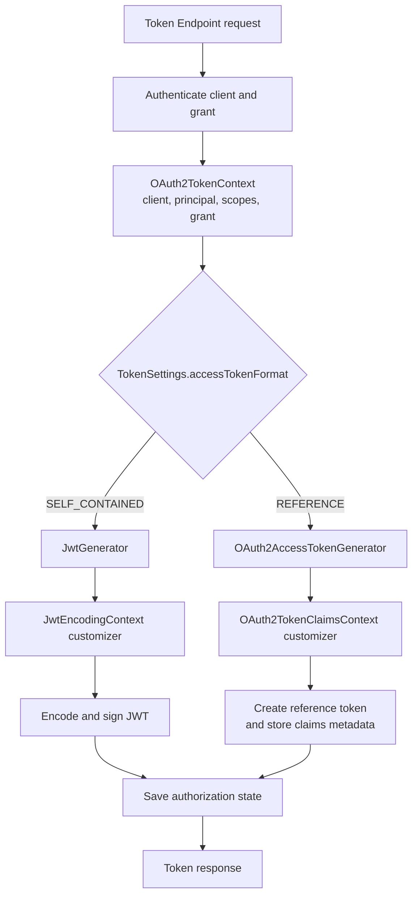
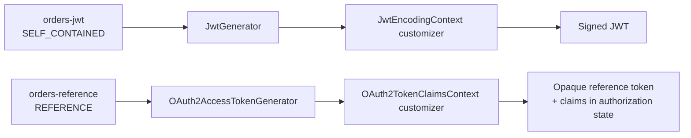

# OAuth2TokenCustomizer for JWT and Reference Access Tokens

In Spring Authorization Server, an access token can be issued as a **self-contained JWT** or a **reference token (opaque)**. Both can carry information about the subject, client, and access privileges, but the way claims are generated, stored, and read back differs.

**`OAuth2TokenCustomizer`** is the extension point that lets an application add or adjust claims during token issuance. When issuing a JWT, the customizer receives **`JwtEncodingContext`**; when issuing a reference access token, it receives **`OAuth2TokenClaimsContext`**. These two contexts serve two different token generators, so you must select the right generic type and attach the customizer to the right generator.

This lesson belongs to the **Tokens and claims** chapter of the **SPRING_SECURITY_OAUTH2_OIDC_AUTHORIZATION_SERVER** module, focusing on designing, configuring, securing, testing, and operating an OAuth 2.0/OpenID Connect Authorization Server with Spring Security and Spring Authorization Server in Spring Boot.

After this lesson, you will be able to:

- Distinguish JWT access tokens from reference access tokens and understand how claims are stored and distributed.
- Use `OAuth2TokenCustomizer` with `JwtEncodingContext` and `OAuth2TokenClaimsContext`.
- Choose the access token format per `RegisteredClient` via `TokenSettings.accessTokenFormat`.
- Add custom claims from the principal, client registration, and trusted business data.
- Preserve standard claims such as `iss`, `sub`, `aud`, `exp`, `iat`, and `scope`.
- Configure a Resource Server to verify JWTs or introspect opaque tokens, and consume custom claims safely.
- Test token generators, introspection, and scenarios involving missing, untrusted, or over-privileged claims.

## 1. Where Does OAuth2TokenCustomizer Fit in Token Issuance?

When a client sends a valid token request, Spring Authorization Server resolves the grant, client, principal, scopes, and authorization context. The matching token generator creates the access token; the customizer is invoked to add information according to application policy.



| Token format | Generator | Customizer context | How are claims used? |
| --- | --- | --- | --- |
| Self-contained JWT | `JwtGenerator` | `JwtEncodingContext` | Claims are embedded into the JWT and protected by a JWS signature. |
| Reference/opaque | `OAuth2AccessTokenGenerator` | `OAuth2TokenClaimsContext` | Claims are attached to server-side authorization/token metadata, typically returned to the Resource Server via introspection. |

**You cannot use a single arbitrary generic customizer for both token types.** An `OAuth2TokenCustomizer<JwtEncodingContext>` bean does not customize reference token claims; an `OAuth2TokenCustomizer<OAuth2TokenClaimsContext>` does not modify JWT payloads signed by `JwtGenerator`.

## 2. How Do JWT and Reference Access Tokens Differ?

### 2.1. Self-Contained JWT

A JWT normally consists of three Base64URL segments:

```text
BASE64URL(header).BASE64URL(payload).BASE64URL(signature)
```

The payload can contain `iss`, `sub`, `aud`, `exp`, `iat`, `scope`, and custom claims. The Resource Server can verify the signature using the public key/JWKS and validate claims without calling the Authorization Server on every request, if policy permits offline verification.

JWTs are **not encrypted by default**. Anyone holding the token can read the payload. The signature protects integrity, not confidentiality; do not put passwords, secrets, sensitive personal data, or unnecessary internal information into claims.

### 2.2. Reference/Opaque Access Token

A reference access token is normally an unguessable string that does not contain directly readable claims:

```text
2YotnFZFEjr1zCsicMWpAA
```

The value above is only illustrative. The Resource Server does not decode the token as a JWT; it sends the token to the Authorization Server's **introspection endpoint**. The AS looks up authorization state and returns metadata to the authenticated Resource Server.

Custom claims are stored in the authorization/token metadata per Spring Authorization Server's mechanism. They can appear in the introspection response if the token is active and the endpoint returns those claims.

### 2.3. Operational Comparison

| Criterion | Self-contained JWT | Reference/opaque |
| --- | --- | --- |
| Reading claims | Decode payload after verifying signature. | Receive claims via introspection or equivalent status service. |
| Per-request check | Can verify offline. | Typically calls introspection or caches results. |
| Revocation before `exp` | Does not take immediate effect on APIs that only verify JWTs offline. | Can reflect revocation status faster, depending on cache and availability. |
| AS dependency | JWKS/signing keys and cache policy. | Introspection endpoint and authorization state store. |
| Claim exposure surface | Claims live inside the token held by the client. | Claims are not in the opaque string; returned to Resource Servers authorized to introspect. |
| Customizer | `OAuth2TokenCustomizer<JwtEncodingContext>` | `OAuth2TokenCustomizer<OAuth2TokenClaimsContext>` |

Token format is an architectural decision. Weigh introspection load, latency, availability, revocation requirements, and data exposure constraints.

## 3. Selecting the Access Token Format per RegisteredClient

In Spring Authorization Server, the access token format is configured via `TokenSettings` on each `RegisteredClient`:

- `OAuth2TokenFormat.SELF_CONTAINED`: JWT access token.
- `OAuth2TokenFormat.REFERENCE`: reference/opaque access token.

Example of two backend clients with different formats:

```java
import java.time.Duration;

import org.springframework.security.oauth2.server.authorization.settings.OAuth2TokenFormat;
import org.springframework.security.oauth2.server.authorization.settings.TokenSettings;

TokenSettings jwtTokenSettings = TokenSettings.builder()
    .accessTokenFormat(OAuth2TokenFormat.SELF_CONTAINED)
    .accessTokenTimeToLive(Duration.ofMinutes(10))
    .build();

TokenSettings referenceTokenSettings = TokenSettings.builder()
    .accessTokenFormat(OAuth2TokenFormat.REFERENCE)
    .accessTokenTimeToLive(Duration.ofMinutes(5))
    .build();
```

Attaching the policy to each client:

```java
RegisteredClient jwtClient = RegisteredClient.withId("orders-jwt-id")
    .clientId("orders-jwt")
    .clientAuthenticationMethod(ClientAuthenticationMethod.CLIENT_SECRET_BASIC)
    .authorizationGrantType(AuthorizationGrantType.CLIENT_CREDENTIALS)
    .scope("orders.read")
    .tokenSettings(jwtTokenSettings)
    .build();

RegisteredClient referenceClient = RegisteredClient.withId("orders-reference-id")
    .clientId("orders-reference")
    .clientAuthenticationMethod(ClientAuthenticationMethod.CLIENT_SECRET_BASIC)
    .authorizationGrantType(AuthorizationGrantType.CLIENT_CREDENTIALS)
    .scope("orders.read")
    .tokenSettings(referenceTokenSettings)
    .build();
```

This is a registration snippet assuming secrets are managed properly and other Authorization Server beans exist. With a durable repository, internal IDs must remain stable.

**Note:** `accessTokenFormat` controls the access token format for the registered client. It does not turn OIDC ID tokens into opaque tokens, nor does it dictate the format of authorization codes or refresh tokens.

## 4. OAuth2TokenCustomizer for JWT Access Tokens

### 4.1. What Does JwtEncodingContext Provide?

`JwtEncodingContext` holds the JWT issuance context, including:

- `getRegisteredClient()`: the client being processed.
- `getPrincipal()`: the authentication principal tied to the grant.
- `getAuthorizationGrantType()`: the grant type, e.g., authorization code or client credentials.
- `getAuthorizedScopes()`: the set of authorized scopes.
- `getAuthorization()`: the authorization state if present.
- `getTokenType()`: the type of token being generated.
- `getClaims()`: builder to add or adjust JWT claims.
- `getJwsHeader()`: builder for the JWS header when genuinely needed.

A customizer should check `tokenType` before adding claims. The same `JwtGenerator` can be used for both JWT access tokens and ID tokens; without filtering, API-specific claims may accidentally leak into ID tokens.

### 4.2. Example Adding `tenant_id` from a Trusted Source

Suppose the application has an internal `TenantDirectory` service that determines the tenant from the authentication principal, registered client, and grant type. This is an application-specific business interface, **not a built-in Spring Authorization Server class**.

```java
package com.example.authserver.token;

import java.util.Optional;

import org.springframework.security.core.Authentication;
import org.springframework.security.oauth2.core.AuthorizationGrantType;
import org.springframework.security.oauth2.server.authorization.client.RegisteredClient;

public interface TenantDirectory {

    Optional<String> findTenantId(
        Authentication principal,
        RegisteredClient registeredClient,
        AuthorizationGrantType grantType
    );
}
```

Customizer for JWT access tokens:

```java
package com.example.authserver.token;

import org.springframework.context.annotation.Bean;
import org.springframework.context.annotation.Configuration;
import org.springframework.security.oauth2.server.authorization.OAuth2TokenType;
import org.springframework.security.oauth2.server.authorization.token.JwtEncodingContext;
import org.springframework.security.oauth2.server.authorization.token.OAuth2TokenCustomizer;

@Configuration(proxyBeanMethods = false)
public class JwtAccessTokenCustomizerConfig {

    @Bean
    OAuth2TokenCustomizer<JwtEncodingContext> jwtAccessTokenCustomizer(
            TenantDirectory tenantDirectory) {

        return context -> {
            if (!OAuth2TokenType.ACCESS_TOKEN.equals(
                    context.getTokenType())) {
                return;
            }

            tenantDirectory.findTenantId(
                    context.getPrincipal(),
                    context.getRegisteredClient(),
                    context.getAuthorizationGrantType()
                )
                .ifPresent(tenantId ->
                    context.getClaims().claim("tenant_id", tenantId)
                );
        };
    }
}
```

Key points:

1. Only add `tenant_id` for `ACCESS_TOKEN`; do not add this claim to every JWT by default.
2. The tenant comes from a server-side service, not directly from a query parameter, form field, or arbitrary client header.
3. The service must distinguish user principals from client principals. For `client_credentials`, the tenant must be derived from the authenticated service/client identity or registration; never assume the principal is always a user.
4. If no tenant can be determined, do not invent a broad default like `public`. The application can refuse to issue the token when tenant is mandatory.
5. Do not overwrite `sub` with the tenant ID. Subject and tenant are two distinct concepts.

### 4.3. Only Add Necessary Claims

You can add claims classifying token purpose or schema version:

```java
context.getClaims()
    .claim("token_schema_version", 1)
    .claim("token_purpose", "orders-api");
```

These values are only useful if assigned by **server-side policy**. If a client can send `token_purpose=admin-api` and the customizer copies it verbatim, the token can be misinterpreted.

For scope, audience, subject, and expiration, prefer letting the standard generator and authorization policy handle them. Customizers should only add specialized claims when there is a clear requirement.

## 5. OAuth2TokenCustomizer for Reference Access Tokens

Reference tokens do not carry a JWT payload for the Resource Server to decode on its own. `OAuth2AccessTokenGenerator` creates the reference token and stores claims metadata alongside the authorization state. To add claims in this case, use:

`OAuth2TokenCustomizer<OAuth2TokenClaimsContext>`

### 5.1. OAuth2TokenClaimsContext

This context provides what is needed to customize claims on reference access tokens, including registered client, principal, authorization grant type, authorized scopes, token type, and claims builder.

The builder lets you add claims to the claim set constructed for the access token. No signed JWT payload is created for the client to read directly.

### 5.2. Example Customizer for Opaque Access Tokens

Using the same `TenantDirectory` described above:

```java
package com.example.authserver.token;

import org.springframework.context.annotation.Bean;
import org.springframework.context.annotation.Configuration;
import org.springframework.security.oauth2.server.authorization.OAuth2TokenType;
import org.springframework.security.oauth2.server.authorization.token.OAuth2TokenClaimsContext;
import org.springframework.security.oauth2.server.authorization.token.OAuth2TokenCustomizer;

@Configuration(proxyBeanMethods = false)
public class ReferenceAccessTokenCustomizerConfig {

    @Bean
    OAuth2TokenCustomizer<OAuth2TokenClaimsContext>
            referenceAccessTokenCustomizer(
                TenantDirectory tenantDirectory) {

        return context -> {
            if (!OAuth2TokenType.ACCESS_TOKEN.equals(
                    context.getTokenType())) {
                return;
            }

            tenantDirectory.findTenantId(
                    context.getPrincipal(),
                    context.getRegisteredClient(),
                    context.getAuthorizationGrantType()
                )
                .ifPresent(tenantId ->
                    context.getClaims().claims(claims ->
                        claims.put("tenant_id", tenantId)
                    )
                );
        };
    }
}
```

In a reference customizer:

- `context.getClaims().claims(...)` lets you manipulate the claims map built for the access token.
- Claims are persisted alongside authorization/token metadata so the AS can use them during introspection.
- The opaque string received by the client does not contain `tenant_id` directly. The Resource Server must introspect the token to retrieve it.
- If the token is expired or inactive, the Resource Server must not use those claims to grant access.

### 5.3. Why Does the Reference Customizer Not Modify JWTs?

`OAuth2TokenClaimsContext` is used by the generator that creates reference access tokens. It is not `JwtEncodingContext` and has no JWS header/payload builder. If a client is registered with `SELF_CONTAINED`, the reference customizer is not where you add claims to the JWT.

Conversely, a JWT customizer does not replace storing claims metadata for reference tokens. Choose the right context based on **the token format the registered client uses**.

## 6. Configuring Both Customizers in the Same Authorization Server

An application may serve multiple clients with different token formats:



You can declare two customizer beans with different generic types in the same application context:

```java
@Bean
OAuth2TokenCustomizer<JwtEncodingContext> jwtCustomizer(
        TenantDirectory tenantDirectory) {
    // Claims for JWT access tokens
}

@Bean
OAuth2TokenCustomizer<OAuth2TokenClaimsContext> referenceCustomizer(
        TenantDirectory tenantDirectory) {
    // Claims for reference access tokens
}
```

With the standard token generator configuration of your Spring Authorization Server version, register customizer beans with the exact generic contexts supported by the framework. If your application **creates or replaces `OAuth2TokenGenerator` manually**, attach each customizer to the proper generator; do not assume beans will be invoked automatically.

Component-level wiring example, used only when you manage generators directly:

```java
JwtGenerator jwtGenerator = new JwtGenerator(jwtEncoder);
jwtGenerator.setJwtCustomizer(jwtCustomizer);

OAuth2AccessTokenGenerator referenceGenerator =
    new OAuth2AccessTokenGenerator();
referenceGenerator.setAccessTokenCustomizer(referenceCustomizer);
```

Then place the required generators into `DelegatingOAuth2TokenGenerator` alongside any other generators, such as the refresh token generator. Do not replace the default generator with a configuration missing essential components.

**Avoid declaring multiple customizers with the same generic type expecting Spring to automatically order them.** If multiple policies write the same claim, merge the logic or use an explicitly ordered composite service.

## 7. Do Not Overwrite Standard Claims or Turn Claims into Arbitrary Privileges

A JWT access token may contain standard claims:

| Claim | Meaning | Notes |
| --- | --- | --- |
| `iss` | Issuer that issued the token. | Must match the issuer trusted by the Resource Server. |
| `sub` | Token subject. | May be a user or client principal depending on grant. |
| `aud` | Audience/target recipient. | Resource Server must validate its own audience. |
| `exp` | Expiration time. | Validator rejects expired tokens per clock-skew policy. |
| `iat` | Issued-at time. | Do not infer session lifetime without a policy. |
| `jti` | Token identifier if issued. | Does not create a revocation mechanism by itself. |
| `scope` | Granted OAuth permissions. | Does not replace per-object authorization. |

Exact default claims depend on the token generator, grant, and version. Customizers should add business claims, not replace standard claims unless there is an explicit protocol requirement.

Dangerous examples:

```java
// Do NOT do this: overwriting subject with request data.
context.getClaims().claim("sub", request.getParameter("user"));

// Do NOT do this: conflicting with the TTL managed by TokenSettings.
context.getClaims().claim(
    "exp",
    Instant.now().plus(Duration.ofDays(365)).getEpochSecond()
);
```

To change TTL, configure `TokenSettings`. To change audience, design a controlled audience policy. To change subject, change the appropriate authentication/authorization flow—never pull it from client input.

### 7.1. Subject Is Not Always a User

In `authorization_code`, the principal usually represents the authenticated user. In `client_credentials`, the principal represents the client/service. Therefore, do not write:

```java
String userId = context.getPrincipal().getName();
context.getClaims().claim("user_id", userId);
```

and apply it to every grant while calling that value a user ID. For a service principal, `getName()` may be the client ID. Branch on `getAuthorizationGrantType()` and your application's identity model.

### 7.2. Role/Authority Claims Need Standardization

If adding roles to JWTs, determine:

- Where do roles come from and were they verified at issuance time?
- Are roles global, tenant-specific, or resource-specific?
- When a role is revoked, how long do in-flight tokens remain valid?
- Which authorities does the Resource Server map role strings to?
- Does a role grant access to all records, or are object-level policies still required?

Do not copy every `GrantedAuthority` into claims just for convenience. There may be internal authorities not meant for APIs, or role names that differ across services.

## 8. Claims and Privacy

| Data type | Recommendation |
| --- | --- |
| Non-sensitive tenant ID | Suitable if the API needs tenant boundary identification; take from server-side source. |
| Short, stable role list | Usable when standardized and paired with appropriate revocation/TTL policy. |
| Email, full name, phone number | Include only if the API needs it; avoid spreading PII across services. |
| Passwords, client secrets, private keys | **Never** place in token claims. |
| Payment/health info or detailed business data | Do not embed wholesale in tokens; query protected data sources when needed. |
| Self-reported request data | Untrusted; include in tokens only after server verification and policy approval. |

JWT payloads can be read by anyone holding the token. Opaque tokens do not expose claims directly, but the introspection endpoint can reveal claims to authenticated Resource Servers; still restrict introspection permissions and response attributes.

**Do not use custom claims to replace database lookups** when data changes constantly or requires immediate revocation. A token is a snapshot at issuance time.

## 9. How Does the Resource Server Use Claims?

### 9.1. With JWT Access Tokens

The Resource Server can configure the issuer:

```yaml
spring:
  security:
    oauth2:
      resourceserver:
        jwt:
          issuer-uri: https://login.example.com
```

Once signature, issuer, and expiration are verified, the application can read custom claims via `Jwt`:

```java
import org.springframework.security.core.annotation.AuthenticationPrincipal;
import org.springframework.security.oauth2.jwt.Jwt;

@GetMapping("/orders/context")
Map<String, Object> context(@AuthenticationPrincipal Jwt jwt) {
    String tenantId = jwt.getClaimAsString("tenant_id");

    // Use tenantId in a service that enforces resource permissions.
    return ordersContextService.describe(jwt.getSubject(), tenantId);
}
```

This is an illustrative example; `ordersContextService` is an application service. Before using `tenant_id` in queries, the API must verify the token came from a trusted issuer and enforce record-level access permissions.

**Issuer validation does not automatically ensure audience validation.** Configure an appropriate validator requiring `aud` to contain the target API's identifier. If a JWT has `tenant_id` but the Resource Server fails to check issuer/audience, the custom claim provides no security boundary.

### 9.2. With Reference Access Tokens

The Resource Server uses the introspection endpoint:

```yaml
spring:
  security:
    oauth2:
      resourceserver:
        opaquetoken:
          introspection-uri: https://login.example.com/oauth2/introspect
          client-id: shipping-api
          client-secret: ${SHIPPING_INTROSPECTION_SECRET}
```

The Resource Server must be registered/permitted to introspect tokens per AS policy. The client secret is a credential used to authenticate to the introspection endpoint; store it in a secret manager/environment, never commit it to source code.

After successful introspection, Spring Security creates an `OAuth2AuthenticatedPrincipal` populated with attributes from the response. Custom claims can be read as follows:

```java
import org.springframework.security.core.annotation.AuthenticationPrincipal;
import org.springframework.security.oauth2.core.OAuth2AuthenticatedPrincipal;

@GetMapping("/orders/context")
Map<String, Object> context(
        @AuthenticationPrincipal OAuth2AuthenticatedPrincipal principal) {

    String tenantId = principal.getAttribute("tenant_id");
    return ordersContextService.describe(principal.getName(), tenantId);
}
```

If custom claims are persisted and returned in the introspection response, the Resource Server can read them as attributes. If a claim is missing, verify that the reference customizer was called, the token was issued with `REFERENCE`, and the introspection response includes the claims metadata.

### 9.3. Do Not Treat Opaque Tokens as JWTs

```java
// Wrong: a reference token is not a JWT payload to decode.
String[] parts = opaqueToken.split("\\.");
```

An opaque token is solely a reference to AS-managed state. The Resource Server must introspect it or use an equivalent status-checking mechanism. Likewise, do not call introspection for JWTs on every request if your system chose offline validation, unless policy requires live state checking.

## 10. Audience, Scope, and Custom Claims Must Be Consistent

A custom claim like `tenant_id` does not establish an audience by itself. An access token for `orders-api` needs an `aud` matching that API; a token for `shipping-api` must be issued/authorized for Shipping.

- `scope` describes granted OAuth permissions.
- `aud` identifies the intended recipient.
- `sub` identifies the subject.
- `tenant_id` can indicate the verified tenant context.
- `roles` can supplement role information per policy.

Do not issue JWTs with an overly broad `aud` and rely on `tenant_id` for every API to guess permissions. Each API must verify its own audience; custom claims only add context and do not erase trust boundaries.

## 11. Testing OAuth2TokenCustomizer

Verify both **that the customizer is called correctly** and **that the Resource Server consumes claims properly**.

### 11.1. Test Matrix

| Scenario | Expected result |
| --- | --- |
| Client uses `SELF_CONTAINED` | Access token is a JWT and custom claims are signed inside the payload. |
| Client uses `REFERENCE` | Access token is opaque and its payload cannot be decoded as a JWT. |
| JWT access token | `JwtEncodingContext` customizer is called for token type ACCESS_TOKEN. |
| JWT ID token | API-only claims are not accidentally added when filtering by ACCESS_TOKEN. |
| Reference access token | `OAuth2TokenClaimsContext` customizer is called for the reference generator. |
| Tenant directory returns valid tenant | `tenant_id` claim is added accurately. |
| Tenant directory finds no tenant | No bad default value issued; if tenant is required, policy rejects token. |
| Client credentials | Principal is classified as client/service, not misassigned as user ID. |
| Authorization code | User/tenant claims come from principal and appropriate server-side data. |
| Request sends a different `tenant_id` | Customizer ignores the client-supplied value. |
| Switching token format JWT to REFERENCE | Customizer matching the new generator is used. |
| Opaque token introspection | Claims metadata returned to authorized Resource Servers. |
| JWT Resource Server | Signature, issuer, audience, exp, and scope verified before using custom claims. |
| Missing or wrong-typed claim | API rejects or handles per contract; no unsafe casting. |
| Multiple customizers with same generic type | Ordering/overrides explicitly controlled. |
| Token issued before policy change | Old tokens retain snapshot claims; new tokens apply new policy. |
| Expired/revoked token | Resource Server stops trusting claims from inactive tokens. |

### 11.2. JWT Integration Test

An integration test should:

1. Register a client with `accessTokenFormat(SELF_CONTAINED)`.
2. Send a valid token request.
3. Use `JwtDecoder` to **verify the signature** before reading claims.
4. Assert `tenant_id` matches the TenantDirectory test fixture.
5. Assert `iss`, `sub`, `aud`, `exp`, and `scope` remain valid.
6. Send the token to the Resource Server and verify audience/scope/tenant policies.
7. Ensure API-only claims are not added to ID tokens if the app issues OIDC ID tokens.

Do not merely Base64-decode the payload and conclude the token is valid.

### 11.3. Reference Token Integration Test

A reference token test should:

1. Register a client with `accessTokenFormat(REFERENCE)`.
2. Send a token request and receive an opaque string.
3. Call the introspection endpoint using an authorized Resource Server client.
4. Assert `active=true`, `scope`, and the custom `tenant_id` claim are correct.
5. Revoke the token or let it expire and re-introspect; verify `active` is no longer true per AS state.
6. Verify a client without introspection permission cannot read claims.
7. Verify the opaque token is not processed by a JWT decoder.

### 11.4. Untrusted Input Test

Send a request containing `tenant_id=tenant-admin` or header `X-Tenant-ID: tenant-admin` while TenantDirectory returns `tenant-user`. The issued token must only contain the value from the server-side source. If the request specifies an invalid tenant, policy must reject it rather than overwriting claims.

## 12. Common Mistakes and Fixes

### 12.1. JWT Customizer Is Not Invoked

Verify the client uses `SELF_CONTAINED`, `JwtGenerator` is in the token generator chain, the customizer bean has the exact generic type, and the token request generates the expected token type. If you replaced `OAuth2TokenGenerator` yourself, attach the customizer via its setter.

### 12.2. Reference Token Lacks Custom Claims in Introspection

Check `accessTokenFormat(REFERENCE)`, `OAuth2AccessTokenGenerator`, `OAuth2TokenCustomizer<OAuth2TokenClaimsContext>`, and `setAccessTokenCustomizer` configuration if managing generators manually. Check that authorization state is persisted and the introspection response returns claims metadata.

### 12.3. Claim Appears Unexpectedly in ID Token

The JWT customizer may be called for more than one kind of JWT. Check `OAuth2TokenType.ACCESS_TOKEN` before adding API-specific claims. If a claim is specifically for OIDC ID tokens, apply the corresponding policy and token type.

### 12.4. Resource Server Does Not See `tenant_id`

For JWTs, verify the token was issued after deploying the customizer and that the Resource Server reads the right claim name/type. For reference tokens, inspect the introspection response and introspection client permissions. Ensure the claim is not dropped by application claim conversion/mapping.

### 12.5. Claims Overwritten or Lost

Look for multiple customizers writing the same claim name, a custom token generator replacing the default generator, or code overwriting standard claims. Consolidate logic in an explicit order, and never clear the entire claims map and add only a few fields.

### 12.6. JWT Has `tenant_id` but Accesses Wrong Tenant

The claim may have been added properly, while the `TenantDirectory` source or Resource Server policy is flawed. Check the principal->tenant mapping, issuer, audience, tenant isolation, and object-level authorization. Never treat a claim's presence as proof the user may read every record in that tenant.

### 12.7. Token Format Changed While Client/API Uses the Old Approach

A JWT Resource Server cannot read an opaque token; an opaque Resource Server does not introspect a JWT under the reference contract. Synchronize format changes across clients, APIs, caches, introspection secrets, and rollout stages.

## 13. Operations and Claim Schema Changes

### 13.1. Claims Are a Snapshot at Issuance Time

When a customizer adds `tenant_id` or `roles`, the token reflects data the server read **at issuance time**. If a user switches tenants, loses a role, or a client changes policy, old tokens may continue carrying old claims until expiration or a live state check.

If fast updates are required:

- Use shorter access token TTLs based on risk.
- With reference tokens, introspection/cache policies can reflect state changes faster.
- With JWTs, consider revocation/denylists or dynamic permission lookups when SLAs require it.
- Do not put rapidly changing permissions into tokens and expect tokens to update themselves.

### 13.2. Versioning Custom Claims

If Resource Servers depend on a claim schema, you can publish an explicit version:

```json
{
  "tenant_id": "tenant-a",
  "token_schema_version": 2
}
```

When changing schemas:

1. Add the new version that APIs can understand.
2. Deploy Resource Servers supporting both old and new schemas during the transition window.
3. Switch the customizer to emit the new schema.
4. Wait for old tokens to expire/be revoked.
5. Remove old schema support after the compatibility window.

Never change the semantics of a claim used by multiple APIs without versioning and contract tests.

### 13.3. Observe Without Logging Tokens

Track token issuance counts by format, customizer errors, introspection latency, claim schema versions, and missing-tenant errors. Logs can include client ID, grant type, correlation ID, and controlled policy outcomes; never log raw JWTs, opaque tokens, refresh tokens, client secrets, or full claims containing PII.

If the customizer fails to query `TenantDirectory`, explicitly enforce **fail closed** when tenant is a mandatory security condition. Never swallow exceptions and issue a token lacking a tenant if the Resource Server relies on that claim for tenant isolation.

## 14. Practice: Same Claim Across Two Token Formats

An Authorization Server issues tokens to two clients:

| Client | Token format | API |
| --- | --- | --- |
| `orders-jwt` | `SELF_CONTAINED` | `orders-api` |
| `orders-reference` | `REFERENCE` | `orders-api` |

Both need a `tenant_id` claim sourced from `TenantDirectory`. Design and answer:

1. How do the two `TokenSettings` differ?
2. Why does the JWT client require `OAuth2TokenCustomizer<JwtEncodingContext>`?
3. Why does the reference client require `OAuth2TokenCustomizer<OAuth2TokenClaimsContext>`?
4. If only the JWT customizer is declared, will the reference token receive the claim?
5. How does the Resource Server read `tenant_id` from a JWT vs. an opaque token?
6. If `TenantDirectory` finds no tenant, should `tenant_id=default` be added?
7. With `client_credentials`, whom does `sub` represent? Can it be treated as a user ID?
8. If a `roles` claim is revoked after token issuance, will the API know immediately?
9. How do you verify audience and scope before using a tenant claim in queries?
10. When changing the `tenant_id` schema, how do you roll out old and new APIs?

**Hint:** The two token formats use separate generators and contexts, yet share the same trusted business data source. Resource Servers need corresponding verification; custom claims only add context and do not replace issuer/audience/scope or per-record authorization.

## 15. OAuth2TokenCustomizer Implementation Checklist

- [ ] Each client explicitly chooses an access token format via `TokenSettings.accessTokenFormat`.
- [ ] JWT access tokens use `OAuth2TokenCustomizer<JwtEncodingContext>`.
- [ ] Reference access tokens use `OAuth2TokenCustomizer<OAuth2TokenClaimsContext>`.
- [ ] Customizer checks `OAuth2TokenType.ACCESS_TOKEN` when claims are API-only.
- [ ] If replacing the default token generator, customizers are attached to the right `JwtGenerator` or `OAuth2AccessTokenGenerator`.
- [ ] Claims come from verified principals, registrations, and server-side data; never copied directly from requests/headers.
- [ ] Standard `iss`, `sub`, `aud`, `exp`, `iat`, and `scope` are not overwritten without an explicit protocol design.
- [ ] User principals and client/service principals are distinguished by grant type.
- [ ] Custom claims are minimized and contain no secrets or unnecessary PII.
- [ ] JWT Resource Servers verify signature, issuer, audience, expiration, and scopes.
- [ ] Opaque Resource Servers use authenticated introspection and receive only necessary metadata.
- [ ] APIs do not treat custom claims as absolute permissions; tenant and object-level authorization are still enforced.
- [ ] Tests cover both token formats, matching customizer contexts, introspection, and revoked/expired tokens.
- [ ] A policy exists when a claim source is unavailable; fail closed if the claim is a security requirement.
- [ ] Claims schemas have a versioning/rollout plan if multiple Resource Servers depend on them.
- [ ] Logs/metrics never expose raw tokens or sensitive data in claims.

**Remember:** JWT and reference access tokens use **two different customizer contexts**. `JwtEncodingContext` adds claims into signed JWTs; `OAuth2TokenClaimsContext` adds claims into reference token metadata managed by the Authorization Server and optionally returned via introspection. Choosing the right token format, customizer, and data source keeps claims consistent; the Resource Server must still validate tokens and enforce authorization by audience, scope, tenant, and resource.

**References:**

- [Spring Authorization Server — How-to: Customize the JWT](https://docs.spring.io/spring-authorization-server/reference/guides/how-to-custom-claims-authorities.html): custom claims and `OAuth2TokenCustomizer<JwtEncodingContext>`.
- [Spring Authorization Server — Core Model and Components](https://docs.spring.io/spring-authorization-server/reference/core-model-components.html): `RegisteredClient`, `TokenSettings`, token generators, and authorization state.
- [Spring Authorization Server — Protocol Endpoints](https://docs.spring.io/spring-authorization-server/reference/protocol-endpoints.html): Token Endpoint and token generation extension points.
- [Spring Security — OAuth2 Resource Server JWT](https://docs.spring.io/spring-security/reference/servlet/oauth2/resource-server/jwt.html): verifying JWTs, issuers, and claims.
- [Spring Security — OAuth2 Resource Server Opaque Token](https://docs.spring.io/spring-security/reference/servlet/oauth2/resource-server/opaque-token.html): introspection and `OAuth2AuthenticatedPrincipal`.
- [RFC 6749 — OAuth 2.0 Authorization Framework](https://www.rfc-editor.org/rfc/rfc6749.html): access tokens, scopes, and token responses.
- [RFC 7662 — OAuth 2.0 Token Introspection](https://www.rfc-editor.org/rfc/rfc7662.html): token status and metadata returned to Resource Servers.
- [RFC 7519 — JSON Web Token](https://www.rfc-editor.org/rfc/rfc7519.html): registered claims and JWT structure.
