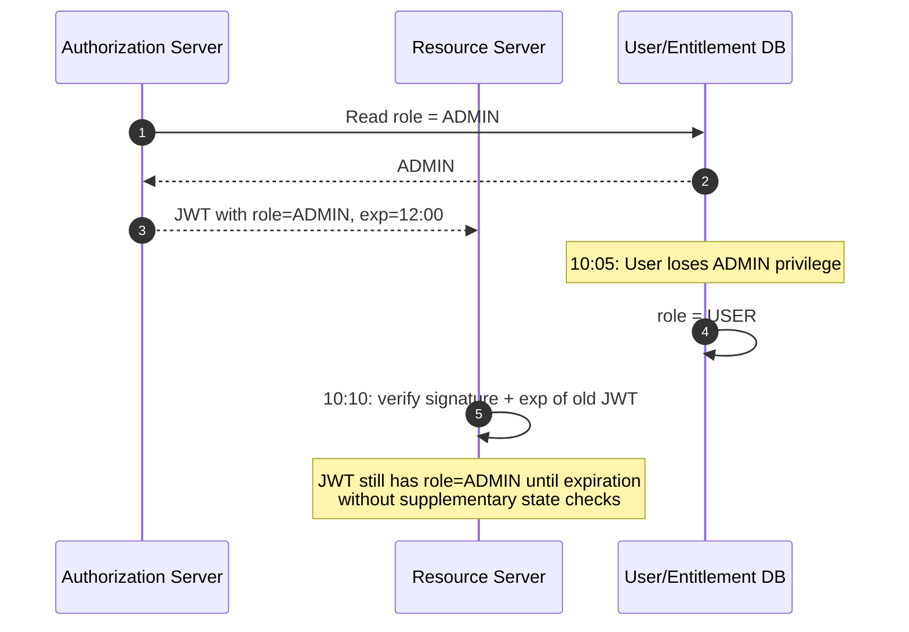

# Controlling Token Size, Personal Information, and Mutable Data

## 1. Why Must Token Contents Be Designed Carefully?

In the **Tokens and claims** chapter of the **SPRING_SECURITY_OAUTH2_OIDC_AUTHORIZATION_SERVER** module, we learn how to design, configure, secure, test, and operate an OAuth 2.0/OpenID Connect Authorization Server using Spring Security and Spring Authorization Server in a Spring Boot application.

When an Authorization Server issues a JWT Access Token, adding claims is tempting: username, email, phone number, role lists, department, groups, tenant, address, and many other attributes can all be placed in the payload. However, the more data a token carries:

- The larger HTTP requests between services become, risking header or proxy limits.
- Personal information gets copied to more systems and storage locations.
- Mutable data can become stale while the token remains valid.
- A change in claim structure can affect multiple Resource Servers and clients.
- If a token leaks, the amount of data readable by whoever holds it increases.

Therefore, token design is not a contest to cram as much information as possible into a JWT. The goal is **to include only the claims needed for the intended purpose, with appropriate lifetimes and trust boundaries**.

For example, an Access Token used to call `inventory-api` may need only `iss`, `sub`, `aud`, `exp`, and `scope=inventory.read`. The API can fetch user profile information from an appropriate source when genuinely needed. There is no need to attach full name, email, phone number, home address, and account history to every request.

### Learning Objectives

After this lesson, learners will be able to:

1. Explain JWT structure and factors affecting JWT size.
2. Distinguish data that belongs in an Access Token, ID Token, UserInfo, or profile API.
3. Apply personal-data minimization principles and avoid putting secrets into claims.
4. Classify stable claims vs. mutable data; understand update latency in self-contained tokens.
5. Choose between self-contained JWTs and opaque/reference tokens based on performance, state, and revocation needs.
6. Use `OAuth2TokenCustomizer<JwtEncodingContext>` within proper bounds to add permitted claims.
7. Test token size, sensitive content, audience, scope, TTL, and data staleness.

## 2. JWT Structure and What Makes Tokens Large

### 2.1. A Signed JWT Does Not Mean an Encrypted JWT

A compact JWS JWT typically has three parts:

```text
BASE64URL(protected-header)
.
BASE64URL(payload)
.
BASE64URL(signature)
```

Example:

```text
eyJhbGciOiJSUzI1NiIsImtpZCI6ImtleS0xIn0
.
eyJpc3MiOiJodHRwczovL2F1dGguZXhhbXBsZS5jb20iLCJzdWIiOiJ1c2VyLTEyMyJ9
.
<signature>
```

Base64URL is merely an encoding for transmitting data in URLs/headers. Anyone holding a JWT can usually decode the header and payload **without needing the public key**. The signature detects tampering and authenticates the issuer; it **does not conceal** the contents.

If a token is a JWE, the data is encrypted in a different format, though encryption adds complexity and typically increases size. Nor is JWE a reason to put passwords, private keys, or unnecessary data into tokens.

### 2.2. Where Does Size Come From?

Compact JWT size depends on:

- Header: `alg`, `kid`, `typ`, and other JOSE parameters.
- Payload: claim names, string values, arrays, nested objects, number of roles/scopes, and Unicode data.
- Signature: depends on the algorithm and key/signature size.
- Base64URL: expands binary data relative to the original JSON/binary bytes.

With every new claim, not only the value adds size; **the claim name, braces, commas, quotes, and JSON structure** also consume bytes.

Compact payload example:

```json
{
  "iss": "https://auth.example.com",
  "sub": "u-8f21",
  "aud": ["inventory-api"],
  "scope": "inventory.read",
  "iat": 1790000000,
  "exp": 1790000600
}
```

Bloated payload:

```json
{
  "iss": "https://auth.example.com",
  "sub": "u-8f21",
  "aud": ["inventory-api"],
  "scope": "inventory.read",
  "name": "Nguyen Van A",
  "email": "user@example.com",
  "phone_number": "+84000000000",
  "home_address": "A long residential address ...",
  "roles": ["ROLE_USER", "ROLE_SUPPORT", "ROLE_REPORT_VIEWER"],
  "all_permissions": ["p1", "p2", "p3", "many-more-permissions"],
  "departments": ["dept-a", "dept-b", "dept-c"],
  "feature_flags": {
    "new_dashboard": true,
    "legacy_reports": false
  }
}
```

The second example is both larger and leaks far more data. Only include a field in a token when the Resource Server genuinely needs it to authenticate or authorize while the token is valid.

### 2.3. Token Size Affects the Network Path

A JWT Access Token is typically sent in an HTTP header:

```http
GET /api/inventory/items HTTP/1.1
Host: api.example.com
Authorization: Bearer <compact-access-token>
```

Large tokens inflate requests on **every API call**. When a request traverses an API gateway, reverse proxy, service mesh, and multiple backends, large headers are copied across every hop.

There is no single universal byte limit across all browsers, HTTP servers, reverse proxies, load balancers, and service meshes. Some systems cap total headers, others cap individual headers; requests can be rejected with errors such as `400`, `413`, or `431` depending on the layer and configuration. Measure against your real infrastructure rather than relying on an assumed default number.

## 3. Choosing the Right Place to Store Information

### 3.1. Access Token, ID Token, and UserInfo Serve Different Purposes

| Storage / Channel | Primary consumer | Appropriate content |
| --- | --- | --- |
| **Access Token** | Resource Server/API | Claims needed to verify the token and make access decisions: issuer, subject, audience, lifetime, minimal scopes/authorities, and required partitioning attributes. |
| **ID Token** | OIDC Client/Relying Party | User authentication outcome and OIDC claims the client is permitted to receive per scope/policy. |
| **UserInfo Endpoint** | OIDC Client with an appropriate Access Token | User profile attributes the client needs to retrieve per current permissions and policy. |
| **Profile/Directory API** | Backend authorized to call the data source | Full profile data, frequently changing data, or business data. |
| **Authorization/Entitlement Service** | Backend/Resource Server | Dynamic permissions, ownership relationships, memberships, and policies needing the latest state. |

An Access Token is not a user profile replica. If an API only needs to know which subject is calling, `sub` is usually enough; if it needs to know permissions, use appropriate scopes/authorities. If the UI needs display name, email, or avatar, the OIDC client can obtain appropriate claims from the ID Token/UserInfo per scope and consent.

### 3.2. Do Not Use an ID Token Instead of an Access Token

An ID Token is issued for an OIDC client and has the client ID as `aud`. An Access Token is issued for a Resource Server and has an audience matching the API. Both tokens may be JWTs, yet **they differ in recipient, purpose, and validation policy**.

Never send an ID Token as a Bearer credential to an API merely because it contains `sub`, `email`, or was signed by the same Authorization Server. The Resource Server must verify the exact token type, issuer, audience, and permissions.

### 3.3. Scopes Are Not a Profile Dump

`scope=profile email` means the client requested the corresponding OIDC permissions; it does not mean every profile field must be stuffed into the Access Token. Profile claims can be provided in the ID Token/UserInfo per OIDC rules, consent, and configuration. Verify exactly where Spring Authorization Server emits claims.

## 4. Minimizing Personal Information

### 4.1. Why Does PII in JWTs Get Replicated Easily?

Access Tokens normally pass through many components: client, gateway, logging middleware, tracing, APIs, and caches. Even if an application does not intentionally persist payloads, tokens can appear in:

- HTTP authorization headers or request dumps;
- error logs, traces, APM, and support tooling;
- memory caches, crash reports, or snapshots;
- end-user devices, browsers, or client storage;
- token copies across receiving services.

When a JWT carries email, phone number, address, or other attributes, every place that sees the token can read the payload if it is a standard signed JWS. **No decryption key is needed to decode a JWS payload.**

### 4.2. Fields to Consider Excluding from Access Tokens

| Data | Why it usually should not be in an Access Token | Alternative |
| --- | --- | --- |
| Full name, display name | Unnecessary for most API decisions; changes in profile. | UserInfo or profile API. |
| Email, phone number | Personal data and subject to change/re-verification. | UserInfo or profile service per permissions. |
| Home address, date of birth | More sensitive and rarely needed by every API. | Dedicated business API with strict access control. |
| Avatar URL, language, theme | Primarily for UI presentation. | Profile/preferences API or client cache. |
| Transaction history, payment details | Large, constantly changing business data. | Specialized data API. |
| Full list of all roles/permissions | Can grow very large and change; bloats tokens. | Compact scopes, entitlement service, or reference token. |
| Passwords, password hashes, OTPs | Authentication secrets; never token claims. | Never issue as claims. |
| Client secrets, private keys, other refresh tokens | Privilege-granting credentials. | Secret manager/key management, never in payloads. |
| Internal data unneeded by the API | Increases leakage and cross-service coupling. | Query only in authoritative systems. |

The list above is a design guideline; if an API has a legitimate business need for a specific attribute, document its purpose, consumers, lifetime, sensitivity level, and access controls.

### 4.3. Pseudonymous Subject

`sub` should be a stable identifier within the issuer/subject model and align with privacy policy. You do not need to use email as the subject, since emails can change, be recycled, and reveal identity.

An opaque identifier like `u-8f21` or a pairwise subject fits many architectures better. However, an opaque ID does not automatically make data anonymous: if a system holds a mapping table or can link it to a real person, it remains identifiable data in that context.

### 4.4. Signed JWTs Do Not Conceal Data

Example payload:

```json
{
  "sub": "user-123",
  "email": "person@example.com",
  "scope": "orders.read"
}
```

Anyone holding the token can decode this JSON without a secret or private key. The signature only verifies integrity and issuer. If content confidentiality between issuer and consumer is required for a special use case, evaluate JWE or an appropriate transport/lookup channel; still, **prefer keeping unnecessary data out of tokens first**. Encryption does not remove the need for data minimization and key management.

## 5. Classifying Stable Claims vs. Mutable Data

### 5.1. Stable Claims

Some claims are normally stable over a token's lifetime:

- `iss`: issuer that issued the token.
- `sub`: subject represented per the issuer's identity model.
- `aud`: intended Resource Server/recipient.
- `iat`, `exp`, `nbf`: token timestamps.
- `jti`: token identifier if used by the profile.
- `client_id` or equivalent claim: client identified per the token profile.

These values still require contextual verification. For example, `aud` varies across APIs; `sub` may be a user or service principal depending on the grant.

### 5.2. Mutable Claims

The following data can change while a JWT is still valid:

| Claim/data | When can it change? | Risk if embedded in a long-lived JWT |
| --- | --- | --- |
| `roles` / `authorities` | User loses a role, changes group, or changes function. | API keeps seeing old privileges until token expires or state is checked. |
| `tenant_id` / membership | User switches orgs or is removed from a tenant. | Old token may cross tenant boundaries if API trusts old claims alone. |
| `account_status` | Account is locked or closed. | Old token may still be accepted without a live status check. |
| `subscription_tier` | Service plan changes/expires. | Feature entitlements become stale. |
| `department` / `manager_id` | Org chart changes. | Business decisions rely on outdated data. |
| `feature_flags` | Features toggled over time. | Token carries stale snapshots and produces unpredictable behavior. |
| Fine-grained `permissions` | Per-resource permissions change frequently. | Token grows huge and revocation lags. |

### 5.3. A JWT Is a Snapshot at Issuance Time

With self-contained JWTs, the Resource Server typically verifies signatures and claims locally without asking the Authorization Server on every request. That offers strong performance and independence, yet dynamic claims are a **snapshot** at issuance time.



This is not a signature bug. The token remains intact, yet the data inside it no longer reflects current state. **Short TTLs shrink the staleness window without guaranteeing instant updates.**

## 6. Choosing Which Data to Embed in a Token

### 6.1. A Practical Decision Table

| Question | If "Yes" | If "No" |
| --- | --- | --- |
| Does the Resource Server need this claim to verify or decide on almost every request? | Consider putting a minimal value in the token. | Keep it in UserInfo/profile/an appropriate API. |
| Does the value change quickly or require immediate revocation? | Prefer lookup/introspection or a state mechanism. | A snapshot with an appropriate TTL may be acceptable. |
| Does the claim contain PII or sensitive data? | Justify purpose, minimize granularity and consumers; usually avoid in Access Tokens. | Still check necessity and size. |
| Can the claim be derived from scope or `sub`? | Avoid repeating unnecessarily. | Evaluate adding it if useful to the API. |
| Is the claim a very large list? | Use an entitlement service/reference token or compact permission groups. | Check overall size. |
| Do all Resource Servers need the exact same claim? | Candidate for a common claim. | Put only in audience-specific tokens or query in the needing service. |

### 6.2. Access Tokens Should Carry Permissions at the Right Granularity

For example, an API may only need to verify:

```text
sub = user-123
aud = inventory-api
scope = inventory.read
exp = ...
```

There is no need to include 300 fine-grained permissions per warehouse, product, and action if the API can query entitlements by `sub`/tenant or use a concise permission model.

Conversely, if an API needs offline verification of a relatively stable permission and a bounded staleness window is acceptable, a small claim can be reasonable. Base the decision on **purpose, data freshness, request volume, and lookup cost**, not a rule that "JWTs must hold everything".

### 6.3. Separating Identity Data from Authorization Data

`sub` answers "who/what does the token represent?"; `scope` or authorities answer "what kinds of operations is the token permitted to perform?"; a `tenant_id` claim if needed can constrain organizational context. Never use a field like `role=ADMIN` to replace all business, data-ownership, and tenant checks.

## 7. Strategies for Handling Mutable Data

No single approach fits every system. You can combine options:

| Strategy | How it works | Pros | Trade-offs |
| --- | --- | --- | --- |
| **Short TTL** | Tokens expire quickly; clients obtain fresh tokens. | Shrinks stale-data window. | Increases token issuance frequency; not instant revocation. |
| **Opaque/reference token + introspection** | Resource Server asks Authorization Server for token status. | Permissions/status can be updated centrally. | Adds network dependency and latency; requires bounded caching. |
| **Entitlement/authorization API** | API fetches live permissions by subject/resource. | Supports dynamic privileges and fine-grained data. | Adds lookups and requires consistency controls. |
| **UserInfo/profile API** | Client fetches profile info when needed. | Avoids duplicating profiles into every Access Token. | Fits only profile data and matching OIDC authorization. |
| **Revocation/denylist** | API or gateway checks revoked tokens/`jti`. | Can block tokens before `exp`. | Requires state, synchronization, and lookup overhead. |
| **Version claim + online check** | Token carries `authz_ver`; API compares to current version. | Tiny claim; detects changed privileges. | Still requires lookup or version caching. |

### 7.1. Short TTL

Short TTLs help when privileges can change while you still want Resource Servers to verify JWTs offline. Choose TTL based on:

- how fast permissions change;
- damage if an old token continues to be accepted;
- token endpoint load and client caching capability;
- clock skew between issuer and Resource Server;
- execution time of ongoing business operations.

Do not shrink TTLs to a few seconds without evaluating load and UX; nor keep long TTLs solely to reduce token endpoint calls when privileges are sensitive.

### 7.2. Opaque/Reference Tokens and Introspection

With opaque tokens, the Resource Server does not decode claims directly from the token. It calls the introspection endpoint to learn whether the token is active and which attributes may be used. When permission data changes, the Authorization Server can return updated status or inactive per policy.

In Spring Authorization Server, `TokenSettings.accessTokenFormat(OAuth2TokenFormat.REFERENCE)` configures reference access tokens in supported versions. The Resource Server needs introspection and proper client authentication. Reference tokens are usually smaller on the wire, yet each introspection incurs network/cache cost and relies on Authorization Server availability.

### 7.3. UserInfo or Profile API

If the goal is displaying name/email/avatar in the UI, use UserInfo in OIDC when the client holds the appropriate scopes/authorization, or a dedicated profile API with its own access control. Do not add those fields to Access Tokens just to save one profile call.

### 7.4. Permission Versioning

A token can carry a small `authz_ver` or `entitlement_version` claim. When permissions change, the system increments the version in the source of truth. The Resource Server must check the current version (directly or via a TTL-bounded cache) before allowing sensitive actions.

A version claim **does not take immediate effect on its own** if the Resource Server does not compare it against the live state source.

## 8. Designing a Small, Stable Claim Schema

### 8.1. Compact Access Token Example

A JWT Access Token for an inventory API might carry:

```json
{
  "iss": "https://auth.example.com",
  "sub": "u-8f21",
  "aud": ["inventory-api"],
  "iat": 1790000000,
  "exp": 1790000600,
  "jti": "7a8e...",
  "scope": "inventory.read",
  "tenant_id": "tenant-a"
}
```

`tenant_id` should appear only if the API truly needs it to enforce tenant boundaries; the Resource Server must still verify the target data belongs to that tenant. `sub` is an opaque identifier in this example. Email/name/phone are omitted because the inventory API does not need display profile data.

### 8.2. Claim Names and Namespaces

Registered claims such as `iss`, `sub`, `aud`, `exp`, `iat`, `nbf`, and `jti` have standard meanings. Custom claims should:

- use clear, consistent names and namespaces when needed to avoid collisions;
- have stable data types (string, number, boolean, array/object per schema);
- document issuer, consumers, purpose, version, and lifecycle;
- never change types arbitrarily across releases;
- avoid deeply nested objects and oversized arrays.

For example, `tenant_id` is a custom claim with clear semantics; `data` or `context` are too generic without an accompanying schema.

### 8.3. Schema Versioning

If Resource Servers must handle structural changes, you can version individual claims or the token profile, while avoiding adding version numbers to every claim unnecessarily. Changing from:

```json
{ "roles": ["ADMIN"] }
```

to:

```json
{ "roles": { "global": ["ADMIN"], "tenant": ["EDITOR"] } }
```

can break older consumers or cause misinterpretation of permissions. Roll out backward-compatibly, run consumer tests, and maintain a transition window. Above all, **never change authorization claim semantics without coordinating with Resource Servers**.

## 9. Customizing Claims in Spring Authorization Server

### 9.1. Role of OAuth2TokenCustomizer

Spring Authorization Server provides `OAuth2TokenCustomizer<JwtEncodingContext>` to customize JWTs when the token generator builds tokens. This is the right place to add structured claims with verified values, such as a tenant identifier needed by an API.

A customizer is NOT a good place to:

- copy all attributes from the request or principal into the token;
- add email, address, or phone number merely because they are available;
- fetch roles from an unverified source;
- make unbounded network lookups on every token signing operation;
- replace client, grant, consent, or authorization verification logic.

### 9.2. Adding a Tenant Claim Only When Needed by the API

Example using a resolver reading the tenant from a trusted server-side source. The resolver is an application abstraction; it does not read tenant directly from client-sent HTTP parameters:

```java
import org.springframework.security.core.Authentication;
import org.springframework.security.oauth2.server.authorization.client.RegisteredClient;

public interface TrustedTenantResolver {
    String resolveTenantId(
            Authentication principal,
            RegisteredClient registeredClient);
}
```

Customizer:

```java
import org.springframework.context.annotation.Bean;
import org.springframework.security.oauth2.core.OAuth2TokenType;
import org.springframework.security.oauth2.server.authorization.token.JwtEncodingContext;
import org.springframework.security.oauth2.server.authorization.token.OAuth2TokenCustomizer;

@Bean
OAuth2TokenCustomizer<JwtEncodingContext> accessTokenClaims(
        TrustedTenantResolver tenantResolver) {

    return context -> {
        if (!OAuth2TokenType.ACCESS_TOKEN.equals(context.getTokenType())) {
            return;
        }

        String tenantId = tenantResolver.resolveTenantId(
                context.getPrincipal(), context.getRegisteredClient());

        if (tenantId != null && !tenantId.isBlank()) {
            context.getClaims().claim("tenant_id", tenantId);
        }
    };
}
```

This example adds only a single small claim to the Access Token. In a real application:

- The resolver must verify that the principal/client is associated with that tenant per policy.
- If a user belongs to multiple tenants, never pick a tenant arbitrarily; require an authenticated and authorized context.
- If the token is for client credentials, `context.getPrincipal()` may represent the client rather than a user; the resolver must handle the grant type properly.
- If tenant membership changes rapidly, consider omitting the claim or pairing it with short TTL/versioning/online authorization.
- Do not create a second competing customizer bean; combine logic in one controlled place.

### 9.3. Restricting the Customizer to Access Tokens

`OAuth2TokenCustomizer<JwtEncodingContext>` can run for JWTs produced by the token generator. Checking `OAuth2TokenType.ACCESS_TOKEN` ensures this example modifies only Access Tokens. If your application customizes ID Tokens, use the proper OIDC flow/claims policy and do not mechanically copy Access Token logic.

ID Tokens target the OIDC client; Access Tokens target the Resource Server. A claim may fit one token type while being inappropriate for the other.

### 9.4. Do Not Dump the Entire Principal into Claims

Avoid practices such as:

```java
// AVOID: anti-pattern illustration
context.getClaims().claim("user", principal.getPrincipal());
context.getClaims().claim("authorities", principal.getAuthorities());
```

A principal object can contain internal attributes, personal data, or implementation details that must not be exposed. Select each claim via an allowlist, defining its data type and purpose.

### 9.5. Default Claims and Custom Claims

Do not delete or overwrite standard framework-generated claims without understanding the consequences. `iss`, `sub`, `aud`, `iat`, `exp`, and profile-required scopes/claims must keep proper semantics. Customizers should add approved claims and include tests verifying the final output.

## 10. TokenSettings and Format Selection

### 10.1. Self-Contained JWT

Example configuration:

```java
import java.time.Duration;
import org.springframework.security.oauth2.core.OAuth2TokenFormat;
import org.springframework.security.oauth2.server.authorization.settings.TokenSettings;

TokenSettings jwtSettings = TokenSettings.builder()
        .accessTokenTimeToLive(Duration.ofMinutes(5))
        .accessTokenFormat(OAuth2TokenFormat.SELF_CONTAINED)
        .build();
```

JWTs let Resource Servers verify signatures locally, reducing the need to call the Authorization Server on every request. In exchange, the token carries a snapshot of claims; role/tenant/account status changes may not take effect at the API until expiration or a supplementary state check.

The 5-minute TTL is only an example. Balance staleness window, token endpoint load, caching, and API risk.

### 10.2. Reference/Opaque Token

Example:

```java
TokenSettings referenceSettings = TokenSettings.builder()
        .accessTokenTimeToLive(Duration.ofMinutes(5))
        .accessTokenFormat(OAuth2TokenFormat.REFERENCE)
        .build();
```

A reference token is usually a short opaque string that does not carry all readable claims itself. The Resource Server verifies it via introspection. This can help:

- reduce bearer credential size on the wire;
- check active status and metadata centrally;
- reflect changes/revocations faster, depending on caching and state storage.

Trade-offs include network dependency, introspection load, Authorization Server availability, and cache consistency. **Opaque tokens do not automatically guarantee fresh privileges** if the Resource Server caches introspection responses too long.

### 10.3. Comparison

| Criterion | Self-contained JWT | Opaque/reference |
| --- | --- | --- |
| Size sent to API | Depends on claims/signature; can grow large. | Typically smaller. |
| Token verification | Verify signature and claims locally. | Introspection or equivalent state check. |
| Permission updates | Snapshot until expiration/supplementary check. | Centrally updatable, subject to cache. |
| Authorization Server fault tolerance | Resource Server can verify offline when holding keys. | Needs introspection/cache strategy if AS is unreachable. |
| Revocation | Usually needs denylist/introspection or short TTL for fast effect. | Can be marked inactive where introspection checks. |
| Operations | Manage key rotation, issuer, audience, and claim schema. | Manage introspection credentials, latency, cache, and token state. |

Do not choose JWTs merely because they are "popular" or opaque tokens merely because they are "shorter". Base the choice on consumers, size, mutable state, offline requirements, and operational capability.

## 11. Measuring Token Size and Testing Tokens

### 11.1. Measuring Compact Tokens in Bytes

Tokens travel over HTTP as compact strings. Measure the UTF-8 byte count of the **actual encoded token**, not just field counts or character length of a Java object before serialization.

Helper:

```java
import java.nio.charset.StandardCharsets;

public final class TokenSize {
    private TokenSize() {}

    public static int utf8Bytes(String compactToken) {
        return compactToken.getBytes(StandardCharsets.UTF_8).length;
    }
}
```

For compact JWTs, characters are normally ASCII, so UTF-8 byte count equals character length; measuring bytes still ensures the helper works for any token representation and test data.

### 11.2. Testing Output Size

A simple test on tokens produced in an integration test:

```java
import static org.junit.jupiter.api.Assertions.assertTrue;

import java.nio.charset.StandardCharsets;

import org.junit.jupiter.api.Test;

class AccessTokenSizeTest {

    @Test
    void accessTokenStaysWithinConfiguredBudget() {
        String accessToken = obtainAccessTokenFromTestAuthorizationServer();
        int actualBytes = accessToken.getBytes(StandardCharsets.UTF_8).length;
        int configuredBudgetBytes = 4096; // test environment budget

        assertTrue(actualBytes <= configuredBudgetBytes,
                () -> "Access token is too large: " + actualBytes + " bytes");
    }

    private String obtainAccessTokenFromTestAuthorizationServer() {
        // Call the application's test fixture/client to obtain an actual token.
        throw new UnsupportedOperationException("Provide test fixture");
    }
}
```

`4096` here is an **example project-defined test budget**, not a JWT standard limit or universal HTTP cap. In real tests, replace the fixture placeholder with your existing test client/helper and pick a threshold measured against your infrastructure.

### 11.3. Testing Claim Allowlists

Do not test only for small tokens; a tiny token containing a sensitive claim is still unsafe. Decode the token **in local tests** or inspect the generated token object to confirm:

- Only schema-permitted claims are present.
- No `password`, `password_hash`, `client_secret`, private key, or credential appears.
- Access Tokens carry no unnecessary profile claims such as email/phone/address.
- `iss`, `sub`, `aud`, `exp`, and scopes have proper semantics.
- No permissions/roles array exceeds design limits.
- Tenant/actor claims appear only when verified and needed by the API.

Tests should enforce both a **forbidden claims** list and an **allowed claims** list rather than relying on manually eyeballing a sample token.

### 11.4. Testing Stale Data

Scenario:

1. Issue a JWT while the user holds `ROLE_ADMIN` or belongs to `tenant-a`.
2. Change the role/membership in the data source.
3. Call the API using the old token.
4. Verify behavior matches the chosen policy: either the old token works until TTL, or the API checks version/introspection and rejects immediately.
5. Issue a new token and verify claims reflect the current state.

Never declare a test "passing" by checking only the new token. The goal is to verify the **staleness window of the old token**.

### 11.5. End-to-End Testing Through Proxies/Gateways

Send real requests through your reverse proxy, gateway, or service mesh in a test environment using a token sized at your budget. Measure:

- total HTTP request header size;
- proxy/server errors when tokens exceed limits;
- header forwarding across hops;
- whether logs/tracing accidentally record the Authorization header;
- cache behavior when tokens change or expire.

Limits can differ across client, gateway, and API; test **end-to-end**, not just the Spring Boot app in isolation.

## 12. Common Design Mistakes

### 12.1. Putting the Entire UserDetails into the Access Token

`UserDetails` serves internal application authentication, not a public JWT schema. Putting the whole object into a token couples it to Java classes, bloats the token, and can leak internal fields. Select individual claims via an allowlist.

### 12.2. Using Email as Subject

Emails can change, be recycled, and expose personal identity. `sub` should follow a stable issuer identity model; Resource Servers should not infer user identity from email without an explicit reason and policy.

### 12.3. Embedding Unbounded Fine-Grained Permission Lists

Hundreds of per-resource roles/permissions bloat tokens and go stale easily. Consider compact scopes, an entitlement API, opaque tokens, or a small version claim paired with online checks.

### 12.4. Trusting Dynamic Claims as Real-Time Data

A validly signed JWT can still carry a revoked role/tenant. Do not confuse **token integrity** with **data freshness**. Use appropriate TTLs, introspection, version checks, revocation, or lookups.

### 12.5. Assuming JWE Solves All Privacy Problems

JWE hides the payload from parties without the decryption key, yet does not solve collection purpose, retention, access permissions, over-privileged consumers, or key management. Claim minimization remains the first step.

### 12.6. Measuring Only the JSON Payload Size

Final wire size also includes the header, signature, and Base64URL encoding. Measure the actual compact token and requests across real infrastructure.

### 12.7. Customizing Claims by Copying Request Parameters

Request parameters are untrusted input. Never copy `tenant_id`, `roles`, `aud`, or `exp` directly from the request into a JWT without verification/authorization. Emitted claims must reflect server decisions.

### 12.8. Changing Claim Schemas Without Coordinating Consumers

Renaming claims, changing types, or altering semantics can cause Resource Servers to misinterpret permissions or fail at runtime. Version and run compatibility tests before releasing.

## 13. Operations: Logs, Caches, Rotation, and Privacy

### 13.1. Do Not Log Tokens or Unnecessary PII

Never write raw Access Tokens, Refresh Tokens, ID Tokens, Authorization headers, client secrets, session cookies, or sensitive profile data to logs/traces. A leaked log token can become a reusable credential.

Log correlation ID, verified client ID, grant type, approved audience, policy outcome, and standardized error codes. When diagnosing claims, use synthetic test tokens or log allowlisted, minimized fields.

### 13.2. Caching Tokens with the Right Context

If a client caches Access Tokens, cache keys must distinguish all factors that can alter privileges:

- issuer and client;
- subject/actor if the token represents a user or delegation;
- audience/resource;
- actually granted scopes;
- required tenant and policy context.

Never cache a `billing-api` token and reuse it for `inventory-api` or another tenant. Caches must never keep tokens past `exp`; account for clock skew and refresh suitably before expiry.

### 13.3. Key Rotation Does Not Fix Old Claims

Rotating signing keys changes the key used to sign new JWTs; it does not alter payloads or erase PII in already-issued tokens. Old tokens may still be accepted while the old public key remains published and tokens are unexpired. If issued tokens hold data that should not exist, evaluate revocation/denylists, planned key retirement, and consumer mitigations; rotating keys alone does not instantly invalidate all old tokens.

### 13.4. Governing Claim Schemas

Every important custom claim should be documented:

| Attribute | Question to answer |
| --- | --- |
| Name and type | What is the claim name—string/number/array/object? |
| Purpose | Which API needs it and which decision uses it? |
| Data source | Which server-side source provides it and how is it verified? |
| Sensitivity | Is it PII or internal data? |
| Freshness | How often does it change and how long can tokens be stale? |
| Consumers | Which Resource Servers/clients may read it? |
| Lifecycle | What are its TTL, revocation/versioning, and migration rules? |
| Size | What are the byte budget and array/object limits? |

Changing a claim schema is a protocol change between the Authorization Server and consumers; it requires review, testing, and controlled rollout.

## 14. Before-and-After Design Example

### 14.1. Before: Token as a Profile and Permission Replica

```json
{
  "iss": "https://auth.example.com",
  "sub": "person@example.com",
  "aud": ["all-internal-apis"],
  "name": "Nguyen Van A",
  "email": "person@example.com",
  "phone_number": "+84000000000",
  "address": "Full residential address",
  "roles": ["ADMIN", "SUPPORT", "REPORTING", "BILLING"],
  "permissions": ["hundreds", "of", "resource", "permissions"],
  "department": "Finance",
  "account_status": "ACTIVE",
  "exp": 1790003600
}
```

Problems:

- `sub` is an email and exposes personal identity.
- `aud` is overly broad without scoping to a specific Resource Server.
- The token contains profile PII unnecessary for every API.
- Role/permission lists are large and mutable.
- `account_status` can go stale if the account is locked after token issuance.
- The token may travel across many APIs and logs/tracing.

### 14.2. After: Token Scoped to One API and One Specific Permission

```json
{
  "iss": "https://auth.example.com",
  "sub": "u-8f21",
  "aud": ["billing-api"],
  "iat": 1790000000,
  "exp": 1790000300,
  "jti": "token-id",
  "scope": "invoice.read",
  "tenant_id": "tenant-a"
}
```

The billing API still checks:

1. Signature, issuer, audience, and lifetime.
2. Scope `invoice.read`.
3. `tenant_id` and whether the subject may access the specific invoice.
4. Current account/privilege status if business logic requires high freshness.

Name, email, and phone number are fetched from a profile service/UserInfo when needed and authorized. Detailed permission lists are not repeated on every request.

## 15. Exercises and Checklist

### Exercise 1 — Measuring Tokens

Create two Access Tokens: one with only standard claims and scopes; another adding name, email, phone, 100 roles, and a permissions list. Measure bytes of the actual compact JWT and compare Authorization header sizes.

### Exercise 2 — Classifying Claims

Classify `sub`, `aud`, `exp`, `scope`, `email`, `department`, `tenant_id`, `roles`, `account_status`, and `feature_flags` into stable/mutable, PII/non-PII, and keep-in-Access-Token/move-to-another-source. Explain exceptions.

### Exercise 3 — Testing Stale Authorization

Issue a token with `ROLE_ADMIN`, remove the privilege in the data source, and call the API with the old token. Try short TTLs, introspection, version checks, and revocation; measure the delay until access is revoked.

### Exercise 4 — Customizing Spring Authorization Server

Use `OAuth2TokenCustomizer<JwtEncodingContext>` to add `tenant_id` from a trusted resolver. Prove that tenant is not taken directly from query/body and that the customizer adds the claim only to Access Tokens under policy conditions.

### Exercise 5 — JWT vs. Opaque Tokens

Run both `SELF_CONTAINED` and `REFERENCE` configurations if supported by your project version. Compare token size, API latency, revocation capability, and data freshness via introspection.

### Exercise 6 — Claim Schema Migration

Change a claim structure from a string to an object. Identify affected Resource Servers/clients, write compatibility tests, and plan a rollout with an overlap window supporting the old schema.

### Completion Checklist

- [ ] Understand that signed JWS JWTs do not encrypt payloads.
- [ ] Know the factors that grow compact token size and measure in bytes.
- [ ] Distinguish Access Tokens, ID Tokens, UserInfo, and profile APIs.
- [ ] Never put passwords, secrets, private keys, or unnecessary profile data into tokens.
- [ ] Use stable/pseudonymous subjects instead of email as the default identifier.
- [ ] Distinguish stable claims from mutable roles, tenant memberships, account status, and dynamic permissions.
- [ ] Understand that self-contained JWTs are snapshots and short TTLs only shrink the staleness window.
- [ ] Know when to choose opaque/reference tokens, introspection, entitlement APIs, or version checks.
- [ ] Customize claims via allowlists and trusted server-side sources.
- [ ] Test size, forbidden claims, audience, scope, expiry, and stale authorization.
- [ ] Never log tokens/PII and govern claim schemas with version, consumers, and purpose.

## 16. References

- [RFC 7519 — JSON Web Token](https://www.rfc-editor.org/rfc/rfc7519) — JWT structure and registered claims.
- [RFC 7515 — JSON Web Signature](https://www.rfc-editor.org/rfc/rfc7515) — JWS compact serialization and signatures.
- [RFC 7516 — JSON Web Encryption](https://www.rfc-editor.org/rfc/rfc7516) — JWE and encrypting JWT contents.
- [RFC 9068 — JWT Profile for OAuth 2.0 Access Tokens](https://www.rfc-editor.org/rfc/rfc9068) — claim profile and validation for JWT Access Tokens.
- [RFC 8725 — JSON Web Token Best Current Practices](https://www.rfc-editor.org/rfc/rfc8725) — security recommendations when using JWTs.
- [RFC 7662 — OAuth 2.0 Token Introspection](https://www.rfc-editor.org/rfc/rfc7662) — checking status of reference/opaque tokens.
- [RFC 7009 — OAuth 2.0 Token Revocation](https://www.rfc-editor.org/rfc/rfc7009) — revoking tokens.
- [OpenID Connect Core 1.0](https://openid.net/specs/openid-connect-core-1_0.html) — ID Token, UserInfo, scopes, and claims.
- [Spring Authorization Server Reference](https://docs.spring.io/spring-authorization-server/reference/) — token generation, core model, and customizers.
- [Spring Authorization Server — Core Model Components](https://docs.spring.io/spring-authorization-server/reference/core-model-components.html) — `TokenSettings`, `OAuth2TokenGenerator`, and related models.
- [Spring Security — OAuth2 Resource Server JWT](https://docs.spring.io/spring-security/reference/servlet/oauth2/resource-server/jwt.html) — verifying JWTs and configuring validators.

**Conclusion:** A good token carries **just enough information for the right Resource Server to verify and make necessary decisions**, not the entire user profile or every existing permission. Measure real token sizes, minimize PII, treat JWTs as time-bounded snapshots, choose online mechanisms when data must be fresh, and add claims only from trusted sources via explicit policies. When both the Authorization Server and Resource Server enforce these boundaries, tokens stay smaller, expose less data, and are easier to operate.
