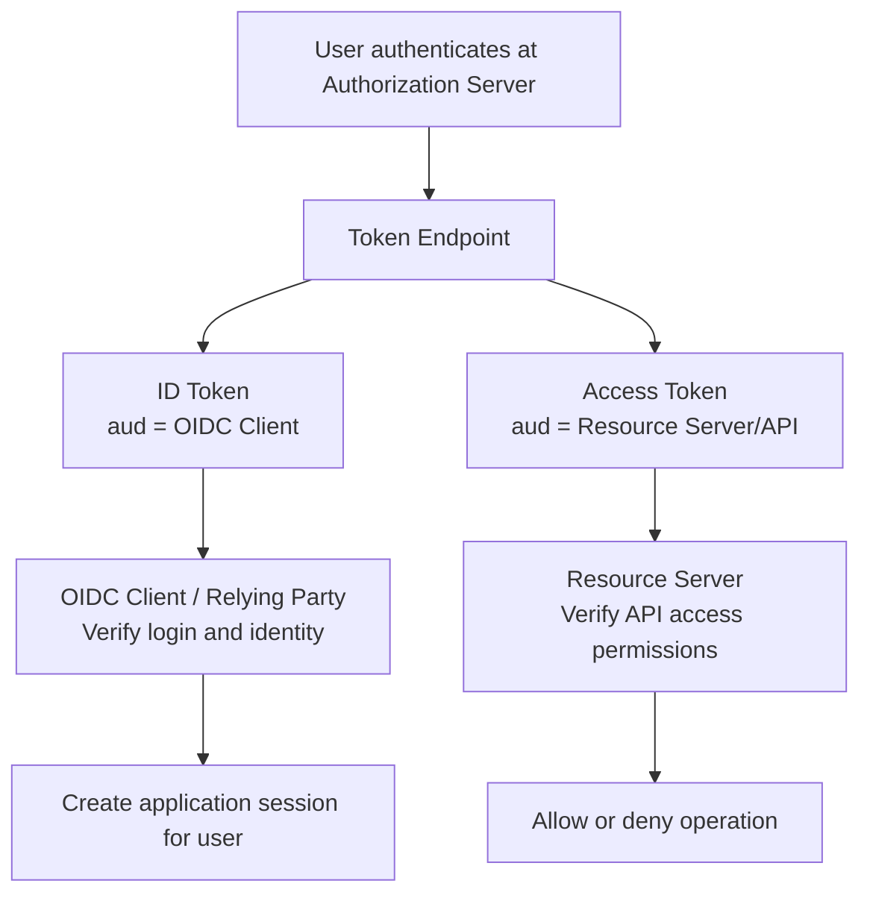
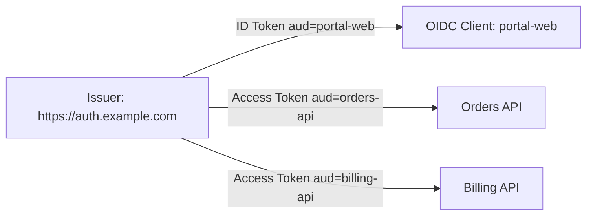
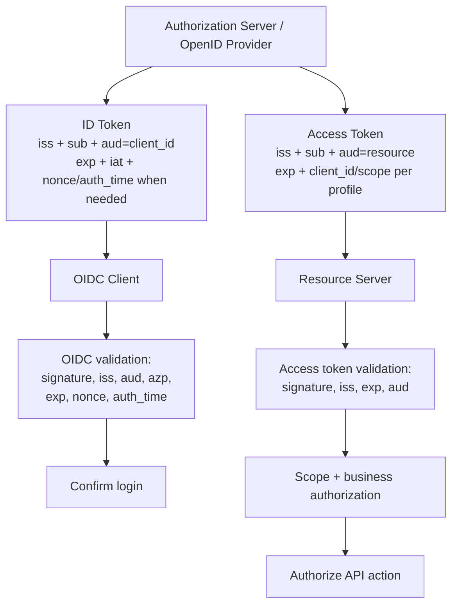

# Distinguishing Access Token Claims from ID Token Claims

## 1. Objectives and Scope

In the **Tokens and claims** chapter of the **SPRING_SECURITY_OAUTH2_OIDC_AUTHORIZATION_SERVER** module, an Authorization Server implemented with **Spring Security**, **Spring Authorization Server (SAS)**, and **Spring Boot** can issue multiple token types for different recipients. The two most common tokens in OpenID Connect are the **access token** and the **ID Token**. Both can be represented as JWTs and contain claims such as `iss`, `sub`, `aud`, and `exp`, yet they have **different purposes, recipients, and validation rules**.

This lesson helps you design, configure, secure, test, and operate an Authorization Server by clearly distinguishing:

- **Access token:** credential for a client to access a Resource Server/API within granted scopes.
- **ID Token:** OpenID Connect assertion for a client/Relying Party to verify authentication results and user identity.
- **Claims:** named attributes inside a token, interpreted by profile/protocol and usage context.
- **Audience:** intended recipient of the token; access tokens target a resource/API, ID Tokens target an OIDC client.

After this lesson, you will be able to:

- Distinguish the roles of access tokens and ID Tokens, even when both are JWTs.
- Identify standard, conditional, and extension claims in each token type.
- Understand how `iss`, `sub`, `aud`, `exp`, `scope`, `nonce`, `auth_time`, `azp`, and `client_id` are used.
- Design JWT access tokens according to an appropriate profile, such as RFC 9068, without assuming every access token is a JWT.
- Customize claims in Spring Authorization Server without mixing access token data with ID Tokens.
- Verify access tokens at the Resource Server and ID Tokens at the OIDC Client according to their roles.
- Minimize PII and test for audience mismatch, nonce mismatch, token substitution, and common misconfigurations.

**Version scope:** Examples use common APIs from **Spring Authorization Server 1.x / Spring Security 6.x / Spring Boot 3.x**. Verify against your exact project version because JWT generator, token customizer, and OIDC configuration details can change. This lesson focuses on the Authorization Code Flow with OIDC, while also explaining differences for Client Credentials or opaque access tokens.

## 2. Two Tokens Can Both Be JWTs Yet Cannot Be Used Interchangeably



| Characteristic | Access token | ID Token |
| --- | --- | --- |
| Protocol | OAuth 2.0; may be used within OIDC | OpenID Connect |
| Purpose | Authorizes access to a resource/API | Conveys authentication result and identity info to the client |
| Primary recipient | Resource Server/API | OIDC Client/Relying Party |
| Typical audience | API/resource identifier such as `orders-api` | `client_id` of the OIDC client |
| Typical contents | Scope, client, subject, resource audience, lifetime | Issuer, subject, client audience, authentication time, and permitted profile claims |
| Where verified | Resource Server, typically via JWT decoder or introspection | OIDC Client via an OIDC library/validator |
| Usable to call an API? | Yes, with matching audience and permissions | **Never** use instead of an access token |
| Usable for client login? | Never use instead of an ID Token | Yes, after full client verification |
| Must it be a JWT? | No; can be an opaque/reference token | ID Token is a JWT per OIDC |
| Contains scope? | Often carries scope/permissions per token profile | Requested scopes belong to the authorization request; not a default API authorization claim on ID Tokens |

**Rule of thumb:** an access token answers *"what is the client allowed to do on which API?"*. An ID Token answers *"which subject did the Authorization Server authenticate and what is it asserting to the OIDC client?"*.

Never decode a JWT, see `sub`/`email`, and conclude the token can be used for login or API calls. Always verify **token type/profile, issuer, audience, and intended recipient**.

## 3. Why Must You Never Use an ID Token as a Bearer Token for an API?

Suppose an OIDC client receives an ID Token with `aud` set to `portal-web`. The client sends that token to `orders-api`:

```http
GET /orders/123 HTTP/1.1
Host: api.example.com
Authorization: Bearer <OIDC_ID_TOKEN>
```

The Orders API must reject it because the token was issued for the **OIDC client**, not for the Orders API. Even if the signature is valid and `exp` has not passed, mismatched audience means the credential must not be accepted.

Conversely, an access token with `aud=["orders-api"]` cannot serve as login proof at `portal-web` just because it was signed by the same issuer. The client must handle OIDC authentication using an ID Token per OIDC Core.

### 3.1. Token Substitution Risks

If an API accepts ID Tokens, risks arise:

- A token whose audience is a client gets accepted at an API.
- The API mistakes user authentication claims for resource access permissions.
- An ID Token carrying profile claims is misused as an out-of-context Bearer credential.
- The client or gateway skips token type/audience checks and accepts out-of-context tokens.

If a client accepts an access token as an ID Token, it may skip OIDC checks such as `nonce`, `azp`, and client audience. This is a verification design flaw, not a weak JWT signature issue.

## 4. Shared Claims vs. Token-Specific Claims

JWT defines several **registered claims** in RFC 7519, such as `iss`, `sub`, `aud`, `exp`, `nbf`, `iat`, and `jti`. OIDC Core and the JWT Access Token Profile (RFC 9068) define additional semantics and conditions for each token type.

| Claim | General meaning | In access tokens | In ID Tokens |
| --- | --- | --- | --- |
| `iss` | Issuing authority | Identifies trusted AS | Identifies OP issuing the ID Token |
| `sub` | Token subject | Subject per grant/profile; may be user or client | Authenticated user subject; stable identifier within issuer |
| `aud` | Intended audience | Resource Server/API | OIDC client ID |
| `exp` | Token expiration | Limits API access window | Limits acceptance window of login assertion |
| `iat` | Issuance timestamp | Useful for auditing/age policies | ID Token issuance time; required claim in OIDC |
| `nbf` | Not valid before time | Optional | Optional |
| `jti` | Unique JWT ID | Can support audit/revocation strategies | Optional; does not replace nonce |
| `client_id` | Requesting OAuth2 client | Required in JWT Access Token Profile RFC 9068 | Not a standard required identity claim in ID Tokens |
| `scope` | Authorization scope | Usually describes API permissions | Not a default identity authentication claim |
| `nonce` | Value binding OIDC request | Not a standard access token claim | Required in ID Token if authorize request sent nonce |
| `auth_time` | When user was authenticated | May be included per policy, not an API permission | Conditional; important with `max_age` |
| `acr`/`amr` | Authentication context/method | May appear per profile/policy | OIDC claims describing assurance level/methods |
| `azp` | Authorized party | Not a common standard access token claim | Used in ID Token when multiple audiences/authorized party apply |
| `email`/`name` | Profile attributes | Usually avoid if API does not need them | May be returned when scope/claim policy permits |

**Sharing a claim name does not mean sharing semantics.** For instance, `aud` appears in both tokens, yet its expected value differs. Never assume every claim in the table is always present; presence depends on standard, grant, scopes, request parameters, and policy.

## 5. Core ID Token Claims Under OIDC

OIDC Core defines an ID Token as a JWT containing claims about **authentication**. An illustrative ID Token in the Authorization Code Flow looks like:

```json
{
  "iss": "https://auth.example.com",
  "sub": "00u8f3a1b2c4d5e6",
  "aud": "portal-web",
  "exp": 1790000600,
  "iat": 1790000000,
  "auth_time": 1789999900,
  "nonce": "CLIENT_NONCE_BOUND_TO_LOGIN",
  "acr": "urn:example:loa:2",
  "amr": ["pwd", "otp"]
}
```

This is an illustrative payload, not a real signed token. Claims `auth_time`, `nonce`, `acr`, and `amr` appear conditionally depending on request and OP capabilities; not all are mandatory in every ID Token.

### 5.1. Required Claims

| Claim | Core OIDC rule |
| --- | --- |
| `iss` | Issuer Identifier of the OpenID Provider; client must exact-match trusted issuer |
| `sub` | Subject Identifier of the user; locally stable identifier within the issuer |
| `aud` | Audience must contain the client's `client_id`; client verifies it is an intended recipient |
| `exp` | Expiration time; client rejects tokens at or after this time (allowing small policy clock skew) |
| `iat` | Time the ID Token was issued |

`sub` should not be a mutable email or username. OIDC uses the subject identifier for account linking on the client; emails can change, collide, or be re-verified. Subjects may be **public** or **pairwise** per OP policy.

### 5.2. `nonce`: Binding Request to ID Token

If the client sends `nonce` in the Authentication Request, the OP must include the exact corresponding value in the ID Token. The client checks nonce when validating the ID Token.

Nonce helps prevent replay/token substitution in OIDC. Clients must store nonce per authorization transaction and never reuse one value across unrelated flows.

**Nonce replaces neither `state` nor PKCE:**

- `state` binds the callback to the client-initiated request.
- PKCE binds authorization code redemption to the client holding `code_verifier`.
- `nonce` binds the ID Token to the OIDC Authentication Request.

### 5.3. `auth_time` and `max_age`

`auth_time` indicates when the user actually authenticated. When a client sends `max_age` in the Authentication Request, the OP must satisfy the authentication freshness requirement and include `auth_time` in the ID Token for client verification.

Do not assume an active login session means the user just authenticated. A session can outlive a freshness threshold. When business logic requires step-up/MFA, enforce an appropriate authentication policy rather than merely extending ID Token lifetime.

### 5.4. `acr` and `amr`

- `acr` (*Authentication Context Class Reference*) describes the authentication level/context under a scheme agreed upon by OP and client.
- `amr` (*Authentication Methods References*) describes the authentication methods used, such as password or OTP when the OP has supporting evidence.

Never hardcode `acr=high` or `amr=["mfa"]` just because a customizer wants nicer-looking claims. These claims must reflect **actual authentication events** managed by a trusted authentication subsystem.

### 5.5. `azp`, `at_hash`, and `c_hash`

- `azp` (*authorized party*) identifies the party to which the ID Token was issued in certain cases. When `aud` has multiple values, the client must apply OIDC rules for `azp` and verify it if present; OIDC recommends `azp` in multi-audience scenarios.
- `at_hash` binds the access token to the ID Token in response types/profiles that require it. It is not always present in every pure Authorization Code Flow.
- `c_hash` binds the authorization code to the ID Token in flows/profiles such as Hybrid Flow. Never invent or skip checks when a flow requires this claim.

In **pure Authorization Code Flow**, the ID Token is typically returned from the Token Endpoint; do not mechanically apply Implicit/Hybrid Flow conditions.

## 6. Common Access Token Claims

Core OAuth 2.0 does not require access tokens to be JWTs. Access tokens can be opaque/reference strings verified by Resource Servers via introspection or an equivalent mechanism. When the AS uses JWTs, claims and validation follow the chosen profile.

Illustrative JWT access token for the Orders API:

```json
{
  "iss": "https://auth.example.com",
  "sub": "orders-worker",
  "aud": ["orders-api"],
  "client_id": "orders-worker",
  "scope": "orders.read orders.export",
  "iat": 1790000000,
  "exp": 1790000300,
  "jti": "b4b2e7a0-6a31-4d3c-9d7a-9f4e0a000001"
}
```

This is an illustrative **JWT access token profile** example. Not every token issued by every Authorization Server contains these exact claims or identical structure.

### 6.1. JWT Access Token Profile (RFC 9068)

When an AS declares adherence to the RFC 9068 JWT Access Token Profile, the profile mandates specific claims and formatting. Core claims include:

| Claim | Role in profile |
| --- | --- |
| `iss` | Access token issuer |
| `exp` | Access token expiration timestamp |
| `aud` | Target Resource Server for the access token |
| `sub` | Token subject; resource owner or client depending on grant |
| `client_id` | OAuth2 client that requested the token |
| `iat` | Token issuance timestamp |
| `jti` | Unique token identifier |
| `scope` | Granted scopes, if any |
| `typ` in JOSE header | Profile JWT access tokens use `at+jwt` |

**Do not label an arbitrary JWT an RFC 9068 access token.** To claim profile compliance, the AS must emit the proper structure/header/claims and the Resource Server must validate per profile; having `aud` and `scope` alone is not enough.

### 6.2. `sub` Depends on the Grant

| Grant | Subject may represent | Meaning |
| --- | --- | --- |
| Authorization Code with user login | Authenticated user | Token issued in a user-delegation context |
| Client Credentials | Client/service account | Token represents workload privileges, not a human user |
| Refresh Token | Preserves initial authorization context per grant | Does not turn the token into a new identity |
| Extension grant/delegation | Depends on defined contract | Must specify who is actor, who is subject, and delegation proof |

Therefore, Resource Servers must never assume `sub` is always a user ID. If an API needs to identify a service account, use verified client info per token profile/policy; if it needs end-user context, trust only claims built from a trusted authorization source.

### 6.3. `scope` and Permission Claims

`scope` typically expresses the access range granted to the client. Spring Security Resource Server commonly maps scope values to authorities like `SCOPE_orders.read` (depending on converter and claim format).

Custom claims such as `permissions`, `roles`, or `entitlements` can be useful, provided you:

- Define a clear schema and namespace.
- Source them solely from authoritative policy services.
- Constrain them by audience/resource and client.
- Never confuse system-wide roles with permissions for a single API.
- Test permission changes and token lifecycles.
- Never treat client-submitted claims from a token request as approved permissions.

### 6.4. `client_id` and `azp` Are Not Synonymous

`client_id` in the access token profile identifies the OAuth2 client that requested the access token. `azp` in an OIDC ID Token carries authorized-party semantics under OIDC. They may hold related values in certain flows, yet cannot be swapped arbitrarily.

## 7. Audience: Same Claim Name, Two Different Contracts



### 7.1. Audience of an ID Token

An ID Token is issued to an **OIDC client**. `aud` must contain the client's `client_id`. If multiple audiences exist, the client must apply OIDC rules, including checking `azp` when required; never simply check that the audience list contains any arbitrary value.

Example:

```json
{
  "iss": "https://auth.example.com",
  "sub": "user-123",
  "aud": ["portal-web", "another-registered-client"],
  "azp": "portal-web",
  "exp": 1790000600,
  "iat": 1790000000
}
```

Client `portal-web` must validate audience/authorized party per OIDC. Never accept a token solely because `iss` matches.

### 7.2. Audience of an Access Token

An access token targets a **Resource Server**. For example, `orders-api` must reject a token having only `aud=["billing-api"]` even with the same issuer and a valid signature.

Avoid broad audiences like `all-internal-services` if you want API isolation. Multi-audience tokens should only be issued when resource contracts are explicit and every API enforces matching acceptance policies.

### 7.3. Do Not Infer Audience from Request Hostname

The AS must pick audience from trusted policy (client-resource allowlist, verified resource indicator, or authorization context). Never take the `Host` header, query `aud`, or arbitrary `resource` and copy it into the JWT. The Resource Server matches audience against the API's own **fixed, trusted configuration**.

## 8. Which Claim Belongs in Which Token?

The table below is a classification guide, not a mandatory list for every system:

| Claim/data | Access token | ID Token | Reason |
| --- | --- | --- | --- |
| Issuer `iss` | Yes | Yes | Identifies issuing party |
| Subject `sub` | Yes per profile | Yes, required in OIDC | Subject in token context |
| Audience `aud` | Resource/API | OIDC client | Two distinct recipients |
| Expiration `exp` | Yes per JWT profile | Required in OIDC | Two credentials with separate lifecycles |
| Client ID | Usually present in JWT access token profile | Not a required OIDC claim | Identifies OAuth2 client |
| API scopes/permissions | Yes | Usually no | Resource access rights belong in access tokens |
| `nonce` | Not a standard access token claim | Present if authorize request sent nonce | Binds OIDC authentication request |
| `auth_time` | Only if profile/policy requires | Conditional per OIDC | User authentication freshness |
| `acr`/`amr` | Only if resource needs auth context and policy permits | Optional per OIDC | Authentication context/methods |
| Email, name, profile photo | Usually avoid if API does not need them | Optional per scope/claim authorization | User profile attributes |
| Tenant/organization | Optional if API needs it and policy is trusted | Only if client needs it and is allowed | Weigh data minimization |
| Refresh token | Not a JWT claim; separate token | No | Standalone credential for refreshing tokens |
| Authorization code | No | No | Pre-Token-Endpoint credential |

**Do not stuff all user data into both tokens.** The ID Token should carry only claims needed by the OIDC client; the access token should carry only claims needed by the Resource Server to authenticate/authorize. If data can be safely queried from a profile API, do not duplicate it into JWTs unnecessarily.

## 9. OIDC Scopes and UserInfo: Avoiding Profile Claim Mix-Ups

OIDC uses standard scopes such as `openid`, `profile`, `email`, and `address` to express requests for authentication/profile information.

| Scope | Group of information that may be requested |
| --- | --- |
| `openid` | Enables OIDC and requests an ID Token |
| `profile` | Profile claims such as `name`, `preferred_username`, `picture`, `updated_at` as supported |
| `email` | `email` and `email_verified` |
| `address` | `address` claim |
| `phone` | `phone_number` and `phone_number_verified` |

Scopes do not guarantee that every claim in the group appears in every ID Token. The OP may lack data, claims may be restricted by consent/policy, or claims may be delivered via the **UserInfo Endpoint**.

### 9.1. UserInfo Endpoint Is a Separate Profile Source

The OIDC UserInfo Endpoint accepts an **access token** and returns claims about the corresponding End-User per scopes/authorization. Clients do not use an ID Token as a Bearer token to call UserInfo; clients use a valid access token issued for UserInfo/resources per contract.

If the UserInfo response includes `sub`, the client must verify it matches `sub` in the ID Token to confirm profile claims belong to the same subject. Never join UserInfo data with an ID Token based solely on email.

### 9.2. Profile Claims Are Not API Permissions

`email`, `name`, or `picture` are not permissions to read/modify business data. Receiving a user's email does not grant a client permission to call `POST /payments`. Conversely, holding scope `payments.read` does not entitle a client to all profile claims.

## 10. Claims by Grant Type

### 10.1. Authorization Code + OIDC

When a client sends scope `openid` and the user authenticates successfully:

- The Authorization Endpoint returns an authorization code.
- The Token Endpoint exchanges the code for an access token and an ID Token per configuration.
- The access token is used to call Resource Servers.
- The ID Token is verified by the client to complete login.
- If the request included `nonce`, the ID Token must carry the matching value for client verification.
- If the request included `max_age`, `auth_time` must reflect authentication time per OIDC.

Never put an access token into a callback URL merely because the ID Token is also a JWT.

### 10.2. Client Credentials

Client Credentials represents a **workload/client**, with no end-user authentication. Therefore:

- Typically yields an access token to call APIs.
- Never issues an OIDC ID Token for a nonexistent user in this flow.
- `sub`/`client_id` should represent the client per profile/token policy.
- Scopes and audience constrain M2M privileges.
- Never add fake `email`/`name` claims to a service account to make the token "look like a user".

### 10.3. Refresh Token

When a client uses a refresh token, the AS issues a new access token based on the original authorization and current policy. A new ID Token may be issued in OIDC-defined cases depending on grant/request/configuration; do not assume every refresh response contains an ID Token. A refresh token is a standalone credential, not a claim inside an access token or ID Token.

### 10.4. Opaque Access Tokens

If the access token is opaque/reference:

- The client still uses it as a Bearer token per contract.
- The Resource Server typically verifies it via introspection or a matching adapter.
- Claims may be returned in the introspection response; this does not mean the client may read/decode the access token.
- Audience/scope/issuer/expiry boundaries must still be enforced via introspection and policy.
- The ID Token remains a JWT per OIDC.

## 11. Customizing Claims in Spring Authorization Server

### 11.1. The Right Extension Point: `OAuth2TokenCustomizer<JwtEncodingContext>`

SAS supports customizing JWT claims via `OAuth2TokenCustomizer<JwtEncodingContext>` when using `JwtGenerator`. Branch by token type to avoid mixing access token and ID Token claims.

```java
@Configuration(proxyBeanMethods = false)
public class TokenClaimsConfig {

    @Bean
    OAuth2TokenCustomizer<JwtEncodingContext> jwtTokenCustomizer(
            AudiencePolicy audiencePolicy,
            IdentityClaimsService identityClaimsService) {

        return context -> {
            String tokenType = context.getTokenType().getValue();

            if (OAuth2TokenType.ACCESS_TOKEN.getValue()
                    .equals(tokenType)) {

                String clientId = context.getRegisteredClient()
                        .getClientId();

                List<String> audiences = audiencePolicy
                        .audiencesFor(
                                clientId,
                                context.getAuthorizedScopes());

                if (audiences == null || audiences.isEmpty()) {
                    throw new IllegalStateException(
                            "No approved audience policy for client");
                }

                context.getClaims().audience(audiences);
                context.getClaims().claim(
                        "token_purpose", "api_access");
            }

            if (OidcParameterNames.ID_TOKEN.equals(tokenType)) {
                // Only load profile data from a trusted identity source.
                // Never take claims from browser request parameters.
                Map<String, Object> claims =
                        identityClaimsService.claimsFor(
                                context.getPrincipal(),
                                context.getAuthorizedScopes());

                claims.forEach((name, value) ->
                        context.getClaims().claim(name, value));
            }
        };
    }
}
```

`AudiencePolicy` and `IdentityClaimsService` are **illustrative application business interfaces**, not built-in SAS beans. The example focuses on separating token types:

- For **access tokens**, audience is chosen by AS-side client/resource policy; scopes are bounded by authorization.
- For **ID Tokens**, profile claims come from a verified identity source and are returned only when permitted by scope/claim authorization.
- Never overwrite the ID Token's default `aud` with an API audience.
- Never inject a self-generated `nonce` in a customizer if the framework already manages request-bound OIDC values; let standard OIDC handling run and test it.
- If no audience policy exists, fail closed at issuance time; never issue an access token lacking an explicit target.

`getTokenType().getValue()` is used to differentiate token types. Check the constants/APIs available in your project's SAS version; never assume ID Tokens use `OAuth2TokenType.ACCESS_TOKEN`.

### 11.2. Avoid Overwriting Standard Claims

Do not arbitrarily overwrite:

- `iss`: must match the configured issuer.
- `sub`: must be the subject per trusted identity/authorization model.
- `aud`: must match the recipient for the token type.
- `exp`/`iat`/`nbf`: must reflect lifetime and clock policy.
- `nonce`: must bind to the authorization request.
- `azp`: must obey OIDC authorized-party rules.

A customizer adding misnamed claims or overwriting standard claims can cause clients/APIs to reject tokens—or worse, cause recipients to accept out-of-context tokens.

### 11.3. Avoid Multiple Conflicting Customizers

If an application has multiple `OAuth2TokenCustomizer<JwtEncodingContext>` beans, verify how your version/framework combines them. Never assume all beans of the same generic type are automatically invoked in your desired order. An easy-to-control setup consolidates logic into a single customizer delegating to specialized policies/services, or explicitly configures the generator.

Never let an access token customizer write `aud=orders-api` onto **every** token including ID Tokens. Never let an ID Token customizer write system-wide `roles` into access tokens outside policy.

### 11.4. Opaque Access Tokens Require a Different Customizer

`OAuth2TokenCustomizer<JwtEncodingContext>` applies only to JWT creation. When an access token uses `OAuth2TokenFormat.REFERENCE`, check the opaque-token customizer/context (such as `OAuth2TokenClaimsContext` and `OAuth2AccessTokenGenerator` per version) and corresponding introspection settings.

Never assume a claim appears in a JWT just because an opaque token customizer ran, or vice versa.

## 12. Configuring RegisteredClient and OIDC in SAS

Example registering a confidential client for Authorization Code + OIDC:

```java
@Bean
RegisteredClientRepository registeredClientRepository(
        PasswordEncoder passwordEncoder,
        @Value("${PORTAL_CLIENT_SECRET}") String rawSecret) {

    RegisteredClient portal = RegisteredClient
            .withId("portal-web-001")
            .clientId("portal-web")
            .clientSecret(passwordEncoder.encode(rawSecret))
            .clientAuthenticationMethod(
                    ClientAuthenticationMethod.CLIENT_SECRET_BASIC)
            .authorizationGrantType(
                    AuthorizationGrantType.AUTHORIZATION_CODE)
            .authorizationGrantType(
                    AuthorizationGrantType.REFRESH_TOKEN)
            .redirectUri(
                    "https://portal.example.com/login/oauth2/code/portal-web")
            .scope(OidcScopes.OPENID)
            .scope(OidcScopes.PROFILE)
            .scope(OidcScopes.EMAIL)
            .clientSettings(ClientSettings.builder()
                    .requireProofKey(true)
                    .requireAuthorizationConsent(true)
                    .build())
            .tokenSettings(TokenSettings.builder()
                    .accessTokenFormat(
                            OAuth2TokenFormat.SELF_CONTAINED)
                    .accessTokenTimeToLive(Duration.ofMinutes(5))
                    .build())
            .build();

    return new InMemoryRegisteredClientRepository(portal);
}
```

This is an illustrative client configuration, not a full AS. Beans such as `PasswordEncoder`, `OAuth2AuthorizationService`, `OAuth2AuthorizationConsentService`, `JWKSource<SecurityContext>`, `JwtDecoder` as needed, and security filter chains must be properly configured. Raw secrets must come from a secret manager/environment, never hardcoded.

### 12.1. Enabling OIDC on the Authorization Server

In the AS filter chain:

```java
OAuth2AuthorizationServerConfigurer as =
        OAuth2AuthorizationServerConfigurer.authorizationServer();

http
    .securityMatcher(as.getEndpointsMatcher())
    .with(as, server ->
            server.oidc(Customizer.withDefaults()));
```

Enabling OIDC requires JWT signing infrastructure and appropriate decoder settings. Enabling `oidc` does not mean ID Tokens automatically contain every profile claim; claims depend on the authorization request, scopes, user data, and policy.

### 12.2. Never Populate User Claims from Client-Submitted Values

An anti-pattern:

```java
// Avoid: letting browser/client self-assert user roles.
context.getClaims().claim(
        "roles",
        request.getParameter("roles"));
```

A client can alter the request and claim `roles=["ADMIN"]`. Token claims must come from authenticated data and AS-managed policies. Inside customizers, read from `context.getPrincipal()`/identity services and check scopes, client, and tenant; never trust raw input.

## 13. Verifying ID Tokens at the OIDC Client

The OIDC Client/Relying Party must use an OIDC library or validator implementing full OIDC Core checks. Essential verifications:

1. **Signature:** use the matching key from the trusted issuer's JWKS; accept only configured algorithms.
2. **`iss`:** exact-match the configured/discovered issuer.
3. **`aud`:** contains this client's own `client_id`.
4. **`azp`:** when present or when multiple audiences exist, apply OIDC rules and verify authorized party.
5. **`exp`:** not expired, allowing small policy-defined clock skew.
6. **`iat`:** valid and not in the future beyond clock tolerance.
7. **`nonce`:** matches the value stored by the client for that authorization transaction if the request included nonce.
8. **`auth_time`:** when `max_age` was requested, verify authentication freshness.
9. **`sub`:** non-empty; if calling UserInfo, compare UserInfo `sub` against ID Token `sub`.
10. **Hash claims** (`at_hash`/`c_hash`) when required by flow/profile.

**Never merely decode the JWT and trust the payload.** Decoding verifies neither signature nor claims. A forged JWT can have nice-looking `iss`, `aud`, and `sub` without being signed by the issuer.

### 13.1. Do Not Use a Resource Server Validator Instead of an OIDC ID Token Validator

A Resource Server validator normally focuses on access tokens: issuer, API audience, expiration, and scopes. An OIDC client validator must understand ID Tokens: client audience, nonce, authorized party, authentication time, and OIDC rules. Both validators may share signature-verification mechanics, yet **do not share the full token policy**.

### 13.2. Storing ID Tokens and Application Sessions

A backend OIDC client may keep the ID Token in a session/server-side token store for logout or library status checks. Avoid placing tokens in URLs, logs, or JavaScript unnecessarily. The client should establish its own application session only after the ID Token passes verification; never use an unverified claim as the session principal.

## 14. Verifying Access Tokens at the Resource Server

The Resource Server accepts only access tokens matching **issuer, audience, and permissions**. For example, the Orders API requires `aud=orders-api` and `SCOPE_orders.read`.

```yaml
security:
  issuer-uri: https://auth.example.com
  jwk-set-uri: https://auth.example.com/oauth2/jwks
  required-audience: orders-api
```

```java
@Configuration(proxyBeanMethods = false)
public class OrdersApiSecurityConfig {

    @Bean
    JwtDecoder jwtDecoder(
            @Value("${security.issuer-uri}") String issuer,
            @Value("${security.jwk-set-uri}") String jwksUri,
            @Value("${security.required-audience}") String audience) {

        NimbusJwtDecoder decoder =
                NimbusJwtDecoder.withJwkSetUri(jwksUri).build();

        OAuth2TokenValidator<Jwt> issuerAndTime =
                JwtValidators.createDefaultWithIssuer(issuer);

        OAuth2TokenValidator<Jwt> audienceValidator =
                new JwtClaimValidator<List<String>>(
                        JwtClaimNames.AUD,
                        actual -> actual != null
                                && actual.contains(audience));

        decoder.setJwtValidator(
                new DelegatingOAuth2TokenValidator<>(
                        issuerAndTime, audienceValidator));

        return decoder;
    }

    @Bean
    SecurityFilterChain apiSecurity(HttpSecurity http)
            throws Exception {

        http
            .authorizeHttpRequests(authorize -> authorize
                    .requestMatchers(HttpMethod.GET, "/orders/**")
                    .hasAuthority("SCOPE_orders.read")
                    .anyRequest().denyAll())
            .oauth2ResourceServer(oauth2 ->
                    oauth2.jwt(Customizer.withDefaults()))
            .sessionManagement(session ->
                    session.sessionCreationPolicy(
                            SessionCreationPolicy.STATELESS));

        return http.build();
    }
}
```

This is a JWT Resource Server example, not OIDC client ID Token validation. `JwtValidators.createDefaultWithIssuer` and the audience validator check issuer/time and the right API; authority mapping must match actual scope structure. If using a custom converter, verify mapping `scope`/`scp` to `SCOPE_*`.

For opaque access tokens, use introspection/opaque token support and validate audience/scope in introspection data per equivalent policy. Never try to decode an opaque string as a JWT.

### 14.1. 401 vs. 403

| Case | Typical response | Meaning |
| --- | --- | --- |
| Missing Bearer token | 401 | Unauthenticated |
| Access token invalid signature/issuer/expired | 401 | Invalid credential |
| ID Token sent to API, wrong audience | 401 | Token not intended for Resource Server |
| Access token valid issuer/audience, missing scope | 403 | Token authenticated, insufficient permissions |
| Token has scope, unauthorized for tenant/object | 403 or policy-specific denial | Business authorization failed |

Do not turn all failures into 403 to mask invalid tokens; separating authentication failures from authorization failures keeps system observability accurate.

## 15. Minimizing Sensitive Data in Claims

JWTs are normally **signed**, not **encrypted** by default. Anyone holding a standard JWS token can read its payload. Signatures guarantee integrity/issuer authenticity, not confidentiality.

Principles:

- Never put passwords, client secrets, API keys, refresh tokens, or private keys into claims.
- Avoid email/phone/address unless the Resource Server genuinely needs them.
- Minimize PII in access tokens because they traverse APIs, gateways, and logs/tracing and spread farther than ID Tokens.
- ID Tokens should carry only profile claims requested/permitted for the client; use UserInfo when appropriate.
- Do not stuff all organization roles/permissions into every token when a client calls one small API.
- Choose suitable subject identifiers; consider pairwise subjects when cross-client user linkability must be reduced.
- Short TTLs and key rotation do not replace data minimization.

If JWT contents must remain confidential from out-of-scope holders, evaluate JWE or opaque tokens/introspection; never assume JWS payloads are encrypted.

## 16. Testing Token Type and Claim Separation

### 16.1. Core Test Matrix

| Scenario | Expected result |
| --- | --- |
| Authorization Code + `openid` succeeds | Token response includes access token and ID Token per OIDC config |
| Missing `openid` scope | Does not issue an ID Token by default |
| ID Token `aud` contains correct client ID | OIDC client proceeds after remaining checks |
| ID Token `aud` lacks client ID | Client rejects |
| ID Token `nonce` matches request | Passes nonce check |
| ID Token nonce wrong/missing when requested | Client rejects |
| `max_age` requested | ID Token includes appropriate `auth_time` and client checks freshness |
| ID Token has multiple audiences | Client enforces `azp` rules |
| Access token `aud=["orders-api"]` | Orders API accepts if signature/issuer/expiry/scope are valid |
| Access token `aud=["billing-api"]` sent to Orders API | Orders API rejects |
| ID Token sent to Resource Server | Rejected due to mismatched token type/audience |
| Access token sent to OIDC client for login | Not accepted in place of ID Token |
| Access token valid audience, missing scope | 403 on scope-protected endpoint |
| Client Credentials grant | M2M access token; no ID Token issued for nonexistent end user |
| Opaque access token | Resource Server verifies via introspection, not JWT decoding |
| JWT payload tampered without re-signing | Signature validation fails |
| Unknown issuer or untrusted key | Token rejected |
| Claim customizer puts API audience into ID Token | Test must catch corrupted client audience |

### 16.2. Testing Token Customizers

Split tests by token type:

- When `context.getTokenType()` is access token, only access-token claims are added; `aud` follows resource policy.
- When token type is ID Token, default `aud` remains the client ID per OIDC; only approved profile claims are added.
- With no audience policy for a client, never issue an access token with an arbitrary audience.
- Without profile claim/consent, do not put profile data into the ID Token.
- Customizer never overwrites `iss`, `sub`, `exp`, `iat`, `nonce`, or `azp` contrary to policy.
- Opaque token path is tested separately if supported by the system.

### 16.3. MockMvc and Signature Testing

Spring Security Test offers the `jwt()` helper to simulate authentication in endpoint tests. This helper can **bypass real decoding and signature verification**. Therefore:

- Use `jwt()` for method authorization/scope mapping tests.
- Use real signed JWTs and `JwtDecoder`/test JWKS to verify signature, issuer, audience, and expiry.
- Use OIDC client integration tests or OIDC libraries to verify ID Token, nonce, azp, and auth_time.
- Never treat a `jsonPath("$.aud")` assertion on the token response as proof the recipient will reject wrong-audience tokens.

### 16.4. Unit Test Example for an Audience Validator

```java
@Test
void ordersApiRejectsBillingAudience() {
    Jwt jwt = Jwt.withTokenValue("test-token")
            .header("alg", "RS256")
            .claim("iss", "https://auth.example.com")
            .claim("aud", List.of("billing-api"))
            .claim("sub", "billing-reconciler")
            .issuedAt(Instant.now())
            .expiresAt(Instant.now().plusSeconds(60))
            .build();

    OAuth2TokenValidator<Jwt> validator =
            new JwtClaimValidator<List<String>>(
                    JwtClaimNames.AUD,
                    aud -> aud != null && aud.contains("orders-api"));

    OAuth2TokenValidatorResult result = validator.validate(jwt);

    assertTrue(result.hasErrors());
}
```

This is a unit test for the **audience validator**; it does not verify the JWT's signature or issuer because the `Jwt` object is constructed directly in the test. Add integration tests with a real decoder to verify the entire pipeline.

## 17. Common Pitfalls

| Symptom | Cause | Resolution |
| --- | --- | --- |
| API accepts ID Token | Checks only signature/issuer, ignores audience or token profile | Accept only API-targeted access tokens; verify audience/scope |
| Client uses access token to log in | Missing OIDC ID Token validation | Use an OIDC client library; validate ID Tokens |
| ID Token has API `aud` | Access token customizer accidentally ran for ID Token | Branch by token type and preserve client audience |
| Access token lacks audience | Missing audience policy or customizer did not run | Check JWT generator/customizer/token format |
| All APIs accept the same token | Broad audience or Resource Server dropped validator | Narrow audiences and per-API validators |
| ID Token missing nonce | Client sent nonce but OP/client integration dropped flow state | Check authorization request and OIDC token generation |
| Same nonce reused across logins | Client stored nonce in a global variable | Store nonce per authorization transaction |
| Client skips `azp` check | Checks only partial `aud` | Enforce full OIDC validation |
| ID Token has email unnecessarily | Customizer emits profile claims unconditionally | Enforce scope/consent/claim policies and data minimization |
| JWT has `roles` from request parameter | Trusting client-supplied input | Source claims only from trusted identity/policy stores |
| `sub` always assumed to be user ID | Failing to distinguish grants | Interpret subject per token profile/grant |
| Opaque token decoded as JWT | Confused token formats | Use introspection |
| Unit tests pass, yet production API accepts wrong tokens | Mock `jwt()` bypassed decoder | Add real signature/JWKS/issuer/audience tests |
| Customizer never runs | Opaque token, different bean wiring/generator, or wrong token type branch | Check token format and generator |
| Customizer overwrites standard claims | Conflicting customizers | Consolidate policies and test each token type |

## 18. Implementation Checklist

- [ ] Clearly distinguish access tokens and ID Tokens as two credentials with distinct purposes/recipients.
- [ ] Resource Server accepts only access tokens matching its audience; never accept ID Tokens at APIs.
- [ ] OIDC client uses ID Tokens only after verifying signature, issuer, audience, expiry, nonce, and related rules.
- [ ] ID Token `aud` contains the right client ID; handle `azp` when required.
- [ ] Access token `aud` contains the target Resource Server; every API runs its own validator.
- [ ] Access token carries minimal scopes/permissions, enforced at endpoints/services.
- [ ] `sub` is interpreted per grant/profile; never assumed to always be a user ID.
- [ ] `auth_time`, `acr`, and `amr` reflect real authentication, never hardcoded values.
- [ ] `nonce` is tracked per authorization transaction; never used instead of state/PKCE.
- [ ] JWT customizers branch by token type and never overwrite standard claims.
- [ ] Opaque access tokens have their own introspection/validation path.
- [ ] Secrets, passwords, and unnecessary PII are excluded from claims.
- [ ] JWT payloads are treated as readable; signing does not equal encryption.
- [ ] Tests cover token substitution, audience mismatch, nonce mismatch, expiry, missing scope, and wrong issuer.
- [ ] Real signature/JWKS verification is tested, not only mock authentication.
- [ ] Validation failures are monitored without logging raw tokens or sensitive claims.

## 19. Concept Map



**Access tokens and ID Tokens may both be JWTs sharing several registered claims, yet they do not share the same usage contract.** An ID Token targets the OIDC client and confirms authentication results; an access token targets the Resource Server and expresses resource access permissions. In Spring Authorization Server, customize according to token type, keep audiences accurate, minimize claims, and let each recipient perform protocol-appropriate validation. Preserving these boundaries prevents token substitution, data leakage, and cross-API privilege confusion.
