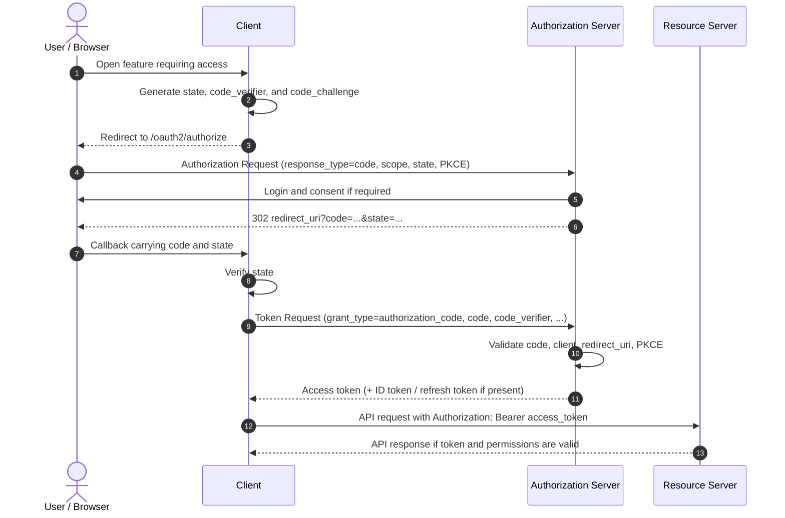

# Authorization Grant, Authorization Request, and Token Request

## 1. Why Distinguish These Three Concepts?

In OAuth 2.0, an application (client) needs access to a protected resource, such as a user's orders API. The **Authorization Server** is responsible for granting authorization and issuing tokens; the **Resource Server** validates tokens when receiving API calls. When implementing with **Spring Security** and **Spring Authorization Server** in a Spring Boot application, you need to distinguish three concepts:

| Concept | Nature | Question to answer |
| --- | --- | --- |
| **Authorization Grant** | The basis or mechanism allowing a client to request an access token; on the wire, typically expressed via a `grant_type` | *Which type of authorization/mechanism is the client relying on to obtain a token?* |
| **Authorization Request** | A request the client sends to the **authorization endpoint**, usually via a browser, to initiate user interaction | *What permissions is the client requesting, on whose behalf, and where should the result be returned?* |
| **Token Request** | A request the client sends to the **token endpoint** to exchange a grant or appropriate credentials for tokens | *What does the client present for the Authorization Server to issue a token?* |

The three concepts are related but **not synonymous**. In the Authorization Code Flow, the authorization request asks for an **authorization code**; then the token request uses `grant_type=authorization_code` to exchange the code for tokens. However, **not every grant requires an authorization request**: `client_credentials` and `refresh_token` typically only require a token request.

### Related Roles

- **Resource Owner**: the entity with authority to permit access to the resource, usually the user.
- **Client**: the application wanting to access the resource; it can be a server-side web app, an SPA, or a mobile app.
- **Authorization Server (AS)**: authenticates and/or records consent, validates the client, and issues authorization codes and tokens.
- **Resource Server (RS)**: the API that receives the access token and decides whether to allow access to the resource.
- **User Agent**: the browser or interactive component that directs the user to the AS's login/consent page.

In OpenID Connect (OIDC), the client is also referred to as the **Relying Party (RP)** and an Authorization Server supporting OIDC acts as the **OpenID Provider (OP)**. OIDC builds on top of OAuth 2.0 to authenticate user identity, prominently featuring the **ID Token**.

## 2. Authorization Grant: The Basis/Mechanism Used to Obtain Tokens

Under the OAuth 2.0 model, an *authorization grant* represents the Resource Owner's authorization (or another valid basis depending on the grant type) for the client to receive an access token. In actual configurations and requests, the term **grant type** specifies the *kind* of token issuance workflow the Authorization Server executes.

To avoid confusion, separate three things:

1. **Grant type**: the label identifying how a token is requested, such as `authorization_code`, `client_credentials`, `refresh_token`.
2. **Authorization code**: a temporary, single-use code returned after a successful authorization request in the Authorization Code Flow; this is **not an access token**.
3. **Access token**: the credential allowing the client to call the Resource Server within the granted scope; the Resource Server uses the token to verify access.

### Common Grant Types

| Grant type / mechanism | Browser-based authorization request? | Key data in token request | When to use |
| --- | --- | --- | --- |
| **Authorization Code** — `authorization_code` | Yes, with `response_type=code` | `code`, `redirect_uri` (when used in the authorize step), `code_verifier` when using PKCE; client authentication per registration type | User login and authorization for web apps, SPAs, and mobile apps |
| **Client Credentials** — `client_credentials` | No | `grant_type=client_credentials`, client credentials, and allowed scopes | Service-to-service calls without representing a specific user |
| **Refresh Token** — `refresh_token` | No new authorize step needed | `refresh_token`, client credentials if confidential | Requesting a new access token without requiring the user to log in again |
| **Device Authorization** — `urn:ietf:params:oauth:grant-type:device_code` | Does not use the standard Authorization Code Flow authorization request; has its own user verification flow | `device_code` and device flow parameters | TVs, keyboard/browser-constrained devices |

The **Implicit** (`response_type=token`) and **Resource Owner Password Credentials** (`grant_type=password`) flows belong to early OAuth 2.0 and **should not be chosen for new systems**, due to security risks and incompatibility with modern practices. Do not assume all grant types are enabled by Spring Authorization Server: the server must support the flow **and** each `RegisteredClient` must be registered with the corresponding grant.

> **Remember:** `authorization_code` is the value of **grant_type** in the token request; `code` is the value of **response_type** in the authorization request. The two values appear at two different steps of the same Authorization Code Flow.

## 3. Authorization Request: Starting Authorization at the Authorization Endpoint

In the Authorization Code Flow, the client initiates the request by redirecting the **browser** to the authorization endpoint. In Spring Authorization Server, the default path is typically `/oauth2/authorize` (configurable).

As an illustrative example, `STATE_SAMPLE` and `CHALLENGE_SAMPLE` represent real random/PKCE values generated by the client—**do not use them literally at runtime**:

```http
GET /oauth2/authorize?response_type=code&client_id=orders-web&redirect_uri=https%3A%2F%2Fclient.example.com%2Fcallback&scope=openid%20profile%20orders.read&state=STATE_SAMPLE&code_challenge=CHALLENGE_SAMPLE&code_challenge_method=S256 HTTP/1.1
Host: auth.example.com
```

| Parameter | Role | Notes |
| --- | --- | --- |
| `response_type=code` | Asks the AS to return an authorization code | Specific to the Authorization Code Flow; distinct from `grant_type` |
| `client_id` | Identifies the registered client | Not a secret |
| `redirect_uri` | Callback address to receive the result | Must match a registered URI per the AS's validation rules; arbitrary redirects are not accepted |
| `scope` | Access scopes requested by the client | The AS may reject or issue only an allowed subset; `openid` triggers an OIDC request |
| `state` | Unpredictable value stored by the client and checked on callback | Protects against CSRF/mix-ups across authorization sessions; must be bound to the initiating session |
| `code_challenge` | Challenge value derived from `code_verifier` | Used for **PKCE**, ensuring a stolen code cannot easily be exchanged for a token |
| `code_challenge_method=S256` | Transformation using SHA-256 | Prefer `S256` |

In an OIDC request, the client may also send `nonce` to bind the returned ID Token to the authentication request, along with `prompt`, `max_age`, and `login_hint` as needed. **`nonce` and `state` address different threats**: `state` binds the authorization response to the client session; `nonce` helps prevent ID Token replay/mix-up. In the Authorization Code Flow, `nonce` does not replace PKCE or `state`.

### What Does the Authorization Server Process?

1. Receives and validates `client_id`, `response_type`, `redirect_uri`, `scope`, PKCE, and client policy.
2. If the user is not yet authenticated, routes them to **the Authorization Server's** login flow. The client application does not need to collect the user's password.
3. Obtains user consent if the flow and policy require consent.
4. If successful, issues a short-lived, single-use **authorization code** bound to the client, redirect URI, and PKCE details.
5. Returns the result to the client's callback via the browser:

```http
HTTP/1.1 302 Found
Location: https://client.example.com/callback?code=CODE_SAMPLE&state=STATE_SAMPLE
```

The client must verify that the returned `state` matches the stored value **before processing the code**. If the user denies consent, a valid callback may receive `error=access_denied` instead of `code`. If `redirect_uri` is invalid, the AS **must not arbitrarily redirect to that URI** just to report the error.

## 4. Token Request: Exchanging the Grant at the Token Endpoint

After receiving a valid code, the client calls the Authorization Server's **token endpoint**, typically `POST /oauth2/token` in Spring Authorization Server. This is **back-channel** communication over HTTPS: the request happens directly between the client and the AS, without sending token responses through callback URLs.

Example of a server-side web client registered with `client_secret_basic` (values in the example are placeholders only):

```http
POST /oauth2/token HTTP/1.1
Host: auth.example.com
Content-Type: application/x-www-form-urlencoded
Authorization: Basic <base64(client_id:client_secret)>

grant_type=authorization_code&code=CODE_SAMPLE&redirect_uri=https%3A%2F%2Fclient.example.com%2Fcallback&code_verifier=VERIFIER_SAMPLE
```

Requirements to understand:

- **`grant_type=authorization_code`** tells the token endpoint that the client is exchanging an authorization code.
- **`code`** must exist, not be expired, not be already used, and have been issued to this exact client.
- **`redirect_uri`** must match the URI used in the authorization request if one was provided there.
- **`code_verifier`** must correspond to the `code_challenge` in the authorization request when PKCE is used.
- **Client authentication** depends on the registered client type. Confidential clients can use HTTP Basic with client secret, `private_key_jwt`, or another supported method; public clients (SPA/mobile) cannot be assumed to keep a client secret safe, so they typically use `client_authentication_method=none`, send `client_id` as required, and use PKCE.
- The token request body uses **`application/x-www-form-urlencoded`**, not JSON by default.

If valid, an example response is:

```http
HTTP/1.1 200 OK
Content-Type: application/json
Cache-Control: no-store
Pragma: no-cache

{
  "access_token": "ACCESS_TOKEN_SAMPLE",
  "token_type": "Bearer",
  "expires_in": 300,
  "scope": "openid profile orders.read",
  "refresh_token": "REFRESH_TOKEN_SAMPLE",
  "id_token": "ID_TOKEN_SAMPLE"
}
```

This is an **illustrative response**: not every client receives a refresh token; `id_token` appears only when the request is a valid OIDC request and the server issues an ID Token. TTL, token contents, and issuance policies depend on configuration. The client uses the **access token** to call APIs; the **ID Token** proves the authentication result to the OIDC client and does not replace the access token for calling the Resource Server.

### How Does PKCE Bind the Two Requests?

Before redirecting the browser, the client generates a sufficiently random `code_verifier` and retains it locally. With the `S256` method:

```text
code_challenge = BASE64URL_NO_PADDING(SHA256(ASCII(code_verifier)))
```

The authorization request carries **`code_challenge`**. The subsequent token request sends **`code_verifier`**; the AS recomputes the challenge to verify it. As a result, merely intercepting the code from the callback URL is **insufficient** to exchange it for a token. PKCE is especially critical for public clients and should also be applied to confidential clients. PKCE **does not replace** confidential client authentication.

## 5. Complete Authorization Code Flow with OAuth 2.0 / OIDC



Distinguish the two communication channels:

| Channel | Requests | Key points |
| --- | --- | --- |
| **Front channel** via browser | Authorization Request and redirect containing `code`, `state` | Browser sees the URL; never put `client_secret` or access tokens in URLs |
| **Back channel** between client and AS | Token Request and token response | HTTPS required; protect secrets, code verifiers, and tokens in appropriate memory/storage |

**Business example:** A dashboard wants to display a user's order list. The client requests `orders.read`. The user logs in at the Authorization Server and approves consent if needed. The client receives the code at the callback, exchanges the code for an access token, and then calls `GET /api/orders`. The Resource Server validates the access token and the `orders.read` permission before returning data. If the dashboard needs to know *who* the user is, it can use the OIDC flow (`scope=openid`) and validate the ID Token according to OIDC rules.

## 6. When There Is No Authorization Request

### Client Credentials: Service-to-Service Communication

A background job needs to access an administration API under the **application's** identity, not a user's identity:

```http
POST /oauth2/token HTTP/1.1
Host: auth.example.com
Content-Type: application/x-www-form-urlencoded
Authorization: Basic <base64(service-client:service-secret)>

grant_type=client_credentials&scope=reports.read
```

The AS verifies the client and allowed grant, then issues an access token according to policy. There is **no** `response_type=code`, `state`, `redirect_uri`, login page, or end-user consent in this basic flow. Do not infer from a `client_credentials` token that it represents a logged-in user.

### Refresh Token: Obtaining a New Access Token

When issued a refresh token and registered for the `refresh_token` grant, the client can send:

```http
POST /oauth2/token HTTP/1.1
Host: auth.example.com
Content-Type: application/x-www-form-urlencoded
Authorization: Basic <base64(client_id:client_secret)>

grant_type=refresh_token&refresh_token=REFRESH_TOKEN_SAMPLE
```

The token endpoint validates that the refresh token is still valid, bound to the client, and meets permission and policy rules; it may issue a new refresh token (rotation) depending on configuration. Refresh tokens must be tightly protected and **should not be placed in URLs, logs, or browser locations at risk of leakage**. Not every flow or client is issued a refresh token.

### Device Authorization: Separate Authorization Interaction

Input-constrained devices typically request a `device_code` at the device authorization endpoint, display a `verification_uri` alongside a `user_code` for the user to authenticate on another device, and then poll the token endpoint using the `urn:ietf:params:oauth:grant-type:device_code` grant. This illustrates that **a grant does not have to start with GET `/oauth2/authorize`**.

## 7. Mapping Concepts to Spring Authorization Server

With Spring Boot, **Spring Authorization Server** provides the Authorization Server functionality, while the client-side **Spring Security OAuth2 Client** module typically constructs authorization requests and performs token exchanges. **Spring Security Resource Server** validates access tokens for APIs. A single system may fulfill multiple roles, but the responsibility boundaries must be clear.

| Component / configuration | Connection to the flow |
| --- | --- |
| `RegisteredClientRepository` / `RegisteredClient` | Defines client ID, authentication methods, grant types, redirect URIs, and allowed scopes |
| `ClientSettings.requireProofKey(true)` | Requires PKCE for the corresponding client |
| `ClientSettings.requireAuthorizationConsent(true)` | Requires recording consent when appropriate |
| Authorization endpoint `/oauth2/authorize` | Receives authorization requests and handles code issuance |
| Token endpoint `/oauth2/token` | Processes token requests by grant type |
| `OAuth2AuthorizationService` | Persists authorization data, codes/tokens, and related state |
| `OAuth2AuthorizationConsentService` | Persists consent when required by the application/policy |
| `OAuth2TokenGenerator` | Generates tokens according to configuration and policy |
| OIDC configuration | Enables OIDC features when ID Tokens and OpenID Connect endpoints are needed |

Example of **registering a confidential client** for Authorization Code + OIDC, focusing only on the parts relevant to this lesson:

```java
import java.util.UUID;
import org.springframework.context.annotation.Bean;
import org.springframework.security.crypto.password.PasswordEncoder;
import org.springframework.security.oauth2.core.AuthorizationGrantType;
import org.springframework.security.oauth2.core.ClientAuthenticationMethod;
import org.springframework.security.oauth2.core.oidc.OidcScopes;
import org.springframework.security.oauth2.server.authorization.client.RegisteredClient;
import org.springframework.security.oauth2.server.authorization.client.RegisteredClientRepository;
import org.springframework.security.oauth2.server.authorization.client.InMemoryRegisteredClientRepository;
import org.springframework.security.oauth2.server.authorization.settings.ClientSettings;

@Bean
RegisteredClientRepository registeredClientRepository(PasswordEncoder encoder) {
    RegisteredClient client = RegisteredClient.withId(UUID.randomUUID().toString())
        .clientId("orders-web")
        .clientSecret(encoder.encode("dev-only-change-me"))
        .clientAuthenticationMethod(ClientAuthenticationMethod.CLIENT_SECRET_BASIC)
        .authorizationGrantType(AuthorizationGrantType.AUTHORIZATION_CODE)
        .authorizationGrantType(AuthorizationGrantType.REFRESH_TOKEN)
        .redirectUri("https://client.example.com/callback")
        .scope(OidcScopes.OPENID)
        .scope(OidcScopes.PROFILE)
        .scope("orders.read")
        .clientSettings(ClientSettings.builder()
            .requireProofKey(true)
            .requireAuthorizationConsent(true)
            .build())
        .build();

    return new InMemoryRegisteredClientRepository(client);
}
```

The snippet above only illustrates **client registration**; a working Authorization Server also requires security filter chains, user authentication, signing keys/token generators, issuer configuration, and related components. For OIDC, you must **enable OIDC in the Authorization Server configuration**; registering the `openid` scope alone is not enough. `InMemoryRegisteredClientRepository` and the inline client secret in this example are suitable only for demos: production requires durable client storage and retrieving secrets from a secret manager/secure configuration.

When receiving:

- `GET /oauth2/authorize?...response_type=code...`: the Authorization Server checks `RegisteredClient`, handles user login/consent, and issues a code.
- `POST /oauth2/token` with `grant_type=authorization_code`: the server authenticates the client per `clientAuthenticationMethod` (if required), validates code + PKCE, and issues tokens.
- `POST /oauth2/token` with `grant_type=client_credentials`: if `orders-web` above **does not register** `CLIENT_CREDENTIALS`, the request is rejected even though the Authorization Server may support that grant for other clients.

Endpoint paths and metadata can vary by version and configuration. When integrating, rely on the **issuer and discovery metadata** (such as `/.well-known/openid-configuration` when OIDC is enabled) to obtain actual endpoints instead of hardcoding them from examples.

## 8. Critical Security Boundaries

| Risk / mistake | Proper handling |
| --- | --- |
| Forcing the callback to an external site to steal the code | Register exact `redirect_uri` values; AS validates strictly; never allow arbitrary redirects |
| Attacker injects a response from another authorization session | Generate unpredictable `state`, bind it to the initiating session, and validate on callback |
| Code exposed via browser history/logs or interception | Use Authorization Code + PKCE `S256`, short-lived single-use codes, and HTTPS |
| SPA/mobile app embeds `client_secret` that can be extracted | Register as an appropriate public client and use PKCE; do not treat secrets packaged in client apps as confidential |
| Using an ID Token as a Bearer token to call APIs | The Resource Server must validate an **access token** with the right audience/permissions; ID Tokens are for OIDC clients |
| Treating requested scopes as proof of granted scopes | Inspect actually granted scopes and enforce authorization at the Resource Server |
| Leaking tokens/secrets via logs, URLs, analytics, or storage | Redact sensitive data; use HTTPS; restrict token lifetime and storage locations |
| Authenticating only the user while skipping client validation | Authenticate/identify the client per its registered method; bind codes and tokens to the exact client |

Do not confuse **authentication** with **authorization**: OIDC provides identity authentication details via the ID Token; OAuth 2.0 grants access permissions via access tokens and scopes. **Successful login does not mean permission to access every API.**

## 9. Common Errors: Reading Errors at the Right Endpoint

### Errors at the Authorization Endpoint

The Authorization Server can redirect back to a **validated callback** with error parameters:

```http
HTTP/1.1 302 Found
Location: https://client.example.com/callback?error=access_denied&state=STATE_SAMPLE
```

Possible errors include: `access_denied` (user declined), `invalid_scope`, `unauthorized_client`, `unsupported_response_type`, `invalid_request`. If the redirect URI has not been verified as valid, the server must report the error safely and **must not arbitrarily redirect to an untrusted URI**.

### Errors at the Token Endpoint

A token request with an invalid code or invalid PKCE typically receives:

```http
HTTP/1.1 400 Bad Request
Content-Type: application/json

{
  "error": "invalid_grant"
}
```

| Error code | Typical cause | How to isolate |
| --- | --- | --- |
| `invalid_grant` | Expired or reused code, belongs to a different client, mismatched redirect URI/PKCE; invalid refresh token | Cross-check code, client, redirect URI, verifier, and timestamps |
| `invalid_client` | Wrong or failed client authentication method | Check registration, secret/credential, and authentication delivery method |
| `unauthorized_client` | Client is not permitted to use the requested grant | Check `RegisteredClient.authorizationGrantTypes` |
| `unsupported_grant_type` | Server does not support the submitted grant type | Check `grant_type` and server configuration |
| `invalid_request` | Missing/duplicate/malformed required parameter | Check HTTP method, content type, and form body |
| `invalid_scope` | Requested scope is invalid or exceeds allowed scope | Match registered scopes and authorization policy |

**Do not assume** every error returns HTTP 400: for instance, `invalid_client` may return HTTP 401 with `WWW-Authenticate`. Log only data needed for diagnostics, and **never log raw tokens, authorization codes, code verifiers, or client secrets**.

## 10. Behavior-Driven Testing

When building an Authorization Server with Spring Security, verify at least the following scenarios:

1. **Happy path**: valid client requests `response_type=code` with PKCE, completes login/consent as needed, callback receives code and matching state; token endpoint returns access token; Resource Server permits access only to APIs with matching scope.
2. **State mismatch**: client rejects callback and discards the received code.
3. **Invalid or missing PKCE when required**: token request is rejected; no access token is issued.
4. **Reused or expired code**: token endpoint returns `invalid_grant`.
5. **Unregistered redirect URI**: authorization request is rejected; no redirect to an unknown URI.
6. **Invalid client/credentials**: token endpoint rejects and issues no token.
7. **Unregistered grant type or scope**: request is rejected per the corresponding rule.
8. **OIDC**: when `openid` is requested, verify the ID Token has the expected issuer, audience, signature, and expiration; if `nonce` is used, verify the matching nonce.
9. **`client_credentials` token**: not interpreted as a user session; API enforces an appropriate authorization policy.

### Self-Check Scenarios

**Scenario A.** The authorization request sends `response_type=code`, callback receives `code=abc`, but the client calls the token endpoint with `grant_type=client_credentials&code=abc`. **Why is this wrong?** Because `code` can only be exchanged via the `authorization_code` grant; `client_credentials` authenticates the application using its own mechanism and does not use authorization codes.

**Scenario B.** An SPA embeds a client secret in JavaScript and skips PKCE because it already uses `state`. **Why is this insecure?** Secrets inside code distributed to users cannot remain confidential; `state` protects against callback mix-up/CSRF, not against proving that the party exchanging the code is the one that initiated the request. An SPA needs the public client model and PKCE.

**Scenario C.** A service using `client_credentials` receives a token with `reports.read`, then calls an endpoint returning the current user's profile. **What is missing?** This grant does not represent a user; the API must have a service-specific permission model or a flow carrying an authorized user context.

## 11. Memory Map

```text
OAuth 2.0 Authorization Code (+ OIDC if scope contains openid)

  Authorization Request
  GET /oauth2/authorize?response_type=code&...&state=...&code_challenge=...
        |
        |  [browser, login/consent if needed]
        v
  Authorization Response
  302 -> redirect_uri?code=...&state=...
        |
        |  [client verifies state]
        v
  Token Request
  POST /oauth2/token
  grant_type=authorization_code&code=...&code_verifier=...
        |
        |  [server validates client, code, redirect_uri, PKCE]
        v
  Token Response
  access_token [+ refresh_token] [+ id_token if OIDC]
        |
        v
  Client -> Resource Server: Authorization: Bearer <access_token>
```

**Core takeaway:** Authorization Grant explains *the mechanism/basis* for obtaining a token; Authorization Request asks the user/AS for authorization in interactive flows; Token Request actually exchanges the grant for tokens. Mastering these boundaries lets you configure `RegisteredClient`, endpoints, PKCE, OIDC, and Spring Authorization Server tests consistently.

## Authoritative References

- [RFC 6749 — The OAuth 2.0 Authorization Framework](https://www.rfc-editor.org/rfc/rfc6749) (authorization grant, authorization endpoint, token endpoint).
- [RFC 7636 — Proof Key for Code Exchange (PKCE)](https://www.rfc-editor.org/rfc/rfc7636).
- [RFC 8628 — OAuth 2.0 Device Authorization Grant](https://www.rfc-editor.org/rfc/rfc8628).
- [OpenID Connect Core 1.0](https://openid.net/specs/openid-connect-core-1_0.html) (authorization code flow, ID Token, nonce).
- [Spring Authorization Server Reference](https://docs.spring.io/spring-authorization-server/reference/) (endpoints and configuration for your version).
